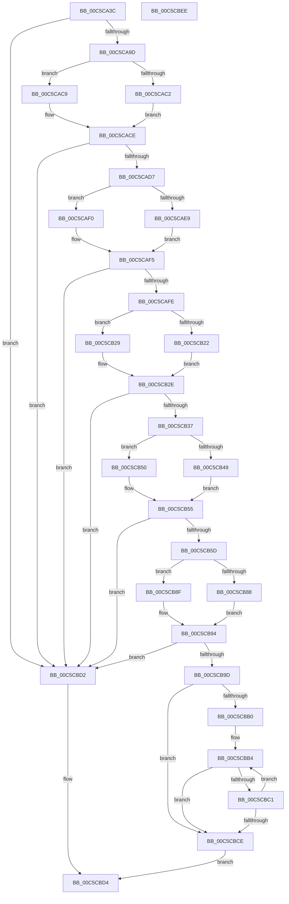

# CmpGetStateSepKeysRedirectionPathValue

- RVA: `0x00C5CA3C`–`0x00C5CBEF` (길이 `435` bytes)
- VA: `0x0000000140C5CA3C`
- 실행 섹션: `INIT`
- PDB 이름 있음: `예`; PDB Function 태그: `아니요`
- unwind 정보 RVA: `0x000D71D4`
- 디코드: `120`개 명령, `435/435` bytes 표시
- 미해석 바이트: `0` (있으면 어셈블리에 `.byte`로 보존)

> 이 문서는 커널 이미지의 기계어와 PDB 기호를 분석해 생성했습니다. 4번과 5번은 함수 원형과 자료형을 바이너리 사용 방식에서 추정한 C 해석이며 원본 소스 복구 결과는 아닙니다.

## 1. Dependencies

- 직접 호출 지점: **14**; 고유 호출 대상: **8**
- 직접 호출자로 확인된 함수: **1**
- RIP 상대 이미지 참조: **2**

### Outgoing calls
- `0x00C5CA90` → [CmpFindStateSepKeysRedirectionMapNode](CmpFindStateSepKeysRedirectionMapNode_function_00C5C554.md) (function, `0x00C5C554`)
- `0x00C5CAAB` → [CmpFindSubKeyByName](../../page/A4/CmpFindSubKeyByName_function_00A49D58.md) (function, `0x00A49D58`)
- `0x00C5CAC2` → [HvpReleaseCellFlat](../../page/85/HvpReleaseCellFlat_function_0085CC20.md) (function, `0x0085CC20`)
- `0x00C5CAC9` → [HvpReleaseCellPaged](../../page/85/HvpReleaseCellPaged_function_00855F40.md) (function, `0x00855F40`)
- `0x00C5CAE9` → [HvpGetCellFlat](../../page/85/HvpGetCellFlat_function_00854C60.md) (function, `0x00854C60`)
- `0x00C5CAF0` → [HvpGetCellPaged](../../page/85/HvpGetCellPaged_function_00854CB0.md) (function, `0x00854CB0`)
- `0x00C5CB0B` → [CmpFindValueByName](../../page/84/CmpFindValueByName_function_00844E1C.md) (function, `0x00844E1C`)
- `0x00C5CB22` → [HvpReleaseCellFlat](../../page/85/HvpReleaseCellFlat_function_0085CC20.md) (function, `0x0085CC20`)
- `0x00C5CB29` → [HvpReleaseCellPaged](../../page/85/HvpReleaseCellPaged_function_00855F40.md) (function, `0x00855F40`)
- `0x00C5CB49` → [HvpGetCellFlat](../../page/85/HvpGetCellFlat_function_00854C60.md) (function, `0x00854C60`)
- `0x00C5CB50` → [HvpGetCellPaged](../../page/85/HvpGetCellPaged_function_00854CB0.md) (function, `0x00854CB0`)
- `0x00C5CB6F` → [CmpValueToData](../../page/7F/CmpValueToData_function_007F3934.md) (function, `0x007F3934`)
- `0x00C5CB88` → [HvpReleaseCellFlat](../../page/85/HvpReleaseCellFlat_function_0085CC20.md) (function, `0x0085CC20`)
- `0x00C5CB8F` → [HvpReleaseCellPaged](../../page/85/HvpReleaseCellPaged_function_00855F40.md) (function, `0x00855F40`)

### Direct callers
- [CmpFindRedirectedDriverServiceStateNode](CmpFindRedirectedDriverServiceStateNode_function_00C5C480.md) at `0x00C5C4C4`

### Static image references
- `0x00C5CAA1` → RVA `0x00C82250` (`CmpDriverStateSourceIdName`; read)
- `0x00C5CAFE` → RVA `0x00C822E0` (`CmpTargetNtPathString`; read)

## 2. Other-region calls and transfers

- 다른 실행 섹션으로 향하는 call: **13**
  - `0x00C5CAAB` → [CmpFindSubKeyByName](../../page/A4/CmpFindSubKeyByName_function_00A49D58.md) (`INIT` → `PAGE`)
  - `0x00C5CAC2` → [HvpReleaseCellFlat](../../page/85/HvpReleaseCellFlat_function_0085CC20.md) (`INIT` → `PAGE`)
  - `0x00C5CAC9` → [HvpReleaseCellPaged](../../page/85/HvpReleaseCellPaged_function_00855F40.md) (`INIT` → `PAGE`)
  - `0x00C5CAE9` → [HvpGetCellFlat](../../page/85/HvpGetCellFlat_function_00854C60.md) (`INIT` → `PAGE`)
  - `0x00C5CAF0` → [HvpGetCellPaged](../../page/85/HvpGetCellPaged_function_00854CB0.md) (`INIT` → `PAGE`)
  - `0x00C5CB0B` → [CmpFindValueByName](../../page/84/CmpFindValueByName_function_00844E1C.md) (`INIT` → `PAGE`)
  - `0x00C5CB22` → [HvpReleaseCellFlat](../../page/85/HvpReleaseCellFlat_function_0085CC20.md) (`INIT` → `PAGE`)
  - `0x00C5CB29` → [HvpReleaseCellPaged](../../page/85/HvpReleaseCellPaged_function_00855F40.md) (`INIT` → `PAGE`)
  - `0x00C5CB49` → [HvpGetCellFlat](../../page/85/HvpGetCellFlat_function_00854C60.md) (`INIT` → `PAGE`)
  - `0x00C5CB50` → [HvpGetCellPaged](../../page/85/HvpGetCellPaged_function_00854CB0.md) (`INIT` → `PAGE`)
  - `0x00C5CB6F` → [CmpValueToData](../../page/7F/CmpValueToData_function_007F3934.md) (`INIT` → `PAGE`)
  - `0x00C5CB88` → [HvpReleaseCellFlat](../../page/85/HvpReleaseCellFlat_function_0085CC20.md) (`INIT` → `PAGE`)
  - `0x00C5CB8F` → [HvpReleaseCellPaged](../../page/85/HvpReleaseCellPaged_function_00855F40.md) (`INIT` → `PAGE`)
- 별도 외부 분기/꼬리 이동을 확인하지 못했습니다.

## 3. Assembly (complete function range)

```asm
00C5CA3C  48 8B C4                        mov rax, rsp
00C5CA3F  48 89 58 08                     mov qword ptr [rax + 8], rbx
00C5CA43  48 89 70 10                     mov qword ptr [rax + 0x10], rsi
00C5CA47  48 89 78 20                     mov qword ptr [rax + 0x20], rdi
00C5CA4B  4C 89 40 18                     mov qword ptr [rax + 0x18], r8
00C5CA4F  55                              push rbp
00C5CA50  41 54                           push r12
00C5CA52  41 56                           push r14
00C5CA54  48 8B EC                        mov rbp, rsp
00C5CA57  48 83 EC 50                     sub rsp, 0x50
00C5CA5B  45 33 F6                        xor r14d, r14d
00C5CA5E  4C 8D 45 F8                     lea r8, [rbp - 8]
00C5CA62  41 83 CC FF                     or r12d, 0xffffffff
00C5CA66  4C 89 75 F8                     mov qword ptr [rbp - 8], r14
00C5CA6A  49 8B F1                        mov rsi, r9
00C5CA6D  44 89 65 F0                     mov dword ptr [rbp - 0x10], r12d
00C5CA71  4C 8D 4D F0                     lea r9, [rbp - 0x10]
00C5CA75  44 89 75 F4                     mov dword ptr [rbp - 0xc], r14d
00C5CA79  44 89 65 E0                     mov dword ptr [rbp - 0x20], r12d
00C5CA7D  48 8B D9                        mov rbx, rcx
00C5CA80  44 89 75 E4                     mov dword ptr [rbp - 0x1c], r14d
00C5CA84  44 89 65 E8                     mov dword ptr [rbp - 0x18], r12d
00C5CA88  44 89 75 EC                     mov dword ptr [rbp - 0x14], r14d
00C5CA8C  44 89 75 30                     mov dword ptr [rbp + 0x30], r14d
00C5CA90  E8 BF FA FF FF                  call 0x140c5c554
00C5CA95  84 C0                           test al, al
00C5CA97  0F 84 35 01 00 00               je 0x140c5cbd2
00C5CA9D  48 8B 55 F8                     mov rdx, qword ptr [rbp - 8]
00C5CAA1  4C 8D 05 A8 57 02 00            lea r8, [rip + 0x257a8]
00C5CAA8  48 8B CB                        mov rcx, rbx
00C5CAAB  E8 A8 D2 DE FF                  call 0x140a49d58
00C5CAB0  F6 83 8C 00 00 00 01            test byte ptr [rbx + 0x8c], 1
00C5CAB7  48 8D 55 F0                     lea rdx, [rbp - 0x10]
00C5CABB  8B F8                           mov edi, eax
00C5CABD  48 8B CB                        mov rcx, rbx
00C5CAC0  74 07                           je 0x140c5cac9
00C5CAC2  E8 59 01 C0 FF                  call 0x14085cc20
00C5CAC7  EB 05                           jmp 0x140c5cace
00C5CAC9  E8 72 94 BF FF                  call 0x140855f40
00C5CACE  41 3B FC                        cmp edi, r12d
00C5CAD1  0F 84 FB 00 00 00               je 0x140c5cbd2
00C5CAD7  F6 83 8C 00 00 00 01            test byte ptr [rbx + 0x8c], 1
00C5CADE  4C 8D 45 E0                     lea r8, [rbp - 0x20]
00C5CAE2  8B D7                           mov edx, edi
00C5CAE4  48 8B CB                        mov rcx, rbx
00C5CAE7  74 07                           je 0x140c5caf0
00C5CAE9  E8 72 81 BF FF                  call 0x140854c60
00C5CAEE  EB 05                           jmp 0x140c5caf5
00C5CAF0  E8 BB 81 BF FF                  call 0x140854cb0
00C5CAF5  48 85 C0                        test rax, rax
00C5CAF8  0F 84 D4 00 00 00               je 0x140c5cbd2
00C5CAFE  4C 8D 05 DB 57 02 00            lea r8, [rip + 0x257db]
00C5CB05  48 8B D0                        mov rdx, rax
00C5CB08  48 8B CB                        mov rcx, rbx
00C5CB0B  E8 0C 83 BE FF                  call 0x140844e1c
00C5CB10  F6 83 8C 00 00 00 01            test byte ptr [rbx + 0x8c], 1
00C5CB17  48 8D 55 E0                     lea rdx, [rbp - 0x20]
00C5CB1B  8B F8                           mov edi, eax
00C5CB1D  48 8B CB                        mov rcx, rbx
00C5CB20  74 07                           je 0x140c5cb29
00C5CB22  E8 F9 00 C0 FF                  call 0x14085cc20
00C5CB27  EB 05                           jmp 0x140c5cb2e
00C5CB29  E8 12 94 BF FF                  call 0x140855f40
00C5CB2E  41 3B FC                        cmp edi, r12d
00C5CB31  0F 84 9B 00 00 00               je 0x140c5cbd2
00C5CB37  F6 83 8C 00 00 00 01            test byte ptr [rbx + 0x8c], 1
00C5CB3E  4C 8D 45 E8                     lea r8, [rbp - 0x18]
00C5CB42  8B D7                           mov edx, edi
00C5CB44  48 8B CB                        mov rcx, rbx
00C5CB47  74 07                           je 0x140c5cb50
00C5CB49  E8 12 81 BF FF                  call 0x140854c60
00C5CB4E  EB 05                           jmp 0x140c5cb55
00C5CB50  E8 5B 81 BF FF                  call 0x140854cb0
00C5CB55  4C 8B C0                        mov r8, rax
00C5CB58  48 85 C0                        test rax, rax
00C5CB5B  74 75                           je 0x140c5cbd2
00C5CB5D  48 8B 45 40                     mov rax, qword ptr [rbp + 0x40]
00C5CB61  4C 8D 4D 30                     lea r9, [rbp + 0x30]
00C5CB65  8B D7                           mov edx, edi
00C5CB67  48 89 44 24 20                  mov qword ptr [rsp + 0x20], rax
00C5CB6C  48 8B CB                        mov rcx, rbx
00C5CB6F  E8 C0 6D B9 FF                  call 0x1407f3934
00C5CB74  F6 83 8C 00 00 00 01            test byte ptr [rbx + 0x8c], 1
00C5CB7B  48 8D 55 E8                     lea rdx, [rbp - 0x18]
00C5CB7F  48 89 46 08                     mov qword ptr [rsi + 8], rax
00C5CB83  48 8B CB                        mov rcx, rbx
00C5CB86  74 07                           je 0x140c5cb8f
00C5CB88  E8 93 00 C0 FF                  call 0x14085cc20
00C5CB8D  EB 05                           jmp 0x140c5cb94
00C5CB8F  E8 AC 93 BF FF                  call 0x140855f40
00C5CB94  4C 8B 4E 08                     mov r9, qword ptr [rsi + 8]
00C5CB98  4D 85 C9                        test r9, r9
00C5CB9B  74 35                           je 0x140c5cbd2
00C5CB9D  44 8B 45 30                     mov r8d, dword ptr [rbp + 0x30]
00C5CBA1  66 44 89 46 02                  mov word ptr [rsi + 2], r8w
00C5CBA6  66 44 89 36                     mov word ptr [rsi], r14w
00C5CBAA  66 45 3B F0                     cmp r14w, r8w
00C5CBAE  73 1E                           jae 0x140c5cbce
00C5CBB0  41 0F B7 D6                     movzx edx, r14w
00C5CBB4  0F B7 CA                        movzx ecx, dx
00C5CBB7  48 D1 E9                        shr rcx, 1
00C5CBBA  66 45 39 34 49                  cmp word ptr [r9 + rcx*2], r14w
00C5CBBF  74 0D                           je 0x140c5cbce
00C5CBC1  66 83 C2 02                     add dx, 2
00C5CBC5  66 89 16                        mov word ptr [rsi], dx
00C5CBC8  66 41 3B D0                     cmp dx, r8w
00C5CBCC  72 E6                           jb 0x140c5cbb4
00C5CBCE  B0 01                           mov al, 1
00C5CBD0  EB 02                           jmp 0x140c5cbd4
00C5CBD2  32 C0                           xor al, al
00C5CBD4  4C 8D 5C 24 50                  lea r11, [rsp + 0x50]
00C5CBD9  49 8B 5B 20                     mov rbx, qword ptr [r11 + 0x20]
00C5CBDD  49 8B 73 28                     mov rsi, qword ptr [r11 + 0x28]
00C5CBE1  49 8B 7B 38                     mov rdi, qword ptr [r11 + 0x38]
00C5CBE5  49 8B E3                        mov rsp, r11
00C5CBE8  41 5E                           pop r14
00C5CBEA  41 5C                           pop r12
00C5CBEC  5D                              pop rbp
00C5CBED  C3                              ret
00C5CBEE  CC                              int3
```

## 4. C-style interpretation (structured pseudocode)

```c
__int64 __fastcall CmpGetStateSepKeysRedirectionPathValue(__int64 a1, __int64 a2, __int64 a3, __int64 a4, __int64 a5)
{
    __int64 result;
    __int64 v_r12;
    __int64 v_r14;
    __int64 v_rsp;
    unsigned __int64 v_stack_m18;
    unsigned __int64 v_stack_m20;
    unsigned int v_stack_m24;
    unsigned int v_stack_m28;
    unsigned int v_stack_m2C;
    unsigned int v_stack_m30;
    unsigned int v_stack_m34;
    unsigned int v_stack_m38;
    unsigned __int64 v_stack_m48;
    unsigned int v_stack_p18;

    *(unsigned __int64 *)(v_rsp + 8) = v_rbx;
    *(unsigned __int64 *)(v_rsp + 16) = v_rsi;
    *(unsigned __int64 *)(v_rsp + 32) = v_rdi;
    *(unsigned __int64 *)(v_rsp + 24) = a3;
    v_rsp = (v_rsp) - (80);
    v_r14 = 0;
    v_r12 = (unsigned int)((v_r12) | (0xFFFFFFFFULL));
    v_stack_m20 = 0;
    v_stack_m28 = (unsigned int)(v_r12);
    v_stack_m24 = 0;
    v_stack_m38 = (unsigned int)(v_r12);
    v_stack_m34 = 0;
    v_stack_m30 = (unsigned int)(v_r12);
    v_stack_m2C = 0;
    v_stack_p18 = 0;
    result = CmpFindStateSepKeysRedirectionMapNode(a1, a2, v_stack_m20, v_stack_m28);
    if ((unsigned __int8)(result) == 0) goto loc_00C5CBD2;
    result = CmpFindSubKeyByName(a1, v_stack_m20, v_rip + 153512, v_stack_m28);
    if (((*(unsigned __int8 *)(a1 + 140)) & (1)) == 0) goto loc_00C5CAC9;
    result = HvpReleaseCellFlat(a1, v_stack_m28, v_rip + 153512, v_stack_m28);
    goto loc_00C5CACE;
loc_00C5CAC9:
    result = HvpReleaseCellPaged(a1, v_stack_m28, v_rip + 153512, v_stack_m28);
loc_00C5CACE:
    if (((unsigned int)((unsigned int)((unsigned int)(result)))) == ((unsigned int)(v_r12))) goto loc_00C5CBD2;
    if (((*(unsigned __int8 *)(a1 + 140)) & (1)) == 0) goto loc_00C5CAF0;
    result = HvpGetCellFlat(a1, (unsigned int)((unsigned int)((unsigned int)((unsigned int)(result)))), v_stack_m38, v_stack_m28);
    goto loc_00C5CAF5;
loc_00C5CAF0:
    result = HvpGetCellPaged(a1, (unsigned int)((unsigned int)((unsigned int)((unsigned int)(result)))), v_stack_m38, v_stack_m28);
loc_00C5CAF5:
    if (result == 0) goto loc_00C5CBD2;
    result = CmpFindValueByName(a1, result, v_rip + 153563, v_stack_m28);
    if (((*(unsigned __int8 *)(a1 + 140)) & (1)) == 0) goto loc_00C5CB29;
    result = HvpReleaseCellFlat(a1, v_stack_m38, v_rip + 153563, v_stack_m28);
    goto loc_00C5CB2E;
loc_00C5CB29:
    result = HvpReleaseCellPaged(a1, v_stack_m38, v_rip + 153563, v_stack_m28);
loc_00C5CB2E:
    if (((unsigned int)((unsigned int)((unsigned int)(result)))) == ((unsigned int)(v_r12))) goto loc_00C5CBD2;
    if (((*(unsigned __int8 *)(a1 + 140)) & (1)) == 0) goto loc_00C5CB50;
    result = HvpGetCellFlat(a1, (unsigned int)((unsigned int)((unsigned int)((unsigned int)(result)))), v_stack_m30, v_stack_m28);
    goto loc_00C5CB55;
loc_00C5CB50:
    result = HvpGetCellPaged(a1, (unsigned int)((unsigned int)((unsigned int)((unsigned int)(result)))), v_stack_m30, v_stack_m28);
loc_00C5CB55:
    if (result == 0) goto loc_00C5CBD2;
    v_stack_m48 = a5;
    result = CmpValueToData(a1, (unsigned int)((unsigned int)((unsigned int)((unsigned int)(result)))), result, v_stack_p18);
    *(unsigned __int64 *)(a4 + 8) = result;
    if (((*(unsigned __int8 *)(a1 + 140)) & (1)) == 0) goto loc_00C5CB8F;
    result = HvpReleaseCellFlat(a1, v_stack_m30, result, v_stack_p18);
    goto loc_00C5CB94;
loc_00C5CB8F:
    result = HvpReleaseCellPaged(a1, v_stack_m30, result, v_stack_p18);
loc_00C5CB94:
    if (*(unsigned __int64 *)(a4 + 8) == 0) goto loc_00C5CBD2;
    *(unsigned __int16 *)(a4 + 2) = (unsigned __int16)((unsigned int)(v_stack_p18));
    *(unsigned __int16 *)(a4) = 0;
    if (0 >= ((unsigned __int16)((unsigned int)(v_stack_p18)))) goto loc_00C5CBCE;
loc_00C5CBB4:
    a1 = (0) >> (1);
    if ((*(unsigned __int16 *)(*(unsigned __int64 *)(a4 + 8) + a1 * 2)) == 0) goto loc_00C5CBCE;
    a2 = (unsigned __int16)((0) + (2));
    *(unsigned __int16 *)(a4) = (unsigned __int16)(a2);
    if (((unsigned __int16)(a2)) < ((unsigned __int16)((unsigned int)(v_stack_p18)))) goto loc_00C5CBB4;
loc_00C5CBCE:
    goto loc_00C5CBD4;
loc_00C5CBD2:
    result = 0;
loc_00C5CBD4:
    return result;
}
```

## 5. (Beta) C Style

```c
int64_t CmpGetStateSepKeysRedirectionPathValue(void *Arg1, int64_t Arg2, int64_t Arg3, void *Arg4, int64_t Arg5)
{
    uint8_t *arg1 = (uint8_t *)Arg1;
    uint8_t *arg4 = (uint8_t *)Arg4;

    int64_t result;
    int64_t local_r12;
    int64_t local_r14;
    int64_t local_rsp;
    uint64_t v_stack_m18;
    uint64_t v_stack_m20;
    uint32_t v_stack_m24;
    uint32_t v_stack_m28;
    uint32_t v_stack_m2C;
    uint32_t v_stack_m30;
    uint32_t v_stack_m34;
    uint32_t v_stack_m38;
    uint64_t v_stack_m48;
    uint32_t v_stack_p18;

    *(uint64_t *)(local_rsp + 0x8) = local_rbx;
    *(uint64_t *)(local_rsp + 0x10) = local_rsi;
    *(uint64_t *)(local_rsp + 0x20) = local_rdi;
    *(uint64_t *)(local_rsp + 0x18) = Arg3;
    local_rsp = (local_rsp) - (80);
    local_r14 = 0;
    local_r12 = (uint32_t)((local_r12) | (0xFFFFFFFFULL));
    v_stack_m20 = 0;
    v_stack_m28 = (uint32_t)(local_r12);
    v_stack_m24 = 0;
    v_stack_m38 = (uint32_t)(local_r12);
    v_stack_m34 = 0;
    v_stack_m30 = (uint32_t)(local_r12);
    v_stack_m2C = 0;
    v_stack_p18 = 0;
    result = CmpFindStateSepKeysRedirectionMapNode(Arg1, Arg2, v_stack_m20, v_stack_m28);
    if ((uint8_t)(result) == 0) goto loc_00C5CBD2;
    result = CmpFindSubKeyByName(Arg1, v_stack_m20, v_rip + 153512, v_stack_m28);
    if (((*(uint8_t *)(arg1 + 0x8C)) & (1)) == 0) goto loc_00C5CAC9;
    result = HvpReleaseCellFlat(Arg1, v_stack_m28, v_rip + 153512, v_stack_m28);
    goto loc_00C5CACE;
loc_00C5CAC9:
    result = HvpReleaseCellPaged(Arg1, v_stack_m28, v_rip + 153512, v_stack_m28);
loc_00C5CACE:
    if (((uint32_t)((uint32_t)((uint32_t)(result)))) == ((uint32_t)(local_r12))) goto loc_00C5CBD2;
    if (((*(uint8_t *)(arg1 + 0x8C)) & (1)) == 0) goto loc_00C5CAF0;
    result = HvpGetCellFlat(Arg1, (uint32_t)((uint32_t)((uint32_t)((uint32_t)(result)))), v_stack_m38, v_stack_m28);
    goto loc_00C5CAF5;
loc_00C5CAF0:
    result = HvpGetCellPaged(Arg1, (uint32_t)((uint32_t)((uint32_t)((uint32_t)(result)))), v_stack_m38, v_stack_m28);
loc_00C5CAF5:
    if (result == 0) goto loc_00C5CBD2;
    result = CmpFindValueByName(Arg1, result, v_rip + 153563, v_stack_m28);
    if (((*(uint8_t *)(arg1 + 0x8C)) & (1)) == 0) goto loc_00C5CB29;
    result = HvpReleaseCellFlat(Arg1, v_stack_m38, v_rip + 153563, v_stack_m28);
    goto loc_00C5CB2E;
loc_00C5CB29:
    result = HvpReleaseCellPaged(Arg1, v_stack_m38, v_rip + 153563, v_stack_m28);
loc_00C5CB2E:
    if (((uint32_t)((uint32_t)((uint32_t)(result)))) == ((uint32_t)(local_r12))) goto loc_00C5CBD2;
    if (((*(uint8_t *)(arg1 + 0x8C)) & (1)) == 0) goto loc_00C5CB50;
    result = HvpGetCellFlat(Arg1, (uint32_t)((uint32_t)((uint32_t)((uint32_t)(result)))), v_stack_m30, v_stack_m28);
    goto loc_00C5CB55;
loc_00C5CB50:
    result = HvpGetCellPaged(Arg1, (uint32_t)((uint32_t)((uint32_t)((uint32_t)(result)))), v_stack_m30, v_stack_m28);
loc_00C5CB55:
    if (result == 0) goto loc_00C5CBD2;
    v_stack_m48 = Arg5;
    result = CmpValueToData(Arg1, (uint32_t)((uint32_t)((uint32_t)((uint32_t)(result)))), result, v_stack_p18);
    *(uint64_t *)(arg4 + 0x8) = result;
    if (((*(uint8_t *)(arg1 + 0x8C)) & (1)) == 0) goto loc_00C5CB8F;
    result = HvpReleaseCellFlat(Arg1, v_stack_m30, result, v_stack_p18);
    goto loc_00C5CB94;
loc_00C5CB8F:
    result = HvpReleaseCellPaged(Arg1, v_stack_m30, result, v_stack_p18);
loc_00C5CB94:
    if (*(uint64_t *)(arg4 + 0x8) == 0) goto loc_00C5CBD2;
    *(uint16_t *)(arg4 + 0x2) = (uint16_t)((uint32_t)(v_stack_p18));
    *(uint16_t *)(arg4) = 0;
    if (0 >= ((uint16_t)((uint32_t)(v_stack_p18)))) goto loc_00C5CBCE;
loc_00C5CBB4:
    Arg1 = (0) >> (1);
    if ((*(uint16_t *)(*(uint64_t *)(arg4 + 0x8) + arg1 * 2)) == 0) goto loc_00C5CBCE;
    Arg2 = (uint16_t)((0) + (2));
    *(uint16_t *)(arg4) = (uint16_t)(Arg2);
    if (((uint16_t)(Arg2)) < ((uint16_t)((uint32_t)(v_stack_p18)))) goto loc_00C5CBB4;
loc_00C5CBCE:
    goto loc_00C5CBD4;
loc_00C5CBD2:
    result = 0;
loc_00C5CBD4:
    return result;
}
```

### 관측된 메모리 오프셋

구조체 형식이 확인되지 않은 접근은 인자 기준의 오프셋으로만 기록했습니다.

| 기준 인자 | 오프셋 표현 | 폭 (bit) | 접근 |
|---|---:|---:|---|
| `Arg1` | `+ 0x8C` | `8` | `R` |
| `Arg4` | `+ 0x0` | `16` | `W` |
| `Arg4` | `+ 0x2` | `16` | `W` |
| `Arg4` | `+ 0x8` | `64` | `R` |
| `Arg4` | `+ 0x8` | `64` | `W` |

## 6. Execution-region graph

[열기: 2D/3D 그래프와 함수 탐색 컨트롤 패널](../../../control-panel.html?section=init&rva=0x00C5CA3C&view=graph)

- 2D 그래프는 위에서 아래로 흐르고, 3D 그래프는 빈 공간을 드래그해 회전합니다. Shift+드래그는 이동, 휠은 확대·축소, 함수 노드 선택은 대상 보고서 이동입니다.

### Static fallback


