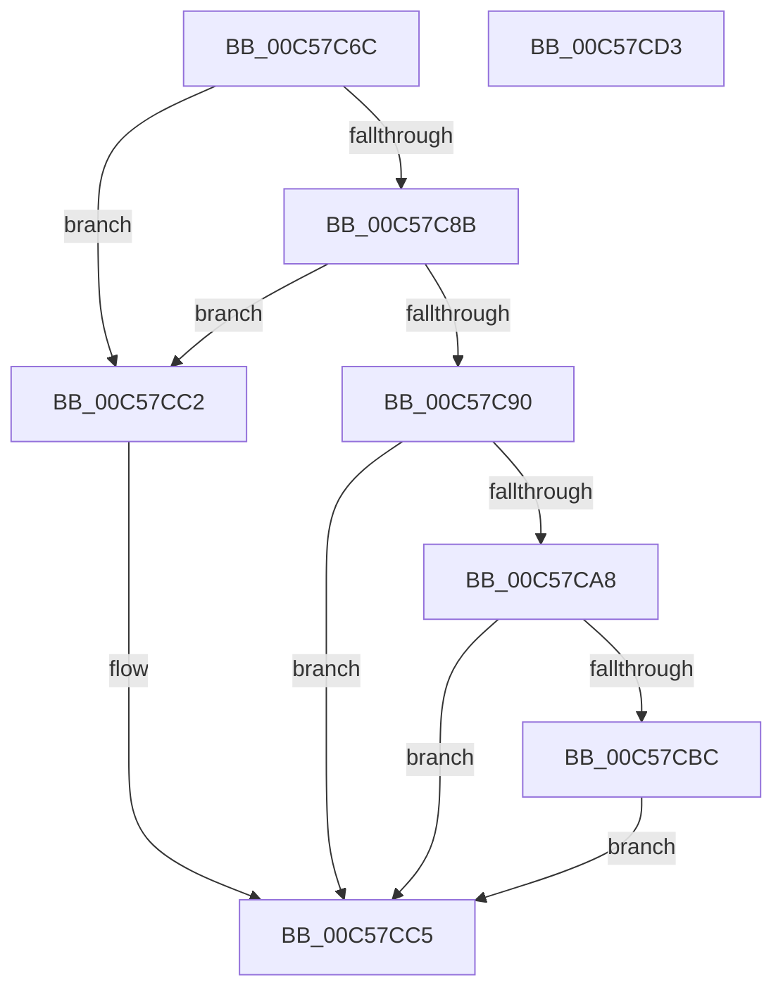

# CmpGetSystemRelativeRegistryHiveFilePath

- RVA: `0x00C57C6C`–`0x00C57CD4` (길이 `104` bytes)
- VA: `0x0000000140C57C6C`
- 실행 섹션: `INIT`
- PDB 이름 있음: `예`; PDB Function 태그: `아니요`
- unwind 정보 RVA: `0x0005CAAC`
- 디코드: `32`개 명령, `104/104` bytes 표시
- 미해석 바이트: `0` (있으면 어셈블리에 `.byte`로 보존)

> 이 문서는 커널 이미지의 기계어와 PDB 기호를 분석해 생성했습니다. 4번과 5번은 함수 원형과 자료형을 바이너리 사용 방식에서 추정한 C 해석이며 원본 소스 복구 결과는 아닙니다.

## 1. Dependencies

- 직접 호출 지점: **2**; 고유 호출 대상: **2**
- 직접 호출자로 확인된 함수: **2**
- RIP 상대 이미지 참조: **1**

### Outgoing calls
- `0x00C57C7E` → [wcsrchr](../../text/50/wcsrchr_function_00501E50.md) (function, `0x00501E50`)
- `0x00C57CB3` → [wcsnicmp](../../text/50/wcsnicmp_function_005001C0.md) (function, `0x005001C0`)

### Direct callers
- [CmpInitializeDriverStores](CmpInitializeDriverStores_function_00C57CF0.md) at `0x00C57F70`
- [CmpInitializePreloadedHive](CmpInitializePreloadedHive_function_00C58070.md) at `0x00C58108`

### Static image references
- `0x00C57CA8` → RVA `0x00C7E120` (` ?? ::PBOPGDP::`string'`; read)

## 2. Other-region calls and transfers

- 다른 실행 섹션으로 향하는 call: **2**
  - `0x00C57C7E` → [wcsrchr](../../text/50/wcsrchr_function_00501E50.md) (`INIT` → `.text`)
  - `0x00C57CB3` → [wcsnicmp](../../text/50/wcsnicmp_function_005001C0.md) (`INIT` → `.text`)
- 별도 외부 분기/꼬리 이동을 확인하지 못했습니다.

## 3. Assembly (complete function range)

```asm
00C57C6C  48 89 5C 24 08                  mov qword ptr [rsp + 8], rbx
00C57C71  57                              push rdi
00C57C72  48 83 EC 20                     sub rsp, 0x20
00C57C76  BA 5C 00 00 00                  mov edx, 0x5c
00C57C7B  48 8B F9                        mov rdi, rcx
00C57C7E  E8 CD A1 8A FF                  call 0x140501e50
00C57C83  48 8B D8                        mov rbx, rax
00C57C86  48 85 C0                        test rax, rax
00C57C89  74 37                           je 0x140c57cc2
00C57C8B  48 3B C7                        cmp rax, rdi
00C57C8E  76 32                           jbe 0x140c57cc2
00C57C90  48 8B D0                        mov rdx, rax
00C57C93  41 B8 11 00 00 00               mov r8d, 0x11
00C57C99  48 2B D7                        sub rdx, rdi
00C57C9C  48 83 C2 02                     add rdx, 2
00C57CA0  48 D1 FA                        sar rdx, 1
00C57CA3  49 3B D0                        cmp rdx, r8
00C57CA6  76 1D                           jbe 0x140c57cc5
00C57CA8  48 8D 15 71 64 02 00            lea rdx, [rip + 0x26471]
00C57CAF  48 8D 48 E0                     lea rcx, [rax - 0x20]
00C57CB3  E8 08 85 8A FF                  call 0x1405001c0
00C57CB8  85 C0                           test eax, eax
00C57CBA  75 09                           jne 0x140c57cc5
00C57CBC  48 83 C3 E0                     add rbx, -0x20
00C57CC0  EB 03                           jmp 0x140c57cc5
00C57CC2  48 8B DF                        mov rbx, rdi
00C57CC5  48 8B C3                        mov rax, rbx
00C57CC8  48 8B 5C 24 30                  mov rbx, qword ptr [rsp + 0x30]
00C57CCD  48 83 C4 20                     add rsp, 0x20
00C57CD1  5F                              pop rdi
00C57CD2  C3                              ret
00C57CD3  CC                              int3
```

## 4. C-style interpretation (structured pseudocode)

```c
__int64 __fastcall CmpGetSystemRelativeRegistryHiveFilePath(__int64 a1)
{
    __int64 result;
    __int64 v_rbx;
    __int64 v_rsp;
    unsigned __int64 v_stack_p8;

    v_stack_p8 = v_rbx;
    v_rsp = (v_rsp) - (32);
    result = wcsrchr(a1, 92, a3, a4);
    if (result == 0) goto loc_00C57CC2;
    if (result <= a1) goto loc_00C57CC2;
    a2 = (result) - (a1);
    a2 = (a2) + (2);
    a2 = (a2) >> (1);
    if (a2 <= 17) goto loc_00C57CC5;
    result = wcsnicmp(result - 32, v_rip + 156785, 17, a4);
    if ((unsigned int)(result) != 0) goto loc_00C57CC5;
    v_rbx = (result) + (-32);
    goto loc_00C57CC5;
loc_00C57CC2:
loc_00C57CC5:
    v_rsp = (v_rsp) + (32);
    return a1;
}
```

## 5. (Beta) C Style

```c
int64_t CmpGetSystemRelativeRegistryHiveFilePath(int64_t Arg1)
{
    int64_t result;
    int64_t local_rbx;
    int64_t local_rsp;
    uint64_t v_stack_p8;

    v_stack_p8 = local_rbx;
    local_rsp = (local_rsp) - (32);
    result = wcsrchr(Arg1, 92, a3, a4);
    if (result == 0) goto loc_00C57CC2;
    if (result <= Arg1) goto loc_00C57CC2;
    a2 = (result) - (Arg1);
    a2 = (a2) + (2);
    a2 = (a2) >> (1);
    if (a2 <= 17) goto loc_00C57CC5;
    result = wcsnicmp(result - 32, v_rip + 156785, 17, a4);
    if ((uint32_t)(result) != 0) goto loc_00C57CC5;
    local_rbx = (result) + (-32);
    goto loc_00C57CC5;
loc_00C57CC2:
loc_00C57CC5:
    local_rsp = (local_rsp) + (32);
    return Arg1;
}
```

## 6. Execution-region graph

[열기: 2D/3D 그래프와 함수 탐색 컨트롤 패널](../../../control-panel.html?section=init&rva=0x00C57C6C&view=graph)

- 2D 그래프는 위에서 아래로 흐르고, 3D 그래프는 빈 공간을 드래그해 회전합니다. Shift+드래그는 이동, 휠은 확대·축소, 함수 노드 선택은 대상 보고서 이동입니다.

### Static fallback


