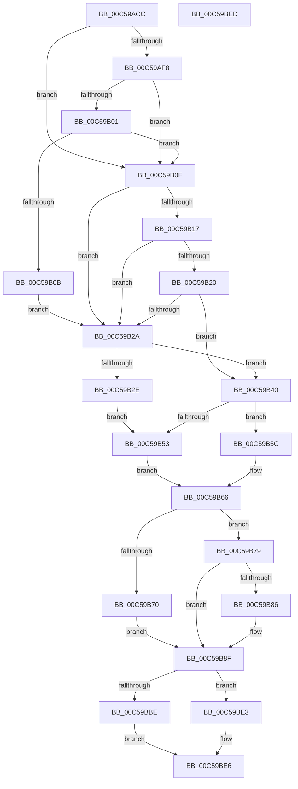

# CmpInitGlobalQuotaAllowed

- RVA: `0x00C59ACC`–`0x00C59BEE` (길이 `290` bytes)
- VA: `0x0000000140C59ACC`
- 실행 섹션: `INIT`
- PDB 이름 있음: `예`; PDB Function 태그: `아니요`
- unwind 정보 RVA: `0x000DB714`
- 디코드: `70`개 명령, `290/290` bytes 표시
- 미해석 바이트: `0` (있으면 어셈블리에 `.byte`로 보존)

> 이 문서는 커널 이미지의 기계어와 PDB 기호를 분석해 생성했습니다. 4번과 5번은 함수 원형과 자료형을 바이너리 사용 방식에서 추정한 C 해석이며 원본 소스 복구 결과는 아닙니다.

## 1. Dependencies

- 직접 호출 지점: **0**; 고유 호출 대상: **0**
- 직접 호출자로 확인된 함수: **1**
- RIP 상대 이미지 참조: **11**

### Outgoing calls
- 직접 디코드된 call 명령이 없습니다.

### Direct callers
- [CmInitSystem1](CmInitSystem1_function_00C559CC.md) at `0x00C55AEF`

### Static image references
- `0x00C59ACC` → RVA `0x00FC6F18` (`ALMOSTRO`; read)
- `0x00C59ADD` → RVA `0x00FD8104` (`PAGEDATA`; read)
- `0x00C59AE7` → RVA `0x00FD9C78` (`PAGEDATA`; write)
- `0x00C59AF8` → RVA `0x00FD8100` (`PAGEDATA`; read)
- `0x00C59B01` → RVA `0x00FD8120` (`PAGEDATA`; read)
- `0x00C59B47` → RVA `0x00FD9A65` (`PAGEDATA`; write)
- `0x00C59B53` → RVA `0x00FD8060` (`PAGEDATA`; write)
- `0x00C59BAD` → RVA `0x00EEFBA8` (`.data`; read)
- `0x00C59BB3` → RVA `0x00FD81C8` (`PAGEDATA`; write)
- `0x00C59BBE` → RVA `0x00E30088` (`.data`; read)
- `0x00C59BE6` → RVA `0x00EEFBA8` (`.data`; write)

## 2. Other-region calls and transfers

- 다른 실행 섹션으로 향하는 call: **0**
- 별도 외부 분기/꼬리 이동을 확인하지 못했습니다.

## 3. Assembly (complete function range)

```asm
00C59ACC  48 8B 0D 45 D4 36 00            mov rcx, qword ptr [rip + 0x36d445]
00C59AD3  48 B8 CD CC CC CC CC CC CC CC   movabs rax, 0xcccccccccccccccd
00C59ADD  44 8B 05 20 E6 37 00            mov r8d, dword ptr [rip + 0x37e620]
00C59AE4  48 F7 E1                        mul rcx
00C59AE7  48 89 0D 8A 01 38 00            mov qword ptr [rip + 0x38018a], rcx
00C59AEE  48 83 E2 F8                     and rdx, 0xfffffffffffffff8
00C59AF2  41 83 F8 04                     cmp r8d, 4
00C59AF6  75 17                           jne 0x140c59b0f
00C59AF8  44 39 05 01 E6 37 00            cmp dword ptr [rip + 0x37e601], r8d
00C59AFF  75 0E                           jne 0x140c59b0f
00C59B01  48 83 3D 17 E6 37 00 00         cmp qword ptr [rip + 0x37e617], 0
00C59B09  74 04                           je 0x140c59b0f
00C59B0B  B0 01                           mov al, 1
00C59B0D  EB 1B                           jmp 0x140c59b2a
00C59B0F  32 C0                           xor al, al
00C59B11  41 83 F8 08                     cmp r8d, 8
00C59B15  75 13                           jne 0x140c59b2a
00C59B17  83 3D E2 E5 37 00 0B            cmp dword ptr [rip + 0x37e5e2], 0xb
00C59B1E  75 0A                           jne 0x140c59b2a
00C59B20  48 83 3D F8 E5 37 00 00         cmp qword ptr [rip + 0x37e5f8], 0
00C59B28  75 16                           jne 0x140c59b40
00C59B2A  84 C0                           test al, al
00C59B2C  75 12                           jne 0x140c59b40
00C59B2E  48 B8 AB AA AA AA AA AA AA AA   movabs rax, 0xaaaaaaaaaaaaaaab
00C59B38  48 F7 E1                        mul rcx
00C59B3B  48 D1 EA                        shr rdx, 1
00C59B3E  EB 13                           jmp 0x140c59b53
00C59B40  48 8B 05 D9 E5 37 00            mov rax, qword ptr [rip + 0x37e5d9]
00C59B47  C6 05 17 FF 37 00 01            mov byte ptr [rip + 0x37ff17], 1
00C59B4E  48 3B C2                        cmp rax, rdx
00C59B51  72 09                           jb 0x140c59b5c
00C59B53  48 89 15 06 E5 37 00            mov qword ptr [rip + 0x37e506], rdx
00C59B5A  EB 0A                           jmp 0x140c59b66
00C59B5C  48 89 05 FD E4 37 00            mov qword ptr [rip + 0x37e4fd], rax
00C59B63  48 8B D0                        mov rdx, rax
00C59B66  B9 FF FF FF FF                  mov ecx, 0xffffffff
00C59B6B  48 3B D1                        cmp rdx, rcx
00C59B6E  76 09                           jbe 0x140c59b79
00C59B70  48 89 0D E9 E4 37 00            mov qword ptr [rip + 0x37e4e9], rcx
00C59B77  EB 16                           jmp 0x140c59b8f
00C59B79  B8 00 00 00 01                  mov eax, 0x1000000
00C59B7E  48 8B CA                        mov rcx, rdx
00C59B81  48 3B D0                        cmp rdx, rax
00C59B84  73 09                           jae 0x140c59b8f
00C59B86  48 89 05 D3 E4 37 00            mov qword ptr [rip + 0x37e4d3], rax
00C59B8D  8B C8                           mov ecx, eax
00C59B8F  48 B8 15 AE 47 E1 7A 14 AE 47   movabs rax, 0x47ae147ae147ae15
00C59B99  48 F7 E1                        mul rcx
00C59B9C  48 2B CA                        sub rcx, rdx
00C59B9F  48 D1 E9                        shr rcx, 1
00C59BA2  48 03 CA                        add rcx, rdx
00C59BA5  48 C1 E9 06                     shr rcx, 6
00C59BA9  48 6B C1 5F                     imul rax, rcx, 0x5f
00C59BAD  8B 0D F5 5F 29 00               mov ecx, dword ptr [rip + 0x295ff5]
00C59BB3  48 89 05 0E E6 37 00            mov qword ptr [rip + 0x37e60e], rax
00C59BBA  85 C9                           test ecx, ecx
00C59BBC  75 25                           jne 0x140c59be3
00C59BBE  48 8B 05 C3 64 1D 00            mov rax, qword ptr [rip + 0x1d64c3]
00C59BC5  48 8B 08                        mov rcx, qword ptr [rax]
00C59BC8  48 8B 81 50 48 00 00            mov rax, qword ptr [rcx + 0x4850]
00C59BCF  B9 00 00 06 00                  mov ecx, 0x60000
00C59BD4  48 D1 E8                        shr rax, 1
00C59BD7  48 3B C1                        cmp rax, rcx
00C59BDA  48 0F 42 C8                     cmovb rcx, rax
00C59BDE  C1 E1 0C                        shl ecx, 0xc
00C59BE1  EB 03                           jmp 0x140c59be6
00C59BE3  C1 E1 14                        shl ecx, 0x14
00C59BE6  89 0D BC 5F 29 00               mov dword ptr [rip + 0x295fbc], ecx
00C59BEC  C3                              ret
00C59BED  CC                              int3
```

## 4. C-style interpretation (structured pseudocode)

```c
__int64 __fastcall CmpInitGlobalQuotaAllowed(__int64 a1, __int64 a2)
{
    __int64 result;

    *(unsigned __int64 *)(v_rip + 3670410) = *(unsigned __int64 *)(v_rip + 3593285);
    a2 = (a2) & (-8);
    if (((unsigned int)((unsigned int)(*(unsigned int *)(v_rip + 3663392)))) != 4) goto loc_00C59B0F;
    if ((*(unsigned int *)(v_rip + 3663361)) != ((unsigned int)((unsigned int)(*(unsigned int *)(v_rip + 3663392))))) goto loc_00C59B0F;
    if ((*(unsigned __int64 *)(v_rip + 3663383)) == 0) goto loc_00C59B0F;
    goto loc_00C59B2A;
loc_00C59B0F:
    result = 0;
    if (((unsigned int)((unsigned int)(*(unsigned int *)(v_rip + 3663392)))) != 8) goto loc_00C59B2A;
    if ((*(unsigned int *)(v_rip + 3663330)) != 11) goto loc_00C59B2A;
    if ((*(unsigned __int64 *)(v_rip + 3663352)) != 0) goto loc_00C59B40;
loc_00C59B2A:
    if (0 != 0) goto loc_00C59B40;
    a2 = (a2) >> (1);
    goto loc_00C59B53;
loc_00C59B40:
    *(unsigned __int8 *)(v_rip + 3669783) = 1;
    if ((*(unsigned __int64 *)(v_rip + 3663321)) < a2) goto loc_00C59B5C;
loc_00C59B53:
    *(unsigned __int64 *)(v_rip + 3663110) = a2;
    goto loc_00C59B66;
loc_00C59B5C:
    *(unsigned __int64 *)(v_rip + 3663101) = *(unsigned __int64 *)(v_rip + 3663321);
loc_00C59B66:
    if ((*(unsigned __int64 *)(v_rip + 3663321)) <= ((unsigned int)(0xFFFFFFFFULL))) goto loc_00C59B79;
    *(unsigned __int64 *)(v_rip + 3663081) = (unsigned int)(0xFFFFFFFFULL);
    goto loc_00C59B8F;
loc_00C59B79:
    if ((*(unsigned __int64 *)(v_rip + 3663321)) < ((unsigned int)(0x1000000ULL))) {
        *(unsigned __int64 *)(v_rip + 3663059) = (unsigned int)(0x1000000ULL);
        a1 = (unsigned int)((unsigned int)(0x1000000ULL));
    }
    a1 = (a1) - (*(unsigned __int64 *)(v_rip + 3663321));
    a1 = (a1) >> (1);
    a1 = (a1) + (*(unsigned __int64 *)(v_rip + 3663321));
    a1 = (a1) >> (6);
    result = ((unsigned int)(0x1000000ULL)) * (a1);
    *(unsigned __int64 *)(v_rip + 3663374) = result;
    if ((unsigned int)((unsigned int)(*(unsigned int *)(v_rip + 2711541))) != 0) goto loc_00C59BE3;
    result = (*(unsigned __int64 *)(*(unsigned __int64 *)(*(unsigned __int64 *)(v_rip + 1926339)) + 18512)) >> (1);
    a1 = (unsigned int)(0x60000ULL);
    if (result < ((unsigned int)(0x60000ULL))) { a1 = result; }
    a1 = (unsigned int)((a1) << (12));
    goto loc_00C59BE6;
loc_00C59BE3:
    a1 = (unsigned int)((a1) << (20));
loc_00C59BE6:
    *(unsigned int *)(v_rip + 2711484) = (unsigned int)(a1);
    return result;
}
```

## 5. (Beta) C Style

```c
int64_t CmpInitGlobalQuotaAllowed(int64_t Arg1, int64_t Arg2)
{
    int64_t result;

    *(uint64_t *)(v_rip + 0x38018A) = *(uint64_t *)(v_rip + 0x36D445);
    Arg2 = (Arg2) & (-8);
    if (((uint32_t)((uint32_t)(*(uint32_t *)(v_rip + 0x37E620)))) != 4) goto loc_00C59B0F;
    if ((*(uint32_t *)(v_rip + 0x37E601)) != ((uint32_t)((uint32_t)(*(uint32_t *)(v_rip + 0x37E620))))) goto loc_00C59B0F;
    if ((*(uint64_t *)(v_rip + 0x37E617)) == 0) goto loc_00C59B0F;
    goto loc_00C59B2A;
loc_00C59B0F:
    result = 0;
    if (((uint32_t)((uint32_t)(*(uint32_t *)(v_rip + 0x37E620)))) != 8) goto loc_00C59B2A;
    if ((*(uint32_t *)(v_rip + 0x37E5E2)) != 11) goto loc_00C59B2A;
    if ((*(uint64_t *)(v_rip + 0x37E5F8)) != 0) goto loc_00C59B40;
loc_00C59B2A:
    if (0 != 0) goto loc_00C59B40;
    Arg2 = (Arg2) >> (1);
    goto loc_00C59B53;
loc_00C59B40:
    *(uint8_t *)(v_rip + 0x37FF17) = 1;
    if ((*(uint64_t *)(v_rip + 0x37E5D9)) < Arg2) goto loc_00C59B5C;
loc_00C59B53:
    *(uint64_t *)(v_rip + 0x37E506) = Arg2;
    goto loc_00C59B66;
loc_00C59B5C:
    *(uint64_t *)(v_rip + 0x37E4FD) = *(uint64_t *)(v_rip + 0x37E5D9);
loc_00C59B66:
    if ((*(uint64_t *)(v_rip + 0x37E5D9)) <= ((uint32_t)(0xFFFFFFFFULL))) goto loc_00C59B79;
    *(uint64_t *)(v_rip + 0x37E4E9) = (uint32_t)(0xFFFFFFFFULL);
    goto loc_00C59B8F;
loc_00C59B79:
    if ((*(uint64_t *)(v_rip + 0x37E5D9)) < ((uint32_t)(0x1000000ULL))) {
        *(uint64_t *)(v_rip + 0x37E4D3) = (uint32_t)(0x1000000ULL);
        Arg1 = (uint32_t)((uint32_t)(0x1000000ULL));
    }
    Arg1 = (Arg1) - (*(uint64_t *)(v_rip + 0x37E5D9));
    Arg1 = (Arg1) >> (1);
    Arg1 = (Arg1) + (*(uint64_t *)(v_rip + 0x37E5D9));
    Arg1 = (Arg1) >> (6);
    result = ((uint32_t)(0x1000000ULL)) * (Arg1);
    *(uint64_t *)(v_rip + 0x37E60E) = result;
    if ((uint32_t)((uint32_t)(*(uint32_t *)(v_rip + 0x295FF5))) != 0) goto loc_00C59BE3;
    result = (*(uint64_t *)(*(uint64_t *)(*(uint64_t *)(v_rip + 0x1D64C3)) + 0x4850)) >> (1);
    Arg1 = (uint32_t)(0x60000ULL);
    if (result < ((uint32_t)(0x60000ULL))) { Arg1 = result; }
    Arg1 = (uint32_t)((Arg1) << (12));
    goto loc_00C59BE6;
loc_00C59BE3:
    Arg1 = (uint32_t)((Arg1) << (20));
loc_00C59BE6:
    *(uint32_t *)(v_rip + 0x295FBC) = (uint32_t)(Arg1);
    return result;
}
```

## 6. Execution-region graph

[열기: 2D/3D 그래프와 함수 탐색 컨트롤 패널](../../../control-panel.html?section=init&rva=0x00C59ACC&view=graph)

- 2D 그래프는 위에서 아래로 흐르고, 3D 그래프는 빈 공간을 드래그해 회전합니다. Shift+드래그는 이동, 휠은 확대·축소, 함수 노드 선택은 대상 보고서 이동입니다.

### Static fallback


