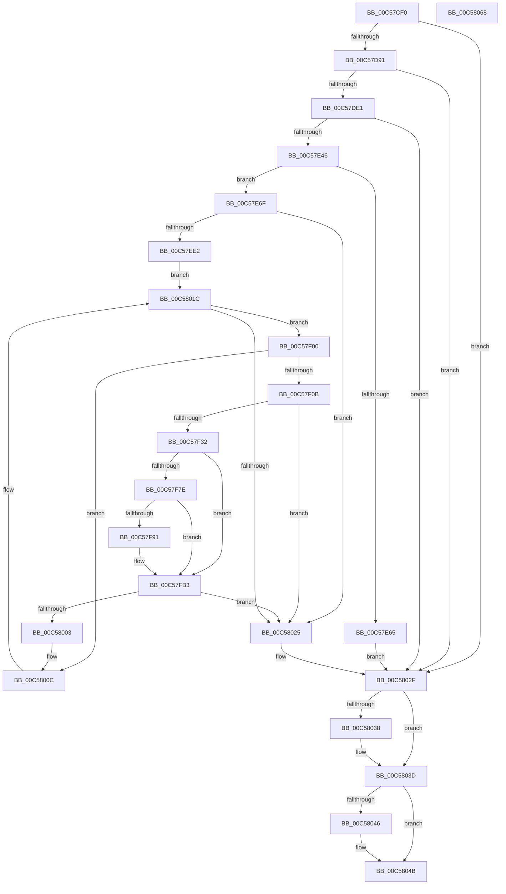

# CmpInitializeDriverStores

- RVA: `0x00C57CF0`–`0x00C58069` (길이 `889` bytes)
- VA: `0x0000000140C57CF0`
- 실행 섹션: `INIT`
- PDB 이름 있음: `예`; PDB Function 태그: `아니요`
- unwind 정보 RVA: `0x000C9420`
- 디코드: `223`개 명령, `889/889` bytes 표시
- 미해석 바이트: `0` (있으면 어셈블리에 `.byte`로 보존)

> 이 문서는 커널 이미지의 기계어와 PDB 기호를 분석해 생성했습니다. 4번과 5번은 함수 원형과 자료형을 바이너리 사용 방식에서 추정한 C 해석이며 원본 소스 복구 결과는 아닙니다.

## 1. Dependencies

- 직접 호출 지점: **25**; 고유 호출 대상: **12**
- 직접 호출자로 확인된 함수: **1**
- RIP 상대 이미지 참조: **8**

### Outgoing calls
- `0x00C57D41` → [RtlInitUnicodeString](../../text/42/RtlInitUnicodeString_function_0042A780.md) (function, `0x0042A780`)
- `0x00C57D82` → [ZwCreateDirectoryObject](../../text/6A/ZwCreateDirectoryObject_function_006AE650.md) (function, `0x006AE650`)
- `0x00C57D9C` → [RtlInitUnicodeString](../../text/42/RtlInitUnicodeString_function_0042A780.md) (function, `0x0042A780`)
- `0x00C57DD2` → [ZwCreateDirectoryObject](../../text/6A/ZwCreateDirectoryObject_function_006AE650.md) (function, `0x006AE650`)
- `0x00C57DEC` → [RtlInitUnicodeString](../../text/42/RtlInitUnicodeString_function_0042A780.md) (function, `0x0042A780`)
- `0x00C57E1F` → [RtlInitUnicodeString](../../text/42/RtlInitUnicodeString_function_0042A780.md) (function, `0x0042A780`)
- `0x00C57E37` → [ZwCreateSymbolicLinkObject](../../text/6A/ZwCreateSymbolicLinkObject_function_006AE9D0.md) (function, `0x006AE9D0`)
- `0x00C57E58` → [CmpAllocatePool](../../text/3C/CmpAllocatePool_function_003CD504.md) (function, `0x003CD504`)
- `0x00C57E89` → [RtlAppendUnicodeToString](../../text/40/RtlAppendUnicodeToString_function_0040F990.md) (function, `0x0040F990`)
- `0x00C57E99` → [RtlInitUnicodeString](../../text/42/RtlInitUnicodeString_function_0042A780.md) (function, `0x0042A780`)
- `0x00C57ED3` → [ZwCreateSymbolicLinkObject](../../text/6A/ZwCreateSymbolicLinkObject_function_006AE9D0.md) (function, `0x006AE9D0`)
- `0x00C57EE6` → [ZwClose](../../text/6A/ZwClose_function_006AD2B0.md) (function, `0x006AD2B0`)
- `0x00C57F13` → [RtlInitAnsiString](../../text/47/RtlInitAnsiString_function_00470F40.md) (function, `0x00470F40`)
- `0x00C57F23` → [RtlAnsiStringToUnicodeString](../../page/90/RtlAnsiStringToUnicodeString_function_0090BEA0.md) (function, `0x0090BEA0`)
- `0x00C57F51` → [RtlAppendUnicodeToString](../../text/40/RtlAppendUnicodeToString_function_0040F990.md) (function, `0x0040F990`)
- `0x00C57F5E` → [RtlAppendUnicodeStringToString](../../text/40/RtlAppendUnicodeStringToString_function_0040FA50.md) (function, `0x0040FA50`)
- `0x00C57F67` → [RtlFreeAnsiString](../../page/9C/RtlFreeAnsiString_function_009C0800.md) (function, `0x009C0800`)
- `0x00C57F70` → [CmpGetSystemRelativeRegistryHiveFilePath](CmpGetSystemRelativeRegistryHiveFilePath_function_00C57C6C.md) (function, `0x00C57C6C`)
- `0x00C57FAE` → [RtlAppendUnicodeStringToString](../../text/40/RtlAppendUnicodeStringToString_function_0040FA50.md) (function, `0x0040FA50`)
- `0x00C57FBB` → [RtlInitUnicodeString](../../text/42/RtlInitUnicodeString_function_0042A780.md) (function, `0x0042A780`)
- `0x00C57FF8` → [ZwCreateSymbolicLinkObject](../../text/6A/ZwCreateSymbolicLinkObject_function_006AE9D0.md) (function, `0x006AE9D0`)
- `0x00C58007` → [ZwClose](../../text/6A/ZwClose_function_006AD2B0.md) (function, `0x006AD2B0`)
- `0x00C5802A` → [ExFreePoolWithTag](../../poolcode/B8/ExFreePoolWithTag_function_00B82870.md) (function, `0x00B82870`)
- `0x00C58038` → [ZwClose](../../text/6A/ZwClose_function_006AD2B0.md) (function, `0x006AD2B0`)
- `0x00C58046` → [ZwClose](../../text/6A/ZwClose_function_006AD2B0.md) (function, `0x006AD2B0`)

### Direct callers
- [CmInitSystem1](CmInitSystem1_function_00C559CC.md) at `0x00C56260`

### Static image references
- `0x00C57D0D` → RVA `0x00C7E0D0` (` ?? ::PBOPGDP::`string'`; read)
- `0x00C57D56` → RVA `0x00FD9AA8` (`PAGEDATA`; read)
- `0x00C57D91` → RVA `0x00C7E0F0` (` ?? ::PBOPGDP::`string'`; read)
- `0x00C57DE1` → RVA `0x00C7E080` (` ?? ::PBOPGDP::`string'`; read)
- `0x00C57DFD` → RVA `0x00C7E0A0` (` ?? ::PBOPGDP::`string'`; read)
- `0x00C57E72` → RVA `0x00C79290` (` ?? ::PBOPGDP::`string'`; read)
- `0x00C57E8E` → RVA `0x00C7A7A0` (` ?? ::PBOPGDP::`string'`; read)
- `0x00C57F35` → RVA `0x00C7E030` (` ?? ::PBOPGDP::`string'`; read)

## 2. Other-region calls and transfers

- 다른 실행 섹션으로 향하는 call: **24**
  - `0x00C57D41` → [RtlInitUnicodeString](../../text/42/RtlInitUnicodeString_function_0042A780.md) (`INIT` → `.text`)
  - `0x00C57D82` → [ZwCreateDirectoryObject](../../text/6A/ZwCreateDirectoryObject_function_006AE650.md) (`INIT` → `.text`)
  - `0x00C57D9C` → [RtlInitUnicodeString](../../text/42/RtlInitUnicodeString_function_0042A780.md) (`INIT` → `.text`)
  - `0x00C57DD2` → [ZwCreateDirectoryObject](../../text/6A/ZwCreateDirectoryObject_function_006AE650.md) (`INIT` → `.text`)
  - `0x00C57DEC` → [RtlInitUnicodeString](../../text/42/RtlInitUnicodeString_function_0042A780.md) (`INIT` → `.text`)
  - `0x00C57E1F` → [RtlInitUnicodeString](../../text/42/RtlInitUnicodeString_function_0042A780.md) (`INIT` → `.text`)
  - `0x00C57E37` → [ZwCreateSymbolicLinkObject](../../text/6A/ZwCreateSymbolicLinkObject_function_006AE9D0.md) (`INIT` → `.text`)
  - `0x00C57E58` → [CmpAllocatePool](../../text/3C/CmpAllocatePool_function_003CD504.md) (`INIT` → `.text`)
  - `0x00C57E89` → [RtlAppendUnicodeToString](../../text/40/RtlAppendUnicodeToString_function_0040F990.md) (`INIT` → `.text`)
  - `0x00C57E99` → [RtlInitUnicodeString](../../text/42/RtlInitUnicodeString_function_0042A780.md) (`INIT` → `.text`)
  - `0x00C57ED3` → [ZwCreateSymbolicLinkObject](../../text/6A/ZwCreateSymbolicLinkObject_function_006AE9D0.md) (`INIT` → `.text`)
  - `0x00C57EE6` → [ZwClose](../../text/6A/ZwClose_function_006AD2B0.md) (`INIT` → `.text`)
  - `0x00C57F13` → [RtlInitAnsiString](../../text/47/RtlInitAnsiString_function_00470F40.md) (`INIT` → `.text`)
  - `0x00C57F23` → [RtlAnsiStringToUnicodeString](../../page/90/RtlAnsiStringToUnicodeString_function_0090BEA0.md) (`INIT` → `PAGE`)
  - `0x00C57F51` → [RtlAppendUnicodeToString](../../text/40/RtlAppendUnicodeToString_function_0040F990.md) (`INIT` → `.text`)
  - `0x00C57F5E` → [RtlAppendUnicodeStringToString](../../text/40/RtlAppendUnicodeStringToString_function_0040FA50.md) (`INIT` → `.text`)
  - `0x00C57F67` → [RtlFreeAnsiString](../../page/9C/RtlFreeAnsiString_function_009C0800.md) (`INIT` → `PAGE`)
  - `0x00C57FAE` → [RtlAppendUnicodeStringToString](../../text/40/RtlAppendUnicodeStringToString_function_0040FA50.md) (`INIT` → `.text`)
  - `0x00C57FBB` → [RtlInitUnicodeString](../../text/42/RtlInitUnicodeString_function_0042A780.md) (`INIT` → `.text`)
  - `0x00C57FF8` → [ZwCreateSymbolicLinkObject](../../text/6A/ZwCreateSymbolicLinkObject_function_006AE9D0.md) (`INIT` → `.text`)
  - `0x00C58007` → [ZwClose](../../text/6A/ZwClose_function_006AD2B0.md) (`INIT` → `.text`)
  - `0x00C5802A` → [ExFreePoolWithTag](../../poolcode/B8/ExFreePoolWithTag_function_00B82870.md) (`INIT` → `POOLCODE`)
  - `0x00C58038` → [ZwClose](../../text/6A/ZwClose_function_006AD2B0.md) (`INIT` → `.text`)
  - `0x00C58046` → [ZwClose](../../text/6A/ZwClose_function_006AD2B0.md) (`INIT` → `.text`)
- 별도 외부 분기/꼬리 이동을 확인하지 못했습니다.

## 3. Assembly (complete function range)

```asm
00C57CF0  48 89 5C 24 08                  mov qword ptr [rsp + 8], rbx
00C57CF5  55                              push rbp
00C57CF6  56                              push rsi
00C57CF7  57                              push rdi
00C57CF8  41 54                           push r12
00C57CFA  41 55                           push r13
00C57CFC  41 56                           push r14
00C57CFE  41 57                           push r15
00C57D00  48 8B EC                        mov rbp, rsp
00C57D03  48 81 EC 80 00 00 00            sub rsp, 0x80
00C57D0A  45 33 FF                        xor r15d, r15d
00C57D0D  48 8D 15 BC 63 02 00            lea rdx, [rip + 0x263bc]
00C57D14  0F 57 C0                        xorps xmm0, xmm0
00C57D17  44 89 7D D4                     mov dword ptr [rbp - 0x2c], r15d
00C57D1B  4C 8B F1                        mov r14, rcx
00C57D1E  44 89 7D EC                     mov dword ptr [rbp - 0x14], r15d
00C57D22  0F 57 C9                        xorps xmm1, xmm1
00C57D25  4C 89 7D 48                     mov qword ptr [rbp + 0x48], r15
00C57D29  48 8D 4D A0                     lea rcx, [rbp - 0x60]
00C57D2D  4C 89 7D 58                     mov qword ptr [rbp + 0x58], r15
00C57D31  0F 11 45 B0                     movups xmmword ptr [rbp - 0x50], xmm0
00C57D35  4C 89 7D 50                     mov qword ptr [rbp + 0x50], r15
00C57D39  0F 11 4D C0                     movups xmmword ptr [rbp - 0x40], xmm1
00C57D3D  0F 11 45 A0                     movups xmmword ptr [rbp - 0x60], xmm0
00C57D41  E8 3A 2A 7D FF                  call 0x14042a780
00C57D46  48 8D 45 A0                     lea rax, [rbp - 0x60]
00C57D4A  4C 89 7D D8                     mov qword ptr [rbp - 0x28], r15
00C57D4E  48 89 45 E0                     mov qword ptr [rbp - 0x20], rax
00C57D52  45 8D 67 30                     lea r12d, [r15 + 0x30]
00C57D56  48 8B 05 4B 1D 38 00            mov rax, qword ptr [rip + 0x381d4b]
00C57D5D  4C 8D 45 D0                     lea r8, [rbp - 0x30]
00C57D61  BF 0F 00 0F 00                  mov edi, 0xf000f
00C57D66  48 89 45 F0                     mov qword ptr [rbp - 0x10], rax
00C57D6A  41 BD 50 02 00 00               mov r13d, 0x250
00C57D70  44 89 65 D0                     mov dword ptr [rbp - 0x30], r12d
00C57D74  8B D7                           mov edx, edi
00C57D76  44 89 6D E8                     mov dword ptr [rbp - 0x18], r13d
00C57D7A  48 8D 4D 58                     lea rcx, [rbp + 0x58]
00C57D7E  4C 89 7D F8                     mov qword ptr [rbp - 8], r15
00C57D82  E8 C9 68 A5 FF                  call 0x1406ae650
00C57D87  8B D8                           mov ebx, eax
00C57D89  85 C0                           test eax, eax
00C57D8B  0F 88 9E 02 00 00               js 0x140c5802f
00C57D91  48 8D 15 58 63 02 00            lea rdx, [rip + 0x26358]
00C57D98  48 8D 4D A0                     lea rcx, [rbp - 0x60]
00C57D9C  E8 DF 29 7D FF                  call 0x14042a780
00C57DA1  48 8B 45 58                     mov rax, qword ptr [rbp + 0x58]
00C57DA5  4C 8D 45 D0                     lea r8, [rbp - 0x30]
00C57DA9  48 89 45 D8                     mov qword ptr [rbp - 0x28], rax
00C57DAD  48 8D 4D 50                     lea rcx, [rbp + 0x50]
00C57DB1  48 8D 45 A0                     lea rax, [rbp - 0x60]
00C57DB5  44 89 65 D0                     mov dword ptr [rbp - 0x30], r12d
00C57DB9  48 89 45 E0                     mov qword ptr [rbp - 0x20], rax
00C57DBD  8B D7                           mov edx, edi
00C57DBF  48 8B 05 E2 1C 38 00            mov rax, qword ptr [rip + 0x381ce2]
00C57DC6  48 89 45 F0                     mov qword ptr [rbp - 0x10], rax
00C57DCA  44 89 6D E8                     mov dword ptr [rbp - 0x18], r13d
00C57DCE  4C 89 7D F8                     mov qword ptr [rbp - 8], r15
00C57DD2  E8 79 68 A5 FF                  call 0x1406ae650
00C57DD7  8B D8                           mov ebx, eax
00C57DD9  85 C0                           test eax, eax
00C57DDB  0F 88 4E 02 00 00               js 0x140c5802f
00C57DE1  48 8D 15 98 62 02 00            lea rdx, [rip + 0x26298]
00C57DE8  48 8D 4D A0                     lea rcx, [rbp - 0x60]
00C57DEC  E8 8F 29 7D FF                  call 0x14042a780
00C57DF1  48 8D 45 A0                     lea rax, [rbp - 0x60]
00C57DF5  44 89 65 D0                     mov dword ptr [rbp - 0x30], r12d
00C57DF9  48 89 45 E0                     mov qword ptr [rbp - 0x20], rax
00C57DFD  48 8D 15 9C 62 02 00            lea rdx, [rip + 0x2629c]
00C57E04  48 8B 05 9D 1C 38 00            mov rax, qword ptr [rip + 0x381c9d]
00C57E0B  48 8D 4D B0                     lea rcx, [rbp - 0x50]
00C57E0F  48 89 45 F0                     mov qword ptr [rbp - 0x10], rax
00C57E13  4C 89 7D D8                     mov qword ptr [rbp - 0x28], r15
00C57E17  44 89 6D E8                     mov dword ptr [rbp - 0x18], r13d
00C57E1B  4C 89 7D F8                     mov qword ptr [rbp - 8], r15
00C57E1F  E8 5C 29 7D FF                  call 0x14042a780
00C57E24  BF 01 00 0F 00                  mov edi, 0xf0001
00C57E29  4C 8D 4D B0                     lea r9, [rbp - 0x50]
00C57E2D  8B D7                           mov edx, edi
00C57E2F  4C 8D 45 D0                     lea r8, [rbp - 0x30]
00C57E33  48 8D 4D 48                     lea rcx, [rbp + 0x48]
00C57E37  E8 94 6B A5 FF                  call 0x1406ae9d0
00C57E3C  8B D8                           mov ebx, eax
00C57E3E  85 C0                           test eax, eax
00C57E40  0F 88 E9 01 00 00               js 0x140c5802f
00C57E46  BB 00 10 00 00                  mov ebx, 0x1000
00C57E4B  41 B8 43 4D 20 20               mov r8d, 0x20204d43
00C57E51  8B D3                           mov edx, ebx
00C57E53  B9 00 01 00 00                  mov ecx, 0x100
00C57E58  E8 A7 56 77 FF                  call 0x1403cd504
00C57E5D  48 8B F0                        mov rsi, rax
00C57E60  48 85 C0                        test rax, rax
00C57E63  75 0A                           jne 0x140c57e6f
00C57E65  BB 9A 00 00 C0                  mov ebx, 0xc000009a
00C57E6A  E9 C0 01 00 00                  jmp 0x140c5802f
00C57E6F  0F 57 C0                        xorps xmm0, xmm0
00C57E72  48 8D 15 17 14 02 00            lea rdx, [rip + 0x21417]
00C57E79  0F 11 45 B0                     movups xmmword ptr [rbp - 0x50], xmm0
00C57E7D  48 8D 4D B0                     lea rcx, [rbp - 0x50]
00C57E81  66 89 5D B2                     mov word ptr [rbp - 0x4e], bx
00C57E85  48 89 75 B8                     mov qword ptr [rbp - 0x48], rsi
00C57E89  E8 02 7B 7B FF                  call 0x14040f990
00C57E8E  48 8D 15 0B 29 02 00            lea rdx, [rip + 0x2290b]
00C57E95  48 8D 4D A0                     lea rcx, [rbp - 0x60]
00C57E99  E8 E2 28 7D FF                  call 0x14042a780
00C57E9E  48 8B 45 50                     mov rax, qword ptr [rbp + 0x50]
00C57EA2  4C 8D 4D B0                     lea r9, [rbp - 0x50]
00C57EA6  48 89 45 D8                     mov qword ptr [rbp - 0x28], rax
00C57EAA  4C 8D 45 D0                     lea r8, [rbp - 0x30]
00C57EAE  48 8D 45 A0                     lea rax, [rbp - 0x60]
00C57EB2  44 89 65 D0                     mov dword ptr [rbp - 0x30], r12d
00C57EB6  48 89 45 E0                     mov qword ptr [rbp - 0x20], rax
00C57EBA  48 8D 4D 48                     lea rcx, [rbp + 0x48]
00C57EBE  48 8B 05 E3 1B 38 00            mov rax, qword ptr [rip + 0x381be3]
00C57EC5  8B D7                           mov edx, edi
00C57EC7  48 89 45 F0                     mov qword ptr [rbp - 0x10], rax
00C57ECB  44 89 6D E8                     mov dword ptr [rbp - 0x18], r13d
00C57ECF  4C 89 7D F8                     mov qword ptr [rbp - 8], r15
00C57ED3  E8 F8 6A A5 FF                  call 0x1406ae9d0
00C57ED8  8B D8                           mov ebx, eax
00C57EDA  85 C0                           test eax, eax
00C57EDC  0F 88 43 01 00 00               js 0x140c58025
00C57EE2  48 8B 4D 48                     mov rcx, qword ptr [rbp + 0x48]
00C57EE6  E8 C5 53 A5 FF                  call 0x1406ad2b0
00C57EEB  49 8B 86 F0 00 00 00            mov rax, qword ptr [r14 + 0xf0]
00C57EF2  48 05 38 01 00 00               add rax, 0x138
00C57EF8  48 8B 38                        mov rdi, qword ptr [rax]
00C57EFB  E9 1C 01 00 00                  jmp 0x140c5801c
00C57F00  8B 47 18                        mov eax, dword ptr [rdi + 0x18]
00C57F03  84 C0                           test al, al
00C57F05  0F 89 01 01 00 00               jns 0x140c5800c
00C57F0B  48 8B 57 58                     mov rdx, qword ptr [rdi + 0x58]
00C57F0F  48 8D 4D C0                     lea rcx, [rbp - 0x40]
00C57F13  E8 28 90 81 FF                  call 0x140470f40
00C57F18  41 B0 01                        mov r8b, 1
00C57F1B  48 8D 55 C0                     lea rdx, [rbp - 0x40]
00C57F1F  48 8D 4D A0                     lea rcx, [rbp - 0x60]
00C57F23  E8 78 3F CB FF                  call 0x14090bea0
00C57F28  8B D8                           mov ebx, eax
00C57F2A  85 C0                           test eax, eax
00C57F2C  0F 88 F3 00 00 00               js 0x140c58025
00C57F32  0F 57 C0                        xorps xmm0, xmm0
00C57F35  48 8D 15 F4 60 02 00            lea rdx, [rip + 0x260f4]
00C57F3C  0F 11 45 B0                     movups xmmword ptr [rbp - 0x50], xmm0
00C57F40  B8 00 10 00 00                  mov eax, 0x1000
00C57F45  48 89 75 B8                     mov qword ptr [rbp - 0x48], rsi
00C57F49  48 8D 4D B0                     lea rcx, [rbp - 0x50]
00C57F4D  66 89 45 B2                     mov word ptr [rbp - 0x4e], ax
00C57F51  E8 3A 7A 7B FF                  call 0x14040f990
00C57F56  48 8D 55 A0                     lea rdx, [rbp - 0x60]
00C57F5A  48 8D 4D B0                     lea rcx, [rbp - 0x50]
00C57F5E  E8 ED 7A 7B FF                  call 0x14040fa50
00C57F63  48 8D 4D A0                     lea rcx, [rbp - 0x60]
00C57F67  E8 94 88 D6 FF                  call 0x1409c0800
00C57F6C  48 8B 4F 10                     mov rcx, qword ptr [rdi + 0x10]
00C57F70  E8 F7 FC FF FF                  call 0x140c57c6c
00C57F75  48 8B 57 10                     mov rdx, qword ptr [rdi + 0x10]
00C57F79  48 3B C2                        cmp rax, rdx
00C57F7C  76 35                           jbe 0x140c57fb3
00C57F7E  48 8B C8                        mov rcx, rax
00C57F81  48 2B CA                        sub rcx, rdx
00C57F84  48 83 E1 FE                     and rcx, 0xfffffffffffffffe
00C57F88  48 81 F9 FE FF 01 00            cmp rcx, 0x1fffe
00C57F8F  7D 22                           jge 0x140c57fb3
00C57F91  48 89 55 A8                     mov qword ptr [rbp - 0x58], rdx
00C57F95  48 8D 4D B0                     lea rcx, [rbp - 0x50]
00C57F99  2B 47 10                        sub eax, dword ptr [rdi + 0x10]
00C57F9C  48 8D 55 A0                     lea rdx, [rbp - 0x60]
00C57FA0  48 D1 F8                        sar rax, 1
00C57FA3  66 03 C0                        add ax, ax
00C57FA6  66 89 45 A0                     mov word ptr [rbp - 0x60], ax
00C57FAA  66 89 45 A2                     mov word ptr [rbp - 0x5e], ax
00C57FAE  E8 9D 7A 7B FF                  call 0x14040fa50
00C57FB3  48 8B 57 30                     mov rdx, qword ptr [rdi + 0x30]
00C57FB7  48 8D 4D A0                     lea rcx, [rbp - 0x60]
00C57FBB  E8 C0 27 7D FF                  call 0x14042a780
00C57FC0  48 8B 45 50                     mov rax, qword ptr [rbp + 0x50]
00C57FC4  4C 8D 4D B0                     lea r9, [rbp - 0x50]
00C57FC8  48 89 45 D8                     mov qword ptr [rbp - 0x28], rax
00C57FCC  4C 8D 45 D0                     lea r8, [rbp - 0x30]
00C57FD0  48 8D 45 A0                     lea rax, [rbp - 0x60]
00C57FD4  44 89 65 D0                     mov dword ptr [rbp - 0x30], r12d
00C57FD8  48 89 45 E0                     mov qword ptr [rbp - 0x20], rax
00C57FDC  48 8D 4D 48                     lea rcx, [rbp + 0x48]
00C57FE0  48 8B 05 C1 1A 38 00            mov rax, qword ptr [rip + 0x381ac1]
00C57FE7  BA 01 00 0F 00                  mov edx, 0xf0001
00C57FEC  48 89 45 F0                     mov qword ptr [rbp - 0x10], rax
00C57FF0  44 89 6D E8                     mov dword ptr [rbp - 0x18], r13d
00C57FF4  4C 89 7D F8                     mov qword ptr [rbp - 8], r15
00C57FF8  E8 D3 69 A5 FF                  call 0x1406ae9d0
00C57FFD  8B D8                           mov ebx, eax
00C57FFF  85 C0                           test eax, eax
00C58001  78 22                           js 0x140c58025
00C58003  48 8B 4D 48                     mov rcx, qword ptr [rbp + 0x48]
00C58007  E8 A4 52 A5 FF                  call 0x1406ad2b0
00C5800C  49 8B 86 F0 00 00 00            mov rax, qword ptr [r14 + 0xf0]
00C58013  48 8B 3F                        mov rdi, qword ptr [rdi]
00C58016  48 05 38 01 00 00               add rax, 0x138
00C5801C  48 3B F8                        cmp rdi, rax
00C5801F  0F 85 DB FE FF FF               jne 0x140c57f00
00C58025  33 D2                           xor edx, edx
00C58027  48 8B CE                        mov rcx, rsi
00C5802A  E8 41 A8 F2 FF                  call 0x140b82870
00C5802F  48 8B 4D 50                     mov rcx, qword ptr [rbp + 0x50]
00C58033  48 85 C9                        test rcx, rcx
00C58036  74 05                           je 0x140c5803d
00C58038  E8 73 52 A5 FF                  call 0x1406ad2b0
00C5803D  48 8B 4D 58                     mov rcx, qword ptr [rbp + 0x58]
00C58041  48 85 C9                        test rcx, rcx
00C58044  74 05                           je 0x140c5804b
00C58046  E8 65 52 A5 FF                  call 0x1406ad2b0
00C5804B  8B C3                           mov eax, ebx
00C5804D  48 8B 9C 24 C0 00 00 00         mov rbx, qword ptr [rsp + 0xc0]
00C58055  48 81 C4 80 00 00 00            add rsp, 0x80
00C5805C  41 5F                           pop r15
00C5805E  41 5E                           pop r14
00C58060  41 5D                           pop r13
00C58062  41 5C                           pop r12
00C58064  5F                              pop rdi
00C58065  5E                              pop rsi
00C58066  5D                              pop rbp
00C58067  C3                              ret
00C58068  CC                              int3
```

## 4. C-style interpretation (structured pseudocode)

```c
__int64 __fastcall CmpInitializeDriverStores(__int64 a1)
{
    __int64 result;
    __int64 v_r15;
    __int64 v_rsp;
    unsigned __int64 v_stack_m40;
    unsigned __int64 v_stack_m48;
    unsigned int v_stack_m4C;
    unsigned int v_stack_m50;
    unsigned __int64 v_stack_m58;
    unsigned __int64 v_stack_m60;
    unsigned int v_stack_m64;
    unsigned __int64 v_stack_m68;
    unsigned __int64 v_stack_m78;
    unsigned __int64 v_stack_m80;
    unsigned __int16 v_stack_m86;
    unsigned __int64 v_stack_m88;
    unsigned __int64 v_stack_m90;
    unsigned __int16 v_stack_m96;
    unsigned __int64 v_stack_m98;
    unsigned __int64 v_stack_p10;
    unsigned __int64 v_stack_p18;
    unsigned __int64 v_stack_p20;
    unsigned __int64 v_stack_p8;

    v_stack_p8 = v_rbx;
    v_rsp = (v_rsp) - (128);
    v_r15 = 0;
    v_stack_m64 = 0;
    v_stack_m4C = 0;
    v_stack_p10 = 0;
    v_stack_p20 = 0;
    v_stack_m88 = v_xmm0;
    v_stack_p18 = 0;
    v_stack_m78 = v_xmm1;
    v_stack_m98 = v_xmm0;
    result = RtlInitUnicodeString(v_stack_m98, v_rip + 156604, a3, a4);
    v_stack_m60 = 0;
    v_stack_m58 = v_stack_m98;
    v_stack_m48 = *(unsigned __int64 *)(v_rip + 3677515);
    v_stack_m68 = (unsigned int)(v_r15 + 48);
    v_stack_m50 = 592;
    v_stack_m40 = 0;
    result = ZwCreateDirectoryObject(v_stack_p20, (unsigned int)((unsigned int)((unsigned int)(0xF000FULL))), v_stack_m68, a4);
    if (sign_flag) goto loc_00C5802F;
    result = RtlInitUnicodeString(v_stack_m98, v_rip + 156504, v_stack_m68, a4);
    v_stack_m60 = v_stack_p20;
    v_stack_m68 = (unsigned int)(v_r15 + 48);
    v_stack_m58 = v_stack_m98;
    v_stack_m48 = *(unsigned __int64 *)(v_rip + 3677410);
    v_stack_m50 = 592;
    v_stack_m40 = 0;
    result = ZwCreateDirectoryObject(v_stack_p18, (unsigned int)((unsigned int)((unsigned int)(0xF000FULL))), v_stack_m68, a4);
    if (sign_flag) goto loc_00C5802F;
    result = RtlInitUnicodeString(v_stack_m98, v_rip + 156312, v_stack_m68, a4);
    v_stack_m68 = (unsigned int)(v_r15 + 48);
    v_stack_m58 = v_stack_m98;
    v_stack_m48 = *(unsigned __int64 *)(v_rip + 3677341);
    v_stack_m60 = 0;
    v_stack_m50 = 592;
    v_stack_m40 = 0;
    result = RtlInitUnicodeString(v_stack_m88, v_rip + 156316, v_stack_m68, a4);
    result = ZwCreateSymbolicLinkObject(v_stack_p10, (unsigned int)((unsigned int)((unsigned int)(0xF0001ULL))), v_stack_m68, v_stack_m88);
    if (sign_flag) goto loc_00C5802F;
    result = CmpAllocatePool(256, (unsigned int)((unsigned int)((unsigned int)(0x1000ULL))), (unsigned int)(0x20204D43ULL), v_stack_m88);
    if (result != 0) goto loc_00C57E6F;
    goto loc_00C5802F;
loc_00C57E6F:
    v_stack_m88 = v_xmm0;
    v_stack_m86 = (unsigned __int16)((unsigned int)(0xC000009AULL));
    v_stack_m80 = result;
    result = RtlAppendUnicodeToString(v_stack_m88, v_rip + 136215, (unsigned int)(0x20204D43ULL), v_stack_m88);
    result = RtlInitUnicodeString(v_stack_m98, v_rip + 141579, (unsigned int)(0x20204D43ULL), v_stack_m88);
    v_stack_m60 = v_stack_p18;
    v_stack_m68 = (unsigned int)(v_r15 + 48);
    v_stack_m58 = v_stack_m98;
    v_stack_m48 = *(unsigned __int64 *)(v_rip + 3677155);
    v_stack_m50 = 592;
    v_stack_m40 = 0;
    result = ZwCreateSymbolicLinkObject(v_stack_p10, (unsigned int)((unsigned int)((unsigned int)(0xF0001ULL))), v_stack_m68, v_stack_m88);
    if (sign_flag) goto loc_00C58025;
    result = ZwClose(v_stack_p10, (unsigned int)((unsigned int)((unsigned int)(0xF0001ULL))), v_stack_m68, v_stack_m88);
    result = (*(unsigned __int64 *)(a1 + 240)) + (312);
    goto loc_00C5801C;
loc_00C57F00:
    if (!sign_flag) goto loc_00C5800C;
    result = RtlInitAnsiString(v_stack_m78, *(unsigned __int64 *)(*(unsigned __int64 *)(result) + 88), v_stack_m68, v_stack_m88);
    result = RtlAnsiStringToUnicodeString(v_stack_m98, v_stack_m78, 1, v_stack_m88);
    if (sign_flag) goto loc_00C58025;
    v_stack_m88 = v_xmm0;
    v_stack_m80 = result;
    v_stack_m86 = (unsigned __int16)((unsigned int)(0x1000ULL));
    result = RtlAppendUnicodeToString(v_stack_m88, v_rip + 155892, 1, v_stack_m88);
    result = RtlAppendUnicodeStringToString(v_stack_m88, v_stack_m98, 1, v_stack_m88);
    result = RtlFreeAnsiString(v_stack_m98, v_stack_m98, 1, v_stack_m88);
    result = CmpGetSystemRelativeRegistryHiveFilePath(*(unsigned __int64 *)(*(unsigned __int64 *)(result) + 16), v_stack_m98, 1, v_stack_m88);
    if (result <= (*(unsigned __int64 *)(*(unsigned __int64 *)(result) + 16))) goto loc_00C57FB3;
    a1 = (result) - (*(unsigned __int64 *)(*(unsigned __int64 *)(result) + 16));
    a1 = (a1) & (-2);
    if (a1 < 0x1FFFEULL) {
        v_stack_m90 = *(unsigned __int64 *)(*(unsigned __int64 *)(result) + 16);
        a1 = v_stack_m88;
        result = (unsigned int)((result) - (*(unsigned int *)(*(unsigned __int64 *)(result) + 16)));
        a2 = v_stack_m98;
        result = (result) >> (1);
        result = (unsigned __int16)((result) + ((unsigned __int16)(result)));
        v_stack_m98 = (unsigned __int16)(result);
        v_stack_m96 = (unsigned __int16)(result);
        result = RtlAppendUnicodeStringToString(a1, a2, 1, v_stack_m88);
    }
    result = RtlInitUnicodeString(v_stack_m98, *(unsigned __int64 *)(*(unsigned __int64 *)(result) + 48), 1, v_stack_m88);
    v_stack_m60 = v_stack_p18;
    v_stack_m68 = (unsigned int)(v_r15 + 48);
    v_stack_m58 = v_stack_m98;
    v_stack_m48 = *(unsigned __int64 *)(v_rip + 3676865);
    v_stack_m50 = 592;
    v_stack_m40 = 0;
    result = ZwCreateSymbolicLinkObject(v_stack_p10, (unsigned int)(0xF0001ULL), v_stack_m68, v_stack_m88);
    if (sign_flag) goto loc_00C58025;
    result = ZwClose(v_stack_p10, (unsigned int)(0xF0001ULL), v_stack_m68, v_stack_m88);
loc_00C5800C:
    result = (*(unsigned __int64 *)(a1 + 240)) + (312);
loc_00C5801C:
    if ((*(unsigned __int64 *)(*(unsigned __int64 *)(result))) != result) goto loc_00C57F00;
loc_00C58025:
    a2 = 0;
    result = ExFreePoolWithTag(result, a2, v_stack_m68, v_stack_m88);
loc_00C5802F:
    if (v_stack_p18 != 0) {
        result = ZwClose(v_stack_p18, a2, v_stack_m68, v_stack_m88);
    }
    if (v_stack_p20 != 0) {
        result = ZwClose(v_stack_p20, a2, v_stack_m68, v_stack_m88);
    }
    v_rsp = (v_rsp) + (128);
    return (unsigned int)((unsigned int)((unsigned int)((unsigned int)(result))));
}
```

## 5. (Beta) C Style

```c
int64_t CmpInitializeDriverStores(void *Arg1)
{
    uint8_t *arg1 = (uint8_t *)Arg1;

    int64_t result;
    int64_t local_r15;
    int64_t local_rsp;
    uint64_t v_stack_m40;
    uint64_t v_stack_m48;
    uint32_t v_stack_m4C;
    uint32_t v_stack_m50;
    uint64_t v_stack_m58;
    uint64_t v_stack_m60;
    uint32_t v_stack_m64;
    uint64_t v_stack_m68;
    uint64_t v_stack_m78;
    uint64_t v_stack_m80;
    uint16_t v_stack_m86;
    uint64_t v_stack_m88;
    uint64_t v_stack_m90;
    uint16_t v_stack_m96;
    uint64_t v_stack_m98;
    uint64_t v_stack_p10;
    uint64_t v_stack_p18;
    uint64_t v_stack_p20;
    uint64_t v_stack_p8;

    v_stack_p8 = local_rbx;
    local_rsp = (local_rsp) - (128);
    local_r15 = 0;
    v_stack_m64 = 0;
    v_stack_m4C = 0;
    v_stack_p10 = 0;
    v_stack_p20 = 0;
    v_stack_m88 = v_xmm0;
    v_stack_p18 = 0;
    v_stack_m78 = v_xmm1;
    v_stack_m98 = v_xmm0;
    result = RtlInitUnicodeString(v_stack_m98, v_rip + 156604, a3, a4);
    v_stack_m60 = 0;
    v_stack_m58 = v_stack_m98;
    v_stack_m48 = *(uint64_t *)(v_rip + 0x381D4B);
    v_stack_m68 = (uint32_t)(local_r15 + 48);
    v_stack_m50 = 592;
    v_stack_m40 = 0;
    result = ZwCreateDirectoryObject(v_stack_p20, (uint32_t)((uint32_t)((uint32_t)(0xF000FULL))), v_stack_m68, a4);
    if (sign_flag) goto loc_00C5802F;
    result = RtlInitUnicodeString(v_stack_m98, v_rip + 156504, v_stack_m68, a4);
    v_stack_m60 = v_stack_p20;
    v_stack_m68 = (uint32_t)(local_r15 + 48);
    v_stack_m58 = v_stack_m98;
    v_stack_m48 = *(uint64_t *)(v_rip + 0x381CE2);
    v_stack_m50 = 592;
    v_stack_m40 = 0;
    result = ZwCreateDirectoryObject(v_stack_p18, (uint32_t)((uint32_t)((uint32_t)(0xF000FULL))), v_stack_m68, a4);
    if (sign_flag) goto loc_00C5802F;
    result = RtlInitUnicodeString(v_stack_m98, v_rip + 156312, v_stack_m68, a4);
    v_stack_m68 = (uint32_t)(local_r15 + 48);
    v_stack_m58 = v_stack_m98;
    v_stack_m48 = *(uint64_t *)(v_rip + 0x381C9D);
    v_stack_m60 = 0;
    v_stack_m50 = 592;
    v_stack_m40 = 0;
    result = RtlInitUnicodeString(v_stack_m88, v_rip + 156316, v_stack_m68, a4);
    result = ZwCreateSymbolicLinkObject(v_stack_p10, (uint32_t)((uint32_t)((uint32_t)(0xF0001ULL))), v_stack_m68, v_stack_m88);
    if (sign_flag) goto loc_00C5802F;
    result = CmpAllocatePool(256, (uint32_t)((uint32_t)((uint32_t)(0x1000ULL))), (uint32_t)(0x20204D43ULL), v_stack_m88);
    if (result != 0) goto loc_00C57E6F;
    goto loc_00C5802F;
loc_00C57E6F:
    v_stack_m88 = v_xmm0;
    v_stack_m86 = (uint16_t)((uint32_t)(0xC000009AULL));
    v_stack_m80 = result;
    result = RtlAppendUnicodeToString(v_stack_m88, v_rip + 136215, (uint32_t)(0x20204D43ULL), v_stack_m88);
    result = RtlInitUnicodeString(v_stack_m98, v_rip + 141579, (uint32_t)(0x20204D43ULL), v_stack_m88);
    v_stack_m60 = v_stack_p18;
    v_stack_m68 = (uint32_t)(local_r15 + 48);
    v_stack_m58 = v_stack_m98;
    v_stack_m48 = *(uint64_t *)(v_rip + 0x381BE3);
    v_stack_m50 = 592;
    v_stack_m40 = 0;
    result = ZwCreateSymbolicLinkObject(v_stack_p10, (uint32_t)((uint32_t)((uint32_t)(0xF0001ULL))), v_stack_m68, v_stack_m88);
    if (sign_flag) goto loc_00C58025;
    result = ZwClose(v_stack_p10, (uint32_t)((uint32_t)((uint32_t)(0xF0001ULL))), v_stack_m68, v_stack_m88);
    result = (*(uint64_t *)(arg1 + 0xF0)) + (312);
    goto loc_00C5801C;
loc_00C57F00:
    if (!sign_flag) goto loc_00C5800C;
    result = RtlInitAnsiString(v_stack_m78, *(uint64_t *)(*(uint64_t *)(result) + 0x58), v_stack_m68, v_stack_m88);
    result = RtlAnsiStringToUnicodeString(v_stack_m98, v_stack_m78, 1, v_stack_m88);
    if (sign_flag) goto loc_00C58025;
    v_stack_m88 = v_xmm0;
    v_stack_m80 = result;
    v_stack_m86 = (uint16_t)((uint32_t)(0x1000ULL));
    result = RtlAppendUnicodeToString(v_stack_m88, v_rip + 155892, 1, v_stack_m88);
    result = RtlAppendUnicodeStringToString(v_stack_m88, v_stack_m98, 1, v_stack_m88);
    result = RtlFreeAnsiString(v_stack_m98, v_stack_m98, 1, v_stack_m88);
    result = CmpGetSystemRelativeRegistryHiveFilePath(*(uint64_t *)(*(uint64_t *)(result) + 0x10), v_stack_m98, 1, v_stack_m88);
    if (result <= (*(uint64_t *)(*(uint64_t *)(result) + 0x10))) goto loc_00C57FB3;
    Arg1 = (result) - (*(uint64_t *)(*(uint64_t *)(result) + 0x10));
    Arg1 = (Arg1) & (-2);
    if (Arg1 < 0x1FFFEULL) {
        v_stack_m90 = *(uint64_t *)(*(uint64_t *)(result) + 0x10);
        Arg1 = v_stack_m88;
        result = (uint32_t)((result) - (*(uint32_t *)(*(uint64_t *)(result) + 0x10)));
        a2 = v_stack_m98;
        result = (result) >> (1);
        result = (uint16_t)((result) + ((uint16_t)(result)));
        v_stack_m98 = (uint16_t)(result);
        v_stack_m96 = (uint16_t)(result);
        result = RtlAppendUnicodeStringToString(Arg1, a2, 1, v_stack_m88);
    }
    result = RtlInitUnicodeString(v_stack_m98, *(uint64_t *)(*(uint64_t *)(result) + 0x30), 1, v_stack_m88);
    v_stack_m60 = v_stack_p18;
    v_stack_m68 = (uint32_t)(local_r15 + 48);
    v_stack_m58 = v_stack_m98;
    v_stack_m48 = *(uint64_t *)(v_rip + 0x381AC1);
    v_stack_m50 = 592;
    v_stack_m40 = 0;
    result = ZwCreateSymbolicLinkObject(v_stack_p10, (uint32_t)(0xF0001ULL), v_stack_m68, v_stack_m88);
    if (sign_flag) goto loc_00C58025;
    result = ZwClose(v_stack_p10, (uint32_t)(0xF0001ULL), v_stack_m68, v_stack_m88);
loc_00C5800C:
    result = (*(uint64_t *)(arg1 + 0xF0)) + (312);
loc_00C5801C:
    if ((*(uint64_t *)(*(uint64_t *)(result))) != result) goto loc_00C57F00;
loc_00C58025:
    a2 = 0;
    result = ExFreePoolWithTag(result, a2, v_stack_m68, v_stack_m88);
loc_00C5802F:
    if (v_stack_p18 != 0) {
        result = ZwClose(v_stack_p18, a2, v_stack_m68, v_stack_m88);
    }
    if (v_stack_p20 != 0) {
        result = ZwClose(v_stack_p20, a2, v_stack_m68, v_stack_m88);
    }
    local_rsp = (local_rsp) + (128);
    return (uint32_t)((uint32_t)((uint32_t)((uint32_t)(result))));
}
```

### 관측된 메모리 오프셋

구조체 형식이 확인되지 않은 접근은 인자 기준의 오프셋으로만 기록했습니다.

| 기준 인자 | 오프셋 표현 | 폭 (bit) | 접근 |
|---|---:|---:|---|
| `Arg1` | `+ 0xF0` | `64` | `R` |

## 6. Execution-region graph

[열기: 2D/3D 그래프와 함수 탐색 컨트롤 패널](../../../control-panel.html?section=init&rva=0x00C57CF0&view=graph)

- 2D 그래프는 위에서 아래로 흐르고, 3D 그래프는 빈 공간을 드래그해 회전합니다. Shift+드래그는 이동, 휠은 확대·축소, 함수 노드 선택은 대상 보고서 이동입니다.

### Static fallback


