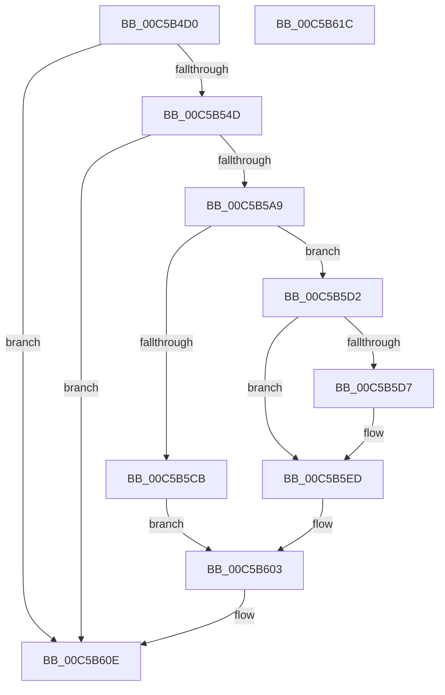

# CmpInitializeHardwareConfiguration

- RVA: `0x00C5B4D0`–`0x00C5B61D` (길이 `333` bytes)
- VA: `0x0000000140C5B4D0`
- 실행 섹션: `INIT`
- PDB 이름 있음: `예`; PDB Function 태그: `아니요`
- unwind 정보 RVA: `0x000C5C5C`
- 디코드: `76`개 명령, `333/333` bytes 표시
- 미해석 바이트: `0` (있으면 어셈블리에 `.byte`로 보존)

> 이 문서는 커널 이미지의 기계어와 PDB 기호를 분석해 생성했습니다. 4번과 5번은 함수 원형과 자료형을 바이너리 사용 방식에서 추정한 C 해석이며 원본 소스 복구 결과는 아닙니다.

## 1. Dependencies

- 직접 호출 지점: **7**; 고유 호출 대상: **5**
- 직접 호출자로 확인된 함수: **1**
- RIP 상대 이미지 참조: **6**

### Outgoing calls
- `0x00C5B540` → [ZwCreateKey](../../text/6A/ZwCreateKey_function_006AD470.md) (function, `0x006AD470`)
- `0x00C5B551` → [ZwClose](../../text/6A/ZwClose_function_006AD2B0.md) (function, `0x006AD2B0`)
- `0x00C5B5A0` → [ZwCreateKey](../../text/6A/ZwCreateKey_function_006AD470.md) (function, `0x006AD470`)
- `0x00C5B5BA` → [ExAllocatePool2](../../poolcode/B8/ExAllocatePool2_function_00B820F0.md) (function, `0x00B820F0`)
- `0x00C5B5E6` → [CmpSetupConfigurationTree](CmpSetupConfigurationTree_function_00C5B624.md) (function, `0x00C5B624`)
- `0x00C5B5F6` → [ExFreePoolWithTag](../../poolcode/B8/ExFreePoolWithTag_function_00B82870.md) (function, `0x00B82870`)
- `0x00C5B607` → [ZwClose](../../text/6A/ZwClose_function_006AD2B0.md) (function, `0x006AD2B0`)

### Direct callers
- [CmInitSystem1](CmInitSystem1_function_00C559CC.md) at `0x00C56239`

### Static image references
- `0x00C5B4E4` → RVA `0x00FDA3D8` (`PAGEDATA`; read)
- `0x00C5B55B` → RVA `0x00FDA3C8` (`PAGEDATA`; read)
- `0x00C5B5A9` → RVA `0x00FD80A8` (`PAGEDATA`; read)
- `0x00C5B5BF` → RVA `0x00FD9AB0` (`PAGEDATA`; write)
- `0x00C5B5ED` → RVA `0x00FD9AB0` (`PAGEDATA`; read)
- `0x00C5B5FB` → RVA `0x00FD9AB0` (`PAGEDATA`; read/write)

## 2. Other-region calls and transfers

- 다른 실행 섹션으로 향하는 call: **6**
  - `0x00C5B540` → [ZwCreateKey](../../text/6A/ZwCreateKey_function_006AD470.md) (`INIT` → `.text`)
  - `0x00C5B551` → [ZwClose](../../text/6A/ZwClose_function_006AD2B0.md) (`INIT` → `.text`)
  - `0x00C5B5A0` → [ZwCreateKey](../../text/6A/ZwCreateKey_function_006AD470.md) (`INIT` → `.text`)
  - `0x00C5B5BA` → [ExAllocatePool2](../../poolcode/B8/ExAllocatePool2_function_00B820F0.md) (`INIT` → `POOLCODE`)
  - `0x00C5B5F6` → [ExFreePoolWithTag](../../poolcode/B8/ExFreePoolWithTag_function_00B82870.md) (`INIT` → `POOLCODE`)
  - `0x00C5B607` → [ZwClose](../../text/6A/ZwClose_function_006AD2B0.md) (`INIT` → `.text`)
- 별도 외부 분기/꼬리 이동을 확인하지 못했습니다.

## 3. Assembly (complete function range)

```asm
00C5B4D0  48 89 5C 24 18                  mov qword ptr [rsp + 0x18], rbx
00C5B4D5  55                              push rbp
00C5B4D6  48 8B EC                        mov rbp, rsp
00C5B4D9  48 83 EC 70                     sub rsp, 0x70
00C5B4DD  48 8B 99 B0 00 00 00            mov rbx, qword ptr [rcx + 0xb0]
00C5B4E4  48 8D 05 ED EE 37 00            lea rax, [rip + 0x37eeed]
00C5B4EB  83 65 EC 00                     and dword ptr [rbp - 0x14], 0
00C5B4EF  4C 8D 45 D0                     lea r8, [rbp - 0x30]
00C5B4F3  48 83 65 18 00                  and qword ptr [rbp + 0x18], 0
00C5B4F8  48 8D 4D 18                     lea rcx, [rbp + 0x18]
00C5B4FC  83 65 10 00                     and dword ptr [rbp + 0x10], 0
00C5B500  0F 57 C0                        xorps xmm0, xmm0
00C5B503  48 83 65 D8 00                  and qword ptr [rbp - 0x28], 0
00C5B508  45 33 C9                        xor r9d, r9d
00C5B50B  48 89 45 E0                     mov qword ptr [rbp - 0x20], rax
00C5B50F  BA 1F 00 02 00                  mov edx, 0x2001f
00C5B514  48 8D 45 10                     lea rax, [rbp + 0x10]
00C5B518  48 C7 45 D0 30 00 00 00         mov qword ptr [rbp - 0x30], 0x30
00C5B520  83 65 D4 00                     and dword ptr [rbp - 0x2c], 0
00C5B524  48 89 44 24 30                  mov qword ptr [rsp + 0x30], rax
00C5B529  83 64 24 28 00                  and dword ptr [rsp + 0x28], 0
00C5B52E  48 83 64 24 20 00               and qword ptr [rsp + 0x20], 0
00C5B534  C7 45 E8 40 02 00 00            mov dword ptr [rbp - 0x18], 0x240
00C5B53B  F3 0F 7F 45 F0                  movdqu xmmword ptr [rbp - 0x10], xmm0
00C5B540  E8 2B 1F A5 FF                  call 0x1406ad470
00C5B545  85 C0                           test eax, eax
00C5B547  0F 88 C1 00 00 00               js 0x140c5b60e
00C5B54D  48 8B 4D 18                     mov rcx, qword ptr [rbp + 0x18]
00C5B551  E8 5A 1D A5 FF                  call 0x1406ad2b0
00C5B556  48 83 65 D8 00                  and qword ptr [rbp - 0x28], 0
00C5B55B  48 8D 05 66 EE 37 00            lea rax, [rip + 0x37ee66]
00C5B562  48 89 45 E0                     mov qword ptr [rbp - 0x20], rax
00C5B566  4C 8D 45 D0                     lea r8, [rbp - 0x30]
00C5B56A  48 8D 45 10                     lea rax, [rbp + 0x10]
00C5B56E  C7 45 D0 30 00 00 00            mov dword ptr [rbp - 0x30], 0x30
00C5B575  48 89 44 24 30                  mov qword ptr [rsp + 0x30], rax
00C5B57A  48 8D 4D 18                     lea rcx, [rbp + 0x18]
00C5B57E  83 64 24 28 00                  and dword ptr [rsp + 0x28], 0
00C5B583  0F 57 C0                        xorps xmm0, xmm0
00C5B586  48 83 64 24 20 00               and qword ptr [rsp + 0x20], 0
00C5B58C  45 33 C9                        xor r9d, r9d
00C5B58F  BA 1F 00 02 00                  mov edx, 0x2001f
00C5B594  C7 45 E8 40 02 00 00            mov dword ptr [rbp - 0x18], 0x240
00C5B59B  F3 0F 7F 45 F0                  movdqu xmmword ptr [rbp - 0x10], xmm0
00C5B5A0  E8 CB 1E A5 FF                  call 0x1406ad470
00C5B5A5  85 C0                           test eax, eax
00C5B5A7  78 65                           js 0x140c5b60e
00C5B5A9  8B 15 F9 CA 37 00               mov edx, dword ptr [rip + 0x37caf9]
00C5B5AF  B9 00 01 00 00                  mov ecx, 0x100
00C5B5B4  41 B8 43 4D 20 20               mov r8d, 0x20204d43
00C5B5BA  E8 31 6B F2 FF                  call 0x140b820f0
00C5B5BF  48 89 05 EA E4 37 00            mov qword ptr [rip + 0x37e4ea], rax
00C5B5C6  48 85 C0                        test rax, rax
00C5B5C9  75 07                           jne 0x140c5b5d2
00C5B5CB  BB 9A 00 00 C0                  mov ebx, 0xc000009a
00C5B5D0  EB 31                           jmp 0x140c5b603
00C5B5D2  48 85 DB                        test rbx, rbx
00C5B5D5  74 16                           je 0x140c5b5ed
00C5B5D7  48 8B 55 18                     mov rdx, qword ptr [rbp + 0x18]
00C5B5DB  41 83 C9 FF                     or r9d, 0xffffffff
00C5B5DF  41 83 C8 FF                     or r8d, 0xffffffff
00C5B5E3  48 8B CB                        mov rcx, rbx
00C5B5E6  E8 39 00 00 00                  call 0x140c5b624
00C5B5EB  8B D8                           mov ebx, eax
00C5B5ED  48 8B 0D BC E4 37 00            mov rcx, qword ptr [rip + 0x37e4bc]
00C5B5F4  33 D2                           xor edx, edx
00C5B5F6  E8 75 72 F2 FF                  call 0x140b82870
00C5B5FB  48 83 25 AD E4 37 00 00         and qword ptr [rip + 0x37e4ad], 0
00C5B603  48 8B 4D 18                     mov rcx, qword ptr [rbp + 0x18]
00C5B607  E8 A4 1C A5 FF                  call 0x1406ad2b0
00C5B60C  8B C3                           mov eax, ebx
00C5B60E  48 8B 9C 24 90 00 00 00         mov rbx, qword ptr [rsp + 0x90]
00C5B616  48 83 C4 70                     add rsp, 0x70
00C5B61A  5D                              pop rbp
00C5B61B  C3                              ret
00C5B61C  CC                              int3
```

## 4. C-style interpretation (structured pseudocode)

```c
__int64 __fastcall CmpInitializeHardwareConfiguration(__int64 a1, __int64 a2, __int64 a3, int a4)
{
    __int64 result;
    __int64 v_rbx;
    __int64 v_rsp;
    unsigned __int64 v_stack_m18;
    unsigned int v_stack_m1C;
    unsigned int v_stack_m20;
    unsigned __int64 v_stack_m28;
    unsigned __int64 v_stack_m30;
    unsigned int v_stack_m34;
    unsigned __int64 v_stack_m38;
    unsigned __int64 v_stack_m48;
    unsigned int v_stack_m50;
    unsigned __int64 v_stack_m58;
    unsigned __int64 v_stack_p10;
    unsigned __int64 v_stack_p18;
    unsigned int v_stack_p8;

    v_stack_p18 = v_rbx;
    v_rsp = (v_rsp) - (112);
    a4 = 0;
    v_stack_m28 = v_rip + 3665645;
    v_stack_m38 = 48;
    v_stack_m48 = v_stack_p8;
    v_stack_m20 = 576;
    v_stack_m18 = v_xmm0;
    result = ZwCreateKey(v_stack_p10, (unsigned int)(0x2001FULL), v_stack_m38, a4);
    if (sign_flag) goto loc_00C5B60E;
    result = ZwClose(v_stack_p10, (unsigned int)(0x2001FULL), v_stack_m38, a4);
    v_stack_m28 = v_rip + 3665510;
    v_stack_m38 = 48;
    v_stack_m48 = v_stack_p8;
    a4 = 0;
    v_stack_m20 = 576;
    v_stack_m18 = v_xmm0;
    result = ZwCreateKey(v_stack_p10, (unsigned int)(0x2001FULL), v_stack_m38, a4);
    if (sign_flag) goto loc_00C5B60E;
    result = ExAllocatePool2(256, (unsigned int)(*(unsigned int *)(v_rip + 3656441)), (unsigned int)(0x20204D43ULL), a4);
    *(unsigned __int64 *)(v_rip + 3663082) = result;
    if (result != 0) goto loc_00C5B5D2;
    goto loc_00C5B603;
loc_00C5B5D2:
    v_rbx = (unsigned int)(0xC000009AULL);
    if ((unsigned int)(0xC000009AULL) != 0) {
        a2 = v_stack_p10;
        a4 = (unsigned int)((a4) | (0xFFFFFFFFULL));
        a3 = (unsigned int)(((unsigned int)(0x20204D43ULL)) | (0xFFFFFFFFULL));
        a1 = (unsigned int)(0xC000009AULL);
        result = CmpSetupConfigurationTree(a1, a2, a3, a4);
        v_rbx = (unsigned int)(result);
    }
    a2 = 0;
    result = ExFreePoolWithTag(*(unsigned __int64 *)(v_rip + 3663036), a2, a3, a4);
loc_00C5B603:
    result = ZwClose(v_stack_p10, a2, a3, a4);
loc_00C5B60E:
    v_rsp = (v_rsp) + (112);
    return (unsigned int)((unsigned int)(v_rbx));
}
```

## 5. (Beta) C Style

```c
int64_t CmpInitializeHardwareConfiguration(void *Arg1, int64_t Arg2, int64_t Arg3, int32_t Arg4)
{
    uint8_t *arg1 = (uint8_t *)Arg1;

    int64_t result;
    int64_t local_rbx;
    int64_t local_rsp;
    uint64_t v_stack_m18;
    uint32_t v_stack_m1C;
    uint32_t v_stack_m20;
    uint64_t v_stack_m28;
    uint64_t v_stack_m30;
    uint32_t v_stack_m34;
    uint64_t v_stack_m38;
    uint64_t v_stack_m48;
    uint32_t v_stack_m50;
    uint64_t v_stack_m58;
    uint64_t v_stack_p10;
    uint64_t v_stack_p18;
    uint32_t v_stack_p8;

    v_stack_p18 = local_rbx;
    local_rsp = (local_rsp) - (112);
    Arg4 = 0;
    v_stack_m28 = v_rip + 3665645;
    v_stack_m38 = 48;
    v_stack_m48 = v_stack_p8;
    v_stack_m20 = 576;
    v_stack_m18 = v_xmm0;
    result = ZwCreateKey(v_stack_p10, (uint32_t)(0x2001FULL), v_stack_m38, Arg4);
    if (sign_flag) goto loc_00C5B60E;
    result = ZwClose(v_stack_p10, (uint32_t)(0x2001FULL), v_stack_m38, Arg4);
    v_stack_m28 = v_rip + 3665510;
    v_stack_m38 = 48;
    v_stack_m48 = v_stack_p8;
    Arg4 = 0;
    v_stack_m20 = 576;
    v_stack_m18 = v_xmm0;
    result = ZwCreateKey(v_stack_p10, (uint32_t)(0x2001FULL), v_stack_m38, Arg4);
    if (sign_flag) goto loc_00C5B60E;
    result = ExAllocatePool2(256, (uint32_t)(*(uint32_t *)(v_rip + 0x37CAF9)), (uint32_t)(0x20204D43ULL), Arg4);
    *(uint64_t *)(v_rip + 0x37E4EA) = result;
    if (result != 0) goto loc_00C5B5D2;
    goto loc_00C5B603;
loc_00C5B5D2:
    local_rbx = (uint32_t)(0xC000009AULL);
    if ((uint32_t)(0xC000009AULL) != 0) {
        Arg2 = v_stack_p10;
        Arg4 = (uint32_t)((Arg4) | (0xFFFFFFFFULL));
        Arg3 = (uint32_t)(((uint32_t)(0x20204D43ULL)) | (0xFFFFFFFFULL));
        Arg1 = (uint32_t)(0xC000009AULL);
        result = CmpSetupConfigurationTree(Arg1, Arg2, Arg3, Arg4);
        local_rbx = (uint32_t)(result);
    }
    Arg2 = 0;
    result = ExFreePoolWithTag(*(uint64_t *)(v_rip + 0x37E4BC), Arg2, Arg3, Arg4);
loc_00C5B603:
    result = ZwClose(v_stack_p10, Arg2, Arg3, Arg4);
loc_00C5B60E:
    local_rsp = (local_rsp) + (112);
    return (uint32_t)((uint32_t)(local_rbx));
}
```

### 관측된 메모리 오프셋

구조체 형식이 확인되지 않은 접근은 인자 기준의 오프셋으로만 기록했습니다.

| 기준 인자 | 오프셋 표현 | 폭 (bit) | 접근 |
|---|---:|---:|---|
| `Arg1` | `+ 0xB0` | `64` | `R` |

## 6. Execution-region graph

[열기: 2D/3D 그래프와 함수 탐색 컨트롤 패널](../../../control-panel.html?section=init&rva=0x00C5B4D0&view=graph)

- 2D 그래프는 위에서 아래로 흐르고, 3D 그래프는 빈 공간을 드래그해 회전합니다. Shift+드래그는 이동, 휠은 확대·축소, 함수 노드 선택은 대상 보고서 이동입니다.

### Static fallback


