# CmpInitializeMachineDependentConfiguration

- RVA: `0x00C5A02C`–`0x00C5A5C8` (길이 `1,436` bytes)
- VA: `0x0000000140C5A02C`
- 실행 섹션: `INIT`
- PDB 이름 있음: `예`; PDB Function 태그: `아니요`
- unwind 정보 RVA: `0x000D6AF4`
- 디코드: `298`개 명령, `1,436/1,436` bytes 표시
- 미해석 바이트: `0` (있으면 어셈블리에 `.byte`로 보존)

> 이 문서는 커널 이미지의 기계어와 PDB 기호를 분석해 생성했습니다. 4번과 5번은 함수 원형과 자료형을 바이너리 사용 방식에서 추정한 C 해석이며 원본 소스 복구 결과는 아닙니다.

## 1. Dependencies

- 직접 호출 지점: **29**; 고유 호출 대상: **17**
- 직접 호출자로 확인된 함수: **1**
- RIP 상대 이미지 참조: **18**

### Outgoing calls
- `0x00C5A0F1` → [_report_rangecheckfailure](../../text/4F/_report_rangecheckfailure_function_004F5FDC.md) (function, `0x004F5FDC`)
- `0x00C5A135` → [ZwOpenKey](../../text/6A/ZwOpenKey_function_006AD310.md) (function, `0x006AD310`)
- `0x00C5A15B` → [RtlInitUnicodeString](../../text/42/RtlInitUnicodeString_function_0042A780.md) (function, `0x0042A780`)
- `0x00C5A185` → [ZwSetValueKey](../../text/6A/ZwSetValueKey_function_006ADCD0.md) (function, `0x006ADCD0`)
- `0x00C5A18F` → [ZwClose](../../text/6A/ZwClose_function_006AD2B0.md) (function, `0x006AD2B0`)
- `0x00C5A1E2` → [ZwCreateKey](../../text/6A/ZwCreateKey_function_006AD470.md) (function, `0x006AD470`)
- `0x00C5A1FE` → [RtlInitUnicodeString](../../text/42/RtlInitUnicodeString_function_0042A780.md) (function, `0x0042A780`)
- `0x00C5A259` → [ZwCreateKey](../../text/6A/ZwCreateKey_function_006AD470.md) (function, `0x006AD470`)
- `0x00C5A263` → [ZwClose](../../text/6A/ZwClose_function_006AD2B0.md) (function, `0x006AD2B0`)
- `0x00C5A284` → [ExAllocatePool2](../../poolcode/B8/ExAllocatePool2_function_00B820F0.md) (function, `0x00B820F0`)
- `0x00C5A2FE` → [KeSetSystemGroupAffinityThread](../../text/39/KeSetSystemGroupAffinityThread_function_00399140.md) (function, `0x00399140`)
- `0x00C5A30D` → [CmpAddProcessorConfigurationEntry](../../page/7E/CmpAddProcessorConfigurationEntry_function_007E4CF8.md) (function, `0x007E4CF8`)
- `0x00C5A3AC` → [KeRevertToUserGroupAffinityThread](../../text/39/KeRevertToUserGroupAffinityThread_function_00398EC0.md) (function, `0x00398EC0`)
- `0x00C5A3D8` → [ExFreePoolWithTag](../../poolcode/B8/ExFreePoolWithTag_function_00B82870.md) (function, `0x00B82870`)
- `0x00C5A3F3` → [RtlInitUnicodeString](../../text/42/RtlInitUnicodeString_function_0042A780.md) (function, `0x0042A780`)
- `0x00C5A435` → [ZwOpenSection](../../text/6A/ZwOpenSection_function_006AD7B0.md) (function, `0x006AD7B0`)
- `0x00C5A45A` → [CmpSetSystemBiosInformation](CmpSetSystemBiosInformation_function_00C5A5D0.md) (function, `0x00C5A5D0`)
- `0x00C5A461` → [CmpInitializeSystemBiosInformation](CmpInitializeSystemBiosInformation_function_00C58620.md) (function, `0x00C58620`)
- `0x00C5A474` → [HalpAcpiGetTable](../../text/3F/HalpAcpiGetTable_function_003F6BF8.md) (function, `0x003F6BF8`)
- `0x00C5A4C5` → [RtlInitUnicodeString](../../text/42/RtlInitUnicodeString_function_0042A780.md) (function, `0x0042A780`)
- `0x00C5A4EF` → [ZwSetValueKey](../../text/6A/ZwSetValueKey_function_006ADCD0.md) (function, `0x006ADCD0`)
- `0x00C5A503` → [RtlInitUnicodeString](../../text/42/RtlInitUnicodeString_function_0042A780.md) (function, `0x0042A780`)
- `0x00C5A52D` → [ZwSetValueKey](../../text/6A/ZwSetValueKey_function_006ADCD0.md) (function, `0x006ADCD0`)
- `0x00C5A541` → [RtlInitUnicodeString](../../text/42/RtlInitUnicodeString_function_0042A780.md) (function, `0x0042A780`)
- `0x00C5A56B` → [ZwSetValueKey](../../text/6A/ZwSetValueKey_function_006ADCD0.md) (function, `0x006ADCD0`)
- `0x00C5A57F` → [CmpSetVideoBiosInformation](CmpSetVideoBiosInformation_function_00C5A970.md) (function, `0x00C5A970`)
- `0x00C5A589` → [ZwClose](../../text/6A/ZwClose_function_006AD2B0.md) (function, `0x006AD2B0`)
- `0x00C5A593` → [ZwClose](../../text/6A/ZwClose_function_006AD2B0.md) (function, `0x006AD2B0`)
- `0x00C5A5A5` → [_security_check_cookie](../../text/6A/_security_check_cookie_function_006AC640.md) (function, `0x006AC640`)

### Direct callers
- [CmInitSystem1](CmInitSystem1_function_00C559CC.md) at `0x00C562CF`

### Static image references
- `0x00C5A047` → RVA `0x00E0A740` (`.data`; read)
- `0x00C5A0A0` → RVA `0x00000000` (`image boundary/outside`; read)
- `0x00C5A0F7` → RVA `0x00FD9FB8` (`PAGEDATA`; read)
- `0x00C5A144` → RVA `0x00B81360` (`CmPhysicalAddressExtension`; read)
- `0x00C5A194` → RVA `0x00FD9DE8` (`PAGEDATA`; read)
- `0x00C5A1EF` → RVA `0x00C7E4E0` (` ?? ::PBOPGDP::`string'`; read)
- `0x00C5A273` → RVA `0x00FD80A8` (`PAGEDATA`; read)
- `0x00C5A289` → RVA `0x00FD9AB0` (`PAGEDATA`; write)
- `0x00C5A293` → RVA `0x00FC6A80` (`ALMOSTRO`; read)
- `0x00C5A2BA` → RVA `0x00F231B0` (`.data`; read)
- `0x00C5A335` → RVA `0x00FC8C40` (`ALMOSTRO`; read)
- `0x00C5A364` → RVA `0x00EF7B38` (`.data`; read/write)
- `0x00C5A3CA` → RVA `0x00FD9AB0` (`PAGEDATA`; read)
- `0x00C5A3E4` → RVA `0x00C79720` (` ?? ::PBOPGDP::`string'`; read)
- `0x00C5A442` → RVA `0x00EFF050` (`.data`; read)
- `0x00C5A4B6` → RVA `0x00C7E470` (` ?? ::PBOPGDP::`string'`; read)
- `0x00C5A4F4` → RVA `0x00C7E4A0` (` ?? ::PBOPGDP::`string'`; read)
- `0x00C5A532` → RVA `0x00C7E450` (` ?? ::PBOPGDP::`string'`; read)

## 2. Other-region calls and transfers

- 다른 실행 섹션으로 향하는 call: **26**
  - `0x00C5A0F1` → [_report_rangecheckfailure](../../text/4F/_report_rangecheckfailure_function_004F5FDC.md) (`INIT` → `.text`)
  - `0x00C5A135` → [ZwOpenKey](../../text/6A/ZwOpenKey_function_006AD310.md) (`INIT` → `.text`)
  - `0x00C5A15B` → [RtlInitUnicodeString](../../text/42/RtlInitUnicodeString_function_0042A780.md) (`INIT` → `.text`)
  - `0x00C5A185` → [ZwSetValueKey](../../text/6A/ZwSetValueKey_function_006ADCD0.md) (`INIT` → `.text`)
  - `0x00C5A18F` → [ZwClose](../../text/6A/ZwClose_function_006AD2B0.md) (`INIT` → `.text`)
  - `0x00C5A1E2` → [ZwCreateKey](../../text/6A/ZwCreateKey_function_006AD470.md) (`INIT` → `.text`)
  - `0x00C5A1FE` → [RtlInitUnicodeString](../../text/42/RtlInitUnicodeString_function_0042A780.md) (`INIT` → `.text`)
  - `0x00C5A259` → [ZwCreateKey](../../text/6A/ZwCreateKey_function_006AD470.md) (`INIT` → `.text`)
  - `0x00C5A263` → [ZwClose](../../text/6A/ZwClose_function_006AD2B0.md) (`INIT` → `.text`)
  - `0x00C5A284` → [ExAllocatePool2](../../poolcode/B8/ExAllocatePool2_function_00B820F0.md) (`INIT` → `POOLCODE`)
  - `0x00C5A2FE` → [KeSetSystemGroupAffinityThread](../../text/39/KeSetSystemGroupAffinityThread_function_00399140.md) (`INIT` → `.text`)
  - `0x00C5A30D` → [CmpAddProcessorConfigurationEntry](../../page/7E/CmpAddProcessorConfigurationEntry_function_007E4CF8.md) (`INIT` → `PAGE`)
  - `0x00C5A3AC` → [KeRevertToUserGroupAffinityThread](../../text/39/KeRevertToUserGroupAffinityThread_function_00398EC0.md) (`INIT` → `.text`)
  - `0x00C5A3D8` → [ExFreePoolWithTag](../../poolcode/B8/ExFreePoolWithTag_function_00B82870.md) (`INIT` → `POOLCODE`)
  - `0x00C5A3F3` → [RtlInitUnicodeString](../../text/42/RtlInitUnicodeString_function_0042A780.md) (`INIT` → `.text`)
  - `0x00C5A435` → [ZwOpenSection](../../text/6A/ZwOpenSection_function_006AD7B0.md) (`INIT` → `.text`)
  - `0x00C5A474` → [HalpAcpiGetTable](../../text/3F/HalpAcpiGetTable_function_003F6BF8.md) (`INIT` → `.text`)
  - `0x00C5A4C5` → [RtlInitUnicodeString](../../text/42/RtlInitUnicodeString_function_0042A780.md) (`INIT` → `.text`)
  - `0x00C5A4EF` → [ZwSetValueKey](../../text/6A/ZwSetValueKey_function_006ADCD0.md) (`INIT` → `.text`)
  - `0x00C5A503` → [RtlInitUnicodeString](../../text/42/RtlInitUnicodeString_function_0042A780.md) (`INIT` → `.text`)
  - `0x00C5A52D` → [ZwSetValueKey](../../text/6A/ZwSetValueKey_function_006ADCD0.md) (`INIT` → `.text`)
  - `0x00C5A541` → [RtlInitUnicodeString](../../text/42/RtlInitUnicodeString_function_0042A780.md) (`INIT` → `.text`)
  - `0x00C5A56B` → [ZwSetValueKey](../../text/6A/ZwSetValueKey_function_006ADCD0.md) (`INIT` → `.text`)
  - `0x00C5A589` → [ZwClose](../../text/6A/ZwClose_function_006AD2B0.md) (`INIT` → `.text`)
  - `0x00C5A593` → [ZwClose](../../text/6A/ZwClose_function_006AD2B0.md) (`INIT` → `.text`)
  - `0x00C5A5A5` → [_security_check_cookie](../../text/6A/_security_check_cookie_function_006AC640.md) (`INIT` → `.text`)
- 별도 외부 분기/꼬리 이동을 확인하지 못했습니다.

## 3. Assembly (complete function range)

```asm
00C5A02C  4C 8B DC                        mov r11, rsp
00C5A02F  49 89 5B 10                     mov qword ptr [r11 + 0x10], rbx
00C5A033  49 89 73 18                     mov qword ptr [r11 + 0x18], rsi
00C5A037  57                              push rdi
00C5A038  41 54                           push r12
00C5A03A  41 55                           push r13
00C5A03C  41 56                           push r14
00C5A03E  41 57                           push r15
00C5A040  48 81 EC 10 01 00 00            sub rsp, 0x110
00C5A047  48 8B 05 F2 06 1B 00            mov rax, qword ptr [rip + 0x1b06f2]
00C5A04E  48 33 C4                        xor rax, rsp
00C5A051  48 89 84 24 00 01 00 00         mov qword ptr [rsp + 0x100], rax
00C5A059  33 C0                           xor eax, eax
00C5A05B  48 89 8C 24 B8 00 00 00         mov qword ptr [rsp + 0xb8], rcx
00C5A063  0F 57 C0                        xorps xmm0, xmm0
00C5A066  49 89 43 A8                     mov qword ptr [r11 - 0x58], rax
00C5A06A  45 33 FF                        xor r15d, r15d
00C5A06D  41 89 43 B0                     mov dword ptr [r11 - 0x50], eax
00C5A071  0F 11 44 24 60                  movups xmmword ptr [rsp + 0x60], xmm0
00C5A076  48 8B F1                        mov rsi, rcx
00C5A079  44 8D 60 01                     lea r12d, [rax + 1]
00C5A07D  0F 11 44 24 70                  movups xmmword ptr [rsp + 0x70], xmm0
00C5A082  49 89 83 48 FF FF FF            mov qword ptr [r11 - 0xb8], rax
00C5A089  45 8B F7                        mov r14d, r15d
00C5A08C  0F 57 C9                        xorps xmm1, xmm1
00C5A08F  89 84 24 88 00 00 00            mov dword ptr [rsp + 0x88], eax
00C5A096  41 0F 11 43 88                  movups xmmword ptr [r11 - 0x78], xmm0
00C5A09B  44 89 7C 24 48                  mov dword ptr [rsp + 0x48], r15d
00C5A0A0  48 8D 15 59 5F 3A FF            lea rdx, [rip - 0xc5a0a7]
00C5A0A7  4C 89 7C 24 40                  mov qword ptr [rsp + 0x40], r15
00C5A0AC  41 8B CF                        mov ecx, r15d
00C5A0AF  4C 89 7C 24 50                  mov qword ptr [rsp + 0x50], r15
00C5A0B4  41 0F 11 43 98                  movups xmmword ptr [r11 - 0x68], xmm0
00C5A0B9  4C 89 7C 24 58                  mov qword ptr [rsp + 0x58], r15
00C5A0BE  0F 11 84 24 A8 00 00 00         movups xmmword ptr [rsp + 0xa8], xmm0
00C5A0C6  41 0F 11 4B B8                  movups xmmword ptr [r11 - 0x48], xmm1
00C5A0CB  0F 11 84 24 90 00 00 00         movups xmmword ptr [rsp + 0x90], xmm0
00C5A0D3  83 F9 2A                        cmp ecx, 0x2a
00C5A0D6  73 1F                           jae 0x140c5a0f7
00C5A0D8  8B C1                           mov eax, ecx
00C5A0DA  48 03 C0                        add rax, rax
00C5A0DD  48 83 F8 54                     cmp rax, 0x54
00C5A0E1  73 0E                           jae 0x140c5a0f1
00C5A0E3  66 44 89 BC 10 40 7B EF 00      mov word ptr [rax + rdx + 0xef7b40], r15w
00C5A0EC  41 03 CC                        add ecx, r12d
00C5A0EF  EB E2                           jmp 0x140c5a0d3
00C5A0F1  E8 E6 BE 89 FF                  call 0x1404f5fdc
00C5A0F6  CC                              int3
00C5A0F7  48 8D 05 BA FE 37 00            lea rax, [rip + 0x37feba]
00C5A0FE  C7 44 24 60 30 00 00 00         mov dword ptr [rsp + 0x60], 0x30
00C5A106  0F 57 C0                        xorps xmm0, xmm0
00C5A109  4C 89 7C 24 68                  mov qword ptr [rsp + 0x68], r15
00C5A10E  BB 1F 00 02 00                  mov ebx, 0x2001f
00C5A113  C7 44 24 78 40 02 00 00         mov dword ptr [rsp + 0x78], 0x240
00C5A11B  8B D3                           mov edx, ebx
00C5A11D  48 89 44 24 70                  mov qword ptr [rsp + 0x70], rax
00C5A122  4C 8D 44 24 60                  lea r8, [rsp + 0x60]
00C5A127  48 8D 4C 24 50                  lea rcx, [rsp + 0x50]
00C5A12C  F3 0F 7F 84 24 80 00 00 00      movdqu xmmword ptr [rsp + 0x80], xmm0
00C5A135  E8 D6 31 A5 FF                  call 0x1406ad310
00C5A13A  41 BD 04 00 00 00               mov r13d, 4
00C5A140  85 C0                           test eax, eax
00C5A142  78 50                           js 0x140c5a194
00C5A144  48 8D 15 15 72 F2 FF            lea rdx, [rip - 0xd8deb]
00C5A14B  44 89 A4 24 A0 00 00 00         mov dword ptr [rsp + 0xa0], r12d
00C5A153  48 8D 8C 24 90 00 00 00         lea rcx, [rsp + 0x90]
00C5A15B  E8 20 06 7D FF                  call 0x14042a780
00C5A160  48 8B 4C 24 50                  mov rcx, qword ptr [rsp + 0x50]
00C5A165  48 8D 84 24 A0 00 00 00         lea rax, [rsp + 0xa0]
00C5A16D  44 89 6C 24 28                  mov dword ptr [rsp + 0x28], r13d
00C5A172  48 8D 94 24 90 00 00 00         lea rdx, [rsp + 0x90]
00C5A17A  45 8B CD                        mov r9d, r13d
00C5A17D  48 89 44 24 20                  mov qword ptr [rsp + 0x20], rax
00C5A182  45 33 C0                        xor r8d, r8d
00C5A185  E8 46 3B A5 FF                  call 0x1406adcd0
00C5A18A  48 8B 4C 24 50                  mov rcx, qword ptr [rsp + 0x50]
00C5A18F  E8 1C 31 A5 FF                  call 0x1406ad2b0
00C5A194  48 8D 05 4D FC 37 00            lea rax, [rip + 0x37fc4d]
00C5A19B  4C 89 7C 24 30                  mov qword ptr [rsp + 0x30], r15
00C5A1A0  0F 57 C0                        xorps xmm0, xmm0
00C5A1A3  44 89 7C 24 28                  mov dword ptr [rsp + 0x28], r15d
00C5A1A8  45 33 C9                        xor r9d, r9d
00C5A1AB  48 89 44 24 70                  mov qword ptr [rsp + 0x70], rax
00C5A1B0  4C 8D 44 24 60                  lea r8, [rsp + 0x60]
00C5A1B5  4C 89 7C 24 20                  mov qword ptr [rsp + 0x20], r15
00C5A1BA  BA 19 00 02 00                  mov edx, 0x20019
00C5A1BF  C7 44 24 60 30 00 00 00         mov dword ptr [rsp + 0x60], 0x30
00C5A1C7  48 8D 4C 24 40                  lea rcx, [rsp + 0x40]
00C5A1CC  4C 89 7C 24 68                  mov qword ptr [rsp + 0x68], r15
00C5A1D1  F3 0F 7F 84 24 80 00 00 00      movdqu xmmword ptr [rsp + 0x80], xmm0
00C5A1DA  C7 44 24 78 40 02 00 00         mov dword ptr [rsp + 0x78], 0x240
00C5A1E2  E8 89 32 A5 FF                  call 0x1406ad470
00C5A1E7  85 C0                           test eax, eax
00C5A1E9  0F 88 AB 03 00 00               js 0x140c5a59a
00C5A1EF  48 8D 15 EA 42 02 00            lea rdx, [rip + 0x242ea]
00C5A1F6  48 8D 8C 24 C0 00 00 00         lea rcx, [rsp + 0xc0]
00C5A1FE  E8 7D 05 7D FF                  call 0x14042a780
00C5A203  48 8B 44 24 40                  mov rax, qword ptr [rsp + 0x40]
00C5A208  4C 8D 44 24 60                  lea r8, [rsp + 0x60]
00C5A20D  48 89 44 24 68                  mov qword ptr [rsp + 0x68], rax
00C5A212  48 8D 4C 24 50                  lea rcx, [rsp + 0x50]
00C5A217  48 8D 84 24 C0 00 00 00         lea rax, [rsp + 0xc0]
00C5A21F  C7 44 24 60 30 00 00 00         mov dword ptr [rsp + 0x60], 0x30
00C5A227  48 89 44 24 70                  mov qword ptr [rsp + 0x70], rax
00C5A22C  0F 57 C0                        xorps xmm0, xmm0
00C5A22F  48 8D 44 24 48                  lea rax, [rsp + 0x48]
00C5A234  C7 44 24 78 40 02 00 00         mov dword ptr [rsp + 0x78], 0x240
00C5A23C  48 89 44 24 30                  mov qword ptr [rsp + 0x30], rax
00C5A241  45 33 C9                        xor r9d, r9d
00C5A244  44 89 7C 24 28                  mov dword ptr [rsp + 0x28], r15d
00C5A249  8B D3                           mov edx, ebx
00C5A24B  4C 89 7C 24 20                  mov qword ptr [rsp + 0x20], r15
00C5A250  F3 0F 7F 84 24 80 00 00 00      movdqu xmmword ptr [rsp + 0x80], xmm0
00C5A259  E8 12 32 A5 FF                  call 0x1406ad470
00C5A25E  48 8B 4C 24 50                  mov rcx, qword ptr [rsp + 0x50]
00C5A263  E8 48 30 A5 FF                  call 0x1406ad2b0
00C5A268  44 39 64 24 48                  cmp dword ptr [rsp + 0x48], r12d
00C5A26D  0F 85 71 01 00 00               jne 0x140c5a3e4
00C5A273  8B 15 2F DE 37 00               mov edx, dword ptr [rip + 0x37de2f]
00C5A279  B9 00 01 00 00                  mov ecx, 0x100
00C5A27E  41 B8 43 4D 20 20               mov r8d, 0x20204d43
00C5A284  E8 67 7E F2 FF                  call 0x140b820f0
00C5A289  48 89 05 20 F8 37 00            mov qword ptr [rip + 0x37f820], rax
00C5A290  41 8B FF                        mov edi, r15d
00C5A293  8B 05 E7 C7 36 00               mov eax, dword ptr [rip + 0x36c7e7]
00C5A299  85 C0                           test eax, eax
00C5A29B  0F 84 29 01 00 00               je 0x140c5a3ca
00C5A2A1  48 8D 35 58 5D 3A FF            lea rsi, [rip - 0xc5a2a8]
00C5A2A8  8B C7                           mov eax, edi
00C5A2AA  48 8D 94 24 F0 00 00 00         lea rdx, [rsp + 0xf0]
00C5A2B2  48 8B 9C C6 40 8C FC 00         mov rbx, qword ptr [rsi + rax*8 + 0xfc8c40]
00C5A2BA  48 8B 05 EF 8E 2C 00            mov rax, qword ptr [rip + 0x2c8eef]
00C5A2C1  8B 4B 24                        mov ecx, dword ptr [rbx + 0x24]
00C5A2C4  8B 0C 88                        mov ecx, dword ptr [rax + rcx*4]
00C5A2C7  33 C0                           xor eax, eax
00C5A2C9  89 84 24 B2 00 00 00            mov dword ptr [rsp + 0xb2], eax
00C5A2D0  66 89 84 24 B6 00 00 00         mov word ptr [rsp + 0xb6], ax
00C5A2D8  8B C1                           mov eax, ecx
00C5A2DA  C1 E8 06                        shr eax, 6
00C5A2DD  83 E1 3F                        and ecx, 0x3f
00C5A2E0  66 89 84 24 B0 00 00 00         mov word ptr [rsp + 0xb0], ax
00C5A2E8  49 8B C4                        mov rax, r12
00C5A2EB  48 D3 E0                        shl rax, cl
00C5A2EE  48 8D 8C 24 A8 00 00 00         lea rcx, [rsp + 0xa8]
00C5A2F6  48 89 84 24 A8 00 00 00         mov qword ptr [rsp + 0xa8], rax
00C5A2FE  E8 3D EE 73 FF                  call 0x140399140
00C5A303  4C 8B 44 24 40                  mov r8, qword ptr [rsp + 0x40]
00C5A308  8B D7                           mov edx, edi
00C5A30A  48 8B CB                        mov rcx, rbx
00C5A30D  E8 E6 A9 B8 FF                  call 0x1407e4cf8
00C5A312  65 48 8B 04 25 18 00 00 00      mov rax, qword ptr gs:[0x18]
00C5A31B  85 FF                           test edi, edi
00C5A31D  75 09                           jne 0x140c5a328
00C5A31F  44 8B B0 BC 00 00 00            mov r14d, dword ptr [rax + 0xbc]
00C5A326  EB 7C                           jmp 0x140c5a3a4
00C5A328  44 8B 88 BC 00 00 00            mov r9d, dword ptr [rax + 0xbc]
00C5A32F  44 38 7B 41                     cmp byte ptr [rbx + 0x41], r15b
00C5A333  74 5B                           je 0x140c5a390
00C5A335  4C 8B 05 04 E9 36 00            mov r8, qword ptr [rip + 0x36e904]
00C5A33C  48 8D 83 90 8F 00 00            lea rax, [rbx + 0x8f90]
00C5A343  49 81 C0 90 8F 00 00            add r8, 0x8f90
00C5A34A  4C 2B C0                        sub r8, rax
00C5A34D  0F B6 08                        movzx ecx, byte ptr [rax]
00C5A350  42 0F B6 14 00                  movzx edx, byte ptr [rax + r8]
00C5A355  2B CA                           sub ecx, edx
00C5A357  75 07                           jne 0x140c5a360
00C5A359  49 03 C4                        add rax, r12
00C5A35C  85 D2                           test edx, edx
00C5A35E  75 ED                           jne 0x140c5a34d
00C5A360  85 C9                           test ecx, ecx
00C5A362  74 07                           je 0x140c5a36b
00C5A364  44 08 25 CD D7 29 00            or byte ptr [rip + 0x29d7cd], r12b
00C5A36B  45 3B CE                        cmp r9d, r14d
00C5A36E  74 07                           je 0x140c5a377
00C5A370  44 08 2D C1 D7 29 00            or byte ptr [rip + 0x29d7c1], r13b
00C5A377  48 8B 0D C2 E8 36 00            mov rcx, qword ptr [rip + 0x36e8c2]
00C5A37E  8A 41 40                        mov al, byte ptr [rcx + 0x40]
00C5A381  38 43 40                        cmp byte ptr [rbx + 0x40], al
00C5A384  75 17                           jne 0x140c5a39d
00C5A386  0F B7 41 42                     movzx eax, word ptr [rcx + 0x42]
00C5A38A  66 39 43 42                     cmp word ptr [rbx + 0x42], ax
00C5A38E  EB 0B                           jmp 0x140c5a39b
00C5A390  48 8B 05 A9 E8 36 00            mov rax, qword ptr [rip + 0x36e8a9]
00C5A397  44 38 78 41                     cmp byte ptr [rax + 0x41], r15b
00C5A39B  74 07                           je 0x140c5a3a4
00C5A39D  80 0D 94 D7 29 00 02            or byte ptr [rip + 0x29d794], 2
00C5A3A4  48 8D 8C 24 F0 00 00 00         lea rcx, [rsp + 0xf0]
00C5A3AC  E8 0F EB 73 FF                  call 0x140398ec0
00C5A3B1  8B 05 C9 C6 36 00               mov eax, dword ptr [rip + 0x36c6c9]
00C5A3B7  41 03 FC                        add edi, r12d
00C5A3BA  3B F8                           cmp edi, eax
00C5A3BC  0F 82 E6 FE FF FF               jb 0x140c5a2a8
00C5A3C2  48 8B B4 24 B8 00 00 00         mov rsi, qword ptr [rsp + 0xb8]
00C5A3CA  48 8B 0D DF F6 37 00            mov rcx, qword ptr [rip + 0x37f6df]
00C5A3D1  48 85 C9                        test rcx, rcx
00C5A3D4  74 0E                           je 0x140c5a3e4
00C5A3D6  33 D2                           xor edx, edx
00C5A3D8  E8 93 84 F2 FF                  call 0x140b82870
00C5A3DD  4C 89 3D CC F6 37 00            mov qword ptr [rip + 0x37f6cc], r15
00C5A3E4  48 8D 15 35 F3 01 00            lea rdx, [rip + 0x1f335]
00C5A3EB  48 8D 8C 24 D0 00 00 00         lea rcx, [rsp + 0xd0]
00C5A3F3  E8 88 03 7D FF                  call 0x14042a780
00C5A3F8  48 8D 84 24 D0 00 00 00         lea rax, [rsp + 0xd0]
00C5A400  C7 44 24 60 30 00 00 00         mov dword ptr [rsp + 0x60], 0x30
00C5A408  0F 57 C0                        xorps xmm0, xmm0
00C5A40B  48 89 44 24 70                  mov qword ptr [rsp + 0x70], rax
00C5A410  4C 8D 44 24 60                  lea r8, [rsp + 0x60]
00C5A415  4C 89 7C 24 68                  mov qword ptr [rsp + 0x68], r15
00C5A41A  BA 1F 00 0F 00                  mov edx, 0xf001f
00C5A41F  C7 44 24 78 40 02 00 00         mov dword ptr [rsp + 0x78], 0x240
00C5A427  48 8D 4C 24 58                  lea rcx, [rsp + 0x58]
00C5A42C  F3 0F 7F 84 24 80 00 00 00      movdqu xmmword ptr [rsp + 0x80], xmm0
00C5A435  E8 76 33 A5 FF                  call 0x1406ad7b0
00C5A43A  85 C0                           test eax, eax
00C5A43C  0F 88 4C 01 00 00               js 0x140c5a58e
00C5A442  8B 1D 08 4C 2A 00               mov ebx, dword ptr [rip + 0x2a4c08]
00C5A448  48 8B CE                        mov rcx, rsi
00C5A44B  41 3B DC                        cmp ebx, r12d
00C5A44E  75 11                           jne 0x140c5a461
00C5A450  4C 8B 44 24 40                  mov r8, qword ptr [rsp + 0x40]
00C5A455  48 8B 54 24 58                  mov rdx, qword ptr [rsp + 0x58]
00C5A45A  E8 71 01 00 00                  call 0x140c5a5d0
00C5A45F  EB 05                           jmp 0x140c5a466
00C5A461  E8 BA E1 FF FF                  call 0x140c58620
00C5A466  45 33 C9                        xor r9d, r9d
00C5A469  45 33 C0                        xor r8d, r8d
00C5A46C  BA 46 41 43 50                  mov edx, 0x50434146
00C5A471  48 8B CE                        mov rcx, rsi
00C5A474  E8 7F C7 79 FF                  call 0x1403f6bf8
00C5A479  48 85 C0                        test rax, rax
00C5A47C  0F 84 EE 00 00 00               je 0x140c5a570
00C5A482  44 38 60 08                     cmp byte ptr [rax + 8], r12b
00C5A486  0F 86 E4 00 00 00               jbe 0x140c5a570
00C5A48C  0F B7 48 6D                     movzx ecx, word ptr [rax + 0x6d]
00C5A490  89 8C 24 E0 00 00 00            mov dword ptr [rsp + 0xe0], ecx
00C5A497  8B 48 70                        mov ecx, dword ptr [rax + 0x70]
00C5A49A  89 8C 24 E8 00 00 00            mov dword ptr [rsp + 0xe8], ecx
00C5A4A1  0F B6 48 2D                     movzx ecx, byte ptr [rax + 0x2d]
00C5A4A5  89 8C 24 E4 00 00 00            mov dword ptr [rsp + 0xe4], ecx
00C5A4AC  44 38 60 08                     cmp byte ptr [rax + 8], r12b
00C5A4B0  0F 86 BA 00 00 00               jbe 0x140c5a570
00C5A4B6  48 8D 15 B3 3F 02 00            lea rdx, [rip + 0x23fb3]
00C5A4BD  48 8D 8C 24 90 00 00 00         lea rcx, [rsp + 0x90]
00C5A4C5  E8 B6 02 7D FF                  call 0x14042a780
00C5A4CA  48 8B 4C 24 40                  mov rcx, qword ptr [rsp + 0x40]
00C5A4CF  48 8D 84 24 E0 00 00 00         lea rax, [rsp + 0xe0]
00C5A4D7  44 89 6C 24 28                  mov dword ptr [rsp + 0x28], r13d
00C5A4DC  48 8D 94 24 90 00 00 00         lea rdx, [rsp + 0x90]
00C5A4E4  45 8B CD                        mov r9d, r13d
00C5A4E7  48 89 44 24 20                  mov qword ptr [rsp + 0x20], rax
00C5A4EC  45 33 C0                        xor r8d, r8d
00C5A4EF  E8 DC 37 A5 FF                  call 0x1406adcd0
00C5A4F4  48 8D 15 A5 3F 02 00            lea rdx, [rip + 0x23fa5]
00C5A4FB  48 8D 8C 24 90 00 00 00         lea rcx, [rsp + 0x90]
00C5A503  E8 78 02 7D FF                  call 0x14042a780
00C5A508  48 8B 4C 24 40                  mov rcx, qword ptr [rsp + 0x40]
00C5A50D  48 8D 84 24 E4 00 00 00         lea rax, [rsp + 0xe4]
00C5A515  44 89 6C 24 28                  mov dword ptr [rsp + 0x28], r13d
00C5A51A  48 8D 94 24 90 00 00 00         lea rdx, [rsp + 0x90]
00C5A522  45 8B CD                        mov r9d, r13d
00C5A525  48 89 44 24 20                  mov qword ptr [rsp + 0x20], rax
00C5A52A  45 33 C0                        xor r8d, r8d
00C5A52D  E8 9E 37 A5 FF                  call 0x1406adcd0
00C5A532  48 8D 15 17 3F 02 00            lea rdx, [rip + 0x23f17]
00C5A539  48 8D 8C 24 90 00 00 00         lea rcx, [rsp + 0x90]
00C5A541  E8 3A 02 7D FF                  call 0x14042a780
00C5A546  48 8B 4C 24 40                  mov rcx, qword ptr [rsp + 0x40]
00C5A54B  48 8D 84 24 E8 00 00 00         lea rax, [rsp + 0xe8]
00C5A553  44 89 6C 24 28                  mov dword ptr [rsp + 0x28], r13d
00C5A558  48 8D 94 24 90 00 00 00         lea rdx, [rsp + 0x90]
00C5A560  45 8B CD                        mov r9d, r13d
00C5A563  48 89 44 24 20                  mov qword ptr [rsp + 0x20], rax
00C5A568  45 33 C0                        xor r8d, r8d
00C5A56B  E8 60 37 A5 FF                  call 0x1406adcd0
00C5A570  41 3B DC                        cmp ebx, r12d
00C5A573  75 0F                           jne 0x140c5a584
00C5A575  48 8B 54 24 40                  mov rdx, qword ptr [rsp + 0x40]
00C5A57A  48 8B 4C 24 58                  mov rcx, qword ptr [rsp + 0x58]
00C5A57F  E8 EC 03 00 00                  call 0x140c5a970
00C5A584  48 8B 4C 24 58                  mov rcx, qword ptr [rsp + 0x58]
00C5A589  E8 22 2D A5 FF                  call 0x1406ad2b0
00C5A58E  48 8B 4C 24 40                  mov rcx, qword ptr [rsp + 0x40]
00C5A593  E8 18 2D A5 FF                  call 0x1406ad2b0
00C5A598  33 C0                           xor eax, eax
00C5A59A  48 8B 8C 24 00 01 00 00         mov rcx, qword ptr [rsp + 0x100]
00C5A5A2  48 33 CC                        xor rcx, rsp
00C5A5A5  E8 96 20 A5 FF                  call 0x1406ac640
00C5A5AA  4C 8D 9C 24 10 01 00 00         lea r11, [rsp + 0x110]
00C5A5B2  49 8B 5B 38                     mov rbx, qword ptr [r11 + 0x38]
00C5A5B6  49 8B 73 40                     mov rsi, qword ptr [r11 + 0x40]
00C5A5BA  49 8B E3                        mov rsp, r11
00C5A5BD  41 5F                           pop r15
00C5A5BF  41 5E                           pop r14
00C5A5C1  41 5D                           pop r13
00C5A5C3  41 5C                           pop r12
00C5A5C5  5F                              pop rdi
00C5A5C6  C3                              ret
00C5A5C7  CC                              int3
```

## 4. C-style interpretation (structured pseudocode)

```c
__int64 __fastcall CmpInitializeMachineDependentConfiguration(__int64 a1)
{
    __int64 result;
    __int64 v_r15;
    __int64 v_rdi;
    __int64 v_rsp;
    unsigned __int64 v_stack_m108;
    unsigned int v_stack_m110;
    unsigned __int64 v_stack_m118;
    unsigned __int64 v_stack_m28;
    unsigned __int64 v_stack_m38;
    unsigned __int64 v_stack_m48;
    unsigned int v_stack_m50;
    unsigned int v_stack_m54;
    unsigned int v_stack_m58;
    unsigned __int64 v_stack_m68;
    unsigned __int64 v_stack_m78;
    unsigned __int64 v_stack_m80;
    unsigned __int16 v_stack_m82;
    unsigned int v_stack_m86;
    unsigned __int16 v_stack_m88;
    unsigned __int64 v_stack_m90;
    unsigned int v_stack_m98;
    unsigned __int64 v_stack_mA8;
    unsigned int v_stack_mB0;
    unsigned __int64 v_stack_mB8;
    unsigned int v_stack_mC0;
    unsigned __int64 v_stack_mC8;
    unsigned __int64 v_stack_mD0;
    unsigned __int64 v_stack_mD8;
    unsigned __int64 v_stack_mE0;
    unsigned __int64 v_stack_mE8;
    unsigned int v_stack_mF0;
    unsigned __int64 v_stack_mF8;

    *(unsigned __int64 *)(v_rsp + 16) = v_rbx;
    *(unsigned __int64 *)(v_rsp + 24) = v_rsi;
    v_rsp = (v_rsp) - (272);
    result = (*(unsigned __int64 *)(v_rip + 1771250)) ^ (v_rsp);
    v_stack_m38 = result;
    result = 0;
    v_stack_m80 = a1;
    *(unsigned __int64 *)(v_rsp - 88) = 0;
    v_r15 = 0;
    *(unsigned int *)(v_rsp - 80) = 0;
    v_stack_mD8 = v_xmm0;
    v_stack_mC8 = v_xmm0;
    *(unsigned __int64 *)(v_rsp - 184) = 0;
    v_stack_mB0 = 0;
    *(unsigned __int64 *)(v_rsp - 120) = v_xmm0;
    v_stack_mF0 = 0;
    v_stack_mF8 = 0;
    v_stack_mE8 = 0;
    *(unsigned __int64 *)(v_rsp - 104) = v_xmm0;
    v_stack_mE0 = 0;
    v_stack_m90 = v_xmm0;
    *(unsigned __int64 *)(v_rsp - 72) = v_xmm1;
    v_stack_mA8 = v_xmm0;
loc_00C5A0D3:
    if (0 >= 42) goto loc_00C5A0F7;
    result = (0) + (0);
    if (result >= 84) goto loc_00C5A0F1;
    *(unsigned __int16 *)(result + v_rip - 12951719 * 1 + 15694656) = 0;
    a1 = (unsigned int)((0) + ((unsigned int)(result + 1)));
    goto loc_00C5A0D3;
loc_00C5A0F1:
    result = _report_rangecheckfailure(a1, v_rip - 12951719, a3, a4);
loc_00C5A0F7:
    v_stack_mD8 = 48;
    v_stack_mD0 = 0;
    v_stack_mC0 = 576;
    v_stack_mC8 = v_rip + 3669690;
    v_stack_mB8 = v_xmm0;
    result = ZwOpenKey(v_stack_mE8, (unsigned int)((unsigned int)((unsigned int)(0x2001FULL))), v_stack_mD8, a4);
    if (!(sign_flag)) {
        a2 = v_rip - 888299;
        v_stack_m98 = (unsigned int)(result + 1);
        a1 = v_stack_mA8;
        result = RtlInitUnicodeString(a1, a2, v_stack_mD8, a4);
        a1 = v_stack_mE8;
        result = v_stack_m98;
        v_stack_m110 = 4;
        a2 = v_stack_mA8;
        a4 = 4;
        v_stack_m118 = result;
        a3 = 0;
        result = ZwSetValueKey(a1, a2, a3, a4);
        a1 = v_stack_mE8;
        result = ZwClose(a1, a2, a3, a4);
    }
    v_stack_m108 = 0;
    v_stack_m110 = 0;
    a4 = 0;
    v_stack_mC8 = v_rip + 3669069;
    v_stack_m118 = 0;
    v_stack_mD8 = 48;
    v_stack_mD0 = 0;
    v_stack_mB8 = v_xmm0;
    v_stack_mC0 = 576;
    result = ZwCreateKey(v_stack_mF8, (unsigned int)(0x20019ULL), v_stack_mD8, a4);
    if (sign_flag) goto loc_00C5A59A;
    result = RtlInitUnicodeString(v_stack_m78, v_rip + 148202, v_stack_mD8, a4);
    v_stack_mD0 = v_stack_mF8;
    v_stack_mD8 = 48;
    v_stack_mC8 = v_stack_m78;
    v_stack_mC0 = 576;
    v_stack_m108 = v_stack_mF0;
    a4 = 0;
    v_stack_m110 = 0;
    v_stack_m118 = 0;
    v_stack_mB8 = v_xmm0;
    result = ZwCreateKey(v_stack_mE8, (unsigned int)((unsigned int)((unsigned int)(0x2001FULL))), v_stack_mD8, a4);
    result = ZwClose(v_stack_mE8, (unsigned int)((unsigned int)((unsigned int)(0x2001FULL))), v_stack_mD8, a4);
    if (v_stack_mF0 != ((unsigned int)(result + 1))) goto loc_00C5A3E4;
    result = ExAllocatePool2(256, (unsigned int)(*(unsigned int *)(v_rip + 3661359)), (unsigned int)(0x20204D43ULL), a4);
    *(unsigned __int64 *)(v_rip + 3668000) = result;
    if ((unsigned int)((unsigned int)(*(unsigned int *)(v_rip + 3590119))) == 0) goto loc_00C5A3CA;
loc_00C5A2A8:
    result = 0;
    v_stack_m86 = 0;
    v_stack_m82 = 0;
    result = (unsigned int)(((unsigned int)((unsigned int)((unsigned int)(*(unsigned int *)(*(unsigned __int64 *)(v_rip + 2920175) + (unsigned int)(*(unsigned int *)(*(unsigned __int64 *)(v_rip - 12952232 + 0 * 8 + 16550976) + 36)) * 4))))) >> (6));
    a1 = (unsigned int)(((unsigned int)(*(unsigned int *)(*(unsigned __int64 *)(v_rip + 2920175) + (unsigned int)(*(unsigned int *)(*(unsigned __int64 *)(v_rip - 12952232 + 0 * 8 + 16550976) + 36)) * 4))) & (63));
    v_stack_m88 = (unsigned __int16)(result);
    result = (result + 1) << ((unsigned __int8)(a1));
    v_stack_m90 = result;
    result = KeSetSystemGroupAffinityThread(v_stack_m90, v_stack_m48, (unsigned int)(0x20204D43ULL), a4);
    result = CmpAddProcessorConfigurationEntry(*(unsigned __int64 *)(v_rip - 12952232 + 0 * 8 + 16550976), 0, v_stack_mF8, a4);
    if (0 != 0) goto loc_00C5A328;
    goto loc_00C5A3A4;
loc_00C5A328:
    if ((*(unsigned __int8 *)(*(unsigned __int64 *)(v_rip - 12952232 + 0 * 8 + 16550976) + 65)) == 0) goto loc_00C5A390;
    a3 = (*(unsigned __int64 *)(v_rip + 3598596)) + (0x8F90ULL);
    a3 = (a3) - (*(unsigned __int64 *)(v_rip - 12952232 + 0 * 8 + 16550976) + 36752);
loc_00C5A34D:
    a1 = (unsigned int)((*(unsigned __int8 *)(*(unsigned __int64 *)(v_rip - 12952232 + 0 * 8 + 16550976) + 36752)) - ((unsigned int)(*(unsigned __int8 *)(*(unsigned __int64 *)(v_rip - 12952232 + 0 * 8 + 16550976) + 36752 + a3 * 1))));
    if (condition_is_not_equal) goto loc_00C5A360;
    result = (*(unsigned __int64 *)(v_rip - 12952232 + 0 * 8 + 16550976) + 36752) + (result + 1);
    if ((unsigned int)(*(unsigned __int8 *)(*(unsigned __int64 *)(v_rip - 12952232 + 0 * 8 + 16550976) + 36752 + a3 * 1)) != 0) goto loc_00C5A34D;
loc_00C5A360:
    if ((unsigned int)(a1) != 0) {
    }
    if (((unsigned int)((unsigned int)(*(unsigned int *)(*(unsigned __int64 *)(gs_base + (0 + 24)) + 188)))) != ((unsigned int)((unsigned int)(*(unsigned int *)(*(unsigned __int64 *)(gs_base + (0 + 24)) + 188))))) {
    }
    if ((*(unsigned __int8 *)(*(unsigned __int64 *)(v_rip - 12952232 + 0 * 8 + 16550976) + 64)) != ((unsigned __int8)(*(unsigned __int8 *)(*(unsigned __int64 *)(v_rip + 3598530) + 64)))) goto loc_00C5A39D;
    goto loc_00C5A39B;
loc_00C5A390:
loc_00C5A39B:
    if ((*(unsigned __int8 *)(*(unsigned __int64 *)(v_rip + 3598505) + 65)) != 0) {
    }
    result = KeRevertToUserGroupAffinityThread(v_stack_m48, *(unsigned __int8 *)(*(unsigned __int64 *)(v_rip - 12952232 + 0 * 8 + 16550976) + 36752 + a3 * 1), a3, (unsigned int)(*(unsigned int *)(*(unsigned __int64 *)(gs_base + (0 + 24)) + 188)));
    v_rdi = (unsigned int)((0) + ((unsigned int)(result + 1)));
    if (((unsigned int)(v_rdi)) < ((unsigned int)((unsigned int)(*(unsigned int *)(v_rip + 3589833))))) goto loc_00C5A2A8;
loc_00C5A3CA:
    result = (unsigned int)(*(unsigned int *)(v_rip + 3589833));
    if (*(unsigned __int64 *)(v_rip + 3667679) != 0) {
        a2 = 0;
        result = ExFreePoolWithTag(*(unsigned __int64 *)(v_rip + 3667679), a2, a3, (unsigned int)(*(unsigned int *)(*(unsigned __int64 *)(gs_base + (0 + 24)) + 188)));
        *(unsigned __int64 *)(v_rip + 3667660) = 0;
    }
    result = RtlInitUnicodeString(v_stack_m68, v_rip + 127797, a3, (unsigned int)(*(unsigned int *)(*(unsigned __int64 *)(gs_base + (0 + 24)) + 188)));
    v_stack_mD8 = 48;
    v_stack_mC8 = v_stack_m68;
    v_stack_mD0 = 0;
    v_stack_mC0 = 576;
    v_stack_mB8 = v_xmm0;
    result = ZwOpenSection(v_stack_mE0, (unsigned int)(0xF001FULL), v_stack_mD8, (unsigned int)(*(unsigned int *)(*(unsigned __int64 *)(gs_base + (0 + 24)) + 188)));
    if (sign_flag) goto loc_00C5A58E;
    if (((unsigned int)((unsigned int)(*(unsigned int *)(v_rip + 2771976)))) != ((unsigned int)(result + 1))) goto loc_00C5A461;
    result = CmpSetSystemBiosInformation(v_stack_m80, v_stack_mE0, v_stack_mF8, (unsigned int)(*(unsigned int *)(*(unsigned __int64 *)(gs_base + (0 + 24)) + 188)));
    goto loc_00C5A466;
loc_00C5A461:
    result = CmpInitializeSystemBiosInformation(v_stack_m80, v_stack_mE0, v_stack_mF8, (unsigned int)(*(unsigned int *)(*(unsigned __int64 *)(gs_base + (0 + 24)) + 188)));
loc_00C5A466:
    a4 = 0;
    a3 = 0;
    result = HalpAcpiGetTable(v_stack_m80, (unsigned int)(0x50434146ULL), a3, a4);
    if (result == 0) goto loc_00C5A570;
    if ((*(unsigned __int8 *)(result + 8)) <= ((unsigned __int8)(result + 1))) goto loc_00C5A570;
    v_stack_m58 = (unsigned int)(*(unsigned __int16 *)(result + 109));
    v_stack_m50 = (unsigned int)((unsigned int)(*(unsigned int *)(result + 112)));
    v_stack_m54 = (unsigned int)(*(unsigned __int8 *)(result + 45));
    if ((*(unsigned __int8 *)(result + 8)) >= = ((unsigned __int8)(result + 1))) {
        a2 = v_rip + 147379;
        a1 = v_stack_mA8;
        result = RtlInitUnicodeString(a1, a2, a3, a4);
        a1 = v_stack_mF8;
        result = v_stack_m58;
        v_stack_m110 = 4;
        a2 = v_stack_mA8;
        a4 = 4;
        v_stack_m118 = result;
        a3 = 0;
        result = ZwSetValueKey(a1, a2, a3, a4);
        a2 = v_rip + 147365;
        a1 = v_stack_mA8;
        result = RtlInitUnicodeString(a1, a2, a3, a4);
        a1 = v_stack_mF8;
        result = v_stack_m54;
        v_stack_m110 = 4;
        a2 = v_stack_mA8;
        a4 = 4;
        v_stack_m118 = result;
        a3 = 0;
        result = ZwSetValueKey(a1, a2, a3, a4);
        a2 = v_rip + 147223;
        a1 = v_stack_mA8;
        result = RtlInitUnicodeString(a1, a2, a3, a4);
        a1 = v_stack_mF8;
        result = v_stack_m50;
        v_stack_m110 = 4;
        a2 = v_stack_mA8;
        a4 = 4;
        v_stack_m118 = result;
        a3 = 0;
        result = ZwSetValueKey(a1, a2, a3, a4);
    }
    if (((unsigned int)((unsigned int)(*(unsigned int *)(v_rip + 2771976)))) == ((unsigned int)(result + 1))) {
        a2 = v_stack_mF8;
        a1 = v_stack_mE0;
        result = CmpSetVideoBiosInformation(a1, a2, a3, a4);
    }
    result = ZwClose(v_stack_mE0, a2, a3, a4);
loc_00C5A58E:
    result = ZwClose(v_stack_mF8, a2, a3, a4);
    result = 0;
loc_00C5A59A:
    a1 = (v_stack_m38) ^ (v_rsp);
    result = _security_check_cookie(a1, a2, a3, a4);
    return result;
}
```

## 5. (Beta) C Style

```c
int64_t CmpInitializeMachineDependentConfiguration(int64_t Arg1)
{
    int64_t result;
    int64_t local_r15;
    int64_t local_rdi;
    int64_t local_rsp;
    uint64_t v_stack_m108;
    uint32_t v_stack_m110;
    uint64_t v_stack_m118;
    uint64_t v_stack_m28;
    uint64_t v_stack_m38;
    uint64_t v_stack_m48;
    uint32_t v_stack_m50;
    uint32_t v_stack_m54;
    uint32_t v_stack_m58;
    uint64_t v_stack_m68;
    uint64_t v_stack_m78;
    uint64_t v_stack_m80;
    uint16_t v_stack_m82;
    uint32_t v_stack_m86;
    uint16_t v_stack_m88;
    uint64_t v_stack_m90;
    uint32_t v_stack_m98;
    uint64_t v_stack_mA8;
    uint32_t v_stack_mB0;
    uint64_t v_stack_mB8;
    uint32_t v_stack_mC0;
    uint64_t v_stack_mC8;
    uint64_t v_stack_mD0;
    uint64_t v_stack_mD8;
    uint64_t v_stack_mE0;
    uint64_t v_stack_mE8;
    uint32_t v_stack_mF0;
    uint64_t v_stack_mF8;

    *(uint64_t *)(local_rsp + 0x10) = local_rbx;
    *(uint64_t *)(local_rsp + 0x18) = local_rsi;
    local_rsp = (local_rsp) - (272);
    result = (*(uint64_t *)(v_rip + 0x1B06F2)) ^ (local_rsp);
    v_stack_m38 = result;
    result = 0;
    v_stack_m80 = Arg1;
    *(uint64_t *)(local_rsp - 0x58) = 0;
    local_r15 = 0;
    *(uint32_t *)(local_rsp - 0x50) = 0;
    v_stack_mD8 = v_xmm0;
    v_stack_mC8 = v_xmm0;
    *(uint64_t *)(local_rsp - 0xB8) = 0;
    v_stack_mB0 = 0;
    *(uint64_t *)(local_rsp - 0x78) = v_xmm0;
    v_stack_mF0 = 0;
    v_stack_mF8 = 0;
    v_stack_mE8 = 0;
    *(uint64_t *)(local_rsp - 0x68) = v_xmm0;
    v_stack_mE0 = 0;
    v_stack_m90 = v_xmm0;
    *(uint64_t *)(local_rsp - 0x48) = v_xmm1;
    v_stack_mA8 = v_xmm0;
loc_00C5A0D3:
    if (0 >= 42) goto loc_00C5A0F7;
    result = (0) + (0);
    if (result >= 84) goto loc_00C5A0F1;
    *(uint16_t *)(result + v_rip - 0xC5A0A7 * 1 + 0xEF7B40) = 0;
    Arg1 = (uint32_t)((0) + ((uint32_t)(result + 1)));
    goto loc_00C5A0D3;
loc_00C5A0F1:
    result = _report_rangecheckfailure(Arg1, v_rip - 12951719, a3, a4);
loc_00C5A0F7:
    v_stack_mD8 = 48;
    v_stack_mD0 = 0;
    v_stack_mC0 = 576;
    v_stack_mC8 = v_rip + 3669690;
    v_stack_mB8 = v_xmm0;
    result = ZwOpenKey(v_stack_mE8, (uint32_t)((uint32_t)((uint32_t)(0x2001FULL))), v_stack_mD8, a4);
    if (!(sign_flag)) {
        a2 = v_rip - 888299;
        v_stack_m98 = (uint32_t)(result + 1);
        Arg1 = v_stack_mA8;
        result = RtlInitUnicodeString(Arg1, a2, v_stack_mD8, a4);
        Arg1 = v_stack_mE8;
        result = v_stack_m98;
        v_stack_m110 = 4;
        a2 = v_stack_mA8;
        a4 = 4;
        v_stack_m118 = result;
        a3 = 0;
        result = ZwSetValueKey(Arg1, a2, a3, a4);
        Arg1 = v_stack_mE8;
        result = ZwClose(Arg1, a2, a3, a4);
    }
    v_stack_m108 = 0;
    v_stack_m110 = 0;
    a4 = 0;
    v_stack_mC8 = v_rip + 3669069;
    v_stack_m118 = 0;
    v_stack_mD8 = 48;
    v_stack_mD0 = 0;
    v_stack_mB8 = v_xmm0;
    v_stack_mC0 = 576;
    result = ZwCreateKey(v_stack_mF8, (uint32_t)(0x20019ULL), v_stack_mD8, a4);
    if (sign_flag) goto loc_00C5A59A;
    result = RtlInitUnicodeString(v_stack_m78, v_rip + 148202, v_stack_mD8, a4);
    v_stack_mD0 = v_stack_mF8;
    v_stack_mD8 = 48;
    v_stack_mC8 = v_stack_m78;
    v_stack_mC0 = 576;
    v_stack_m108 = v_stack_mF0;
    a4 = 0;
    v_stack_m110 = 0;
    v_stack_m118 = 0;
    v_stack_mB8 = v_xmm0;
    result = ZwCreateKey(v_stack_mE8, (uint32_t)((uint32_t)((uint32_t)(0x2001FULL))), v_stack_mD8, a4);
    result = ZwClose(v_stack_mE8, (uint32_t)((uint32_t)((uint32_t)(0x2001FULL))), v_stack_mD8, a4);
    if (v_stack_mF0 != ((uint32_t)(result + 1))) goto loc_00C5A3E4;
    result = ExAllocatePool2(256, (uint32_t)(*(uint32_t *)(v_rip + 0x37DE2F)), (uint32_t)(0x20204D43ULL), a4);
    *(uint64_t *)(v_rip + 0x37F820) = result;
    if ((uint32_t)((uint32_t)(*(uint32_t *)(v_rip + 0x36C7E7))) == 0) goto loc_00C5A3CA;
loc_00C5A2A8:
    result = 0;
    v_stack_m86 = 0;
    v_stack_m82 = 0;
    result = (uint32_t)(((uint32_t)((uint32_t)((uint32_t)(*(uint32_t *)(*(uint64_t *)(v_rip + 0x2C8EEF) + (uint32_t)(*(uint32_t *)(*(uint64_t *)(v_rip - 0xC5A2A8 + 0x0 * 8 + 0xFC8C40) + 0x24)) * 4))))) >> (6));
    Arg1 = (uint32_t)(((uint32_t)(*(uint32_t *)(*(uint64_t *)(v_rip + 0x2C8EEF) + (uint32_t)(*(uint32_t *)(*(uint64_t *)(v_rip - 0xC5A2A8 + 0x0 * 8 + 0xFC8C40) + 0x24)) * 4))) & (63));
    v_stack_m88 = (uint16_t)(result);
    result = (result + 1) << ((uint8_t)(Arg1));
    v_stack_m90 = result;
    result = KeSetSystemGroupAffinityThread(v_stack_m90, v_stack_m48, (uint32_t)(0x20204D43ULL), a4);
    result = CmpAddProcessorConfigurationEntry(*(uint64_t *)(v_rip - 0xC5A2A8 + 0x0 * 8 + 0xFC8C40), 0, v_stack_mF8, a4);
    if (0 != 0) goto loc_00C5A328;
    goto loc_00C5A3A4;
loc_00C5A328:
    if ((*(uint8_t *)(*(uint64_t *)(v_rip - 0xC5A2A8 + 0x0 * 8 + 0xFC8C40) + 0x41)) == 0) goto loc_00C5A390;
    a3 = (*(uint64_t *)(v_rip + 0x36E904)) + (0x8F90ULL);
    a3 = (a3) - (*(uint64_t *)(v_rip - 0xC5A2A8 + 0x0 * 8 + 0xFC8C40) + 36752);
loc_00C5A34D:
    Arg1 = (uint32_t)((*(uint8_t *)(*(uint64_t *)(v_rip - 0xC5A2A8 + 0x0 * 8 + 0xFC8C40) + 0x8F90)) - ((uint32_t)(*(uint8_t *)(*(uint64_t *)(v_rip - 0xC5A2A8 + 0x0 * 8 + 0xFC8C40) + 0x8F90 + a3 * 1))));
    if (condition_is_not_equal) goto loc_00C5A360;
    result = (*(uint64_t *)(v_rip - 0xC5A2A8 + 0x0 * 8 + 0xFC8C40) + 36752) + (result + 1);
    if ((uint32_t)(*(uint8_t *)(*(uint64_t *)(v_rip - 0xC5A2A8 + 0x0 * 8 + 0xFC8C40) + 0x8F90 + a3 * 1)) != 0) goto loc_00C5A34D;
loc_00C5A360:
    if ((uint32_t)(Arg1) != 0) {
    }
    if (((uint32_t)((uint32_t)(*(uint32_t *)(*(uint64_t *)(gs_base + (0 + 0x18)) + 0xBC)))) != ((uint32_t)((uint32_t)(*(uint32_t *)(*(uint64_t *)(gs_base + (0 + 0x18)) + 0xBC))))) {
    }
    if ((*(uint8_t *)(*(uint64_t *)(v_rip - 0xC5A2A8 + 0x0 * 8 + 0xFC8C40) + 0x40)) != ((uint8_t)(*(uint8_t *)(*(uint64_t *)(v_rip + 0x36E8C2) + 0x40)))) goto loc_00C5A39D;
    goto loc_00C5A39B;
loc_00C5A390:
loc_00C5A39B:
    if ((*(uint8_t *)(*(uint64_t *)(v_rip + 0x36E8A9) + 0x41)) != 0) {
    }
    result = KeRevertToUserGroupAffinityThread(v_stack_m48, *(uint8_t *)(*(uint64_t *)(v_rip - 0xC5A2A8 + 0x0 * 8 + 0xFC8C40) + 0x8F90 + a3 * 1), a3, (uint32_t)(*(uint32_t *)(*(uint64_t *)(gs_base + (0 + 0x18)) + 0xBC)));
    local_rdi = (uint32_t)((0) + ((uint32_t)(result + 1)));
    if (((uint32_t)(local_rdi)) < ((uint32_t)((uint32_t)(*(uint32_t *)(v_rip + 0x36C6C9))))) goto loc_00C5A2A8;
loc_00C5A3CA:
    result = (uint32_t)(*(uint32_t *)(v_rip + 0x36C6C9));
    if (*(uint64_t *)(v_rip + 0x37F6DF) != 0) {
        a2 = 0;
        result = ExFreePoolWithTag(*(uint64_t *)(v_rip + 0x37F6DF), a2, a3, (uint32_t)(*(uint32_t *)(*(uint64_t *)(gs_base + (0 + 0x18)) + 0xBC)));
        *(uint64_t *)(v_rip + 0x37F6CC) = 0;
    }
    result = RtlInitUnicodeString(v_stack_m68, v_rip + 127797, a3, (uint32_t)(*(uint32_t *)(*(uint64_t *)(gs_base + (0 + 0x18)) + 0xBC)));
    v_stack_mD8 = 48;
    v_stack_mC8 = v_stack_m68;
    v_stack_mD0 = 0;
    v_stack_mC0 = 576;
    v_stack_mB8 = v_xmm0;
    result = ZwOpenSection(v_stack_mE0, (uint32_t)(0xF001FULL), v_stack_mD8, (uint32_t)(*(uint32_t *)(*(uint64_t *)(gs_base + (0 + 0x18)) + 0xBC)));
    if (sign_flag) goto loc_00C5A58E;
    if (((uint32_t)((uint32_t)(*(uint32_t *)(v_rip + 0x2A4C08)))) != ((uint32_t)(result + 1))) goto loc_00C5A461;
    result = CmpSetSystemBiosInformation(v_stack_m80, v_stack_mE0, v_stack_mF8, (uint32_t)(*(uint32_t *)(*(uint64_t *)(gs_base + (0 + 0x18)) + 0xBC)));
    goto loc_00C5A466;
loc_00C5A461:
    result = CmpInitializeSystemBiosInformation(v_stack_m80, v_stack_mE0, v_stack_mF8, (uint32_t)(*(uint32_t *)(*(uint64_t *)(gs_base + (0 + 0x18)) + 0xBC)));
loc_00C5A466:
    a4 = 0;
    a3 = 0;
    result = HalpAcpiGetTable(v_stack_m80, (uint32_t)(0x50434146ULL), a3, a4);
    if (result == 0) goto loc_00C5A570;
    if ((*(uint8_t *)(result + 0x8)) <= ((uint8_t)(result + 1))) goto loc_00C5A570;
    v_stack_m58 = (uint32_t)(*(uint16_t *)(result + 0x6D));
    v_stack_m50 = (uint32_t)((uint32_t)(*(uint32_t *)(result + 0x70)));
    v_stack_m54 = (uint32_t)(*(uint8_t *)(result + 0x2D));
    if ((*(uint8_t *)(result + 0x8)) >= = ((uint8_t)(result + 1))) {
        a2 = v_rip + 147379;
        Arg1 = v_stack_mA8;
        result = RtlInitUnicodeString(Arg1, a2, a3, a4);
        Arg1 = v_stack_mF8;
        result = v_stack_m58;
        v_stack_m110 = 4;
        a2 = v_stack_mA8;
        a4 = 4;
        v_stack_m118 = result;
        a3 = 0;
        result = ZwSetValueKey(Arg1, a2, a3, a4);
        a2 = v_rip + 147365;
        Arg1 = v_stack_mA8;
        result = RtlInitUnicodeString(Arg1, a2, a3, a4);
        Arg1 = v_stack_mF8;
        result = v_stack_m54;
        v_stack_m110 = 4;
        a2 = v_stack_mA8;
        a4 = 4;
        v_stack_m118 = result;
        a3 = 0;
        result = ZwSetValueKey(Arg1, a2, a3, a4);
        a2 = v_rip + 147223;
        Arg1 = v_stack_mA8;
        result = RtlInitUnicodeString(Arg1, a2, a3, a4);
        Arg1 = v_stack_mF8;
        result = v_stack_m50;
        v_stack_m110 = 4;
        a2 = v_stack_mA8;
        a4 = 4;
        v_stack_m118 = result;
        a3 = 0;
        result = ZwSetValueKey(Arg1, a2, a3, a4);
    }
    if (((uint32_t)((uint32_t)(*(uint32_t *)(v_rip + 0x2A4C08)))) == ((uint32_t)(result + 1))) {
        a2 = v_stack_mF8;
        Arg1 = v_stack_mE0;
        result = CmpSetVideoBiosInformation(Arg1, a2, a3, a4);
    }
    result = ZwClose(v_stack_mE0, a2, a3, a4);
loc_00C5A58E:
    result = ZwClose(v_stack_mF8, a2, a3, a4);
    result = 0;
loc_00C5A59A:
    Arg1 = (v_stack_m38) ^ (local_rsp);
    result = _security_check_cookie(Arg1, a2, a3, a4);
    return result;
}
```

## 6. Execution-region graph

[열기: 2D/3D 그래프와 함수 탐색 컨트롤 패널](../../../control-panel.html?section=init&rva=0x00C5A02C&view=graph)

- 2D 그래프는 위에서 아래로 흐르고, 3D 그래프는 빈 공간을 드래그해 회전합니다. Shift+드래그는 이동, 휠은 확대·축소, 함수 노드 선택은 대상 보고서 이동입니다.

### Static fallback

```mermaid
flowchart TD
  bb_00C5A02C[BB_00C5A02C]
  bb_00C5A0D3[BB_00C5A0D3]
  bb_00C5A0D8[BB_00C5A0D8]
  bb_00C5A0E3[BB_00C5A0E3]
  bb_00C5A0F1[BB_00C5A0F1]
  bb_00C5A0F7[BB_00C5A0F7]
  bb_00C5A144[BB_00C5A144]
  bb_00C5A194[BB_00C5A194]
  bb_00C5A1EF[BB_00C5A1EF]
  bb_00C5A273[BB_00C5A273]
  bb_00C5A2A1[BB_00C5A2A1]
  bb_00C5A2A8[BB_00C5A2A8]
  bb_00C5A31F[BB_00C5A31F]
  bb_00C5A328[BB_00C5A328]
  bb_00C5A335[BB_00C5A335]
  bb_00C5A34D[BB_00C5A34D]
  bb_00C5A359[BB_00C5A359]
  bb_00C5A360[BB_00C5A360]
  bb_00C5A364[BB_00C5A364]
  bb_00C5A36B[BB_00C5A36B]
  bb_00C5A370[BB_00C5A370]
  bb_00C5A377[BB_00C5A377]
  bb_00C5A386[BB_00C5A386]
  bb_00C5A390[BB_00C5A390]
  bb_00C5A39B[BB_00C5A39B]
  bb_00C5A39D[BB_00C5A39D]
  bb_00C5A3A4[BB_00C5A3A4]
  bb_00C5A3C2[BB_00C5A3C2]
  bb_00C5A3CA[BB_00C5A3CA]
  bb_00C5A3D6[BB_00C5A3D6]
  bb_00C5A3E4[BB_00C5A3E4]
  bb_00C5A442[BB_00C5A442]
  bb_00C5A450[BB_00C5A450]
  bb_00C5A461[BB_00C5A461]
  bb_00C5A466[BB_00C5A466]
  bb_00C5A482[BB_00C5A482]
  bb_00C5A48C[BB_00C5A48C]
  bb_00C5A4B6[BB_00C5A4B6]
  bb_00C5A570[BB_00C5A570]
  bb_00C5A575[BB_00C5A575]
  bb_00C5A584[BB_00C5A584]
  bb_00C5A58E[BB_00C5A58E]
  bb_00C5A59A[BB_00C5A59A]
  bb_00C5A5C7[BB_00C5A5C7]
  bb_00C5A02C -->|flow| bb_00C5A0D3
  bb_00C5A0D3 -->|branch| bb_00C5A0F7
  bb_00C5A0D3 -->|fallthrough| bb_00C5A0D8
  bb_00C5A0D8 -->|branch| bb_00C5A0F1
  bb_00C5A0D8 -->|fallthrough| bb_00C5A0E3
  bb_00C5A0E3 -->|branch| bb_00C5A0D3
  bb_00C5A0F1 -->|flow| bb_00C5A0F7
  bb_00C5A0F7 -->|branch| bb_00C5A194
  bb_00C5A0F7 -->|fallthrough| bb_00C5A144
  bb_00C5A144 -->|flow| bb_00C5A194
  bb_00C5A194 -->|branch| bb_00C5A59A
  bb_00C5A194 -->|fallthrough| bb_00C5A1EF
  bb_00C5A1EF -->|branch| bb_00C5A3E4
  bb_00C5A1EF -->|fallthrough| bb_00C5A273
  bb_00C5A273 -->|branch| bb_00C5A3CA
  bb_00C5A273 -->|fallthrough| bb_00C5A2A1
  bb_00C5A2A1 -->|flow| bb_00C5A2A8
  bb_00C5A2A8 -->|branch| bb_00C5A328
  bb_00C5A2A8 -->|fallthrough| bb_00C5A31F
  bb_00C5A31F -->|branch| bb_00C5A3A4
  bb_00C5A328 -->|branch| bb_00C5A390
  bb_00C5A328 -->|fallthrough| bb_00C5A335
  bb_00C5A335 -->|flow| bb_00C5A34D
  bb_00C5A34D -->|branch| bb_00C5A360
  bb_00C5A34D -->|fallthrough| bb_00C5A359
  bb_00C5A359 -->|branch| bb_00C5A34D
  bb_00C5A359 -->|fallthrough| bb_00C5A360
  bb_00C5A360 -->|branch| bb_00C5A36B
  bb_00C5A360 -->|fallthrough| bb_00C5A364
  bb_00C5A364 -->|flow| bb_00C5A36B
  bb_00C5A36B -->|branch| bb_00C5A377
  bb_00C5A36B -->|fallthrough| bb_00C5A370
  bb_00C5A370 -->|flow| bb_00C5A377
  bb_00C5A377 -->|branch| bb_00C5A39D
  bb_00C5A377 -->|fallthrough| bb_00C5A386
  bb_00C5A386 -->|branch| bb_00C5A39B
  bb_00C5A390 -->|flow| bb_00C5A39B
  bb_00C5A39B -->|branch| bb_00C5A3A4
  bb_00C5A39B -->|fallthrough| bb_00C5A39D
  bb_00C5A39D -->|flow| bb_00C5A3A4
  bb_00C5A3A4 -->|branch| bb_00C5A2A8
  bb_00C5A3A4 -->|fallthrough| bb_00C5A3C2
  bb_00C5A3C2 -->|flow| bb_00C5A3CA
  bb_00C5A3CA -->|branch| bb_00C5A3E4
  bb_00C5A3CA -->|fallthrough| bb_00C5A3D6
  bb_00C5A3D6 -->|flow| bb_00C5A3E4
  bb_00C5A3E4 -->|branch| bb_00C5A58E
  bb_00C5A3E4 -->|fallthrough| bb_00C5A442
  bb_00C5A442 -->|branch| bb_00C5A461
  bb_00C5A442 -->|fallthrough| bb_00C5A450
  bb_00C5A450 -->|branch| bb_00C5A466
  bb_00C5A461 -->|flow| bb_00C5A466
  bb_00C5A466 -->|branch| bb_00C5A570
  bb_00C5A466 -->|fallthrough| bb_00C5A482
  bb_00C5A482 -->|branch| bb_00C5A570
  bb_00C5A482 -->|fallthrough| bb_00C5A48C
  bb_00C5A48C -->|branch| bb_00C5A570
  bb_00C5A48C -->|fallthrough| bb_00C5A4B6
  bb_00C5A4B6 -->|flow| bb_00C5A570
  bb_00C5A570 -->|branch| bb_00C5A584
  bb_00C5A570 -->|fallthrough| bb_00C5A575
  bb_00C5A575 -->|flow| bb_00C5A584
  bb_00C5A584 -->|flow| bb_00C5A58E
  bb_00C5A58E -->|flow| bb_00C5A59A
```


