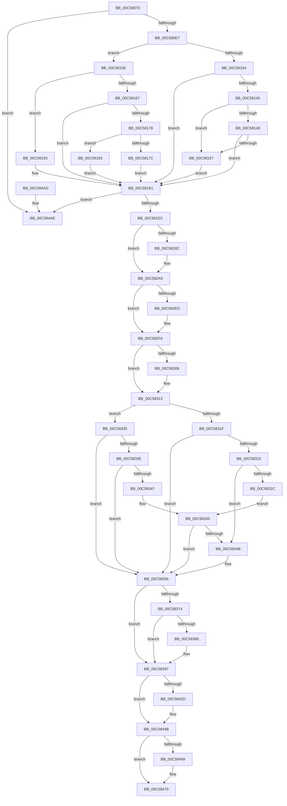

# CmpInitializePreloadedHive

- RVA: `0x00C58070`–`0x00C584CB` (길이 `1,115` bytes)
- VA: `0x0000000140C58070`
- 실행 섹션: `INIT`
- PDB 이름 있음: `예`; PDB Function 태그: `아니요`
- unwind 정보 RVA: `0x000D6454`
- 디코드: `276`개 명령, `1,115/1,115` bytes 표시
- 미해석 바이트: `0` (있으면 어셈블리에 `.byte`로 보존)

> 이 문서는 커널 이미지의 기계어와 PDB 기호를 분석해 생성했습니다. 4번과 5번은 함수 원형과 자료형을 바이너리 사용 방식에서 추정한 C 해석이며 원본 소스 복구 결과는 아닙니다.

## 1. Dependencies

- 직접 호출 지점: **25**; 고유 호출 대상: **12**
- 직접 호출자로 확인된 함수: **1**
- RIP 상대 이미지 참조: **14**

### Outgoing calls
- `0x00C580B2` → [memset](../../text/6C/memset_function_006C6C40.md) (function, `0x006C6C40`)
- `0x00C580D6` → [ExAllocatePool2](../../poolcode/B8/ExAllocatePool2_function_00B820F0.md) (function, `0x00B820F0`)
- `0x00C58108` → [CmpGetSystemRelativeRegistryHiveFilePath](CmpGetSystemRelativeRegistryHiveFilePath_function_00C57C6C.md) (function, `0x00C57C6C`)
- `0x00C5811B` → [RtlAppendUnicodeToString](../../text/40/RtlAppendUnicodeToString_function_0040F990.md) (function, `0x0040F990`)
- `0x00C58128` → [RtlAppendUnicodeToString](../../text/40/RtlAppendUnicodeToString_function_0040F990.md) (function, `0x0040F990`)
- `0x00C58134` → [RtlAppendUnicodeToString](../../text/40/RtlAppendUnicodeToString_function_0040F990.md) (function, `0x0040F990`)
- `0x00C5816B` → [RtlAppendUnicodeToString](../../text/40/RtlAppendUnicodeToString_function_0040F990.md) (function, `0x0040F990`)
- `0x00C5819A` → [RtlAppendUnicodeToString](../../text/40/RtlAppendUnicodeToString_function_0040F990.md) (function, `0x0040F990`)
- `0x00C581A7` → [RtlAppendUnicodeToString](../../text/40/RtlAppendUnicodeToString_function_0040F990.md) (function, `0x0040F990`)
- `0x00C581DB` → [ExAllocatePool2](../../poolcode/B8/ExAllocatePool2_function_00B820F0.md) (function, `0x00B820F0`)
- `0x00C581F8` → [memcpy](../../text/6C/memcpy_function_006C6840.md) (function, `0x006C6840`)
- `0x00C58202` → [ExFreePoolWithTag](../../poolcode/B8/ExFreePoolWithTag_function_00B82870.md) (function, `0x00B82870`)
- `0x00C58283` → [CmpCreateHive](../../page/87/CmpCreateHive_function_00879DF0.md) (function, `0x00879DF0`)
- `0x00C582A3` → [KeBugCheckEx](../../text/4F/KeBugCheckEx_function_004FD660.md) (function, `0x004FD660`)
- `0x00C582B2` → [CmpSetupLoggingState](../../page/7D/CmpSetupLoggingState_function_007DCCA8.md) (function, `0x007DCCA8`)
- `0x00C582C6` → [RtlInitUnicodeString](../../text/42/RtlInitUnicodeString_function_0042A780.md) (function, `0x0042A780`)
- `0x00C58391` → [KeBugCheckEx](../../text/4F/KeBugCheckEx_function_004FD660.md) (function, `0x004FD660`)
- `0x00C583B8` → [RtlAppendUnicodeToString](../../text/40/RtlAppendUnicodeToString_function_0040F990.md) (function, `0x0040F990`)
- `0x00C583C5` → [RtlAppendUnicodeToString](../../text/40/RtlAppendUnicodeToString_function_0040F990.md) (function, `0x0040F990`)
- `0x00C583D5` → [RtlAppendUnicodeToString](../../text/40/RtlAppendUnicodeToString_function_0040F990.md) (function, `0x0040F990`)
- `0x00C583E2` → [RtlAppendUnicodeToString](../../text/40/RtlAppendUnicodeToString_function_0040F990.md) (function, `0x0040F990`)
- `0x00C58424` → [CmpLinkHiveToMaster](../../page/87/CmpLinkHiveToMaster_function_00877D6C.md) (function, `0x00877D6C`)
- `0x00C58445` → [KeBugCheckEx](../../text/4F/KeBugCheckEx_function_004FD660.md) (function, `0x004FD660`)
- `0x00C5848D` → [_security_check_cookie](../../text/6A/_security_check_cookie_function_006AC640.md) (function, `0x006AC640`)
- `0x00C584C5` → [KeBugCheckEx](../../text/4F/KeBugCheckEx_function_004FD660.md) (function, `0x004FD660`)

### Direct callers
- [CmpInitializePreloadedHives](CmpInitializePreloadedHives_function_00C584D4.md) at `0x00C585A6`

### Static image references
- `0x00C5808F` → RVA `0x00E0A740` (`.data`; read)
- `0x00C5810D` → RVA `0x00C7E050` (` ?? ::PBOPGDP::`string'`; read)
- `0x00C58145` → RVA `0x00EEFB6C` (`.data`; read)
- `0x00C5814E` → RVA `0x00EEFB70` (`.data`; read)
- `0x00C58193` → RVA `0x00C7DFD0` (` ?? ::PBOPGDP::`string'`; read)
- `0x00C582FA` → RVA `0x00FD8004` (`PAGEDATA`; read)
- `0x00C58356` → RVA `0x00E0EC6C` (`.data`; read)
- `0x00C5836C` → RVA `0x00EF7C60` (`.data`; write)
- `0x00C58374` → RVA `0x00FD8002` (`PAGEDATA`; write)
- `0x00C583AD` → RVA `0x00C7E010` (` ?? ::PBOPGDP::`string'`; read)
- `0x00C583CA` → RVA `0x00C7DCE0` (` ?? ::PBOPGDP::`string'`; read)
- `0x00C5844B` → RVA `0x00EF7C08` (`.data`; read)
- `0x00C58452` → RVA `0x00EF7C00` (`.data`; read)
- `0x00C5847A` → RVA `0x00EF7C08` (`.data`; write)

## 2. Other-region calls and transfers

- 다른 실행 섹션으로 향하는 call: **24**
  - `0x00C580B2` → [memset](../../text/6C/memset_function_006C6C40.md) (`INIT` → `.text`)
  - `0x00C580D6` → [ExAllocatePool2](../../poolcode/B8/ExAllocatePool2_function_00B820F0.md) (`INIT` → `POOLCODE`)
  - `0x00C5811B` → [RtlAppendUnicodeToString](../../text/40/RtlAppendUnicodeToString_function_0040F990.md) (`INIT` → `.text`)
  - `0x00C58128` → [RtlAppendUnicodeToString](../../text/40/RtlAppendUnicodeToString_function_0040F990.md) (`INIT` → `.text`)
  - `0x00C58134` → [RtlAppendUnicodeToString](../../text/40/RtlAppendUnicodeToString_function_0040F990.md) (`INIT` → `.text`)
  - `0x00C5816B` → [RtlAppendUnicodeToString](../../text/40/RtlAppendUnicodeToString_function_0040F990.md) (`INIT` → `.text`)
  - `0x00C5819A` → [RtlAppendUnicodeToString](../../text/40/RtlAppendUnicodeToString_function_0040F990.md) (`INIT` → `.text`)
  - `0x00C581A7` → [RtlAppendUnicodeToString](../../text/40/RtlAppendUnicodeToString_function_0040F990.md) (`INIT` → `.text`)
  - `0x00C581DB` → [ExAllocatePool2](../../poolcode/B8/ExAllocatePool2_function_00B820F0.md) (`INIT` → `POOLCODE`)
  - `0x00C581F8` → [memcpy](../../text/6C/memcpy_function_006C6840.md) (`INIT` → `.text`)
  - `0x00C58202` → [ExFreePoolWithTag](../../poolcode/B8/ExFreePoolWithTag_function_00B82870.md) (`INIT` → `POOLCODE`)
  - `0x00C58283` → [CmpCreateHive](../../page/87/CmpCreateHive_function_00879DF0.md) (`INIT` → `PAGE`)
  - `0x00C582A3` → [KeBugCheckEx](../../text/4F/KeBugCheckEx_function_004FD660.md) (`INIT` → `.text`)
  - `0x00C582B2` → [CmpSetupLoggingState](../../page/7D/CmpSetupLoggingState_function_007DCCA8.md) (`INIT` → `PAGE`)
  - `0x00C582C6` → [RtlInitUnicodeString](../../text/42/RtlInitUnicodeString_function_0042A780.md) (`INIT` → `.text`)
  - `0x00C58391` → [KeBugCheckEx](../../text/4F/KeBugCheckEx_function_004FD660.md) (`INIT` → `.text`)
  - `0x00C583B8` → [RtlAppendUnicodeToString](../../text/40/RtlAppendUnicodeToString_function_0040F990.md) (`INIT` → `.text`)
  - `0x00C583C5` → [RtlAppendUnicodeToString](../../text/40/RtlAppendUnicodeToString_function_0040F990.md) (`INIT` → `.text`)
  - `0x00C583D5` → [RtlAppendUnicodeToString](../../text/40/RtlAppendUnicodeToString_function_0040F990.md) (`INIT` → `.text`)
  - `0x00C583E2` → [RtlAppendUnicodeToString](../../text/40/RtlAppendUnicodeToString_function_0040F990.md) (`INIT` → `.text`)
  - `0x00C58424` → [CmpLinkHiveToMaster](../../page/87/CmpLinkHiveToMaster_function_00877D6C.md) (`INIT` → `PAGE`)
  - `0x00C58445` → [KeBugCheckEx](../../text/4F/KeBugCheckEx_function_004FD660.md) (`INIT` → `.text`)
  - `0x00C5848D` → [_security_check_cookie](../../text/6A/_security_check_cookie_function_006AC640.md) (`INIT` → `.text`)
  - `0x00C584C5` → [KeBugCheckEx](../../text/4F/KeBugCheckEx_function_004FD660.md) (`INIT` → `.text`)
- 별도 외부 분기/꼬리 이동을 확인하지 못했습니다.

## 3. Assembly (complete function range)

```asm
00C58070  48 89 5C 24 18                  mov qword ptr [rsp + 0x18], rbx
00C58075  55                              push rbp
00C58076  56                              push rsi
00C58077  57                              push rdi
00C58078  41 54                           push r12
00C5807A  41 55                           push r13
00C5807C  41 56                           push r14
00C5807E  41 57                           push r15
00C58080  48 8D AC 24 20 FE FF FF         lea rbp, [rsp - 0x1e0]
00C58088  48 81 EC E0 02 00 00            sub rsp, 0x2e0
00C5808F  48 8B 05 AA 26 1B 00            mov rax, qword ptr [rip + 0x1b26aa]
00C58096  48 33 C4                        xor rax, rsp
00C58099  48 89 85 D0 01 00 00            mov qword ptr [rbp + 0x1d0], rax
00C580A0  4C 8B E2                        mov r12, rdx
00C580A3  48 8B F9                        mov rdi, rcx
00C580A6  33 D2                           xor edx, edx
00C580A8  48 8D 4D A0                     lea rcx, [rbp - 0x60]
00C580AC  41 B8 B0 01 00 00               mov r8d, 0x1b0
00C580B2  E8 89 EB A6 FF                  call 0x1406c6c40
00C580B7  45 33 ED                        xor r13d, r13d
00C580BA  BB 00 10 00 00                  mov ebx, 0x1000
00C580BF  8B D3                           mov edx, ebx
00C580C1  4C 89 6C 24 78                  mov qword ptr [rsp + 0x78], r13
00C580C6  41 B8 43 4D 20 20               mov r8d, 0x20204d43
00C580CC  44 88 6C 24 70                  mov byte ptr [rsp + 0x70], r13b
00C580D1  B9 00 01 00 00                  mov ecx, 0x100
00C580D6  E8 15 A0 F2 FF                  call 0x140b820f0
00C580DB  4C 8B F8                        mov r15, rax
00C580DE  48 85 C0                        test rax, rax
00C580E1  0F 84 C7 03 00 00               je 0x140c584ae
00C580E7  8B 4F 18                        mov ecx, dword ptr [rdi + 0x18]
00C580EA  41 8D 75 02                     lea esi, [r13 + 2]
00C580EE  0F 57 C0                        xorps xmm0, xmm0
00C580F1  0F 11 45 80                     movups xmmword ptr [rbp - 0x80], xmm0
00C580F5  48 89 45 88                     mov qword ptr [rbp - 0x78], rax
00C580F9  8D 46 7E                        lea eax, [rsi + 0x7e]
00C580FC  66 89 5D 82                     mov word ptr [rbp - 0x7e], bx
00C58100  84 C8                           test al, cl
00C58102  74 5A                           je 0x140c5815e
00C58104  48 8B 4F 10                     mov rcx, qword ptr [rdi + 0x10]
00C58108  E8 5F FB FF FF                  call 0x140c57c6c
00C5810D  48 8D 15 3C 5F 02 00            lea rdx, [rip + 0x25f3c]
00C58114  48 8B D8                        mov rbx, rax
00C58117  48 8D 4D 80                     lea rcx, [rbp - 0x80]
00C5811B  E8 70 78 7B FF                  call 0x14040f990
00C58120  48 8B 57 30                     mov rdx, qword ptr [rdi + 0x30]
00C58124  48 8D 4D 80                     lea rcx, [rbp - 0x80]
00C58128  E8 63 78 7B FF                  call 0x14040f990
00C5812D  48 8B D3                        mov rdx, rbx
00C58130  48 8D 4D 80                     lea rcx, [rbp - 0x80]
00C58134  E8 57 78 7B FF                  call 0x14040f990
00C58139  8B 47 18                        mov eax, dword ptr [rdi + 0x18]
00C5813C  BB 00 00 40 00                  mov ebx, 0x400000
00C58141  A8 10                           test al, 0x10
00C58143  74 6C                           je 0x140c581b1
00C58145  44 39 2D 20 7A 29 00            cmp dword ptr [rip + 0x297a20], r13d
00C5814C  74 09                           je 0x140c58157
00C5814E  44 39 2D 1B 7A 29 00            cmp dword ptr [rip + 0x297a1b], r13d
00C58155  75 5A                           jne 0x140c581b1
00C58157  BB 01 00 40 00                  mov ebx, 0x400001
00C5815C  EB 53                           jmp 0x140c581b1
00C5815E  F6 C1 36                        test cl, 0x36
00C58161  48 8D 4D 80                     lea rcx, [rbp - 0x80]
00C58165  74 2C                           je 0x140c58193
00C58167  48 8B 57 10                     mov rdx, qword ptr [rdi + 0x10]
00C5816B  E8 20 78 7B FF                  call 0x14040f990
00C58170  8B 47 18                        mov eax, dword ptr [rdi + 0x18]
00C58173  40 84 C6                        test sil, al
00C58176  75 39                           jne 0x140c581b1
00C58178  A8 04                           test al, 4
00C5817A  74 07                           je 0x140c58183
00C5817C  BB 00 20 00 00                  mov ebx, 0x2000
00C58181  EB 2E                           jmp 0x140c581b1
00C58183  24 20                           and al, 0x20
00C58185  F6 D8                           neg al
00C58187  1B C0                           sbb eax, eax
00C58189  25 FF FF 1F 00                  and eax, 0x1fffff
00C5818E  8D 58 01                        lea ebx, [rax + 1]
00C58191  EB 1E                           jmp 0x140c581b1
00C58193  48 8D 15 36 5E 02 00            lea rdx, [rip + 0x25e36]
00C5819A  E8 F1 77 7B FF                  call 0x14040f990
00C5819F  48 8B 57 10                     mov rdx, qword ptr [rdi + 0x10]
00C581A3  48 8D 4D 80                     lea rcx, [rbp - 0x80]
00C581A7  E8 E4 77 7B FF                  call 0x14040f990
00C581AC  BB 00 40 00 00                  mov ebx, 0x4000
00C581B1  44 8B 77 18                     mov r14d, dword ptr [rdi + 0x18]
00C581B5  B9 00 01 00 00                  mov ecx, 0x100
00C581BA  0F B7 55 80                     movzx edx, word ptr [rbp - 0x80]
00C581BE  8B F3                           mov esi, ebx
00C581C0  0F BA EE 18                     bts esi, 0x18
00C581C4  41 B8 43 4D 20 20               mov r8d, 0x20204d43
00C581CA  44 85 F1                        test ecx, r14d
00C581CD  0F 44 F3                        cmove esi, ebx
00C581D0  48 83 C2 02                     add rdx, 2
00C581D4  41 81 E6 00 02 00 00            and r14d, 0x200
00C581DB  E8 10 9F F2 FF                  call 0x140b820f0
00C581E0  48 8B D8                        mov rbx, rax
00C581E3  48 85 C0                        test rax, rax
00C581E6  0F 84 C2 02 00 00               je 0x140c584ae
00C581EC  44 0F B7 45 80                  movzx r8d, word ptr [rbp - 0x80]
00C581F1  48 8B C8                        mov rcx, rax
00C581F4  48 8B 55 88                     mov rdx, qword ptr [rbp - 0x78]
00C581F8  E8 43 E6 A6 FF                  call 0x1406c6840
00C581FD  33 D2                           xor edx, edx
00C581FF  49 8B CF                        mov rcx, r15
00C58202  E8 69 A6 F2 FF                  call 0x140b82870
00C58207  0F B7 4D 80                     movzx ecx, word ptr [rbp - 0x80]
00C5820B  48 D1 E9                        shr rcx, 1
00C5820E  66 44 89 2C 4B                  mov word ptr [rbx + rcx*2], r13w
00C58213  B9 02 00 00 00                  mov ecx, 2
00C58218  0F B7 45 80                     movzx eax, word ptr [rbp - 0x80]
00C5821C  44 8B C9                        mov r9d, ecx
00C5821F  44 8B 47 18                     mov r8d, dword ptr [rdi + 0x18]
00C58223  66 03 C1                        add ax, cx
00C58226  66 89 45 82                     mov word ptr [rbp - 0x7e], ax
00C5822A  41 83 E0 08                     and r8d, 8
00C5822E  48 8D 45 A0                     lea rax, [rbp - 0x60]
00C58232  41 C1 E0 05                     shl r8d, 5
00C58236  48 89 44 24 60                  mov qword ptr [rsp + 0x60], rax
00C5823B  8D 51 FF                        lea edx, [rcx - 1]
00C5823E  48 8D 44 24 70                  lea rax, [rsp + 0x70]
00C58243  48 89 5D 88                     mov qword ptr [rbp - 0x78], rbx
00C58247  48 89 44 24 58                  mov qword ptr [rsp + 0x58], rax
00C5824C  48 8D 4C 24 78                  lea rcx, [rsp + 0x78]
00C58251  48 89 7C 24 50                  mov qword ptr [rsp + 0x50], rdi
00C58256  48 8D 45 80                     lea rax, [rbp - 0x80]
00C5825A  4C 89 6C 24 48                  mov qword ptr [rsp + 0x48], r13
00C5825F  41 83 C8 12                     or r8d, 0x12
00C58263  4C 89 6C 24 40                  mov qword ptr [rsp + 0x40], r13
00C58268  C7 44 24 38 08 00 59 00         mov dword ptr [rsp + 0x38], 0x590008
00C58270  48 89 44 24 30                  mov qword ptr [rsp + 0x30], rax
00C58275  48 8B 47 20                     mov rax, qword ptr [rdi + 0x20]
00C58279  4C 89 6C 24 28                  mov qword ptr [rsp + 0x28], r13
00C5827E  48 89 44 24 20                  mov qword ptr [rsp + 0x20], rax
00C58283  E8 68 1B C2 FF                  call 0x140879df0
00C58288  85 C0                           test eax, eax
00C5828A  79 1D                           jns 0x140c582a9
00C5828C  BA 03 00 00 00                  mov edx, 3
00C58291  48 98                           cdqe
00C58293  4C 8D 4D A0                     lea r9, [rbp - 0x60]
00C58297  48 89 44 24 20                  mov qword ptr [rsp + 0x20], rax
00C5829C  8D 4A 71                        lea ecx, [rdx + 0x71]
00C5829F  44 8D 42 02                     lea r8d, [rdx + 2]
00C582A3  E8 B8 53 8A FF                  call 0x1404fd660
00C582A8  CC                              int3
00C582A9  48 8B 4C 24 78                  mov rcx, qword ptr [rsp + 0x78]
00C582AE  48 8D 57 40                     lea rdx, [rdi + 0x40]
00C582B2  E8 F1 49 B8 FF                  call 0x1407dcca8
00C582B7  48 8B 4C 24 78                  mov rcx, qword ptr [rsp + 0x78]
00C582BC  48 8B D3                        mov rdx, rbx
00C582BF  48 81 C1 20 07 00 00            add rcx, 0x720
00C582C6  E8 B5 24 7D FF                  call 0x14042a780
00C582CB  48 8B 4C 24 78                  mov rcx, qword ptr [rsp + 0x78]
00C582D0  8B C6                           mov eax, esi
00C582D2  0F BA E8 1A                     bts eax, 0x1a
00C582D6  45 85 F6                        test r14d, r14d
00C582D9  0F 44 C6                        cmove eax, esi
00C582DC  0F BA E8 0A                     bts eax, 0xa
00C582E0  09 81 A0 00 00 00               or dword ptr [rcx + 0xa0], eax
00C582E6  80 7C 24 70 01                  cmp byte ptr [rsp + 0x70], 1
00C582EB  75 0D                           jne 0x140c582fa
00C582ED  48 8B 44 24 78                  mov rax, qword ptr [rsp + 0x78]
00C582F2  0F BA A8 A0 00 00 00 0B         bts dword ptr [rax + 0xa0], 0xb
00C582FA  44 38 2D 03 FD 37 00            cmp byte ptr [rip + 0x37fd03], r13b
00C58301  B9 00 80 00 00                  mov ecx, 0x8000
00C58306  74 0B                           je 0x140c58313
00C58308  48 8B 44 24 78                  mov rax, qword ptr [rsp + 0x78]
00C5830D  09 88 A0 00 00 00               or dword ptr [rax + 0xa0], ecx
00C58313  8B 47 18                        mov eax, dword ptr [rdi + 0x18]
00C58316  BA 80 00 00 00                  mov edx, 0x80
00C5831B  84 C2                           test dl, al
00C5831D  74 16                           je 0x140c58335
00C5831F  A8 10                           test al, 0x10
00C58321  74 33                           je 0x140c58356
00C58323  44 39 2D 42 78 29 00            cmp dword ptr [rip + 0x297842], r13d
00C5832A  74 1F                           je 0x140c5834b
00C5832C  44 39 2D 3D 78 29 00            cmp dword ptr [rip + 0x29783d], r13d
00C58333  EB 14                           jmp 0x140c58349
00C58335  44 39 2D 30 78 29 00            cmp dword ptr [rip + 0x297830], r13d
00C5833C  74 18                           je 0x140c58356
00C5833E  44 39 2D 2B 78 29 00            cmp dword ptr [rip + 0x29782b], r13d
00C58345  75 0F                           jne 0x140c58356
00C58347  A8 20                           test al, 0x20
00C58349  75 0B                           jne 0x140c58356
00C5834B  48 8B 44 24 78                  mov rax, qword ptr [rsp + 0x78]
00C58350  09 88 A0 00 00 00               or dword ptr [rax + 0xa0], ecx
00C58356  44 39 2D 0F 69 1B 00            cmp dword ptr [rip + 0x1b690f], r13d
00C5835D  4C 8B 4C 24 78                  mov r9, qword ptr [rsp + 0x78]
00C58362  49 8B 41 40                     mov rax, qword ptr [r9 + 0x40]
00C58366  8B 88 F8 0F 00 00               mov ecx, dword ptr [rax + 0xff8]
00C5836C  89 0D EE F8 29 00               mov dword ptr [rip + 0x29f8ee], ecx
00C58372  75 23                           jne 0x140c58397
00C58374  44 88 2D 87 FC 37 00            mov byte ptr [rip + 0x37fc87], r13b
00C5837B  F6 C1 04                        test cl, 4
00C5837E  74 17                           je 0x140c58397
00C58380  BA 03 00 00 00                  mov edx, 3
00C58385  4C 89 6C 24 20                  mov qword ptr [rsp + 0x20], r13
00C5838A  8D 4A 71                        lea ecx, [rdx + 0x71]
00C5838D  44 8D 42 03                     lea r8d, [rdx + 3]
00C58391  E8 CA 52 8A FF                  call 0x1404fd660
00C58396  CC                              int3
00C58397  0F 57 C0                        xorps xmm0, xmm0
00C5839A  48 8D 85 50 01 00 00            lea rax, [rbp + 0x150]
00C583A1  0F 11 45 90                     movups xmmword ptr [rbp - 0x70], xmm0
00C583A5  66 89 55 92                     mov word ptr [rbp - 0x6e], dx
00C583A9  48 8D 4D 90                     lea rcx, [rbp - 0x70]
00C583AD  48 8D 15 5C 5C 02 00            lea rdx, [rip + 0x25c5c]
00C583B4  48 89 45 98                     mov qword ptr [rbp - 0x68], rax
00C583B8  E8 D3 75 7B FF                  call 0x14040f990
00C583BD  48 8B 57 38                     mov rdx, qword ptr [rdi + 0x38]
00C583C1  48 8D 4D 90                     lea rcx, [rbp - 0x70]
00C583C5  E8 C6 75 7B FF                  call 0x14040f990
00C583CA  48 8D 15 0F 59 02 00            lea rdx, [rip + 0x2590f]
00C583D1  48 8D 4D 90                     lea rcx, [rbp - 0x70]
00C583D5  E8 B6 75 7B FF                  call 0x14040f990
00C583DA  48 8B 57 30                     mov rdx, qword ptr [rdi + 0x30]
00C583DE  48 8D 4D 90                     lea rcx, [rbp - 0x70]
00C583E2  E8 A9 75 7B FF                  call 0x14040f990
00C583E7  4C 8B 44 24 78                  mov r8, qword ptr [rsp + 0x78]
00C583EC  48 8D 45 A0                     lea rax, [rbp - 0x60]
00C583F0  48 89 44 24 58                  mov qword ptr [rsp + 0x58], rax
00C583F5  48 8D 4D 90                     lea rcx, [rbp - 0x70]
00C583F9  C6 44 24 50 01                  mov byte ptr [rsp + 0x50], 1
00C583FE  45 33 C9                        xor r9d, r9d
00C58401  4C 89 6C 24 48                  mov qword ptr [rsp + 0x48], r13
00C58406  33 D2                           xor edx, edx
00C58408  4C 89 6C 24 40                  mov qword ptr [rsp + 0x40], r13
00C5840D  4C 89 64 24 38                  mov qword ptr [rsp + 0x38], r12
00C58412  4C 89 6C 24 30                  mov qword ptr [rsp + 0x30], r13
00C58417  44 88 6C 24 28                  mov byte ptr [rsp + 0x28], r13b
00C5841C  C7 44 24 20 00 02 00 00         mov dword ptr [rsp + 0x20], 0x200
00C58424  E8 43 F9 C1 FF                  call 0x140877d6c
00C58429  85 C0                           test eax, eax
00C5842B  79 1E                           jns 0x140c5844b
00C5842D  4C 8B 4C 24 78                  mov r9, qword ptr [rsp + 0x78]
00C58432  BA 03 00 00 00                  mov edx, 3
00C58437  48 98                           cdqe
00C58439  48 89 44 24 20                  mov qword ptr [rsp + 0x20], rax
00C5843E  8D 4A 71                        lea ecx, [rdx + 0x71]
00C58441  44 8D 42 04                     lea r8d, [rdx + 4]
00C58445  E8 16 52 8A FF                  call 0x1404fd660
00C5844A  CC                              int3
00C5844B  48 8B 0D B6 F7 29 00            mov rcx, qword ptr [rip + 0x29f7b6]
00C58452  48 8D 15 A7 F7 29 00            lea rdx, [rip + 0x29f7a7]
00C58459  48 8B 44 24 78                  mov rax, qword ptr [rsp + 0x78]
00C5845E  48 05 58 06 00 00               add rax, 0x658
00C58464  48 39 11                        cmp qword ptr [rcx], rdx
00C58467  74 07                           je 0x140c58470
00C58469  B9 03 00 00 00                  mov ecx, 3
00C5846E  CD 29                           int 0x29
00C58470  48 89 10                        mov qword ptr [rax], rdx
00C58473  48 89 48 08                     mov qword ptr [rax + 8], rcx
00C58477  48 89 01                        mov qword ptr [rcx], rax
00C5847A  48 89 05 87 F7 29 00            mov qword ptr [rip + 0x29f787], rax
00C58481  33 C0                           xor eax, eax
00C58483  48 8B 8D D0 01 00 00            mov rcx, qword ptr [rbp + 0x1d0]
00C5848A  48 33 CC                        xor rcx, rsp
00C5848D  E8 AE 41 A5 FF                  call 0x1406ac640
00C58492  48 8B 9C 24 30 03 00 00         mov rbx, qword ptr [rsp + 0x330]
00C5849A  48 81 C4 E0 02 00 00            add rsp, 0x2e0
00C584A1  41 5F                           pop r15
00C584A3  41 5E                           pop r14
00C584A5  41 5D                           pop r13
00C584A7  41 5C                           pop r12
00C584A9  5F                              pop rdi
00C584AA  5E                              pop rsi
00C584AB  5D                              pop rbp
00C584AC  C3                              ret
00C584AD  CC                              int3
00C584AE  45 33 C9                        xor r9d, r9d
00C584B1  48 C7 44 24 20 9A 00 00 C0      mov qword ptr [rsp + 0x20], 0xffffffffc000009a
00C584BA  41 8D 51 03                     lea edx, [r9 + 3]
00C584BE  8D 4A 71                        lea ecx, [rdx + 0x71]
00C584C1  45 8D 41 04                     lea r8d, [r9 + 4]
00C584C5  E8 96 51 8A FF                  call 0x1404fd660
00C584CA  CC                              int3
```

## 4. C-style interpretation (structured pseudocode)

```c
__int64 __fastcall CmpInitializePreloadedHive(__int64 a1, __int64 a2)
{
    __int64 result;
    __int64 v_r13;
    __int64 v_r14;
    __int64 v_rsi;
    __int64 v_rsp;
    unsigned __int64 v_stack_m218;
    unsigned __int64 v_stack_m278;
    unsigned __int64 v_stack_m280;
    unsigned __int16 v_stack_m286;
    unsigned __int64 v_stack_m288;
    unsigned __int64 v_stack_m290;
    unsigned __int16 v_stack_m296;
    unsigned __int64 v_stack_m298;
    unsigned __int64 v_stack_m2A0;
    unsigned __int8 v_stack_m2A8;
    unsigned __int64 v_stack_m2B8;
    unsigned __int64 v_stack_m2C0;
    unsigned __int64 v_stack_m2C8;
    unsigned __int64 v_stack_m2D0;
    unsigned __int64 v_stack_m2D8;
    unsigned int v_stack_m2E0;
    unsigned __int64 v_stack_m2E8;
    unsigned __int64 v_stack_m2F0;
    unsigned __int64 v_stack_m2F8;
    unsigned __int64 v_stack_m48;
    unsigned __int64 v_stack_mC8;
    unsigned __int64 v_stack_p18;
    unsigned __int64 v_stack_p20;

    v_stack_p18 = v_rbx;
    v_rsp = (v_rsp) - (736);
    result = (*(unsigned __int64 *)(v_rip + 1779370)) ^ (v_rsp);
    v_stack_m48 = result;
    a2 = 0;
    result = memset(v_stack_m278, a2, 432, a4);
    v_r13 = 0;
    v_stack_m2A0 = 0;
    v_stack_m2A8 = 0;
    result = ExAllocatePool2(256, (unsigned int)((unsigned int)((unsigned int)(0x1000ULL))), (unsigned int)(0x20204D43ULL), a4);
    if (result == 0) goto loc_00C584AE;
    v_stack_m298 = v_xmm0;
    v_stack_m290 = result;
    v_stack_m296 = (unsigned __int16)((unsigned int)(0x1000ULL));
    if ((((unsigned __int8)(v_r13 + 2 + 126)) & ((unsigned __int8)((unsigned int)(*(unsigned int *)(a1 + 24))))) == 0) goto loc_00C5815E;
    result = CmpGetSystemRelativeRegistryHiveFilePath(*(unsigned __int64 *)(a1 + 16), (unsigned int)((unsigned int)((unsigned int)(0x1000ULL))), (unsigned int)(0x20204D43ULL), a4);
    result = RtlAppendUnicodeToString(v_stack_m298, v_rip + 155452, (unsigned int)(0x20204D43ULL), a4);
    result = RtlAppendUnicodeToString(v_stack_m298, *(unsigned __int64 *)(a1 + 48), (unsigned int)(0x20204D43ULL), a4);
    result = RtlAppendUnicodeToString(v_stack_m298, result, (unsigned int)(0x20204D43ULL), a4);
    if ((((unsigned __int8)((unsigned int)(*(unsigned int *)(a1 + 24)))) & (16)) == 0) goto loc_00C581B1;
    if ((*(unsigned int *)(v_rip + 2718240)) == 0) goto loc_00C58157;
    if ((*(unsigned int *)(v_rip + 2718235)) != 0) goto loc_00C581B1;
loc_00C58157:
    goto loc_00C581B1;
loc_00C5815E:
    if ((((unsigned __int8)(v_stack_m298)) & (54)) == 0) goto loc_00C58193;
    result = RtlAppendUnicodeToString(v_stack_m298, *(unsigned __int64 *)(a1 + 16), (unsigned int)(0x20204D43ULL), a4);
    if ((((unsigned __int8)(v_r13 + 2)) & ((unsigned __int8)((unsigned int)(*(unsigned int *)(a1 + 24))))) != 0) goto loc_00C581B1;
    if ((((unsigned __int8)((unsigned int)(*(unsigned int *)(a1 + 24)))) & (4)) == 0) goto loc_00C58183;
    goto loc_00C581B1;
loc_00C58183:
    result = (unsigned __int8)(((unsigned int)(*(unsigned int *)(a1 + 24))) & (32));
    result = (unsigned __int8)(-(result));
    result = (unsigned int)((result) & (0x1FFFFFULL));
    goto loc_00C581B1;
loc_00C58193:
    result = RtlAppendUnicodeToString(v_stack_m298, v_rip + 155190, (unsigned int)(0x20204D43ULL), a4);
    result = RtlAppendUnicodeToString(v_stack_m298, *(unsigned __int64 *)(a1 + 16), (unsigned int)(0x20204D43ULL), a4);
loc_00C581B1:
    v_rsi = (unsigned int)((unsigned int)((unsigned int)(0x4000ULL)));
    if (((256) & ((unsigned int)((unsigned int)(*(unsigned int *)(a1 + 24))))) == 0) { v_rsi = (unsigned int)((unsigned int)(0x4000ULL)); }
    a2 = (v_stack_m298) + (2);
    v_r14 = (unsigned int)(((unsigned int)(*(unsigned int *)(a1 + 24))) & (512));
    result = ExAllocatePool2(256, a2, (unsigned int)(0x20204D43ULL), a4);
    if (result == 0) goto loc_00C584AE;
    result = memcpy(result, v_stack_m290, v_stack_m298, a4);
    a2 = 0;
    result = ExFreePoolWithTag(result, a2, v_stack_m298, a4);
    a1 = (v_stack_m298) >> (1);
    *(unsigned __int16 *)(result + a1 * 2) = 0;
    result = (unsigned __int16)((v_stack_m298) + (2));
    v_stack_m296 = (unsigned __int16)(result);
    a3 = (unsigned int)(((unsigned int)(*(unsigned int *)(a1 + 24))) & (8));
    a3 = (unsigned int)((a3) << (5));
    v_stack_m2B8 = v_stack_m278;
    v_stack_m290 = result;
    v_stack_m2C0 = v_stack_m2A8;
    v_stack_m2C8 = a1;
    v_stack_m2D0 = 0;
    a3 = (unsigned int)((a3) | (18));
    v_stack_m2D8 = 0;
    v_stack_m2E0 = 0x590008ULL;
    v_stack_m2E8 = v_stack_m298;
    v_stack_m2F0 = 0;
    v_stack_m2F8 = *(unsigned __int64 *)(a1 + 32);
    result = CmpCreateHive(v_stack_m2A0, 2 - 1, a3, 2);
    if (sign_flag) {
        a2 = 3;
        a4 = v_stack_m278;
        v_stack_m2F8 = result;
        a1 = a2 + 113;
        a3 = a2 + 2;
        result = KeBugCheckEx(a1, a2, a3, a4);
    }
    result = CmpSetupLoggingState(v_stack_m2A0, a1 + 64, a3, a4);
    a1 = (v_stack_m2A0) + (0x720ULL);
    result = RtlInitUnicodeString(a1, result, a3, a4);
    result = (unsigned int)((unsigned int)(v_rsi));
    if ((unsigned int)(v_r14) == 0) { result = (unsigned int)(v_rsi); }
    if (v_stack_m2A8 == 1) {
        result = v_stack_m2A0;
    }
    if ((*(unsigned __int8 *)(v_rip + 3669251)) != 0) {
        result = v_stack_m2A0;
    }
    if (((128) & ((unsigned __int8)((unsigned int)(*(unsigned int *)(a1 + 24))))) == 0) goto loc_00C58335;
    if ((((unsigned __int8)((unsigned int)(*(unsigned int *)(a1 + 24)))) & (16)) == 0) goto loc_00C58356;
    if ((*(unsigned int *)(v_rip + 2717762)) == 0) goto loc_00C5834B;
    goto loc_00C58349;
loc_00C58335:
    if ((*(unsigned int *)(v_rip + 2717744)) == 0) goto loc_00C58356;
    if ((*(unsigned int *)(v_rip + 2717739)) != 0) goto loc_00C58356;
loc_00C58349:
    result = (unsigned int)(*(unsigned int *)(a1 + 24));
    if ((((unsigned __int8)((unsigned int)(*(unsigned int *)(a1 + 24)))) & (32)) == 0) {
        result = v_stack_m2A0;
    }
    *(unsigned int *)(v_rip + 2750702) = (unsigned int)((unsigned int)(*(unsigned int *)(*(unsigned __int64 *)(v_stack_m2A0 + 64) + 4088)));
    if ((*(unsigned int *)(v_rip + 1796367)) != 0) goto loc_00C58397;
    *(unsigned __int8 *)(v_rip + 3669127) = 0;
    result = *(unsigned __int64 *)(v_stack_m2A0 + 64);
    if ((((unsigned __int8)((unsigned int)(*(unsigned int *)(*(unsigned __int64 *)(v_stack_m2A0 + 64) + 4088)))) & (4)) != 0) {
        a2 = 3;
        v_stack_m2F8 = 0;
        a1 = a2 + 113;
        a3 = a2 + 3;
        result = KeBugCheckEx(a1, a2, a3, v_stack_m2A0);
    }
    v_stack_m288 = v_xmm0;
    v_stack_m286 = (unsigned __int16)(a2);
    v_stack_m280 = v_stack_mC8;
    result = RtlAppendUnicodeToString(v_stack_m288, v_rip + 154716, a3, v_stack_m2A0);
    result = RtlAppendUnicodeToString(v_stack_m288, *(unsigned __int64 *)(a1 + 56), a3, v_stack_m2A0);
    result = RtlAppendUnicodeToString(v_stack_m288, v_rip + 153871, a3, v_stack_m2A0);
    result = RtlAppendUnicodeToString(v_stack_m288, *(unsigned __int64 *)(a1 + 48), a3, v_stack_m2A0);
    v_stack_m2C0 = v_stack_m278;
    v_stack_m2C8 = 1;
    a4 = 0;
    v_stack_m2D0 = 0;
    a2 = 0;
    v_stack_m2D8 = 0;
    v_stack_m2E0 = 0;
    v_stack_m2E8 = 0;
    v_stack_m2F0 = 0;
    v_stack_m2F8 = 512;
    result = CmpLinkHiveToMaster(v_stack_m288, a2, v_stack_m2A0, a4);
    if (sign_flag) {
        a4 = v_stack_m2A0;
        a2 = 3;
        v_stack_m2F8 = result;
        a1 = a2 + 113;
        a3 = a2 + 4;
        result = KeBugCheckEx(a1, a2, a3, a4);
    }
    result = (v_stack_m2A0) + (0x658ULL);
    if ((*(unsigned __int64 *)(*(unsigned __int64 *)(v_rip + 2750390))) != (v_rip + 2750375)) {
        a1 = 3;
    }
    *(unsigned __int64 *)(result) = v_rip + 2750375;
    *(unsigned __int64 *)(result + 8) = a1;
    *(unsigned __int64 *)(a1) = result;
    *(unsigned __int64 *)(v_rip + 2750343) = result;
    result = 0;
    a1 = (v_stack_m48) ^ (v_rsp);
    result = _security_check_cookie(a1, v_rip + 2750375, a3, a4);
    v_rsp = (v_rsp) + (736);
    return result;
loc_00C584AE:
    a4 = 0;
    v_stack_p20 = 0xFFFFFFFFC000009AULL;
    result = KeBugCheckEx(a4 + 3 + 113, a4 + 3, a4 + 4, a4);
    return result;
}
```

## 5. (Beta) C Style

```c
int64_t CmpInitializePreloadedHive(void *Arg1, int64_t Arg2)
{
    uint8_t *arg1 = (uint8_t *)Arg1;

    int64_t result;
    int64_t local_r13;
    int64_t local_r14;
    int64_t local_rsi;
    int64_t local_rsp;
    uint64_t v_stack_m218;
    uint64_t v_stack_m278;
    uint64_t v_stack_m280;
    uint16_t v_stack_m286;
    uint64_t v_stack_m288;
    uint64_t v_stack_m290;
    uint16_t v_stack_m296;
    uint64_t v_stack_m298;
    uint64_t v_stack_m2A0;
    uint8_t v_stack_m2A8;
    uint64_t v_stack_m2B8;
    uint64_t v_stack_m2C0;
    uint64_t v_stack_m2C8;
    uint64_t v_stack_m2D0;
    uint64_t v_stack_m2D8;
    uint32_t v_stack_m2E0;
    uint64_t v_stack_m2E8;
    uint64_t v_stack_m2F0;
    uint64_t v_stack_m2F8;
    uint64_t v_stack_m48;
    uint64_t v_stack_mC8;
    uint64_t v_stack_p18;
    uint64_t v_stack_p20;

    v_stack_p18 = local_rbx;
    local_rsp = (local_rsp) - (736);
    result = (*(uint64_t *)(v_rip + 0x1B26AA)) ^ (local_rsp);
    v_stack_m48 = result;
    Arg2 = 0;
    result = memset(v_stack_m278, Arg2, 432, a4);
    local_r13 = 0;
    v_stack_m2A0 = 0;
    v_stack_m2A8 = 0;
    result = ExAllocatePool2(256, (uint32_t)((uint32_t)((uint32_t)(0x1000ULL))), (uint32_t)(0x20204D43ULL), a4);
    if (result == 0) goto loc_00C584AE;
    v_stack_m298 = v_xmm0;
    v_stack_m290 = result;
    v_stack_m296 = (uint16_t)((uint32_t)(0x1000ULL));
    if ((((uint8_t)(local_r13 + 2 + 126)) & ((uint8_t)((uint32_t)(*(uint32_t *)(arg1 + 0x18))))) == 0) goto loc_00C5815E;
    result = CmpGetSystemRelativeRegistryHiveFilePath(*(uint64_t *)(arg1 + 0x10), (uint32_t)((uint32_t)((uint32_t)(0x1000ULL))), (uint32_t)(0x20204D43ULL), a4);
    result = RtlAppendUnicodeToString(v_stack_m298, v_rip + 155452, (uint32_t)(0x20204D43ULL), a4);
    result = RtlAppendUnicodeToString(v_stack_m298, *(uint64_t *)(arg1 + 0x30), (uint32_t)(0x20204D43ULL), a4);
    result = RtlAppendUnicodeToString(v_stack_m298, result, (uint32_t)(0x20204D43ULL), a4);
    if ((((uint8_t)((uint32_t)(*(uint32_t *)(arg1 + 0x18)))) & (16)) == 0) goto loc_00C581B1;
    if ((*(uint32_t *)(v_rip + 0x297A20)) == 0) goto loc_00C58157;
    if ((*(uint32_t *)(v_rip + 0x297A1B)) != 0) goto loc_00C581B1;
loc_00C58157:
    goto loc_00C581B1;
loc_00C5815E:
    if ((((uint8_t)(v_stack_m298)) & (54)) == 0) goto loc_00C58193;
    result = RtlAppendUnicodeToString(v_stack_m298, *(uint64_t *)(arg1 + 0x10), (uint32_t)(0x20204D43ULL), a4);
    if ((((uint8_t)(local_r13 + 2)) & ((uint8_t)((uint32_t)(*(uint32_t *)(arg1 + 0x18))))) != 0) goto loc_00C581B1;
    if ((((uint8_t)((uint32_t)(*(uint32_t *)(arg1 + 0x18)))) & (4)) == 0) goto loc_00C58183;
    goto loc_00C581B1;
loc_00C58183:
    result = (uint8_t)(((uint32_t)(*(uint32_t *)(arg1 + 0x18))) & (32));
    result = (uint8_t)(-(result));
    result = (uint32_t)((result) & (0x1FFFFFULL));
    goto loc_00C581B1;
loc_00C58193:
    result = RtlAppendUnicodeToString(v_stack_m298, v_rip + 155190, (uint32_t)(0x20204D43ULL), a4);
    result = RtlAppendUnicodeToString(v_stack_m298, *(uint64_t *)(arg1 + 0x10), (uint32_t)(0x20204D43ULL), a4);
loc_00C581B1:
    local_rsi = (uint32_t)((uint32_t)((uint32_t)(0x4000ULL)));
    if (((256) & ((uint32_t)((uint32_t)(*(uint32_t *)(arg1 + 0x18))))) == 0) { local_rsi = (uint32_t)((uint32_t)(0x4000ULL)); }
    Arg2 = (v_stack_m298) + (2);
    local_r14 = (uint32_t)(((uint32_t)(*(uint32_t *)(arg1 + 0x18))) & (512));
    result = ExAllocatePool2(256, Arg2, (uint32_t)(0x20204D43ULL), a4);
    if (result == 0) goto loc_00C584AE;
    result = memcpy(result, v_stack_m290, v_stack_m298, a4);
    Arg2 = 0;
    result = ExFreePoolWithTag(result, Arg2, v_stack_m298, a4);
    Arg1 = (v_stack_m298) >> (1);
    *(uint16_t *)(result + arg1 * 2) = 0;
    result = (uint16_t)((v_stack_m298) + (2));
    v_stack_m296 = (uint16_t)(result);
    a3 = (uint32_t)(((uint32_t)(*(uint32_t *)(arg1 + 0x18))) & (8));
    a3 = (uint32_t)((a3) << (5));
    v_stack_m2B8 = v_stack_m278;
    v_stack_m290 = result;
    v_stack_m2C0 = v_stack_m2A8;
    v_stack_m2C8 = Arg1;
    v_stack_m2D0 = 0;
    a3 = (uint32_t)((a3) | (18));
    v_stack_m2D8 = 0;
    v_stack_m2E0 = 0x590008ULL;
    v_stack_m2E8 = v_stack_m298;
    v_stack_m2F0 = 0;
    v_stack_m2F8 = *(uint64_t *)(arg1 + 0x20);
    result = CmpCreateHive(v_stack_m2A0, 2 - 1, a3, 2);
    if (sign_flag) {
        Arg2 = 3;
        a4 = v_stack_m278;
        v_stack_m2F8 = result;
        Arg1 = Arg2 + 113;
        a3 = Arg2 + 2;
        result = KeBugCheckEx(Arg1, Arg2, a3, a4);
    }
    result = CmpSetupLoggingState(v_stack_m2A0, Arg1 + 64, a3, a4);
    Arg1 = (v_stack_m2A0) + (0x720ULL);
    result = RtlInitUnicodeString(Arg1, result, a3, a4);
    result = (uint32_t)((uint32_t)(local_rsi));
    if ((uint32_t)(local_r14) == 0) { result = (uint32_t)(local_rsi); }
    if (v_stack_m2A8 == 1) {
        result = v_stack_m2A0;
    }
    if ((*(uint8_t *)(v_rip + 0x37FD03)) != 0) {
        result = v_stack_m2A0;
    }
    if (((128) & ((uint8_t)((uint32_t)(*(uint32_t *)(arg1 + 0x18))))) == 0) goto loc_00C58335;
    if ((((uint8_t)((uint32_t)(*(uint32_t *)(arg1 + 0x18)))) & (16)) == 0) goto loc_00C58356;
    if ((*(uint32_t *)(v_rip + 0x297842)) == 0) goto loc_00C5834B;
    goto loc_00C58349;
loc_00C58335:
    if ((*(uint32_t *)(v_rip + 0x297830)) == 0) goto loc_00C58356;
    if ((*(uint32_t *)(v_rip + 0x29782B)) != 0) goto loc_00C58356;
loc_00C58349:
    result = (uint32_t)(*(uint32_t *)(arg1 + 0x18));
    if ((((uint8_t)((uint32_t)(*(uint32_t *)(arg1 + 0x18)))) & (32)) == 0) {
        result = v_stack_m2A0;
    }
    *(uint32_t *)(v_rip + 0x29F8EE) = (uint32_t)((uint32_t)(*(uint32_t *)(*(uint64_t *)(v_stack_m2A0 + 0x40) + 0xFF8)));
    if ((*(uint32_t *)(v_rip + 0x1B690F)) != 0) goto loc_00C58397;
    *(uint8_t *)(v_rip + 0x37FC87) = 0;
    result = *(uint64_t *)(v_stack_m2A0 + 0x40);
    if ((((uint8_t)((uint32_t)(*(uint32_t *)(*(uint64_t *)(v_stack_m2A0 + 0x40) + 0xFF8)))) & (4)) != 0) {
        Arg2 = 3;
        v_stack_m2F8 = 0;
        Arg1 = Arg2 + 113;
        a3 = Arg2 + 3;
        result = KeBugCheckEx(Arg1, Arg2, a3, v_stack_m2A0);
    }
    v_stack_m288 = v_xmm0;
    v_stack_m286 = (uint16_t)(Arg2);
    v_stack_m280 = v_stack_mC8;
    result = RtlAppendUnicodeToString(v_stack_m288, v_rip + 154716, a3, v_stack_m2A0);
    result = RtlAppendUnicodeToString(v_stack_m288, *(uint64_t *)(arg1 + 0x38), a3, v_stack_m2A0);
    result = RtlAppendUnicodeToString(v_stack_m288, v_rip + 153871, a3, v_stack_m2A0);
    result = RtlAppendUnicodeToString(v_stack_m288, *(uint64_t *)(arg1 + 0x30), a3, v_stack_m2A0);
    v_stack_m2C0 = v_stack_m278;
    v_stack_m2C8 = 1;
    a4 = 0;
    v_stack_m2D0 = 0;
    Arg2 = 0;
    v_stack_m2D8 = 0;
    v_stack_m2E0 = 0;
    v_stack_m2E8 = 0;
    v_stack_m2F0 = 0;
    v_stack_m2F8 = 512;
    result = CmpLinkHiveToMaster(v_stack_m288, Arg2, v_stack_m2A0, a4);
    if (sign_flag) {
        a4 = v_stack_m2A0;
        Arg2 = 3;
        v_stack_m2F8 = result;
        Arg1 = Arg2 + 113;
        a3 = Arg2 + 4;
        result = KeBugCheckEx(Arg1, Arg2, a3, a4);
    }
    result = (v_stack_m2A0) + (0x658ULL);
    if ((*(uint64_t *)(*(uint64_t *)(v_rip + 0x29F7B6))) != (v_rip + 2750375)) {
        Arg1 = 3;
    }
    *(uint64_t *)(result) = v_rip + 2750375;
    *(void **)(result + 0x8) = Arg1;
    *(uint64_t *)(arg1) = result;
    *(uint64_t *)(v_rip + 0x29F787) = result;
    result = 0;
    Arg1 = (v_stack_m48) ^ (local_rsp);
    result = _security_check_cookie(Arg1, v_rip + 2750375, a3, a4);
    local_rsp = (local_rsp) + (736);
    return result;
loc_00C584AE:
    a4 = 0;
    v_stack_p20 = 0xFFFFFFFFC000009AULL;
    result = KeBugCheckEx(a4 + 3 + 113, a4 + 3, a4 + 4, a4);
    return result;
}
```

### 관측된 메모리 오프셋

구조체 형식이 확인되지 않은 접근은 인자 기준의 오프셋으로만 기록했습니다.

| 기준 인자 | 오프셋 표현 | 폭 (bit) | 접근 |
|---|---:|---:|---|
| `Arg1` | `+ 0x10` | `64` | `R` |
| `Arg1` | `+ 0x18` | `32` | `R` |
| `Arg1` | `+ 0x20` | `64` | `R` |
| `Arg1` | `+ 0x30` | `64` | `R` |
| `Arg1` | `+ 0x38` | `64` | `R` |
| `Arg1` | `+ 0x40` | `64` | `R` |

## 6. Execution-region graph

[열기: 2D/3D 그래프와 함수 탐색 컨트롤 패널](../../../control-panel.html?section=init&rva=0x00C58070&view=graph)

- 2D 그래프는 위에서 아래로 흐르고, 3D 그래프는 빈 공간을 드래그해 회전합니다. Shift+드래그는 이동, 휠은 확대·축소, 함수 노드 선택은 대상 보고서 이동입니다.

### Static fallback


