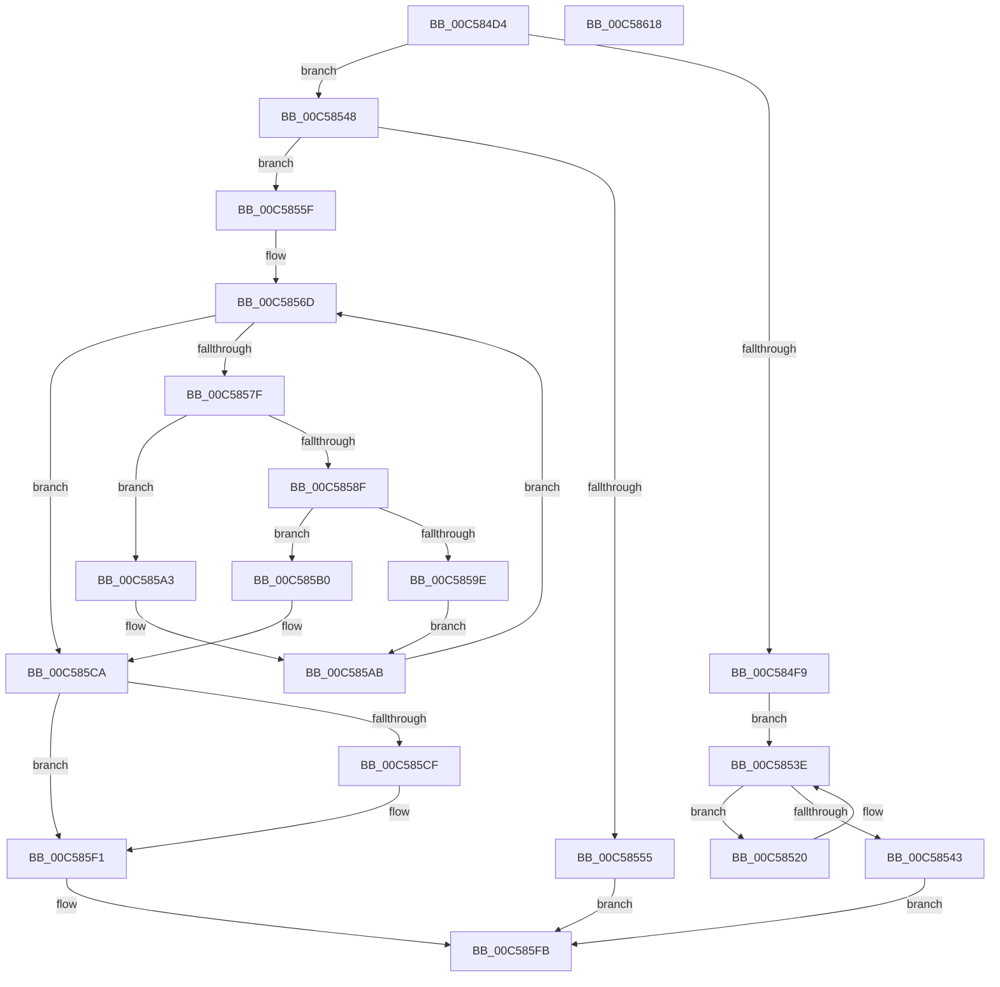

# CmpInitializePreloadedHives

- RVA: `0x00C584D4`–`0x00C58619` (길이 `325` bytes)
- VA: `0x0000000140C584D4`
- 실행 섹션: `INIT`
- PDB 이름 있음: `예`; PDB Function 태그: `아니요`
- unwind 정보 RVA: `0x000D22F4`
- 디코드: `84`개 명령, `325/325` bytes 표시
- 미해석 바이트: `0` (있으면 어셈블리에 `.byte`로 보존)

> 이 문서는 커널 이미지의 기계어와 PDB 기호를 분석해 생성했습니다. 4번과 5번은 함수 원형과 자료형을 바이너리 사용 방식에서 추정한 C 해석이며 원본 소스 복구 결과는 아닙니다.

## 1. Dependencies

- 직접 호출 지점: **6**; 고유 호출 대상: **5**
- 직접 호출자로 확인된 함수: **1**
- RIP 상대 이미지 참조: **5**

### Outgoing calls
- `0x00C58548` → [CmpHiveRootSecurityDescriptor](../../page/7E/CmpHiveRootSecurityDescriptor_function_007ED104.md) (function, `0x007ED104`)
- `0x00C58595` → [CmpInitializeSystemHive](CmpInitializeSystemHive_function_00C58798.md) (function, `0x00C58798`)
- `0x00C585A6` → [CmpInitializePreloadedHive](CmpInitializePreloadedHive_function_00C58070.md) (function, `0x00C58070`)
- `0x00C585C4` → [KeBugCheckEx](../../text/4F/KeBugCheckEx_function_004FD660.md) (function, `0x004FD660`)
- `0x00C585EB` → [KeBugCheckEx](../../text/4F/KeBugCheckEx_function_004FD660.md) (function, `0x004FD660`)
- `0x00C585F6` → [ExFreePoolWithTag](../../poolcode/B8/ExFreePoolWithTag_function_00B82870.md) (function, `0x00B82870`)

### Direct callers
- [CmInitSystem1](CmInitSystem1_function_00C559CC.md) at `0x00C55D1C`
- [CmInitSystem1](CmInitSystem1_function_00C559CC.md) at `0x00C5606F`

### Static image references
- `0x00C584F9` → RVA `0x00EF7C00` (`.data`; read)
- `0x00C58500` → RVA `0x00EF7C08` (`.data`; write)
- `0x00C58507` → RVA `0x00EF7C00` (`.data`; write)
- `0x00C58520` → RVA `0x00EEFB50` (`.data`; read)
- `0x00C58528` → RVA `0x00EEFB50` (`.data`; write)

## 2. Other-region calls and transfers

- 다른 실행 섹션으로 향하는 call: **4**
  - `0x00C58548` → [CmpHiveRootSecurityDescriptor](../../page/7E/CmpHiveRootSecurityDescriptor_function_007ED104.md) (`INIT` → `PAGE`)
  - `0x00C585C4` → [KeBugCheckEx](../../text/4F/KeBugCheckEx_function_004FD660.md) (`INIT` → `.text`)
  - `0x00C585EB` → [KeBugCheckEx](../../text/4F/KeBugCheckEx_function_004FD660.md) (`INIT` → `.text`)
  - `0x00C585F6` → [ExFreePoolWithTag](../../poolcode/B8/ExFreePoolWithTag_function_00B82870.md) (`INIT` → `POOLCODE`)
- 별도 외부 분기/꼬리 이동을 확인하지 못했습니다.

## 3. Assembly (complete function range)

```asm
00C584D4  48 8B C4                        mov rax, rsp
00C584D7  48 89 58 08                     mov qword ptr [rax + 8], rbx
00C584DB  48 89 68 10                     mov qword ptr [rax + 0x10], rbp
00C584DF  48 89 70 18                     mov qword ptr [rax + 0x18], rsi
00C584E3  4C 89 70 20                     mov qword ptr [rax + 0x20], r14
00C584E7  41 57                           push r15
00C584E9  48 83 EC 30                     sub rsp, 0x30
00C584ED  33 DB                           xor ebx, ebx
00C584EF  48 8B E9                        mov rbp, rcx
00C584F2  44 8A FB                        mov r15b, bl
00C584F5  85 D2                           test edx, edx
00C584F7  75 4F                           jne 0x140c58548
00C584F9  48 8D 05 00 F7 29 00            lea rax, [rip + 0x29f700]
00C58500  48 89 05 01 F7 29 00            mov qword ptr [rip + 0x29f701], rax
00C58507  48 89 05 F2 F6 29 00            mov qword ptr [rip + 0x29f6f2], rax
00C5850E  48 8B 81 F0 00 00 00            mov rax, qword ptr [rcx + 0xf0]
00C58515  48 05 38 01 00 00               add rax, 0x138
00C5851B  48 8B 10                        mov rdx, qword ptr [rax]
00C5851E  EB 1E                           jmp 0x140c5853e
00C58520  8B 05 2A 76 29 00               mov eax, dword ptr [rip + 0x29762a]
00C58526  FF C0                           inc eax
00C58528  89 05 22 76 29 00               mov dword ptr [rip + 0x297622], eax
00C5852E  48 8B 81 F0 00 00 00            mov rax, qword ptr [rcx + 0xf0]
00C58535  48 8B 12                        mov rdx, qword ptr [rdx]
00C58538  48 05 38 01 00 00               add rax, 0x138
00C5853E  48 3B D0                        cmp rdx, rax
00C58541  75 DD                           jne 0x140c58520
00C58543  E9 B3 00 00 00                  jmp 0x140c585fb
00C58548  E8 B7 4B B9 FF                  call 0x1407ed104
00C5854D  4C 8B F0                        mov r14, rax
00C58550  48 85 C0                        test rax, rax
00C58553  75 0A                           jne 0x140c5855f
00C58555  BB 9A 00 00 C0                  mov ebx, 0xc000009a
00C5855A  E9 9C 00 00 00                  jmp 0x140c585fb
00C5855F  48 8B 85 F0 00 00 00            mov rax, qword ptr [rbp + 0xf0]
00C58566  48 8B B0 38 01 00 00            mov rsi, qword ptr [rax + 0x138]
00C5856D  48 8B 85 F0 00 00 00            mov rax, qword ptr [rbp + 0xf0]
00C58574  48 05 38 01 00 00               add rax, 0x138
00C5857A  48 3B F0                        cmp rsi, rax
00C5857D  74 4B                           je 0x140c585ca
00C5857F  8B 46 18                        mov eax, dword ptr [rsi + 0x18]
00C58582  49 8B D6                        mov rdx, r14
00C58585  25 09 02 00 00                  and eax, 0x209
00C5858A  83 F8 01                        cmp eax, 1
00C5858D  75 14                           jne 0x140c585a3
00C5858F  4C 8B CE                        mov r9, rsi
00C58592  48 8B CD                        mov rcx, rbp
00C58595  E8 FE 01 00 00                  call 0x140c58798
00C5859A  85 C0                           test eax, eax
00C5859C  78 12                           js 0x140c585b0
00C5859E  41 B7 01                        mov r15b, 1
00C585A1  EB 08                           jmp 0x140c585ab
00C585A3  48 8B CE                        mov rcx, rsi
00C585A6  E8 C5 FA FF FF                  call 0x140c58070
00C585AB  48 8B 36                        mov rsi, qword ptr [rsi]
00C585AE  EB BD                           jmp 0x140c5856d
00C585B0  BA 01 00 00 00                  mov edx, 1
00C585B5  4C 63 C8                        movsxd r9, eax
00C585B8  48 89 5C 24 20                  mov qword ptr [rsp + 0x20], rbx
00C585BD  8D 4A 66                        lea ecx, [rdx + 0x66]
00C585C0  44 8D 42 0B                     lea r8d, [rdx + 0xb]
00C585C4  E8 97 50 8A FF                  call 0x1404fd660
00C585C9  CC                              int3
00C585CA  45 84 FF                        test r15b, r15b
00C585CD  75 22                           jne 0x140c585f1
00C585CF  BA 01 00 00 00                  mov edx, 1
00C585D4  48 C7 44 24 20 01 00 00 00      mov qword ptr [rsp + 0x20], 1
00C585DD  49 C7 C1 25 02 00 C0            mov r9, 0xffffffffc0000225
00C585E4  8D 4A 66                        lea ecx, [rdx + 0x66]
00C585E7  44 8D 42 0B                     lea r8d, [rdx + 0xb]
00C585EB  E8 70 50 8A FF                  call 0x1404fd660
00C585F0  CC                              int3
00C585F1  33 D2                           xor edx, edx
00C585F3  49 8B CE                        mov rcx, r14
00C585F6  E8 75 A2 F2 FF                  call 0x140b82870
00C585FB  48 8B 6C 24 48                  mov rbp, qword ptr [rsp + 0x48]
00C58600  8B C3                           mov eax, ebx
00C58602  48 8B 5C 24 40                  mov rbx, qword ptr [rsp + 0x40]
00C58607  48 8B 74 24 50                  mov rsi, qword ptr [rsp + 0x50]
00C5860C  4C 8B 74 24 58                  mov r14, qword ptr [rsp + 0x58]
00C58611  48 83 C4 30                     add rsp, 0x30
00C58615  41 5F                           pop r15
00C58617  C3                              ret
00C58618  CC                              int3
```

## 4. C-style interpretation (structured pseudocode)

```c
__int64 __fastcall CmpInitializePreloadedHives(__int64 a1, int a2)
{
    __int64 result;
    __int64 v_rbx;
    __int64 v_rsp;
    unsigned __int64 v_stack_m18;
    unsigned __int64 v_stack_p10;
    unsigned __int64 v_stack_p18;
    unsigned __int64 v_stack_p20;
    unsigned __int64 v_stack_p8;

    *(unsigned __int64 *)(v_rsp + 8) = v_rbx;
    *(unsigned __int64 *)(v_rsp + 16) = v_rbp;
    *(unsigned __int64 *)(v_rsp + 24) = v_rsi;
    *(unsigned __int64 *)(v_rsp + 32) = v_r14;
    v_rsp = (v_rsp) - (48);
    v_rbx = 0;
    if (a2 != 0) goto loc_00C58548;
    *(unsigned __int64 *)(v_rip + 2750209) = v_rip + 2750208;
    *(unsigned __int64 *)(v_rip + 2750194) = v_rip + 2750208;
    result = (*(unsigned __int64 *)(a1 + 240)) + (312);
    goto loc_00C5853E;
loc_00C58520:
    result = (unsigned int)(((unsigned int)(*(unsigned int *)(v_rip + 2717226))) + 1);
    *(unsigned int *)(v_rip + 2717218) = (unsigned int)(result);
    result = (*(unsigned __int64 *)(a1 + 240)) + (312);
loc_00C5853E:
    if ((*(unsigned __int64 *)(*(unsigned __int64 *)(result))) != result) goto loc_00C58520;
    goto loc_00C585FB;
loc_00C58548:
    result = CmpHiveRootSecurityDescriptor(a1, *(unsigned __int64 *)(*(unsigned __int64 *)(result)), a3, a4);
    if (result != 0) goto loc_00C5855F;
    goto loc_00C585FB;
loc_00C5855F:
loc_00C5856D:
    result = (*(unsigned __int64 *)(a1 + 240)) + (312);
    if ((*(unsigned __int64 *)(*(unsigned __int64 *)(a1 + 240) + 312)) == result) goto loc_00C585CA;
    result = (unsigned int)(((unsigned int)(*(unsigned int *)(*(unsigned __int64 *)(*(unsigned __int64 *)(a1 + 240) + 312) + 24))) & (521));
    if (((unsigned int)(result)) != 1) goto loc_00C585A3;
    result = CmpInitializeSystemHive(a1, result, a3, *(unsigned __int64 *)(*(unsigned __int64 *)(a1 + 240) + 312));
    if (sign_flag) goto loc_00C585B0;
    goto loc_00C585AB;
loc_00C585A3:
    result = CmpInitializePreloadedHive(*(unsigned __int64 *)(*(unsigned __int64 *)(a1 + 240) + 312), result, a3, *(unsigned __int64 *)(*(unsigned __int64 *)(a1 + 240) + 312));
loc_00C585AB:
    goto loc_00C5856D;
loc_00C585B0:
    v_stack_m18 = (unsigned int)(0xC000009AULL);
    result = KeBugCheckEx(1 + 102, 1, 1 + 11, (int)((unsigned int)(result)));
loc_00C585CA:
    if (1 == 0) {
        a2 = 1;
        v_stack_m18 = 1;
        a4 = 0xFFFFFFFFC0000225ULL;
        a1 = a2 + 102;
        a3 = a2 + 11;
        result = KeBugCheckEx(a1, a2, a3, a4);
    }
    a2 = 0;
    result = ExFreePoolWithTag(result, a2, a3, a4);
loc_00C585FB:
    v_rsp = (v_rsp) + (48);
    return (unsigned int)((unsigned int)((unsigned int)(0xC000009AULL)));
}
```

## 5. (Beta) C Style

```c
int64_t CmpInitializePreloadedHives(void *Arg1, int32_t Arg2)
{
    uint8_t *arg1 = (uint8_t *)Arg1;

    int64_t result;
    int64_t local_rbx;
    int64_t local_rsp;
    uint64_t v_stack_m18;
    uint64_t v_stack_p10;
    uint64_t v_stack_p18;
    uint64_t v_stack_p20;
    uint64_t v_stack_p8;

    *(uint64_t *)(local_rsp + 0x8) = local_rbx;
    *(uint64_t *)(local_rsp + 0x10) = local_rbp;
    *(uint64_t *)(local_rsp + 0x18) = local_rsi;
    *(uint64_t *)(local_rsp + 0x20) = local_r14;
    local_rsp = (local_rsp) - (48);
    local_rbx = 0;
    if (Arg2 != 0) goto loc_00C58548;
    *(uint64_t *)(v_rip + 0x29F701) = v_rip + 2750208;
    *(uint64_t *)(v_rip + 0x29F6F2) = v_rip + 2750208;
    result = (*(uint64_t *)(arg1 + 0xF0)) + (312);
    goto loc_00C5853E;
loc_00C58520:
    result = (uint32_t)(((uint32_t)(*(uint32_t *)(v_rip + 0x29762A))) + 1);
    *(uint32_t *)(v_rip + 0x297622) = (uint32_t)(result);
    result = (*(uint64_t *)(arg1 + 0xF0)) + (312);
loc_00C5853E:
    if ((*(uint64_t *)(*(uint64_t *)(result))) != result) goto loc_00C58520;
    goto loc_00C585FB;
loc_00C58548:
    result = CmpHiveRootSecurityDescriptor(Arg1, *(uint64_t *)(*(uint64_t *)(result)), a3, a4);
    if (result != 0) goto loc_00C5855F;
    goto loc_00C585FB;
loc_00C5855F:
loc_00C5856D:
    result = (*(uint64_t *)(arg1 + 0xF0)) + (312);
    if ((*(uint64_t *)(*(uint64_t *)(arg1 + 0xF0) + 0x138)) == result) goto loc_00C585CA;
    result = (uint32_t)(((uint32_t)(*(uint32_t *)(*(uint64_t *)(*(uint64_t *)(arg1 + 0xF0) + 0x138) + 0x18))) & (521));
    if (((uint32_t)(result)) != 1) goto loc_00C585A3;
    result = CmpInitializeSystemHive(Arg1, result, a3, *(uint64_t *)(*(uint64_t *)(arg1 + 0xF0) + 0x138));
    if (sign_flag) goto loc_00C585B0;
    goto loc_00C585AB;
loc_00C585A3:
    result = CmpInitializePreloadedHive(*(uint64_t *)(*(uint64_t *)(arg1 + 0xF0) + 0x138), result, a3, *(uint64_t *)(*(uint64_t *)(arg1 + 0xF0) + 0x138));
loc_00C585AB:
    goto loc_00C5856D;
loc_00C585B0:
    v_stack_m18 = (uint32_t)(0xC000009AULL);
    result = KeBugCheckEx(1 + 102, 1, 1 + 11, (int32_t)((uint32_t)(result)));
loc_00C585CA:
    if (1 == 0) {
        Arg2 = 1;
        v_stack_m18 = 1;
        a4 = 0xFFFFFFFFC0000225ULL;
        Arg1 = Arg2 + 102;
        a3 = Arg2 + 11;
        result = KeBugCheckEx(Arg1, Arg2, a3, a4);
    }
    Arg2 = 0;
    result = ExFreePoolWithTag(result, Arg2, a3, a4);
loc_00C585FB:
    local_rsp = (local_rsp) + (48);
    return (uint32_t)((uint32_t)((uint32_t)(0xC000009AULL)));
}
```

### 관측된 메모리 오프셋

구조체 형식이 확인되지 않은 접근은 인자 기준의 오프셋으로만 기록했습니다.

| 기준 인자 | 오프셋 표현 | 폭 (bit) | 접근 |
|---|---:|---:|---|
| `Arg1` | `+ 0xF0` | `64` | `R` |

## 6. Execution-region graph

[열기: 2D/3D 그래프와 함수 탐색 컨트롤 패널](../../../control-panel.html?section=init&rva=0x00C584D4&view=graph)

- 2D 그래프는 위에서 아래로 흐르고, 3D 그래프는 빈 공간을 드래그해 회전합니다. Shift+드래그는 이동, 휠은 확대·축소, 함수 노드 선택은 대상 보고서 이동입니다.

### Static fallback


