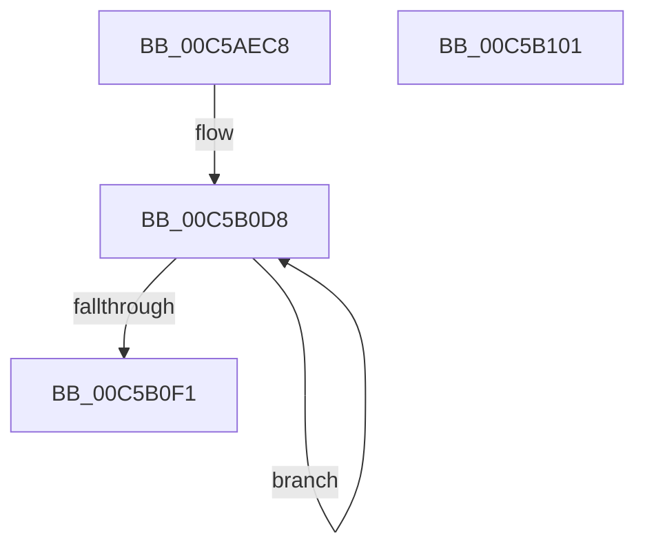

# CmpInitializeRegistryNames

- RVA: `0x00C5AEC8`–`0x00C5B102` (길이 `570` bytes)
- VA: `0x0000000140C5AEC8`
- 실행 섹션: `INIT`
- PDB 이름 있음: `예`; PDB Function 태그: `아니요`
- unwind 정보 RVA: `0x00060BC4`
- 디코드: `98`개 명령, `570/570` bytes 표시
- 미해석 바이트: `0` (있으면 어셈블리에 `.byte`로 보존)

> 이 문서는 커널 이미지의 기계어와 PDB 기호를 분석해 생성했습니다. 4번과 5번은 함수 원형과 자료형을 바이너리 사용 방식에서 추정한 C 해석이며 원본 소스 복구 결과는 아닙니다.

## 1. Dependencies

- 직접 호출 지점: **27**; 고유 호출 대상: **1**
- 직접 호출자로 확인된 함수: **1**
- RIP 상대 이미지 참조: **54**

### Outgoing calls
- `0x00C5AEE5` → [RtlInitUnicodeString](../../text/42/RtlInitUnicodeString_function_0042A780.md) (function, `0x0042A780`)
- `0x00C5AEF8` → [RtlInitUnicodeString](../../text/42/RtlInitUnicodeString_function_0042A780.md) (function, `0x0042A780`)
- `0x00C5AF0B` → [RtlInitUnicodeString](../../text/42/RtlInitUnicodeString_function_0042A780.md) (function, `0x0042A780`)
- `0x00C5AF1E` → [RtlInitUnicodeString](../../text/42/RtlInitUnicodeString_function_0042A780.md) (function, `0x0042A780`)
- `0x00C5AF31` → [RtlInitUnicodeString](../../text/42/RtlInitUnicodeString_function_0042A780.md) (function, `0x0042A780`)
- `0x00C5AF44` → [RtlInitUnicodeString](../../text/42/RtlInitUnicodeString_function_0042A780.md) (function, `0x0042A780`)
- `0x00C5AF57` → [RtlInitUnicodeString](../../text/42/RtlInitUnicodeString_function_0042A780.md) (function, `0x0042A780`)
- `0x00C5AF6A` → [RtlInitUnicodeString](../../text/42/RtlInitUnicodeString_function_0042A780.md) (function, `0x0042A780`)
- `0x00C5AF7D` → [RtlInitUnicodeString](../../text/42/RtlInitUnicodeString_function_0042A780.md) (function, `0x0042A780`)
- `0x00C5AF90` → [RtlInitUnicodeString](../../text/42/RtlInitUnicodeString_function_0042A780.md) (function, `0x0042A780`)
- `0x00C5AFA3` → [RtlInitUnicodeString](../../text/42/RtlInitUnicodeString_function_0042A780.md) (function, `0x0042A780`)
- `0x00C5AFB6` → [RtlInitUnicodeString](../../text/42/RtlInitUnicodeString_function_0042A780.md) (function, `0x0042A780`)
- `0x00C5AFC9` → [RtlInitUnicodeString](../../text/42/RtlInitUnicodeString_function_0042A780.md) (function, `0x0042A780`)
- `0x00C5AFDC` → [RtlInitUnicodeString](../../text/42/RtlInitUnicodeString_function_0042A780.md) (function, `0x0042A780`)
- `0x00C5AFEF` → [RtlInitUnicodeString](../../text/42/RtlInitUnicodeString_function_0042A780.md) (function, `0x0042A780`)
- `0x00C5B002` → [RtlInitUnicodeString](../../text/42/RtlInitUnicodeString_function_0042A780.md) (function, `0x0042A780`)
- `0x00C5B015` → [RtlInitUnicodeString](../../text/42/RtlInitUnicodeString_function_0042A780.md) (function, `0x0042A780`)
- `0x00C5B028` → [RtlInitUnicodeString](../../text/42/RtlInitUnicodeString_function_0042A780.md) (function, `0x0042A780`)
- `0x00C5B03B` → [RtlInitUnicodeString](../../text/42/RtlInitUnicodeString_function_0042A780.md) (function, `0x0042A780`)
- `0x00C5B04E` → [RtlInitUnicodeString](../../text/42/RtlInitUnicodeString_function_0042A780.md) (function, `0x0042A780`)
- `0x00C5B061` → [RtlInitUnicodeString](../../text/42/RtlInitUnicodeString_function_0042A780.md) (function, `0x0042A780`)
- `0x00C5B074` → [RtlInitUnicodeString](../../text/42/RtlInitUnicodeString_function_0042A780.md) (function, `0x0042A780`)
- `0x00C5B087` → [RtlInitUnicodeString](../../text/42/RtlInitUnicodeString_function_0042A780.md) (function, `0x0042A780`)
- `0x00C5B09A` → [RtlInitUnicodeString](../../text/42/RtlInitUnicodeString_function_0042A780.md) (function, `0x0042A780`)
- `0x00C5B0AD` → [RtlInitUnicodeString](../../text/42/RtlInitUnicodeString_function_0042A780.md) (function, `0x0042A780`)
- `0x00C5B0C0` → [RtlInitUnicodeString](../../text/42/RtlInitUnicodeString_function_0042A780.md) (function, `0x0042A780`)
- `0x00C5B0DE` → [RtlInitUnicodeString](../../text/42/RtlInitUnicodeString_function_0042A780.md) (function, `0x0042A780`)

### Direct callers
- [CmInitSystem1](CmInitSystem1_function_00C559CC.md) at `0x00C55AEA`

### Static image references
- `0x00C5AED7` → RVA `0x00B57368` (` ?? ::LBKOJDO::`string'`; read)
- `0x00C5AEDE` → RVA `0x00FD9F98` (`PAGEDATA`; read)
- `0x00C5AEEA` → RVA `0x00B57380` (` ?? ::LBKOJDO::`string'`; read)
- `0x00C5AEF1` → RVA `0x00FD9DD8` (`PAGEDATA`; read)
- `0x00C5AEFD` → RVA `0x00B573A8` (` ?? ::LBKOJDO::`string'`; read)
- `0x00C5AF04` → RVA `0x00FDA3B8` (`PAGEDATA`; read)
- `0x00C5AF10` → RVA `0x00B573E0` (` ?? ::LBKOJDO::`string'`; read)
- `0x00C5AF17` → RVA `0x00FDA3C8` (`PAGEDATA`; read)
- `0x00C5AF23` → RVA `0x00B57220` (` ?? ::LBKOJDO::`string'`; read)
- `0x00C5AF2A` → RVA `0x00FD9DE8` (`PAGEDATA`; read)
- `0x00C5AF36` → RVA `0x00B57280` (` ?? ::LBKOJDO::`string'`; read)
- `0x00C5AF3D` → RVA `0x00FDA3D8` (`PAGEDATA`; read)
- `0x00C5AF49` → RVA `0x00B572D0` (` ?? ::LBKOJDO::`string'`; read)
- `0x00C5AF50` → RVA `0x00FDA028` (`PAGEDATA`; read)
- `0x00C5AF5C` → RVA `0x00B57320` (` ?? ::LBKOJDO::`string'`; read)
- `0x00C5AF63` → RVA `0x00FDA548` (`PAGEDATA`; read)
- `0x00C5AF6F` → RVA `0x00B570B8` (` ?? ::LBKOJDO::`string'`; read)
- `0x00C5AF76` → RVA `0x00FDA0D8` (`PAGEDATA`; read)
- `0x00C5AF82` → RVA `0x00B570F0` (` ?? ::LBKOJDO::`string'`; read)
- `0x00C5AF89` → RVA `0x00FD9EF8` (`PAGEDATA`; read)
- `0x00C5AF95` → RVA `0x00B56C30` (` ?? ::LBKOJDO::`string'`; read)
- `0x00C5AF9C` → RVA `0x00FDA388` (`PAGEDATA`; read)
- `0x00C5AFA8` → RVA `0x00B56C50` (` ?? ::LBKOJDO::`string'`; read)
- `0x00C5AFAF` → RVA `0x00FDA3A8` (`PAGEDATA`; read)
- `0x00C5AFBB` → RVA `0x00B56C70` (` ?? ::LBKOJDO::`string'`; read)
- `0x00C5AFC2` → RVA `0x00FDA398` (`PAGEDATA`; read)
- `0x00C5AFCE` → RVA `0x00B56B88` (` ?? ::LBKOJDO::`string'`; read)
- `0x00C5AFD5` → RVA `0x00FDA0A8` (`PAGEDATA`; read)
- `0x00C5AFE1` → RVA `0x00B57150` (` ?? ::LBKOJDO::`string'`; read)
- `0x00C5AFE8` → RVA `0x00FDA508` (`PAGEDATA`; read)
- `0x00C5AFF4` → RVA `0x00B571B0` (` ?? ::LBKOJDO::`string'`; read)
- `0x00C5AFFB` → RVA `0x00FDA518` (`PAGEDATA`; read)
- `0x00C5B007` → RVA `0x00B56EC0` (` ?? ::LBKOJDO::`string'`; read)
- `0x00C5B00E` → RVA `0x00FD9D28` (`PAGEDATA`; read)
- `0x00C5B01A` → RVA `0x00B56F30` (` ?? ::LBKOJDO::`string'`; read)
- `0x00C5B021` → RVA `0x00FDA528` (`PAGEDATA`; read)
- `0x00C5B02D` → RVA `0x00B56FC0` (` ?? ::LBKOJDO::`string'`; read)
- `0x00C5B034` → RVA `0x00FDA538` (`PAGEDATA`; read)
- `0x00C5B040` → RVA `0x00B57040` (` ?? ::LBKOJDO::`string'`; read)
- `0x00C5B047` → RVA `0x00FDA0B8` (`PAGEDATA`; read)
- `0x00C5B053` → RVA `0x00B56C90` (` ?? ::LBKOJDO::`string'`; read)
- `0x00C5B05A` → RVA `0x00FD9FB8` (`PAGEDATA`; read)
- `0x00C5B066` → RVA `0x00B56D40` (` ?? ::LBKOJDO::`string'`; read)
- `0x00C5B06D` → RVA `0x00FDA0C8` (`PAGEDATA`; read)
- `0x00C5B079` → RVA `0x00B56DC0` (` ?? ::LBKOJDO::`string'`; read)
- `0x00C5B080` → RVA `0x00FDA3E8` (`PAGEDATA`; read)
- `0x00C5B08C` → RVA `0x00B57528` (` ?? ::LBKOJDO::`string'`; read)
- `0x00C5B093` → RVA `0x00FD9C00` (`PAGEDATA`; read)
- `0x00C5B09F` → RVA `0x00B574C0` (` ?? ::LBKOJDO::`string'`; read)
- `0x00C5B0A6` → RVA `0x00FDA378` (`PAGEDATA`; read)
- `0x00C5B0B2` → RVA `0x00B57550` (` ?? ::LBKOJDO::`string'`; read)
- `0x00C5B0B9` → RVA `0x00FDA368` (`PAGEDATA`; read)
- `0x00C5B0C5` → RVA `0x00B4D1D0` (`CmTypeString`; read)
- `0x00C5B0D1` → RVA `0x00FDAC20` (`PAGEDATA`; read)

## 2. Other-region calls and transfers

- 다른 실행 섹션으로 향하는 call: **27**
  - `0x00C5AEE5` → [RtlInitUnicodeString](../../text/42/RtlInitUnicodeString_function_0042A780.md) (`INIT` → `.text`)
  - `0x00C5AEF8` → [RtlInitUnicodeString](../../text/42/RtlInitUnicodeString_function_0042A780.md) (`INIT` → `.text`)
  - `0x00C5AF0B` → [RtlInitUnicodeString](../../text/42/RtlInitUnicodeString_function_0042A780.md) (`INIT` → `.text`)
  - `0x00C5AF1E` → [RtlInitUnicodeString](../../text/42/RtlInitUnicodeString_function_0042A780.md) (`INIT` → `.text`)
  - `0x00C5AF31` → [RtlInitUnicodeString](../../text/42/RtlInitUnicodeString_function_0042A780.md) (`INIT` → `.text`)
  - `0x00C5AF44` → [RtlInitUnicodeString](../../text/42/RtlInitUnicodeString_function_0042A780.md) (`INIT` → `.text`)
  - `0x00C5AF57` → [RtlInitUnicodeString](../../text/42/RtlInitUnicodeString_function_0042A780.md) (`INIT` → `.text`)
  - `0x00C5AF6A` → [RtlInitUnicodeString](../../text/42/RtlInitUnicodeString_function_0042A780.md) (`INIT` → `.text`)
  - `0x00C5AF7D` → [RtlInitUnicodeString](../../text/42/RtlInitUnicodeString_function_0042A780.md) (`INIT` → `.text`)
  - `0x00C5AF90` → [RtlInitUnicodeString](../../text/42/RtlInitUnicodeString_function_0042A780.md) (`INIT` → `.text`)
  - `0x00C5AFA3` → [RtlInitUnicodeString](../../text/42/RtlInitUnicodeString_function_0042A780.md) (`INIT` → `.text`)
  - `0x00C5AFB6` → [RtlInitUnicodeString](../../text/42/RtlInitUnicodeString_function_0042A780.md) (`INIT` → `.text`)
  - `0x00C5AFC9` → [RtlInitUnicodeString](../../text/42/RtlInitUnicodeString_function_0042A780.md) (`INIT` → `.text`)
  - `0x00C5AFDC` → [RtlInitUnicodeString](../../text/42/RtlInitUnicodeString_function_0042A780.md) (`INIT` → `.text`)
  - `0x00C5AFEF` → [RtlInitUnicodeString](../../text/42/RtlInitUnicodeString_function_0042A780.md) (`INIT` → `.text`)
  - `0x00C5B002` → [RtlInitUnicodeString](../../text/42/RtlInitUnicodeString_function_0042A780.md) (`INIT` → `.text`)
  - `0x00C5B015` → [RtlInitUnicodeString](../../text/42/RtlInitUnicodeString_function_0042A780.md) (`INIT` → `.text`)
  - `0x00C5B028` → [RtlInitUnicodeString](../../text/42/RtlInitUnicodeString_function_0042A780.md) (`INIT` → `.text`)
  - `0x00C5B03B` → [RtlInitUnicodeString](../../text/42/RtlInitUnicodeString_function_0042A780.md) (`INIT` → `.text`)
  - `0x00C5B04E` → [RtlInitUnicodeString](../../text/42/RtlInitUnicodeString_function_0042A780.md) (`INIT` → `.text`)
  - `0x00C5B061` → [RtlInitUnicodeString](../../text/42/RtlInitUnicodeString_function_0042A780.md) (`INIT` → `.text`)
  - `0x00C5B074` → [RtlInitUnicodeString](../../text/42/RtlInitUnicodeString_function_0042A780.md) (`INIT` → `.text`)
  - `0x00C5B087` → [RtlInitUnicodeString](../../text/42/RtlInitUnicodeString_function_0042A780.md) (`INIT` → `.text`)
  - `0x00C5B09A` → [RtlInitUnicodeString](../../text/42/RtlInitUnicodeString_function_0042A780.md) (`INIT` → `.text`)
  - `0x00C5B0AD` → [RtlInitUnicodeString](../../text/42/RtlInitUnicodeString_function_0042A780.md) (`INIT` → `.text`)
  - `0x00C5B0C0` → [RtlInitUnicodeString](../../text/42/RtlInitUnicodeString_function_0042A780.md) (`INIT` → `.text`)
  - `0x00C5B0DE` → [RtlInitUnicodeString](../../text/42/RtlInitUnicodeString_function_0042A780.md) (`INIT` → `.text`)
- 별도 외부 분기/꼬리 이동을 확인하지 못했습니다.

## 3. Assembly (complete function range)

```asm
00C5AEC8  48 89 5C 24 08                  mov qword ptr [rsp + 8], rbx
00C5AECD  48 89 74 24 10                  mov qword ptr [rsp + 0x10], rsi
00C5AED2  57                              push rdi
00C5AED3  48 83 EC 20                     sub rsp, 0x20
00C5AED7  48 8D 15 8A C4 EF FF            lea rdx, [rip - 0x103b76]
00C5AEDE  48 8D 0D B3 F0 37 00            lea rcx, [rip + 0x37f0b3]
00C5AEE5  E8 96 F8 7C FF                  call 0x14042a780
00C5AEEA  48 8D 15 8F C4 EF FF            lea rdx, [rip - 0x103b71]
00C5AEF1  48 8D 0D E0 EE 37 00            lea rcx, [rip + 0x37eee0]
00C5AEF8  E8 83 F8 7C FF                  call 0x14042a780
00C5AEFD  48 8D 15 A4 C4 EF FF            lea rdx, [rip - 0x103b5c]
00C5AF04  48 8D 0D AD F4 37 00            lea rcx, [rip + 0x37f4ad]
00C5AF0B  E8 70 F8 7C FF                  call 0x14042a780
00C5AF10  48 8D 15 C9 C4 EF FF            lea rdx, [rip - 0x103b37]
00C5AF17  48 8D 0D AA F4 37 00            lea rcx, [rip + 0x37f4aa]
00C5AF1E  E8 5D F8 7C FF                  call 0x14042a780
00C5AF23  48 8D 15 F6 C2 EF FF            lea rdx, [rip - 0x103d0a]
00C5AF2A  48 8D 0D B7 EE 37 00            lea rcx, [rip + 0x37eeb7]
00C5AF31  E8 4A F8 7C FF                  call 0x14042a780
00C5AF36  48 8D 15 43 C3 EF FF            lea rdx, [rip - 0x103cbd]
00C5AF3D  48 8D 0D 94 F4 37 00            lea rcx, [rip + 0x37f494]
00C5AF44  E8 37 F8 7C FF                  call 0x14042a780
00C5AF49  48 8D 15 80 C3 EF FF            lea rdx, [rip - 0x103c80]
00C5AF50  48 8D 0D D1 F0 37 00            lea rcx, [rip + 0x37f0d1]
00C5AF57  E8 24 F8 7C FF                  call 0x14042a780
00C5AF5C  48 8D 15 BD C3 EF FF            lea rdx, [rip - 0x103c43]
00C5AF63  48 8D 0D DE F5 37 00            lea rcx, [rip + 0x37f5de]
00C5AF6A  E8 11 F8 7C FF                  call 0x14042a780
00C5AF6F  48 8D 15 42 C1 EF FF            lea rdx, [rip - 0x103ebe]
00C5AF76  48 8D 0D 5B F1 37 00            lea rcx, [rip + 0x37f15b]
00C5AF7D  E8 FE F7 7C FF                  call 0x14042a780
00C5AF82  48 8D 15 67 C1 EF FF            lea rdx, [rip - 0x103e99]
00C5AF89  48 8D 0D 68 EF 37 00            lea rcx, [rip + 0x37ef68]
00C5AF90  E8 EB F7 7C FF                  call 0x14042a780
00C5AF95  48 8D 15 94 BC EF FF            lea rdx, [rip - 0x10436c]
00C5AF9C  48 8D 0D E5 F3 37 00            lea rcx, [rip + 0x37f3e5]
00C5AFA3  E8 D8 F7 7C FF                  call 0x14042a780
00C5AFA8  48 8D 15 A1 BC EF FF            lea rdx, [rip - 0x10435f]
00C5AFAF  48 8D 0D F2 F3 37 00            lea rcx, [rip + 0x37f3f2]
00C5AFB6  E8 C5 F7 7C FF                  call 0x14042a780
00C5AFBB  48 8D 15 AE BC EF FF            lea rdx, [rip - 0x104352]
00C5AFC2  48 8D 0D CF F3 37 00            lea rcx, [rip + 0x37f3cf]
00C5AFC9  E8 B2 F7 7C FF                  call 0x14042a780
00C5AFCE  48 8D 15 B3 BB EF FF            lea rdx, [rip - 0x10444d]
00C5AFD5  48 8D 0D CC F0 37 00            lea rcx, [rip + 0x37f0cc]
00C5AFDC  E8 9F F7 7C FF                  call 0x14042a780
00C5AFE1  48 8D 15 68 C1 EF FF            lea rdx, [rip - 0x103e98]
00C5AFE8  48 8D 0D 19 F5 37 00            lea rcx, [rip + 0x37f519]
00C5AFEF  E8 8C F7 7C FF                  call 0x14042a780
00C5AFF4  48 8D 15 B5 C1 EF FF            lea rdx, [rip - 0x103e4b]
00C5AFFB  48 8D 0D 16 F5 37 00            lea rcx, [rip + 0x37f516]
00C5B002  E8 79 F7 7C FF                  call 0x14042a780
00C5B007  48 8D 15 B2 BE EF FF            lea rdx, [rip - 0x10414e]
00C5B00E  48 8D 0D 13 ED 37 00            lea rcx, [rip + 0x37ed13]
00C5B015  E8 66 F7 7C FF                  call 0x14042a780
00C5B01A  48 8D 15 0F BF EF FF            lea rdx, [rip - 0x1040f1]
00C5B021  48 8D 0D 00 F5 37 00            lea rcx, [rip + 0x37f500]
00C5B028  E8 53 F7 7C FF                  call 0x14042a780
00C5B02D  48 8D 15 8C BF EF FF            lea rdx, [rip - 0x104074]
00C5B034  48 8D 0D FD F4 37 00            lea rcx, [rip + 0x37f4fd]
00C5B03B  E8 40 F7 7C FF                  call 0x14042a780
00C5B040  48 8D 15 F9 BF EF FF            lea rdx, [rip - 0x104007]
00C5B047  48 8D 0D 6A F0 37 00            lea rcx, [rip + 0x37f06a]
00C5B04E  E8 2D F7 7C FF                  call 0x14042a780
00C5B053  48 8D 15 36 BC EF FF            lea rdx, [rip - 0x1043ca]
00C5B05A  48 8D 0D 57 EF 37 00            lea rcx, [rip + 0x37ef57]
00C5B061  E8 1A F7 7C FF                  call 0x14042a780
00C5B066  48 8D 15 D3 BC EF FF            lea rdx, [rip - 0x10432d]
00C5B06D  48 8D 0D 54 F0 37 00            lea rcx, [rip + 0x37f054]
00C5B074  E8 07 F7 7C FF                  call 0x14042a780
00C5B079  48 8D 15 40 BD EF FF            lea rdx, [rip - 0x1042c0]
00C5B080  48 8D 0D 61 F3 37 00            lea rcx, [rip + 0x37f361]
00C5B087  E8 F4 F6 7C FF                  call 0x14042a780
00C5B08C  48 8D 15 95 C4 EF FF            lea rdx, [rip - 0x103b6b]
00C5B093  48 8D 0D 66 EB 37 00            lea rcx, [rip + 0x37eb66]
00C5B09A  E8 E1 F6 7C FF                  call 0x14042a780
00C5B09F  48 8D 15 1A C4 EF FF            lea rdx, [rip - 0x103be6]
00C5B0A6  48 8D 0D CB F2 37 00            lea rcx, [rip + 0x37f2cb]
00C5B0AD  E8 CE F6 7C FF                  call 0x14042a780
00C5B0B2  48 8D 15 97 C4 EF FF            lea rdx, [rip - 0x103b69]
00C5B0B9  48 8D 0D A8 F2 37 00            lea rcx, [rip + 0x37f2a8]
00C5B0C0  E8 BB F6 7C FF                  call 0x14042a780
00C5B0C5  48 8D 1D 04 21 EF FF            lea rbx, [rip - 0x10defc]
00C5B0CC  BE 2A 00 00 00                  mov esi, 0x2a
00C5B0D1  48 8D 3D 48 FB 37 00            lea rdi, [rip + 0x37fb48]
00C5B0D8  48 8B 13                        mov rdx, qword ptr [rbx]
00C5B0DB  48 8B CF                        mov rcx, rdi
00C5B0DE  E8 9D F6 7C FF                  call 0x14042a780
00C5B0E3  48 83 C7 10                     add rdi, 0x10
00C5B0E7  48 8D 5B 08                     lea rbx, [rbx + 8]
00C5B0EB  48 83 EE 01                     sub rsi, 1
00C5B0EF  75 E7                           jne 0x140c5b0d8
00C5B0F1  48 8B 5C 24 30                  mov rbx, qword ptr [rsp + 0x30]
00C5B0F6  48 8B 74 24 38                  mov rsi, qword ptr [rsp + 0x38]
00C5B0FB  48 83 C4 20                     add rsp, 0x20
00C5B0FF  5F                              pop rdi
00C5B100  C3                              ret
00C5B101  CC                              int3
```

## 4. C-style interpretation (structured pseudocode)

```c
__int64 __fastcall CmpInitializeRegistryNames(void)
{
    __int64 result;
    __int64 v_rdi;
    __int64 v_rsi;
    __int64 v_rsp;
    unsigned __int64 v_stack_p10;
    unsigned __int64 v_stack_p8;

    v_stack_p8 = v_rbx;
    v_stack_p10 = v_rsi;
    v_rsp = (v_rsp) - (32);
    result = RtlInitUnicodeString(v_rip + 3666099, v_rip - 1063798, a3, a4);
    result = RtlInitUnicodeString(v_rip + 3665632, v_rip - 1063793, a3, a4);
    result = RtlInitUnicodeString(v_rip + 3667117, v_rip - 1063772, a3, a4);
    result = RtlInitUnicodeString(v_rip + 3667114, v_rip - 1063735, a3, a4);
    result = RtlInitUnicodeString(v_rip + 3665591, v_rip - 1064202, a3, a4);
    result = RtlInitUnicodeString(v_rip + 3667092, v_rip - 1064125, a3, a4);
    result = RtlInitUnicodeString(v_rip + 3666129, v_rip - 1064064, a3, a4);
    result = RtlInitUnicodeString(v_rip + 3667422, v_rip - 1064003, a3, a4);
    result = RtlInitUnicodeString(v_rip + 3666267, v_rip - 1064638, a3, a4);
    result = RtlInitUnicodeString(v_rip + 3665768, v_rip - 1064601, a3, a4);
    result = RtlInitUnicodeString(v_rip + 3666917, v_rip - 1065836, a3, a4);
    result = RtlInitUnicodeString(v_rip + 3666930, v_rip - 1065823, a3, a4);
    result = RtlInitUnicodeString(v_rip + 3666895, v_rip - 1065810, a3, a4);
    result = RtlInitUnicodeString(v_rip + 3666124, v_rip - 1066061, a3, a4);
    result = RtlInitUnicodeString(v_rip + 3667225, v_rip - 1064600, a3, a4);
    result = RtlInitUnicodeString(v_rip + 3667222, v_rip - 1064523, a3, a4);
    result = RtlInitUnicodeString(v_rip + 3665171, v_rip - 1065294, a3, a4);
    result = RtlInitUnicodeString(v_rip + 3667200, v_rip - 1065201, a3, a4);
    result = RtlInitUnicodeString(v_rip + 3667197, v_rip - 1065076, a3, a4);
    result = RtlInitUnicodeString(v_rip + 3666026, v_rip - 1064967, a3, a4);
    result = RtlInitUnicodeString(v_rip + 3665751, v_rip - 1065930, a3, a4);
    result = RtlInitUnicodeString(v_rip + 3666004, v_rip - 1065773, a3, a4);
    result = RtlInitUnicodeString(v_rip + 3666785, v_rip - 1065664, a3, a4);
    result = RtlInitUnicodeString(v_rip + 3664742, v_rip - 1063787, a3, a4);
    result = RtlInitUnicodeString(v_rip + 3666635, v_rip - 1063910, a3, a4);
    result = RtlInitUnicodeString(v_rip + 3666600, v_rip - 1063785, a3, a4);
loc_00C5B0D8:
    result = RtlInitUnicodeString(v_rip + 3668808, *(unsigned __int64 *)(v_rip - 1105660), a3, a4);
    v_rdi = (v_rip + 3668808) + (16);
    v_rsi = (42) - (1);
    if (condition_is_not_equal) goto loc_00C5B0D8;
    v_rsp = (v_rsp) + (32);
    return result;
}
```

## 5. (Beta) C Style

```c
void CmpInitializeRegistryNames(void)
{
    int64_t result;
    int64_t local_rdi;
    int64_t local_rsi;
    int64_t local_rsp;
    uint64_t v_stack_p10;
    uint64_t v_stack_p8;

    v_stack_p8 = local_rbx;
    v_stack_p10 = local_rsi;
    local_rsp = (local_rsp) - (32);
    result = RtlInitUnicodeString(v_rip + 3666099, v_rip - 1063798, a3, a4);
    result = RtlInitUnicodeString(v_rip + 3665632, v_rip - 1063793, a3, a4);
    result = RtlInitUnicodeString(v_rip + 3667117, v_rip - 1063772, a3, a4);
    result = RtlInitUnicodeString(v_rip + 3667114, v_rip - 1063735, a3, a4);
    result = RtlInitUnicodeString(v_rip + 3665591, v_rip - 1064202, a3, a4);
    result = RtlInitUnicodeString(v_rip + 3667092, v_rip - 1064125, a3, a4);
    result = RtlInitUnicodeString(v_rip + 3666129, v_rip - 1064064, a3, a4);
    result = RtlInitUnicodeString(v_rip + 3667422, v_rip - 1064003, a3, a4);
    result = RtlInitUnicodeString(v_rip + 3666267, v_rip - 1064638, a3, a4);
    result = RtlInitUnicodeString(v_rip + 3665768, v_rip - 1064601, a3, a4);
    result = RtlInitUnicodeString(v_rip + 3666917, v_rip - 1065836, a3, a4);
    result = RtlInitUnicodeString(v_rip + 3666930, v_rip - 1065823, a3, a4);
    result = RtlInitUnicodeString(v_rip + 3666895, v_rip - 1065810, a3, a4);
    result = RtlInitUnicodeString(v_rip + 3666124, v_rip - 1066061, a3, a4);
    result = RtlInitUnicodeString(v_rip + 3667225, v_rip - 1064600, a3, a4);
    result = RtlInitUnicodeString(v_rip + 3667222, v_rip - 1064523, a3, a4);
    result = RtlInitUnicodeString(v_rip + 3665171, v_rip - 1065294, a3, a4);
    result = RtlInitUnicodeString(v_rip + 3667200, v_rip - 1065201, a3, a4);
    result = RtlInitUnicodeString(v_rip + 3667197, v_rip - 1065076, a3, a4);
    result = RtlInitUnicodeString(v_rip + 3666026, v_rip - 1064967, a3, a4);
    result = RtlInitUnicodeString(v_rip + 3665751, v_rip - 1065930, a3, a4);
    result = RtlInitUnicodeString(v_rip + 3666004, v_rip - 1065773, a3, a4);
    result = RtlInitUnicodeString(v_rip + 3666785, v_rip - 1065664, a3, a4);
    result = RtlInitUnicodeString(v_rip + 3664742, v_rip - 1063787, a3, a4);
    result = RtlInitUnicodeString(v_rip + 3666635, v_rip - 1063910, a3, a4);
    result = RtlInitUnicodeString(v_rip + 3666600, v_rip - 1063785, a3, a4);
loc_00C5B0D8:
    result = RtlInitUnicodeString(v_rip + 3668808, *(uint64_t *)(v_rip - 0x10DEFC), a3, a4);
    local_rdi = (v_rip + 3668808) + (16);
    local_rsi = (42) - (1);
    if (condition_is_not_equal) goto loc_00C5B0D8;
    local_rsp = (local_rsp) + (32);
    return result;
}
```

## 6. Execution-region graph

[열기: 2D/3D 그래프와 함수 탐색 컨트롤 패널](../../../control-panel.html?section=init&rva=0x00C5AEC8&view=graph)

- 2D 그래프는 위에서 아래로 흐르고, 3D 그래프는 빈 공간을 드래그해 회전합니다. Shift+드래그는 이동, 휠은 확대·축소, 함수 노드 선택은 대상 보고서 이동입니다.

### Static fallback


