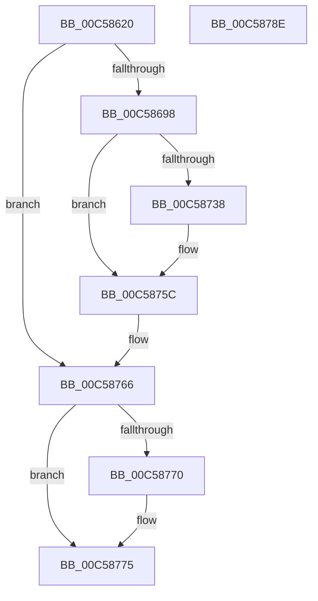

# CmpInitializeSystemBiosInformation

- RVA: `0x00C58620`–`0x00C5878F` (길이 `367` bytes)
- VA: `0x0000000140C58620`
- 실행 섹션: `INIT`
- PDB 이름 있음: `예`; PDB Function 태그: `아니요`
- unwind 정보 RVA: `0x000D64A8`
- 디코드: `91`개 명령, `367/367` bytes 표시
- 미해석 바이트: `0` (있으면 어셈블리에 `.byte`로 보존)

> 이 문서는 커널 이미지의 기계어와 PDB 기호를 분석해 생성했습니다. 4번과 5번은 함수 원형과 자료형을 바이너리 사용 방식에서 추정한 C 해석이며 원본 소스 복구 결과는 아닙니다.

## 1. Dependencies

- 직접 호출 지점: **8**; 고유 호출 대상: **6**
- 직접 호출자로 확인된 함수: **1**
- RIP 상대 이미지 참조: **2**

### Outgoing calls
- `0x00C58684` → [ExAllocatePool2](../../poolcode/B8/ExAllocatePool2_function_00B820F0.md) (function, `0x00B820F0`)
- `0x00C586AE` → [CmpBuildRegMultiSz](CmpBuildRegMultiSz_function_00C5689C.md) (function, `0x00C5689C`)
- `0x00C586C6` → [CmpBuildRegMultiSz](CmpBuildRegMultiSz_function_00C5689C.md) (function, `0x00C5689C`)
- `0x00C586DE` → [CmpBuildRegMultiSz](CmpBuildRegMultiSz_function_00C5689C.md) (function, `0x00C5689C`)
- `0x00C5872F` → [ZwCreateKey](../../text/6A/ZwCreateKey_function_006AD470.md) (function, `0x006AD470`)
- `0x00C58757` → [ZwSetValueKey](../../text/6A/ZwSetValueKey_function_006ADCD0.md) (function, `0x006ADCD0`)
- `0x00C58761` → [ExFreePoolWithTag](../../poolcode/B8/ExFreePoolWithTag_function_00B82870.md) (function, `0x00B82870`)
- `0x00C58770` → [ZwClose](../../text/6A/ZwClose_function_006AD2B0.md) (function, `0x006AD2B0`)

### Direct callers
- [CmpInitializeMachineDependentConfiguration](CmpInitializeMachineDependentConfiguration_function_00C5A02C.md) at `0x00C5A461`

### Static image references
- `0x00C586E6` → RVA `0x00FD9DE8` (`PAGEDATA`; read)
- `0x00C58750` → RVA `0x00C82380` (`CmpSystemBiosVersionString`; read)

## 2. Other-region calls and transfers

- 다른 실행 섹션으로 향하는 call: **5**
  - `0x00C58684` → [ExAllocatePool2](../../poolcode/B8/ExAllocatePool2_function_00B820F0.md) (`INIT` → `POOLCODE`)
  - `0x00C5872F` → [ZwCreateKey](../../text/6A/ZwCreateKey_function_006AD470.md) (`INIT` → `.text`)
  - `0x00C58757` → [ZwSetValueKey](../../text/6A/ZwSetValueKey_function_006ADCD0.md) (`INIT` → `.text`)
  - `0x00C58761` → [ExFreePoolWithTag](../../poolcode/B8/ExFreePoolWithTag_function_00B82870.md) (`INIT` → `POOLCODE`)
  - `0x00C58770` → [ZwClose](../../text/6A/ZwClose_function_006AD2B0.md) (`INIT` → `.text`)
- 별도 외부 분기/꼬리 이동을 확인하지 못했습니다.

## 3. Assembly (complete function range)

```asm
00C58620  48 89 5C 24 18                  mov qword ptr [rsp + 0x18], rbx
00C58625  48 89 74 24 20                  mov qword ptr [rsp + 0x20], rsi
00C5862A  55                              push rbp
00C5862B  57                              push rdi
00C5862C  41 54                           push r12
00C5862E  41 56                           push r14
00C58630  41 57                           push r15
00C58632  48 8B EC                        mov rbp, rsp
00C58635  48 83 EC 70                     sub rsp, 0x70
00C58639  48 8B B9 F0 00 00 00            mov rdi, qword ptr [rcx + 0xf0]
00C58640  33 C0                           xor eax, eax
00C58642  48 83 4D 38 FF                  or qword ptr [rbp + 0x38], 0xffffffffffffffff
00C58647  0F 57 C0                        xorps xmm0, xmm0
00C5864A  48 89 45 F0                     mov qword ptr [rbp - 0x10], rax
00C5864E  B9 00 01 00 00                  mov ecx, 0x100
00C58653  89 45 F8                        mov dword ptr [rbp - 8], eax
00C58656  41 B8 43 4D 20 20               mov r8d, 0x20204d43
00C5865C  0F 11 45 D0                     movups xmmword ptr [rbp - 0x30], xmm0
00C58660  0F 11 45 E0                     movups xmmword ptr [rbp - 0x20], xmm0
00C58664  0F B7 B7 C0 0A 00 00            movzx esi, word ptr [rdi + 0xac0]
00C5866B  44 0F B7 B7 D0 0A 00 00         movzx r14d, word ptr [rdi + 0xad0]
00C58673  44 0F B7 BF E0 0A 00 00         movzx r15d, word ptr [rdi + 0xae0]
00C5867B  8D 56 08                        lea edx, [rsi + 8]
00C5867E  43 8D 04 3E                     lea eax, [r14 + r15]
00C58682  03 D0                           add edx, eax
00C58684  E8 67 9A F2 FF                  call 0x140b820f0
00C58689  45 33 E4                        xor r12d, r12d
00C5868C  48 8B D8                        mov rbx, rax
00C5868F  48 85 C0                        test rax, rax
00C58692  0F 84 CE 00 00 00               je 0x140c58766
00C58698  4C 8B 8F C8 0A 00 00            mov r9, qword ptr [rdi + 0xac8]
00C5869F  4C 8D 45 30                     lea r8, [rbp + 0x30]
00C586A3  48 8B C8                        mov rcx, rax
00C586A6  44 89 65 30                     mov dword ptr [rbp + 0x30], r12d
00C586AA  89 74 24 20                     mov dword ptr [rsp + 0x20], esi
00C586AE  E8 E9 E1 FF FF                  call 0x140c5689c
00C586B3  4C 8B 8F D8 0A 00 00            mov r9, qword ptr [rdi + 0xad8]
00C586BA  4C 8D 45 30                     lea r8, [rbp + 0x30]
00C586BE  48 8B CB                        mov rcx, rbx
00C586C1  44 89 74 24 20                  mov dword ptr [rsp + 0x20], r14d
00C586C6  E8 D1 E1 FF FF                  call 0x140c5689c
00C586CB  4C 8B 8F E8 0A 00 00            mov r9, qword ptr [rdi + 0xae8]
00C586D2  4C 8D 45 30                     lea r8, [rbp + 0x30]
00C586D6  48 8B CB                        mov rcx, rbx
00C586D9  44 89 7C 24 20                  mov dword ptr [rsp + 0x20], r15d
00C586DE  E8 B9 E1 FF FF                  call 0x140c5689c
00C586E3  8B 7D 30                        mov edi, dword ptr [rbp + 0x30]
00C586E6  48 8D 05 FB 16 38 00            lea rax, [rip + 0x3816fb]
00C586ED  0F 57 C0                        xorps xmm0, xmm0
00C586F0  4C 89 64 24 30                  mov qword ptr [rsp + 0x30], r12
00C586F5  44 89 64 24 28                  mov dword ptr [rsp + 0x28], r12d
00C586FA  4C 8D 45 D0                     lea r8, [rbp - 0x30]
00C586FE  45 33 C9                        xor r9d, r9d
00C58701  4C 89 64 24 20                  mov qword ptr [rsp + 0x20], r12
00C58706  66 44 89 24 1F                  mov word ptr [rdi + rbx], r12w
00C5870B  41 8D 54 24 02                  lea edx, [r12 + 2]
00C58710  48 8D 4D 38                     lea rcx, [rbp + 0x38]
00C58714  C7 45 D0 30 00 00 00            mov dword ptr [rbp - 0x30], 0x30
00C5871B  4C 89 65 D8                     mov qword ptr [rbp - 0x28], r12
00C5871F  C7 45 E8 40 02 00 00            mov dword ptr [rbp - 0x18], 0x240
00C58726  48 89 45 E0                     mov qword ptr [rbp - 0x20], rax
00C5872A  F3 0F 7F 45 F0                  movdqu xmmword ptr [rbp - 0x10], xmm0
00C5872F  E8 3C 4D A5 FF                  call 0x1406ad470
00C58734  85 C0                           test eax, eax
00C58736  78 24                           js 0x140c5875c
00C58738  48 8B 4D 38                     mov rcx, qword ptr [rbp + 0x38]
00C5873C  8D 47 02                        lea eax, [rdi + 2]
00C5873F  89 44 24 28                     mov dword ptr [rsp + 0x28], eax
00C58743  45 8D 4C 24 07                  lea r9d, [r12 + 7]
00C58748  45 33 C0                        xor r8d, r8d
00C5874B  48 89 5C 24 20                  mov qword ptr [rsp + 0x20], rbx
00C58750  48 8D 15 29 9C 02 00            lea rdx, [rip + 0x29c29]
00C58757  E8 74 55 A5 FF                  call 0x1406adcd0
00C5875C  33 D2                           xor edx, edx
00C5875E  48 8B CB                        mov rcx, rbx
00C58761  E8 0A A1 F2 FF                  call 0x140b82870
00C58766  48 8B 4D 38                     mov rcx, qword ptr [rbp + 0x38]
00C5876A  48 83 F9 FF                     cmp rcx, -1
00C5876E  74 05                           je 0x140c58775
00C58770  E8 3B 4B A5 FF                  call 0x1406ad2b0
00C58775  4C 8D 5C 24 70                  lea r11, [rsp + 0x70]
00C5877A  49 8B 5B 40                     mov rbx, qword ptr [r11 + 0x40]
00C5877E  49 8B 73 48                     mov rsi, qword ptr [r11 + 0x48]
00C58782  49 8B E3                        mov rsp, r11
00C58785  41 5F                           pop r15
00C58787  41 5E                           pop r14
00C58789  41 5C                           pop r12
00C5878B  5F                              pop rdi
00C5878C  5D                              pop rbp
00C5878D  C3                              ret
00C5878E  CC                              int3
```

## 4. C-style interpretation (structured pseudocode)

```c
__int64 __fastcall CmpInitializeSystemBiosInformation(__int64 a1)
{
    __int64 result;
    __int64 v_r12;
    __int64 v_rsp;
    unsigned __int64 v_stack_m28;
    unsigned int v_stack_m30;
    unsigned __int64 v_stack_m38;
    unsigned int v_stack_m40;
    unsigned __int64 v_stack_m48;
    unsigned __int64 v_stack_m50;
    unsigned __int64 v_stack_m58;
    unsigned __int64 v_stack_m68;
    unsigned int v_stack_m70;
    unsigned int v_stack_m78;
    unsigned __int64 v_stack_p10;
    unsigned __int64 v_stack_p18;
    unsigned __int64 v_stack_p20;
    unsigned __int64 v_stack_p8;

    v_stack_p18 = v_rbx;
    v_stack_p20 = v_rsi;
    v_rsp = (v_rsp) - (112);
    result = 0;
    v_stack_m38 = 0;
    v_stack_m30 = 0;
    v_stack_m58 = v_xmm0;
    v_stack_m48 = v_xmm0;
    a2 = (unsigned int)((*(unsigned __int16 *)(*(unsigned __int64 *)(a1 + 240) + 2752) + 8) + ((unsigned int)(*(unsigned __int16 *)(*(unsigned __int64 *)(a1 + 240) + 2768) + *(unsigned __int16 *)(*(unsigned __int64 *)(a1 + 240) + 2784) * 1)));
    result = ExAllocatePool2(256, a2, (unsigned int)(0x20204D43ULL), a4);
    v_r12 = 0;
    if (result == 0) goto loc_00C58766;
    v_stack_p8 = 0;
    v_stack_m78 = (unsigned int)(*(unsigned __int16 *)(*(unsigned __int64 *)(a1 + 240) + 2752));
    result = CmpBuildRegMultiSz(result, a2, v_stack_p8, *(unsigned __int64 *)(*(unsigned __int64 *)(a1 + 240) + 2760));
    v_stack_m78 = (unsigned int)(*(unsigned __int16 *)(*(unsigned __int64 *)(a1 + 240) + 2768));
    result = CmpBuildRegMultiSz(result, a2, v_stack_p8, *(unsigned __int64 *)(*(unsigned __int64 *)(a1 + 240) + 2776));
    v_stack_m78 = (unsigned int)(*(unsigned __int16 *)(*(unsigned __int64 *)(a1 + 240) + 2784));
    result = CmpBuildRegMultiSz(result, a2, v_stack_p8, *(unsigned __int64 *)(*(unsigned __int64 *)(a1 + 240) + 2792));
    v_stack_m68 = 0;
    v_stack_m70 = 0;
    a4 = 0;
    v_stack_m78 = 0;
    *(unsigned __int16 *)((unsigned int)(v_stack_p8) + result * 1) = 0;
    v_stack_m58 = 48;
    v_stack_m50 = 0;
    v_stack_m40 = 576;
    v_stack_m48 = v_rip + 3675899;
    v_stack_m38 = v_xmm0;
    result = ZwCreateKey(v_stack_p10, v_r12 + 2, v_stack_m58, a4);
    if (!(sign_flag)) {
        a1 = v_stack_p10;
        result = (unsigned int)(v_stack_p8) + 2;
        v_stack_m70 = (unsigned int)(result);
        a4 = v_r12 + 7;
        a3 = 0;
        v_stack_m78 = result;
        a2 = v_rip + 171049;
        result = ZwSetValueKey(a1, a2, a3, a4);
    }
    a2 = 0;
    result = ExFreePoolWithTag(result, a2, a3, a4);
loc_00C58766:
    if (v_stack_p10 != -1) {
        result = ZwClose(v_stack_p10, a2, a3, a4);
    }
    return result;
}
```

## 5. (Beta) C Style

```c
int64_t CmpInitializeSystemBiosInformation(void *Arg1)
{
    uint8_t *arg1 = (uint8_t *)Arg1;

    int64_t result;
    int64_t local_r12;
    int64_t local_rsp;
    uint64_t v_stack_m28;
    uint32_t v_stack_m30;
    uint64_t v_stack_m38;
    uint32_t v_stack_m40;
    uint64_t v_stack_m48;
    uint64_t v_stack_m50;
    uint64_t v_stack_m58;
    uint64_t v_stack_m68;
    uint32_t v_stack_m70;
    uint32_t v_stack_m78;
    uint64_t v_stack_p10;
    uint64_t v_stack_p18;
    uint64_t v_stack_p20;
    uint64_t v_stack_p8;

    v_stack_p18 = local_rbx;
    v_stack_p20 = local_rsi;
    local_rsp = (local_rsp) - (112);
    result = 0;
    v_stack_m38 = 0;
    v_stack_m30 = 0;
    v_stack_m58 = v_xmm0;
    v_stack_m48 = v_xmm0;
    a2 = (uint32_t)((*(uint16_t *)(*(uint64_t *)(arg1 + 0xF0) + 0xAC0) + 8) + ((uint32_t)(*(uint16_t *)(*(uint64_t *)(arg1 + 0xF0) + 0xAD0) + *(uint16_t *)(*(uint64_t *)(arg1 + 0xF0) + 0xAE0) * 1)));
    result = ExAllocatePool2(256, a2, (uint32_t)(0x20204D43ULL), a4);
    local_r12 = 0;
    if (result == 0) goto loc_00C58766;
    v_stack_p8 = 0;
    v_stack_m78 = (uint32_t)(*(uint16_t *)(*(uint64_t *)(arg1 + 0xF0) + 0xAC0));
    result = CmpBuildRegMultiSz(result, a2, v_stack_p8, *(uint64_t *)(*(uint64_t *)(arg1 + 0xF0) + 0xAC8));
    v_stack_m78 = (uint32_t)(*(uint16_t *)(*(uint64_t *)(arg1 + 0xF0) + 0xAD0));
    result = CmpBuildRegMultiSz(result, a2, v_stack_p8, *(uint64_t *)(*(uint64_t *)(arg1 + 0xF0) + 0xAD8));
    v_stack_m78 = (uint32_t)(*(uint16_t *)(*(uint64_t *)(arg1 + 0xF0) + 0xAE0));
    result = CmpBuildRegMultiSz(result, a2, v_stack_p8, *(uint64_t *)(*(uint64_t *)(arg1 + 0xF0) + 0xAE8));
    v_stack_m68 = 0;
    v_stack_m70 = 0;
    a4 = 0;
    v_stack_m78 = 0;
    *(uint16_t *)((uint32_t)(v_stack_p8) + result * 1) = 0;
    v_stack_m58 = 48;
    v_stack_m50 = 0;
    v_stack_m40 = 576;
    v_stack_m48 = v_rip + 3675899;
    v_stack_m38 = v_xmm0;
    result = ZwCreateKey(v_stack_p10, local_r12 + 2, v_stack_m58, a4);
    if (!(sign_flag)) {
        Arg1 = v_stack_p10;
        result = (uint32_t)(v_stack_p8) + 2;
        v_stack_m70 = (uint32_t)(result);
        a4 = local_r12 + 7;
        a3 = 0;
        v_stack_m78 = result;
        a2 = v_rip + 171049;
        result = ZwSetValueKey(Arg1, a2, a3, a4);
    }
    a2 = 0;
    result = ExFreePoolWithTag(result, a2, a3, a4);
loc_00C58766:
    if (v_stack_p10 != -1) {
        result = ZwClose(v_stack_p10, a2, a3, a4);
    }
    return result;
}
```

### 관측된 메모리 오프셋

구조체 형식이 확인되지 않은 접근은 인자 기준의 오프셋으로만 기록했습니다.

| 기준 인자 | 오프셋 표현 | 폭 (bit) | 접근 |
|---|---:|---:|---|
| `Arg1` | `+ 0xF0` | `64` | `R` |

## 6. Execution-region graph

[열기: 2D/3D 그래프와 함수 탐색 컨트롤 패널](../../../control-panel.html?section=init&rva=0x00C58620&view=graph)

- 2D 그래프는 위에서 아래로 흐르고, 3D 그래프는 빈 공간을 드래그해 회전합니다. Shift+드래그는 이동, 휠은 확대·축소, 함수 노드 선택은 대상 보고서 이동입니다.

### Static fallback


