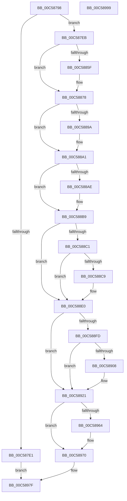

# CmpInitializeSystemHive

- RVA: `0x00C58798`–`0x00C5899A` (길이 `514` bytes)
- VA: `0x0000000140C58798`
- 실행 섹션: `INIT`
- PDB 이름 있음: `예`; PDB Function 태그: `아니요`
- unwind 정보 RVA: `0x000D647C`
- 디코드: `123`개 명령, `514/514` bytes 표시
- 미해석 바이트: `0` (있으면 어셈블리에 `.byte`로 보존)

> 이 문서는 커널 이미지의 기계어와 PDB 기호를 분석해 생성했습니다. 4번과 5번은 함수 원형과 자료형을 바이너리 사용 방식에서 추정한 C 해석이며 원본 소스 복구 결과는 아닙니다.

## 1. Dependencies

- 직접 호출 지점: **7**; 고유 호출 대상: **6**
- 직접 호출자로 확인된 함수: **1**
- RIP 상대 이미지 참조: **12**

### Outgoing calls
- `0x00C587D4` → [CmpAllocatePool](../../text/3C/CmpAllocatePool_function_003CD504.md) (function, `0x003CD504`)
- `0x00C58856` → [CmpCreateHive](../../page/87/CmpCreateHive_function_00879DF0.md) (function, `0x00879DF0`)
- `0x00C58872` → [KeBugCheckEx](../../text/4F/KeBugCheckEx_function_004FD660.md) (function, `0x004FD660`)
- `0x00C5888B` → [CmpSetupLoggingState](../../page/7D/CmpSetupLoggingState_function_007DCCA8.md) (function, `0x007DCCA8`)
- `0x00C5891B` → [KeBugCheckEx](../../text/4F/KeBugCheckEx_function_004FD660.md) (function, `0x004FD660`)
- `0x00C58959` → [CmpLinkHiveToMaster](../../page/87/CmpLinkHiveToMaster_function_00877D6C.md) (function, `0x00877D6C`)
- `0x00C58975` → [ExFreePoolWithTag](../../poolcode/B8/ExFreePoolWithTag_function_00B82870.md) (function, `0x00B82870`)

### Direct callers
- [CmpInitializePreloadedHives](CmpInitializePreloadedHives_function_00C584D4.md) at `0x00C58595`

### Static image references
- `0x00C587EB` → RVA `0x00EEFB58` (`.data`; read)
- `0x00C58819` → RVA `0x00FDA0A8` (`PAGEDATA`; read)
- `0x00C5889A` → RVA `0x00EEFB68` (`.data`; write)
- `0x00C588A1` → RVA `0x00FD8004` (`PAGEDATA`; read)
- `0x00C588B9` → RVA `0x00EEFB6C` (`.data`; read)
- `0x00C588C1` → RVA `0x00EEFB70` (`.data`; read)
- `0x00C588E0` → RVA `0x00E0EC6C` (`.data`; read)
- `0x00C588F5` → RVA `0x00EF7C60` (`.data`; write)
- `0x00C588FD` → RVA `0x00FD8002` (`PAGEDATA`; write)
- `0x00C58921` → RVA `0x00E09AF0` (`.data`; read)
- `0x00C58927` → RVA `0x00FDA0D8` (`PAGEDATA`; read)
- `0x00C58969` → RVA `0x00E09AE0` (`.data`; write)

## 2. Other-region calls and transfers

- 다른 실행 섹션으로 향하는 call: **7**
  - `0x00C587D4` → [CmpAllocatePool](../../text/3C/CmpAllocatePool_function_003CD504.md) (`INIT` → `.text`)
  - `0x00C58856` → [CmpCreateHive](../../page/87/CmpCreateHive_function_00879DF0.md) (`INIT` → `PAGE`)
  - `0x00C58872` → [KeBugCheckEx](../../text/4F/KeBugCheckEx_function_004FD660.md) (`INIT` → `.text`)
  - `0x00C5888B` → [CmpSetupLoggingState](../../page/7D/CmpSetupLoggingState_function_007DCCA8.md) (`INIT` → `PAGE`)
  - `0x00C5891B` → [KeBugCheckEx](../../text/4F/KeBugCheckEx_function_004FD660.md) (`INIT` → `.text`)
  - `0x00C58959` → [CmpLinkHiveToMaster](../../page/87/CmpLinkHiveToMaster_function_00877D6C.md) (`INIT` → `PAGE`)
  - `0x00C58975` → [ExFreePoolWithTag](../../poolcode/B8/ExFreePoolWithTag_function_00B82870.md) (`INIT` → `POOLCODE`)
- 별도 외부 분기/꼬리 이동을 확인하지 못했습니다.

## 3. Assembly (complete function range)

```asm
00C58798  48 8B C4                        mov rax, rsp
00C5879B  48 89 58 08                     mov qword ptr [rax + 8], rbx
00C5879F  48 89 68 10                     mov qword ptr [rax + 0x10], rbp
00C587A3  4C 89 40 18                     mov qword ptr [rax + 0x18], r8
00C587A7  56                              push rsi
00C587A8  57                              push rdi
00C587A9  41 56                           push r14
00C587AB  48 81 EC 80 00 00 00            sub rsp, 0x80
00C587B2  4C 8B F2                        mov r14, rdx
00C587B5  48 8B F1                        mov rsi, rcx
00C587B8  33 DB                           xor ebx, ebx
00C587BA  BA B0 01 00 00                  mov edx, 0x1b0
00C587BF  B9 00 01 00 00                  mov ecx, 0x100
00C587C4  88 58 18                        mov byte ptr [rax + 0x18], bl
00C587C7  41 B8 43 4D 39 33               mov r8d, 0x33394d43
00C587CD  48 89 58 D8                     mov qword ptr [rax - 0x28], rbx
00C587D1  49 8B E9                        mov rbp, r9
00C587D4  E8 2B 4D 77 FF                  call 0x1403cd504
00C587D9  48 8B F8                        mov rdi, rax
00C587DC  48 85 C0                        test rax, rax
00C587DF  75 0A                           jne 0x140c587eb
00C587E1  BB 9A 00 00 C0                  mov ebx, 0xc000009a
00C587E6  E9 94 01 00 00                  jmp 0x140c5897f
00C587EB  39 1D 67 73 29 00               cmp dword ptr [rip + 0x297367], ebx
00C587F1  B9 12 00 00 02                  mov ecx, 0x2000012
00C587F6  48 8B 86 A8 00 00 00            mov rax, qword ptr [rsi + 0xa8]
00C587FD  41 B8 12 00 00 00               mov r8d, 0x12
00C58803  48 89 7C 24 60                  mov qword ptr [rsp + 0x60], rdi
00C58808  44 0F 45 C1                     cmovne r8d, ecx
00C5880C  48 8D 8C 24 B0 00 00 00         lea rcx, [rsp + 0xb0]
00C58814  48 89 4C 24 58                  mov qword ptr [rsp + 0x58], rcx
00C58819  48 8D 0D 88 18 38 00            lea rcx, [rip + 0x381888]
00C58820  48 89 6C 24 50                  mov qword ptr [rsp + 0x50], rbp
00C58825  BD 02 00 00 00                  mov ebp, 2
00C5882A  48 89 5C 24 48                  mov qword ptr [rsp + 0x48], rbx
00C5882F  44 8B CD                        mov r9d, ebp
00C58832  48 89 5C 24 40                  mov qword ptr [rsp + 0x40], rbx
00C58837  C7 44 24 38 08 00 59 00         mov dword ptr [rsp + 0x38], 0x590008
00C5883F  48 89 4C 24 30                  mov qword ptr [rsp + 0x30], rcx
00C58844  8D 55 FF                        lea edx, [rbp - 1]
00C58847  48 89 5C 24 28                  mov qword ptr [rsp + 0x28], rbx
00C5884C  48 8D 4C 24 70                  lea rcx, [rsp + 0x70]
00C58851  48 89 44 24 20                  mov qword ptr [rsp + 0x20], rax
00C58856  E8 95 15 C2 FF                  call 0x140879df0
00C5885B  85 C0                           test eax, eax
00C5885D  79 19                           jns 0x140c58878
00C5885F  48 98                           cdqe
00C58861  8D 55 01                        lea edx, [rbp + 1]
00C58864  4C 8B CF                        mov r9, rdi
00C58867  48 89 44 24 20                  mov qword ptr [rsp + 0x20], rax
00C5886C  44 8B C5                        mov r8d, ebp
00C5886F  8D 4D 72                        lea ecx, [rbp + 0x72]
00C58872  E8 E9 4D 8A FF                  call 0x1404fd660
00C58877  CC                              int3
00C58878  48 8B 96 F0 00 00 00            mov rdx, qword ptr [rsi + 0xf0]
00C5887F  48 8B 4C 24 70                  mov rcx, qword ptr [rsp + 0x70]
00C58884  48 81 C2 64 0B 00 00            add rdx, 0xb64
00C5888B  E8 18 44 B8 FF                  call 0x1407dcca8
00C58890  80 BC 24 B0 00 00 00 01         cmp byte ptr [rsp + 0xb0], 1
00C58898  75 07                           jne 0x140c588a1
00C5889A  C6 05 C7 72 29 00 01            mov byte ptr [rip + 0x2972c7], 1
00C588A1  38 1D 5D F7 37 00               cmp byte ptr [rip + 0x37f75d], bl
00C588A7  B9 00 80 00 00                  mov ecx, 0x8000
00C588AC  74 0B                           je 0x140c588b9
00C588AE  48 8B 44 24 70                  mov rax, qword ptr [rsp + 0x70]
00C588B3  09 88 A0 00 00 00               or dword ptr [rax + 0xa0], ecx
00C588B9  39 1D AD 72 29 00               cmp dword ptr [rip + 0x2972ad], ebx
00C588BF  74 1F                           je 0x140c588e0
00C588C1  39 1D A9 72 29 00               cmp dword ptr [rip + 0x2972a9], ebx
00C588C7  75 17                           jne 0x140c588e0
00C588C9  48 8B 44 24 70                  mov rax, qword ptr [rsp + 0x70]
00C588CE  09 88 A0 00 00 00               or dword ptr [rax + 0xa0], ecx
00C588D4  48 8B 44 24 70                  mov rax, qword ptr [rsp + 0x70]
00C588D9  83 A0 A0 00 00 00 FD            and dword ptr [rax + 0xa0], 0xfffffffd
00C588E0  39 1D 86 63 1B 00               cmp dword ptr [rip + 0x1b6386], ebx
00C588E6  4C 8B 44 24 70                  mov r8, qword ptr [rsp + 0x70]
00C588EB  49 8B 40 40                     mov rax, qword ptr [r8 + 0x40]
00C588EF  8B 88 F8 0F 00 00               mov ecx, dword ptr [rax + 0xff8]
00C588F5  89 0D 65 F3 29 00               mov dword ptr [rip + 0x29f365], ecx
00C588FB  75 24                           jne 0x140c58921
00C588FD  88 1D FF F6 37 00               mov byte ptr [rip + 0x37f6ff], bl
00C58903  F6 C1 04                        test cl, 4
00C58906  74 19                           je 0x140c58921
00C58908  BA 03 00 00 00                  mov edx, 3
00C5890D  48 89 5C 24 20                  mov qword ptr [rsp + 0x20], rbx
00C58912  4D 8B C8                        mov r9, r8
00C58915  44 8B C2                        mov r8d, edx
00C58918  8D 4A 71                        lea ecx, [rdx + 0x71]
00C5891B  E8 40 4D 8A FF                  call 0x1404fd660
00C58920  CC                              int3
00C58921  8B 05 C9 11 1B 00               mov eax, dword ptr [rip + 0x1b11c9]
00C58927  48 8D 0D AA 17 38 00            lea rcx, [rip + 0x3817aa]
00C5892E  48 89 7C 24 58                  mov qword ptr [rsp + 0x58], rdi
00C58933  45 33 C9                        xor r9d, r9d
00C58936  C6 44 24 50 01                  mov byte ptr [rsp + 0x50], 1
00C5893B  33 D2                           xor edx, edx
00C5893D  48 89 5C 24 48                  mov qword ptr [rsp + 0x48], rbx
00C58942  48 89 5C 24 40                  mov qword ptr [rsp + 0x40], rbx
00C58947  4C 89 74 24 38                  mov qword ptr [rsp + 0x38], r14
00C5894C  48 89 5C 24 30                  mov qword ptr [rsp + 0x30], rbx
00C58951  88 5C 24 28                     mov byte ptr [rsp + 0x28], bl
00C58955  89 44 24 20                     mov dword ptr [rsp + 0x20], eax
00C58959  E8 0E F4 C1 FF                  call 0x140877d6c
00C5895E  8B F0                           mov esi, eax
00C58960  85 C0                           test eax, eax
00C58962  78 0C                           js 0x140c58970
00C58964  48 8B 4C 24 70                  mov rcx, qword ptr [rsp + 0x70]
00C58969  48 89 0D 70 11 1B 00            mov qword ptr [rip + 0x1b1170], rcx
00C58970  33 D2                           xor edx, edx
00C58972  48 8B CF                        mov rcx, rdi
00C58975  E8 F6 9E F2 FF                  call 0x140b82870
00C5897A  85 F6                           test esi, esi
00C5897C  0F 48 DE                        cmovs ebx, esi
00C5897F  4C 8D 9C 24 80 00 00 00         lea r11, [rsp + 0x80]
00C58987  8B C3                           mov eax, ebx
00C58989  49 8B 5B 20                     mov rbx, qword ptr [r11 + 0x20]
00C5898D  49 8B 6B 28                     mov rbp, qword ptr [r11 + 0x28]
00C58991  49 8B E3                        mov rsp, r11
00C58994  41 5E                           pop r14
00C58996  5F                              pop rdi
00C58997  5E                              pop rsi
00C58998  C3                              ret
00C58999  CC                              int3
```

## 4. C-style interpretation (structured pseudocode)

```c
__int64 __fastcall CmpInitializeSystemHive(__int64 a1, __int64 a2, __int64 a3, __int64 a4)
{
    __int64 result;
    __int64 v_rbx;
    __int64 v_rsp;
    unsigned __int64 v_stack_m18;
    unsigned __int64 v_stack_m28;
    unsigned __int64 v_stack_m38;
    unsigned __int64 v_stack_m40;
    unsigned __int64 v_stack_m48;
    unsigned __int64 v_stack_m50;
    unsigned __int64 v_stack_m58;
    unsigned int v_stack_m60;
    unsigned __int64 v_stack_m68;
    unsigned __int64 v_stack_m70;
    unsigned __int64 v_stack_m78;
    unsigned __int64 v_stack_p18;

    *(unsigned __int64 *)(v_rsp + 8) = v_rbx;
    *(unsigned __int64 *)(v_rsp + 16) = v_rbp;
    *(unsigned __int64 *)(v_rsp + 24) = a3;
    v_rsp = (v_rsp) - (128);
    v_rbx = 0;
    *(unsigned __int8 *)(v_rsp + 24) = 0;
    *(unsigned __int64 *)(v_rsp - 40) = 0;
    result = CmpAllocatePool(256, 432, (unsigned int)(0x33394D43ULL), a4);
    if (result != 0) goto loc_00C587EB;
    goto loc_00C5897F;
loc_00C587EB:
    v_stack_m38 = result;
    a3 = 18;
    if ((*(unsigned int *)(v_rip + 2716519)) != ((unsigned int)((unsigned int)(0xC000009AULL)))) { a3 = (unsigned int)((unsigned int)(0x2000012ULL)); }
    v_stack_m40 = v_stack_p18;
    v_stack_m48 = a4;
    v_stack_m50 = (unsigned int)(0xC000009AULL);
    v_stack_m58 = (unsigned int)(0xC000009AULL);
    v_stack_m60 = 0x590008ULL;
    v_stack_m68 = v_rip + 3676296;
    v_stack_m70 = (unsigned int)(0xC000009AULL);
    v_stack_m78 = *(unsigned __int64 *)(a1 + 168);
    result = CmpCreateHive(v_stack_m28, 2 - 1, a3, 2);
    if (sign_flag) {
        a2 = 2 + 1;
        a4 = result;
        v_stack_m78 = result;
        a3 = 2;
        a1 = 2 + 114;
        result = KeBugCheckEx(a1, a2, a3, a4);
    }
    a2 = (*(unsigned __int64 *)(a1 + 240)) + (0xB64ULL);
    result = CmpSetupLoggingState(v_stack_m28, a2, a3, a4);
    if (v_stack_p18 == 1) {
        *(unsigned __int8 *)(v_rip + 2716359) = 1;
    }
    if ((*(unsigned __int8 *)(v_rip + 3667805)) != ((unsigned __int8)((unsigned int)(0xC000009AULL)))) {
        result = v_stack_m28;
    }
    if ((*(unsigned int *)(v_rip + 2716333)) == ((unsigned int)((unsigned int)(0xC000009AULL)))) goto loc_00C588E0;
    if ((*(unsigned int *)(v_rip + 2716329)) == ((unsigned int)((unsigned int)(0xC000009AULL)))) {
        result = v_stack_m28;
        result = v_stack_m28;
    }
    *(unsigned int *)(v_rip + 2749285) = (unsigned int)((unsigned int)(*(unsigned int *)(*(unsigned __int64 *)(v_stack_m28 + 64) + 4088)));
    if ((*(unsigned int *)(v_rip + 1794950)) != ((unsigned int)((unsigned int)(0xC000009AULL)))) goto loc_00C58921;
    *(unsigned __int8 *)(v_rip + 3667711) = (unsigned __int8)((unsigned int)(0xC000009AULL));
    result = *(unsigned __int64 *)(v_stack_m28 + 64);
    if ((((unsigned __int8)((unsigned int)(*(unsigned int *)(*(unsigned __int64 *)(v_stack_m28 + 64) + 4088)))) & (4)) != 0) {
        a2 = 3;
        v_stack_m78 = (unsigned int)(0xC000009AULL);
        a4 = v_stack_m28;
        a3 = (unsigned int)(a2);
        a1 = a2 + 113;
        result = KeBugCheckEx(a1, a2, a3, a4);
    }
    v_stack_m40 = result;
    a4 = 0;
    v_stack_m48 = 1;
    a2 = 0;
    v_stack_m50 = (unsigned int)(0xC000009AULL);
    v_stack_m58 = (unsigned int)(0xC000009AULL);
    v_stack_m60 = 0;
    v_stack_m68 = (unsigned int)(0xC000009AULL);
    v_stack_m70 = (unsigned __int8)((unsigned int)(0xC000009AULL));
    v_stack_m78 = (unsigned int)((unsigned int)(*(unsigned int *)(v_rip + 1774025)));
    result = CmpLinkHiveToMaster(v_rip + 3676074, a2, a3, a4);
    if (!(sign_flag)) {
        a1 = v_stack_m28;
        *(unsigned __int64 *)(v_rip + 1773936) = a1;
    }
    a2 = 0;
    result = ExFreePoolWithTag(result, a2, a3, a4);
    v_rbx = (unsigned int)(0xC000009AULL);
    if (sign_flag) { v_rbx = (unsigned int)((unsigned int)((unsigned int)(result))); }
loc_00C5897F:
    return (unsigned int)((unsigned int)(v_rbx));
}
```

## 5. (Beta) C Style

```c
int64_t CmpInitializeSystemHive(void *Arg1, int64_t Arg2, int64_t Arg3, int64_t Arg4)
{
    uint8_t *arg1 = (uint8_t *)Arg1;

    int64_t result;
    int64_t local_rbx;
    int64_t local_rsp;
    uint64_t v_stack_m18;
    uint64_t v_stack_m28;
    uint64_t v_stack_m38;
    uint64_t v_stack_m40;
    uint64_t v_stack_m48;
    uint64_t v_stack_m50;
    uint64_t v_stack_m58;
    uint32_t v_stack_m60;
    uint64_t v_stack_m68;
    uint64_t v_stack_m70;
    uint64_t v_stack_m78;
    uint64_t v_stack_p18;

    *(uint64_t *)(local_rsp + 0x8) = local_rbx;
    *(uint64_t *)(local_rsp + 0x10) = local_rbp;
    *(uint64_t *)(local_rsp + 0x18) = Arg3;
    local_rsp = (local_rsp) - (128);
    local_rbx = 0;
    *(uint8_t *)(local_rsp + 0x18) = 0;
    *(uint64_t *)(local_rsp - 0x28) = 0;
    result = CmpAllocatePool(256, 432, (uint32_t)(0x33394D43ULL), Arg4);
    if (result != 0) goto loc_00C587EB;
    goto loc_00C5897F;
loc_00C587EB:
    v_stack_m38 = result;
    Arg3 = 18;
    if ((*(uint32_t *)(v_rip + 0x297367)) != ((uint32_t)((uint32_t)(0xC000009AULL)))) { Arg3 = (uint32_t)((uint32_t)(0x2000012ULL)); }
    v_stack_m40 = v_stack_p18;
    v_stack_m48 = Arg4;
    v_stack_m50 = (uint32_t)(0xC000009AULL);
    v_stack_m58 = (uint32_t)(0xC000009AULL);
    v_stack_m60 = 0x590008ULL;
    v_stack_m68 = v_rip + 3676296;
    v_stack_m70 = (uint32_t)(0xC000009AULL);
    v_stack_m78 = *(uint64_t *)(arg1 + 0xA8);
    result = CmpCreateHive(v_stack_m28, 2 - 1, Arg3, 2);
    if (sign_flag) {
        Arg2 = 2 + 1;
        Arg4 = result;
        v_stack_m78 = result;
        Arg3 = 2;
        Arg1 = 2 + 114;
        result = KeBugCheckEx(Arg1, Arg2, Arg3, Arg4);
    }
    Arg2 = (*(uint64_t *)(arg1 + 0xF0)) + (0xB64ULL);
    result = CmpSetupLoggingState(v_stack_m28, Arg2, Arg3, Arg4);
    if (v_stack_p18 == 1) {
        *(uint8_t *)(v_rip + 0x2972C7) = 1;
    }
    if ((*(uint8_t *)(v_rip + 0x37F75D)) != ((uint8_t)((uint32_t)(0xC000009AULL)))) {
        result = v_stack_m28;
    }
    if ((*(uint32_t *)(v_rip + 0x2972AD)) == ((uint32_t)((uint32_t)(0xC000009AULL)))) goto loc_00C588E0;
    if ((*(uint32_t *)(v_rip + 0x2972A9)) == ((uint32_t)((uint32_t)(0xC000009AULL)))) {
        result = v_stack_m28;
        result = v_stack_m28;
    }
    *(uint32_t *)(v_rip + 0x29F365) = (uint32_t)((uint32_t)(*(uint32_t *)(*(uint64_t *)(v_stack_m28 + 0x40) + 0xFF8)));
    if ((*(uint32_t *)(v_rip + 0x1B6386)) != ((uint32_t)((uint32_t)(0xC000009AULL)))) goto loc_00C58921;
    *(uint8_t *)(v_rip + 0x37F6FF) = (uint8_t)((uint32_t)(0xC000009AULL));
    result = *(uint64_t *)(v_stack_m28 + 0x40);
    if ((((uint8_t)((uint32_t)(*(uint32_t *)(*(uint64_t *)(v_stack_m28 + 0x40) + 0xFF8)))) & (4)) != 0) {
        Arg2 = 3;
        v_stack_m78 = (uint32_t)(0xC000009AULL);
        Arg4 = v_stack_m28;
        Arg3 = (uint32_t)(Arg2);
        Arg1 = Arg2 + 113;
        result = KeBugCheckEx(Arg1, Arg2, Arg3, Arg4);
    }
    v_stack_m40 = result;
    Arg4 = 0;
    v_stack_m48 = 1;
    Arg2 = 0;
    v_stack_m50 = (uint32_t)(0xC000009AULL);
    v_stack_m58 = (uint32_t)(0xC000009AULL);
    v_stack_m60 = 0;
    v_stack_m68 = (uint32_t)(0xC000009AULL);
    v_stack_m70 = (uint8_t)((uint32_t)(0xC000009AULL));
    v_stack_m78 = (uint32_t)((uint32_t)(*(uint32_t *)(v_rip + 0x1B11C9)));
    result = CmpLinkHiveToMaster(v_rip + 3676074, Arg2, Arg3, Arg4);
    if (!(sign_flag)) {
        Arg1 = v_stack_m28;
        *(void **)(v_rip + 0x1B1170) = Arg1;
    }
    Arg2 = 0;
    result = ExFreePoolWithTag(result, Arg2, Arg3, Arg4);
    local_rbx = (uint32_t)(0xC000009AULL);
    if (sign_flag) { local_rbx = (uint32_t)((uint32_t)((uint32_t)(result))); }
loc_00C5897F:
    return (uint32_t)((uint32_t)(local_rbx));
}
```

### 관측된 메모리 오프셋

구조체 형식이 확인되지 않은 접근은 인자 기준의 오프셋으로만 기록했습니다.

| 기준 인자 | 오프셋 표현 | 폭 (bit) | 접근 |
|---|---:|---:|---|
| `Arg1` | `+ 0xA8` | `64` | `R` |
| `Arg1` | `+ 0xF0` | `64` | `R` |

## 6. Execution-region graph

[열기: 2D/3D 그래프와 함수 탐색 컨트롤 패널](../../../control-panel.html?section=init&rva=0x00C58798&view=graph)

- 2D 그래프는 위에서 아래로 흐르고, 3D 그래프는 빈 공간을 드래그해 회전합니다. Shift+드래그는 이동, 휠은 확대·축소, 함수 노드 선택은 대상 보고서 이동입니다.

### Static fallback


