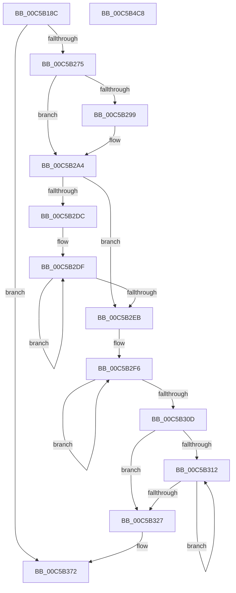

# CmpInitializeTransactions

- RVA: `0x00C5B18C`–`0x00C5B4C9` (길이 `829` bytes)
- VA: `0x0000000140C5B18C`
- 실행 섹션: `INIT`
- PDB 이름 있음: `예`; PDB Function 태그: `아니요`
- unwind 정보 RVA: `0x00064C80`
- 디코드: `147`개 명령, `829/829` bytes 표시
- 미해석 바이트: `0` (있으면 어셈블리에 `.byte`로 보존)

> 이 문서는 커널 이미지의 기계어와 PDB 기호를 분석해 생성했습니다. 4번과 5번은 함수 원형과 자료형을 바이너리 사용 방식에서 추정한 C 해석이며 원본 소스 복구 결과는 아닙니다.

## 1. Dependencies

- 직접 호출 지점: **1**; 고유 호출 대상: **1**
- 직접 호출자로 확인된 함수: **1**
- RIP 상대 이미지 참조: **79**

### Outgoing calls
- `0x00C5B330` → [KiQueryUnbiasedInterruptTime](../../text/42/KiQueryUnbiasedInterruptTime_function_0042D180.md) (function, `0x0042D180`)

### Direct callers
- [CmInitSystem1](CmInitSystem1_function_00C559CC.md) at `0x00C55C68`

### Static image references
- `0x00C5B194` → RVA `0x00EF5660` (`.data`; write)
- `0x00C5B19E` → RVA `0x00EF56B0` (`.data`; read)
- `0x00C5B1A5` → RVA `0x00EF5668` (`.data`; write)
- `0x00C5B1AC` → RVA `0x00EF56B8` (`.data`; write)
- `0x00C5B1B3` → RVA `0x00EF56B0` (`.data`; write)
- `0x00C5B1BA` → RVA `0x00EF5680` (`.data`; read)
- `0x00C5B1C1` → RVA `0x00EF5688` (`.data`; write)
- `0x00C5B1C8` → RVA `0x00EF5680` (`.data`; write)
- `0x00C5B1CF` → RVA `0x00EF5840` (`.data`; read)
- `0x00C5B1D6` → RVA `0x00EF5848` (`.data`; write)
- `0x00C5B1DD` → RVA `0x00EF5840` (`.data`; write)
- `0x00C5B1E4` → RVA `0x007EE030` (`CmpLazyCommitWorker`; read)
- `0x00C5B1EB` → RVA `0x00EF5750` (`.data`; write)
- `0x00C5B1F2` → RVA `0x00EF57A0` (`.data`; read)
- `0x00C5B1F9` → RVA `0x00EF57A8` (`.data`; write)
- `0x00C5B200` → RVA `0x00EF57A0` (`.data`; write)
- `0x00C5B207` → RVA `0x00EF5670` (`.data`; write)
- `0x00C5B20D` → RVA `0x00EF5678` (`.data`; write)
- `0x00C5B216` → RVA `0x00EF567A` (`.data`; write)
- `0x00C5B21D` → RVA `0x00EF567C` (`.data`; write)
- `0x00C5B223` → RVA `0x00EF5820` (`.data`; write)
- `0x00C5B22D` → RVA `0x00EF5828` (`.data`; write)
- `0x00C5B234` → RVA `0x00EF5830` (`.data`; write)
- `0x00C5B23A` → RVA `0x00EF5838` (`.data`; write)
- `0x00C5B243` → RVA `0x00EF583A` (`.data`; write)
- `0x00C5B24A` → RVA `0x00EF583C` (`.data`; write)
- `0x00C5B250` → RVA `0x00EF5810` (`.data`; write)
- `0x00C5B257` → RVA `0x00EF5758` (`.data`; write)
- `0x00C5B25E` → RVA `0x00EF5740` (`.data`; write)
- `0x00C5B268` → RVA `0x00E62700` (`.data`; read)
- `0x00C5B290` → RVA `0x00E62700` (`.data`; write)
- `0x00C5B2BF` → RVA `0x00E62708` (`.data`; write)
- `0x00C5B329` → RVA `0x00E62718` (`.data`; write)
- `0x00C5B36B` → RVA `0x00E62710` (`.data`; write)
- `0x00C5B372` → RVA `0x0066ADC0` (`CmpLazyCommitDpcRoutine`; read)
- `0x00C5B379` → RVA `0x00EF57C0` (`.data`; write)
- `0x00C5B380` → RVA `0x00EF5778` (`.data`; write)
- `0x00C5B387` → RVA `0x00EF57C8` (`.data`; read)
- `0x00C5B38E` → RVA `0x00EF57D0` (`.data`; write)
- `0x00C5B395` → RVA `0x00EF57C8` (`.data`; write)
- `0x00C5B39C` → RVA `0x00EF56A0` (`.data`; read)
- `0x00C5B3A3` → RVA `0x00EF56A8` (`.data`; write)
- `0x00C5B3AA` → RVA `0x00EF56A0` (`.data`; write)
- `0x00C5B3B1` → RVA `0x00EF5700` (`.data`; read)
- `0x00C5B3B8` → RVA `0x00EF5708` (`.data`; write)
- `0x00C5B3BF` → RVA `0x00EF5700` (`.data`; write)
- `0x00C5B3C6` → RVA `0x00AB65B0` (`CmpDelayFreeRMWorker`; read)
- `0x00C5B3CD` → RVA `0x00EF56D0` (`.data`; write)
- `0x00C5B3D4` → RVA `0x0066AF00` (`CmpDelayFreeRMDpcRoutine`; read)
- `0x00C5B3DB` → RVA `0x00EF55F8` (`.data`; write)
- `0x00C5B3E2` → RVA `0x00EF5628` (`.data`; read)
- `0x00C5B3E9` → RVA `0x00EF5630` (`.data`; write)
- `0x00C5B3F0` → RVA `0x00EF5628` (`.data`; write)
- `0x00C5B3F7` → RVA `0x00EF5800` (`.data`; read)
- `0x00C5B3FE` → RVA `0x00EF5620` (`.data`; write)
- `0x00C5B405` → RVA `0x00EF5808` (`.data`; write)
- `0x00C5B40C` → RVA `0x00EF5800` (`.data`; write)
- `0x00C5B413` → RVA `0x00EF5760` (`.data`; write)
- `0x00C5B41D` → RVA `0x00EF5780` (`.data`; write)
- `0x00C5B424` → RVA `0x00EF5798` (`.data`; write)
- `0x00C5B42B` → RVA `0x00EF5770` (`.data`; write)
- `0x00C5B439` → RVA `0x00EF57D8` (`.data`; write)
- `0x00C5B440` → RVA `0x00EF57FC` (`.data`; write)
- `0x00C5B446` → RVA `0x00EF57F8` (`.data`; write)
- `0x00C5B44D` → RVA `0x00EF56E0` (`.data`; write)
- `0x00C5B457` → RVA `0x00EF56E8` (`.data`; write)
- `0x00C5B45E` → RVA `0x00EF56F0` (`.data`; write)
- `0x00C5B464` → RVA `0x00EF56F8` (`.data`; write)
- `0x00C5B46D` → RVA `0x00EF56FA` (`.data`; write)
- `0x00C5B474` → RVA `0x00EF56FC` (`.data`; write)
- `0x00C5B47A` → RVA `0x00EF56D8` (`.data`; write)
- `0x00C5B481` → RVA `0x00EF56C0` (`.data`; write)
- `0x00C5B488` → RVA `0x00EF55E0` (`.data`; write)
- `0x00C5B492` → RVA `0x00EF5600` (`.data`; write)
- `0x00C5B499` → RVA `0x00EF5618` (`.data`; write)
- `0x00C5B4A0` → RVA `0x00EF55F0` (`.data`; write)
- `0x00C5B4AE` → RVA `0x00EF5638` (`.data`; write)
- `0x00C5B4B5` → RVA `0x00EF565C` (`.data`; write)
- `0x00C5B4BB` → RVA `0x00EF5658` (`.data`; write)

## 2. Other-region calls and transfers

- 다른 실행 섹션으로 향하는 call: **1**
  - `0x00C5B330` → [KiQueryUnbiasedInterruptTime](../../text/42/KiQueryUnbiasedInterruptTime_function_0042D180.md) (`INIT` → `.text`)
- 별도 외부 분기/꼬리 이동을 확인하지 못했습니다.

## 3. Assembly (complete function range)

```asm
00C5B18C  40 53                           push rbx
00C5B18E  48 83 EC 30                     sub rsp, 0x30
00C5B192  33 DB                           xor ebx, ebx
00C5B194  C7 05 C2 A4 29 00 01 00 00 00   mov dword ptr [rip + 0x29a4c2], 1
00C5B19E  48 8D 05 0B A5 29 00            lea rax, [rip + 0x29a50b]
00C5B1A5  48 89 1D BC A4 29 00            mov qword ptr [rip + 0x29a4bc], rbx
00C5B1AC  48 89 05 05 A5 29 00            mov qword ptr [rip + 0x29a505], rax
00C5B1B3  48 89 05 F6 A4 29 00            mov qword ptr [rip + 0x29a4f6], rax
00C5B1BA  48 8D 05 BF A4 29 00            lea rax, [rip + 0x29a4bf]
00C5B1C1  48 89 05 C0 A4 29 00            mov qword ptr [rip + 0x29a4c0], rax
00C5B1C8  48 89 05 B1 A4 29 00            mov qword ptr [rip + 0x29a4b1], rax
00C5B1CF  48 8D 05 6A A6 29 00            lea rax, [rip + 0x29a66a]
00C5B1D6  48 89 05 6B A6 29 00            mov qword ptr [rip + 0x29a66b], rax
00C5B1DD  48 89 05 5C A6 29 00            mov qword ptr [rip + 0x29a65c], rax
00C5B1E4  48 8D 05 45 2E B9 FF            lea rax, [rip - 0x46d1bb]
00C5B1EB  48 89 05 5E A5 29 00            mov qword ptr [rip + 0x29a55e], rax
00C5B1F2  48 8D 05 A7 A5 29 00            lea rax, [rip + 0x29a5a7]
00C5B1F9  48 89 05 A8 A5 29 00            mov qword ptr [rip + 0x29a5a8], rax
00C5B200  48 89 05 99 A5 29 00            mov qword ptr [rip + 0x29a599], rax
00C5B207  89 1D 63 A4 29 00               mov dword ptr [rip + 0x29a463], ebx
00C5B20D  66 C7 05 62 A4 29 00 01 00      mov word ptr [rip + 0x29a462], 1
00C5B216  C6 05 5D A4 29 00 06            mov byte ptr [rip + 0x29a45d], 6
00C5B21D  89 1D 59 A4 29 00               mov dword ptr [rip + 0x29a459], ebx
00C5B223  C7 05 F3 A5 29 00 01 00 00 00   mov dword ptr [rip + 0x29a5f3], 1
00C5B22D  48 89 1D F4 A5 29 00            mov qword ptr [rip + 0x29a5f4], rbx
00C5B234  89 1D F6 A5 29 00               mov dword ptr [rip + 0x29a5f6], ebx
00C5B23A  66 C7 05 F5 A5 29 00 01 00      mov word ptr [rip + 0x29a5f5], 1
00C5B243  C6 05 F0 A5 29 00 06            mov byte ptr [rip + 0x29a5f0], 6
00C5B24A  89 1D EC A5 29 00               mov dword ptr [rip + 0x29a5ec], ebx
00C5B250  48 89 1D B9 A5 29 00            mov qword ptr [rip + 0x29a5b9], rbx
00C5B257  48 89 1D FA A4 29 00            mov qword ptr [rip + 0x29a4fa], rbx
00C5B25E  48 89 1D DB A4 29 00            mov qword ptr [rip + 0x29a4db], rbx
00C5B265  0F AE E8                        lfence
00C5B268  48 39 1D 91 74 20 00            cmp qword ptr [rip + 0x207491], rbx
00C5B26F  0F 85 FD 00 00 00               jne 0x140c5b372
00C5B275  0F 31                           rdtsc
00C5B277  48 C1 E2 20                     shl rdx, 0x20
00C5B27B  48 0B C2                        or rax, rdx
00C5B27E  48 C1 E8 04                     shr rax, 4
00C5B282  44 69 C0 BF CB 7F 02            imul r8d, eax, 0x27fcbbf
00C5B289  49 81 F0 A5 0F 00 00            xor r8, 0xfa5
00C5B290  4C 89 05 69 74 20 00            mov qword ptr [rip + 0x207469], r8
00C5B297  75 0B                           jne 0x140c5b2a4
00C5B299  44 8D 43 01                     lea r8d, [rbx + 1]
00C5B29D  4C 89 05 5C 74 20 00            mov qword ptr [rip + 0x20745c], r8
00C5B2A4  0F 31                           rdtsc
00C5B2A6  48 C1 E2 20                     shl rdx, 0x20
00C5B2AA  48 0B C2                        or rax, rdx
00C5B2AD  48 C1 E8 04                     shr rax, 4
00C5B2B1  44 69 D0 BF CB 7F 02            imul r10d, eax, 0x27fcbbf
00C5B2B8  49 81 F2 37 05 00 00            xor r10, 0x537
00C5B2BF  4C 89 15 42 74 20 00            mov qword ptr [rip + 0x207442], r10
00C5B2C6  0F 01 4C 24 20                  sidt [rsp + 0x20]
00C5B2CB  48 8B 54 24 22                  mov rdx, qword ptr [rsp + 0x22]
00C5B2D0  48 8D 8A 50 03 00 00            lea rcx, [rdx + 0x350]
00C5B2D7  48 3B D1                        cmp rdx, rcx
00C5B2DA  73 0F                           jae 0x140c5b2eb
00C5B2DC  48 8B C2                        mov rax, rdx
00C5B2DF  0F 18 00                        prefetchnta byte ptr [rax]
00C5B2E2  48 83 C0 40                     add rax, 0x40
00C5B2E6  48 3B C1                        cmp rax, rcx
00C5B2E9  72 F4                           jb 0x140c5b2df
00C5B2EB  B8 6A 00 00 00                  mov eax, 0x6a
00C5B2F0  41 B9 50 03 00 00               mov r9d, 0x350
00C5B2F6  4C 2B 02                        sub r8, qword ptr [rdx]
00C5B2F9  41 8B CA                        mov ecx, r10d
00C5B2FC  49 D3 C8                        ror r8, cl
00C5B2FF  48 83 C2 08                     add rdx, 8
00C5B303  41 83 C1 F8                     add r9d, -8
00C5B307  48 83 E8 01                     sub rax, 1
00C5B30B  75 E9                           jne 0x140c5b2f6
00C5B30D  45 85 C9                        test r9d, r9d
00C5B310  74 15                           je 0x140c5b327
00C5B312  0F B6 02                        movzx eax, byte ptr [rdx]
00C5B315  41 8B CA                        mov ecx, r10d
00C5B318  4C 2B C0                        sub r8, rax
00C5B31B  48 FF C2                        inc rdx
00C5B31E  49 D3 C8                        ror r8, cl
00C5B321  41 83 C1 FF                     add r9d, -1
00C5B325  75 EB                           jne 0x140c5b312
00C5B327  B1 01                           mov cl, 1
00C5B329  4C 89 05 E8 73 20 00            mov qword ptr [rip + 0x2073e8], r8
00C5B330  E8 4B 1E 7D FF                  call 0x14042d180
00C5B335  4C 8B D8                        mov r11, rax
00C5B338  0F 31                           rdtsc
00C5B33A  48 C1 E2 20                     shl rdx, 0x20
00C5B33E  48 B9 00 20 5F A0 12 00 00 00   movabs rcx, 0x12a05f2000
00C5B348  48 0B C2                        or rax, rdx
00C5B34B  33 D2                           xor edx, edx
00C5B34D  48 C1 E8 04                     shr rax, 4
00C5B351  48 69 C0 BF CB 7F 02            imul rax, rax, 0x27fcbbf
00C5B358  48 F7 F1                        div rcx
00C5B35B  48 B8 00 40 23 0E 43 00 00 00   movabs rax, 0x430e234000
00C5B365  48 03 C2                        add rax, rdx
00C5B368  49 03 C3                        add rax, r11
00C5B36B  48 89 05 9E 73 20 00            mov qword ptr [rip + 0x20739e], rax
00C5B372  48 8D 05 47 FA A0 FF            lea rax, [rip - 0x5f05b9]
00C5B379  48 89 1D 40 A4 29 00            mov qword ptr [rip + 0x29a440], rbx
00C5B380  48 89 05 F1 A3 29 00            mov qword ptr [rip + 0x29a3f1], rax
00C5B387  48 8D 05 3A A4 29 00            lea rax, [rip + 0x29a43a]
00C5B38E  48 89 05 3B A4 29 00            mov qword ptr [rip + 0x29a43b], rax
00C5B395  48 89 05 2C A4 29 00            mov qword ptr [rip + 0x29a42c], rax
00C5B39C  48 8D 05 FD A2 29 00            lea rax, [rip + 0x29a2fd]
00C5B3A3  48 89 05 FE A2 29 00            mov qword ptr [rip + 0x29a2fe], rax
00C5B3AA  48 89 05 EF A2 29 00            mov qword ptr [rip + 0x29a2ef], rax
00C5B3B1  48 8D 05 48 A3 29 00            lea rax, [rip + 0x29a348]
00C5B3B8  48 89 05 49 A3 29 00            mov qword ptr [rip + 0x29a349], rax
00C5B3BF  48 89 05 3A A3 29 00            mov qword ptr [rip + 0x29a33a], rax
00C5B3C6  48 8D 05 E3 B1 E5 FF            lea rax, [rip - 0x1a4e1d]
00C5B3CD  48 89 05 FC A2 29 00            mov qword ptr [rip + 0x29a2fc], rax
00C5B3D4  48 8D 05 25 FB A0 FF            lea rax, [rip - 0x5f04db]
00C5B3DB  48 89 05 16 A2 29 00            mov qword ptr [rip + 0x29a216], rax
00C5B3E2  48 8D 05 3F A2 29 00            lea rax, [rip + 0x29a23f]
00C5B3E9  48 89 05 40 A2 29 00            mov qword ptr [rip + 0x29a240], rax
00C5B3F0  48 89 05 31 A2 29 00            mov qword ptr [rip + 0x29a231], rax
00C5B3F7  48 8D 05 02 A4 29 00            lea rax, [rip + 0x29a402]
00C5B3FE  48 89 1D 1B A2 29 00            mov qword ptr [rip + 0x29a21b], rbx
00C5B405  48 89 05 FC A3 29 00            mov qword ptr [rip + 0x29a3fc], rax
00C5B40C  48 89 05 ED A3 29 00            mov qword ptr [rip + 0x29a3ed], rax
00C5B413  C7 05 43 A3 29 00 13 01 00 00   mov dword ptr [rip + 0x29a343], 0x113
00C5B41D  48 89 1D 5C A3 29 00            mov qword ptr [rip + 0x29a35c], rbx
00C5B424  48 89 1D 6D A3 29 00            mov qword ptr [rip + 0x29a36d], rbx
00C5B42B  48 89 1D 3E A3 29 00            mov qword ptr [rip + 0x29a33e], rbx
00C5B432  C6 05 87 A3 29 00 08            mov byte ptr [rip + 0x29a387], 8
00C5B439  48 89 1D 98 A3 29 00            mov qword ptr [rip + 0x29a398], rbx
00C5B440  89 1D B6 A3 29 00               mov dword ptr [rip + 0x29a3b6], ebx
00C5B446  66 89 1D AB A3 29 00            mov word ptr [rip + 0x29a3ab], bx
00C5B44D  C7 05 89 A2 29 00 01 00 00 00   mov dword ptr [rip + 0x29a289], 1
00C5B457  48 89 1D 8A A2 29 00            mov qword ptr [rip + 0x29a28a], rbx
00C5B45E  89 1D 8C A2 29 00               mov dword ptr [rip + 0x29a28c], ebx
00C5B464  66 C7 05 8B A2 29 00 01 00      mov word ptr [rip + 0x29a28b], 1
00C5B46D  C6 05 86 A2 29 00 06            mov byte ptr [rip + 0x29a286], 6
00C5B474  89 1D 82 A2 29 00               mov dword ptr [rip + 0x29a282], ebx
00C5B47A  48 89 1D 57 A2 29 00            mov qword ptr [rip + 0x29a257], rbx
00C5B481  48 89 1D 38 A2 29 00            mov qword ptr [rip + 0x29a238], rbx
00C5B488  C7 05 4E A1 29 00 13 01 00 00   mov dword ptr [rip + 0x29a14e], 0x113
00C5B492  48 89 1D 67 A1 29 00            mov qword ptr [rip + 0x29a167], rbx
00C5B499  48 89 1D 78 A1 29 00            mov qword ptr [rip + 0x29a178], rbx
00C5B4A0  48 89 1D 49 A1 29 00            mov qword ptr [rip + 0x29a149], rbx
00C5B4A7  C6 05 72 A1 29 00 08            mov byte ptr [rip + 0x29a172], 8
00C5B4AE  48 89 1D 83 A1 29 00            mov qword ptr [rip + 0x29a183], rbx
00C5B4B5  89 1D A1 A1 29 00               mov dword ptr [rip + 0x29a1a1], ebx
00C5B4BB  66 89 1D 96 A1 29 00            mov word ptr [rip + 0x29a196], bx
00C5B4C2  48 83 C4 30                     add rsp, 0x30
00C5B4C6  5B                              pop rbx
00C5B4C7  C3                              ret
00C5B4C8  CC                              int3
```

## 4. C-style interpretation (structured pseudocode)

```c
__int64 __fastcall CmpInitializeTransactions(__int64 a1, __int64 a2)
{
    __int64 result;
    __int64 v_r10;
    __int64 v_rbx;
    __int64 v_rsp;
    unsigned __int64 v_stack_m16;
    unsigned __int64 v_stack_m18;

    v_rsp = (v_rsp) - (48);
    v_rbx = 0;
    *(unsigned int *)(v_rip + 2729154) = 1;
    *(unsigned __int64 *)(v_rip + 2729148) = 0;
    *(unsigned __int64 *)(v_rip + 2729221) = v_rip + 2729227;
    *(unsigned __int64 *)(v_rip + 2729206) = v_rip + 2729227;
    *(unsigned __int64 *)(v_rip + 2729152) = v_rip + 2729151;
    *(unsigned __int64 *)(v_rip + 2729137) = v_rip + 2729151;
    *(unsigned __int64 *)(v_rip + 2729579) = v_rip + 2729578;
    *(unsigned __int64 *)(v_rip + 2729564) = v_rip + 2729578;
    *(unsigned __int64 *)(v_rip + 2729310) = v_rip - 4641211;
    *(unsigned __int64 *)(v_rip + 2729384) = v_rip + 2729383;
    *(unsigned __int64 *)(v_rip + 2729369) = v_rip + 2729383;
    *(unsigned int *)(v_rip + 2729059) = 0;
    *(unsigned __int16 *)(v_rip + 2729058) = 1;
    *(unsigned __int8 *)(v_rip + 2729053) = 6;
    *(unsigned int *)(v_rip + 2729049) = 0;
    *(unsigned int *)(v_rip + 2729459) = 1;
    *(unsigned __int64 *)(v_rip + 2729460) = 0;
    *(unsigned int *)(v_rip + 2729462) = 0;
    *(unsigned __int16 *)(v_rip + 2729461) = 1;
    *(unsigned __int8 *)(v_rip + 2729456) = 6;
    *(unsigned int *)(v_rip + 2729452) = 0;
    *(unsigned __int64 *)(v_rip + 2729401) = 0;
    *(unsigned __int64 *)(v_rip + 2729210) = 0;
    *(unsigned __int64 *)(v_rip + 2729179) = 0;
    if ((*(unsigned __int64 *)(v_rip + 2126993)) != 0) goto loc_00C5B372;
    a2 = (a2) << (32);
    result = (v_rip + 2729383) | (a2);
    result = (result) >> (4);
    a3 = (unsigned int)((a3) * ((unsigned int)(result)));
    a3 = (a3) ^ (0xFA5ULL);
    *(unsigned __int64 *)(v_rip + 2126953) = a3;
    if (!(condition_is_not_equal)) {
        a3 = v_rbx + 1;
        *(unsigned __int64 *)(v_rip + 2126940) = a3;
    }
    a2 = (a2) << (32);
    result = (result) | (a2);
    result = (result) >> (4);
    v_r10 = (unsigned int)((v_r10) * ((unsigned int)(result)));
    v_r10 = (v_r10) ^ (0x537ULL);
    *(unsigned __int64 *)(v_rip + 2126914) = v_r10;
    if (v_stack_m16 >= (v_stack_m16 + 848)) goto loc_00C5B2EB;
loc_00C5B2DF:
    result = (v_stack_m16) + (64);
    if (result < (v_stack_m16 + 848)) goto loc_00C5B2DF;
loc_00C5B2EB:
loc_00C5B2F6:
    a3 = (a3) - (*(unsigned __int64 *)(v_stack_m16));
    a2 = (v_stack_m16) + (8);
    a4 = (unsigned int)((848) + (-8));
    result = (106) - (1);
    if (condition_is_not_equal) goto loc_00C5B2F6;
    if ((unsigned int)(a4) == 0) goto loc_00C5B327;
loc_00C5B312:
    a3 = (a3) - (*(unsigned __int8 *)(a2));
    a2 = (a2) + 1;
    a4 = (unsigned int)((a4) + (-1));
    if (condition_is_not_equal) goto loc_00C5B312;
loc_00C5B327:
    *(unsigned __int64 *)(v_rip + 2126824) = a3;
    result = KiQueryUnbiasedInterruptTime(1, a2, a3, a4);
    a2 = (a2) << (32);
    result = (result) | (a2);
    a2 = 0;
    result = (result) >> (4);
    result = (result) * (result);
    result = (result) + (0);
    result = (result) + (result);
    *(unsigned __int64 *)(v_rip + 2126750) = result;
loc_00C5B372:
    *(unsigned __int64 *)(v_rip + 2729024) = 0;
    *(unsigned __int64 *)(v_rip + 2728945) = v_rip - 6227385;
    *(unsigned __int64 *)(v_rip + 2729019) = v_rip + 2729018;
    *(unsigned __int64 *)(v_rip + 2729004) = v_rip + 2729018;
    *(unsigned __int64 *)(v_rip + 2728702) = v_rip + 2728701;
    *(unsigned __int64 *)(v_rip + 2728687) = v_rip + 2728701;
    *(unsigned __int64 *)(v_rip + 2728777) = v_rip + 2728776;
    *(unsigned __int64 *)(v_rip + 2728762) = v_rip + 2728776;
    *(unsigned __int64 *)(v_rip + 2728700) = v_rip - 1723933;
    *(unsigned __int64 *)(v_rip + 2728470) = v_rip - 6227163;
    *(unsigned __int64 *)(v_rip + 2728512) = v_rip + 2728511;
    *(unsigned __int64 *)(v_rip + 2728497) = v_rip + 2728511;
    *(unsigned __int64 *)(v_rip + 2728475) = 0;
    *(unsigned __int64 *)(v_rip + 2728956) = v_rip + 2728962;
    *(unsigned __int64 *)(v_rip + 2728941) = v_rip + 2728962;
    *(unsigned int *)(v_rip + 2728771) = 275;
    *(unsigned __int64 *)(v_rip + 2728796) = 0;
    *(unsigned __int64 *)(v_rip + 2728813) = 0;
    *(unsigned __int64 *)(v_rip + 2728766) = 0;
    *(unsigned __int8 *)(v_rip + 2728839) = 8;
    *(unsigned __int64 *)(v_rip + 2728856) = 0;
    *(unsigned int *)(v_rip + 2728886) = 0;
    *(unsigned __int16 *)(v_rip + 2728875) = 0;
    *(unsigned int *)(v_rip + 2728585) = 1;
    *(unsigned __int64 *)(v_rip + 2728586) = 0;
    *(unsigned int *)(v_rip + 2728588) = 0;
    *(unsigned __int16 *)(v_rip + 2728587) = 1;
    *(unsigned __int8 *)(v_rip + 2728582) = 6;
    *(unsigned int *)(v_rip + 2728578) = 0;
    *(unsigned __int64 *)(v_rip + 2728535) = 0;
    *(unsigned __int64 *)(v_rip + 2728504) = 0;
    *(unsigned int *)(v_rip + 2728270) = 275;
    *(unsigned __int64 *)(v_rip + 2728295) = 0;
    *(unsigned __int64 *)(v_rip + 2728312) = 0;
    *(unsigned __int64 *)(v_rip + 2728265) = 0;
    *(unsigned __int8 *)(v_rip + 2728306) = 8;
    *(unsigned __int64 *)(v_rip + 2728323) = 0;
    *(unsigned int *)(v_rip + 2728353) = 0;
    *(unsigned __int16 *)(v_rip + 2728342) = 0;
    v_rsp = (v_rsp) + (48);
    return v_rip + 2728962;
}
```

## 5. (Beta) C Style

```c
int64_t CmpInitializeTransactions(int64_t Arg1, int64_t Arg2)
{
    int64_t result;
    int64_t local_r10;
    int64_t local_rbx;
    int64_t local_rsp;
    uint64_t v_stack_m16;
    uint64_t v_stack_m18;

    local_rsp = (local_rsp) - (48);
    local_rbx = 0;
    *(uint32_t *)(v_rip + 0x29A4C2) = 1;
    *(uint64_t *)(v_rip + 0x29A4BC) = 0;
    *(uint64_t *)(v_rip + 0x29A505) = v_rip + 2729227;
    *(uint64_t *)(v_rip + 0x29A4F6) = v_rip + 2729227;
    *(uint64_t *)(v_rip + 0x29A4C0) = v_rip + 2729151;
    *(uint64_t *)(v_rip + 0x29A4B1) = v_rip + 2729151;
    *(uint64_t *)(v_rip + 0x29A66B) = v_rip + 2729578;
    *(uint64_t *)(v_rip + 0x29A65C) = v_rip + 2729578;
    *(uint64_t *)(v_rip + 0x29A55E) = v_rip - 4641211;
    *(uint64_t *)(v_rip + 0x29A5A8) = v_rip + 2729383;
    *(uint64_t *)(v_rip + 0x29A599) = v_rip + 2729383;
    *(uint32_t *)(v_rip + 0x29A463) = 0;
    *(uint16_t *)(v_rip + 0x29A462) = 1;
    *(uint8_t *)(v_rip + 0x29A45D) = 6;
    *(uint32_t *)(v_rip + 0x29A459) = 0;
    *(uint32_t *)(v_rip + 0x29A5F3) = 1;
    *(uint64_t *)(v_rip + 0x29A5F4) = 0;
    *(uint32_t *)(v_rip + 0x29A5F6) = 0;
    *(uint16_t *)(v_rip + 0x29A5F5) = 1;
    *(uint8_t *)(v_rip + 0x29A5F0) = 6;
    *(uint32_t *)(v_rip + 0x29A5EC) = 0;
    *(uint64_t *)(v_rip + 0x29A5B9) = 0;
    *(uint64_t *)(v_rip + 0x29A4FA) = 0;
    *(uint64_t *)(v_rip + 0x29A4DB) = 0;
    if ((*(uint64_t *)(v_rip + 0x207491)) != 0) goto loc_00C5B372;
    Arg2 = (Arg2) << (32);
    result = (v_rip + 2729383) | (Arg2);
    result = (result) >> (4);
    a3 = (uint32_t)((a3) * ((uint32_t)(result)));
    a3 = (a3) ^ (0xFA5ULL);
    *(uint64_t *)(v_rip + 0x207469) = a3;
    if (!(condition_is_not_equal)) {
        a3 = local_rbx + 1;
        *(uint64_t *)(v_rip + 0x20745C) = a3;
    }
    Arg2 = (Arg2) << (32);
    result = (result) | (Arg2);
    result = (result) >> (4);
    local_r10 = (uint32_t)((local_r10) * ((uint32_t)(result)));
    local_r10 = (local_r10) ^ (0x537ULL);
    *(uint64_t *)(v_rip + 0x207442) = local_r10;
    if (v_stack_m16 >= (v_stack_m16 + 848)) goto loc_00C5B2EB;
loc_00C5B2DF:
    result = (v_stack_m16) + (64);
    if (result < (v_stack_m16 + 848)) goto loc_00C5B2DF;
loc_00C5B2EB:
loc_00C5B2F6:
    a3 = (a3) - (*(uint64_t *)(v_stack_m16));
    Arg2 = (v_stack_m16) + (8);
    a4 = (uint32_t)((848) + (-8));
    result = (106) - (1);
    if (condition_is_not_equal) goto loc_00C5B2F6;
    if ((uint32_t)(a4) == 0) goto loc_00C5B327;
loc_00C5B312:
    a3 = (a3) - (*(uint8_t *)(Arg2));
    Arg2 = (Arg2) + 1;
    a4 = (uint32_t)((a4) + (-1));
    if (condition_is_not_equal) goto loc_00C5B312;
loc_00C5B327:
    *(uint64_t *)(v_rip + 0x2073E8) = a3;
    result = KiQueryUnbiasedInterruptTime(1, Arg2, a3, a4);
    Arg2 = (Arg2) << (32);
    result = (result) | (Arg2);
    Arg2 = 0;
    result = (result) >> (4);
    result = (result) * (result);
    result = (result) + (0);
    result = (result) + (result);
    *(uint64_t *)(v_rip + 0x20739E) = result;
loc_00C5B372:
    *(uint64_t *)(v_rip + 0x29A440) = 0;
    *(uint64_t *)(v_rip + 0x29A3F1) = v_rip - 6227385;
    *(uint64_t *)(v_rip + 0x29A43B) = v_rip + 2729018;
    *(uint64_t *)(v_rip + 0x29A42C) = v_rip + 2729018;
    *(uint64_t *)(v_rip + 0x29A2FE) = v_rip + 2728701;
    *(uint64_t *)(v_rip + 0x29A2EF) = v_rip + 2728701;
    *(uint64_t *)(v_rip + 0x29A349) = v_rip + 2728776;
    *(uint64_t *)(v_rip + 0x29A33A) = v_rip + 2728776;
    *(uint64_t *)(v_rip + 0x29A2FC) = v_rip - 1723933;
    *(uint64_t *)(v_rip + 0x29A216) = v_rip - 6227163;
    *(uint64_t *)(v_rip + 0x29A240) = v_rip + 2728511;
    *(uint64_t *)(v_rip + 0x29A231) = v_rip + 2728511;
    *(uint64_t *)(v_rip + 0x29A21B) = 0;
    *(uint64_t *)(v_rip + 0x29A3FC) = v_rip + 2728962;
    *(uint64_t *)(v_rip + 0x29A3ED) = v_rip + 2728962;
    *(uint32_t *)(v_rip + 0x29A343) = 275;
    *(uint64_t *)(v_rip + 0x29A35C) = 0;
    *(uint64_t *)(v_rip + 0x29A36D) = 0;
    *(uint64_t *)(v_rip + 0x29A33E) = 0;
    *(uint8_t *)(v_rip + 0x29A387) = 8;
    *(uint64_t *)(v_rip + 0x29A398) = 0;
    *(uint32_t *)(v_rip + 0x29A3B6) = 0;
    *(uint16_t *)(v_rip + 0x29A3AB) = 0;
    *(uint32_t *)(v_rip + 0x29A289) = 1;
    *(uint64_t *)(v_rip + 0x29A28A) = 0;
    *(uint32_t *)(v_rip + 0x29A28C) = 0;
    *(uint16_t *)(v_rip + 0x29A28B) = 1;
    *(uint8_t *)(v_rip + 0x29A286) = 6;
    *(uint32_t *)(v_rip + 0x29A282) = 0;
    *(uint64_t *)(v_rip + 0x29A257) = 0;
    *(uint64_t *)(v_rip + 0x29A238) = 0;
    *(uint32_t *)(v_rip + 0x29A14E) = 275;
    *(uint64_t *)(v_rip + 0x29A167) = 0;
    *(uint64_t *)(v_rip + 0x29A178) = 0;
    *(uint64_t *)(v_rip + 0x29A149) = 0;
    *(uint8_t *)(v_rip + 0x29A172) = 8;
    *(uint64_t *)(v_rip + 0x29A183) = 0;
    *(uint32_t *)(v_rip + 0x29A1A1) = 0;
    *(uint16_t *)(v_rip + 0x29A196) = 0;
    local_rsp = (local_rsp) + (48);
    return v_rip + 2728962;
}
```

## 6. Execution-region graph

[열기: 2D/3D 그래프와 함수 탐색 컨트롤 패널](../../../control-panel.html?section=init&rva=0x00C5B18C&view=graph)

- 2D 그래프는 위에서 아래로 흐르고, 3D 그래프는 빈 공간을 드래그해 회전합니다. Shift+드래그는 이동, 휠은 확대·축소, 함수 노드 선택은 대상 보고서 이동입니다.

### Static fallback


