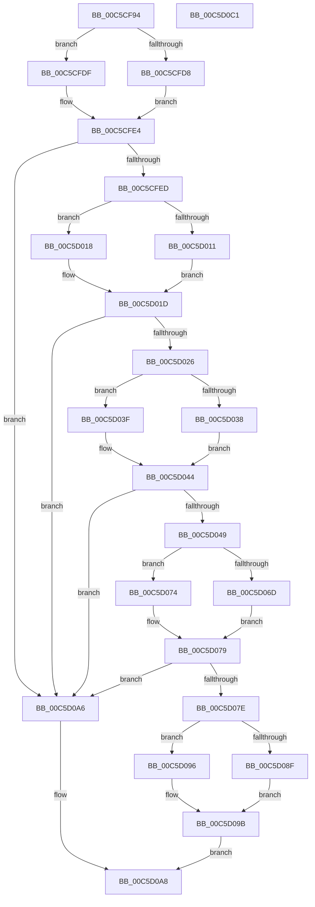

# CmpLoadManufacturingModeNode

- RVA: `0x00C5CF94`–`0x00C5D0C2` (길이 `302` bytes)
- VA: `0x0000000140C5CF94`
- 실행 섹션: `INIT`
- PDB 이름 있음: `예`; PDB Function 태그: `아니요`
- unwind 정보 RVA: `0x000D7264`
- 디코드: `84`개 명령, `302/302` bytes 표시
- 미해석 바이트: `0` (있으면 어셈블리에 `.byte`로 보존)

> 이 문서는 커널 이미지의 기계어와 PDB 기호를 분석해 생성했습니다. 4번과 5번은 함수 원형과 자료형을 바이너리 사용 방식에서 추정한 C 해석이며 원본 소스 복구 결과는 아닙니다.

## 1. Dependencies

- 직접 호출 지점: **12**; 고유 호출 대상: **5**
- 직접 호출자로 확인된 함수: **1**
- RIP 상대 이미지 참조: **2**

### Outgoing calls
- `0x00C5CFD8` → [HvpGetCellFlat](../../page/85/HvpGetCellFlat_function_00854C60.md) (function, `0x00854C60`)
- `0x00C5CFDF` → [HvpGetCellPaged](../../page/85/HvpGetCellPaged_function_00854CB0.md) (function, `0x00854CB0`)
- `0x00C5CFFA` → [CmpFindSubKeyByName](../../page/A4/CmpFindSubKeyByName_function_00A49D58.md) (function, `0x00A49D58`)
- `0x00C5D011` → [HvpReleaseCellFlat](../../page/85/HvpReleaseCellFlat_function_0085CC20.md) (function, `0x0085CC20`)
- `0x00C5D018` → [HvpReleaseCellPaged](../../page/85/HvpReleaseCellPaged_function_00855F40.md) (function, `0x00855F40`)
- `0x00C5D038` → [HvpGetCellFlat](../../page/85/HvpGetCellFlat_function_00854C60.md) (function, `0x00854C60`)
- `0x00C5D03F` → [HvpGetCellPaged](../../page/85/HvpGetCellPaged_function_00854CB0.md) (function, `0x00854CB0`)
- `0x00C5D056` → [CmpFindSubKeyByName](../../page/A4/CmpFindSubKeyByName_function_00A49D58.md) (function, `0x00A49D58`)
- `0x00C5D06D` → [HvpReleaseCellFlat](../../page/85/HvpReleaseCellFlat_function_0085CC20.md) (function, `0x0085CC20`)
- `0x00C5D074` → [HvpReleaseCellPaged](../../page/85/HvpReleaseCellPaged_function_00855F40.md) (function, `0x00855F40`)
- `0x00C5D08F` → [HvpGetCellFlat](../../page/85/HvpGetCellFlat_function_00854C60.md) (function, `0x00854C60`)
- `0x00C5D096` → [HvpGetCellPaged](../../page/85/HvpGetCellPaged_function_00854CB0.md) (function, `0x00854CB0`)

### Direct callers
- [CmpLoadManufacturingProfileNode](CmpLoadManufacturingProfileNode_function_00C5D0C8.md) at `0x00C5D109`

### Static image references
- `0x00C5CFED` → RVA `0x00C82188` (`CmpControlString`; read)
- `0x00C5D049` → RVA `0x00C82320` (`CmpManufacturingModeString`; read)

## 2. Other-region calls and transfers

- 다른 실행 섹션으로 향하는 call: **12**
  - `0x00C5CFD8` → [HvpGetCellFlat](../../page/85/HvpGetCellFlat_function_00854C60.md) (`INIT` → `PAGE`)
  - `0x00C5CFDF` → [HvpGetCellPaged](../../page/85/HvpGetCellPaged_function_00854CB0.md) (`INIT` → `PAGE`)
  - `0x00C5CFFA` → [CmpFindSubKeyByName](../../page/A4/CmpFindSubKeyByName_function_00A49D58.md) (`INIT` → `PAGE`)
  - `0x00C5D011` → [HvpReleaseCellFlat](../../page/85/HvpReleaseCellFlat_function_0085CC20.md) (`INIT` → `PAGE`)
  - `0x00C5D018` → [HvpReleaseCellPaged](../../page/85/HvpReleaseCellPaged_function_00855F40.md) (`INIT` → `PAGE`)
  - `0x00C5D038` → [HvpGetCellFlat](../../page/85/HvpGetCellFlat_function_00854C60.md) (`INIT` → `PAGE`)
  - `0x00C5D03F` → [HvpGetCellPaged](../../page/85/HvpGetCellPaged_function_00854CB0.md) (`INIT` → `PAGE`)
  - `0x00C5D056` → [CmpFindSubKeyByName](../../page/A4/CmpFindSubKeyByName_function_00A49D58.md) (`INIT` → `PAGE`)
  - `0x00C5D06D` → [HvpReleaseCellFlat](../../page/85/HvpReleaseCellFlat_function_0085CC20.md) (`INIT` → `PAGE`)
  - `0x00C5D074` → [HvpReleaseCellPaged](../../page/85/HvpReleaseCellPaged_function_00855F40.md) (`INIT` → `PAGE`)
  - `0x00C5D08F` → [HvpGetCellFlat](../../page/85/HvpGetCellFlat_function_00854C60.md) (`INIT` → `PAGE`)
  - `0x00C5D096` → [HvpGetCellPaged](../../page/85/HvpGetCellPaged_function_00854CB0.md) (`INIT` → `PAGE`)
- 별도 외부 분기/꼬리 이동을 확인하지 못했습니다.

## 3. Assembly (complete function range)

```asm
00C5CF94  48 89 5C 24 10                  mov qword ptr [rsp + 0x10], rbx
00C5CF99  48 89 74 24 18                  mov qword ptr [rsp + 0x18], rsi
00C5CF9E  48 89 7C 24 20                  mov qword ptr [rsp + 0x20], rdi
00C5CFA3  55                              push rbp
00C5CFA4  41 56                           push r14
00C5CFA6  41 57                           push r15
00C5CFA8  48 8B EC                        mov rbp, rsp
00C5CFAB  48 83 EC 30                     sub rsp, 0x30
00C5CFAF  83 4D F0 FF                     or dword ptr [rbp - 0x10], 0xffffffff
00C5CFB3  45 33 FF                        xor r15d, r15d
00C5CFB6  83 4D 20 FF                     or dword ptr [rbp + 0x20], 0xffffffff
00C5CFBA  4D 8B F0                        mov r14, r8
00C5CFBD  F6 81 8C 00 00 00 01            test byte ptr [rcx + 0x8c], 1
00C5CFC4  4C 8D 45 20                     lea r8, [rbp + 0x20]
00C5CFC8  49 8B F1                        mov rsi, r9
00C5CFCB  44 89 7D F4                     mov dword ptr [rbp - 0xc], r15d
00C5CFCF  48 8B D9                        mov rbx, rcx
00C5CFD2  44 89 7D 24                     mov dword ptr [rbp + 0x24], r15d
00C5CFD6  74 07                           je 0x140c5cfdf
00C5CFD8  E8 83 7C BF FF                  call 0x140854c60
00C5CFDD  EB 05                           jmp 0x140c5cfe4
00C5CFDF  E8 CC 7C BF FF                  call 0x140854cb0
00C5CFE4  48 85 C0                        test rax, rax
00C5CFE7  0F 84 B9 00 00 00               je 0x140c5d0a6
00C5CFED  4C 8D 05 94 51 02 00            lea r8, [rip + 0x25194]
00C5CFF4  48 8B D0                        mov rdx, rax
00C5CFF7  48 8B CB                        mov rcx, rbx
00C5CFFA  E8 59 CD DE FF                  call 0x140a49d58
00C5CFFF  F6 83 8C 00 00 00 01            test byte ptr [rbx + 0x8c], 1
00C5D006  48 8D 55 20                     lea rdx, [rbp + 0x20]
00C5D00A  8B F8                           mov edi, eax
00C5D00C  48 8B CB                        mov rcx, rbx
00C5D00F  74 07                           je 0x140c5d018
00C5D011  E8 0A FC BF FF                  call 0x14085cc20
00C5D016  EB 05                           jmp 0x140c5d01d
00C5D018  E8 23 8F BF FF                  call 0x140855f40
00C5D01D  83 FF FF                        cmp edi, -1
00C5D020  0F 84 80 00 00 00               je 0x140c5d0a6
00C5D026  F6 83 8C 00 00 00 01            test byte ptr [rbx + 0x8c], 1
00C5D02D  4C 8D 45 F0                     lea r8, [rbp - 0x10]
00C5D031  8B D7                           mov edx, edi
00C5D033  48 8B CB                        mov rcx, rbx
00C5D036  74 07                           je 0x140c5d03f
00C5D038  E8 23 7C BF FF                  call 0x140854c60
00C5D03D  EB 05                           jmp 0x140c5d044
00C5D03F  E8 6C 7C BF FF                  call 0x140854cb0
00C5D044  48 85 C0                        test rax, rax
00C5D047  74 5D                           je 0x140c5d0a6
00C5D049  4C 8D 05 D0 52 02 00            lea r8, [rip + 0x252d0]
00C5D050  48 8B D0                        mov rdx, rax
00C5D053  48 8B CB                        mov rcx, rbx
00C5D056  E8 FD CC DE FF                  call 0x140a49d58
00C5D05B  F6 83 8C 00 00 00 01            test byte ptr [rbx + 0x8c], 1
00C5D062  48 8D 55 F0                     lea rdx, [rbp - 0x10]
00C5D066  8B F8                           mov edi, eax
00C5D068  48 8B CB                        mov rcx, rbx
00C5D06B  74 07                           je 0x140c5d074
00C5D06D  E8 AE FB BF FF                  call 0x14085cc20
00C5D072  EB 05                           jmp 0x140c5d079
00C5D074  E8 C7 8E BF FF                  call 0x140855f40
00C5D079  83 FF FF                        cmp edi, -1
00C5D07C  74 28                           je 0x140c5d0a6
00C5D07E  F6 83 8C 00 00 00 01            test byte ptr [rbx + 0x8c], 1
00C5D085  4C 8B C6                        mov r8, rsi
00C5D088  8B D7                           mov edx, edi
00C5D08A  48 8B CB                        mov rcx, rbx
00C5D08D  74 07                           je 0x140c5d096
00C5D08F  E8 CC 7B BF FF                  call 0x140854c60
00C5D094  EB 05                           jmp 0x140c5d09b
00C5D096  E8 15 7C BF FF                  call 0x140854cb0
00C5D09B  48 85 C0                        test rax, rax
00C5D09E  49 89 06                        mov qword ptr [r14], rax
00C5D0A1  0F 95 C0                        setne al
00C5D0A4  EB 02                           jmp 0x140c5d0a8
00C5D0A6  32 C0                           xor al, al
00C5D0A8  48 8B 5C 24 58                  mov rbx, qword ptr [rsp + 0x58]
00C5D0AD  48 8B 74 24 60                  mov rsi, qword ptr [rsp + 0x60]
00C5D0B2  48 8B 7C 24 68                  mov rdi, qword ptr [rsp + 0x68]
00C5D0B7  48 83 C4 30                     add rsp, 0x30
00C5D0BB  41 5F                           pop r15
00C5D0BD  41 5E                           pop r14
00C5D0BF  5D                              pop rbp
00C5D0C0  C3                              ret
00C5D0C1  CC                              int3
```

## 4. C-style interpretation (structured pseudocode)

```c
__int64 __fastcall CmpLoadManufacturingModeNode(__int64 a1, __int64 a2, __int64 a3, __int64 a4)
{
    __int64 result;
    __int64 v_r15;
    __int64 v_rsp;
    unsigned int v_stack_m24;
    unsigned int v_stack_m28;
    unsigned __int64 v_stack_p10;
    unsigned __int64 v_stack_p18;
    unsigned __int64 v_stack_p20;
    unsigned int v_stack_p8;
    unsigned int v_stack_pC;

    v_stack_p10 = v_rbx;
    v_stack_p18 = v_rsi;
    v_stack_p20 = v_rdi;
    v_rsp = (v_rsp) - (48);
    v_r15 = 0;
    v_stack_m24 = 0;
    v_stack_pC = 0;
    if (((*(unsigned __int8 *)(a1 + 140)) & (1)) == 0) goto loc_00C5CFDF;
    result = HvpGetCellFlat(a1, a2, v_stack_p8, a4);
    goto loc_00C5CFE4;
loc_00C5CFDF:
    result = HvpGetCellPaged(a1, a2, v_stack_p8, a4);
loc_00C5CFE4:
    if (result == 0) goto loc_00C5D0A6;
    result = CmpFindSubKeyByName(a1, result, v_rip + 151956, a4);
    if (((*(unsigned __int8 *)(a1 + 140)) & (1)) == 0) goto loc_00C5D018;
    result = HvpReleaseCellFlat(a1, v_stack_p8, v_rip + 151956, a4);
    goto loc_00C5D01D;
loc_00C5D018:
    result = HvpReleaseCellPaged(a1, v_stack_p8, v_rip + 151956, a4);
loc_00C5D01D:
    if (((unsigned int)((unsigned int)((unsigned int)(result)))) == -1) goto loc_00C5D0A6;
    if (((*(unsigned __int8 *)(a1 + 140)) & (1)) == 0) goto loc_00C5D03F;
    result = HvpGetCellFlat(a1, (unsigned int)((unsigned int)((unsigned int)((unsigned int)(result)))), v_stack_m28, a4);
    goto loc_00C5D044;
loc_00C5D03F:
    result = HvpGetCellPaged(a1, (unsigned int)((unsigned int)((unsigned int)((unsigned int)(result)))), v_stack_m28, a4);
loc_00C5D044:
    if (result == 0) goto loc_00C5D0A6;
    result = CmpFindSubKeyByName(a1, result, v_rip + 152272, a4);
    if (((*(unsigned __int8 *)(a1 + 140)) & (1)) == 0) goto loc_00C5D074;
    result = HvpReleaseCellFlat(a1, v_stack_m28, v_rip + 152272, a4);
    goto loc_00C5D079;
loc_00C5D074:
    result = HvpReleaseCellPaged(a1, v_stack_m28, v_rip + 152272, a4);
loc_00C5D079:
    if (((unsigned int)((unsigned int)((unsigned int)(result)))) == -1) goto loc_00C5D0A6;
    if (((*(unsigned __int8 *)(a1 + 140)) & (1)) == 0) goto loc_00C5D096;
    result = HvpGetCellFlat(a1, (unsigned int)((unsigned int)((unsigned int)((unsigned int)(result)))), a4, a4);
    goto loc_00C5D09B;
loc_00C5D096:
    result = HvpGetCellPaged(a1, (unsigned int)((unsigned int)((unsigned int)((unsigned int)(result)))), a4, a4);
loc_00C5D09B:
    *(unsigned __int64 *)(a3) = result;
    result = (result != 0) ? 1 : 0;
    goto loc_00C5D0A8;
loc_00C5D0A6:
    result = 0;
loc_00C5D0A8:
    v_rsp = (v_rsp) + (48);
    return result;
}
```

## 5. (Beta) C Style

```c
int64_t CmpLoadManufacturingModeNode(void *Arg1, int64_t Arg2, void *Arg3, int64_t Arg4)
{
    uint8_t *arg1 = (uint8_t *)Arg1;
    uint8_t *arg3 = (uint8_t *)Arg3;

    int64_t result;
    int64_t local_r15;
    int64_t local_rsp;
    uint32_t v_stack_m24;
    uint32_t v_stack_m28;
    uint64_t v_stack_p10;
    uint64_t v_stack_p18;
    uint64_t v_stack_p20;
    uint32_t v_stack_p8;
    uint32_t v_stack_pC;

    v_stack_p10 = local_rbx;
    v_stack_p18 = local_rsi;
    v_stack_p20 = local_rdi;
    local_rsp = (local_rsp) - (48);
    local_r15 = 0;
    v_stack_m24 = 0;
    v_stack_pC = 0;
    if (((*(uint8_t *)(arg1 + 0x8C)) & (1)) == 0) goto loc_00C5CFDF;
    result = HvpGetCellFlat(Arg1, Arg2, v_stack_p8, Arg4);
    goto loc_00C5CFE4;
loc_00C5CFDF:
    result = HvpGetCellPaged(Arg1, Arg2, v_stack_p8, Arg4);
loc_00C5CFE4:
    if (result == 0) goto loc_00C5D0A6;
    result = CmpFindSubKeyByName(Arg1, result, v_rip + 151956, Arg4);
    if (((*(uint8_t *)(arg1 + 0x8C)) & (1)) == 0) goto loc_00C5D018;
    result = HvpReleaseCellFlat(Arg1, v_stack_p8, v_rip + 151956, Arg4);
    goto loc_00C5D01D;
loc_00C5D018:
    result = HvpReleaseCellPaged(Arg1, v_stack_p8, v_rip + 151956, Arg4);
loc_00C5D01D:
    if (((uint32_t)((uint32_t)((uint32_t)(result)))) == -1) goto loc_00C5D0A6;
    if (((*(uint8_t *)(arg1 + 0x8C)) & (1)) == 0) goto loc_00C5D03F;
    result = HvpGetCellFlat(Arg1, (uint32_t)((uint32_t)((uint32_t)((uint32_t)(result)))), v_stack_m28, Arg4);
    goto loc_00C5D044;
loc_00C5D03F:
    result = HvpGetCellPaged(Arg1, (uint32_t)((uint32_t)((uint32_t)((uint32_t)(result)))), v_stack_m28, Arg4);
loc_00C5D044:
    if (result == 0) goto loc_00C5D0A6;
    result = CmpFindSubKeyByName(Arg1, result, v_rip + 152272, Arg4);
    if (((*(uint8_t *)(arg1 + 0x8C)) & (1)) == 0) goto loc_00C5D074;
    result = HvpReleaseCellFlat(Arg1, v_stack_m28, v_rip + 152272, Arg4);
    goto loc_00C5D079;
loc_00C5D074:
    result = HvpReleaseCellPaged(Arg1, v_stack_m28, v_rip + 152272, Arg4);
loc_00C5D079:
    if (((uint32_t)((uint32_t)((uint32_t)(result)))) == -1) goto loc_00C5D0A6;
    if (((*(uint8_t *)(arg1 + 0x8C)) & (1)) == 0) goto loc_00C5D096;
    result = HvpGetCellFlat(Arg1, (uint32_t)((uint32_t)((uint32_t)((uint32_t)(result)))), Arg4, Arg4);
    goto loc_00C5D09B;
loc_00C5D096:
    result = HvpGetCellPaged(Arg1, (uint32_t)((uint32_t)((uint32_t)((uint32_t)(result)))), Arg4, Arg4);
loc_00C5D09B:
    *(uint64_t *)(arg3) = result;
    result = (result != 0) ? 1 : 0;
    goto loc_00C5D0A8;
loc_00C5D0A6:
    result = 0;
loc_00C5D0A8:
    local_rsp = (local_rsp) + (48);
    return result;
}
```

### 관측된 메모리 오프셋

구조체 형식이 확인되지 않은 접근은 인자 기준의 오프셋으로만 기록했습니다.

| 기준 인자 | 오프셋 표현 | 폭 (bit) | 접근 |
|---|---:|---:|---|
| `Arg1` | `+ 0x8C` | `8` | `R` |
| `Arg3` | `+ 0x0` | `64` | `W` |

## 6. Execution-region graph

[열기: 2D/3D 그래프와 함수 탐색 컨트롤 패널](../../../control-panel.html?section=init&rva=0x00C5CF94&view=graph)

- 2D 그래프는 위에서 아래로 흐르고, 3D 그래프는 빈 공간을 드래그해 회전합니다. Shift+드래그는 이동, 휠은 확대·축소, 함수 노드 선택은 대상 보고서 이동입니다.

### Static fallback


