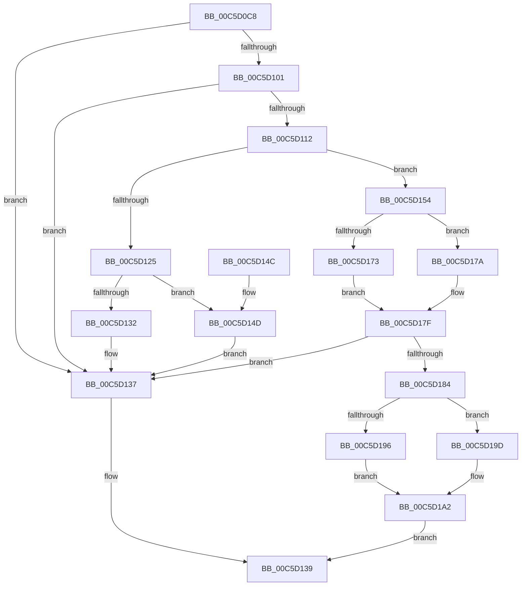

# CmpLoadManufacturingProfileNode

- RVA: `0x00C5D0C8`–`0x00C5D1AD` (길이 `229` bytes)
- VA: `0x0000000140C5D0C8`
- 실행 섹션: `INIT`
- PDB 이름 있음: `예`; PDB Function 태그: `아니요`
- unwind 정보 RVA: `0x000D724C`
- 디코드: `69`개 명령, `229/229` bytes 표시
- 미해석 바이트: `0` (있으면 어셈블리에 `.byte`로 보존)

> 이 문서는 커널 이미지의 기계어와 PDB 기호를 분석해 생성했습니다. 4번과 5번은 함수 원형과 자료형을 바이너리 사용 방식에서 추정한 C 해석이며 원본 소스 복구 결과는 아닙니다.

## 1. Dependencies

- 직접 호출 지점: **9**; 고유 호출 대상: **7**
- 직접 호출자로 확인된 함수: **1**
- RIP 상대 이미지 참조: **0**

### Outgoing calls
- `0x00C5D109` → [CmpLoadManufacturingModeNode](CmpLoadManufacturingModeNode_function_00C5CF94.md) (function, `0x00C5CF94`)
- `0x00C5D119` → [RtlInitUnicodeStringEx](../../text/46/RtlInitUnicodeStringEx_function_00463960.md) (function, `0x00463960`)
- `0x00C5D132` → [HvpReleaseCellFlat](../../page/85/HvpReleaseCellFlat_function_0085CC20.md) (function, `0x0085CC20`)
- `0x00C5D14D` → [HvpReleaseCellPaged](../../page/85/HvpReleaseCellPaged_function_00855F40.md) (function, `0x00855F40`)
- `0x00C5D15C` → [CmpFindSubKeyByName](../../page/A4/CmpFindSubKeyByName_function_00A49D58.md) (function, `0x00A49D58`)
- `0x00C5D173` → [HvpReleaseCellFlat](../../page/85/HvpReleaseCellFlat_function_0085CC20.md) (function, `0x0085CC20`)
- `0x00C5D17A` → [HvpReleaseCellPaged](../../page/85/HvpReleaseCellPaged_function_00855F40.md) (function, `0x00855F40`)
- `0x00C5D196` → [HvpGetCellFlat](../../page/85/HvpGetCellFlat_function_00854C60.md) (function, `0x00854C60`)
- `0x00C5D19D` → [HvpGetCellPaged](../../page/85/HvpGetCellPaged_function_00854CB0.md) (function, `0x00854CB0`)

### Direct callers
- [CmpLoadManufacturingProfileServicesNode](CmpLoadManufacturingProfileServicesNode_function_00C5D1B4.md) at `0x00C5D1E9`

### Static image references
- 디코드된 RIP-relative 메모리 참조가 없습니다.

## 2. Other-region calls and transfers

- 다른 실행 섹션으로 향하는 call: **8**
  - `0x00C5D119` → [RtlInitUnicodeStringEx](../../text/46/RtlInitUnicodeStringEx_function_00463960.md) (`INIT` → `.text`)
  - `0x00C5D132` → [HvpReleaseCellFlat](../../page/85/HvpReleaseCellFlat_function_0085CC20.md) (`INIT` → `PAGE`)
  - `0x00C5D14D` → [HvpReleaseCellPaged](../../page/85/HvpReleaseCellPaged_function_00855F40.md) (`INIT` → `PAGE`)
  - `0x00C5D15C` → [CmpFindSubKeyByName](../../page/A4/CmpFindSubKeyByName_function_00A49D58.md) (`INIT` → `PAGE`)
  - `0x00C5D173` → [HvpReleaseCellFlat](../../page/85/HvpReleaseCellFlat_function_0085CC20.md) (`INIT` → `PAGE`)
  - `0x00C5D17A` → [HvpReleaseCellPaged](../../page/85/HvpReleaseCellPaged_function_00855F40.md) (`INIT` → `PAGE`)
  - `0x00C5D196` → [HvpGetCellFlat](../../page/85/HvpGetCellFlat_function_00854C60.md) (`INIT` → `PAGE`)
  - `0x00C5D19D` → [HvpGetCellPaged](../../page/85/HvpGetCellPaged_function_00854CB0.md) (`INIT` → `PAGE`)
- 별도 외부 분기/꼬리 이동을 확인하지 못했습니다.

## 3. Assembly (complete function range)

```asm
00C5D0C8  48 89 5C 24 08                  mov qword ptr [rsp + 8], rbx
00C5D0CD  48 89 74 24 10                  mov qword ptr [rsp + 0x10], rsi
00C5D0D2  55                              push rbp
00C5D0D3  57                              push rdi
00C5D0D4  41 56                           push r14
00C5D0D6  48 8B EC                        mov rbp, rsp
00C5D0D9  48 83 EC 40                     sub rsp, 0x40
00C5D0DD  83 4D 30 FF                     or dword ptr [rbp + 0x30], 0xffffffff
00C5D0E1  45 33 F6                        xor r14d, r14d
00C5D0E4  4C 89 75 E0                     mov qword ptr [rbp - 0x20], r14
00C5D0E8  0F 57 C0                        xorps xmm0, xmm0
00C5D0EB  44 89 75 34                     mov dword ptr [rbp + 0x34], r14d
00C5D0EF  49 8B F1                        mov rsi, r9
00C5D0F2  49 8B F8                        mov rdi, r8
00C5D0F5  48 8B D9                        mov rbx, rcx
00C5D0F8  0F 11 45 E8                     movups xmmword ptr [rbp - 0x18], xmm0
00C5D0FC  4D 85 C0                        test r8, r8
00C5D0FF  74 36                           je 0x140c5d137
00C5D101  4C 8D 4D 30                     lea r9, [rbp + 0x30]
00C5D105  4C 8D 45 E0                     lea r8, [rbp - 0x20]
00C5D109  E8 86 FE FF FF                  call 0x140c5cf94
00C5D10E  84 C0                           test al, al
00C5D110  74 25                           je 0x140c5d137
00C5D112  48 8B D7                        mov rdx, rdi
00C5D115  48 8D 4D E8                     lea rcx, [rbp - 0x18]
00C5D119  E8 42 68 80 FF                  call 0x140463960
00C5D11E  48 8B CB                        mov rcx, rbx
00C5D121  85 C0                           test eax, eax
00C5D123  79 2F                           jns 0x140c5d154
00C5D125  F6 83 8C 00 00 00 01            test byte ptr [rbx + 0x8c], 1
00C5D12C  48 8D 55 30                     lea rdx, [rbp + 0x30]
00C5D130  74 1B                           je 0x140c5d14d
00C5D132  E8 E9 FA BF FF                  call 0x14085cc20
00C5D137  32 C0                           xor al, al
00C5D139  48 8B 5C 24 60                  mov rbx, qword ptr [rsp + 0x60]
00C5D13E  48 8B 74 24 68                  mov rsi, qword ptr [rsp + 0x68]
00C5D143  48 83 C4 40                     add rsp, 0x40
00C5D147  41 5E                           pop r14
00C5D149  5F                              pop rdi
00C5D14A  5D                              pop rbp
00C5D14B  C3                              ret
00C5D14C  CC                              int3
00C5D14D  E8 EE 8D BF FF                  call 0x140855f40
00C5D152  EB E3                           jmp 0x140c5d137
00C5D154  48 8B 55 E0                     mov rdx, qword ptr [rbp - 0x20]
00C5D158  4C 8D 45 E8                     lea r8, [rbp - 0x18]
00C5D15C  E8 F7 CB DE FF                  call 0x140a49d58
00C5D161  F6 83 8C 00 00 00 01            test byte ptr [rbx + 0x8c], 1
00C5D168  48 8D 55 30                     lea rdx, [rbp + 0x30]
00C5D16C  8B F8                           mov edi, eax
00C5D16E  48 8B CB                        mov rcx, rbx
00C5D171  74 07                           je 0x140c5d17a
00C5D173  E8 A8 FA BF FF                  call 0x14085cc20
00C5D178  EB 05                           jmp 0x140c5d17f
00C5D17A  E8 C1 8D BF FF                  call 0x140855f40
00C5D17F  83 FF FF                        cmp edi, -1
00C5D182  74 B3                           je 0x140c5d137
00C5D184  F6 83 8C 00 00 00 01            test byte ptr [rbx + 0x8c], 1
00C5D18B  8B D7                           mov edx, edi
00C5D18D  4C 8B 45 40                     mov r8, qword ptr [rbp + 0x40]
00C5D191  48 8B CB                        mov rcx, rbx
00C5D194  74 07                           je 0x140c5d19d
00C5D196  E8 C5 7A BF FF                  call 0x140854c60
00C5D19B  EB 05                           jmp 0x140c5d1a2
00C5D19D  E8 0E 7B BF FF                  call 0x140854cb0
00C5D1A2  48 85 C0                        test rax, rax
00C5D1A5  48 89 06                        mov qword ptr [rsi], rax
00C5D1A8  0F 95 C0                        setne al
00C5D1AB  EB 8C                           jmp 0x140c5d139
```

## 4. C-style interpretation (structured pseudocode)

```c
__int64 __fastcall CmpLoadManufacturingProfileNode(__int64 a1, __int64 a2, __int64 a3, __int64 a4, __int64 a5)
{
    __int64 result;
    __int64 v_r14;
    __int64 v_rsp;
    unsigned __int64 v_stack_m30;
    unsigned __int64 v_stack_m38;
    unsigned __int64 v_stack_p10;
    unsigned int v_stack_p18;
    unsigned int v_stack_p1C;
    unsigned __int64 v_stack_p8;

    v_stack_p8 = v_rbx;
    v_stack_p10 = v_rsi;
    v_rsp = (v_rsp) - (64);
    v_r14 = 0;
    v_stack_m38 = 0;
    v_stack_p1C = 0;
    v_stack_m30 = v_xmm0;
    if (a3 == 0) goto loc_00C5D137;
    result = CmpLoadManufacturingModeNode(a1, a2, v_stack_m38, v_stack_p18);
    if ((unsigned __int8)(result) == 0) goto loc_00C5D137;
    result = RtlInitUnicodeStringEx(v_stack_m30, a3, v_stack_m38, v_stack_p18);
    if (!sign_flag) goto loc_00C5D154;
    if (((*(unsigned __int8 *)(a1 + 140)) & (1)) == 0) goto loc_00C5D14D;
    result = HvpReleaseCellFlat(a1, v_stack_p18, v_stack_m38, v_stack_p18);
loc_00C5D137:
    result = 0;
loc_00C5D139:
    v_rsp = (v_rsp) + (64);
    return result;
loc_00C5D14D:
    result = HvpReleaseCellPaged(a1, v_stack_p18, v_stack_m38, v_stack_p18);
    goto loc_00C5D137;
loc_00C5D154:
    result = CmpFindSubKeyByName(a1, v_stack_m38, v_stack_m30, v_stack_p18);
    if (((*(unsigned __int8 *)(v_stack_p8 + 140)) & (1)) == 0) goto loc_00C5D17A;
    result = HvpReleaseCellFlat(v_stack_p8, v_stack_p18, v_stack_m30, v_stack_p18);
    goto loc_00C5D17F;
loc_00C5D17A:
    result = HvpReleaseCellPaged(v_stack_p8, v_stack_p18, v_stack_m30, v_stack_p18);
loc_00C5D17F:
    if (((unsigned int)((unsigned int)((unsigned int)(result)))) == -1) goto loc_00C5D137;
    if (((*(unsigned __int8 *)(v_stack_p8 + 140)) & (1)) == 0) goto loc_00C5D19D;
    result = HvpGetCellFlat(v_stack_p8, (unsigned int)((unsigned int)((unsigned int)((unsigned int)(result)))), a5, v_stack_p18);
    goto loc_00C5D1A2;
loc_00C5D19D:
    result = HvpGetCellPaged(v_stack_p8, (unsigned int)((unsigned int)((unsigned int)((unsigned int)(result)))), a5, v_stack_p18);
loc_00C5D1A2:
    *(unsigned __int64 *)(v_stack_p10) = result;
    result = (result != 0) ? 1 : 0;
    goto loc_00C5D139;
}
```

## 5. (Beta) C Style

```c
int64_t CmpLoadManufacturingProfileNode(void *Arg1, int64_t Arg2, int64_t Arg3, void *Arg4, int64_t Arg5)
{
    uint8_t *arg1 = (uint8_t *)Arg1;
    uint8_t *arg4 = (uint8_t *)Arg4;

    int64_t result;
    int64_t local_r14;
    int64_t local_rsp;
    uint64_t v_stack_m30;
    uint64_t v_stack_m38;
    uint64_t v_stack_p10;
    uint32_t v_stack_p18;
    uint32_t v_stack_p1C;
    uint64_t v_stack_p8;

    v_stack_p8 = local_rbx;
    v_stack_p10 = local_rsi;
    local_rsp = (local_rsp) - (64);
    local_r14 = 0;
    v_stack_m38 = 0;
    v_stack_p1C = 0;
    v_stack_m30 = v_xmm0;
    if (Arg3 == 0) goto loc_00C5D137;
    result = CmpLoadManufacturingModeNode(Arg1, Arg2, v_stack_m38, v_stack_p18);
    if ((uint8_t)(result) == 0) goto loc_00C5D137;
    result = RtlInitUnicodeStringEx(v_stack_m30, Arg3, v_stack_m38, v_stack_p18);
    if (!sign_flag) goto loc_00C5D154;
    if (((*(uint8_t *)(arg1 + 0x8C)) & (1)) == 0) goto loc_00C5D14D;
    result = HvpReleaseCellFlat(Arg1, v_stack_p18, v_stack_m38, v_stack_p18);
loc_00C5D137:
    result = 0;
loc_00C5D139:
    local_rsp = (local_rsp) + (64);
    return result;
loc_00C5D14D:
    result = HvpReleaseCellPaged(Arg1, v_stack_p18, v_stack_m38, v_stack_p18);
    goto loc_00C5D137;
loc_00C5D154:
    result = CmpFindSubKeyByName(Arg1, v_stack_m38, v_stack_m30, v_stack_p18);
    if (((*(uint8_t *)(v_stack_p8 + 0x8C)) & (1)) == 0) goto loc_00C5D17A;
    result = HvpReleaseCellFlat(v_stack_p8, v_stack_p18, v_stack_m30, v_stack_p18);
    goto loc_00C5D17F;
loc_00C5D17A:
    result = HvpReleaseCellPaged(v_stack_p8, v_stack_p18, v_stack_m30, v_stack_p18);
loc_00C5D17F:
    if (((uint32_t)((uint32_t)((uint32_t)(result)))) == -1) goto loc_00C5D137;
    if (((*(uint8_t *)(v_stack_p8 + 0x8C)) & (1)) == 0) goto loc_00C5D19D;
    result = HvpGetCellFlat(v_stack_p8, (uint32_t)((uint32_t)((uint32_t)((uint32_t)(result)))), Arg5, v_stack_p18);
    goto loc_00C5D1A2;
loc_00C5D19D:
    result = HvpGetCellPaged(v_stack_p8, (uint32_t)((uint32_t)((uint32_t)((uint32_t)(result)))), Arg5, v_stack_p18);
loc_00C5D1A2:
    *(uint64_t *)(v_stack_p10) = result;
    result = (result != 0) ? 1 : 0;
    goto loc_00C5D139;
}
```

### 관측된 메모리 오프셋

구조체 형식이 확인되지 않은 접근은 인자 기준의 오프셋으로만 기록했습니다.

| 기준 인자 | 오프셋 표현 | 폭 (bit) | 접근 |
|---|---:|---:|---|
| `Arg1` | `+ 0x8C` | `8` | `R` |
| `Arg4` | `+ 0x0` | `64` | `W` |

## 6. Execution-region graph

[열기: 2D/3D 그래프와 함수 탐색 컨트롤 패널](../../../control-panel.html?section=init&rva=0x00C5D0C8&view=graph)

- 2D 그래프는 위에서 아래로 흐르고, 3D 그래프는 빈 공간을 드래그해 회전합니다. Shift+드래그는 이동, 휠은 확대·축소, 함수 노드 선택은 대상 보고서 이동입니다.

### Static fallback


