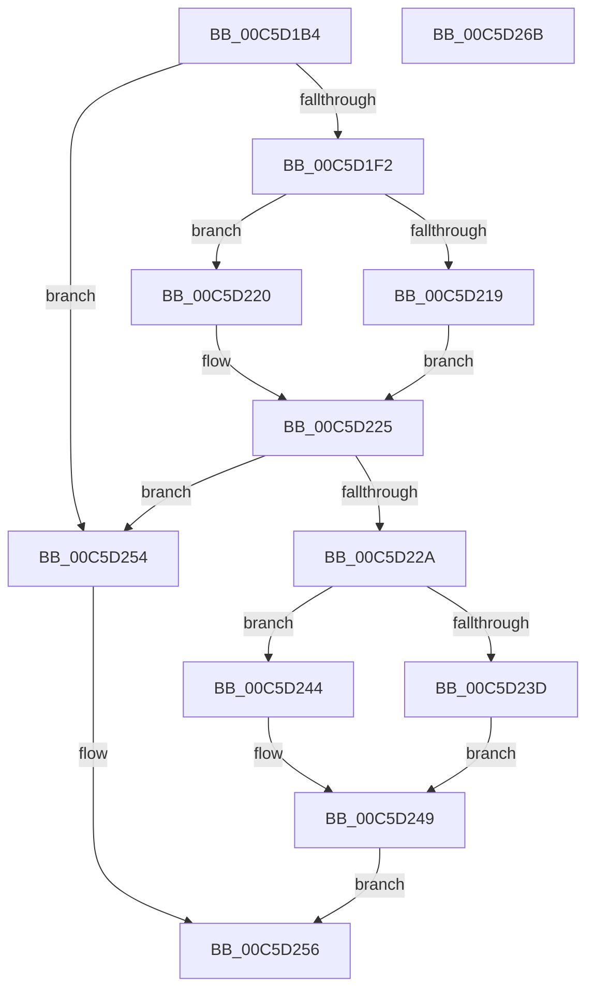

# CmpLoadManufacturingProfileServicesNode

- RVA: `0x00C5D1B4`–`0x00C5D26C` (길이 `184` bytes)
- VA: `0x0000000140C5D1B4`
- 실행 섹션: `INIT`
- PDB 이름 있음: `예`; PDB Function 태그: `아니요`
- unwind 정보 RVA: `0x0007D3C0`
- 디코드: `52`개 명령, `184/184` bytes 표시
- 미해석 바이트: `0` (있으면 어셈블리에 `.byte`로 보존)

> 이 문서는 커널 이미지의 기계어와 PDB 기호를 분석해 생성했습니다. 4번과 5번은 함수 원형과 자료형을 바이너리 사용 방식에서 추정한 C 해석이며 원본 소스 복구 결과는 아닙니다.

## 1. Dependencies

- 직접 호출 지점: **6**; 고유 호출 대상: **6**
- 직접 호출자로 확인된 함수: **1**
- RIP 상대 이미지 참조: **1**

### Outgoing calls
- `0x00C5D1E9` → [CmpLoadManufacturingProfileNode](CmpLoadManufacturingProfileNode_function_00C5D0C8.md) (function, `0x00C5D0C8`)
- `0x00C5D201` → [CmpFindSubKeyByName](../../page/A4/CmpFindSubKeyByName_function_00A49D58.md) (function, `0x00A49D58`)
- `0x00C5D219` → [HvpReleaseCellFlat](../../page/85/HvpReleaseCellFlat_function_0085CC20.md) (function, `0x0085CC20`)
- `0x00C5D220` → [HvpReleaseCellPaged](../../page/85/HvpReleaseCellPaged_function_00855F40.md) (function, `0x00855F40`)
- `0x00C5D23D` → [HvpGetCellFlat](../../page/85/HvpGetCellFlat_function_00854C60.md) (function, `0x00854C60`)
- `0x00C5D244` → [HvpGetCellPaged](../../page/85/HvpGetCellPaged_function_00854CB0.md) (function, `0x00854CB0`)

### Direct callers
- [CmpFindDrivers](CmpFindDrivers_function_00C5BFBC.md) at `0x00C5C065`

### Static image references
- `0x00C5D1F7` → RVA `0x00C821F0` (`CmpServicesString`; read)

## 2. Other-region calls and transfers

- 다른 실행 섹션으로 향하는 call: **5**
  - `0x00C5D201` → [CmpFindSubKeyByName](../../page/A4/CmpFindSubKeyByName_function_00A49D58.md) (`INIT` → `PAGE`)
  - `0x00C5D219` → [HvpReleaseCellFlat](../../page/85/HvpReleaseCellFlat_function_0085CC20.md) (`INIT` → `PAGE`)
  - `0x00C5D220` → [HvpReleaseCellPaged](../../page/85/HvpReleaseCellPaged_function_00855F40.md) (`INIT` → `PAGE`)
  - `0x00C5D23D` → [HvpGetCellFlat](../../page/85/HvpGetCellFlat_function_00854C60.md) (`INIT` → `PAGE`)
  - `0x00C5D244` → [HvpGetCellPaged](../../page/85/HvpGetCellPaged_function_00854CB0.md) (`INIT` → `PAGE`)
- 별도 외부 분기/꼬리 이동을 확인하지 못했습니다.

## 3. Assembly (complete function range)

```asm
00C5D1B4  48 8B C4                        mov rax, rsp
00C5D1B7  48 89 58 08                     mov qword ptr [rax + 8], rbx
00C5D1BB  48 89 68 10                     mov qword ptr [rax + 0x10], rbp
00C5D1BF  48 89 70 18                     mov qword ptr [rax + 0x18], rsi
00C5D1C3  57                              push rdi
00C5D1C4  48 83 EC 40                     sub rsp, 0x40
00C5D1C8  83 48 E8 FF                     or dword ptr [rax - 0x18], 0xffffffff
00C5D1CC  48 8D 40 E8                     lea rax, [rax - 0x18]
00C5D1D0  33 ED                           xor ebp, ebp
00C5D1D2  48 89 44 24 20                  mov qword ptr [rsp + 0x20], rax
00C5D1D7  48 89 68 08                     mov qword ptr [rax + 8], rbp
00C5D1DB  49 8B F1                        mov rsi, r9
00C5D1DE  89 68 04                        mov dword ptr [rax + 4], ebp
00C5D1E1  4C 8D 4C 24 38                  lea r9, [rsp + 0x38]
00C5D1E6  48 8B D9                        mov rbx, rcx
00C5D1E9  E8 DA FE FF FF                  call 0x140c5d0c8
00C5D1EE  84 C0                           test al, al
00C5D1F0  74 62                           je 0x140c5d254
00C5D1F2  48 8B 54 24 38                  mov rdx, qword ptr [rsp + 0x38]
00C5D1F7  4C 8D 05 F2 4F 02 00            lea r8, [rip + 0x24ff2]
00C5D1FE  48 8B CB                        mov rcx, rbx
00C5D201  E8 52 CB DE FF                  call 0x140a49d58
00C5D206  F6 83 8C 00 00 00 01            test byte ptr [rbx + 0x8c], 1
00C5D20D  48 8D 54 24 30                  lea rdx, [rsp + 0x30]
00C5D212  8B F8                           mov edi, eax
00C5D214  48 8B CB                        mov rcx, rbx
00C5D217  74 07                           je 0x140c5d220
00C5D219  E8 02 FA BF FF                  call 0x14085cc20
00C5D21E  EB 05                           jmp 0x140c5d225
00C5D220  E8 1B 8D BF FF                  call 0x140855f40
00C5D225  83 FF FF                        cmp edi, -1
00C5D228  74 2A                           je 0x140c5d254
00C5D22A  F6 83 8C 00 00 00 01            test byte ptr [rbx + 0x8c], 1
00C5D231  8B D7                           mov edx, edi
00C5D233  4C 8B 44 24 70                  mov r8, qword ptr [rsp + 0x70]
00C5D238  48 8B CB                        mov rcx, rbx
00C5D23B  74 07                           je 0x140c5d244
00C5D23D  E8 1E 7A BF FF                  call 0x140854c60
00C5D242  EB 05                           jmp 0x140c5d249
00C5D244  E8 67 7A BF FF                  call 0x140854cb0
00C5D249  48 85 C0                        test rax, rax
00C5D24C  48 89 06                        mov qword ptr [rsi], rax
00C5D24F  0F 95 C0                        setne al
00C5D252  EB 02                           jmp 0x140c5d256
00C5D254  32 C0                           xor al, al
00C5D256  48 8B 5C 24 50                  mov rbx, qword ptr [rsp + 0x50]
00C5D25B  48 8B 6C 24 58                  mov rbp, qword ptr [rsp + 0x58]
00C5D260  48 8B 74 24 60                  mov rsi, qword ptr [rsp + 0x60]
00C5D265  48 83 C4 40                     add rsp, 0x40
00C5D269  5F                              pop rdi
00C5D26A  C3                              ret
00C5D26B  CC                              int3
```

## 4. C-style interpretation (structured pseudocode)

```c
__int64 __fastcall CmpLoadManufacturingProfileServicesNode(__int64 a1, __int64 a2, __int64 a3, __int64 a4, __int64 a5)
{
    __int64 result;
    __int64 v_rbp;
    __int64 v_rsp;
    unsigned __int64 v_stack_m10;
    unsigned __int64 v_stack_m18;
    unsigned __int64 v_stack_m28;
    unsigned __int64 v_stack_p10;
    unsigned __int64 v_stack_p18;
    unsigned __int64 v_stack_p8;

    *(unsigned __int64 *)(v_rsp + 8) = v_rbx;
    *(unsigned __int64 *)(v_rsp + 16) = v_rbp;
    *(unsigned __int64 *)(v_rsp + 24) = v_rsi;
    v_rsp = (v_rsp) - (64);
    v_rbp = 0;
    v_stack_m28 = v_rsp - 24;
    *(unsigned __int64 *)(v_rsp - 24 + 8) = 0;
    *(unsigned int *)(v_rsp - 24 + 4) = 0;
    result = CmpLoadManufacturingProfileNode(a1, a2, a3, v_stack_m10);
    if ((unsigned __int8)(result) == 0) goto loc_00C5D254;
    result = CmpFindSubKeyByName(a1, v_stack_m10, v_rip + 151538, v_stack_m10);
    if (((*(unsigned __int8 *)(a1 + 140)) & (1)) == 0) goto loc_00C5D220;
    result = HvpReleaseCellFlat(a1, v_stack_m18, v_rip + 151538, v_stack_m10);
    goto loc_00C5D225;
loc_00C5D220:
    result = HvpReleaseCellPaged(a1, v_stack_m18, v_rip + 151538, v_stack_m10);
loc_00C5D225:
    if (((unsigned int)((unsigned int)((unsigned int)(result)))) == -1) goto loc_00C5D254;
    if (((*(unsigned __int8 *)(a1 + 140)) & (1)) == 0) goto loc_00C5D244;
    result = HvpGetCellFlat(a1, (unsigned int)((unsigned int)((unsigned int)((unsigned int)(result)))), a5, v_stack_m10);
    goto loc_00C5D249;
loc_00C5D244:
    result = HvpGetCellPaged(a1, (unsigned int)((unsigned int)((unsigned int)((unsigned int)(result)))), a5, v_stack_m10);
loc_00C5D249:
    *(unsigned __int64 *)(a4) = result;
    result = (result != 0) ? 1 : 0;
    goto loc_00C5D256;
loc_00C5D254:
    result = 0;
loc_00C5D256:
    v_rsp = (v_rsp) + (64);
    return result;
}
```

## 5. (Beta) C Style

```c
int64_t CmpLoadManufacturingProfileServicesNode(void *Arg1, int64_t Arg2, int64_t Arg3, void *Arg4, int64_t Arg5)
{
    uint8_t *arg1 = (uint8_t *)Arg1;
    uint8_t *arg4 = (uint8_t *)Arg4;

    int64_t result;
    int64_t local_rbp;
    int64_t local_rsp;
    uint64_t v_stack_m10;
    uint64_t v_stack_m18;
    uint64_t v_stack_m28;
    uint64_t v_stack_p10;
    uint64_t v_stack_p18;
    uint64_t v_stack_p8;

    *(uint64_t *)(local_rsp + 0x8) = local_rbx;
    *(uint64_t *)(local_rsp + 0x10) = local_rbp;
    *(uint64_t *)(local_rsp + 0x18) = local_rsi;
    local_rsp = (local_rsp) - (64);
    local_rbp = 0;
    v_stack_m28 = local_rsp - 24;
    *(uint64_t *)(local_rsp - 0x18 + 0x8) = 0;
    *(uint32_t *)(local_rsp - 0x18 + 0x4) = 0;
    result = CmpLoadManufacturingProfileNode(Arg1, Arg2, Arg3, v_stack_m10);
    if ((uint8_t)(result) == 0) goto loc_00C5D254;
    result = CmpFindSubKeyByName(Arg1, v_stack_m10, v_rip + 151538, v_stack_m10);
    if (((*(uint8_t *)(arg1 + 0x8C)) & (1)) == 0) goto loc_00C5D220;
    result = HvpReleaseCellFlat(Arg1, v_stack_m18, v_rip + 151538, v_stack_m10);
    goto loc_00C5D225;
loc_00C5D220:
    result = HvpReleaseCellPaged(Arg1, v_stack_m18, v_rip + 151538, v_stack_m10);
loc_00C5D225:
    if (((uint32_t)((uint32_t)((uint32_t)(result)))) == -1) goto loc_00C5D254;
    if (((*(uint8_t *)(arg1 + 0x8C)) & (1)) == 0) goto loc_00C5D244;
    result = HvpGetCellFlat(Arg1, (uint32_t)((uint32_t)((uint32_t)((uint32_t)(result)))), Arg5, v_stack_m10);
    goto loc_00C5D249;
loc_00C5D244:
    result = HvpGetCellPaged(Arg1, (uint32_t)((uint32_t)((uint32_t)((uint32_t)(result)))), Arg5, v_stack_m10);
loc_00C5D249:
    *(uint64_t *)(arg4) = result;
    result = (result != 0) ? 1 : 0;
    goto loc_00C5D256;
loc_00C5D254:
    result = 0;
loc_00C5D256:
    local_rsp = (local_rsp) + (64);
    return result;
}
```

### 관측된 메모리 오프셋

구조체 형식이 확인되지 않은 접근은 인자 기준의 오프셋으로만 기록했습니다.

| 기준 인자 | 오프셋 표현 | 폭 (bit) | 접근 |
|---|---:|---:|---|
| `Arg1` | `+ 0x8C` | `8` | `R` |
| `Arg4` | `+ 0x0` | `64` | `W` |

## 6. Execution-region graph

[열기: 2D/3D 그래프와 함수 탐색 컨트롤 패널](../../../control-panel.html?section=init&rva=0x00C5D1B4&view=graph)

- 2D 그래프는 위에서 아래로 흐르고, 3D 그래프는 빈 공간을 드래그해 회전합니다. Shift+드래그는 이동, 휠은 확대·축소, 함수 노드 선택은 대상 보고서 이동입니다.

### Static fallback


