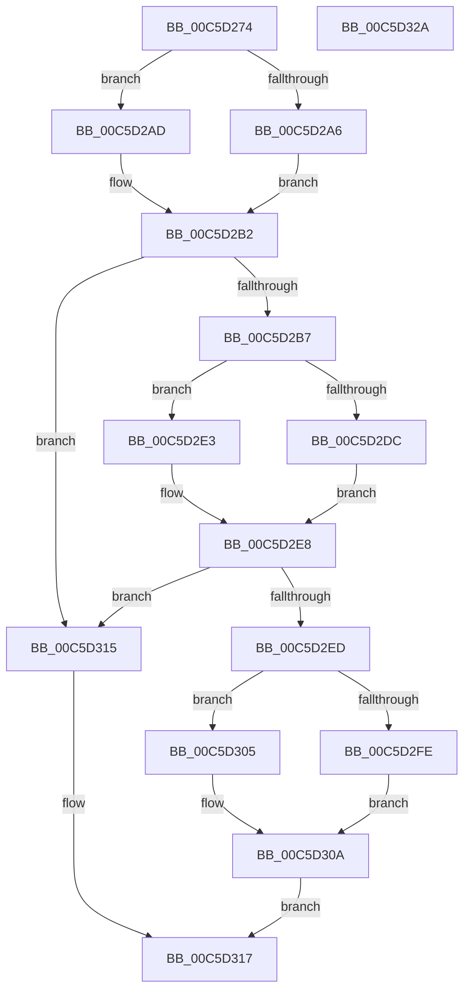

# CmpLoadServicesNode

- RVA: `0x00C5D274`–`0x00C5D32B` (길이 `183` bytes)
- VA: `0x0000000140C5D274`
- 실행 섹션: `INIT`
- PDB 이름 있음: `예`; PDB Function 태그: `아니요`
- unwind 정보 RVA: `0x000BF954`
- 디코드: `56`개 명령, `183/183` bytes 표시
- 미해석 바이트: `0` (있으면 어셈블리에 `.byte`로 보존)

> 이 문서는 커널 이미지의 기계어와 PDB 기호를 분석해 생성했습니다. 4번과 5번은 함수 원형과 자료형을 바이너리 사용 방식에서 추정한 C 해석이며 원본 소스 복구 결과는 아닙니다.

## 1. Dependencies

- 직접 호출 지점: **7**; 고유 호출 대상: **5**
- 직접 호출자로 확인된 함수: **1**
- RIP 상대 이미지 참조: **1**

### Outgoing calls
- `0x00C5D2A6` → [HvpGetCellFlat](../../page/85/HvpGetCellFlat_function_00854C60.md) (function, `0x00854C60`)
- `0x00C5D2AD` → [HvpGetCellPaged](../../page/85/HvpGetCellPaged_function_00854CB0.md) (function, `0x00854CB0`)
- `0x00C5D2C4` → [CmpFindSubKeyByName](../../page/A4/CmpFindSubKeyByName_function_00A49D58.md) (function, `0x00A49D58`)
- `0x00C5D2DC` → [HvpReleaseCellFlat](../../page/85/HvpReleaseCellFlat_function_0085CC20.md) (function, `0x0085CC20`)
- `0x00C5D2E3` → [HvpReleaseCellPaged](../../page/85/HvpReleaseCellPaged_function_00855F40.md) (function, `0x00855F40`)
- `0x00C5D2FE` → [HvpGetCellFlat](../../page/85/HvpGetCellFlat_function_00854C60.md) (function, `0x00854C60`)
- `0x00C5D305` → [HvpGetCellPaged](../../page/85/HvpGetCellPaged_function_00854CB0.md) (function, `0x00854CB0`)

### Direct callers
- [CmpFindDrivers](CmpFindDrivers_function_00C5BFBC.md) at `0x00C5C030`
- [CmpFindDrivers](CmpFindDrivers_function_00C5BFBC.md) at `0x00C5C16E`

### Static image references
- `0x00C5D2B7` → RVA `0x00C821F0` (`CmpServicesString`; read)

## 2. Other-region calls and transfers

- 다른 실행 섹션으로 향하는 call: **7**
  - `0x00C5D2A6` → [HvpGetCellFlat](../../page/85/HvpGetCellFlat_function_00854C60.md) (`INIT` → `PAGE`)
  - `0x00C5D2AD` → [HvpGetCellPaged](../../page/85/HvpGetCellPaged_function_00854CB0.md) (`INIT` → `PAGE`)
  - `0x00C5D2C4` → [CmpFindSubKeyByName](../../page/A4/CmpFindSubKeyByName_function_00A49D58.md) (`INIT` → `PAGE`)
  - `0x00C5D2DC` → [HvpReleaseCellFlat](../../page/85/HvpReleaseCellFlat_function_0085CC20.md) (`INIT` → `PAGE`)
  - `0x00C5D2E3` → [HvpReleaseCellPaged](../../page/85/HvpReleaseCellPaged_function_00855F40.md) (`INIT` → `PAGE`)
  - `0x00C5D2FE` → [HvpGetCellFlat](../../page/85/HvpGetCellFlat_function_00854C60.md) (`INIT` → `PAGE`)
  - `0x00C5D305` → [HvpGetCellPaged](../../page/85/HvpGetCellPaged_function_00854CB0.md) (`INIT` → `PAGE`)
- 별도 외부 분기/꼬리 이동을 확인하지 못했습니다.

## 3. Assembly (complete function range)

```asm
00C5D274  48 8B C4                        mov rax, rsp
00C5D277  48 89 58 10                     mov qword ptr [rax + 0x10], rbx
00C5D27B  48 89 68 18                     mov qword ptr [rax + 0x18], rbp
00C5D27F  56                              push rsi
00C5D280  57                              push rdi
00C5D281  41 56                           push r14
00C5D283  48 83 EC 20                     sub rsp, 0x20
00C5D287  83 48 08 FF                     or dword ptr [rax + 8], 0xffffffff
00C5D28B  33 ED                           xor ebp, ebp
00C5D28D  F6 81 8C 00 00 00 01            test byte ptr [rcx + 0x8c], 1
00C5D294  4D 8B F0                        mov r14, r8
00C5D297  49 8B F1                        mov rsi, r9
00C5D29A  89 68 0C                        mov dword ptr [rax + 0xc], ebp
00C5D29D  48 8B D9                        mov rbx, rcx
00C5D2A0  4C 8D 40 08                     lea r8, [rax + 8]
00C5D2A4  74 07                           je 0x140c5d2ad
00C5D2A6  E8 B5 79 BF FF                  call 0x140854c60
00C5D2AB  EB 05                           jmp 0x140c5d2b2
00C5D2AD  E8 FE 79 BF FF                  call 0x140854cb0
00C5D2B2  48 85 C0                        test rax, rax
00C5D2B5  74 5E                           je 0x140c5d315
00C5D2B7  4C 8D 05 32 4F 02 00            lea r8, [rip + 0x24f32]
00C5D2BE  48 8B D0                        mov rdx, rax
00C5D2C1  48 8B CB                        mov rcx, rbx
00C5D2C4  E8 8F CA DE FF                  call 0x140a49d58
00C5D2C9  F6 83 8C 00 00 00 01            test byte ptr [rbx + 0x8c], 1
00C5D2D0  48 8D 54 24 40                  lea rdx, [rsp + 0x40]
00C5D2D5  8B F8                           mov edi, eax
00C5D2D7  48 8B CB                        mov rcx, rbx
00C5D2DA  74 07                           je 0x140c5d2e3
00C5D2DC  E8 3F F9 BF FF                  call 0x14085cc20
00C5D2E1  EB 05                           jmp 0x140c5d2e8
00C5D2E3  E8 58 8C BF FF                  call 0x140855f40
00C5D2E8  83 FF FF                        cmp edi, -1
00C5D2EB  74 28                           je 0x140c5d315
00C5D2ED  F6 83 8C 00 00 00 01            test byte ptr [rbx + 0x8c], 1
00C5D2F4  4C 8B C6                        mov r8, rsi
00C5D2F7  8B D7                           mov edx, edi
00C5D2F9  48 8B CB                        mov rcx, rbx
00C5D2FC  74 07                           je 0x140c5d305
00C5D2FE  E8 5D 79 BF FF                  call 0x140854c60
00C5D303  EB 05                           jmp 0x140c5d30a
00C5D305  E8 A6 79 BF FF                  call 0x140854cb0
00C5D30A  48 85 C0                        test rax, rax
00C5D30D  49 89 06                        mov qword ptr [r14], rax
00C5D310  0F 95 C0                        setne al
00C5D313  EB 02                           jmp 0x140c5d317
00C5D315  32 C0                           xor al, al
00C5D317  48 8B 5C 24 48                  mov rbx, qword ptr [rsp + 0x48]
00C5D31C  48 8B 6C 24 50                  mov rbp, qword ptr [rsp + 0x50]
00C5D321  48 83 C4 20                     add rsp, 0x20
00C5D325  41 5E                           pop r14
00C5D327  5F                              pop rdi
00C5D328  5E                              pop rsi
00C5D329  C3                              ret
00C5D32A  CC                              int3
```

## 4. C-style interpretation (structured pseudocode)

```c
__int64 __fastcall CmpLoadServicesNode(__int64 a1, __int64 a2, __int64 a3, __int64 a4)
{
    __int64 result;
    __int64 v_rbp;
    __int64 v_rsp;
    unsigned __int64 v_stack_p10;
    unsigned __int64 v_stack_p18;
    unsigned __int64 v_stack_p8;

    *(unsigned __int64 *)(v_rsp + 16) = v_rbx;
    *(unsigned __int64 *)(v_rsp + 24) = v_rbp;
    v_rsp = (v_rsp) - (32);
    v_rbp = 0;
    *(unsigned int *)(v_rsp + 12) = 0;
    if (((*(unsigned __int8 *)(a1 + 140)) & (1)) == 0) goto loc_00C5D2AD;
    result = HvpGetCellFlat(a1, a2, v_rsp + 8, a4);
    goto loc_00C5D2B2;
loc_00C5D2AD:
    result = HvpGetCellPaged(a1, a2, v_rsp + 8, a4);
loc_00C5D2B2:
    if (result == 0) goto loc_00C5D315;
    result = CmpFindSubKeyByName(a1, result, v_rip + 151346, a4);
    if (((*(unsigned __int8 *)(a1 + 140)) & (1)) == 0) goto loc_00C5D2E3;
    result = HvpReleaseCellFlat(a1, v_stack_p8, v_rip + 151346, a4);
    goto loc_00C5D2E8;
loc_00C5D2E3:
    result = HvpReleaseCellPaged(a1, v_stack_p8, v_rip + 151346, a4);
loc_00C5D2E8:
    if (((unsigned int)((unsigned int)((unsigned int)(result)))) == -1) goto loc_00C5D315;
    if (((*(unsigned __int8 *)(a1 + 140)) & (1)) == 0) goto loc_00C5D305;
    result = HvpGetCellFlat(a1, (unsigned int)((unsigned int)((unsigned int)((unsigned int)(result)))), a4, a4);
    goto loc_00C5D30A;
loc_00C5D305:
    result = HvpGetCellPaged(a1, (unsigned int)((unsigned int)((unsigned int)((unsigned int)(result)))), a4, a4);
loc_00C5D30A:
    *(unsigned __int64 *)(a3) = result;
    result = (result != 0) ? 1 : 0;
    goto loc_00C5D317;
loc_00C5D315:
    result = 0;
loc_00C5D317:
    v_rsp = (v_rsp) + (32);
    return result;
}
```

## 5. (Beta) C Style

```c
int64_t CmpLoadServicesNode(void *Arg1, int64_t Arg2, void *Arg3, int64_t Arg4)
{
    uint8_t *arg1 = (uint8_t *)Arg1;
    uint8_t *arg3 = (uint8_t *)Arg3;

    int64_t result;
    int64_t local_rbp;
    int64_t local_rsp;
    uint64_t v_stack_p10;
    uint64_t v_stack_p18;
    uint64_t v_stack_p8;

    *(uint64_t *)(local_rsp + 0x10) = local_rbx;
    *(uint64_t *)(local_rsp + 0x18) = local_rbp;
    local_rsp = (local_rsp) - (32);
    local_rbp = 0;
    *(uint32_t *)(local_rsp + 0xC) = 0;
    if (((*(uint8_t *)(arg1 + 0x8C)) & (1)) == 0) goto loc_00C5D2AD;
    result = HvpGetCellFlat(Arg1, Arg2, local_rsp + 8, Arg4);
    goto loc_00C5D2B2;
loc_00C5D2AD:
    result = HvpGetCellPaged(Arg1, Arg2, local_rsp + 8, Arg4);
loc_00C5D2B2:
    if (result == 0) goto loc_00C5D315;
    result = CmpFindSubKeyByName(Arg1, result, v_rip + 151346, Arg4);
    if (((*(uint8_t *)(arg1 + 0x8C)) & (1)) == 0) goto loc_00C5D2E3;
    result = HvpReleaseCellFlat(Arg1, v_stack_p8, v_rip + 151346, Arg4);
    goto loc_00C5D2E8;
loc_00C5D2E3:
    result = HvpReleaseCellPaged(Arg1, v_stack_p8, v_rip + 151346, Arg4);
loc_00C5D2E8:
    if (((uint32_t)((uint32_t)((uint32_t)(result)))) == -1) goto loc_00C5D315;
    if (((*(uint8_t *)(arg1 + 0x8C)) & (1)) == 0) goto loc_00C5D305;
    result = HvpGetCellFlat(Arg1, (uint32_t)((uint32_t)((uint32_t)((uint32_t)(result)))), Arg4, Arg4);
    goto loc_00C5D30A;
loc_00C5D305:
    result = HvpGetCellPaged(Arg1, (uint32_t)((uint32_t)((uint32_t)((uint32_t)(result)))), Arg4, Arg4);
loc_00C5D30A:
    *(uint64_t *)(arg3) = result;
    result = (result != 0) ? 1 : 0;
    goto loc_00C5D317;
loc_00C5D315:
    result = 0;
loc_00C5D317:
    local_rsp = (local_rsp) + (32);
    return result;
}
```

### 관측된 메모리 오프셋

구조체 형식이 확인되지 않은 접근은 인자 기준의 오프셋으로만 기록했습니다.

| 기준 인자 | 오프셋 표현 | 폭 (bit) | 접근 |
|---|---:|---:|---|
| `Arg1` | `+ 0x8C` | `8` | `R` |
| `Arg3` | `+ 0x0` | `64` | `W` |

## 6. Execution-region graph

[열기: 2D/3D 그래프와 함수 탐색 컨트롤 패널](../../../control-panel.html?section=init&rva=0x00C5D274&view=graph)

- 2D 그래프는 위에서 아래로 흐르고, 3D 그래프는 빈 공간을 드래그해 회전합니다. Shift+드래그는 이동, 휠은 확대·축소, 함수 노드 선택은 대상 보고서 이동입니다.

### Static fallback


