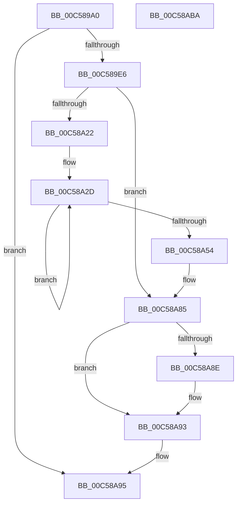

# CmpMigrateOOBELanguageToInstallationLanguage

- RVA: `0x00C589A0`–`0x00C58ABB` (길이 `283` bytes)
- VA: `0x0000000140C589A0`
- 실행 섹션: `INIT`
- PDB 이름 있음: `예`; PDB Function 태그: `아니요`
- unwind 정보 RVA: `0x000D631C`
- 디코드: `71`개 명령, `283/283` bytes 표시
- 미해석 바이트: `0` (있으면 어셈블리에 `.byte`로 보존)

> 이 문서는 커널 이미지의 기계어와 PDB 기호를 분석해 생성했습니다. 4번과 5번은 함수 원형과 자료형을 바이너리 사용 방식에서 추정한 C 해석이며 원본 소스 복구 결과는 아닙니다.

## 1. Dependencies

- 직접 호출 지점: **4**; 고유 호출 대상: **4**
- 직접 호출자로 확인된 함수: **1**
- RIP 상대 이미지 참조: **5**

### Outgoing calls
- `0x00C58A17` → [ZwOpenKey](../../text/6A/ZwOpenKey_function_006AD310.md) (function, `0x006AD310`)
- `0x00C58A79` → [ZwSetValueKey](../../text/6A/ZwSetValueKey_function_006ADCD0.md) (function, `0x006ADCD0`)
- `0x00C58A8E` → [ZwClose](../../text/6A/ZwClose_function_006AD2B0.md) (function, `0x006AD2B0`)
- `0x00C58A9C` → [_security_check_cookie](../../text/6A/_security_check_cookie_function_006AC640.md) (function, `0x006AC640`)

### Direct callers
- [CmInitSystem1](CmInitSystem1_function_00C559CC.md) at `0x00C5631A`

### Static image references
- `0x00C589BA` → RVA `0x00E0A740` (`.data`; read)
- `0x00C589CC` → RVA `0x010086E8` (`INITDATA`; read)
- `0x00C589ED` → RVA `0x00C824C0` (`CmpCurrentControlSetControlNlsLanguagePathString`; read)
- `0x00C58A22` → RVA `0x00FD9A60` (`PAGEDATA`; read)
- `0x00C58A64` → RVA `0x00C82440` (`CmpInstallLanguageString`; read)

## 2. Other-region calls and transfers

- 다른 실행 섹션으로 향하는 call: **4**
  - `0x00C58A17` → [ZwOpenKey](../../text/6A/ZwOpenKey_function_006AD310.md) (`INIT` → `.text`)
  - `0x00C58A79` → [ZwSetValueKey](../../text/6A/ZwSetValueKey_function_006ADCD0.md) (`INIT` → `.text`)
  - `0x00C58A8E` → [ZwClose](../../text/6A/ZwClose_function_006AD2B0.md) (`INIT` → `.text`)
  - `0x00C58A9C` → [_security_check_cookie](../../text/6A/_security_check_cookie_function_006AC640.md) (`INIT` → `.text`)
- 별도 외부 분기/꼬리 이동을 확인하지 못했습니다.

## 3. Assembly (complete function range)

```asm
00C589A0  48 89 5C 24 08                  mov qword ptr [rsp + 8], rbx
00C589A5  48 89 74 24 10                  mov qword ptr [rsp + 0x10], rsi
00C589AA  48 89 7C 24 18                  mov qword ptr [rsp + 0x18], rdi
00C589AF  55                              push rbp
00C589B0  48 8B EC                        mov rbp, rsp
00C589B3  48 81 EC 80 00 00 00            sub rsp, 0x80
00C589BA  48 8B 05 7F 1D 1B 00            mov rax, qword ptr [rip + 0x1b1d7f]
00C589C1  48 33 C4                        xor rax, rsp
00C589C4  48 89 45 F0                     mov qword ptr [rbp - 0x10], rax
00C589C8  33 FF                           xor edi, edi
00C589CA  33 C0                           xor eax, eax
00C589CC  39 3D 16 FD 3A 00               cmp dword ptr [rip + 0x3afd16], edi
00C589D2  89 7D BC                        mov dword ptr [rbp - 0x44], edi
00C589D5  89 7D D4                        mov dword ptr [rbp - 0x2c], edi
00C589D8  48 89 7D B0                     mov qword ptr [rbp - 0x50], rdi
00C589DC  48 89 7D E8                     mov qword ptr [rbp - 0x18], rdi
00C589E0  0F 84 AF 00 00 00               je 0x140c58a95
00C589E6  8D 70 30                        lea esi, [rax + 0x30]
00C589E9  48 89 7D C0                     mov qword ptr [rbp - 0x40], rdi
00C589ED  48 8D 05 CC 9A 02 00            lea rax, [rip + 0x29acc]
00C589F4  89 75 B8                        mov dword ptr [rbp - 0x48], esi
00C589F7  0F 57 C0                        xorps xmm0, xmm0
00C589FA  48 89 45 C8                     mov qword ptr [rbp - 0x38], rax
00C589FE  4C 8D 45 B8                     lea r8, [rbp - 0x48]
00C58A02  C7 45 D0 40 02 00 00            mov dword ptr [rbp - 0x30], 0x240
00C58A09  BA 3F 00 0F 00                  mov edx, 0xf003f
00C58A0E  48 8D 4D B0                     lea rcx, [rbp - 0x50]
00C58A12  F3 0F 7F 45 D8                  movdqu xmmword ptr [rbp - 0x28], xmm0
00C58A17  E8 F4 48 A5 FF                  call 0x1406ad310
00C58A1C  8B D8                           mov ebx, eax
00C58A1E  85 C0                           test eax, eax
00C58A20  78 63                           js 0x140c58a85
00C58A22  0F B7 15 37 10 38 00            movzx edx, word ptr [rip + 0x381037]
00C58A29  44 8D 47 03                     lea r8d, [rdi + 3]
00C58A2D  0F B7 CA                        movzx ecx, dx
00C58A30  B8 37 00 00 00                  mov eax, 0x37
00C58A35  66 83 E1 0F                     and cx, 0xf
00C58A39  66 83 F9 09                     cmp cx, 9
00C58A3D  66 0F 46 C6                     cmovbe ax, si
00C58A41  66 C1 EA 04                     shr dx, 4
00C58A45  66 03 C1                        add ax, cx
00C58A48  66 42 89 44 45 E8               mov word ptr [rbp + r8*2 - 0x18], ax
00C58A4E  49 83 E8 01                     sub r8, 1
00C58A52  79 D9                           jns 0x140c58a2d
00C58A54  48 8B 4D B0                     mov rcx, qword ptr [rbp - 0x50]
00C58A58  48 8D 45 E8                     lea rax, [rbp - 0x18]
00C58A5C  C7 44 24 28 08 00 00 00         mov dword ptr [rsp + 0x28], 8
00C58A64  48 8D 15 D5 99 02 00            lea rdx, [rip + 0x299d5]
00C58A6B  41 B9 01 00 00 00               mov r9d, 1
00C58A71  48 89 44 24 20                  mov qword ptr [rsp + 0x20], rax
00C58A76  45 33 C0                        xor r8d, r8d
00C58A79  E8 52 52 A5 FF                  call 0x1406adcd0
00C58A7E  85 C0                           test eax, eax
00C58A80  8B D8                           mov ebx, eax
00C58A82  0F 49 DF                        cmovns ebx, edi
00C58A85  48 8B 4D B0                     mov rcx, qword ptr [rbp - 0x50]
00C58A89  48 85 C9                        test rcx, rcx
00C58A8C  74 05                           je 0x140c58a93
00C58A8E  E8 1D 48 A5 FF                  call 0x1406ad2b0
00C58A93  8B C3                           mov eax, ebx
00C58A95  48 8B 4D F0                     mov rcx, qword ptr [rbp - 0x10]
00C58A99  48 33 CC                        xor rcx, rsp
00C58A9C  E8 9F 3B A5 FF                  call 0x1406ac640
00C58AA1  4C 8D 9C 24 80 00 00 00         lea r11, [rsp + 0x80]
00C58AA9  49 8B 5B 10                     mov rbx, qword ptr [r11 + 0x10]
00C58AAD  49 8B 73 18                     mov rsi, qword ptr [r11 + 0x18]
00C58AB1  49 8B 7B 20                     mov rdi, qword ptr [r11 + 0x20]
00C58AB5  49 8B E3                        mov rsp, r11
00C58AB8  5D                              pop rbp
00C58AB9  C3                              ret
00C58ABA  CC                              int3
```

## 4. C-style interpretation (structured pseudocode)

```c
__int64 __fastcall CmpMigrateOOBELanguageToInstallationLanguage(void)
{
    __int64 result;
    __int64 v_rbx;
    __int64 v_rdi;
    __int64 v_rsp;
    unsigned __int64 v_stack_m18;
    unsigned __int64 v_stack_m20;
    unsigned __int64 v_stack_m30;
    unsigned int v_stack_m34;
    unsigned int v_stack_m38;
    unsigned __int64 v_stack_m40;
    unsigned __int64 v_stack_m48;
    unsigned int v_stack_m4C;
    unsigned int v_stack_m50;
    unsigned __int64 v_stack_m58;
    unsigned int v_stack_m60;
    unsigned __int64 v_stack_m68;
    unsigned __int64 v_stack_m8;
    unsigned __int64 v_stack_p10;
    unsigned __int64 v_stack_p18;
    unsigned __int64 v_stack_p8;

    v_stack_p8 = v_rbx;
    v_stack_p10 = v_rsi;
    v_stack_p18 = v_rdi;
    v_rsp = (v_rsp) - (128);
    result = (*(unsigned __int64 *)(v_rip + 1777023)) ^ (v_rsp);
    v_stack_m18 = result;
    v_rdi = 0;
    result = 0;
    v_stack_m4C = 0;
    v_stack_m34 = 0;
    v_stack_m58 = 0;
    v_stack_m20 = 0;
    if ((*(unsigned int *)(v_rip + 3865878)) == 0) goto loc_00C58A95;
    v_stack_m48 = 0;
    v_stack_m50 = (unsigned int)(result + 48);
    v_stack_m40 = v_rip + 170700;
    v_stack_m38 = 576;
    v_stack_m30 = v_xmm0;
    result = ZwOpenKey(v_stack_m58, (unsigned int)(0xF003FULL), v_stack_m50, a4);
    if (sign_flag) goto loc_00C58A85;
loc_00C58A2D:
    a1 = (unsigned __int16)(((unsigned __int16)(*(unsigned __int16 *)(v_rip + 3674167))) & (15));
    result = 55;
    if (((unsigned __int16)(a1)) <= 9) { result = (unsigned __int16)(result + 48); }
    a2 = (unsigned __int16)((*(unsigned __int16 *)(v_rip + 3674167)) >> (4));
    result = (unsigned __int16)((result) + ((unsigned __int16)(a1)));
    *(unsigned __int16 *)(v_rsp + v_rdi + 3 * 2 - 24) = (unsigned __int16)(result);
    a3 = (v_rdi + 3) - (1);
    if (!sign_flag) goto loc_00C58A2D;
    v_stack_m60 = 8;
    v_stack_m68 = v_stack_m20;
    a3 = 0;
    result = ZwSetValueKey(v_stack_m58, v_rip + 170453, a3, 1);
    v_rbx = (unsigned int)((unsigned int)(result));
    if (!sign_flag) { v_rbx = 0; }
loc_00C58A85:
    if (v_stack_m58 != 0) {
        result = ZwClose(v_stack_m58, v_rip + 170453, a3, 1);
    }
loc_00C58A95:
    a1 = (v_stack_m18) ^ (v_rsp);
    result = _security_check_cookie(a1, v_rip + 170453, a3, 1);
    return result;
}
```

## 5. (Beta) C Style

```c
void CmpMigrateOOBELanguageToInstallationLanguage(void)
{
    int64_t result;
    int64_t local_rbx;
    int64_t local_rdi;
    int64_t local_rsp;
    uint64_t v_stack_m18;
    uint64_t v_stack_m20;
    uint64_t v_stack_m30;
    uint32_t v_stack_m34;
    uint32_t v_stack_m38;
    uint64_t v_stack_m40;
    uint64_t v_stack_m48;
    uint32_t v_stack_m4C;
    uint32_t v_stack_m50;
    uint64_t v_stack_m58;
    uint32_t v_stack_m60;
    uint64_t v_stack_m68;
    uint64_t v_stack_m8;
    uint64_t v_stack_p10;
    uint64_t v_stack_p18;
    uint64_t v_stack_p8;

    v_stack_p8 = local_rbx;
    v_stack_p10 = local_rsi;
    v_stack_p18 = local_rdi;
    local_rsp = (local_rsp) - (128);
    result = (*(uint64_t *)(v_rip + 0x1B1D7F)) ^ (local_rsp);
    v_stack_m18 = result;
    local_rdi = 0;
    result = 0;
    v_stack_m4C = 0;
    v_stack_m34 = 0;
    v_stack_m58 = 0;
    v_stack_m20 = 0;
    if ((*(uint32_t *)(v_rip + 0x3AFD16)) == 0) goto loc_00C58A95;
    v_stack_m48 = 0;
    v_stack_m50 = (uint32_t)(result + 48);
    v_stack_m40 = v_rip + 170700;
    v_stack_m38 = 576;
    v_stack_m30 = v_xmm0;
    result = ZwOpenKey(v_stack_m58, (uint32_t)(0xF003FULL), v_stack_m50, a4);
    if (sign_flag) goto loc_00C58A85;
loc_00C58A2D:
    a1 = (uint16_t)(((uint16_t)(*(uint16_t *)(v_rip + 0x381037))) & (15));
    result = 55;
    if (((uint16_t)(a1)) <= 9) { result = (uint16_t)(result + 48); }
    a2 = (uint16_t)((*(uint16_t *)(v_rip + 0x381037)) >> (4));
    result = (uint16_t)((result) + ((uint16_t)(a1)));
    *(uint16_t *)(local_rsp + local_rdi + 0x3 * 2 - 0x18) = (uint16_t)(result);
    a3 = (local_rdi + 3) - (1);
    if (!sign_flag) goto loc_00C58A2D;
    v_stack_m60 = 8;
    v_stack_m68 = v_stack_m20;
    a3 = 0;
    result = ZwSetValueKey(v_stack_m58, v_rip + 170453, a3, 1);
    local_rbx = (uint32_t)((uint32_t)(result));
    if (!sign_flag) { local_rbx = 0; }
loc_00C58A85:
    if (v_stack_m58 != 0) {
        result = ZwClose(v_stack_m58, v_rip + 170453, a3, 1);
    }
loc_00C58A95:
    a1 = (v_stack_m18) ^ (local_rsp);
    result = _security_check_cookie(a1, v_rip + 170453, a3, 1);
    return result;
}
```

## 6. Execution-region graph

[열기: 2D/3D 그래프와 함수 탐색 컨트롤 패널](../../../control-panel.html?section=init&rva=0x00C589A0&view=graph)

- 2D 그래프는 위에서 아래로 흐르고, 3D 그래프는 빈 공간을 드래그해 회전합니다. Shift+드래그는 이동, 휠은 확대·축소, 함수 노드 선택은 대상 보고서 이동입니다.

### Static fallback


