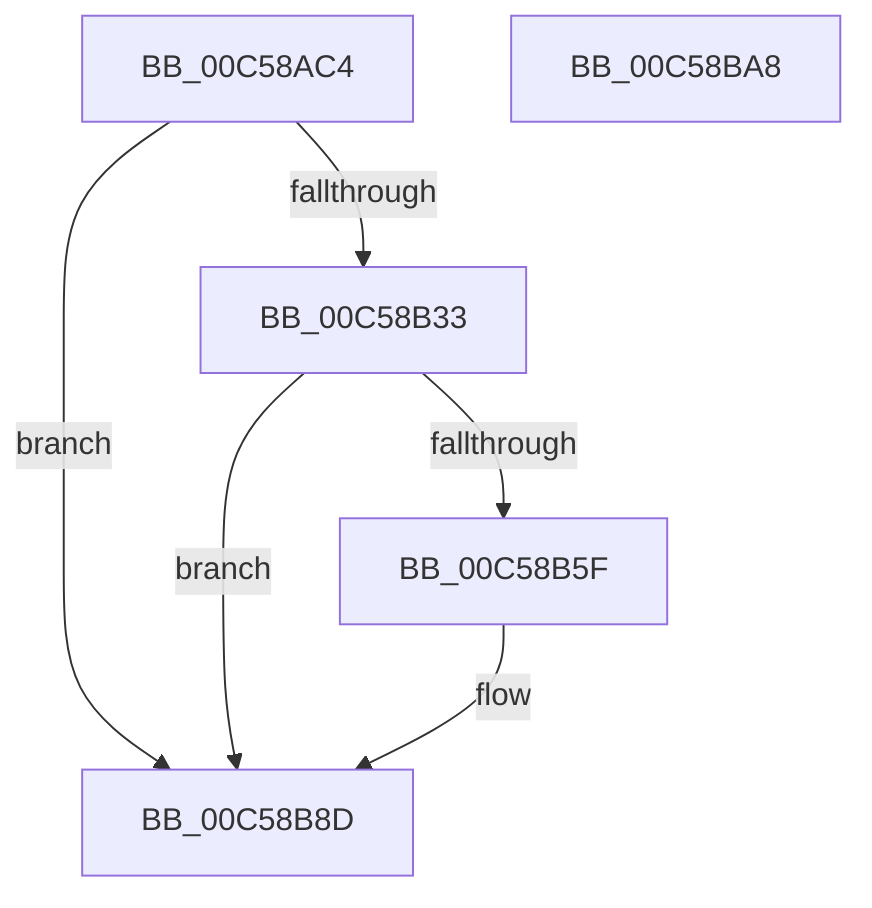

# CmpSetNetworkValue

- RVA: `0x00C58AC4`–`0x00C58BA9` (길이 `229` bytes)
- VA: `0x0000000140C58AC4`
- 실행 섹션: `INIT`
- PDB 이름 있음: `예`; PDB Function 태그: `아니요`
- unwind 정보 RVA: `0x000C4620`
- 디코드: `63`개 명령, `229/229` bytes 표시
- 미해석 바이트: `0` (있으면 어셈블리에 `.byte`로 보존)

> 이 문서는 커널 이미지의 기계어와 PDB 기호를 분석해 생성했습니다. 4번과 5번은 함수 원형과 자료형을 바이너리 사용 방식에서 추정한 C 해석이며 원본 소스 복구 결과는 아닙니다.

## 1. Dependencies

- 직접 호출 지점: **4**; 고유 호출 대상: **3**
- 직접 호출자로 확인된 함수: **1**
- RIP 상대 이미지 참조: **3**

### Outgoing calls
- `0x00C58B28` → [ZwCreateKey](../../text/6A/ZwCreateKey_function_006AD470.md) (function, `0x006AD470`)
- `0x00C58B54` → [ZwSetValueKey](../../text/6A/ZwSetValueKey_function_006ADCD0.md) (function, `0x006ADCD0`)
- `0x00C58B81` → [ZwSetValueKey](../../text/6A/ZwSetValueKey_function_006ADCD0.md) (function, `0x006ADCD0`)
- `0x00C58B91` → [ZwClose](../../text/6A/ZwClose_function_006AD2B0.md) (function, `0x006AD2B0`)

### Direct callers
- [CmInitSystem1](CmInitSystem1_function_00C559CC.md) at `0x00C56342`

### Static image references
- `0x00C58ADD` → RVA `0x00C824D0` (`CmpCurrentControlSetControlPxePathString`; read)
- `0x00C58B3E` → RVA `0x00C82420` (`CmpDhcpServerAckString`; read)
- `0x00C58B6A` → RVA `0x00C82490` (`CmpBootServerReplyString`; read)

## 2. Other-region calls and transfers

- 다른 실행 섹션으로 향하는 call: **4**
  - `0x00C58B28` → [ZwCreateKey](../../text/6A/ZwCreateKey_function_006AD470.md) (`INIT` → `.text`)
  - `0x00C58B54` → [ZwSetValueKey](../../text/6A/ZwSetValueKey_function_006ADCD0.md) (`INIT` → `.text`)
  - `0x00C58B81` → [ZwSetValueKey](../../text/6A/ZwSetValueKey_function_006ADCD0.md) (`INIT` → `.text`)
  - `0x00C58B91` → [ZwClose](../../text/6A/ZwClose_function_006AD2B0.md) (`INIT` → `.text`)
- 별도 외부 분기/꼬리 이동을 확인하지 못했습니다.

## 3. Assembly (complete function range)

```asm
00C58AC4  48 89 5C 24 08                  mov qword ptr [rsp + 8], rbx
00C58AC9  55                              push rbp
00C58ACA  56                              push rsi
00C58ACB  57                              push rdi
00C58ACC  48 8B EC                        mov rbp, rsp
00C58ACF  48 83 EC 70                     sub rsp, 0x70
00C58AD3  33 F6                           xor esi, esi
00C58AD5  48 C7 45 D0 30 00 00 00         mov qword ptr [rbp - 0x30], 0x30
00C58ADD  48 8D 05 EC 99 02 00            lea rax, [rip + 0x299ec]
00C58AE4  48 C7 45 E8 40 02 00 00         mov qword ptr [rbp - 0x18], 0x240
00C58AEC  48 89 45 E0                     mov qword ptr [rbp - 0x20], rax
00C58AF0  4C 8D 45 D0                     lea r8, [rbp - 0x30]
00C58AF4  48 8D 45 28                     lea rax, [rbp + 0x28]
00C58AF8  48 89 75 30                     mov qword ptr [rbp + 0x30], rsi
00C58AFC  48 89 44 24 30                  mov qword ptr [rsp + 0x30], rax
00C58B01  48 8B F9                        mov rdi, rcx
00C58B04  0F 57 C0                        xorps xmm0, xmm0
00C58B07  89 74 24 28                     mov dword ptr [rsp + 0x28], esi
00C58B0B  45 33 C9                        xor r9d, r9d
00C58B0E  48 89 74 24 20                  mov qword ptr [rsp + 0x20], rsi
00C58B13  BA 3F 00 0F 00                  mov edx, 0xf003f
00C58B18  89 75 28                        mov dword ptr [rbp + 0x28], esi
00C58B1B  48 8D 4D 30                     lea rcx, [rbp + 0x30]
00C58B1F  48 89 75 D8                     mov qword ptr [rbp - 0x28], rsi
00C58B23  F3 0F 7F 45 F0                  movdqu xmmword ptr [rbp - 0x10], xmm0
00C58B28  E8 43 49 A5 FF                  call 0x1406ad470
00C58B2D  8B D8                           mov ebx, eax
00C58B2F  85 C0                           test eax, eax
00C58B31  78 5A                           js 0x140c58b8d
00C58B33  8B 47 08                        mov eax, dword ptr [rdi + 8]
00C58B36  44 8D 4E 03                     lea r9d, [rsi + 3]
00C58B3A  48 8B 4D 30                     mov rcx, qword ptr [rbp + 0x30]
00C58B3E  48 8D 15 DB 98 02 00            lea rdx, [rip + 0x298db]
00C58B45  89 44 24 28                     mov dword ptr [rsp + 0x28], eax
00C58B49  45 33 C0                        xor r8d, r8d
00C58B4C  48 8B 07                        mov rax, qword ptr [rdi]
00C58B4F  48 89 44 24 20                  mov qword ptr [rsp + 0x20], rax
00C58B54  E8 77 51 A5 FF                  call 0x1406adcd0
00C58B59  8B D8                           mov ebx, eax
00C58B5B  85 C0                           test eax, eax
00C58B5D  78 2E                           js 0x140c58b8d
00C58B5F  8B 47 18                        mov eax, dword ptr [rdi + 0x18]
00C58B62  44 8D 4E 03                     lea r9d, [rsi + 3]
00C58B66  48 8B 4D 30                     mov rcx, qword ptr [rbp + 0x30]
00C58B6A  48 8D 15 1F 99 02 00            lea rdx, [rip + 0x2991f]
00C58B71  89 44 24 28                     mov dword ptr [rsp + 0x28], eax
00C58B75  45 33 C0                        xor r8d, r8d
00C58B78  48 8B 47 10                     mov rax, qword ptr [rdi + 0x10]
00C58B7C  48 89 44 24 20                  mov qword ptr [rsp + 0x20], rax
00C58B81  E8 4A 51 A5 FF                  call 0x1406adcd0
00C58B86  85 C0                           test eax, eax
00C58B88  8B D8                           mov ebx, eax
00C58B8A  0F 49 DE                        cmovns ebx, esi
00C58B8D  48 8B 4D 30                     mov rcx, qword ptr [rbp + 0x30]
00C58B91  E8 1A 47 A5 FF                  call 0x1406ad2b0
00C58B96  8B C3                           mov eax, ebx
00C58B98  48 8B 9C 24 90 00 00 00         mov rbx, qword ptr [rsp + 0x90]
00C58BA0  48 83 C4 70                     add rsp, 0x70
00C58BA4  5F                              pop rdi
00C58BA5  5E                              pop rsi
00C58BA6  5D                              pop rbp
00C58BA7  C3                              ret
00C58BA8  CC                              int3
```

## 4. C-style interpretation (structured pseudocode)

```c
__int64 __fastcall CmpSetNetworkValue(__int64 a1, __int64 a2, __int64 a3, int a4)
{
    __int64 result;
    __int64 v_rbx;
    __int64 v_rsi;
    __int64 v_rsp;
    unsigned __int64 v_stack_m28;
    unsigned __int64 v_stack_m30;
    unsigned __int64 v_stack_m38;
    unsigned __int64 v_stack_m40;
    unsigned __int64 v_stack_m48;
    unsigned __int64 v_stack_m58;
    unsigned int v_stack_m60;
    unsigned __int64 v_stack_m68;
    unsigned __int64 v_stack_p10;
    unsigned __int64 v_stack_p18;
    unsigned __int64 v_stack_p8;

    v_stack_p8 = v_rbx;
    v_rsp = (v_rsp) - (112);
    v_rsi = 0;
    v_stack_m48 = 48;
    v_stack_m30 = 576;
    v_stack_m38 = v_rip + 170476;
    v_stack_p18 = 0;
    v_stack_m58 = v_stack_p10;
    v_stack_m60 = 0;
    a4 = 0;
    v_stack_m68 = 0;
    v_stack_p10 = 0;
    v_stack_m40 = 0;
    v_stack_m28 = v_xmm0;
    result = ZwCreateKey(v_stack_p18, (unsigned int)(0xF003FULL), v_stack_m48, a4);
    if (sign_flag) goto loc_00C58B8D;
    v_stack_m60 = (unsigned int)((unsigned int)(*(unsigned int *)(a1 + 8)));
    a3 = 0;
    v_stack_m68 = *(unsigned __int64 *)(a1);
    result = ZwSetValueKey(v_stack_p18, v_rip + 170203, a3, v_rsi + 3);
    v_rbx = (unsigned int)((unsigned int)(result));
    if (!(sign_flag)) {
        result = *(unsigned int *)(a1 + 24);
        a4 = v_rsi + 3;
        a1 = v_stack_p18;
        a2 = v_rip + 170271;
        v_stack_m60 = (unsigned int)(result);
        a3 = 0;
        result = *(unsigned __int64 *)(a1 + 16);
        v_stack_m68 = result;
        result = ZwSetValueKey(a1, a2, a3, a4);
        v_rbx = (unsigned int)(result);
        if (!sign_flag) { v_rbx = 0; }
    }
    result = ZwClose(v_stack_p18, a2, a3, a4);
    v_rsp = (v_rsp) + (112);
    return (unsigned int)((unsigned int)(v_rbx));
}
```

## 5. (Beta) C Style

```c
int64_t CmpSetNetworkValue(void *Arg1, int64_t Arg2, int64_t Arg3, int32_t Arg4)
{
    uint8_t *arg1 = (uint8_t *)Arg1;

    int64_t result;
    int64_t local_rbx;
    int64_t local_rsi;
    int64_t local_rsp;
    uint64_t v_stack_m28;
    uint64_t v_stack_m30;
    uint64_t v_stack_m38;
    uint64_t v_stack_m40;
    uint64_t v_stack_m48;
    uint64_t v_stack_m58;
    uint32_t v_stack_m60;
    uint64_t v_stack_m68;
    uint64_t v_stack_p10;
    uint64_t v_stack_p18;
    uint64_t v_stack_p8;

    v_stack_p8 = local_rbx;
    local_rsp = (local_rsp) - (112);
    local_rsi = 0;
    v_stack_m48 = 48;
    v_stack_m30 = 576;
    v_stack_m38 = v_rip + 170476;
    v_stack_p18 = 0;
    v_stack_m58 = v_stack_p10;
    v_stack_m60 = 0;
    Arg4 = 0;
    v_stack_m68 = 0;
    v_stack_p10 = 0;
    v_stack_m40 = 0;
    v_stack_m28 = v_xmm0;
    result = ZwCreateKey(v_stack_p18, (uint32_t)(0xF003FULL), v_stack_m48, Arg4);
    if (sign_flag) goto loc_00C58B8D;
    v_stack_m60 = (uint32_t)((uint32_t)(*(uint32_t *)(arg1 + 0x8)));
    Arg3 = 0;
    v_stack_m68 = *(uint64_t *)(arg1);
    result = ZwSetValueKey(v_stack_p18, v_rip + 170203, Arg3, local_rsi + 3);
    local_rbx = (uint32_t)((uint32_t)(result));
    if (!(sign_flag)) {
        result = *(uint32_t *)(arg1 + 0x18);
        Arg4 = local_rsi + 3;
        Arg1 = v_stack_p18;
        Arg2 = v_rip + 170271;
        v_stack_m60 = (uint32_t)(result);
        Arg3 = 0;
        result = *(uint64_t *)(arg1 + 0x10);
        v_stack_m68 = result;
        result = ZwSetValueKey(Arg1, Arg2, Arg3, Arg4);
        local_rbx = (uint32_t)(result);
        if (!sign_flag) { local_rbx = 0; }
    }
    result = ZwClose(v_stack_p18, Arg2, Arg3, Arg4);
    local_rsp = (local_rsp) + (112);
    return (uint32_t)((uint32_t)(local_rbx));
}
```

### 관측된 메모리 오프셋

구조체 형식이 확인되지 않은 접근은 인자 기준의 오프셋으로만 기록했습니다.

| 기준 인자 | 오프셋 표현 | 폭 (bit) | 접근 |
|---|---:|---:|---|
| `Arg1` | `+ 0x0` | `64` | `R` |
| `Arg1` | `+ 0x8` | `32` | `R` |
| `Arg1` | `+ 0x10` | `64` | `R` |
| `Arg1` | `+ 0x18` | `32` | `R` |

## 6. Execution-region graph

[열기: 2D/3D 그래프와 함수 탐색 컨트롤 패널](../../../control-panel.html?section=init&rva=0x00C58AC4&view=graph)

- 2D 그래프는 위에서 아래로 흐르고, 3D 그래프는 빈 공간을 드래그해 회전합니다. Shift+드래그는 이동, 휠은 확대·축소, 함수 노드 선택은 대상 보고서 이동입니다.

### Static fallback


