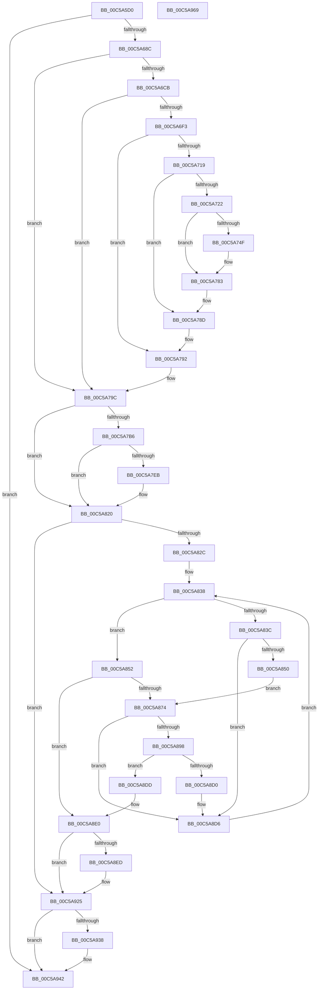

# CmpSetSystemBiosInformation

- RVA: `0x00C5A5D0`–`0x00C5A96A` (길이 `922` bytes)
- VA: `0x0000000140C5A5D0`
- 실행 섹션: `INIT`
- PDB 이름 있음: `예`; PDB Function 태그: `아니요`
- unwind 정보 RVA: `0x000D6A80`
- 디코드: `230`개 명령, `922/922` bytes 표시
- 미해석 바이트: `0` (있으면 어셈블리에 `.byte`로 보존)

> 이 문서는 커널 이미지의 기계어와 PDB 기호를 분석해 생성했습니다. 4번과 5번은 함수 원형과 자료형을 바이너리 사용 방식에서 추정한 C 해석이며 원본 소스 복구 결과는 아닙니다.

## 1. Dependencies

- 직접 호출 지점: **29**; 고유 호출 대상: **16**
- 직접 호출자로 확인된 함수: **1**
- RIP 상대 이미지 참조: **4**

### Outgoing calls
- `0x00C5A67F` → [ZwMapViewOfSection](../../text/6A/ZwMapViewOfSection_function_006AD5D0.md) (function, `0x006AD5D0`)
- `0x00C5A69C` → [ExAllocatePool2](../../poolcode/B8/ExAllocatePool2_function_00B820F0.md) (function, `0x00B820F0`)
- `0x00C5A6BE` → [CmpGetBiosDate](CmpGetBiosDate_function_00C59C80.md) (function, `0x00C59C80`)
- `0x00C5A6D4` → [RtlInitAnsiString](../../text/47/RtlInitAnsiString_function_00470F40.md) (function, `0x00470F40`)
- `0x00C5A6E6` → [RtlAnsiStringToUnicodeString](../../page/90/RtlAnsiStringToUnicodeString_function_0090BEA0.md) (function, `0x0090BEA0`)
- `0x00C5A6FF` → [RtlInitUnicodeString](../../text/42/RtlInitUnicodeString_function_0042A780.md) (function, `0x0042A780`)
- `0x00C5A710` → [CmpGetRegistryValue](CmpGetRegistryValue_function_00C5D860.md) (function, `0x00C5D860`)
- `0x00C5A746` → [RtlCompareUnicodeString](../../page/93/RtlCompareUnicodeString_function_00937F90.md) (function, `0x00937F90`)
- `0x00C5A75B` → [RtlInitUnicodeString](../../text/42/RtlInitUnicodeString_function_0042A780.md) (function, `0x0042A780`)
- `0x00C5A77E` → [ZwSetValueKey](../../text/6A/ZwSetValueKey_function_006ADCD0.md) (function, `0x006ADCD0`)
- `0x00C5A788` → [ExFreePoolWithTag](../../poolcode/B8/ExFreePoolWithTag_function_00B82870.md) (function, `0x00B82870`)
- `0x00C5A797` → [RtlFreeAnsiString](../../page/9C/RtlFreeAnsiString_function_009C0800.md) (function, `0x009C0800`)
- `0x00C5A7AD` → [CmpGetBiosDate](CmpGetBiosDate_function_00C59C80.md) (function, `0x00C59C80`)
- `0x00C5A7C2` → [RtlInitUnicodeString](../../text/42/RtlInitUnicodeString_function_0042A780.md) (function, `0x0042A780`)
- `0x00C5A7D0` → [RtlInitAnsiString](../../text/47/RtlInitAnsiString_function_00470F40.md) (function, `0x00470F40`)
- `0x00C5A7E2` → [RtlAnsiStringToUnicodeString](../../page/90/RtlAnsiStringToUnicodeString_function_0090BEA0.md) (function, `0x0090BEA0`)
- `0x00C5A811` → [ZwSetValueKey](../../text/6A/ZwSetValueKey_function_006ADCD0.md) (function, `0x006ADCD0`)
- `0x00C5A81B` → [RtlFreeAnsiString](../../page/9C/RtlFreeAnsiString_function_009C0800.md) (function, `0x009C0800`)
- `0x00C5A843` → [CmpGetAcpiBiosVersion](CmpGetAcpiBiosVersion_function_00C59BF4.md) (function, `0x00C59BF4`)
- `0x00C5A86B` → [CmpGetBiosVersion](CmpGetBiosVersion_function_00C59E90.md) (function, `0x00C59E90`)
- `0x00C5A87D` → [RtlInitAnsiString](../../text/47/RtlInitAnsiString_function_00470F40.md) (function, `0x00470F40`)
- `0x00C5A88F` → [RtlAnsiStringToUnicodeString](../../page/90/RtlAnsiStringToUnicodeString_function_0090BEA0.md) (function, `0x0090BEA0`)
- `0x00C5A8AD` → [memcpy](../../text/6C/memcpy_function_006C6840.md) (function, `0x006C6840`)
- `0x00C5A8BA` → [RtlFreeAnsiString](../../page/9C/RtlFreeAnsiString_function_009C0800.md) (function, `0x009C0800`)
- `0x00C5A8FD` → [RtlInitUnicodeString](../../text/42/RtlInitUnicodeString_function_0042A780.md) (function, `0x0042A780`)
- `0x00C5A920` → [ZwSetValueKey](../../text/6A/ZwSetValueKey_function_006ADCD0.md) (function, `0x006ADCD0`)
- `0x00C5A92E` → [ZwUnmapViewOfSection](../../text/6A/ZwUnmapViewOfSection_function_006AD610.md) (function, `0x006AD610`)
- `0x00C5A93D` → [ExFreePoolWithTag](../../poolcode/B8/ExFreePoolWithTag_function_00B82870.md) (function, `0x00B82870`)
- `0x00C5A949` → [_security_check_cookie](../../text/6A/_security_check_cookie_function_006AC640.md) (function, `0x006AC640`)

### Direct callers
- [CmpInitializeMachineDependentConfiguration](CmpInitializeMachineDependentConfiguration_function_00C5A02C.md) at `0x00C5A45A`

### Static image references
- `0x00C5A5EC` → RVA `0x00E0A740` (`.data`; read)
- `0x00C5A6F3` → RVA `0x00C79E80` (` ?? ::PBOPGDP::`string'`; read)
- `0x00C5A74F` → RVA `0x00C79E50` (` ?? ::PBOPGDP::`string'`; read)
- `0x00C5A8ED` → RVA `0x00C7A620` (` ?? ::PBOPGDP::`string'`; read)

## 2. Other-region calls and transfers

- 다른 실행 섹션으로 향하는 call: **24**
  - `0x00C5A67F` → [ZwMapViewOfSection](../../text/6A/ZwMapViewOfSection_function_006AD5D0.md) (`INIT` → `.text`)
  - `0x00C5A69C` → [ExAllocatePool2](../../poolcode/B8/ExAllocatePool2_function_00B820F0.md) (`INIT` → `POOLCODE`)
  - `0x00C5A6D4` → [RtlInitAnsiString](../../text/47/RtlInitAnsiString_function_00470F40.md) (`INIT` → `.text`)
  - `0x00C5A6E6` → [RtlAnsiStringToUnicodeString](../../page/90/RtlAnsiStringToUnicodeString_function_0090BEA0.md) (`INIT` → `PAGE`)
  - `0x00C5A6FF` → [RtlInitUnicodeString](../../text/42/RtlInitUnicodeString_function_0042A780.md) (`INIT` → `.text`)
  - `0x00C5A746` → [RtlCompareUnicodeString](../../page/93/RtlCompareUnicodeString_function_00937F90.md) (`INIT` → `PAGE`)
  - `0x00C5A75B` → [RtlInitUnicodeString](../../text/42/RtlInitUnicodeString_function_0042A780.md) (`INIT` → `.text`)
  - `0x00C5A77E` → [ZwSetValueKey](../../text/6A/ZwSetValueKey_function_006ADCD0.md) (`INIT` → `.text`)
  - `0x00C5A788` → [ExFreePoolWithTag](../../poolcode/B8/ExFreePoolWithTag_function_00B82870.md) (`INIT` → `POOLCODE`)
  - `0x00C5A797` → [RtlFreeAnsiString](../../page/9C/RtlFreeAnsiString_function_009C0800.md) (`INIT` → `PAGE`)
  - `0x00C5A7C2` → [RtlInitUnicodeString](../../text/42/RtlInitUnicodeString_function_0042A780.md) (`INIT` → `.text`)
  - `0x00C5A7D0` → [RtlInitAnsiString](../../text/47/RtlInitAnsiString_function_00470F40.md) (`INIT` → `.text`)
  - `0x00C5A7E2` → [RtlAnsiStringToUnicodeString](../../page/90/RtlAnsiStringToUnicodeString_function_0090BEA0.md) (`INIT` → `PAGE`)
  - `0x00C5A811` → [ZwSetValueKey](../../text/6A/ZwSetValueKey_function_006ADCD0.md) (`INIT` → `.text`)
  - `0x00C5A81B` → [RtlFreeAnsiString](../../page/9C/RtlFreeAnsiString_function_009C0800.md) (`INIT` → `PAGE`)
  - `0x00C5A87D` → [RtlInitAnsiString](../../text/47/RtlInitAnsiString_function_00470F40.md) (`INIT` → `.text`)
  - `0x00C5A88F` → [RtlAnsiStringToUnicodeString](../../page/90/RtlAnsiStringToUnicodeString_function_0090BEA0.md) (`INIT` → `PAGE`)
  - `0x00C5A8AD` → [memcpy](../../text/6C/memcpy_function_006C6840.md) (`INIT` → `.text`)
  - `0x00C5A8BA` → [RtlFreeAnsiString](../../page/9C/RtlFreeAnsiString_function_009C0800.md) (`INIT` → `PAGE`)
  - `0x00C5A8FD` → [RtlInitUnicodeString](../../text/42/RtlInitUnicodeString_function_0042A780.md) (`INIT` → `.text`)
  - `0x00C5A920` → [ZwSetValueKey](../../text/6A/ZwSetValueKey_function_006ADCD0.md) (`INIT` → `.text`)
  - `0x00C5A92E` → [ZwUnmapViewOfSection](../../text/6A/ZwUnmapViewOfSection_function_006AD610.md) (`INIT` → `.text`)
  - `0x00C5A93D` → [ExFreePoolWithTag](../../poolcode/B8/ExFreePoolWithTag_function_00B82870.md) (`INIT` → `POOLCODE`)
  - `0x00C5A949` → [_security_check_cookie](../../text/6A/_security_check_cookie_function_006AC640.md) (`INIT` → `.text`)
- 별도 외부 분기/꼬리 이동을 확인하지 못했습니다.

## 3. Assembly (complete function range)

```asm
00C5A5D0  48 89 5C 24 20                  mov qword ptr [rsp + 0x20], rbx
00C5A5D5  55                              push rbp
00C5A5D6  56                              push rsi
00C5A5D7  57                              push rdi
00C5A5D8  41 54                           push r12
00C5A5DA  41 55                           push r13
00C5A5DC  41 56                           push r14
00C5A5DE  41 57                           push r15
00C5A5E0  48 8D 6C 24 A0                  lea rbp, [rsp - 0x60]
00C5A5E5  48 81 EC 60 01 00 00            sub rsp, 0x160
00C5A5EC  48 8B 05 4D 01 1B 00            mov rax, qword ptr [rip + 0x1b014d]
00C5A5F3  48 33 C4                        xor rax, rsp
00C5A5F6  48 89 45 50                     mov qword ptr [rbp + 0x50], rax
00C5A5FA  45 33 FF                        xor r15d, r15d
00C5A5FD  C7 44 24 48 04 00 00 00         mov dword ptr [rsp + 0x48], 4
00C5A605  48 89 4D B0                     mov qword ptr [rbp - 0x50], rcx
00C5A609  0F 57 C0                        xorps xmm0, xmm0
00C5A60C  44 89 7C 24 40                  mov dword ptr [rsp + 0x40], r15d
00C5A611  48 8D 4D A8                     lea rcx, [rbp - 0x58]
00C5A615  48 8B C2                        mov rax, rdx
00C5A618  4C 89 45 C0                     mov qword ptr [rbp - 0x40], r8
00C5A61C  4D 8B E0                        mov r12, r8
00C5A61F  4C 89 7D 90                     mov qword ptr [rbp - 0x70], r15
00C5A623  0F 57 C9                        xorps xmm1, xmm1
00C5A626  4C 89 7C 24 50                  mov qword ptr [rsp + 0x50], r15
00C5A62B  41 8D 5F 02                     lea ebx, [r15 + 2]
00C5A62F  48 C7 45 A8 00 00 01 00         mov qword ptr [rbp - 0x58], 0x10000
00C5A637  89 5C 24 38                     mov dword ptr [rsp + 0x38], ebx
00C5A63B  4C 8D 44 24 50                  lea r8, [rsp + 0x50]
00C5A640  48 89 4C 24 30                  mov qword ptr [rsp + 0x30], rcx
00C5A645  45 33 C9                        xor r9d, r9d
00C5A648  48 8D 4D 88                     lea rcx, [rbp - 0x78]
00C5A64C  48 C7 45 88 00 00 0F 00         mov qword ptr [rbp - 0x78], 0xf0000
00C5A654  48 89 4C 24 28                  mov qword ptr [rsp + 0x28], rcx
00C5A659  48 83 CA FF                     or rdx, 0xffffffffffffffff
00C5A65D  48 8B C8                        mov rcx, rax
00C5A660  48 C7 44 24 20 00 00 01 00      mov qword ptr [rsp + 0x20], 0x10000
00C5A669  0F 11 44 24 78                  movups xmmword ptr [rsp + 0x78], xmm0
00C5A66E  45 8B EF                        mov r13d, r15d
00C5A671  0F 11 45 98                     movups xmmword ptr [rbp - 0x68], xmm0
00C5A675  0F 11 4C 24 58                  movups xmmword ptr [rsp + 0x58], xmm1
00C5A67A  0F 11 44 24 68                  movups xmmword ptr [rsp + 0x68], xmm0
00C5A67F  E8 4C 2F A5 FF                  call 0x1406ad5d0
00C5A684  85 C0                           test eax, eax
00C5A686  0F 88 B6 02 00 00               js 0x140c5a942
00C5A68C  BA 00 10 00 00                  mov edx, 0x1000
00C5A691  B9 00 01 00 00                  mov ecx, 0x100
00C5A696  41 B8 43 4D 20 20               mov r8d, 0x20204d43
00C5A69C  E8 4F 7A F2 FF                  call 0x140b820f0
00C5A6A1  48 8B 4C 24 50                  mov rcx, qword ptr [rsp + 0x50]
00C5A6A6  4C 8D 45 D0                     lea r8, [rbp - 0x30]
00C5A6AA  48 81 C1 F5 FF 00 00            add rcx, 0xfff5
00C5A6B1  48 89 45 B8                     mov qword ptr [rbp - 0x48], rax
00C5A6B5  41 B1 01                        mov r9b, 1
00C5A6B8  8D 53 06                        lea edx, [rbx + 6]
00C5A6BB  48 8B F0                        mov rsi, rax
00C5A6BE  E8 BD F5 FF FF                  call 0x140c59c80
00C5A6C3  84 C0                           test al, al
00C5A6C5  0F 84 D1 00 00 00               je 0x140c5a79c
00C5A6CB  48 8D 55 D0                     lea rdx, [rbp - 0x30]
00C5A6CF  48 8D 4C 24 78                  lea rcx, [rsp + 0x78]
00C5A6D4  E8 67 68 81 FF                  call 0x140470f40
00C5A6D9  41 B0 01                        mov r8b, 1
00C5A6DC  48 8D 54 24 78                  lea rdx, [rsp + 0x78]
00C5A6E1  48 8D 4C 24 58                  lea rcx, [rsp + 0x58]
00C5A6E6  E8 B5 17 CB FF                  call 0x14090bea0
00C5A6EB  85 C0                           test eax, eax
00C5A6ED  0F 88 A9 00 00 00               js 0x140c5a79c
00C5A6F3  48 8D 15 86 F7 01 00            lea rdx, [rip + 0x1f786]
00C5A6FA  48 8D 4C 24 68                  lea rcx, [rsp + 0x68]
00C5A6FF  E8 7C 00 7D FF                  call 0x14042a780
00C5A704  48 8B 54 24 70                  mov rdx, qword ptr [rsp + 0x70]
00C5A709  4C 8D 45 90                     lea r8, [rbp - 0x70]
00C5A70D  49 8B CC                        mov rcx, r12
00C5A710  E8 4B 31 00 00                  call 0x140c5d860
00C5A715  85 C0                           test eax, eax
00C5A717  78 79                           js 0x140c5a792
00C5A719  48 8B 5D 90                     mov rbx, qword ptr [rbp - 0x70]
00C5A71D  48 85 DB                        test rbx, rbx
00C5A720  74 6B                           je 0x140c5a78d
00C5A722  0F B7 7B 08                     movzx edi, word ptr [rbx + 8]
00C5A726  4C 8D 73 0C                     lea r14, [rbx + 0xc]
00C5A72A  66 89 7D 9A                     mov word ptr [rbp - 0x66], di
00C5A72E  48 8D 55 98                     lea rdx, [rbp - 0x68]
00C5A732  66 83 EF 02                     sub di, 2
00C5A736  4C 89 75 A0                     mov qword ptr [rbp - 0x60], r14
00C5A73A  41 B0 01                        mov r8b, 1
00C5A73D  66 89 7D 98                     mov word ptr [rbp - 0x68], di
00C5A741  48 8D 4C 24 58                  lea rcx, [rsp + 0x58]
00C5A746  E8 45 D8 CD FF                  call 0x140937f90
00C5A74B  85 C0                           test eax, eax
00C5A74D  74 34                           je 0x140c5a783
00C5A74F  48 8D 15 FA F6 01 00            lea rdx, [rip + 0x1f6fa]
00C5A756  48 8D 4C 24 68                  lea rcx, [rsp + 0x68]
00C5A75B  E8 20 00 7D FF                  call 0x14042a780
00C5A760  0F B7 C7                        movzx eax, di
00C5A763  45 8D 4F 01                     lea r9d, [r15 + 1]
00C5A767  83 C0 02                        add eax, 2
00C5A76A  48 8D 54 24 68                  lea rdx, [rsp + 0x68]
00C5A76F  89 44 24 28                     mov dword ptr [rsp + 0x28], eax
00C5A773  45 33 C0                        xor r8d, r8d
00C5A776  49 8B CC                        mov rcx, r12
00C5A779  4C 89 74 24 20                  mov qword ptr [rsp + 0x20], r14
00C5A77E  E8 4D 35 A5 FF                  call 0x1406adcd0
00C5A783  33 D2                           xor edx, edx
00C5A785  48 8B CB                        mov rcx, rbx
00C5A788  E8 E3 80 F2 FF                  call 0x140b82870
00C5A78D  BB 02 00 00 00                  mov ebx, 2
00C5A792  48 8D 4C 24 58                  lea rcx, [rsp + 0x58]
00C5A797  E8 64 60 D6 FF                  call 0x1409c0800
00C5A79C  48 8B 4C 24 50                  mov rcx, qword ptr [rsp + 0x50]
00C5A7A1  4C 8D 45 D0                     lea r8, [rbp - 0x30]
00C5A7A5  41 B1 01                        mov r9b, 1
00C5A7A8  BA 00 00 01 00                  mov edx, 0x10000
00C5A7AD  E8 CE F4 FF FF                  call 0x140c59c80
00C5A7B2  84 C0                           test al, al
00C5A7B4  74 6A                           je 0x140c5a820
00C5A7B6  48 8D 15 C3 F6 01 00            lea rdx, [rip + 0x1f6c3]
00C5A7BD  48 8D 4C 24 68                  lea rcx, [rsp + 0x68]
00C5A7C2  E8 B9 FF 7C FF                  call 0x14042a780
00C5A7C7  48 8D 55 D0                     lea rdx, [rbp - 0x30]
00C5A7CB  48 8D 4C 24 78                  lea rcx, [rsp + 0x78]
00C5A7D0  E8 6B 67 81 FF                  call 0x140470f40
00C5A7D5  41 B0 01                        mov r8b, 1
00C5A7D8  48 8D 54 24 78                  lea rdx, [rsp + 0x78]
00C5A7DD  48 8D 4C 24 58                  lea rcx, [rsp + 0x58]
00C5A7E2  E8 B9 16 CB FF                  call 0x14090bea0
00C5A7E7  85 C0                           test eax, eax
00C5A7E9  78 35                           js 0x140c5a820
00C5A7EB  0F B7 44 24 58                  movzx eax, word ptr [rsp + 0x58]
00C5A7F0  48 8D 54 24 68                  lea rdx, [rsp + 0x68]
00C5A7F5  03 C3                           add eax, ebx
00C5A7F7  41 B9 01 00 00 00               mov r9d, 1
00C5A7FD  89 44 24 28                     mov dword ptr [rsp + 0x28], eax
00C5A801  45 33 C0                        xor r8d, r8d
00C5A804  48 8B 44 24 60                  mov rax, qword ptr [rsp + 0x60]
00C5A809  49 8B CC                        mov rcx, r12
00C5A80C  48 89 44 24 20                  mov qword ptr [rsp + 0x20], rax
00C5A811  E8 BA 34 A5 FF                  call 0x1406adcd0
00C5A816  48 8D 4C 24 58                  lea rcx, [rsp + 0x58]
00C5A81B  E8 E0 5F D6 FF                  call 0x1409c0800
00C5A820  4C 8B F6                        mov r14, rsi
00C5A823  48 85 F6                        test rsi, rsi
00C5A826  0F 84 F9 00 00 00               je 0x140c5a925
00C5A82C  4C 8B 65 B0                     mov r12, qword ptr [rbp - 0x50]
00C5A830  41 8B FF                        mov edi, r15d
00C5A833  BE 02 00 00 00                  mov esi, 2
00C5A838  85 FF                           test edi, edi
00C5A83A  75 16                           jne 0x140c5a852
00C5A83C  48 8D 55 D0                     lea rdx, [rbp - 0x30]
00C5A840  49 8B CC                        mov rcx, r12
00C5A843  E8 AC F3 FF FF                  call 0x140c59bf4
00C5A848  84 C0                           test al, al
00C5A84A  0F 84 86 00 00 00               je 0x140c5a8d6
00C5A850  EB 22                           jmp 0x140c5a874
00C5A852  83 FF 01                        cmp edi, 1
00C5A855  4C 8D 45 D0                     lea r8, [rbp - 0x30]
00C5A859  BA 00 00 01 00                  mov edx, 0x10000
00C5A85E  49 8B CF                        mov rcx, r15
00C5A861  48 0F 44 4C 24 50               cmove rcx, qword ptr [rsp + 0x50]
00C5A867  41 0F 45 D7                     cmovne edx, r15d
00C5A86B  E8 20 F6 FF FF                  call 0x140c59e90
00C5A870  84 C0                           test al, al
00C5A872  74 6C                           je 0x140c5a8e0
00C5A874  48 8D 55 D0                     lea rdx, [rbp - 0x30]
00C5A878  48 8D 4C 24 78                  lea rcx, [rsp + 0x78]
00C5A87D  E8 BE 66 81 FF                  call 0x140470f40
00C5A882  41 B0 01                        mov r8b, 1
00C5A885  48 8D 54 24 78                  lea rdx, [rsp + 0x78]
00C5A88A  48 8D 4C 24 58                  lea rcx, [rsp + 0x58]
00C5A88F  E8 0C 16 CB FF                  call 0x14090bea0
00C5A894  85 C0                           test eax, eax
00C5A896  78 3E                           js 0x140c5a8d6
00C5A898  0F B7 5C 24 58                  movzx ebx, word ptr [rsp + 0x58]
00C5A89D  49 8B CE                        mov rcx, r14
00C5A8A0  48 8B 54 24 60                  mov rdx, qword ptr [rsp + 0x60]
00C5A8A5  03 DE                           add ebx, esi
00C5A8A7  44 8B C3                        mov r8d, ebx
00C5A8AA  44 8B FB                        mov r15d, ebx
00C5A8AD  E8 8E BF A6 FF                  call 0x1406c6840
00C5A8B2  48 8D 4C 24 58                  lea rcx, [rsp + 0x58]
00C5A8B7  44 03 EB                        add r13d, ebx
00C5A8BA  E8 41 5F D6 FF                  call 0x1409c0800
00C5A8BF  41 8B C5                        mov eax, r13d
00C5A8C2  48 05 04 01 00 00               add rax, 0x104
00C5A8C8  48 3D 00 10 00 00               cmp rax, 0x1000
00C5A8CE  77 0D                           ja 0x140c5a8dd
00C5A8D0  4D 03 F7                        add r14, r15
00C5A8D3  45 33 FF                        xor r15d, r15d
00C5A8D6  FF C7                           inc edi
00C5A8D8  E9 5B FF FF FF                  jmp 0x140c5a838
00C5A8DD  45 33 FF                        xor r15d, r15d
00C5A8E0  48 8B 75 B8                     mov rsi, qword ptr [rbp - 0x48]
00C5A8E4  4C 8B 65 C0                     mov r12, qword ptr [rbp - 0x40]
00C5A8E8  45 85 ED                        test r13d, r13d
00C5A8EB  74 38                           je 0x140c5a925
00C5A8ED  48 8D 15 2C FD 01 00            lea rdx, [rip + 0x1fd2c]
00C5A8F4  66 45 89 3E                     mov word ptr [r14], r15w
00C5A8F8  48 8D 4C 24 68                  lea rcx, [rsp + 0x68]
00C5A8FD  E8 7E FE 7C FF                  call 0x14042a780
00C5A902  41 8D 45 02                     lea eax, [r13 + 2]
00C5A906  41 B9 07 00 00 00               mov r9d, 7
00C5A90C  89 44 24 28                     mov dword ptr [rsp + 0x28], eax
00C5A910  48 8D 54 24 68                  lea rdx, [rsp + 0x68]
00C5A915  45 33 C0                        xor r8d, r8d
00C5A918  48 89 74 24 20                  mov qword ptr [rsp + 0x20], rsi
00C5A91D  49 8B CC                        mov rcx, r12
00C5A920  E8 AB 33 A5 FF                  call 0x1406adcd0
00C5A925  48 8B 54 24 50                  mov rdx, qword ptr [rsp + 0x50]
00C5A92A  48 83 C9 FF                     or rcx, 0xffffffffffffffff
00C5A92E  E8 DD 2C A5 FF                  call 0x1406ad610
00C5A933  48 85 F6                        test rsi, rsi
00C5A936  74 0A                           je 0x140c5a942
00C5A938  33 D2                           xor edx, edx
00C5A93A  48 8B CE                        mov rcx, rsi
00C5A93D  E8 2E 7F F2 FF                  call 0x140b82870
00C5A942  48 8B 4D 50                     mov rcx, qword ptr [rbp + 0x50]
00C5A946  48 33 CC                        xor rcx, rsp
00C5A949  E8 F2 1C A5 FF                  call 0x1406ac640
00C5A94E  48 8B 9C 24 B8 01 00 00         mov rbx, qword ptr [rsp + 0x1b8]
00C5A956  48 81 C4 60 01 00 00            add rsp, 0x160
00C5A95D  41 5F                           pop r15
00C5A95F  41 5E                           pop r14
00C5A961  41 5D                           pop r13
00C5A963  41 5C                           pop r12
00C5A965  5F                              pop rdi
00C5A966  5E                              pop rsi
00C5A967  5D                              pop rbp
00C5A968  C3                              ret
00C5A969  CC                              int3
```

## 4. C-style interpretation (structured pseudocode)

```c
__int64 __fastcall CmpSetSystemBiosInformation(__int64 a1, __int64 a2, __int64 a3, int a4)
{
    __int64 result;
    __int64 v_r13;
    __int64 v_r14;
    __int64 v_r15;
    __int64 v_rbx;
    __int64 v_rdi;
    __int64 v_rsp;
    unsigned __int64 v_stack_m100;
    unsigned __int64 v_stack_m108;
    unsigned __int64 v_stack_m110;
    unsigned __int64 v_stack_m120;
    unsigned __int64 v_stack_m128;
    unsigned __int64 v_stack_m130;
    unsigned __int64 v_stack_m138;
    unsigned __int64 v_stack_m140;
    unsigned __int64 v_stack_m148;
    unsigned int v_stack_m150;
    unsigned int v_stack_m158;
    unsigned int v_stack_m160;
    unsigned __int64 v_stack_m168;
    unsigned __int64 v_stack_m170;
    unsigned __int64 v_stack_m178;
    unsigned __int64 v_stack_m48;
    unsigned __int64 v_stack_m98;
    unsigned __int64 v_stack_mC8;
    unsigned __int64 v_stack_mD8;
    unsigned __int64 v_stack_mE0;
    unsigned __int64 v_stack_mE8;
    unsigned __int64 v_stack_mF0;
    unsigned __int64 v_stack_mF8;
    unsigned __int16 v_stack_mFE;
    unsigned __int64 v_stack_p20;

    v_stack_p20 = v_rbx;
    v_rsp = (v_rsp) - (352);
    result = (*(unsigned __int64 *)(v_rip + 1769805)) ^ (v_rsp);
    v_stack_m48 = result;
    v_r15 = 0;
    v_stack_m150 = 4;
    v_stack_mE8 = a1;
    v_stack_m158 = 0;
    v_stack_mD8 = a3;
    v_stack_m108 = 0;
    v_stack_m148 = 0;
    v_stack_mF0 = 0x10000ULL;
    v_stack_m160 = (unsigned int)(v_r15 + 2);
    v_stack_m168 = v_stack_mF0;
    a4 = 0;
    v_stack_m110 = 0xF0000ULL;
    v_stack_m170 = v_stack_m110;
    a2 = (a2) | (-1);
    v_stack_m178 = 0x10000ULL;
    v_stack_m120 = v_xmm0;
    v_stack_m100 = v_xmm0;
    v_stack_m140 = v_xmm1;
    v_stack_m130 = v_xmm0;
    result = ZwMapViewOfSection(a2, a2, v_stack_m148, a4);
    if (sign_flag) goto loc_00C5A942;
    result = ExAllocatePool2(256, (unsigned int)(0x1000ULL), (unsigned int)(0x20204D43ULL), a4);
    a1 = (v_stack_m148) + (0xFFF5ULL);
    v_stack_mE0 = result;
    result = CmpGetBiosDate(a1, v_r15 + 2 + 6, v_stack_mC8, 1);
    if ((unsigned __int8)(result) == 0) goto loc_00C5A79C;
    result = RtlInitAnsiString(v_stack_m120, v_stack_mC8, v_stack_mC8, 1);
    result = RtlAnsiStringToUnicodeString(v_stack_m140, v_stack_m120, 1, 1);
    if (sign_flag) goto loc_00C5A79C;
    result = RtlInitUnicodeString(v_stack_m130, v_rip + 128902, 1, 1);
    result = CmpGetRegistryValue(a3, v_stack_m128, v_stack_m108, 1);
    if (sign_flag) goto loc_00C5A792;
    if (v_stack_m108 == 0) goto loc_00C5A78D;
    v_stack_mFE = (unsigned __int16)(*(unsigned __int16 *)(v_stack_m108 + 8));
    v_rdi = (unsigned __int16)((*(unsigned __int16 *)(v_stack_m108 + 8)) - (2));
    v_stack_mF8 = v_stack_m108 + 12;
    v_stack_m100 = (unsigned __int16)(v_rdi);
    result = RtlCompareUnicodeString(v_stack_m140, v_stack_m100, 1, 1);
    if ((unsigned int)(result) != 0) {
        a2 = v_rip + 128762;
        a1 = v_stack_m130;
        result = RtlInitUnicodeString(a1, a2, 1, 1);
        result = (unsigned __int16)(v_rdi);
        a4 = v_r15 + 1;
        result = (unsigned int)((result) + (2));
        a2 = v_stack_m130;
        v_stack_m170 = (unsigned int)(result);
        a3 = 0;
        a1 = 0;
        v_stack_m178 = v_stack_m108 + 12;
        result = ZwSetValueKey(a1, a2, a3, a4);
    }
    a2 = 0;
    result = ExFreePoolWithTag(v_stack_m108, a2, a3, a4);
loc_00C5A78D:
loc_00C5A792:
    result = RtlFreeAnsiString(v_stack_m140, a2, a3, a4);
loc_00C5A79C:
    result = CmpGetBiosDate(v_stack_m148, (unsigned int)(0x10000ULL), v_stack_mC8, 1);
    if ((unsigned __int8)(result) == 0) goto loc_00C5A820;
    result = RtlInitUnicodeString(v_stack_m130, v_rip + 128707, v_stack_mC8, 1);
    result = RtlInitAnsiString(v_stack_m120, v_stack_mC8, v_stack_mC8, 1);
    result = RtlAnsiStringToUnicodeString(v_stack_m140, v_stack_m120, 1, 1);
    if (!(sign_flag)) {
        result = v_stack_m140;
        a2 = v_stack_m130;
        result = (unsigned int)((result) + (2));
        a4 = 1;
        v_stack_m170 = (unsigned int)(result);
        a3 = 0;
        result = v_stack_m138;
        a1 = 0;
        v_stack_m178 = result;
        result = ZwSetValueKey(a1, a2, a3, a4);
        a1 = v_stack_m140;
        result = RtlFreeAnsiString(a1, a2, a3, a4);
    }
    if (result == 0) goto loc_00C5A925;
loc_00C5A838:
    if (0 != 0) goto loc_00C5A852;
    result = CmpGetAcpiBiosVersion(v_stack_mE8, v_stack_mC8, a3, a4);
    if ((unsigned __int8)(result) == 0) goto loc_00C5A8D6;
    goto loc_00C5A874;
loc_00C5A852:
    a1 = 0;
    if (0 == 1) { a1 = v_stack_m148; }
    a2 = (unsigned int)(0x10000ULL);
    if (0 != 1) { a2 = 0; }
    result = CmpGetBiosVersion(a1, a2, v_stack_mC8, a4);
    if ((unsigned __int8)(result) == 0) goto loc_00C5A8E0;
loc_00C5A874:
    result = RtlInitAnsiString(v_stack_m120, v_stack_mC8, v_stack_mC8, a4);
    result = RtlAnsiStringToUnicodeString(v_stack_m140, v_stack_m120, 1, a4);
    if (sign_flag) goto loc_00C5A8D6;
    v_rbx = (unsigned int)((v_stack_m140) + (2));
    result = memcpy(result, v_stack_m138, (unsigned int)((unsigned int)(v_rbx)), a4);
    v_r13 = (unsigned int)((0) + ((unsigned int)(v_rbx)));
    result = RtlFreeAnsiString(v_stack_m140, v_stack_m138, (unsigned int)((unsigned int)(v_rbx)), a4);
    result = ((unsigned int)((unsigned int)(v_r13))) + (260);
    if (result > 0x1000ULL) goto loc_00C5A8DD;
    v_r14 = (result) + ((unsigned int)((unsigned int)(v_rbx)));
    v_r15 = 0;
loc_00C5A8D6:
    v_rdi = (unsigned int)((0) + 1);
    goto loc_00C5A838;
loc_00C5A8DD:
    v_r15 = 0;
loc_00C5A8E0:
    if ((unsigned int)(v_r13) != 0) {
        a2 = v_rip + 130348;
        *(unsigned __int16 *)(v_r14) = 0;
        a1 = v_stack_m130;
        result = RtlInitUnicodeString(a1, a2, (unsigned int)((unsigned int)(v_rbx)), a4);
        result = v_r13 + 2;
        a4 = 7;
        v_stack_m170 = (unsigned int)(result);
        a2 = v_stack_m130;
        a3 = 0;
        v_stack_m178 = v_stack_mE0;
        a1 = v_stack_mD8;
        result = ZwSetValueKey(a1, a2, a3, a4);
    }
    a1 = (a1) | (-1);
    result = ZwUnmapViewOfSection(a1, v_stack_m148, a3, a4);
    if (v_stack_mE0 != 0) {
        a2 = 0;
        a1 = v_stack_mE0;
        result = ExFreePoolWithTag(a1, a2, a3, a4);
    }
    a1 = (v_stack_m48) ^ (v_rsp);
    result = _security_check_cookie(a1, a2, a3, a4);
    v_rsp = (v_rsp) + (352);
    return result;
}
```

## 5. (Beta) C Style

```c
int64_t CmpSetSystemBiosInformation(int64_t Arg1, int64_t Arg2, int64_t Arg3, int32_t Arg4)
{
    int64_t result;
    int64_t local_r13;
    int64_t local_r14;
    int64_t local_r15;
    int64_t local_rbx;
    int64_t local_rdi;
    int64_t local_rsp;
    uint64_t v_stack_m100;
    uint64_t v_stack_m108;
    uint64_t v_stack_m110;
    uint64_t v_stack_m120;
    uint64_t v_stack_m128;
    uint64_t v_stack_m130;
    uint64_t v_stack_m138;
    uint64_t v_stack_m140;
    uint64_t v_stack_m148;
    uint32_t v_stack_m150;
    uint32_t v_stack_m158;
    uint32_t v_stack_m160;
    uint64_t v_stack_m168;
    uint64_t v_stack_m170;
    uint64_t v_stack_m178;
    uint64_t v_stack_m48;
    uint64_t v_stack_m98;
    uint64_t v_stack_mC8;
    uint64_t v_stack_mD8;
    uint64_t v_stack_mE0;
    uint64_t v_stack_mE8;
    uint64_t v_stack_mF0;
    uint64_t v_stack_mF8;
    uint16_t v_stack_mFE;
    uint64_t v_stack_p20;

    v_stack_p20 = local_rbx;
    local_rsp = (local_rsp) - (352);
    result = (*(uint64_t *)(v_rip + 0x1B014D)) ^ (local_rsp);
    v_stack_m48 = result;
    local_r15 = 0;
    v_stack_m150 = 4;
    v_stack_mE8 = Arg1;
    v_stack_m158 = 0;
    v_stack_mD8 = Arg3;
    v_stack_m108 = 0;
    v_stack_m148 = 0;
    v_stack_mF0 = 0x10000ULL;
    v_stack_m160 = (uint32_t)(local_r15 + 2);
    v_stack_m168 = v_stack_mF0;
    Arg4 = 0;
    v_stack_m110 = 0xF0000ULL;
    v_stack_m170 = v_stack_m110;
    Arg2 = (Arg2) | (-1);
    v_stack_m178 = 0x10000ULL;
    v_stack_m120 = v_xmm0;
    v_stack_m100 = v_xmm0;
    v_stack_m140 = v_xmm1;
    v_stack_m130 = v_xmm0;
    result = ZwMapViewOfSection(Arg2, Arg2, v_stack_m148, Arg4);
    if (sign_flag) goto loc_00C5A942;
    result = ExAllocatePool2(256, (uint32_t)(0x1000ULL), (uint32_t)(0x20204D43ULL), Arg4);
    Arg1 = (v_stack_m148) + (0xFFF5ULL);
    v_stack_mE0 = result;
    result = CmpGetBiosDate(Arg1, local_r15 + 2 + 6, v_stack_mC8, 1);
    if ((uint8_t)(result) == 0) goto loc_00C5A79C;
    result = RtlInitAnsiString(v_stack_m120, v_stack_mC8, v_stack_mC8, 1);
    result = RtlAnsiStringToUnicodeString(v_stack_m140, v_stack_m120, 1, 1);
    if (sign_flag) goto loc_00C5A79C;
    result = RtlInitUnicodeString(v_stack_m130, v_rip + 128902, 1, 1);
    result = CmpGetRegistryValue(Arg3, v_stack_m128, v_stack_m108, 1);
    if (sign_flag) goto loc_00C5A792;
    if (v_stack_m108 == 0) goto loc_00C5A78D;
    v_stack_mFE = (uint16_t)(*(uint16_t *)(v_stack_m108 + 0x8));
    local_rdi = (uint16_t)((*(uint16_t *)(v_stack_m108 + 0x8)) - (2));
    v_stack_mF8 = v_stack_m108 + 12;
    v_stack_m100 = (uint16_t)(local_rdi);
    result = RtlCompareUnicodeString(v_stack_m140, v_stack_m100, 1, 1);
    if ((uint32_t)(result) != 0) {
        Arg2 = v_rip + 128762;
        Arg1 = v_stack_m130;
        result = RtlInitUnicodeString(Arg1, Arg2, 1, 1);
        result = (uint16_t)(local_rdi);
        Arg4 = local_r15 + 1;
        result = (uint32_t)((result) + (2));
        Arg2 = v_stack_m130;
        v_stack_m170 = (uint32_t)(result);
        Arg3 = 0;
        Arg1 = 0;
        v_stack_m178 = v_stack_m108 + 12;
        result = ZwSetValueKey(Arg1, Arg2, Arg3, Arg4);
    }
    Arg2 = 0;
    result = ExFreePoolWithTag(v_stack_m108, Arg2, Arg3, Arg4);
loc_00C5A78D:
loc_00C5A792:
    result = RtlFreeAnsiString(v_stack_m140, Arg2, Arg3, Arg4);
loc_00C5A79C:
    result = CmpGetBiosDate(v_stack_m148, (uint32_t)(0x10000ULL), v_stack_mC8, 1);
    if ((uint8_t)(result) == 0) goto loc_00C5A820;
    result = RtlInitUnicodeString(v_stack_m130, v_rip + 128707, v_stack_mC8, 1);
    result = RtlInitAnsiString(v_stack_m120, v_stack_mC8, v_stack_mC8, 1);
    result = RtlAnsiStringToUnicodeString(v_stack_m140, v_stack_m120, 1, 1);
    if (!(sign_flag)) {
        result = v_stack_m140;
        Arg2 = v_stack_m130;
        result = (uint32_t)((result) + (2));
        Arg4 = 1;
        v_stack_m170 = (uint32_t)(result);
        Arg3 = 0;
        result = v_stack_m138;
        Arg1 = 0;
        v_stack_m178 = result;
        result = ZwSetValueKey(Arg1, Arg2, Arg3, Arg4);
        Arg1 = v_stack_m140;
        result = RtlFreeAnsiString(Arg1, Arg2, Arg3, Arg4);
    }
    if (result == 0) goto loc_00C5A925;
loc_00C5A838:
    if (0 != 0) goto loc_00C5A852;
    result = CmpGetAcpiBiosVersion(v_stack_mE8, v_stack_mC8, Arg3, Arg4);
    if ((uint8_t)(result) == 0) goto loc_00C5A8D6;
    goto loc_00C5A874;
loc_00C5A852:
    Arg1 = 0;
    if (0 == 1) { Arg1 = v_stack_m148; }
    Arg2 = (uint32_t)(0x10000ULL);
    if (0 != 1) { Arg2 = 0; }
    result = CmpGetBiosVersion(Arg1, Arg2, v_stack_mC8, Arg4);
    if ((uint8_t)(result) == 0) goto loc_00C5A8E0;
loc_00C5A874:
    result = RtlInitAnsiString(v_stack_m120, v_stack_mC8, v_stack_mC8, Arg4);
    result = RtlAnsiStringToUnicodeString(v_stack_m140, v_stack_m120, 1, Arg4);
    if (sign_flag) goto loc_00C5A8D6;
    local_rbx = (uint32_t)((v_stack_m140) + (2));
    result = memcpy(result, v_stack_m138, (uint32_t)((uint32_t)(local_rbx)), Arg4);
    local_r13 = (uint32_t)((0) + ((uint32_t)(local_rbx)));
    result = RtlFreeAnsiString(v_stack_m140, v_stack_m138, (uint32_t)((uint32_t)(local_rbx)), Arg4);
    result = ((uint32_t)((uint32_t)(local_r13))) + (260);
    if (result > 0x1000ULL) goto loc_00C5A8DD;
    local_r14 = (result) + ((uint32_t)((uint32_t)(local_rbx)));
    local_r15 = 0;
loc_00C5A8D6:
    local_rdi = (uint32_t)((0) + 1);
    goto loc_00C5A838;
loc_00C5A8DD:
    local_r15 = 0;
loc_00C5A8E0:
    if ((uint32_t)(local_r13) != 0) {
        Arg2 = v_rip + 130348;
        *(uint16_t *)(local_r14) = 0;
        Arg1 = v_stack_m130;
        result = RtlInitUnicodeString(Arg1, Arg2, (uint32_t)((uint32_t)(local_rbx)), Arg4);
        result = local_r13 + 2;
        Arg4 = 7;
        v_stack_m170 = (uint32_t)(result);
        Arg2 = v_stack_m130;
        Arg3 = 0;
        v_stack_m178 = v_stack_mE0;
        Arg1 = v_stack_mD8;
        result = ZwSetValueKey(Arg1, Arg2, Arg3, Arg4);
    }
    Arg1 = (Arg1) | (-1);
    result = ZwUnmapViewOfSection(Arg1, v_stack_m148, Arg3, Arg4);
    if (v_stack_mE0 != 0) {
        Arg2 = 0;
        Arg1 = v_stack_mE0;
        result = ExFreePoolWithTag(Arg1, Arg2, Arg3, Arg4);
    }
    Arg1 = (v_stack_m48) ^ (local_rsp);
    result = _security_check_cookie(Arg1, Arg2, Arg3, Arg4);
    local_rsp = (local_rsp) + (352);
    return result;
}
```

## 6. Execution-region graph

[열기: 2D/3D 그래프와 함수 탐색 컨트롤 패널](../../../control-panel.html?section=init&rva=0x00C5A5D0&view=graph)

- 2D 그래프는 위에서 아래로 흐르고, 3D 그래프는 빈 공간을 드래그해 회전합니다. Shift+드래그는 이동, 휠은 확대·축소, 함수 노드 선택은 대상 보고서 이동입니다.

### Static fallback


