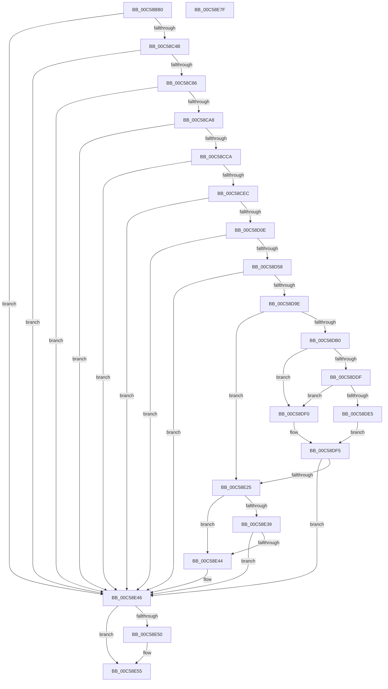

# CmpSetSystemValues

- RVA: `0x00C58BB0`–`0x00C58E80` (길이 `720` bytes)
- VA: `0x0000000140C58BB0`
- 실행 섹션: `INIT`
- PDB 이름 있음: `예`; PDB Function 태그: `아니요`
- unwind 정보 RVA: `0x000D62F8`
- 디코드: `161`개 명령, `720/720` bytes 표시
- 미해석 바이트: `0` (있으면 어셈블리에 `.byte`로 보존)

> 이 문서는 커널 이미지의 기계어와 PDB 기호를 분석해 생성했습니다. 4번과 5번은 함수 원형과 자료형을 바이너리 사용 방식에서 추정한 C 해석이며 원본 소스 복구 결과는 아닙니다.

## 1. Dependencies

- 직접 호출 지점: **13**; 고유 호출 대상: **7**
- 직접 호출자로 확인된 함수: **1**
- RIP 상대 이미지 참조: **12**

### Outgoing calls
- `0x00C58C3C` → [ZwOpenKey](../../text/6A/ZwOpenKey_function_006AD310.md) (function, `0x006AD310`)
- `0x00C58C77` → [ZwSetValueKey](../../text/6A/ZwSetValueKey_function_006ADCD0.md) (function, `0x006ADCD0`)
- `0x00C58C99` → [CmpSetSystemRegistryString](../../text/66/CmpSetSystemRegistryString_function_0066A2F0.md) (function, `0x0066A2F0`)
- `0x00C58CBB` → [CmpSetSystemRegistryString](../../text/66/CmpSetSystemRegistryString_function_0066A2F0.md) (function, `0x0066A2F0`)
- `0x00C58CDD` → [CmpSetSystemRegistryString](../../text/66/CmpSetSystemRegistryString_function_0066A2F0.md) (function, `0x0066A2F0`)
- `0x00C58CFF` → [CmpSetSystemRegistryString](../../text/66/CmpSetSystemRegistryString_function_0066A2F0.md) (function, `0x0066A2F0`)
- `0x00C58D49` → [ZwSetValueKey](../../text/6A/ZwSetValueKey_function_006ADCD0.md) (function, `0x006ADCD0`)
- `0x00C58D8F` → [ZwSetValueKey](../../text/6A/ZwSetValueKey_function_006ADCD0.md) (function, `0x006ADCD0`)
- `0x00C58DD6` → [ZwQueryValueKey](../../text/6A/ZwQueryValueKey_function_006AD3B0.md) (function, `0x006AD3B0`)
- `0x00C58E1A` → [ZwSetValueKey](../../text/6A/ZwSetValueKey_function_006ADCD0.md) (function, `0x006ADCD0`)
- `0x00C58E39` → [BcdSetBootBcdAsSystemStore](../C6/BcdSetBootBcdAsSystemStore_function_00C6D214.md) (function, `0x00C6D214`)
- `0x00C58E50` → [ZwClose](../../text/6A/ZwClose_function_006AD2B0.md) (function, `0x006AD2B0`)
- `0x00C58E61` → [_security_check_cookie](../../text/6A/_security_check_cookie_function_006AC640.md) (function, `0x006AC640`)

### Direct callers
- [CmInitSystem1](CmInitSystem1_function_00C559CC.md) at `0x00C562F6`

### Static image references
- `0x00C58BCE` → RVA `0x00E0A740` (`.data`; read)
- `0x00C58BE4` → RVA `0x00C824A0` (`CmpControlPathString`; read)
- `0x00C58C4B` → RVA `0x010086D8` (`INITDATA`; read)
- `0x00C58C52` → RVA `0x00C82370` (`CmpSystemStartOptionsString`; read)
- `0x00C58C6B` → RVA `0x010086E0` (`INITDATA`; read)
- `0x00C58C8D` → RVA `0x00C82410` (`CmpSystemBootDeviceString`; read)
- `0x00C58CAF` → RVA `0x00C82430` (`CmpFirmwareBootDeviceString`; read)
- `0x00C58CD1` → RVA `0x00C82390` (`CmpWindowsSysPartString`; read)
- `0x00C58CF3` → RVA `0x00C82480` (`CmpOsBootstatPathString`; read)
- `0x00C58D15` → RVA `0x00C82470` (`CmpLastBootSucceededString`; read)
- `0x00C58D5F` → RVA `0x00C82460` (`CmpLastBootShutdownString`; read)
- `0x00C58DCF` → RVA `0x00C82200` (`CmpDirtyShutdownCountString`; read)

## 2. Other-region calls and transfers

- 다른 실행 섹션으로 향하는 call: **12**
  - `0x00C58C3C` → [ZwOpenKey](../../text/6A/ZwOpenKey_function_006AD310.md) (`INIT` → `.text`)
  - `0x00C58C77` → [ZwSetValueKey](../../text/6A/ZwSetValueKey_function_006ADCD0.md) (`INIT` → `.text`)
  - `0x00C58C99` → [CmpSetSystemRegistryString](../../text/66/CmpSetSystemRegistryString_function_0066A2F0.md) (`INIT` → `.text`)
  - `0x00C58CBB` → [CmpSetSystemRegistryString](../../text/66/CmpSetSystemRegistryString_function_0066A2F0.md) (`INIT` → `.text`)
  - `0x00C58CDD` → [CmpSetSystemRegistryString](../../text/66/CmpSetSystemRegistryString_function_0066A2F0.md) (`INIT` → `.text`)
  - `0x00C58CFF` → [CmpSetSystemRegistryString](../../text/66/CmpSetSystemRegistryString_function_0066A2F0.md) (`INIT` → `.text`)
  - `0x00C58D49` → [ZwSetValueKey](../../text/6A/ZwSetValueKey_function_006ADCD0.md) (`INIT` → `.text`)
  - `0x00C58D8F` → [ZwSetValueKey](../../text/6A/ZwSetValueKey_function_006ADCD0.md) (`INIT` → `.text`)
  - `0x00C58DD6` → [ZwQueryValueKey](../../text/6A/ZwQueryValueKey_function_006AD3B0.md) (`INIT` → `.text`)
  - `0x00C58E1A` → [ZwSetValueKey](../../text/6A/ZwSetValueKey_function_006ADCD0.md) (`INIT` → `.text`)
  - `0x00C58E50` → [ZwClose](../../text/6A/ZwClose_function_006AD2B0.md) (`INIT` → `.text`)
  - `0x00C58E61` → [_security_check_cookie](../../text/6A/_security_check_cookie_function_006AC640.md) (`INIT` → `.text`)
- 별도 외부 분기/꼬리 이동을 확인하지 못했습니다.

## 3. Assembly (complete function range)

```asm
00C58BB0  48 8B C4                        mov rax, rsp
00C58BB3  48 89 58 10                     mov qword ptr [rax + 0x10], rbx
00C58BB7  48 89 78 18                     mov qword ptr [rax + 0x18], rdi
00C58BBB  4C 89 78 20                     mov qword ptr [rax + 0x20], r15
00C58BBF  55                              push rbp
00C58BC0  48 8D A8 68 FF FF FF            lea rbp, [rax - 0x98]
00C58BC7  48 81 EC 90 01 00 00            sub rsp, 0x190
00C58BCE  48 8B 05 6B 1B 1B 00            mov rax, qword ptr [rip + 0x1b1b6b]
00C58BD5  48 33 C4                        xor rax, rsp
00C58BD8  48 89 85 80 00 00 00            mov qword ptr [rbp + 0x80], rax
00C58BDF  83 64 24 38 00                  and dword ptr [rsp + 0x38], 0
00C58BE4  48 8D 05 B5 98 02 00            lea rax, [rip + 0x298b5]
00C58BEB  83 64 24 3C 00                  and dword ptr [rsp + 0x3c], 0
00C58BF0  4C 8D 44 24 48                  lea r8, [rsp + 0x48]
00C58BF5  83 64 24 40 00                  and dword ptr [rsp + 0x40], 0
00C58BFA  48 8B F9                        mov rdi, rcx
00C58BFD  83 64 24 64 00                  and dword ptr [rsp + 0x64], 0
00C58C02  48 8D 4C 24 30                  lea rcx, [rsp + 0x30]
00C58C07  48 83 64 24 30 00               and qword ptr [rsp + 0x30], 0
00C58C0D  0F 57 C0                        xorps xmm0, xmm0
00C58C10  48 83 64 24 50 00               and qword ptr [rsp + 0x50], 0
00C58C16  BA 3F 00 0F 00                  mov edx, 0xf003f
00C58C1B  48 C7 44 24 48 30 00 00 00      mov qword ptr [rsp + 0x48], 0x30
00C58C24  83 64 24 4C 00                  and dword ptr [rsp + 0x4c], 0
00C58C29  48 89 44 24 58                  mov qword ptr [rsp + 0x58], rax
00C58C2E  F3 0F 7F 44 24 68               movdqu xmmword ptr [rsp + 0x68], xmm0
00C58C34  C7 44 24 60 40 02 00 00         mov dword ptr [rsp + 0x60], 0x240
00C58C3C  E8 CF 46 A5 FF                  call 0x1406ad310
00C58C41  8B D8                           mov ebx, eax
00C58C43  85 C0                           test eax, eax
00C58C45  0F 88 FB 01 00 00               js 0x140c58e46
00C58C4B  0F B7 05 86 FA 3A 00            movzx eax, word ptr [rip + 0x3afa86]
00C58C52  48 8D 15 17 97 02 00            lea rdx, [rip + 0x29717]
00C58C59  48 8B 4C 24 30                  mov rcx, qword ptr [rsp + 0x30]
00C58C5E  41 B9 01 00 00 00               mov r9d, 1
00C58C64  89 44 24 28                     mov dword ptr [rsp + 0x28], eax
00C58C68  45 33 C0                        xor r8d, r8d
00C58C6B  48 8B 05 6E FA 3A 00            mov rax, qword ptr [rip + 0x3afa6e]
00C58C72  48 89 44 24 20                  mov qword ptr [rsp + 0x20], rax
00C58C77  E8 54 50 A5 FF                  call 0x1406adcd0
00C58C7C  8B D8                           mov ebx, eax
00C58C7E  85 C0                           test eax, eax
00C58C80  0F 88 C0 01 00 00               js 0x140c58e46
00C58C86  4C 8B 87 B8 00 00 00            mov r8, qword ptr [rdi + 0xb8]
00C58C8D  48 8D 15 7C 97 02 00            lea rdx, [rip + 0x2977c]
00C58C94  48 8B 4C 24 30                  mov rcx, qword ptr [rsp + 0x30]
00C58C99  E8 52 16 A1 FF                  call 0x14066a2f0
00C58C9E  8B D8                           mov ebx, eax
00C58CA0  85 C0                           test eax, eax
00C58CA2  0F 88 9E 01 00 00               js 0x140c58e46
00C58CA8  4C 8B 87 C0 00 00 00            mov r8, qword ptr [rdi + 0xc0]
00C58CAF  48 8D 15 7A 97 02 00            lea rdx, [rip + 0x2977a]
00C58CB6  48 8B 4C 24 30                  mov rcx, qword ptr [rsp + 0x30]
00C58CBB  E8 30 16 A1 FF                  call 0x14066a2f0
00C58CC0  8B D8                           mov ebx, eax
00C58CC2  85 C0                           test eax, eax
00C58CC4  0F 88 7C 01 00 00               js 0x140c58e46
00C58CCA  4C 8B 87 58 01 00 00            mov r8, qword ptr [rdi + 0x158]
00C58CD1  48 8D 15 B8 96 02 00            lea rdx, [rip + 0x296b8]
00C58CD8  48 8B 4C 24 30                  mov rcx, qword ptr [rsp + 0x30]
00C58CDD  E8 0E 16 A1 FF                  call 0x14066a2f0
00C58CE2  8B D8                           mov ebx, eax
00C58CE4  85 C0                           test eax, eax
00C58CE6  0F 88 5A 01 00 00               js 0x140c58e46
00C58CEC  4C 8B 87 48 01 00 00            mov r8, qword ptr [rdi + 0x148]
00C58CF3  48 8D 15 86 97 02 00            lea rdx, [rip + 0x29786]
00C58CFA  48 8B 4C 24 30                  mov rcx, qword ptr [rsp + 0x30]
00C58CFF  E8 EC 15 A1 FF                  call 0x14066a2f0
00C58D04  8B D8                           mov ebx, eax
00C58D06  85 C0                           test eax, eax
00C58D08  0F 88 38 01 00 00               js 0x140c58e46
00C58D0E  48 8B 87 F0 00 00 00            mov rax, qword ptr [rdi + 0xf0]
00C58D15  48 8D 15 54 97 02 00            lea rdx, [rip + 0x29754]
00C58D1C  41 BF 04 00 00 00               mov r15d, 4
00C58D22  45 33 C0                        xor r8d, r8d
00C58D25  44 89 7C 24 28                  mov dword ptr [rsp + 0x28], r15d
00C58D2A  45 8B CF                        mov r9d, r15d
00C58D2D  8B 88 84 00 00 00               mov ecx, dword ptr [rax + 0x84]
00C58D33  48 8D 44 24 38                  lea rax, [rsp + 0x38]
00C58D38  83 E1 01                        and ecx, 1
00C58D3B  48 89 44 24 20                  mov qword ptr [rsp + 0x20], rax
00C58D40  89 4C 24 38                     mov dword ptr [rsp + 0x38], ecx
00C58D44  48 8B 4C 24 30                  mov rcx, qword ptr [rsp + 0x30]
00C58D49  E8 82 4F A5 FF                  call 0x1406adcd0
00C58D4E  8B D8                           mov ebx, eax
00C58D50  85 C0                           test eax, eax
00C58D52  0F 88 EE 00 00 00               js 0x140c58e46
00C58D58  48 8B 87 F0 00 00 00            mov rax, qword ptr [rdi + 0xf0]
00C58D5F  48 8D 15 FA 96 02 00            lea rdx, [rip + 0x296fa]
00C58D66  44 89 7C 24 28                  mov dword ptr [rsp + 0x28], r15d
00C58D6B  45 8B CF                        mov r9d, r15d
00C58D6E  45 33 C0                        xor r8d, r8d
00C58D71  8B 88 84 00 00 00               mov ecx, dword ptr [rax + 0x84]
00C58D77  48 8D 44 24 38                  lea rax, [rsp + 0x38]
00C58D7C  D1 E9                           shr ecx, 1
00C58D7E  83 E1 01                        and ecx, 1
00C58D81  48 89 44 24 20                  mov qword ptr [rsp + 0x20], rax
00C58D86  89 4C 24 38                     mov dword ptr [rsp + 0x38], ecx
00C58D8A  48 8B 4C 24 30                  mov rcx, qword ptr [rsp + 0x30]
00C58D8F  E8 3C 4F A5 FF                  call 0x1406adcd0
00C58D94  8B D8                           mov ebx, eax
00C58D96  85 C0                           test eax, eax
00C58D98  0F 88 A8 00 00 00               js 0x140c58e46
00C58D9E  48 8B 87 F0 00 00 00            mov rax, qword ptr [rdi + 0xf0]
00C58DA5  8B 88 84 00 00 00               mov ecx, dword ptr [rax + 0x84]
00C58DAB  F6 C1 02                        test cl, 2
00C58DAE  75 75                           jne 0x140c58e25
00C58DB0  48 8B 4C 24 30                  mov rcx, qword ptr [rsp + 0x30]
00C58DB5  48 8D 44 24 40                  lea rax, [rsp + 0x40]
00C58DBA  48 89 44 24 28                  mov qword ptr [rsp + 0x28], rax
00C58DBF  4C 8D 4D 80                     lea r9, [rbp - 0x80]
00C58DC3  45 8D 47 FD                     lea r8d, [r15 - 3]
00C58DC7  C7 44 24 20 00 01 00 00         mov dword ptr [rsp + 0x20], 0x100
00C58DCF  48 8D 15 2A 94 02 00            lea rdx, [rip + 0x2942a]
00C58DD6  E8 D5 45 A5 FF                  call 0x1406ad3b0
00C58DDB  85 C0                           test eax, eax
00C58DDD  78 11                           js 0x140c58df0
00C58DDF  44 39 7D 84                     cmp dword ptr [rbp - 0x7c], r15d
00C58DE3  75 0B                           jne 0x140c58df0
00C58DE5  8B 45 88                        mov eax, dword ptr [rbp - 0x78]
00C58DE8  8B 4C 05 80                     mov ecx, dword ptr [rbp + rax - 0x80]
00C58DEC  FF C1                           inc ecx
00C58DEE  EB 05                           jmp 0x140c58df5
00C58DF0  B9 01 00 00 00                  mov ecx, 1
00C58DF5  89 4C 24 3C                     mov dword ptr [rsp + 0x3c], ecx
00C58DF9  48 8D 44 24 3C                  lea rax, [rsp + 0x3c]
00C58DFE  48 8B 4C 24 30                  mov rcx, qword ptr [rsp + 0x30]
00C58E03  48 8D 15 F6 93 02 00            lea rdx, [rip + 0x293f6]
00C58E0A  44 89 7C 24 28                  mov dword ptr [rsp + 0x28], r15d
00C58E0F  45 8B CF                        mov r9d, r15d
00C58E12  45 33 C0                        xor r8d, r8d
00C58E15  48 89 44 24 20                  mov qword ptr [rsp + 0x20], rax
00C58E1A  E8 B1 4E A5 FF                  call 0x1406adcd0
00C58E1F  8B D8                           mov ebx, eax
00C58E21  85 C0                           test eax, eax
00C58E23  78 21                           js 0x140c58e46
00C58E25  48 8B 87 F0 00 00 00            mov rax, qword ptr [rdi + 0xf0]
00C58E2C  8B 88 58 0A 00 00               mov ecx, dword ptr [rax + 0xa58]
00C58E32  48 0F BA E1 10                  bt rcx, 0x10
00C58E37  73 0B                           jae 0x140c58e44
00C58E39  E8 D6 43 01 00                  call 0x140c6d214
00C58E3E  8B D8                           mov ebx, eax
00C58E40  85 C0                           test eax, eax
00C58E42  78 02                           js 0x140c58e46
00C58E44  33 DB                           xor ebx, ebx
00C58E46  48 8B 4C 24 30                  mov rcx, qword ptr [rsp + 0x30]
00C58E4B  48 85 C9                        test rcx, rcx
00C58E4E  74 05                           je 0x140c58e55
00C58E50  E8 5B 44 A5 FF                  call 0x1406ad2b0
00C58E55  8B C3                           mov eax, ebx
00C58E57  48 8B 8D 80 00 00 00            mov rcx, qword ptr [rbp + 0x80]
00C58E5E  48 33 CC                        xor rcx, rsp
00C58E61  E8 DA 37 A5 FF                  call 0x1406ac640
00C58E66  4C 8D 9C 24 90 01 00 00         lea r11, [rsp + 0x190]
00C58E6E  49 8B 5B 18                     mov rbx, qword ptr [r11 + 0x18]
00C58E72  49 8B 7B 20                     mov rdi, qword ptr [r11 + 0x20]
00C58E76  4D 8B 7B 28                     mov r15, qword ptr [r11 + 0x28]
00C58E7A  49 8B E3                        mov rsp, r11
00C58E7D  5D                              pop rbp
00C58E7E  C3                              ret
00C58E7F  CC                              int3
```

## 4. C-style interpretation (structured pseudocode)

```c
__int64 __fastcall CmpSetSystemValues(__int64 a1)
{
    __int64 result;
    __int64 v_rbx;
    __int64 v_rsp;
    unsigned __int64 v_stack_m130;
    unsigned int v_stack_m134;
    unsigned int v_stack_m138;
    unsigned __int64 v_stack_m140;
    unsigned __int64 v_stack_m148;
    unsigned int v_stack_m14C;
    unsigned __int64 v_stack_m150;
    unsigned int v_stack_m158;
    unsigned int v_stack_m15C;
    unsigned int v_stack_m160;
    unsigned __int64 v_stack_m168;
    unsigned int v_stack_m170;
    unsigned __int64 v_stack_m178;
    unsigned __int64 v_stack_m8;

    *(unsigned __int64 *)(v_rsp + 16) = v_rbx;
    *(unsigned __int64 *)(v_rsp + 24) = v_rdi;
    *(unsigned __int64 *)(v_rsp + 32) = v_r15;
    v_rsp = (v_rsp) - (400);
    result = (*(unsigned __int64 *)(v_rip + 1776491)) ^ (v_rsp);
    *(unsigned __int64 *)(v_rsp - 152 + 128) = result;
    v_stack_m150 = 48;
    v_stack_m140 = v_rip + 170165;
    v_stack_m130 = v_xmm0;
    v_stack_m138 = 576;
    result = ZwOpenKey(v_stack_m168, (unsigned int)(0xF003FULL), v_stack_m150, a4);
    if (sign_flag) goto loc_00C58E46;
    v_stack_m170 = (unsigned int)(*(unsigned __int16 *)(v_rip + 3865222));
    a3 = 0;
    v_stack_m178 = *(unsigned __int64 *)(v_rip + 3865198);
    result = ZwSetValueKey(v_stack_m168, v_rip + 169751, a3, 1);
    if (sign_flag) goto loc_00C58E46;
    result = CmpSetSystemRegistryString(v_stack_m168, v_rip + 169852, *(unsigned __int64 *)(a1 + 184), 1);
    if (sign_flag) goto loc_00C58E46;
    result = CmpSetSystemRegistryString(v_stack_m168, v_rip + 169850, *(unsigned __int64 *)(a1 + 192), 1);
    if (sign_flag) goto loc_00C58E46;
    result = CmpSetSystemRegistryString(v_stack_m168, v_rip + 169656, *(unsigned __int64 *)(a1 + 344), 1);
    if (sign_flag) goto loc_00C58E46;
    result = CmpSetSystemRegistryString(v_stack_m168, v_rip + 169862, *(unsigned __int64 *)(a1 + 328), 1);
    if (sign_flag) goto loc_00C58E46;
    a3 = 0;
    v_stack_m170 = 4;
    a1 = (unsigned int)(((unsigned int)(*(unsigned int *)(*(unsigned __int64 *)(a1 + 240) + 132))) & (1));
    v_stack_m178 = v_stack_m160;
    v_stack_m160 = (unsigned int)(a1);
    result = ZwSetValueKey(v_stack_m168, v_rip + 169812, a3, 4);
    if (sign_flag) goto loc_00C58E46;
    v_stack_m170 = 4;
    a3 = 0;
    a1 = (unsigned int)(((unsigned int)(*(unsigned int *)(*(unsigned __int64 *)(a1 + 240) + 132))) >> (1));
    a1 = (unsigned int)((a1) & (1));
    v_stack_m178 = v_stack_m160;
    v_stack_m160 = (unsigned int)(a1);
    result = ZwSetValueKey(v_stack_m168, v_rip + 169722, a3, 4);
    if (sign_flag) goto loc_00C58E46;
    if ((((unsigned __int8)((unsigned int)(*(unsigned int *)(*(unsigned __int64 *)(a1 + 240) + 132)))) & (2)) != 0) goto loc_00C58E25;
    v_stack_m170 = v_stack_m158;
    v_stack_m178 = 256;
    result = ZwQueryValueKey(v_stack_m168, v_rip + 169002, 4 - 3, v_rsp - 152 - 128);
    if (sign_flag) goto loc_00C58DF0;
    if ((*(unsigned int *)(v_rsp - 152 - 124)) != 4) goto loc_00C58DF0;
    a1 = (unsigned int)(((unsigned int)(*(unsigned int *)(v_rsp - 152 + (unsigned int)(*(unsigned int *)(v_rsp - 152 - 120)) * 1 - 128))) + 1);
    goto loc_00C58DF5;
loc_00C58DF0:
loc_00C58DF5:
    v_stack_m15C = 1;
    v_stack_m170 = 4;
    a3 = 0;
    v_stack_m178 = v_stack_m15C;
    result = ZwSetValueKey(v_stack_m168, v_rip + 168950, a3, 4);
    if (sign_flag) goto loc_00C58E46;
loc_00C58E25:
    if (condition_is_above_or_equal) goto loc_00C58E44;
    result = BcdSetBootBcdAsSystemStore((unsigned int)(*(unsigned int *)(*(unsigned __int64 *)(a1 + 240) + 2648)), v_rip + 168950, a3, 4);
    v_rbx = (unsigned int)((unsigned int)(result));
    if (!(sign_flag)) {
        v_rbx = 0;
    }
    if (v_stack_m168 != 0) {
        result = ZwClose(v_stack_m168, v_rip + 168950, a3, 4);
    }
    a1 = (*(unsigned __int64 *)(v_rsp - 152 + 128)) ^ (v_rsp);
    result = _security_check_cookie(a1, v_rip + 168950, a3, 4);
    return result;
}
```

## 5. (Beta) C Style

```c
int64_t CmpSetSystemValues(void *Arg1)
{
    uint8_t *arg1 = (uint8_t *)Arg1;

    int64_t result;
    int64_t local_rbx;
    int64_t local_rsp;
    uint64_t v_stack_m130;
    uint32_t v_stack_m134;
    uint32_t v_stack_m138;
    uint64_t v_stack_m140;
    uint64_t v_stack_m148;
    uint32_t v_stack_m14C;
    uint64_t v_stack_m150;
    uint32_t v_stack_m158;
    uint32_t v_stack_m15C;
    uint32_t v_stack_m160;
    uint64_t v_stack_m168;
    uint32_t v_stack_m170;
    uint64_t v_stack_m178;
    uint64_t v_stack_m8;

    *(uint64_t *)(local_rsp + 0x10) = local_rbx;
    *(uint64_t *)(local_rsp + 0x18) = local_rdi;
    *(uint64_t *)(local_rsp + 0x20) = local_r15;
    local_rsp = (local_rsp) - (400);
    result = (*(uint64_t *)(v_rip + 0x1B1B6B)) ^ (local_rsp);
    *(uint64_t *)(local_rsp - 0x98 + 0x80) = result;
    v_stack_m150 = 48;
    v_stack_m140 = v_rip + 170165;
    v_stack_m130 = v_xmm0;
    v_stack_m138 = 576;
    result = ZwOpenKey(v_stack_m168, (uint32_t)(0xF003FULL), v_stack_m150, a4);
    if (sign_flag) goto loc_00C58E46;
    v_stack_m170 = (uint32_t)(*(uint16_t *)(v_rip + 0x3AFA86));
    a3 = 0;
    v_stack_m178 = *(uint64_t *)(v_rip + 0x3AFA6E);
    result = ZwSetValueKey(v_stack_m168, v_rip + 169751, a3, 1);
    if (sign_flag) goto loc_00C58E46;
    result = CmpSetSystemRegistryString(v_stack_m168, v_rip + 169852, *(uint64_t *)(arg1 + 0xB8), 1);
    if (sign_flag) goto loc_00C58E46;
    result = CmpSetSystemRegistryString(v_stack_m168, v_rip + 169850, *(uint64_t *)(arg1 + 0xC0), 1);
    if (sign_flag) goto loc_00C58E46;
    result = CmpSetSystemRegistryString(v_stack_m168, v_rip + 169656, *(uint64_t *)(arg1 + 0x158), 1);
    if (sign_flag) goto loc_00C58E46;
    result = CmpSetSystemRegistryString(v_stack_m168, v_rip + 169862, *(uint64_t *)(arg1 + 0x148), 1);
    if (sign_flag) goto loc_00C58E46;
    a3 = 0;
    v_stack_m170 = 4;
    Arg1 = (uint32_t)(((uint32_t)(*(uint32_t *)(*(uint64_t *)(arg1 + 0xF0) + 0x84))) & (1));
    v_stack_m178 = v_stack_m160;
    v_stack_m160 = (uint32_t)(Arg1);
    result = ZwSetValueKey(v_stack_m168, v_rip + 169812, a3, 4);
    if (sign_flag) goto loc_00C58E46;
    v_stack_m170 = 4;
    a3 = 0;
    Arg1 = (uint32_t)(((uint32_t)(*(uint32_t *)(*(uint64_t *)(arg1 + 0xF0) + 0x84))) >> (1));
    Arg1 = (uint32_t)((Arg1) & (1));
    v_stack_m178 = v_stack_m160;
    v_stack_m160 = (uint32_t)(Arg1);
    result = ZwSetValueKey(v_stack_m168, v_rip + 169722, a3, 4);
    if (sign_flag) goto loc_00C58E46;
    if ((((uint8_t)((uint32_t)(*(uint32_t *)(*(uint64_t *)(arg1 + 0xF0) + 0x84)))) & (2)) != 0) goto loc_00C58E25;
    v_stack_m170 = v_stack_m158;
    v_stack_m178 = 256;
    result = ZwQueryValueKey(v_stack_m168, v_rip + 169002, 4 - 3, local_rsp - 152 - 128);
    if (sign_flag) goto loc_00C58DF0;
    if ((*(uint32_t *)(local_rsp - 0x98 - 0x7C)) != 4) goto loc_00C58DF0;
    Arg1 = (uint32_t)(((uint32_t)(*(uint32_t *)(local_rsp - 0x98 + (uint32_t)(*(uint32_t *)(local_rsp - 0x98 - 0x78)) * 1 - 0x80))) + 1);
    goto loc_00C58DF5;
loc_00C58DF0:
loc_00C58DF5:
    v_stack_m15C = 1;
    v_stack_m170 = 4;
    a3 = 0;
    v_stack_m178 = v_stack_m15C;
    result = ZwSetValueKey(v_stack_m168, v_rip + 168950, a3, 4);
    if (sign_flag) goto loc_00C58E46;
loc_00C58E25:
    if (condition_is_above_or_equal) goto loc_00C58E44;
    result = BcdSetBootBcdAsSystemStore((uint32_t)(*(uint32_t *)(*(uint64_t *)(arg1 + 0xF0) + 0xA58)), v_rip + 168950, a3, 4);
    local_rbx = (uint32_t)((uint32_t)(result));
    if (!(sign_flag)) {
        local_rbx = 0;
    }
    if (v_stack_m168 != 0) {
        result = ZwClose(v_stack_m168, v_rip + 168950, a3, 4);
    }
    Arg1 = (*(uint64_t *)(local_rsp - 0x98 + 0x80)) ^ (local_rsp);
    result = _security_check_cookie(Arg1, v_rip + 168950, a3, 4);
    return result;
}
```

### 관측된 메모리 오프셋

구조체 형식이 확인되지 않은 접근은 인자 기준의 오프셋으로만 기록했습니다.

| 기준 인자 | 오프셋 표현 | 폭 (bit) | 접근 |
|---|---:|---:|---|
| `Arg1` | `+ 0xB8` | `64` | `R` |
| `Arg1` | `+ 0xC0` | `64` | `R` |
| `Arg1` | `+ 0xF0` | `64` | `R` |
| `Arg1` | `+ 0x148` | `64` | `R` |
| `Arg1` | `+ 0x158` | `64` | `R` |

## 6. Execution-region graph

[열기: 2D/3D 그래프와 함수 탐색 컨트롤 패널](../../../control-panel.html?section=init&rva=0x00C58BB0&view=graph)

- 2D 그래프는 위에서 아래로 흐르고, 3D 그래프는 빈 공간을 드래그해 회전합니다. Shift+드래그는 이동, 휠은 확대·축소, 함수 노드 선택은 대상 보고서 이동입니다.

### Static fallback


