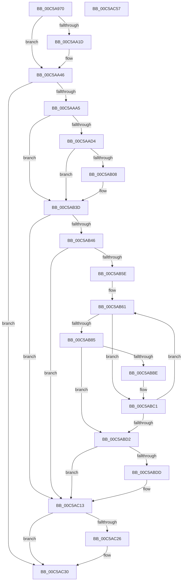

# CmpSetVideoBiosInformation

- RVA: `0x00C5A970`–`0x00C5AC58` (길이 `744` bytes)
- VA: `0x0000000140C5A970`
- 실행 섹션: `INIT`
- PDB 이름 있음: `예`; PDB Function 태그: `아니요`
- unwind 정보 RVA: `0x000CCBA4`
- 디코드: `188`개 명령, `744/744` bytes 표시
- 미해석 바이트: `0` (있으면 어셈블리에 `.byte`로 보존)

> 이 문서는 커널 이미지의 기계어와 PDB 기호를 분석해 생성했습니다. 4번과 5번은 함수 원형과 자료형을 바이너리 사용 방식에서 추정한 C 해석이며 원본 소스 복구 결과는 아닙니다.

## 1. Dependencies

- 직접 호출 지점: **21**; 고유 호출 대상: **13**
- 직접 호출자로 확인된 함수: **1**
- RIP 상대 이미지 참조: **3**

### Outgoing calls
- `0x00C5AA0F` → [ZwMapViewOfSection](../../text/6A/ZwMapViewOfSection_function_006AD5D0.md) (function, `0x006AD5D0`)
- `0x00C5AA41` → [ZwUnmapViewOfSection](../../text/6A/ZwUnmapViewOfSection_function_006AD610.md) (function, `0x006AD610`)
- `0x00C5AA98` → [ZwMapViewOfSection](../../text/6A/ZwMapViewOfSection_function_006AD5D0.md) (function, `0x006AD5D0`)
- `0x00C5AAB5` → [ExAllocatePool2](../../poolcode/B8/ExAllocatePool2_function_00B820F0.md) (function, `0x00B820F0`)
- `0x00C5AACB` → [CmpGetBiosDate](CmpGetBiosDate_function_00C59C80.md) (function, `0x00C59C80`)
- `0x00C5AADF` → [RtlInitUnicodeString](../../text/42/RtlInitUnicodeString_function_0042A780.md) (function, `0x0042A780`)
- `0x00C5AAED` → [RtlInitAnsiString](../../text/47/RtlInitAnsiString_function_00470F40.md) (function, `0x00470F40`)
- `0x00C5AAFF` → [RtlAnsiStringToUnicodeString](../../page/90/RtlAnsiStringToUnicodeString_function_0090BEA0.md) (function, `0x0090BEA0`)
- `0x00C5AB2E` → [ZwSetValueKey](../../text/6A/ZwSetValueKey_function_006ADCD0.md) (function, `0x006ADCD0`)
- `0x00C5AB38` → [RtlFreeAnsiString](../../page/9C/RtlFreeAnsiString_function_009C0800.md) (function, `0x009C0800`)
- `0x00C5AB51` → [CmpGetBiosVersion](CmpGetBiosVersion_function_00C59E90.md) (function, `0x00C59E90`)
- `0x00C5AB6A` → [RtlInitAnsiString](../../text/47/RtlInitAnsiString_function_00470F40.md) (function, `0x00470F40`)
- `0x00C5AB7C` → [RtlAnsiStringToUnicodeString](../../page/90/RtlAnsiStringToUnicodeString_function_0090BEA0.md) (function, `0x0090BEA0`)
- `0x00C5AB9B` → [memcpy](../../text/6C/memcpy_function_006C6840.md) (function, `0x006C6840`)
- `0x00C5ABA8` → [RtlFreeAnsiString](../../page/9C/RtlFreeAnsiString_function_009C0800.md) (function, `0x009C0800`)
- `0x00C5ABC9` → [CmpGetBiosVersion](CmpGetBiosVersion_function_00C59E90.md) (function, `0x00C59E90`)
- `0x00C5ABEC` → [RtlInitUnicodeString](../../text/42/RtlInitUnicodeString_function_0042A780.md) (function, `0x0042A780`)
- `0x00C5AC0E` → [ZwSetValueKey](../../text/6A/ZwSetValueKey_function_006ADCD0.md) (function, `0x006ADCD0`)
- `0x00C5AC1C` → [ZwUnmapViewOfSection](../../text/6A/ZwUnmapViewOfSection_function_006AD610.md) (function, `0x006AD610`)
- `0x00C5AC2B` → [ExFreePoolWithTag](../../poolcode/B8/ExFreePoolWithTag_function_00B82870.md) (function, `0x00B82870`)
- `0x00C5AC37` → [_security_check_cookie](../../text/6A/_security_check_cookie_function_006AC640.md) (function, `0x006AC640`)

### Direct callers
- [CmpInitializeMachineDependentConfiguration](CmpInitializeMachineDependentConfiguration_function_00C5A02C.md) at `0x00C5A57F`

### Static image references
- `0x00C5A98C` → RVA `0x00E0A740` (`.data`; read)
- `0x00C5AAD4` → RVA `0x00C7E510` (` ?? ::PBOPGDP::`string'`; read)
- `0x00C5ABDD` → RVA `0x00C7E530` (` ?? ::PBOPGDP::`string'`; read)

## 2. Other-region calls and transfers

- 다른 실행 섹션으로 향하는 call: **18**
  - `0x00C5AA0F` → [ZwMapViewOfSection](../../text/6A/ZwMapViewOfSection_function_006AD5D0.md) (`INIT` → `.text`)
  - `0x00C5AA41` → [ZwUnmapViewOfSection](../../text/6A/ZwUnmapViewOfSection_function_006AD610.md) (`INIT` → `.text`)
  - `0x00C5AA98` → [ZwMapViewOfSection](../../text/6A/ZwMapViewOfSection_function_006AD5D0.md) (`INIT` → `.text`)
  - `0x00C5AAB5` → [ExAllocatePool2](../../poolcode/B8/ExAllocatePool2_function_00B820F0.md) (`INIT` → `POOLCODE`)
  - `0x00C5AADF` → [RtlInitUnicodeString](../../text/42/RtlInitUnicodeString_function_0042A780.md) (`INIT` → `.text`)
  - `0x00C5AAED` → [RtlInitAnsiString](../../text/47/RtlInitAnsiString_function_00470F40.md) (`INIT` → `.text`)
  - `0x00C5AAFF` → [RtlAnsiStringToUnicodeString](../../page/90/RtlAnsiStringToUnicodeString_function_0090BEA0.md) (`INIT` → `PAGE`)
  - `0x00C5AB2E` → [ZwSetValueKey](../../text/6A/ZwSetValueKey_function_006ADCD0.md) (`INIT` → `.text`)
  - `0x00C5AB38` → [RtlFreeAnsiString](../../page/9C/RtlFreeAnsiString_function_009C0800.md) (`INIT` → `PAGE`)
  - `0x00C5AB6A` → [RtlInitAnsiString](../../text/47/RtlInitAnsiString_function_00470F40.md) (`INIT` → `.text`)
  - `0x00C5AB7C` → [RtlAnsiStringToUnicodeString](../../page/90/RtlAnsiStringToUnicodeString_function_0090BEA0.md) (`INIT` → `PAGE`)
  - `0x00C5AB9B` → [memcpy](../../text/6C/memcpy_function_006C6840.md) (`INIT` → `.text`)
  - `0x00C5ABA8` → [RtlFreeAnsiString](../../page/9C/RtlFreeAnsiString_function_009C0800.md) (`INIT` → `PAGE`)
  - `0x00C5ABEC` → [RtlInitUnicodeString](../../text/42/RtlInitUnicodeString_function_0042A780.md) (`INIT` → `.text`)
  - `0x00C5AC0E` → [ZwSetValueKey](../../text/6A/ZwSetValueKey_function_006ADCD0.md) (`INIT` → `.text`)
  - `0x00C5AC1C` → [ZwUnmapViewOfSection](../../text/6A/ZwUnmapViewOfSection_function_006AD610.md) (`INIT` → `.text`)
  - `0x00C5AC2B` → [ExFreePoolWithTag](../../poolcode/B8/ExFreePoolWithTag_function_00B82870.md) (`INIT` → `POOLCODE`)
  - `0x00C5AC37` → [_security_check_cookie](../../text/6A/_security_check_cookie_function_006AC640.md) (`INIT` → `.text`)
- 별도 외부 분기/꼬리 이동을 확인하지 못했습니다.

## 3. Assembly (complete function range)

```asm
00C5A970  48 89 5C 24 18                  mov qword ptr [rsp + 0x18], rbx
00C5A975  55                              push rbp
00C5A976  56                              push rsi
00C5A977  57                              push rdi
00C5A978  41 54                           push r12
00C5A97A  41 55                           push r13
00C5A97C  41 56                           push r14
00C5A97E  41 57                           push r15
00C5A980  48 8D 6C 24 D0                  lea rbp, [rsp - 0x30]
00C5A985  48 81 EC 30 01 00 00            sub rsp, 0x130
00C5A98C  48 8B 05 AD FD 1A 00            mov rax, qword ptr [rip + 0x1afdad]
00C5A993  48 33 C4                        xor rax, rsp
00C5A996  48 89 45 20                     mov qword ptr [rbp + 0x20], rax
00C5A99A  45 33 ED                        xor r13d, r13d
00C5A99D  48 8D 44 24 70                  lea rax, [rsp + 0x70]
00C5A9A2  48 8B F9                        mov rdi, rcx
00C5A9A5  4C 89 6C 24 50                  mov qword ptr [rsp + 0x50], r13
00C5A9AA  B9 00 10 00 00                  mov ecx, 0x1000
00C5A9AF  4C 89 6C 24 58                  mov qword ptr [rsp + 0x58], r13
00C5A9B4  0F 57 C0                        xorps xmm0, xmm0
00C5A9B7  48 89 4C 24 70                  mov qword ptr [rsp + 0x70], rcx
00C5A9BC  4C 8B E2                        mov r12, rdx
00C5A9BF  45 8D 7D 04                     lea r15d, [r13 + 4]
00C5A9C3  44 89 7C 24 48                  mov dword ptr [rsp + 0x48], r15d
00C5A9C8  4C 8D 44 24 50                  lea r8, [rsp + 0x50]
00C5A9CD  44 89 6C 24 40                  mov dword ptr [rsp + 0x40], r13d
00C5A9D2  0F 57 C9                        xorps xmm1, xmm1
00C5A9D5  C7 44 24 38 02 00 00 00         mov dword ptr [rsp + 0x38], 2
00C5A9DD  48 83 CE FF                     or rsi, 0xffffffffffffffff
00C5A9E1  48 89 44 24 30                  mov qword ptr [rsp + 0x30], rax
00C5A9E6  45 33 C9                        xor r9d, r9d
00C5A9E9  48 8D 44 24 58                  lea rax, [rsp + 0x58]
00C5A9EE  48 8B D6                        mov rdx, rsi
00C5A9F1  48 89 44 24 28                  mov qword ptr [rsp + 0x28], rax
00C5A9F6  45 8B F5                        mov r14d, r13d
00C5A9F9  48 89 4C 24 20                  mov qword ptr [rsp + 0x20], rcx
00C5A9FE  48 8B CF                        mov rcx, rdi
00C5AA01  0F 11 44 24 78                  movups xmmword ptr [rsp + 0x78], xmm0
00C5AA06  0F 11 4C 24 60                  movups xmmword ptr [rsp + 0x60], xmm1
00C5AA0B  0F 11 45 88                     movups xmmword ptr [rbp - 0x78], xmm0
00C5AA0F  E8 BC 2B A5 FF                  call 0x1406ad5d0
00C5AA14  BB 00 00 0C 00                  mov ebx, 0xc0000
00C5AA19  85 C0                           test eax, eax
00C5AA1B  78 29                           js 0x140c5aa46
00C5AA1D  48 8B 54 24 50                  mov rdx, qword ptr [rsp + 0x50]
00C5AA22  8B 42 40                        mov eax, dword ptr [rdx + 0x40]
00C5AA25  8B C8                           mov ecx, eax
00C5AA27  C1 E9 0C                        shr ecx, 0xc
00C5AA2A  25 F0 FF 00 00                  and eax, 0xfff0
00C5AA2F  03 C8                           add ecx, eax
00C5AA31  81 E1 00 80 FF FF               and ecx, 0xffff8000
00C5AA37  3B CB                           cmp ecx, ebx
00C5AA39  0F 42 CB                        cmovb ecx, ebx
00C5AA3C  8B D9                           mov ebx, ecx
00C5AA3E  48 8B CE                        mov rcx, rsi
00C5AA41  E8 CA 2B A5 FF                  call 0x1406ad610
00C5AA46  44 89 7C 24 48                  mov dword ptr [rsp + 0x48], r15d
00C5AA4B  48 8D 44 24 70                  lea rax, [rsp + 0x70]
00C5AA50  44 89 6C 24 40                  mov dword ptr [rsp + 0x40], r13d
00C5AA55  4C 8D 44 24 50                  lea r8, [rsp + 0x50]
00C5AA5A  C7 44 24 38 02 00 00 00         mov dword ptr [rsp + 0x38], 2
00C5AA62  BE 00 80 00 00                  mov esi, 0x8000
00C5AA67  48 89 44 24 30                  mov qword ptr [rsp + 0x30], rax
00C5AA6C  45 33 C9                        xor r9d, r9d
00C5AA6F  48 8D 44 24 58                  lea rax, [rsp + 0x58]
00C5AA74  4C 89 6C 24 50                  mov qword ptr [rsp + 0x50], r13
00C5AA79  48 89 44 24 28                  mov qword ptr [rsp + 0x28], rax
00C5AA7E  48 83 CA FF                     or rdx, 0xffffffffffffffff
00C5AA82  48 8B CF                        mov rcx, rdi
00C5AA85  48 89 74 24 20                  mov qword ptr [rsp + 0x20], rsi
00C5AA8A  48 89 74 24 70                  mov qword ptr [rsp + 0x70], rsi
00C5AA8F  89 5C 24 58                     mov dword ptr [rsp + 0x58], ebx
00C5AA93  44 89 6C 24 5C                  mov dword ptr [rsp + 0x5c], r13d
00C5AA98  E8 33 2B A5 FF                  call 0x1406ad5d0
00C5AA9D  85 C0                           test eax, eax
00C5AA9F  0F 88 8B 01 00 00               js 0x140c5ac30
00C5AAA5  BA 00 10 00 00                  mov edx, 0x1000
00C5AAAA  B9 00 01 00 00                  mov ecx, 0x100
00C5AAAF  41 B8 43 4D 20 20               mov r8d, 0x20204d43
00C5AAB5  E8 36 76 F2 FF                  call 0x140b820f0
00C5AABA  48 8B 4C 24 50                  mov rcx, qword ptr [rsp + 0x50]
00C5AABF  4C 8D 45 A0                     lea r8, [rbp - 0x60]
00C5AAC3  45 33 C9                        xor r9d, r9d
00C5AAC6  8B D6                           mov edx, esi
00C5AAC8  48 8B F8                        mov rdi, rax
00C5AACB  E8 B0 F1 FF FF                  call 0x140c59c80
00C5AAD0  84 C0                           test al, al
00C5AAD2  74 69                           je 0x140c5ab3d
00C5AAD4  48 8D 15 35 3A 02 00            lea rdx, [rip + 0x23a35]
00C5AADB  48 8D 4D 88                     lea rcx, [rbp - 0x78]
00C5AADF  E8 9C FC 7C FF                  call 0x14042a780
00C5AAE4  48 8D 55 A0                     lea rdx, [rbp - 0x60]
00C5AAE8  48 8D 4C 24 78                  lea rcx, [rsp + 0x78]
00C5AAED  E8 4E 64 81 FF                  call 0x140470f40
00C5AAF2  41 B0 01                        mov r8b, 1
00C5AAF5  48 8D 54 24 78                  lea rdx, [rsp + 0x78]
00C5AAFA  48 8D 4C 24 60                  lea rcx, [rsp + 0x60]
00C5AAFF  E8 9C 13 CB FF                  call 0x14090bea0
00C5AB04  85 C0                           test eax, eax
00C5AB06  78 35                           js 0x140c5ab3d
00C5AB08  0F B7 44 24 60                  movzx eax, word ptr [rsp + 0x60]
00C5AB0D  48 8D 55 88                     lea rdx, [rbp - 0x78]
00C5AB11  83 C0 02                        add eax, 2
00C5AB14  41 B9 01 00 00 00               mov r9d, 1
00C5AB1A  89 44 24 28                     mov dword ptr [rsp + 0x28], eax
00C5AB1E  45 33 C0                        xor r8d, r8d
00C5AB21  48 8B 44 24 68                  mov rax, qword ptr [rsp + 0x68]
00C5AB26  49 8B CC                        mov rcx, r12
00C5AB29  48 89 44 24 20                  mov qword ptr [rsp + 0x20], rax
00C5AB2E  E8 9D 31 A5 FF                  call 0x1406adcd0
00C5AB33  48 8D 4C 24 60                  lea rcx, [rsp + 0x60]
00C5AB38  E8 C3 5C D6 FF                  call 0x1409c0800
00C5AB3D  48 85 FF                        test rdi, rdi
00C5AB40  0F 84 CD 00 00 00               je 0x140c5ac13
00C5AB46  48 8B 4C 24 50                  mov rcx, qword ptr [rsp + 0x50]
00C5AB4B  4C 8D 45 A0                     lea r8, [rbp - 0x60]
00C5AB4F  8B D6                           mov edx, esi
00C5AB51  E8 3A F3 FF FF                  call 0x140c59e90
00C5AB56  84 C0                           test al, al
00C5AB58  0F 84 B5 00 00 00               je 0x140c5ac13
00C5AB5E  48 8B F7                        mov rsi, rdi
00C5AB61  48 8D 55 A0                     lea rdx, [rbp - 0x60]
00C5AB65  48 8D 4C 24 78                  lea rcx, [rsp + 0x78]
00C5AB6A  E8 D1 63 81 FF                  call 0x140470f40
00C5AB6F  41 B0 01                        mov r8b, 1
00C5AB72  48 8D 54 24 78                  lea rdx, [rsp + 0x78]
00C5AB77  48 8D 4C 24 60                  lea rcx, [rsp + 0x60]
00C5AB7C  E8 1F 13 CB FF                  call 0x14090bea0
00C5AB81  85 C0                           test eax, eax
00C5AB83  78 3C                           js 0x140c5abc1
00C5AB85  0F B7 5C 24 60                  movzx ebx, word ptr [rsp + 0x60]
00C5AB8A  48 8B CE                        mov rcx, rsi
00C5AB8D  48 8B 54 24 68                  mov rdx, qword ptr [rsp + 0x68]
00C5AB92  83 C3 02                        add ebx, 2
00C5AB95  44 8B C3                        mov r8d, ebx
00C5AB98  44 8B FB                        mov r15d, ebx
00C5AB9B  E8 A0 BC A6 FF                  call 0x1406c6840
00C5ABA0  48 8D 4C 24 60                  lea rcx, [rsp + 0x60]
00C5ABA5  44 03 F3                        add r14d, ebx
00C5ABA8  E8 53 5C D6 FF                  call 0x1409c0800
00C5ABAD  41 8B C6                        mov eax, r14d
00C5ABB0  48 05 04 01 00 00               add rax, 0x104
00C5ABB6  48 3D 00 10 00 00               cmp rax, 0x1000
00C5ABBC  77 14                           ja 0x140c5abd2
00C5ABBE  49 03 F7                        add rsi, r15
00C5ABC1  4C 8D 45 A0                     lea r8, [rbp - 0x60]
00C5ABC5  33 D2                           xor edx, edx
00C5ABC7  33 C9                           xor ecx, ecx
00C5ABC9  E8 C2 F2 FF FF                  call 0x140c59e90
00C5ABCE  84 C0                           test al, al
00C5ABD0  75 8F                           jne 0x140c5ab61
00C5ABD2  41 8D 46 FF                     lea eax, [r14 - 1]
00C5ABD6  3D FD 0F 00 00                  cmp eax, 0xffd
00C5ABDB  77 36                           ja 0x140c5ac13
00C5ABDD  48 8D 15 4C 39 02 00            lea rdx, [rip + 0x2394c]
00C5ABE4  66 44 89 2E                     mov word ptr [rsi], r13w
00C5ABE8  48 8D 4D 88                     lea rcx, [rbp - 0x78]
00C5ABEC  E8 8F FB 7C FF                  call 0x14042a780
00C5ABF1  41 8D 46 02                     lea eax, [r14 + 2]
00C5ABF5  41 B9 07 00 00 00               mov r9d, 7
00C5ABFB  89 44 24 28                     mov dword ptr [rsp + 0x28], eax
00C5ABFF  48 8D 55 88                     lea rdx, [rbp - 0x78]
00C5AC03  45 33 C0                        xor r8d, r8d
00C5AC06  48 89 7C 24 20                  mov qword ptr [rsp + 0x20], rdi
00C5AC0B  49 8B CC                        mov rcx, r12
00C5AC0E  E8 BD 30 A5 FF                  call 0x1406adcd0
00C5AC13  48 8B 54 24 50                  mov rdx, qword ptr [rsp + 0x50]
00C5AC18  48 83 C9 FF                     or rcx, 0xffffffffffffffff
00C5AC1C  E8 EF 29 A5 FF                  call 0x1406ad610
00C5AC21  48 85 FF                        test rdi, rdi
00C5AC24  74 0A                           je 0x140c5ac30
00C5AC26  33 D2                           xor edx, edx
00C5AC28  48 8B CF                        mov rcx, rdi
00C5AC2B  E8 40 7C F2 FF                  call 0x140b82870
00C5AC30  48 8B 4D 20                     mov rcx, qword ptr [rbp + 0x20]
00C5AC34  48 33 CC                        xor rcx, rsp
00C5AC37  E8 04 1A A5 FF                  call 0x1406ac640
00C5AC3C  48 8B 9C 24 80 01 00 00         mov rbx, qword ptr [rsp + 0x180]
00C5AC44  48 81 C4 30 01 00 00            add rsp, 0x130
00C5AC4B  41 5F                           pop r15
00C5AC4D  41 5E                           pop r14
00C5AC4F  41 5D                           pop r13
00C5AC51  41 5C                           pop r12
00C5AC53  5F                              pop rdi
00C5AC54  5E                              pop rsi
00C5AC55  5D                              pop rbp
00C5AC56  C3                              ret
00C5AC57  CC                              int3
```

## 4. C-style interpretation (structured pseudocode)

```c
__int64 __fastcall CmpSetVideoBiosInformation(__int64 a1, __int64 a2, __int64 a3, int a4)
{
    __int64 result;
    __int64 v_r13;
    __int64 v_r14;
    __int64 v_rbx;
    __int64 v_rsi;
    __int64 v_rsp;
    unsigned __int64 v_stack_m100;
    unsigned __int64 v_stack_m108;
    unsigned int v_stack_m10C;
    unsigned __int64 v_stack_m110;
    unsigned __int64 v_stack_m118;
    unsigned int v_stack_m120;
    unsigned int v_stack_m128;
    unsigned int v_stack_m130;
    unsigned __int64 v_stack_m138;
    unsigned __int64 v_stack_m140;
    unsigned __int64 v_stack_m148;
    unsigned __int64 v_stack_m48;
    unsigned __int64 v_stack_m68;
    unsigned __int64 v_stack_mC8;
    unsigned __int64 v_stack_mE0;
    unsigned __int64 v_stack_mF0;
    unsigned __int64 v_stack_mF8;
    unsigned __int64 v_stack_p18;

    v_stack_p18 = v_rbx;
    v_rsp = (v_rsp) - (304);
    result = (*(unsigned __int64 *)(v_rip + 1768877)) ^ (v_rsp);
    v_stack_m48 = result;
    v_r13 = 0;
    v_stack_m118 = 0;
    v_stack_m110 = 0;
    v_stack_mF8 = (unsigned int)(0x1000ULL);
    v_stack_m120 = (unsigned int)(v_r13 + 4);
    v_stack_m128 = 0;
    v_stack_m130 = 2;
    v_rsi = (v_rsi) | (-1);
    v_stack_m138 = v_stack_mF8;
    a4 = 0;
    v_stack_m140 = v_stack_m110;
    v_stack_m148 = (unsigned int)(0x1000ULL);
    v_stack_mF0 = v_xmm0;
    v_stack_m108 = v_xmm1;
    v_stack_mE0 = v_xmm0;
    result = ZwMapViewOfSection(a1, v_rsi, v_stack_m118, a4);
    v_rbx = (unsigned int)(0xC0000ULL);
    if (!(sign_flag)) {
        a2 = v_stack_m118;
        result = *(unsigned int *)(a2 + 64);
        a1 = (unsigned int)(result);
        a1 = (unsigned int)((a1) >> (12));
        result = (unsigned int)((result) & (0xFFF0ULL));
        a1 = (unsigned int)((a1) + ((unsigned int)(result)));
        a1 = (unsigned int)((a1) & (0xFFFF8000ULL));
        if (((unsigned int)(a1)) < ((unsigned int)((unsigned int)(0xC0000ULL)))) { a1 = (unsigned int)((unsigned int)(0xC0000ULL)); }
        v_rbx = (unsigned int)(a1);
        a1 = v_rsi;
        result = ZwUnmapViewOfSection(a1, a2, v_stack_m118, a4);
    }
    v_stack_m120 = (unsigned int)(v_r13 + 4);
    v_stack_m128 = 0;
    v_stack_m130 = 2;
    v_stack_m138 = v_stack_mF8;
    a4 = 0;
    v_stack_m118 = 0;
    v_stack_m140 = v_stack_m110;
    a2 = (a2) | (-1);
    v_stack_m148 = (unsigned int)(0x8000ULL);
    v_stack_mF8 = (unsigned int)(0x8000ULL);
    v_stack_m110 = (unsigned int)(v_rbx);
    v_stack_m10C = 0;
    result = ZwMapViewOfSection(a1, a2, v_stack_m118, a4);
    if (sign_flag) goto loc_00C5AC30;
    result = ExAllocatePool2(256, (unsigned int)(0x1000ULL), (unsigned int)(0x20204D43ULL), a4);
    a4 = 0;
    result = CmpGetBiosDate(v_stack_m118, (unsigned int)((unsigned int)((unsigned int)(0x8000ULL))), v_stack_mC8, a4);
    if ((unsigned __int8)(result) == 0) goto loc_00C5AB3D;
    result = RtlInitUnicodeString(v_stack_mE0, v_rip + 145973, v_stack_mC8, a4);
    result = RtlInitAnsiString(v_stack_mF0, v_stack_mC8, v_stack_mC8, a4);
    result = RtlAnsiStringToUnicodeString(v_stack_m108, v_stack_mF0, 1, a4);
    if (!(sign_flag)) {
        result = v_stack_m108;
        a2 = v_stack_mE0;
        result = (unsigned int)((result) + (2));
        a4 = 1;
        v_stack_m140 = (unsigned int)(result);
        a3 = 0;
        result = v_stack_m100;
        a1 = a2;
        v_stack_m148 = result;
        result = ZwSetValueKey(a1, a2, a3, a4);
        a1 = v_stack_m108;
        result = RtlFreeAnsiString(a1, a2, a3, a4);
    }
    if (result == 0) goto loc_00C5AC13;
    result = CmpGetBiosVersion(v_stack_m118, (unsigned int)((unsigned int)((unsigned int)(0x8000ULL))), v_stack_mC8, a4);
    if ((unsigned __int8)(result) == 0) goto loc_00C5AC13;
loc_00C5AB61:
    result = RtlInitAnsiString(v_stack_mF0, v_stack_mC8, v_stack_mC8, a4);
    result = RtlAnsiStringToUnicodeString(v_stack_m108, v_stack_mF0, 1, a4);
    if (sign_flag) goto loc_00C5ABC1;
    v_rbx = (unsigned int)((v_stack_m108) + (2));
    result = memcpy(result, v_stack_m100, (unsigned int)((unsigned int)(v_rbx)), a4);
    v_r14 = (unsigned int)((0) + ((unsigned int)(v_rbx)));
    result = RtlFreeAnsiString(v_stack_m108, v_stack_m100, (unsigned int)((unsigned int)(v_rbx)), a4);
    result = ((unsigned int)((unsigned int)(v_r14))) + (260);
    if (result > 0x1000ULL) goto loc_00C5ABD2;
    v_rsi = (result) + ((unsigned int)((unsigned int)(v_rbx)));
loc_00C5ABC1:
    a2 = 0;
    a1 = 0;
    result = CmpGetBiosVersion(a1, a2, v_stack_mC8, a4);
    if ((unsigned __int8)(result) != 0) goto loc_00C5AB61;
loc_00C5ABD2:
    result = v_r14 - 1;
    if (((unsigned int)(v_r14 - 1)) <= 0xFFDULL) {
        a2 = v_rip + 145740;
        *(unsigned __int16 *)(v_rsi) = 0;
        a1 = v_stack_mE0;
        result = RtlInitUnicodeString(a1, a2, v_stack_mC8, a4);
        result = v_r14 + 2;
        a4 = 7;
        v_stack_m140 = (unsigned int)(result);
        a2 = v_stack_mE0;
        a3 = 0;
        v_stack_m148 = result;
        a1 = a2;
        result = ZwSetValueKey(a1, a2, a3, a4);
    }
    a1 = (a1) | (-1);
    result = ZwUnmapViewOfSection(a1, v_stack_m118, a3, a4);
    if (result != 0) {
        a2 = 0;
        a1 = result;
        result = ExFreePoolWithTag(a1, a2, a3, a4);
    }
    a1 = (v_stack_m48) ^ (v_rsp);
    result = _security_check_cookie(a1, a2, a3, a4);
    v_rsp = (v_rsp) + (304);
    return result;
}
```

## 5. (Beta) C Style

```c
int64_t CmpSetVideoBiosInformation(int64_t Arg1, int64_t Arg2, int64_t Arg3, int32_t Arg4)
{
    int64_t result;
    int64_t local_r13;
    int64_t local_r14;
    int64_t local_rbx;
    int64_t local_rsi;
    int64_t local_rsp;
    uint64_t v_stack_m100;
    uint64_t v_stack_m108;
    uint32_t v_stack_m10C;
    uint64_t v_stack_m110;
    uint64_t v_stack_m118;
    uint32_t v_stack_m120;
    uint32_t v_stack_m128;
    uint32_t v_stack_m130;
    uint64_t v_stack_m138;
    uint64_t v_stack_m140;
    uint64_t v_stack_m148;
    uint64_t v_stack_m48;
    uint64_t v_stack_m68;
    uint64_t v_stack_mC8;
    uint64_t v_stack_mE0;
    uint64_t v_stack_mF0;
    uint64_t v_stack_mF8;
    uint64_t v_stack_p18;

    v_stack_p18 = local_rbx;
    local_rsp = (local_rsp) - (304);
    result = (*(uint64_t *)(v_rip + 0x1AFDAD)) ^ (local_rsp);
    v_stack_m48 = result;
    local_r13 = 0;
    v_stack_m118 = 0;
    v_stack_m110 = 0;
    v_stack_mF8 = (uint32_t)(0x1000ULL);
    v_stack_m120 = (uint32_t)(local_r13 + 4);
    v_stack_m128 = 0;
    v_stack_m130 = 2;
    local_rsi = (local_rsi) | (-1);
    v_stack_m138 = v_stack_mF8;
    Arg4 = 0;
    v_stack_m140 = v_stack_m110;
    v_stack_m148 = (uint32_t)(0x1000ULL);
    v_stack_mF0 = v_xmm0;
    v_stack_m108 = v_xmm1;
    v_stack_mE0 = v_xmm0;
    result = ZwMapViewOfSection(Arg1, local_rsi, v_stack_m118, Arg4);
    local_rbx = (uint32_t)(0xC0000ULL);
    if (!(sign_flag)) {
        Arg2 = v_stack_m118;
        result = *(uint32_t *)(Arg2 + 0x40);
        Arg1 = (uint32_t)(result);
        Arg1 = (uint32_t)((Arg1) >> (12));
        result = (uint32_t)((result) & (0xFFF0ULL));
        Arg1 = (uint32_t)((Arg1) + ((uint32_t)(result)));
        Arg1 = (uint32_t)((Arg1) & (0xFFFF8000ULL));
        if (((uint32_t)(Arg1)) < ((uint32_t)((uint32_t)(0xC0000ULL)))) { Arg1 = (uint32_t)((uint32_t)(0xC0000ULL)); }
        local_rbx = (uint32_t)(Arg1);
        Arg1 = local_rsi;
        result = ZwUnmapViewOfSection(Arg1, Arg2, v_stack_m118, Arg4);
    }
    v_stack_m120 = (uint32_t)(local_r13 + 4);
    v_stack_m128 = 0;
    v_stack_m130 = 2;
    v_stack_m138 = v_stack_mF8;
    Arg4 = 0;
    v_stack_m118 = 0;
    v_stack_m140 = v_stack_m110;
    Arg2 = (Arg2) | (-1);
    v_stack_m148 = (uint32_t)(0x8000ULL);
    v_stack_mF8 = (uint32_t)(0x8000ULL);
    v_stack_m110 = (uint32_t)(local_rbx);
    v_stack_m10C = 0;
    result = ZwMapViewOfSection(Arg1, Arg2, v_stack_m118, Arg4);
    if (sign_flag) goto loc_00C5AC30;
    result = ExAllocatePool2(256, (uint32_t)(0x1000ULL), (uint32_t)(0x20204D43ULL), Arg4);
    Arg4 = 0;
    result = CmpGetBiosDate(v_stack_m118, (uint32_t)((uint32_t)((uint32_t)(0x8000ULL))), v_stack_mC8, Arg4);
    if ((uint8_t)(result) == 0) goto loc_00C5AB3D;
    result = RtlInitUnicodeString(v_stack_mE0, v_rip + 145973, v_stack_mC8, Arg4);
    result = RtlInitAnsiString(v_stack_mF0, v_stack_mC8, v_stack_mC8, Arg4);
    result = RtlAnsiStringToUnicodeString(v_stack_m108, v_stack_mF0, 1, Arg4);
    if (!(sign_flag)) {
        result = v_stack_m108;
        Arg2 = v_stack_mE0;
        result = (uint32_t)((result) + (2));
        Arg4 = 1;
        v_stack_m140 = (uint32_t)(result);
        Arg3 = 0;
        result = v_stack_m100;
        Arg1 = Arg2;
        v_stack_m148 = result;
        result = ZwSetValueKey(Arg1, Arg2, Arg3, Arg4);
        Arg1 = v_stack_m108;
        result = RtlFreeAnsiString(Arg1, Arg2, Arg3, Arg4);
    }
    if (result == 0) goto loc_00C5AC13;
    result = CmpGetBiosVersion(v_stack_m118, (uint32_t)((uint32_t)((uint32_t)(0x8000ULL))), v_stack_mC8, Arg4);
    if ((uint8_t)(result) == 0) goto loc_00C5AC13;
loc_00C5AB61:
    result = RtlInitAnsiString(v_stack_mF0, v_stack_mC8, v_stack_mC8, Arg4);
    result = RtlAnsiStringToUnicodeString(v_stack_m108, v_stack_mF0, 1, Arg4);
    if (sign_flag) goto loc_00C5ABC1;
    local_rbx = (uint32_t)((v_stack_m108) + (2));
    result = memcpy(result, v_stack_m100, (uint32_t)((uint32_t)(local_rbx)), Arg4);
    local_r14 = (uint32_t)((0) + ((uint32_t)(local_rbx)));
    result = RtlFreeAnsiString(v_stack_m108, v_stack_m100, (uint32_t)((uint32_t)(local_rbx)), Arg4);
    result = ((uint32_t)((uint32_t)(local_r14))) + (260);
    if (result > 0x1000ULL) goto loc_00C5ABD2;
    local_rsi = (result) + ((uint32_t)((uint32_t)(local_rbx)));
loc_00C5ABC1:
    Arg2 = 0;
    Arg1 = 0;
    result = CmpGetBiosVersion(Arg1, Arg2, v_stack_mC8, Arg4);
    if ((uint8_t)(result) != 0) goto loc_00C5AB61;
loc_00C5ABD2:
    result = local_r14 - 1;
    if (((uint32_t)(local_r14 - 1)) <= 0xFFDULL) {
        Arg2 = v_rip + 145740;
        *(uint16_t *)(local_rsi) = 0;
        Arg1 = v_stack_mE0;
        result = RtlInitUnicodeString(Arg1, Arg2, v_stack_mC8, Arg4);
        result = local_r14 + 2;
        Arg4 = 7;
        v_stack_m140 = (uint32_t)(result);
        Arg2 = v_stack_mE0;
        Arg3 = 0;
        v_stack_m148 = result;
        Arg1 = Arg2;
        result = ZwSetValueKey(Arg1, Arg2, Arg3, Arg4);
    }
    Arg1 = (Arg1) | (-1);
    result = ZwUnmapViewOfSection(Arg1, v_stack_m118, Arg3, Arg4);
    if (result != 0) {
        Arg2 = 0;
        Arg1 = result;
        result = ExFreePoolWithTag(Arg1, Arg2, Arg3, Arg4);
    }
    Arg1 = (v_stack_m48) ^ (local_rsp);
    result = _security_check_cookie(Arg1, Arg2, Arg3, Arg4);
    local_rsp = (local_rsp) + (304);
    return result;
}
```

## 6. Execution-region graph

[열기: 2D/3D 그래프와 함수 탐색 컨트롤 패널](../../../control-panel.html?section=init&rva=0x00C5A970&view=graph)

- 2D 그래프는 위에서 아래로 흐르고, 3D 그래프는 빈 공간을 드래그해 회전합니다. Shift+드래그는 이동, 휠은 확대·축소, 함수 노드 선택은 대상 보고서 이동입니다.

### Static fallback


