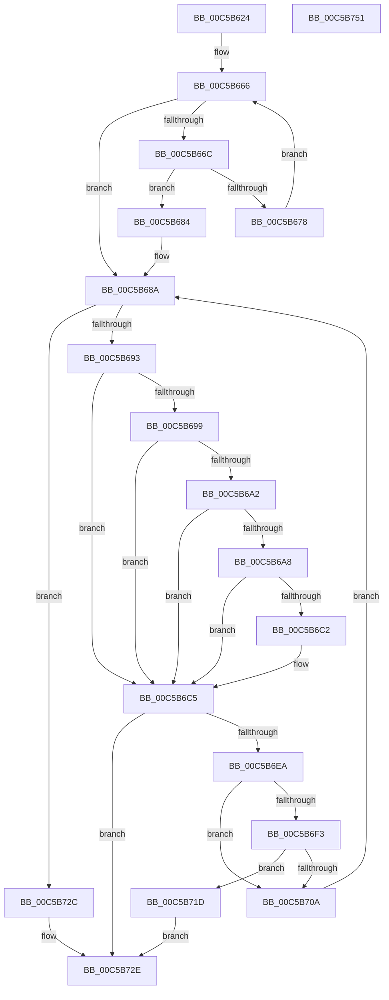

# CmpSetupConfigurationTree

- RVA: `0x00C5B624`–`0x00C5B752` (길이 `302` bytes)
- VA: `0x0000000140C5B624`
- 실행 섹션: `INIT`
- PDB 이름 있음: `예`; PDB Function 태그: `아니요`
- unwind 정보 RVA: `0x000D6FE0`
- 디코드: `89`개 명령, `302/302` bytes 표시
- 미해석 바이트: `0` (있으면 어셈블리에 `.byte`로 보존)

> 이 문서는 커널 이미지의 기계어와 PDB 기호를 분석해 생성했습니다. 4번과 5번은 함수 원형과 자료형을 바이너리 사용 방식에서 추정한 C 해석이며 원본 소스 복구 결과는 아닙니다.

## 1. Dependencies

- 직접 호출 지점: **7**; 고유 호출 대상: **6**
- 직접 호출자로 확인된 함수: **2**
- RIP 상대 이미지 참조: **2**

### Outgoing calls
- `0x00C5B684` → [_report_rangecheckfailure](../../text/4F/_report_rangecheckfailure_function_004F5FDC.md) (function, `0x004F5FDC`)
- `0x00C5B6B3` → [stricmp](../../text/4F/stricmp_function_004FFD80.md) (function, `0x004FFD80`)
- `0x00C5B6E1` → [CmpInitializeRegistryNode](../../page/7E/CmpInitializeRegistryNode_function_007EE81C.md) (function, `0x007EE81C`)
- `0x00C5B6FE` → [CmpSetupConfigurationTree](CmpSetupConfigurationTree_function_00C5B624.md) (function, `0x00C5B624`)
- `0x00C5B70F` → [ZwClose](../../text/6A/ZwClose_function_006AD2B0.md) (function, `0x006AD2B0`)
- `0x00C5B722` → [ZwClose](../../text/6A/ZwClose_function_006AD2B0.md) (function, `0x006AD2B0`)
- `0x00C5B739` → [_security_check_cookie](../../text/6A/_security_check_cookie_function_006AC640.md) (function, `0x006AC640`)

### Direct callers
- [CmpInitializeHardwareConfiguration](CmpInitializeHardwareConfiguration_function_00C5B4D0.md) at `0x00C5B5E6`
- [CmpSetupConfigurationTree](CmpSetupConfigurationTree_function_00C5B624.md) at `0x00C5B6FE`

### Static image references
- `0x00C5B637` → RVA `0x00E0A740` (`.data`; read)
- `0x00C5B6AC` → RVA `0x00C7E560` (` ?? ::PBOPGDP::`string'`; read)

## 2. Other-region calls and transfers

- 다른 실행 섹션으로 향하는 call: **6**
  - `0x00C5B684` → [_report_rangecheckfailure](../../text/4F/_report_rangecheckfailure_function_004F5FDC.md) (`INIT` → `.text`)
  - `0x00C5B6B3` → [stricmp](../../text/4F/stricmp_function_004FFD80.md) (`INIT` → `.text`)
  - `0x00C5B6E1` → [CmpInitializeRegistryNode](../../page/7E/CmpInitializeRegistryNode_function_007EE81C.md) (`INIT` → `PAGE`)
  - `0x00C5B70F` → [ZwClose](../../text/6A/ZwClose_function_006AD2B0.md) (`INIT` → `.text`)
  - `0x00C5B722` → [ZwClose](../../text/6A/ZwClose_function_006AD2B0.md) (`INIT` → `.text`)
  - `0x00C5B739` → [_security_check_cookie](../../text/6A/_security_check_cookie_function_006AC640.md) (`INIT` → `.text`)
- 별도 외부 분기/꼬리 이동을 확인하지 못했습니다.

## 3. Assembly (complete function range)

```asm
00C5B624  40 53                           push rbx
00C5B626  55                              push rbp
00C5B627  56                              push rsi
00C5B628  41 54                           push r12
00C5B62A  41 55                           push r13
00C5B62C  41 56                           push r14
00C5B62E  41 57                           push r15
00C5B630  48 81 EC C0 00 00 00            sub rsp, 0xc0
00C5B637  48 8B 05 02 F1 1A 00            mov rax, qword ptr [rip + 0x1af102]
00C5B63E  48 33 C4                        xor rax, rsp
00C5B641  48 89 84 24 B0 00 00 00         mov qword ptr [rsp + 0xb0], rax
00C5B649  45 33 E4                        xor r12d, r12d
00C5B64C  48 8B D9                        mov rbx, rcx
00C5B64F  41 8B F1                        mov esi, r9d
00C5B652  4C 89 64 24 40                  mov qword ptr [rsp + 0x40], r12
00C5B657  41 8B E8                        mov ebp, r8d
00C5B65A  4C 8B FA                        mov r15, rdx
00C5B65D  41 0F B7 CC                     movzx ecx, r12w
00C5B661  45 8D 6C 24 01                  lea r13d, [r12 + 1]
00C5B666  66 83 F9 2A                     cmp cx, 0x2a
00C5B66A  73 1E                           jae 0x140c5b68a
00C5B66C  0F B7 C1                        movzx eax, cx
00C5B66F  48 03 C0                        add rax, rax
00C5B672  48 83 F8 54                     cmp rax, 0x54
00C5B676  73 0C                           jae 0x140c5b684
00C5B678  66 44 89 64 04 50               mov word ptr [rsp + rax + 0x50], r12w
00C5B67E  66 41 03 CD                     add cx, r13w
00C5B682  EB E2                           jmp 0x140c5b666
00C5B684  E8 53 A9 89 FF                  call 0x1404f5fdc
00C5B689  CC                              int3
00C5B68A  48 85 DB                        test rbx, rbx
00C5B68D  0F 84 99 00 00 00               je 0x140c5b72c
00C5B693  83 7B 18 03                     cmp dword ptr [rbx + 0x18], 3
00C5B697  75 2C                           jne 0x140c5b6c5
00C5B699  48 8B 03                        mov rax, qword ptr [rbx]
00C5B69C  44 39 60 18                     cmp dword ptr [rax + 0x18], r12d
00C5B6A0  75 23                           jne 0x140c5b6c5
00C5B6A2  83 7B 1C 0C                     cmp dword ptr [rbx + 0x1c], 0xc
00C5B6A6  75 1D                           jne 0x140c5b6c5
00C5B6A8  48 8B 4B 38                     mov rcx, qword ptr [rbx + 0x38]
00C5B6AC  48 8D 15 AD 2E 02 00            lea rdx, [rip + 0x22ead]
00C5B6B3  E8 C8 46 8A FF                  call 0x1404ffd80
00C5B6B8  41 8B F4                        mov esi, r12d
00C5B6BB  41 8B ED                        mov ebp, r13d
00C5B6BE  85 C0                           test eax, eax
00C5B6C0  74 03                           je 0x140c5b6c5
00C5B6C2  41 8B EC                        mov ebp, r12d
00C5B6C5  48 8D 44 24 50                  lea rax, [rsp + 0x50]
00C5B6CA  44 8B CD                        mov r9d, ebp
00C5B6CD  48 89 44 24 28                  mov qword ptr [rsp + 0x28], rax
00C5B6D2  4C 8D 44 24 40                  lea r8, [rsp + 0x40]
00C5B6D7  49 8B D7                        mov rdx, r15
00C5B6DA  89 74 24 20                     mov dword ptr [rsp + 0x20], esi
00C5B6DE  48 8B CB                        mov rcx, rbx
00C5B6E1  E8 36 31 B9 FF                  call 0x1407ee81c
00C5B6E6  85 C0                           test eax, eax
00C5B6E8  78 44                           js 0x140c5b72e
00C5B6EA  48 8B 4B 08                     mov rcx, qword ptr [rbx + 8]
00C5B6EE  48 85 C9                        test rcx, rcx
00C5B6F1  74 17                           je 0x140c5b70a
00C5B6F3  48 8B 54 24 40                  mov rdx, qword ptr [rsp + 0x40]
00C5B6F8  44 8B CE                        mov r9d, esi
00C5B6FB  44 8B C5                        mov r8d, ebp
00C5B6FE  E8 21 FF FF FF                  call 0x140c5b624
00C5B703  44 8B F0                        mov r14d, eax
00C5B706  85 C0                           test eax, eax
00C5B708  78 13                           js 0x140c5b71d
00C5B70A  48 8B 4C 24 40                  mov rcx, qword ptr [rsp + 0x40]
00C5B70F  E8 9C 1B A5 FF                  call 0x1406ad2b0
00C5B714  48 8B 5B 10                     mov rbx, qword ptr [rbx + 0x10]
00C5B718  E9 6D FF FF FF                  jmp 0x140c5b68a
00C5B71D  48 8B 4C 24 40                  mov rcx, qword ptr [rsp + 0x40]
00C5B722  E8 89 1B A5 FF                  call 0x1406ad2b0
00C5B727  41 8B C6                        mov eax, r14d
00C5B72A  EB 02                           jmp 0x140c5b72e
00C5B72C  33 C0                           xor eax, eax
00C5B72E  48 8B 8C 24 B0 00 00 00         mov rcx, qword ptr [rsp + 0xb0]
00C5B736  48 33 CC                        xor rcx, rsp
00C5B739  E8 02 0F A5 FF                  call 0x1406ac640
00C5B73E  48 81 C4 C0 00 00 00            add rsp, 0xc0
00C5B745  41 5F                           pop r15
00C5B747  41 5E                           pop r14
00C5B749  41 5D                           pop r13
00C5B74B  41 5C                           pop r12
00C5B74D  5E                              pop rsi
00C5B74E  5D                              pop rbp
00C5B74F  5B                              pop rbx
00C5B750  C3                              ret
00C5B751  CC                              int3
```

## 4. C-style interpretation (structured pseudocode)

```c
__int64 __fastcall CmpSetupConfigurationTree(__int64 a1, __int64 a2, int a3, int a4)
{
    __int64 result;
    __int64 v_r12;
    __int64 v_rbp;
    __int64 v_rsp;
    unsigned __int64 v_stack_m48;
    unsigned __int64 v_stack_mA8;
    unsigned __int64 v_stack_mB8;
    unsigned __int64 v_stack_mD0;
    unsigned int v_stack_mD8;

    v_rsp = (v_rsp) - (192);
    result = (*(unsigned __int64 *)(v_rip + 1765634)) ^ (v_rsp);
    v_stack_m48 = result;
    v_r12 = 0;
    v_stack_mB8 = 0;
loc_00C5B666:
    if (0 >= 42) goto loc_00C5B68A;
    result = (0) + (0);
    if (result >= 84) goto loc_00C5B684;
    *(unsigned __int16 *)(v_rsp + result * 1 + 80) = 0;
    a1 = (unsigned __int16)((0) + ((unsigned __int16)(v_r12 + 1)));
    goto loc_00C5B666;
loc_00C5B684:
    result = _report_rangecheckfailure(a1, a2, a3, a4);
loc_00C5B68A:
    if (a1 == 0) goto loc_00C5B72C;
    if ((*(unsigned int *)(a1 + 24)) != 3) goto loc_00C5B6C5;
    if ((*(unsigned int *)(*(unsigned __int64 *)(a1) + 24)) != 0) goto loc_00C5B6C5;
    if ((*(unsigned int *)(a1 + 28)) != 12) goto loc_00C5B6C5;
    result = stricmp(*(unsigned __int64 *)(a1 + 56), v_rip + 143021, a3, a4);
    v_rbp = (unsigned int)((unsigned int)(v_r12 + 1));
    if ((unsigned int)(result) != 0) {
        v_rbp = 0;
    }
    v_stack_mD0 = v_stack_mA8;
    v_stack_mD8 = 0;
    result = CmpInitializeRegistryNode(a1, a2, v_stack_mB8, (unsigned int)((unsigned int)(v_rbp)));
    if (sign_flag) goto loc_00C5B72E;
    if (*(unsigned __int64 *)(a1 + 8) == 0) goto loc_00C5B70A;
    result = CmpSetupConfigurationTree(*(unsigned __int64 *)(a1 + 8), v_stack_mB8, (unsigned int)((unsigned int)(v_rbp)), 0);
    if (sign_flag) goto loc_00C5B71D;
loc_00C5B70A:
    result = ZwClose(v_stack_mB8, v_stack_mB8, (unsigned int)((unsigned int)(v_rbp)), 0);
    goto loc_00C5B68A;
loc_00C5B71D:
    result = ZwClose(v_stack_mB8, v_stack_mB8, (unsigned int)((unsigned int)(v_rbp)), 0);
    goto loc_00C5B72E;
loc_00C5B72C:
    result = 0;
loc_00C5B72E:
    a1 = (v_stack_m48) ^ (v_rsp);
    result = _security_check_cookie(a1, v_stack_mB8, (unsigned int)((unsigned int)(v_rbp)), 0);
    v_rsp = (v_rsp) + (192);
    return result;
}
```

## 5. (Beta) C Style

```c
int64_t CmpSetupConfigurationTree(int64_t Arg1, int64_t Arg2, int32_t Arg3, int32_t Arg4)
{
    int64_t result;
    int64_t local_r12;
    int64_t local_rbp;
    int64_t local_rsp;
    uint64_t v_stack_m48;
    uint64_t v_stack_mA8;
    uint64_t v_stack_mB8;
    uint64_t v_stack_mD0;
    uint32_t v_stack_mD8;

    local_rsp = (local_rsp) - (192);
    result = (*(uint64_t *)(v_rip + 0x1AF102)) ^ (local_rsp);
    v_stack_m48 = result;
    local_r12 = 0;
    v_stack_mB8 = 0;
loc_00C5B666:
    if (0 >= 42) goto loc_00C5B68A;
    result = (0) + (0);
    if (result >= 84) goto loc_00C5B684;
    *(uint16_t *)(local_rsp + result * 1 + 0x50) = 0;
    Arg1 = (uint16_t)((0) + ((uint16_t)(local_r12 + 1)));
    goto loc_00C5B666;
loc_00C5B684:
    result = _report_rangecheckfailure(Arg1, Arg2, Arg3, Arg4);
loc_00C5B68A:
    if (Arg1 == 0) goto loc_00C5B72C;
    if ((*(uint32_t *)(Arg1 + 0x18)) != 3) goto loc_00C5B6C5;
    if ((*(uint32_t *)(*(uint64_t *)(Arg1) + 0x18)) != 0) goto loc_00C5B6C5;
    if ((*(uint32_t *)(Arg1 + 0x1C)) != 12) goto loc_00C5B6C5;
    result = stricmp(*(uint64_t *)(Arg1 + 0x38), v_rip + 143021, Arg3, Arg4);
    local_rbp = (uint32_t)((uint32_t)(local_r12 + 1));
    if ((uint32_t)(result) != 0) {
        local_rbp = 0;
    }
    v_stack_mD0 = v_stack_mA8;
    v_stack_mD8 = 0;
    result = CmpInitializeRegistryNode(Arg1, Arg2, v_stack_mB8, (uint32_t)((uint32_t)(local_rbp)));
    if (sign_flag) goto loc_00C5B72E;
    if (*(uint64_t *)(Arg1 + 0x8) == 0) goto loc_00C5B70A;
    result = CmpSetupConfigurationTree(*(uint64_t *)(Arg1 + 0x8), v_stack_mB8, (uint32_t)((uint32_t)(local_rbp)), 0);
    if (sign_flag) goto loc_00C5B71D;
loc_00C5B70A:
    result = ZwClose(v_stack_mB8, v_stack_mB8, (uint32_t)((uint32_t)(local_rbp)), 0);
    goto loc_00C5B68A;
loc_00C5B71D:
    result = ZwClose(v_stack_mB8, v_stack_mB8, (uint32_t)((uint32_t)(local_rbp)), 0);
    goto loc_00C5B72E;
loc_00C5B72C:
    result = 0;
loc_00C5B72E:
    Arg1 = (v_stack_m48) ^ (local_rsp);
    result = _security_check_cookie(Arg1, v_stack_mB8, (uint32_t)((uint32_t)(local_rbp)), 0);
    local_rsp = (local_rsp) + (192);
    return result;
}
```

## 6. Execution-region graph

[열기: 2D/3D 그래프와 함수 탐색 컨트롤 패널](../../../control-panel.html?section=init&rva=0x00C5B624&view=graph)

- 2D 그래프는 위에서 아래로 흐르고, 3D 그래프는 빈 공간을 드래그해 회전합니다. Shift+드래그는 이동, 휠은 확대·축소, 함수 노드 선택은 대상 보고서 이동입니다.

### Static fallback


