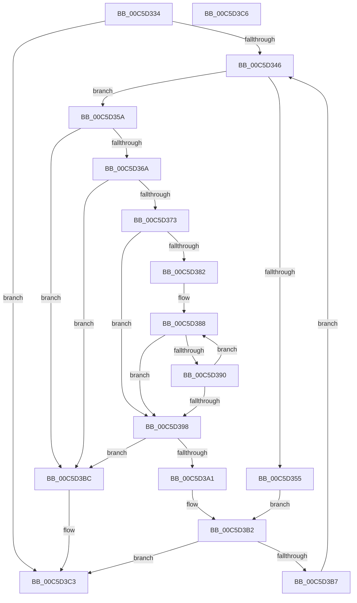

# CmpSortByTag

- RVA: `0x00C5D334`–`0x00C5D3C7` (길이 `147` bytes)
- VA: `0x0000000140C5D334`
- 실행 섹션: `INIT`
- PDB 이름 있음: `예`; PDB Function 태그: `아니요`
- unwind 정보 RVA: `0x000DB714`
- 디코드: `47`개 명령, `147/147` bytes 표시
- 미해석 바이트: `0` (있으면 어셈블리에 `.byte`로 보존)

> 이 문서는 커널 이미지의 기계어와 PDB 기호를 분석해 생성했습니다. 4번과 5번은 함수 원형과 자료형을 바이너리 사용 방식에서 추정한 C 해석이며 원본 소스 복구 결과는 아닙니다.

## 1. Dependencies

- 직접 호출 지점: **0**; 고유 호출 대상: **0**
- 직접 호출자로 확인된 함수: **1**
- RIP 상대 이미지 참조: **0**

### Outgoing calls
- 직접 디코드된 call 명령이 없습니다.

### Direct callers
- [CmpDoSort](CmpDoSort_function_00C5BE84.md) at `0x00C5BEAD`

### Static image references
- 디코드된 RIP-relative 메모리 참조가 없습니다.

## 2. Other-region calls and transfers

- 다른 실행 섹션으로 향하는 call: **0**
- 별도 외부 분기/꼬리 이동을 확인하지 못했습니다.

## 3. Assembly (complete function range)

```asm
00C5D334  4C 8B 01                        mov r8, qword ptr [rcx]
00C5D337  4C 8B D1                        mov r10, rcx
00C5D33A  4C 8B 49 08                     mov r9, qword ptr [rcx + 8]
00C5D33E  49 8B 10                        mov rdx, qword ptr [r8]
00C5D341  4D 3B C1                        cmp r8, r9
00C5D344  74 7D                           je 0x140c5d3c3
00C5D346  8B 82 88 00 00 00               mov eax, dword ptr [rdx + 0x88]
00C5D34C  41 39 80 88 00 00 00            cmp dword ptr [r8 + 0x88], eax
00C5D353  77 05                           ja 0x140c5d35a
00C5D355  4C 8B C2                        mov r8, rdx
00C5D358  EB 58                           jmp 0x140c5d3b2
00C5D35A  48 8B 0A                        mov rcx, qword ptr [rdx]
00C5D35D  49 3B D1                        cmp rdx, r9
00C5D360  4D 0F 44 C8                     cmove r9, r8
00C5D364  48 39 51 08                     cmp qword ptr [rcx + 8], rdx
00C5D368  75 52                           jne 0x140c5d3bc
00C5D36A  48 8B 42 08                     mov rax, qword ptr [rdx + 8]
00C5D36E  48 39 10                        cmp qword ptr [rax], rdx
00C5D371  75 49                           jne 0x140c5d3bc
00C5D373  48 89 08                        mov qword ptr [rax], rcx
00C5D376  48 89 41 08                     mov qword ptr [rcx + 8], rax
00C5D37A  49 8B 02                        mov rax, qword ptr [r10]
00C5D37D  49 3B C0                        cmp rax, r8
00C5D380  74 16                           je 0x140c5d398
00C5D382  8B 8A 88 00 00 00               mov ecx, dword ptr [rdx + 0x88]
00C5D388  39 88 88 00 00 00               cmp dword ptr [rax + 0x88], ecx
00C5D38E  73 08                           jae 0x140c5d398
00C5D390  48 8B 00                        mov rax, qword ptr [rax]
00C5D393  49 3B C0                        cmp rax, r8
00C5D396  75 F0                           jne 0x140c5d388
00C5D398  48 8B 48 08                     mov rcx, qword ptr [rax + 8]
00C5D39C  48 39 01                        cmp qword ptr [rcx], rax
00C5D39F  75 1B                           jne 0x140c5d3bc
00C5D3A1  48 89 02                        mov qword ptr [rdx], rax
00C5D3A4  48 89 4A 08                     mov qword ptr [rdx + 8], rcx
00C5D3A8  48 89 11                        mov qword ptr [rcx], rdx
00C5D3AB  48 89 50 08                     mov qword ptr [rax + 8], rdx
00C5D3AF  49 8B D0                        mov rdx, r8
00C5D3B2  4D 3B C1                        cmp r8, r9
00C5D3B5  74 0C                           je 0x140c5d3c3
00C5D3B7  48 8B 12                        mov rdx, qword ptr [rdx]
00C5D3BA  EB 8A                           jmp 0x140c5d346
00C5D3BC  B9 03 00 00 00                  mov ecx, 3
00C5D3C1  CD 29                           int 0x29
00C5D3C3  B0 01                           mov al, 1
00C5D3C5  C3                              ret
00C5D3C6  CC                              int3
```

## 4. C-style interpretation (structured pseudocode)

```c
__int64 __fastcall CmpSortByTag(__int64 a1)
{
    if ((*(unsigned __int64 *)(a1)) == (*(unsigned __int64 *)(a1 + 8))) goto loc_00C5D3C3;
loc_00C5D346:
    if ((*(unsigned int *)(*(unsigned __int64 *)(a1) + 136)) > ((unsigned int)((unsigned int)(*(unsigned int *)(*(unsigned __int64 *)(*(unsigned __int64 *)(a1)) + 136))))) goto loc_00C5D35A;
    goto loc_00C5D3B2;
loc_00C5D35A:
    a4 = *(unsigned __int64 *)(a1 + 8);
    if ((*(unsigned __int64 *)(*(unsigned __int64 *)(a1))) == (*(unsigned __int64 *)(a1 + 8))) { a4 = *(unsigned __int64 *)(*(unsigned __int64 *)(a1)); }
    if ((*(unsigned __int64 *)(*(unsigned __int64 *)(*(unsigned __int64 *)(*(unsigned __int64 *)(a1))) + 8)) != (*(unsigned __int64 *)(*(unsigned __int64 *)(a1)))) goto loc_00C5D3BC;
    if ((*(unsigned __int64 *)(*(unsigned __int64 *)(*(unsigned __int64 *)(*(unsigned __int64 *)(a1)) + 8))) != (*(unsigned __int64 *)(*(unsigned __int64 *)(a1)))) goto loc_00C5D3BC;
    *(unsigned __int64 *)(*(unsigned __int64 *)(*(unsigned __int64 *)(*(unsigned __int64 *)(a1)) + 8)) = *(unsigned __int64 *)(*(unsigned __int64 *)(*(unsigned __int64 *)(a1)));
    *(unsigned __int64 *)(*(unsigned __int64 *)(*(unsigned __int64 *)(*(unsigned __int64 *)(a1))) + 8) = *(unsigned __int64 *)(*(unsigned __int64 *)(*(unsigned __int64 *)(a1)) + 8);
    if ((*(unsigned __int64 *)(a1)) == (*(unsigned __int64 *)(*(unsigned __int64 *)(a1)))) goto loc_00C5D398;
loc_00C5D388:
    if ((*(unsigned int *)(*(unsigned __int64 *)(a1) + 136)) >= ((unsigned int)((unsigned int)(*(unsigned int *)(*(unsigned __int64 *)(*(unsigned __int64 *)(a1)) + 136))))) goto loc_00C5D398;
    if ((*(unsigned __int64 *)(*(unsigned __int64 *)(a1))) != (*(unsigned __int64 *)(*(unsigned __int64 *)(a1)))) goto loc_00C5D388;
loc_00C5D398:
    if ((*(unsigned __int64 *)(*(unsigned __int64 *)(*(unsigned __int64 *)(*(unsigned __int64 *)(a1)) + 8))) != (*(unsigned __int64 *)(*(unsigned __int64 *)(a1)))) goto loc_00C5D3BC;
    *(unsigned __int64 *)(*(unsigned __int64 *)(*(unsigned __int64 *)(a1))) = *(unsigned __int64 *)(*(unsigned __int64 *)(a1));
    *(unsigned __int64 *)(*(unsigned __int64 *)(*(unsigned __int64 *)(a1)) + 8) = *(unsigned __int64 *)(*(unsigned __int64 *)(*(unsigned __int64 *)(a1)) + 8);
    *(unsigned __int64 *)(*(unsigned __int64 *)(*(unsigned __int64 *)(*(unsigned __int64 *)(a1)) + 8)) = *(unsigned __int64 *)(*(unsigned __int64 *)(a1));
    *(unsigned __int64 *)(*(unsigned __int64 *)(*(unsigned __int64 *)(a1)) + 8) = *(unsigned __int64 *)(*(unsigned __int64 *)(a1));
loc_00C5D3B2:
    if ((*(unsigned __int64 *)(*(unsigned __int64 *)(a1))) == a4) goto loc_00C5D3C3;
    goto loc_00C5D346;
loc_00C5D3BC:
loc_00C5D3C3:
    return 1;
}
```

## 5. (Beta) C Style

```c
int64_t CmpSortByTag(void *Arg1)
{
    uint8_t *arg1 = (uint8_t *)Arg1;

    if ((*(uint64_t *)(arg1)) == (*(uint64_t *)(arg1 + 0x8))) goto loc_00C5D3C3;
loc_00C5D346:
    if ((*(uint32_t *)(*(uint64_t *)(arg1) + 0x88)) > ((uint32_t)((uint32_t)(*(uint32_t *)(*(uint64_t *)(*(uint64_t *)(arg1)) + 0x88))))) goto loc_00C5D35A;
    goto loc_00C5D3B2;
loc_00C5D35A:
    a4 = *(uint64_t *)(arg1 + 0x8);
    if ((*(uint64_t *)(*(uint64_t *)(arg1))) == (*(uint64_t *)(arg1 + 0x8))) { a4 = *(uint64_t *)(*(uint64_t *)(arg1)); }
    if ((*(uint64_t *)(*(uint64_t *)(*(uint64_t *)(*(uint64_t *)(arg1))) + 0x8)) != (*(uint64_t *)(*(uint64_t *)(arg1)))) goto loc_00C5D3BC;
    if ((*(uint64_t *)(*(uint64_t *)(*(uint64_t *)(*(uint64_t *)(arg1)) + 0x8))) != (*(uint64_t *)(*(uint64_t *)(arg1)))) goto loc_00C5D3BC;
    *(uint64_t *)(*(uint64_t *)(*(uint64_t *)(*(uint64_t *)(arg1)) + 0x8)) = *(uint64_t *)(*(uint64_t *)(*(uint64_t *)(arg1)));
    *(uint64_t *)(*(uint64_t *)(*(uint64_t *)(*(uint64_t *)(arg1))) + 0x8) = *(uint64_t *)(*(uint64_t *)(*(uint64_t *)(arg1)) + 0x8);
    if ((*(uint64_t *)(arg1)) == (*(uint64_t *)(*(uint64_t *)(arg1)))) goto loc_00C5D398;
loc_00C5D388:
    if ((*(uint32_t *)(*(uint64_t *)(arg1) + 0x88)) >= ((uint32_t)((uint32_t)(*(uint32_t *)(*(uint64_t *)(*(uint64_t *)(arg1)) + 0x88))))) goto loc_00C5D398;
    if ((*(uint64_t *)(*(uint64_t *)(arg1))) != (*(uint64_t *)(*(uint64_t *)(arg1)))) goto loc_00C5D388;
loc_00C5D398:
    if ((*(uint64_t *)(*(uint64_t *)(*(uint64_t *)(*(uint64_t *)(arg1)) + 0x8))) != (*(uint64_t *)(*(uint64_t *)(arg1)))) goto loc_00C5D3BC;
    *(uint64_t *)(*(uint64_t *)(*(uint64_t *)(arg1))) = *(uint64_t *)(*(uint64_t *)(arg1));
    *(uint64_t *)(*(uint64_t *)(*(uint64_t *)(arg1)) + 0x8) = *(uint64_t *)(*(uint64_t *)(*(uint64_t *)(arg1)) + 0x8);
    *(uint64_t *)(*(uint64_t *)(*(uint64_t *)(*(uint64_t *)(arg1)) + 0x8)) = *(uint64_t *)(*(uint64_t *)(arg1));
    *(uint64_t *)(*(uint64_t *)(*(uint64_t *)(arg1)) + 0x8) = *(uint64_t *)(*(uint64_t *)(arg1));
loc_00C5D3B2:
    if ((*(uint64_t *)(*(uint64_t *)(arg1))) == a4) goto loc_00C5D3C3;
    goto loc_00C5D346;
loc_00C5D3BC:
loc_00C5D3C3:
    return 1;
}
```

### 관측된 메모리 오프셋

구조체 형식이 확인되지 않은 접근은 인자 기준의 오프셋으로만 기록했습니다.

| 기준 인자 | 오프셋 표현 | 폭 (bit) | 접근 |
|---|---:|---:|---|
| `Arg1` | `+ 0x0` | `64` | `R` |
| `Arg1` | `+ 0x8` | `64` | `R` |

## 6. Execution-region graph

[열기: 2D/3D 그래프와 함수 탐색 컨트롤 패널](../../../control-panel.html?section=init&rva=0x00C5D334&view=graph)

- 2D 그래프는 위에서 아래로 흐르고, 3D 그래프는 빈 공간을 드래그해 회전합니다. Shift+드래그는 이동, 휠은 확대·축소, 함수 노드 선택은 대상 보고서 이동입니다.

### Static fallback


