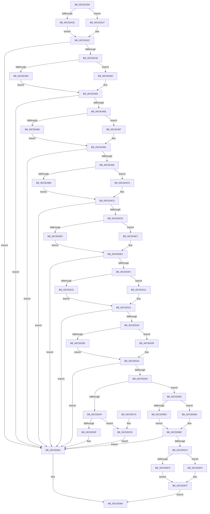

# CmpSortDriverList

- RVA: `0x00C5D3D0`–`0x00C5D607` (길이 `567` bytes)
- VA: `0x0000000140C5D3D0`
- 실행 섹션: `INIT`
- PDB 이름 있음: `예`; PDB Function 태그: `아니요`
- unwind 정보 RVA: `0x000D72B4`
- 디코드: `155`개 명령, `567/567` bytes 표시
- 미해석 바이트: `0` (있으면 어셈블리에 `.byte`로 보존)

> 이 문서는 커널 이미지의 기계어와 PDB 기호를 분석해 생성했습니다. 4번과 5번은 함수 원형과 자료형을 바이너리 사용 방식에서 추정한 C 해석이며 원본 소스 복구 결과는 아닙니다.

## 1. Dependencies

- 직접 호출 지점: **25**; 고유 호출 대상: **8**
- 직접 호출자로 확인된 함수: **1**
- RIP 상대 이미지 참조: **3**

### Outgoing calls
- `0x00C5D420` → [HvpGetCellFlat](../../page/85/HvpGetCellFlat_function_00854C60.md) (function, `0x00854C60`)
- `0x00C5D427` → [HvpGetCellPaged](../../page/85/HvpGetCellPaged_function_00854CB0.md) (function, `0x00854CB0`)
- `0x00C5D442` → [CmpFindSubKeyByName](../../page/A4/CmpFindSubKeyByName_function_00A49D58.md) (function, `0x00A49D58`)
- `0x00C5D459` → [HvpReleaseCellFlat](../../page/85/HvpReleaseCellFlat_function_0085CC20.md) (function, `0x0085CC20`)
- `0x00C5D460` → [HvpReleaseCellPaged](../../page/85/HvpReleaseCellPaged_function_00855F40.md) (function, `0x00855F40`)
- `0x00C5D480` → [HvpGetCellFlat](../../page/85/HvpGetCellFlat_function_00854C60.md) (function, `0x00854C60`)
- `0x00C5D487` → [HvpGetCellPaged](../../page/85/HvpGetCellPaged_function_00854CB0.md) (function, `0x00854CB0`)
- `0x00C5D4A2` → [CmpFindSubKeyByName](../../page/A4/CmpFindSubKeyByName_function_00A49D58.md) (function, `0x00A49D58`)
- `0x00C5D4B9` → [HvpReleaseCellFlat](../../page/85/HvpReleaseCellFlat_function_0085CC20.md) (function, `0x0085CC20`)
- `0x00C5D4C0` → [HvpReleaseCellPaged](../../page/85/HvpReleaseCellPaged_function_00855F40.md) (function, `0x00855F40`)
- `0x00C5D4E0` → [HvpGetCellFlat](../../page/85/HvpGetCellFlat_function_00854C60.md) (function, `0x00854C60`)
- `0x00C5D4E7` → [HvpGetCellPaged](../../page/85/HvpGetCellPaged_function_00854CB0.md) (function, `0x00854CB0`)
- `0x00C5D4FE` → [CmpFindValueByName](../../page/84/CmpFindValueByName_function_00844E1C.md) (function, `0x00844E1C`)
- `0x00C5D515` → [HvpReleaseCellFlat](../../page/85/HvpReleaseCellFlat_function_0085CC20.md) (function, `0x0085CC20`)
- `0x00C5D51C` → [HvpReleaseCellPaged](../../page/85/HvpReleaseCellPaged_function_00855F40.md) (function, `0x00855F40`)
- `0x00C5D538` → [HvpGetCellFlat](../../page/85/HvpGetCellFlat_function_00854C60.md) (function, `0x00854C60`)
- `0x00C5D53F` → [HvpGetCellPaged](../../page/85/HvpGetCellPaged_function_00854CB0.md) (function, `0x00854CB0`)
- `0x00C5D55F` → [HvpReleaseCellFlat](../../page/85/HvpReleaseCellFlat_function_0085CC20.md) (function, `0x0085CC20`)
- `0x00C5D57B` → [HvpReleaseCellPaged](../../page/85/HvpReleaseCellPaged_function_00855F40.md) (function, `0x00855F40`)
- `0x00C5D597` → [CmpValueToData](../../page/7F/CmpValueToData_function_007F3934.md) (function, `0x007F3934`)
- `0x00C5D5B3` → [HvpReleaseCellFlat](../../page/85/HvpReleaseCellFlat_function_0085CC20.md) (function, `0x0085CC20`)
- `0x00C5D5BA` → [HvpReleaseCellPaged](../../page/85/HvpReleaseCellPaged_function_00855F40.md) (function, `0x00855F40`)
- `0x00C5D5DB` → [CmpDoSort](CmpDoSort_function_00C5BE84.md) (function, `0x00C5BE84`)
- `0x00C5D5F3` → [HvpReleaseCellFlat](../../page/85/HvpReleaseCellFlat_function_0085CC20.md) (function, `0x0085CC20`)
- `0x00C5D5FA` → [HvpReleaseCellPaged](../../page/85/HvpReleaseCellPaged_function_00855F40.md) (function, `0x00855F40`)

### Direct callers
- [CmGetSystemDriverList](../C7/CmGetSystemDriverList_function_00C7380C.md) at `0x00C73BAC`

### Static image references
- `0x00C5D435` → RVA `0x00C82188` (`CmpControlString`; read)
- `0x00C5D495` → RVA `0x00C822D0` (`CmpServiceGroupOrderString`; read)
- `0x00C5D4F1` → RVA `0x00C82330` (`CmpListString`; read)

## 2. Other-region calls and transfers

- 다른 실행 섹션으로 향하는 call: **24**
  - `0x00C5D420` → [HvpGetCellFlat](../../page/85/HvpGetCellFlat_function_00854C60.md) (`INIT` → `PAGE`)
  - `0x00C5D427` → [HvpGetCellPaged](../../page/85/HvpGetCellPaged_function_00854CB0.md) (`INIT` → `PAGE`)
  - `0x00C5D442` → [CmpFindSubKeyByName](../../page/A4/CmpFindSubKeyByName_function_00A49D58.md) (`INIT` → `PAGE`)
  - `0x00C5D459` → [HvpReleaseCellFlat](../../page/85/HvpReleaseCellFlat_function_0085CC20.md) (`INIT` → `PAGE`)
  - `0x00C5D460` → [HvpReleaseCellPaged](../../page/85/HvpReleaseCellPaged_function_00855F40.md) (`INIT` → `PAGE`)
  - `0x00C5D480` → [HvpGetCellFlat](../../page/85/HvpGetCellFlat_function_00854C60.md) (`INIT` → `PAGE`)
  - `0x00C5D487` → [HvpGetCellPaged](../../page/85/HvpGetCellPaged_function_00854CB0.md) (`INIT` → `PAGE`)
  - `0x00C5D4A2` → [CmpFindSubKeyByName](../../page/A4/CmpFindSubKeyByName_function_00A49D58.md) (`INIT` → `PAGE`)
  - `0x00C5D4B9` → [HvpReleaseCellFlat](../../page/85/HvpReleaseCellFlat_function_0085CC20.md) (`INIT` → `PAGE`)
  - `0x00C5D4C0` → [HvpReleaseCellPaged](../../page/85/HvpReleaseCellPaged_function_00855F40.md) (`INIT` → `PAGE`)
  - `0x00C5D4E0` → [HvpGetCellFlat](../../page/85/HvpGetCellFlat_function_00854C60.md) (`INIT` → `PAGE`)
  - `0x00C5D4E7` → [HvpGetCellPaged](../../page/85/HvpGetCellPaged_function_00854CB0.md) (`INIT` → `PAGE`)
  - `0x00C5D4FE` → [CmpFindValueByName](../../page/84/CmpFindValueByName_function_00844E1C.md) (`INIT` → `PAGE`)
  - `0x00C5D515` → [HvpReleaseCellFlat](../../page/85/HvpReleaseCellFlat_function_0085CC20.md) (`INIT` → `PAGE`)
  - `0x00C5D51C` → [HvpReleaseCellPaged](../../page/85/HvpReleaseCellPaged_function_00855F40.md) (`INIT` → `PAGE`)
  - `0x00C5D538` → [HvpGetCellFlat](../../page/85/HvpGetCellFlat_function_00854C60.md) (`INIT` → `PAGE`)
  - `0x00C5D53F` → [HvpGetCellPaged](../../page/85/HvpGetCellPaged_function_00854CB0.md) (`INIT` → `PAGE`)
  - `0x00C5D55F` → [HvpReleaseCellFlat](../../page/85/HvpReleaseCellFlat_function_0085CC20.md) (`INIT` → `PAGE`)
  - `0x00C5D57B` → [HvpReleaseCellPaged](../../page/85/HvpReleaseCellPaged_function_00855F40.md) (`INIT` → `PAGE`)
  - `0x00C5D597` → [CmpValueToData](../../page/7F/CmpValueToData_function_007F3934.md) (`INIT` → `PAGE`)
  - `0x00C5D5B3` → [HvpReleaseCellFlat](../../page/85/HvpReleaseCellFlat_function_0085CC20.md) (`INIT` → `PAGE`)
  - `0x00C5D5BA` → [HvpReleaseCellPaged](../../page/85/HvpReleaseCellPaged_function_00855F40.md) (`INIT` → `PAGE`)
  - `0x00C5D5F3` → [HvpReleaseCellFlat](../../page/85/HvpReleaseCellFlat_function_0085CC20.md) (`INIT` → `PAGE`)
  - `0x00C5D5FA` → [HvpReleaseCellPaged](../../page/85/HvpReleaseCellPaged_function_00855F40.md) (`INIT` → `PAGE`)
- 별도 외부 분기/꼬리 이동을 확인하지 못했습니다.

## 3. Assembly (complete function range)

```asm
00C5D3D0  48 89 5C 24 10                  mov qword ptr [rsp + 0x10], rbx
00C5D3D5  55                              push rbp
00C5D3D6  56                              push rsi
00C5D3D7  57                              push rdi
00C5D3D8  41 54                           push r12
00C5D3DA  41 57                           push r15
00C5D3DC  48 8B EC                        mov rbp, rsp
00C5D3DF  48 83 EC 50                     sub rsp, 0x50
00C5D3E3  45 33 FF                        xor r15d, r15d
00C5D3E6  41 83 CC FF                     or r12d, 0xffffffff
00C5D3EA  F6 81 8C 00 00 00 01            test byte ptr [rcx + 0x8c], 1
00C5D3F1  0F 57 C0                        xorps xmm0, xmm0
00C5D3F4  49 8B F0                        mov rsi, r8
00C5D3F7  44 89 65 E8                     mov dword ptr [rbp - 0x18], r12d
00C5D3FB  48 8B D9                        mov rbx, rcx
00C5D3FE  44 89 7D EC                     mov dword ptr [rbp - 0x14], r15d
00C5D402  0F 11 45 F0                     movups xmmword ptr [rbp - 0x10], xmm0
00C5D406  44 89 65 E0                     mov dword ptr [rbp - 0x20], r12d
00C5D40A  4C 8D 45 48                     lea r8, [rbp + 0x48]
00C5D40E  44 89 7D E4                     mov dword ptr [rbp - 0x1c], r15d
00C5D412  44 89 7D 30                     mov dword ptr [rbp + 0x30], r15d
00C5D416  44 89 65 48                     mov dword ptr [rbp + 0x48], r12d
00C5D41A  44 89 7D 4C                     mov dword ptr [rbp + 0x4c], r15d
00C5D41E  74 07                           je 0x140c5d427
00C5D420  E8 3B 78 BF FF                  call 0x140854c60
00C5D425  EB 05                           jmp 0x140c5d42c
00C5D427  E8 84 78 BF FF                  call 0x140854cb0
00C5D42C  48 85 C0                        test rax, rax
00C5D42F  0F 84 2F 01 00 00               je 0x140c5d564
00C5D435  4C 8D 05 4C 4D 02 00            lea r8, [rip + 0x24d4c]
00C5D43C  48 8B D0                        mov rdx, rax
00C5D43F  48 8B CB                        mov rcx, rbx
00C5D442  E8 11 C9 DE FF                  call 0x140a49d58
00C5D447  F6 83 8C 00 00 00 01            test byte ptr [rbx + 0x8c], 1
00C5D44E  48 8D 55 48                     lea rdx, [rbp + 0x48]
00C5D452  8B F8                           mov edi, eax
00C5D454  48 8B CB                        mov rcx, rbx
00C5D457  74 07                           je 0x140c5d460
00C5D459  E8 C2 F7 BF FF                  call 0x14085cc20
00C5D45E  EB 05                           jmp 0x140c5d465
00C5D460  E8 DB 8A BF FF                  call 0x140855f40
00C5D465  41 3B FC                        cmp edi, r12d
00C5D468  0F 84 F6 00 00 00               je 0x140c5d564
00C5D46E  F6 83 8C 00 00 00 01            test byte ptr [rbx + 0x8c], 1
00C5D475  4C 8D 45 48                     lea r8, [rbp + 0x48]
00C5D479  8B D7                           mov edx, edi
00C5D47B  48 8B CB                        mov rcx, rbx
00C5D47E  74 07                           je 0x140c5d487
00C5D480  E8 DB 77 BF FF                  call 0x140854c60
00C5D485  EB 05                           jmp 0x140c5d48c
00C5D487  E8 24 78 BF FF                  call 0x140854cb0
00C5D48C  48 85 C0                        test rax, rax
00C5D48F  0F 84 CF 00 00 00               je 0x140c5d564
00C5D495  4C 8D 05 34 4E 02 00            lea r8, [rip + 0x24e34]
00C5D49C  48 8B D0                        mov rdx, rax
00C5D49F  48 8B CB                        mov rcx, rbx
00C5D4A2  E8 B1 C8 DE FF                  call 0x140a49d58
00C5D4A7  F6 83 8C 00 00 00 01            test byte ptr [rbx + 0x8c], 1
00C5D4AE  48 8D 55 48                     lea rdx, [rbp + 0x48]
00C5D4B2  8B F8                           mov edi, eax
00C5D4B4  48 8B CB                        mov rcx, rbx
00C5D4B7  74 07                           je 0x140c5d4c0
00C5D4B9  E8 62 F7 BF FF                  call 0x14085cc20
00C5D4BE  EB 05                           jmp 0x140c5d4c5
00C5D4C0  E8 7B 8A BF FF                  call 0x140855f40
00C5D4C5  41 3B FC                        cmp edi, r12d
00C5D4C8  0F 84 96 00 00 00               je 0x140c5d564
00C5D4CE  F6 83 8C 00 00 00 01            test byte ptr [rbx + 0x8c], 1
00C5D4D5  4C 8D 45 48                     lea r8, [rbp + 0x48]
00C5D4D9  8B D7                           mov edx, edi
00C5D4DB  48 8B CB                        mov rcx, rbx
00C5D4DE  74 07                           je 0x140c5d4e7
00C5D4E0  E8 7B 77 BF FF                  call 0x140854c60
00C5D4E5  EB 05                           jmp 0x140c5d4ec
00C5D4E7  E8 C4 77 BF FF                  call 0x140854cb0
00C5D4EC  48 85 C0                        test rax, rax
00C5D4EF  74 73                           je 0x140c5d564
00C5D4F1  4C 8D 05 38 4E 02 00            lea r8, [rip + 0x24e38]
00C5D4F8  48 8B D0                        mov rdx, rax
00C5D4FB  48 8B CB                        mov rcx, rbx
00C5D4FE  E8 19 79 BE FF                  call 0x140844e1c
00C5D503  F6 83 8C 00 00 00 01            test byte ptr [rbx + 0x8c], 1
00C5D50A  48 8D 55 48                     lea rdx, [rbp + 0x48]
00C5D50E  8B F8                           mov edi, eax
00C5D510  48 8B CB                        mov rcx, rbx
00C5D513  74 07                           je 0x140c5d51c
00C5D515  E8 06 F7 BF FF                  call 0x14085cc20
00C5D51A  EB 05                           jmp 0x140c5d521
00C5D51C  E8 1F 8A BF FF                  call 0x140855f40
00C5D521  41 3B FC                        cmp edi, r12d
00C5D524  74 3E                           je 0x140c5d564
00C5D526  F6 83 8C 00 00 00 01            test byte ptr [rbx + 0x8c], 1
00C5D52D  4C 8D 45 E0                     lea r8, [rbp - 0x20]
00C5D531  8B D7                           mov edx, edi
00C5D533  48 8B CB                        mov rcx, rbx
00C5D536  74 07                           je 0x140c5d53f
00C5D538  E8 23 77 BF FF                  call 0x140854c60
00C5D53D  EB 05                           jmp 0x140c5d544
00C5D53F  E8 6C 77 BF FF                  call 0x140854cb0
00C5D544  48 85 C0                        test rax, rax
00C5D547  74 1B                           je 0x140c5d564
00C5D549  83 78 0C 07                     cmp dword ptr [rax + 0xc], 7
00C5D54D  74 33                           je 0x140c5d582
00C5D54F  F6 83 8C 00 00 00 01            test byte ptr [rbx + 0x8c], 1
00C5D556  48 8D 55 E0                     lea rdx, [rbp - 0x20]
00C5D55A  48 8B CB                        mov rcx, rbx
00C5D55D  74 1C                           je 0x140c5d57b
00C5D55F  E8 BC F6 BF FF                  call 0x14085cc20
00C5D564  32 C0                           xor al, al
00C5D566  48 8B 9C 24 88 00 00 00         mov rbx, qword ptr [rsp + 0x88]
00C5D56E  48 83 C4 50                     add rsp, 0x50
00C5D572  41 5F                           pop r15
00C5D574  41 5C                           pop r12
00C5D576  5F                              pop rdi
00C5D577  5E                              pop rsi
00C5D578  5D                              pop rbp
00C5D579  C3                              ret
00C5D57A  CC                              int3
00C5D57B  E8 C0 89 BF FF                  call 0x140855f40
00C5D580  EB E2                           jmp 0x140c5d564
00C5D582  48 8D 4D E8                     lea rcx, [rbp - 0x18]
00C5D586  4C 8B C0                        mov r8, rax
00C5D589  48 89 4C 24 20                  mov qword ptr [rsp + 0x20], rcx
00C5D58E  4C 8D 4D 30                     lea r9, [rbp + 0x30]
00C5D592  48 8B CB                        mov rcx, rbx
00C5D595  8B D7                           mov edx, edi
00C5D597  E8 98 63 B9 FF                  call 0x1407f3934
00C5D59C  F6 83 8C 00 00 00 01            test byte ptr [rbx + 0x8c], 1
00C5D5A3  48 8D 55 E0                     lea rdx, [rbp - 0x20]
00C5D5A7  48 8B F8                        mov rdi, rax
00C5D5AA  48 89 45 F8                     mov qword ptr [rbp - 8], rax
00C5D5AE  48 8B CB                        mov rcx, rbx
00C5D5B1  74 07                           je 0x140c5d5ba
00C5D5B3  E8 68 F6 BF FF                  call 0x14085cc20
00C5D5B8  EB 05                           jmp 0x140c5d5bf
00C5D5BA  E8 81 89 BF FF                  call 0x140855f40
00C5D5BF  48 85 FF                        test rdi, rdi
00C5D5C2  74 A0                           je 0x140c5d564
00C5D5C4  0F B7 45 30                     movzx eax, word ptr [rbp + 0x30]
00C5D5C8  48 8D 55 F0                     lea rdx, [rbp - 0x10]
00C5D5CC  66 83 E8 02                     sub ax, 2
00C5D5D0  48 8B CE                        mov rcx, rsi
00C5D5D3  66 89 45 F2                     mov word ptr [rbp - 0xe], ax
00C5D5D7  66 89 45 F0                     mov word ptr [rbp - 0x10], ax
00C5D5DB  E8 A4 E8 FF FF                  call 0x140c5be84
00C5D5E0  F6 83 8C 00 00 00 01            test byte ptr [rbx + 0x8c], 1
00C5D5E7  48 8D 55 E8                     lea rdx, [rbp - 0x18]
00C5D5EB  40 8A F8                        mov dil, al
00C5D5EE  48 8B CB                        mov rcx, rbx
00C5D5F1  74 07                           je 0x140c5d5fa
00C5D5F3  E8 28 F6 BF FF                  call 0x14085cc20
00C5D5F8  EB 05                           jmp 0x140c5d5ff
00C5D5FA  E8 41 89 BF FF                  call 0x140855f40
00C5D5FF  40 8A C7                        mov al, dil
00C5D602  E9 5F FF FF FF                  jmp 0x140c5d566
```

## 4. C-style interpretation (structured pseudocode)

```c
__int64 __fastcall CmpSortDriverList(__int64 a1, __int64 a2, __int64 a3)
{
    __int64 result;
    __int64 v_r12;
    __int64 v_r15;
    __int64 v_rsp;
    unsigned __int64 v_stack_m30;
    unsigned __int16 v_stack_m36;
    unsigned __int64 v_stack_m38;
    unsigned int v_stack_m3C;
    unsigned int v_stack_m40;
    unsigned int v_stack_m44;
    unsigned int v_stack_m48;
    unsigned __int64 v_stack_p10;
    unsigned __int64 v_stack_p20;
    unsigned int v_stack_p24;
    unsigned int v_stack_p8;

    v_stack_p10 = v_rbx;
    v_rsp = (v_rsp) - (80);
    v_r15 = 0;
    v_r12 = (unsigned int)((v_r12) | (0xFFFFFFFFULL));
    v_stack_m40 = (unsigned int)(v_r12);
    v_stack_m3C = 0;
    v_stack_m38 = v_xmm0;
    v_stack_m48 = (unsigned int)(v_r12);
    v_stack_m44 = 0;
    v_stack_p8 = 0;
    v_stack_p20 = (unsigned int)(v_r12);
    v_stack_p24 = 0;
    if (((*(unsigned __int8 *)(a1 + 140)) & (1)) == 0) goto loc_00C5D427;
    result = HvpGetCellFlat(a1, a2, v_stack_p20, a4);
    goto loc_00C5D42C;
loc_00C5D427:
    result = HvpGetCellPaged(a1, a2, v_stack_p20, a4);
loc_00C5D42C:
    if (result == 0) goto loc_00C5D564;
    result = CmpFindSubKeyByName(a1, result, v_rip + 150860, a4);
    if (((*(unsigned __int8 *)(a1 + 140)) & (1)) == 0) goto loc_00C5D460;
    result = HvpReleaseCellFlat(a1, v_stack_p20, v_rip + 150860, a4);
    goto loc_00C5D465;
loc_00C5D460:
    result = HvpReleaseCellPaged(a1, v_stack_p20, v_rip + 150860, a4);
loc_00C5D465:
    if (((unsigned int)((unsigned int)((unsigned int)(result)))) == ((unsigned int)(v_r12))) goto loc_00C5D564;
    if (((*(unsigned __int8 *)(a1 + 140)) & (1)) == 0) goto loc_00C5D487;
    result = HvpGetCellFlat(a1, (unsigned int)((unsigned int)((unsigned int)((unsigned int)(result)))), v_stack_p20, a4);
    goto loc_00C5D48C;
loc_00C5D487:
    result = HvpGetCellPaged(a1, (unsigned int)((unsigned int)((unsigned int)((unsigned int)(result)))), v_stack_p20, a4);
loc_00C5D48C:
    if (result == 0) goto loc_00C5D564;
    result = CmpFindSubKeyByName(a1, result, v_rip + 151092, a4);
    if (((*(unsigned __int8 *)(a1 + 140)) & (1)) == 0) goto loc_00C5D4C0;
    result = HvpReleaseCellFlat(a1, v_stack_p20, v_rip + 151092, a4);
    goto loc_00C5D4C5;
loc_00C5D4C0:
    result = HvpReleaseCellPaged(a1, v_stack_p20, v_rip + 151092, a4);
loc_00C5D4C5:
    if (((unsigned int)((unsigned int)((unsigned int)(result)))) == ((unsigned int)(v_r12))) goto loc_00C5D564;
    if (((*(unsigned __int8 *)(a1 + 140)) & (1)) == 0) goto loc_00C5D4E7;
    result = HvpGetCellFlat(a1, (unsigned int)((unsigned int)((unsigned int)((unsigned int)(result)))), v_stack_p20, a4);
    goto loc_00C5D4EC;
loc_00C5D4E7:
    result = HvpGetCellPaged(a1, (unsigned int)((unsigned int)((unsigned int)((unsigned int)(result)))), v_stack_p20, a4);
loc_00C5D4EC:
    if (result == 0) goto loc_00C5D564;
    result = CmpFindValueByName(a1, result, v_rip + 151096, a4);
    if (((*(unsigned __int8 *)(a1 + 140)) & (1)) == 0) goto loc_00C5D51C;
    result = HvpReleaseCellFlat(a1, v_stack_p20, v_rip + 151096, a4);
    goto loc_00C5D521;
loc_00C5D51C:
    result = HvpReleaseCellPaged(a1, v_stack_p20, v_rip + 151096, a4);
loc_00C5D521:
    if (((unsigned int)((unsigned int)((unsigned int)(result)))) == ((unsigned int)(v_r12))) goto loc_00C5D564;
    if (((*(unsigned __int8 *)(a1 + 140)) & (1)) == 0) goto loc_00C5D53F;
    result = HvpGetCellFlat(a1, (unsigned int)((unsigned int)((unsigned int)((unsigned int)(result)))), v_stack_m48, a4);
    goto loc_00C5D544;
loc_00C5D53F:
    result = HvpGetCellPaged(a1, (unsigned int)((unsigned int)((unsigned int)((unsigned int)(result)))), v_stack_m48, a4);
loc_00C5D544:
    if (result == 0) goto loc_00C5D564;
    if ((*(unsigned int *)(result + 12)) == 7) goto loc_00C5D582;
    if (((*(unsigned __int8 *)(a1 + 140)) & (1)) == 0) goto loc_00C5D57B;
    result = HvpReleaseCellFlat(a1, v_stack_m48, v_stack_m48, a4);
loc_00C5D564:
    result = 0;
loc_00C5D566:
    v_rsp = (v_rsp) + (80);
    return result;
loc_00C5D57B:
    result = HvpReleaseCellPaged(a1, v_stack_m48, v_stack_m48, a4);
    goto loc_00C5D564;
loc_00C5D582:
    v_stack_p20 = v_stack_m40;
    result = CmpValueToData(v_stack_p10, (unsigned int)((unsigned int)((unsigned int)((unsigned int)(result)))), result, v_stack_p8);
    v_stack_m30 = result;
    if (((*(unsigned __int8 *)(v_stack_p10 + 140)) & (1)) == 0) goto loc_00C5D5BA;
    result = HvpReleaseCellFlat(v_stack_p10, v_stack_m48, result, v_stack_p8);
    goto loc_00C5D5BF;
loc_00C5D5BA:
    result = HvpReleaseCellPaged(v_stack_p10, v_stack_m48, result, v_stack_p8);
loc_00C5D5BF:
    if (result == 0) goto loc_00C5D564;
    result = (unsigned __int16)((v_stack_p8) - (2));
    v_stack_m36 = (unsigned __int16)(result);
    v_stack_m38 = (unsigned __int16)(result);
    result = CmpDoSort(a3, v_stack_m38, result, v_stack_p8);
    if (((*(unsigned __int8 *)(v_stack_p10 + 140)) & (1)) == 0) goto loc_00C5D5FA;
    result = HvpReleaseCellFlat(v_stack_p10, v_stack_m40, result, v_stack_p8);
    goto loc_00C5D5FF;
loc_00C5D5FA:
    result = HvpReleaseCellPaged(v_stack_p10, v_stack_m40, result, v_stack_p8);
loc_00C5D5FF:
    goto loc_00C5D566;
}
```

## 5. (Beta) C Style

```c
int64_t CmpSortDriverList(void *Arg1, int64_t Arg2, int64_t Arg3)
{
    uint8_t *arg1 = (uint8_t *)Arg1;

    int64_t result;
    int64_t local_r12;
    int64_t local_r15;
    int64_t local_rsp;
    uint64_t v_stack_m30;
    uint16_t v_stack_m36;
    uint64_t v_stack_m38;
    uint32_t v_stack_m3C;
    uint32_t v_stack_m40;
    uint32_t v_stack_m44;
    uint32_t v_stack_m48;
    uint64_t v_stack_p10;
    uint64_t v_stack_p20;
    uint32_t v_stack_p24;
    uint32_t v_stack_p8;

    v_stack_p10 = local_rbx;
    local_rsp = (local_rsp) - (80);
    local_r15 = 0;
    local_r12 = (uint32_t)((local_r12) | (0xFFFFFFFFULL));
    v_stack_m40 = (uint32_t)(local_r12);
    v_stack_m3C = 0;
    v_stack_m38 = v_xmm0;
    v_stack_m48 = (uint32_t)(local_r12);
    v_stack_m44 = 0;
    v_stack_p8 = 0;
    v_stack_p20 = (uint32_t)(local_r12);
    v_stack_p24 = 0;
    if (((*(uint8_t *)(arg1 + 0x8C)) & (1)) == 0) goto loc_00C5D427;
    result = HvpGetCellFlat(Arg1, Arg2, v_stack_p20, a4);
    goto loc_00C5D42C;
loc_00C5D427:
    result = HvpGetCellPaged(Arg1, Arg2, v_stack_p20, a4);
loc_00C5D42C:
    if (result == 0) goto loc_00C5D564;
    result = CmpFindSubKeyByName(Arg1, result, v_rip + 150860, a4);
    if (((*(uint8_t *)(arg1 + 0x8C)) & (1)) == 0) goto loc_00C5D460;
    result = HvpReleaseCellFlat(Arg1, v_stack_p20, v_rip + 150860, a4);
    goto loc_00C5D465;
loc_00C5D460:
    result = HvpReleaseCellPaged(Arg1, v_stack_p20, v_rip + 150860, a4);
loc_00C5D465:
    if (((uint32_t)((uint32_t)((uint32_t)(result)))) == ((uint32_t)(local_r12))) goto loc_00C5D564;
    if (((*(uint8_t *)(arg1 + 0x8C)) & (1)) == 0) goto loc_00C5D487;
    result = HvpGetCellFlat(Arg1, (uint32_t)((uint32_t)((uint32_t)((uint32_t)(result)))), v_stack_p20, a4);
    goto loc_00C5D48C;
loc_00C5D487:
    result = HvpGetCellPaged(Arg1, (uint32_t)((uint32_t)((uint32_t)((uint32_t)(result)))), v_stack_p20, a4);
loc_00C5D48C:
    if (result == 0) goto loc_00C5D564;
    result = CmpFindSubKeyByName(Arg1, result, v_rip + 151092, a4);
    if (((*(uint8_t *)(arg1 + 0x8C)) & (1)) == 0) goto loc_00C5D4C0;
    result = HvpReleaseCellFlat(Arg1, v_stack_p20, v_rip + 151092, a4);
    goto loc_00C5D4C5;
loc_00C5D4C0:
    result = HvpReleaseCellPaged(Arg1, v_stack_p20, v_rip + 151092, a4);
loc_00C5D4C5:
    if (((uint32_t)((uint32_t)((uint32_t)(result)))) == ((uint32_t)(local_r12))) goto loc_00C5D564;
    if (((*(uint8_t *)(arg1 + 0x8C)) & (1)) == 0) goto loc_00C5D4E7;
    result = HvpGetCellFlat(Arg1, (uint32_t)((uint32_t)((uint32_t)((uint32_t)(result)))), v_stack_p20, a4);
    goto loc_00C5D4EC;
loc_00C5D4E7:
    result = HvpGetCellPaged(Arg1, (uint32_t)((uint32_t)((uint32_t)((uint32_t)(result)))), v_stack_p20, a4);
loc_00C5D4EC:
    if (result == 0) goto loc_00C5D564;
    result = CmpFindValueByName(Arg1, result, v_rip + 151096, a4);
    if (((*(uint8_t *)(arg1 + 0x8C)) & (1)) == 0) goto loc_00C5D51C;
    result = HvpReleaseCellFlat(Arg1, v_stack_p20, v_rip + 151096, a4);
    goto loc_00C5D521;
loc_00C5D51C:
    result = HvpReleaseCellPaged(Arg1, v_stack_p20, v_rip + 151096, a4);
loc_00C5D521:
    if (((uint32_t)((uint32_t)((uint32_t)(result)))) == ((uint32_t)(local_r12))) goto loc_00C5D564;
    if (((*(uint8_t *)(arg1 + 0x8C)) & (1)) == 0) goto loc_00C5D53F;
    result = HvpGetCellFlat(Arg1, (uint32_t)((uint32_t)((uint32_t)((uint32_t)(result)))), v_stack_m48, a4);
    goto loc_00C5D544;
loc_00C5D53F:
    result = HvpGetCellPaged(Arg1, (uint32_t)((uint32_t)((uint32_t)((uint32_t)(result)))), v_stack_m48, a4);
loc_00C5D544:
    if (result == 0) goto loc_00C5D564;
    if ((*(uint32_t *)(result + 0xC)) == 7) goto loc_00C5D582;
    if (((*(uint8_t *)(arg1 + 0x8C)) & (1)) == 0) goto loc_00C5D57B;
    result = HvpReleaseCellFlat(Arg1, v_stack_m48, v_stack_m48, a4);
loc_00C5D564:
    result = 0;
loc_00C5D566:
    local_rsp = (local_rsp) + (80);
    return result;
loc_00C5D57B:
    result = HvpReleaseCellPaged(Arg1, v_stack_m48, v_stack_m48, a4);
    goto loc_00C5D564;
loc_00C5D582:
    v_stack_p20 = v_stack_m40;
    result = CmpValueToData(v_stack_p10, (uint32_t)((uint32_t)((uint32_t)((uint32_t)(result)))), result, v_stack_p8);
    v_stack_m30 = result;
    if (((*(uint8_t *)(v_stack_p10 + 0x8C)) & (1)) == 0) goto loc_00C5D5BA;
    result = HvpReleaseCellFlat(v_stack_p10, v_stack_m48, result, v_stack_p8);
    goto loc_00C5D5BF;
loc_00C5D5BA:
    result = HvpReleaseCellPaged(v_stack_p10, v_stack_m48, result, v_stack_p8);
loc_00C5D5BF:
    if (result == 0) goto loc_00C5D564;
    result = (uint16_t)((v_stack_p8) - (2));
    v_stack_m36 = (uint16_t)(result);
    v_stack_m38 = (uint16_t)(result);
    result = CmpDoSort(Arg3, v_stack_m38, result, v_stack_p8);
    if (((*(uint8_t *)(v_stack_p10 + 0x8C)) & (1)) == 0) goto loc_00C5D5FA;
    result = HvpReleaseCellFlat(v_stack_p10, v_stack_m40, result, v_stack_p8);
    goto loc_00C5D5FF;
loc_00C5D5FA:
    result = HvpReleaseCellPaged(v_stack_p10, v_stack_m40, result, v_stack_p8);
loc_00C5D5FF:
    goto loc_00C5D566;
}
```

### 관측된 메모리 오프셋

구조체 형식이 확인되지 않은 접근은 인자 기준의 오프셋으로만 기록했습니다.

| 기준 인자 | 오프셋 표현 | 폭 (bit) | 접근 |
|---|---:|---:|---|
| `Arg1` | `+ 0x8C` | `8` | `R` |

## 6. Execution-region graph

[열기: 2D/3D 그래프와 함수 탐색 컨트롤 패널](../../../control-panel.html?section=init&rva=0x00C5D3D0&view=graph)

- 2D 그래프는 위에서 아래로 흐르고, 3D 그래프는 빈 공간을 드래그해 회전합니다. Shift+드래그는 이동, 휠은 확대·축소, 함수 노드 선택은 대상 보고서 이동입니다.

### Static fallback


