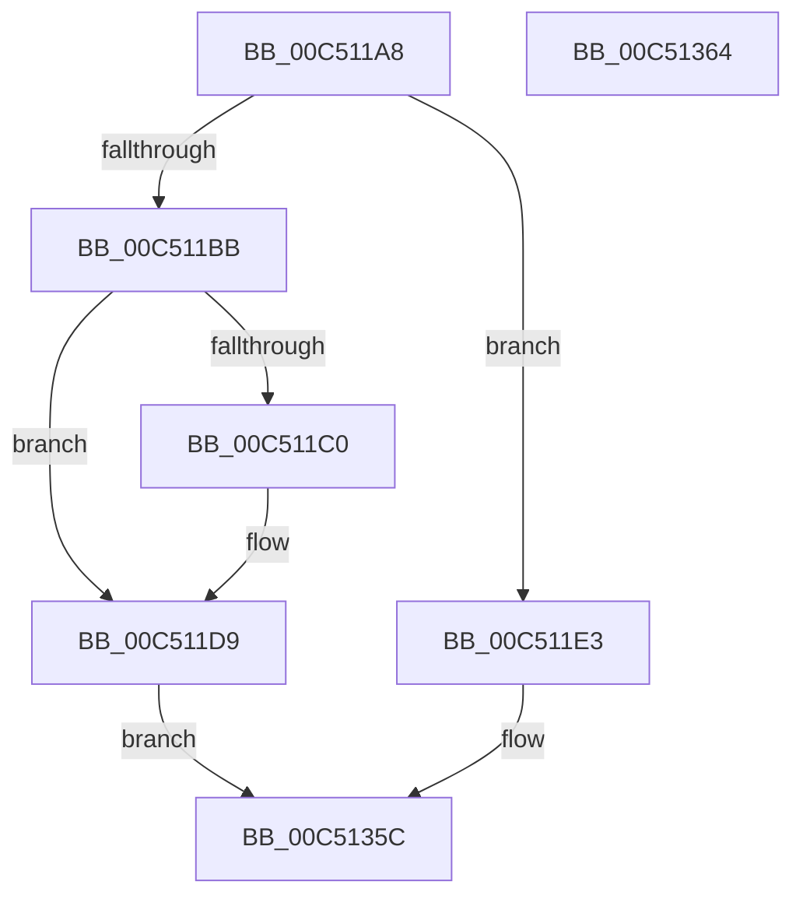

# ExInitSystem

- RVA: `0x00C511A8`–`0x00C51365` (길이 `445` bytes)
- VA: `0x0000000140C511A8`
- 실행 섹션: `INIT`
- PDB 이름 있음: `예`; PDB Function 태그: `아니요`
- unwind 정보 RVA: `0x000D4BD8`
- 디코드: `75`개 명령, `445/445` bytes 표시
- 미해석 바이트: `0` (있으면 어셈블리에 `.byte`로 보존)

> 이 문서는 커널 이미지의 기계어와 PDB 기호를 분석해 생성했습니다. 4번과 5번은 함수 원형과 자료형을 바이너리 사용 방식에서 추정한 C 해석이며 원본 소스 복구 결과는 아닙니다.

## 1. Dependencies

- 직접 호출 지점: **4**; 고유 호출 대상: **4**
- 직접 호출자로 확인된 함수: **2**
- RIP 상대 이미지 참조: **30**

### Outgoing calls
- `0x00C511D3` → [KeBugCheckEx](../../text/4F/KeBugCheckEx_function_004FD660.md) (function, `0x004FD660`)
- `0x00C511D9` → [ExpInitSystemPhase1](ExpInitSystemPhase1_function_00C51508.md) (function, `0x00C51508`)
- `0x00C51352` → [ExpStringCheck](ExpStringCheck_function_00C518D4.md) (function, `0x00C518D4`)
- `0x00C51357` → [ExpInitSystemPhase0](ExpInitSystemPhase0_function_00C5136C.md) (function, `0x00C5136C`)

### Direct callers
- [InitBootProcessor](../C1/InitBootProcessor_function_00C1B1C8.md) at `0x00C1B693`
- [Phase1InitializationDiscard](../C1/Phase1InitializationDiscard_function_00C1C728.md) at `0x00C1D1D6`

### Static image references
- `0x00C511AF` → RVA `0x00FC41A0` (`.data`; read)
- `0x00C511E3` → RVA `0x00B4AE40` (`PAGE`; read)
- `0x00C511F2` → RVA `0x00B4AE38` (`PAGE`; read)
- `0x00C51201` → RVA `0x00B4AE30` (`PAGE`; read)
- `0x00C51210` → RVA `0x00B4AE28` (`PAGE`; read)
- `0x00C5121F` → RVA `0x00B4AE20` (`PAGE`; read)
- `0x00C5122E` → RVA `0x00B4AE18` (`PAGE`; read)
- `0x00C5123D` → RVA `0x00B4AE10` (`PAGE`; read)
- `0x00C5124C` → RVA `0x00B4AE08` (`PAGE`; read)
- `0x00C5125B` → RVA `0x00B4AE00` (`PAGE`; read)
- `0x00C5126A` → RVA `0x00B4ADF8` (`PAGE`; read)
- `0x00C51271` → RVA `0x00B4AD78` (`PAGE`; read)
- `0x00C51278` → RVA `0x00B4AD70` (`PAGE`; read)
- `0x00C5127F` → RVA `0x00B4AD68` (`PAGE`; read)
- `0x00C51286` → RVA `0x00B4AD60` (`PAGE`; read)
- `0x00C51295` → RVA `0x00B4ADF0` (`PAGE`; read)
- `0x00C512A4` → RVA `0x00B4ADE8` (`PAGE`; read)
- `0x00C512B3` → RVA `0x00B4ADE0` (`PAGE`; read)
- `0x00C512C2` → RVA `0x00B4ADD8` (`PAGE`; read)
- `0x00C512CE` → RVA `0x00B4ADD0` (`PAGE`; read)
- `0x00C512DA` → RVA `0x00B4ADC8` (`PAGE`; read)
- `0x00C512E6` → RVA `0x00B4ADC0` (`PAGE`; read)
- `0x00C512F2` → RVA `0x00B4ADB8` (`PAGE`; read)
- `0x00C512FE` → RVA `0x00B4ADB0` (`PAGE`; read)
- `0x00C5130A` → RVA `0x00B4ADA8` (`PAGE`; read)
- `0x00C51316` → RVA `0x00B4ADA0` (`PAGE`; read)
- `0x00C51322` → RVA `0x00B4AD98` (`PAGE`; read)
- `0x00C5132E` → RVA `0x00B4AD90` (`PAGE`; read)
- `0x00C5133A` → RVA `0x00B4AD88` (`PAGE`; read)
- `0x00C51346` → RVA `0x00B4AD80` (`PAGE`; read)

## 2. Other-region calls and transfers

- 다른 실행 섹션으로 향하는 call: **1**
  - `0x00C511D3` → [KeBugCheckEx](../../text/4F/KeBugCheckEx_function_004FD660.md) (`INIT` → `.text`)
- 별도 외부 분기/꼬리 이동을 확인하지 못했습니다.

## 3. Assembly (complete function range)

```asm
00C511A8  48 81 EC F8 00 00 00            sub rsp, 0xf8
00C511AF  8B 15 EB 2F 37 00               mov edx, dword ptr [rip + 0x372feb]
00C511B5  8B C2                           mov eax, edx
00C511B7  85 D2                           test edx, edx
00C511B9  74 28                           je 0x140c511e3
00C511BB  83 F8 01                        cmp eax, 1
00C511BE  74 19                           je 0x140c511d9
00C511C0  48 83 64 24 20 00               and qword ptr [rsp + 0x20], 0
00C511C6  45 33 C9                        xor r9d, r9d
00C511C9  44 8B C2                        mov r8d, edx
00C511CC  41 8D 51 03                     lea edx, [r9 + 3]
00C511D0  8D 4A 30                        lea ecx, [rdx + 0x30]
00C511D3  E8 88 C4 8A FF                  call 0x1404fd660
00C511D8  CC                              int3
00C511D9  E8 2A 03 00 00                  call 0x140c51508
00C511DE  E9 79 01 00 00                  jmp 0x140c5135c
00C511E3  48 8B 05 56 9C EF FF            mov rax, qword ptr [rip - 0x1063aa]
00C511EA  48 89 84 24 E0 00 00 00         mov qword ptr [rsp + 0xe0], rax
00C511F2  48 8B 05 3F 9C EF FF            mov rax, qword ptr [rip - 0x1063c1]
00C511F9  48 89 84 24 D8 00 00 00         mov qword ptr [rsp + 0xd8], rax
00C51201  48 8B 05 28 9C EF FF            mov rax, qword ptr [rip - 0x1063d8]
00C51208  48 89 84 24 D0 00 00 00         mov qword ptr [rsp + 0xd0], rax
00C51210  48 8B 05 11 9C EF FF            mov rax, qword ptr [rip - 0x1063ef]
00C51217  48 89 84 24 C8 00 00 00         mov qword ptr [rsp + 0xc8], rax
00C5121F  48 8B 05 FA 9B EF FF            mov rax, qword ptr [rip - 0x106406]
00C51226  48 89 84 24 C0 00 00 00         mov qword ptr [rsp + 0xc0], rax
00C5122E  48 8B 05 E3 9B EF FF            mov rax, qword ptr [rip - 0x10641d]
00C51235  48 89 84 24 B8 00 00 00         mov qword ptr [rsp + 0xb8], rax
00C5123D  48 8B 05 CC 9B EF FF            mov rax, qword ptr [rip - 0x106434]
00C51244  48 89 84 24 B0 00 00 00         mov qword ptr [rsp + 0xb0], rax
00C5124C  48 8B 05 B5 9B EF FF            mov rax, qword ptr [rip - 0x10644b]
00C51253  48 89 84 24 A8 00 00 00         mov qword ptr [rsp + 0xa8], rax
00C5125B  48 8B 05 9E 9B EF FF            mov rax, qword ptr [rip - 0x106462]
00C51262  48 89 84 24 A0 00 00 00         mov qword ptr [rsp + 0xa0], rax
00C5126A  48 8B 05 87 9B EF FF            mov rax, qword ptr [rip - 0x106479]
00C51271  4C 8B 0D 00 9B EF FF            mov r9, qword ptr [rip - 0x106500]
00C51278  4C 8B 05 F1 9A EF FF            mov r8, qword ptr [rip - 0x10650f]
00C5127F  48 8B 15 E2 9A EF FF            mov rdx, qword ptr [rip - 0x10651e]
00C51286  48 8B 0D D3 9A EF FF            mov rcx, qword ptr [rip - 0x10652d]
00C5128D  48 89 84 24 98 00 00 00         mov qword ptr [rsp + 0x98], rax
00C51295  48 8B 05 54 9B EF FF            mov rax, qword ptr [rip - 0x1064ac]
00C5129C  48 89 84 24 90 00 00 00         mov qword ptr [rsp + 0x90], rax
00C512A4  48 8B 05 3D 9B EF FF            mov rax, qword ptr [rip - 0x1064c3]
00C512AB  48 89 84 24 88 00 00 00         mov qword ptr [rsp + 0x88], rax
00C512B3  48 8B 05 26 9B EF FF            mov rax, qword ptr [rip - 0x1064da]
00C512BA  48 89 84 24 80 00 00 00         mov qword ptr [rsp + 0x80], rax
00C512C2  48 8B 05 0F 9B EF FF            mov rax, qword ptr [rip - 0x1064f1]
00C512C9  48 89 44 24 78                  mov qword ptr [rsp + 0x78], rax
00C512CE  48 8B 05 FB 9A EF FF            mov rax, qword ptr [rip - 0x106505]
00C512D5  48 89 44 24 70                  mov qword ptr [rsp + 0x70], rax
00C512DA  48 8B 05 E7 9A EF FF            mov rax, qword ptr [rip - 0x106519]
00C512E1  48 89 44 24 68                  mov qword ptr [rsp + 0x68], rax
00C512E6  48 8B 05 D3 9A EF FF            mov rax, qword ptr [rip - 0x10652d]
00C512ED  48 89 44 24 60                  mov qword ptr [rsp + 0x60], rax
00C512F2  48 8B 05 BF 9A EF FF            mov rax, qword ptr [rip - 0x106541]
00C512F9  48 89 44 24 58                  mov qword ptr [rsp + 0x58], rax
00C512FE  48 8B 05 AB 9A EF FF            mov rax, qword ptr [rip - 0x106555]
00C51305  48 89 44 24 50                  mov qword ptr [rsp + 0x50], rax
00C5130A  48 8B 05 97 9A EF FF            mov rax, qword ptr [rip - 0x106569]
00C51311  48 89 44 24 48                  mov qword ptr [rsp + 0x48], rax
00C51316  48 8B 05 83 9A EF FF            mov rax, qword ptr [rip - 0x10657d]
00C5131D  48 89 44 24 40                  mov qword ptr [rsp + 0x40], rax
00C51322  48 8B 05 6F 9A EF FF            mov rax, qword ptr [rip - 0x106591]
00C51329  48 89 44 24 38                  mov qword ptr [rsp + 0x38], rax
00C5132E  48 8B 05 5B 9A EF FF            mov rax, qword ptr [rip - 0x1065a5]
00C51335  48 89 44 24 30                  mov qword ptr [rsp + 0x30], rax
00C5133A  48 8B 05 47 9A EF FF            mov rax, qword ptr [rip - 0x1065b9]
00C51341  48 89 44 24 28                  mov qword ptr [rsp + 0x28], rax
00C51346  48 8B 05 33 9A EF FF            mov rax, qword ptr [rip - 0x1065cd]
00C5134D  48 89 44 24 20                  mov qword ptr [rsp + 0x20], rax
00C51352  E8 7D 05 00 00                  call 0x140c518d4
00C51357  E8 10 00 00 00                  call 0x140c5136c
00C5135C  48 81 C4 F8 00 00 00            add rsp, 0xf8
00C51363  C3                              ret
00C51364  CC                              int3
```

## 4. C-style interpretation (structured pseudocode)

```c
__int64 __fastcall ExInitSystem(__int64 a1, __int64 a2, __int64 a3, int a4)
{
    __int64 result;
    __int64 v_rsp;
    unsigned __int64 v_stack_m18;
    unsigned __int64 v_stack_m20;
    unsigned __int64 v_stack_m28;
    unsigned __int64 v_stack_m30;
    unsigned __int64 v_stack_m38;
    unsigned __int64 v_stack_m40;
    unsigned __int64 v_stack_m48;
    unsigned __int64 v_stack_m50;
    unsigned __int64 v_stack_m58;
    unsigned __int64 v_stack_m60;
    unsigned __int64 v_stack_m68;
    unsigned __int64 v_stack_m70;
    unsigned __int64 v_stack_m78;
    unsigned __int64 v_stack_m80;
    unsigned __int64 v_stack_m88;
    unsigned __int64 v_stack_m90;
    unsigned __int64 v_stack_m98;
    unsigned __int64 v_stack_mA0;
    unsigned __int64 v_stack_mA8;
    unsigned __int64 v_stack_mB0;
    unsigned __int64 v_stack_mB8;
    unsigned __int64 v_stack_mC0;
    unsigned __int64 v_stack_mC8;
    unsigned __int64 v_stack_mD0;
    unsigned __int64 v_stack_mD8;

    v_rsp = (v_rsp) - (248);
    if ((unsigned int)((unsigned int)(*(unsigned int *)(v_rip + 3616747))) == 0) goto loc_00C511E3;
    result = (unsigned int)((unsigned int)((unsigned int)(*(unsigned int *)(v_rip + 3616747))));
    if (((unsigned int)((unsigned int)((unsigned int)((unsigned int)(*(unsigned int *)(v_rip + 3616747)))))) != 1) {
        a4 = 0;
        a3 = (unsigned int)((unsigned int)(*(unsigned int *)(v_rip + 3616747)));
        a2 = a4 + 3;
        a1 = a2 + 48;
        result = KeBugCheckEx(a1, a2, a3, a4);
    }
    result = ExpInitSystemPhase1(a1, a2, a3, a4);
    goto loc_00C5135C;
loc_00C511E3:
    v_stack_m18 = *(unsigned __int64 *)(v_rip - 1074090);
    v_stack_m20 = *(unsigned __int64 *)(v_rip - 1074113);
    v_stack_m28 = *(unsigned __int64 *)(v_rip - 1074136);
    v_stack_m30 = *(unsigned __int64 *)(v_rip - 1074159);
    v_stack_m38 = *(unsigned __int64 *)(v_rip - 1074182);
    v_stack_m40 = *(unsigned __int64 *)(v_rip - 1074205);
    v_stack_m48 = *(unsigned __int64 *)(v_rip - 1074228);
    v_stack_m50 = *(unsigned __int64 *)(v_rip - 1074251);
    v_stack_m58 = *(unsigned __int64 *)(v_rip - 1074274);
    v_stack_m60 = *(unsigned __int64 *)(v_rip - 1074297);
    v_stack_m68 = *(unsigned __int64 *)(v_rip - 1074348);
    v_stack_m70 = *(unsigned __int64 *)(v_rip - 1074371);
    v_stack_m78 = *(unsigned __int64 *)(v_rip - 1074394);
    v_stack_m80 = *(unsigned __int64 *)(v_rip - 1074417);
    v_stack_m88 = *(unsigned __int64 *)(v_rip - 1074437);
    v_stack_m90 = *(unsigned __int64 *)(v_rip - 1074457);
    v_stack_m98 = *(unsigned __int64 *)(v_rip - 1074477);
    v_stack_mA0 = *(unsigned __int64 *)(v_rip - 1074497);
    v_stack_mA8 = *(unsigned __int64 *)(v_rip - 1074517);
    v_stack_mB0 = *(unsigned __int64 *)(v_rip - 1074537);
    v_stack_mB8 = *(unsigned __int64 *)(v_rip - 1074557);
    v_stack_mC0 = *(unsigned __int64 *)(v_rip - 1074577);
    v_stack_mC8 = *(unsigned __int64 *)(v_rip - 1074597);
    v_stack_mD0 = *(unsigned __int64 *)(v_rip - 1074617);
    v_stack_mD8 = *(unsigned __int64 *)(v_rip - 1074637);
    result = ExpStringCheck(*(unsigned __int64 *)(v_rip - 1074477), *(unsigned __int64 *)(v_rip - 1074462), *(unsigned __int64 *)(v_rip - 1074447), *(unsigned __int64 *)(v_rip - 1074432));
    result = ExpInitSystemPhase0(*(unsigned __int64 *)(v_rip - 1074477), *(unsigned __int64 *)(v_rip - 1074462), *(unsigned __int64 *)(v_rip - 1074447), *(unsigned __int64 *)(v_rip - 1074432));
loc_00C5135C:
    v_rsp = (v_rsp) + (248);
    return result;
}
```

## 5. (Beta) C Style

```c
int64_t ExInitSystem(int64_t Arg1, int64_t Arg2, int64_t Arg3, int32_t Arg4)
{
    int64_t result;
    int64_t local_rsp;
    uint64_t v_stack_m18;
    uint64_t v_stack_m20;
    uint64_t v_stack_m28;
    uint64_t v_stack_m30;
    uint64_t v_stack_m38;
    uint64_t v_stack_m40;
    uint64_t v_stack_m48;
    uint64_t v_stack_m50;
    uint64_t v_stack_m58;
    uint64_t v_stack_m60;
    uint64_t v_stack_m68;
    uint64_t v_stack_m70;
    uint64_t v_stack_m78;
    uint64_t v_stack_m80;
    uint64_t v_stack_m88;
    uint64_t v_stack_m90;
    uint64_t v_stack_m98;
    uint64_t v_stack_mA0;
    uint64_t v_stack_mA8;
    uint64_t v_stack_mB0;
    uint64_t v_stack_mB8;
    uint64_t v_stack_mC0;
    uint64_t v_stack_mC8;
    uint64_t v_stack_mD0;
    uint64_t v_stack_mD8;

    local_rsp = (local_rsp) - (248);
    if ((uint32_t)((uint32_t)(*(uint32_t *)(v_rip + 0x372FEB))) == 0) goto loc_00C511E3;
    result = (uint32_t)((uint32_t)((uint32_t)(*(uint32_t *)(v_rip + 0x372FEB))));
    if (((uint32_t)((uint32_t)((uint32_t)((uint32_t)(*(uint32_t *)(v_rip + 0x372FEB)))))) != 1) {
        Arg4 = 0;
        Arg3 = (uint32_t)((uint32_t)(*(uint32_t *)(v_rip + 0x372FEB)));
        Arg2 = Arg4 + 3;
        Arg1 = Arg2 + 48;
        result = KeBugCheckEx(Arg1, Arg2, Arg3, Arg4);
    }
    result = ExpInitSystemPhase1(Arg1, Arg2, Arg3, Arg4);
    goto loc_00C5135C;
loc_00C511E3:
    v_stack_m18 = *(uint64_t *)(v_rip - 0x1063AA);
    v_stack_m20 = *(uint64_t *)(v_rip - 0x1063C1);
    v_stack_m28 = *(uint64_t *)(v_rip - 0x1063D8);
    v_stack_m30 = *(uint64_t *)(v_rip - 0x1063EF);
    v_stack_m38 = *(uint64_t *)(v_rip - 0x106406);
    v_stack_m40 = *(uint64_t *)(v_rip - 0x10641D);
    v_stack_m48 = *(uint64_t *)(v_rip - 0x106434);
    v_stack_m50 = *(uint64_t *)(v_rip - 0x10644B);
    v_stack_m58 = *(uint64_t *)(v_rip - 0x106462);
    v_stack_m60 = *(uint64_t *)(v_rip - 0x106479);
    v_stack_m68 = *(uint64_t *)(v_rip - 0x1064AC);
    v_stack_m70 = *(uint64_t *)(v_rip - 0x1064C3);
    v_stack_m78 = *(uint64_t *)(v_rip - 0x1064DA);
    v_stack_m80 = *(uint64_t *)(v_rip - 0x1064F1);
    v_stack_m88 = *(uint64_t *)(v_rip - 0x106505);
    v_stack_m90 = *(uint64_t *)(v_rip - 0x106519);
    v_stack_m98 = *(uint64_t *)(v_rip - 0x10652D);
    v_stack_mA0 = *(uint64_t *)(v_rip - 0x106541);
    v_stack_mA8 = *(uint64_t *)(v_rip - 0x106555);
    v_stack_mB0 = *(uint64_t *)(v_rip - 0x106569);
    v_stack_mB8 = *(uint64_t *)(v_rip - 0x10657D);
    v_stack_mC0 = *(uint64_t *)(v_rip - 0x106591);
    v_stack_mC8 = *(uint64_t *)(v_rip - 0x1065A5);
    v_stack_mD0 = *(uint64_t *)(v_rip - 0x1065B9);
    v_stack_mD8 = *(uint64_t *)(v_rip - 0x1065CD);
    result = ExpStringCheck(*(uint64_t *)(v_rip - 0x10652D), *(uint64_t *)(v_rip - 0x10651E), *(uint64_t *)(v_rip - 0x10650F), *(uint64_t *)(v_rip - 0x106500));
    result = ExpInitSystemPhase0(*(uint64_t *)(v_rip - 0x10652D), *(uint64_t *)(v_rip - 0x10651E), *(uint64_t *)(v_rip - 0x10650F), *(uint64_t *)(v_rip - 0x106500));
loc_00C5135C:
    local_rsp = (local_rsp) + (248);
    return result;
}
```

## 6. Execution-region graph

[열기: 2D/3D 그래프와 함수 탐색 컨트롤 패널](../../../control-panel.html?section=init&rva=0x00C511A8&view=graph)

- 2D 그래프는 위에서 아래로 흐르고, 3D 그래프는 빈 공간을 드래그해 회전합니다. Shift+드래그는 이동, 휠은 확대·축소, 함수 노드 선택은 대상 보고서 이동입니다.

### Static fallback


