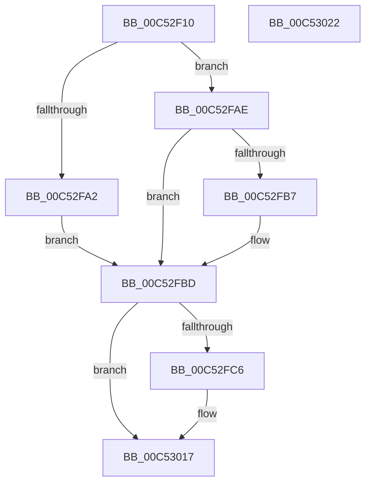

# ExInitializePoolTracker

- RVA: `0x00C52F10`–`0x00C53023` (길이 `275` bytes)
- VA: `0x0000000140C52F10`
- 실행 섹션: `INIT`
- PDB 이름 있음: `예`; PDB Function 태그: `아니요`
- unwind 정보 RVA: `0x00068D5C`
- 디코드: `65`개 명령, `275/275` bytes 표시
- 미해석 바이트: `0` (있으면 어셈블리에 `.byte`로 보존)

> 이 문서는 커널 이미지의 기계어와 PDB 기호를 분석해 생성했습니다. 4번과 5번은 함수 원형과 자료형을 바이너리 사용 방식에서 추정한 C 해석이며 원본 소스 복구 결과는 아닙니다.

## 1. Dependencies

- 직접 호출 지점: **5**; 고유 호출 대상: **4**
- 직접 호출자로 확인된 함수: **1**
- RIP 상대 이미지 참조: **7**

### Outgoing calls
- `0x00C52F62` → [ExGenRandom](../../text/41/ExGenRandom_function_0041B010.md) (function, `0x0041B010`)
- `0x00C52F6F` → [ExGenRandom](../../text/41/ExGenRandom_function_0041B010.md) (function, `0x0041B010`)
- `0x00C52FBD` → [ExpInitializePoolTrackerTable](../../text/65/ExpInitializePoolTrackerTable_function_00656860.md) (function, `0x00656860`)
- `0x00C52FD4` → [ExpSeedHotTags](ExpSeedHotTags_function_00C5302C.md) (function, `0x00C5302C`)
- `0x00C53010` → [ExpInsertPoolTracker](../../text/2E/ExpInsertPoolTracker_function_002EEFAC.md) (function, `0x002EEFAC`)

### Direct callers
- [ExInitializePoolHeapManagement](../../text/65/ExInitializePoolHeapManagement_function_0065C3D0.md) at `0x0065C5EE`

### Static image references
- `0x00C52F81` → RVA `0x00FC5120` (`ALMOSTRO`; read)
- `0x00C52F8E` → RVA `0x00FC7228` (`ALMOSTRO`; write)
- `0x00C52F97` → RVA `0x00FC6C80` (`ALMOSTRO`; write)
- `0x00C52FC6` → RVA `0x00EFED60` (`.data`; read)
- `0x00C52FCD` → RVA `0x00EFAD20` (`.data`; write)
- `0x00C52FD9` → RVA `0x00EFED50` (`.data`; read)
- `0x00C52FF2` → RVA `0x00EFAD00` (`.data`; read/write)

## 2. Other-region calls and transfers

- 다른 실행 섹션으로 향하는 call: **4**
  - `0x00C52F62` → [ExGenRandom](../../text/41/ExGenRandom_function_0041B010.md) (`INIT` → `.text`)
  - `0x00C52F6F` → [ExGenRandom](../../text/41/ExGenRandom_function_0041B010.md) (`INIT` → `.text`)
  - `0x00C52FBD` → [ExpInitializePoolTrackerTable](../../text/65/ExpInitializePoolTrackerTable_function_00656860.md) (`INIT` → `.text`)
  - `0x00C53010` → [ExpInsertPoolTracker](../../text/2E/ExpInsertPoolTracker_function_002EEFAC.md) (`INIT` → `.text`)
- 별도 외부 분기/꼬리 이동을 확인하지 못했습니다.

## 3. Assembly (complete function range)

```asm
00C52F10  48 89 5C 24 10                  mov qword ptr [rsp + 0x10], rbx
00C52F15  57                              push rdi
00C52F16  48 83 EC 20                     sub rsp, 0x20
00C52F1A  48 B9 14 00 00 00 80 F7 FF FF   movabs rcx, 0xfffff78000000014
00C52F24  48 8B 09                        mov rcx, qword ptr [rcx]
00C52F27  65 4C 8B 04 25 20 00 00 00      mov r8, qword ptr gs:[0x20]
00C52F30  8B F9                           mov edi, ecx
00C52F32  48 C1 E7 20                     shl rdi, 0x20
00C52F36  0F 31                           rdtsc
00C52F38  48 C1 E9 20                     shr rcx, 0x20
00C52F3C  48 C1 E2 20                     shl rdx, 0x20
00C52F40  48 0B C2                        or rax, rdx
00C52F43  48 63 D1                        movsxd rdx, ecx
00C52F46  41 8B 88 38 2D 00 00            mov ecx, dword ptr [r8 + 0x2d38]
00C52F4D  48 33 C2                        xor rax, rdx
00C52F50  48 33 C1                        xor rax, rcx
00C52F53  41 8B 88 50 86 00 00            mov ecx, dword ptr [r8 + 0x8650]
00C52F5A  48 33 C1                        xor rax, rcx
00C52F5D  33 C9                           xor ecx, ecx
00C52F5F  48 33 F8                        xor rdi, rax
00C52F62  E8 A9 80 7C FF                  call 0x14041b010
00C52F67  8B D8                           mov ebx, eax
00C52F69  33 C9                           xor ecx, ecx
00C52F6B  48 C1 E3 20                     shl rbx, 0x20
00C52F6F  E8 9C 80 7C FF                  call 0x14041b010
00C52F74  8B C0                           mov eax, eax
00C52F76  BA 01 00 00 00                  mov edx, 1
00C52F7B  48 0B C3                        or rax, rbx
00C52F7E  48 33 F8                        xor rdi, rax
00C52F81  8B 05 99 21 37 00               mov eax, dword ptr [rip + 0x372199]
00C52F87  48 0F 44 FA                     cmove rdi, rdx
00C52F8B  0F BD C8                        bsr ecx, eax
00C52F8E  48 89 3D 93 42 37 00            mov qword ptr [rip + 0x374293], rdi
00C52F95  D3 E2                           shl edx, cl
00C52F97  89 15 E3 3C 37 00               mov dword ptr [rip + 0x373ce3], edx
00C52F9D  83 FA 10                        cmp edx, 0x10
00C52FA0  73 0C                           jae 0x140c52fae
00C52FA2  C7 05 D4 3C 37 00 10 00 00 00   mov dword ptr [rip + 0x373cd4], 0x10
00C52FAC  EB 0F                           jmp 0x140c52fbd
00C52FAE  B8 00 10 00 00                  mov eax, 0x1000
00C52FB3  3B D0                           cmp edx, eax
00C52FB5  76 06                           jbe 0x140c52fbd
00C52FB7  89 05 C3 3C 37 00               mov dword ptr [rip + 0x373cc3], eax
00C52FBD  E8 9E 38 A0 FF                  call 0x140656860
00C52FC2  85 C0                           test eax, eax
00C52FC4  78 51                           js 0x140c53017
00C52FC6  48 8B 05 93 BD 2A 00            mov rax, qword ptr [rip + 0x2abd93]
00C52FCD  48 89 05 4C 7D 2A 00            mov qword ptr [rip + 0x2a7d4c], rax
00C52FD4  E8 53 00 00 00                  call 0x140c5302c
00C52FD9  48 8B 05 70 BD 2A 00            mov rax, qword ptr [rip + 0x2abd70]
00C52FE0  B9 50 6F 6F 6C                  mov ecx, 0x6c6f6f50
00C52FE5  4C 8B 0D 74 BD 2A 00            mov r9, qword ptr [rip + 0x2abd74]
00C52FEC  41 B8 40 00 00 00               mov r8d, 0x40
00C52FF2  48 83 25 06 7D 2A 00 00         and qword ptr [rip + 0x2a7d06], 0
00C52FFA  48 8D 14 80                     lea rdx, [rax + rax*4]
00C52FFE  48 C1 E2 04                     shl rdx, 4
00C53002  48 81 C2 FF 0F 00 00            add rdx, 0xfff
00C53009  48 81 E2 00 F0 FF FF            and rdx, 0xfffffffffffff000
00C53010  E8 97 BF 69 FF                  call 0x1402eefac
00C53015  33 C0                           xor eax, eax
00C53017  48 8B 5C 24 38                  mov rbx, qword ptr [rsp + 0x38]
00C5301C  48 83 C4 20                     add rsp, 0x20
00C53020  5F                              pop rdi
00C53021  C3                              ret
00C53022  CC                              int3
```

## 4. C-style interpretation (structured pseudocode)

```c
__int64 __fastcall ExInitializePoolTracker(__int64 a1, __int64 a2)
{
    __int64 result;
    __int64 v_rbx;
    __int64 v_rdi;
    __int64 v_rsp;
    unsigned __int64 v_stack_p10;

    v_stack_p10 = v_rbx;
    v_rsp = (v_rsp) - (32);
    v_rdi = ((unsigned int)((unsigned int)(*(unsigned __int64 *)(a1)))) << (32);
    a1 = (*(unsigned __int64 *)(a1)) >> (32);
    a2 = (a2) << (32);
    result = (result) | (a2);
    result = (result) ^ ((int)((unsigned int)(a1)));
    result = (result) ^ ((unsigned int)(*(unsigned int *)(*(unsigned __int64 *)(gs_base + (0 + 32)) + 11576)));
    result = (result) ^ ((unsigned int)(*(unsigned int *)(*(unsigned __int64 *)(gs_base + (0 + 32)) + 34384)));
    a1 = 0;
    v_rdi = (v_rdi) ^ (result);
    result = ExGenRandom(a1, (int)((unsigned int)(a1)), *(unsigned __int64 *)(gs_base + (0 + 32)), a4);
    a1 = 0;
    v_rbx = ((unsigned int)((unsigned int)(result))) << (32);
    result = ExGenRandom(a1, (int)((unsigned int)(a1)), *(unsigned __int64 *)(gs_base + (0 + 32)), a4);
    result = ((unsigned int)((unsigned int)(result))) | (v_rbx);
    v_rdi = (v_rdi) ^ (result);
    if (condition_is_equal) { v_rdi = 1; }
    *(unsigned __int64 *)(v_rip + 3621523) = v_rdi;
    a2 = (unsigned int)((1) << (0));
    *(unsigned int *)(v_rip + 3620067) = (unsigned int)(a2);
    if (((unsigned int)(a2)) >= 16) goto loc_00C52FAE;
    *(unsigned int *)(v_rip + 3620052) = 16;
    goto loc_00C52FBD;
loc_00C52FAE:
    if (((unsigned int)(a2)) >= = ((unsigned int)((unsigned int)(0x1000ULL)))) {
        *(unsigned int *)(v_rip + 3620035) = (unsigned int)((unsigned int)(0x1000ULL));
    }
    result = ExpInitializePoolTrackerTable(a1, a2, *(unsigned __int64 *)(gs_base + (0 + 32)), a4);
    if (!(sign_flag)) {
        result = *(unsigned __int64 *)(v_rip + 2801043);
        *(unsigned __int64 *)(v_rip + 2784588) = result;
        result = ExpSeedHotTags(a1, a2, *(unsigned __int64 *)(gs_base + (0 + 32)), a4);
        result = *(unsigned __int64 *)(v_rip + 2801008);
        a1 = 0x6C6F6F50ULL;
        a4 = *(unsigned __int64 *)(v_rip + 2801012);
        a3 = 64;
        a2 = result + result * 4;
        a2 = (a2) << (4);
        a2 = (a2) + (0xFFFULL);
        a2 = (a2) & (0xFFFFFFFFFFFFF000ULL);
        result = ExpInsertPoolTracker(a1, a2, a3, a4);
        result = 0;
    }
    v_rsp = (v_rsp) + (32);
    return result;
}
```

## 5. (Beta) C Style

```c
int64_t ExInitializePoolTracker(int64_t Arg1, int64_t Arg2)
{
    int64_t result;
    int64_t local_rbx;
    int64_t local_rdi;
    int64_t local_rsp;
    uint64_t v_stack_p10;

    v_stack_p10 = local_rbx;
    local_rsp = (local_rsp) - (32);
    local_rdi = ((uint32_t)((uint32_t)(*(uint64_t *)(Arg1)))) << (32);
    Arg1 = (*(uint64_t *)(Arg1)) >> (32);
    Arg2 = (Arg2) << (32);
    result = (result) | (Arg2);
    result = (result) ^ ((int32_t)((uint32_t)(Arg1)));
    result = (result) ^ ((uint32_t)(*(uint32_t *)(*(uint64_t *)(gs_base + (0 + 0x20)) + 0x2D38)));
    result = (result) ^ ((uint32_t)(*(uint32_t *)(*(uint64_t *)(gs_base + (0 + 0x20)) + 0x8650)));
    Arg1 = 0;
    local_rdi = (local_rdi) ^ (result);
    result = ExGenRandom(Arg1, (int32_t)((uint32_t)(Arg1)), *(uint64_t *)(gs_base + (0 + 0x20)), a4);
    Arg1 = 0;
    local_rbx = ((uint32_t)((uint32_t)(result))) << (32);
    result = ExGenRandom(Arg1, (int32_t)((uint32_t)(Arg1)), *(uint64_t *)(gs_base + (0 + 0x20)), a4);
    result = ((uint32_t)((uint32_t)(result))) | (local_rbx);
    local_rdi = (local_rdi) ^ (result);
    if (condition_is_equal) { local_rdi = 1; }
    *(uint64_t *)(v_rip + 0x374293) = local_rdi;
    Arg2 = (uint32_t)((1) << (0));
    *(uint32_t *)(v_rip + 0x373CE3) = (uint32_t)(Arg2);
    if (((uint32_t)(Arg2)) >= 16) goto loc_00C52FAE;
    *(uint32_t *)(v_rip + 0x373CD4) = 16;
    goto loc_00C52FBD;
loc_00C52FAE:
    if (((uint32_t)(Arg2)) >= = ((uint32_t)((uint32_t)(0x1000ULL)))) {
        *(uint32_t *)(v_rip + 0x373CC3) = (uint32_t)((uint32_t)(0x1000ULL));
    }
    result = ExpInitializePoolTrackerTable(Arg1, Arg2, *(uint64_t *)(gs_base + (0 + 0x20)), a4);
    if (!(sign_flag)) {
        result = *(uint64_t *)(v_rip + 0x2ABD93);
        *(uint64_t *)(v_rip + 0x2A7D4C) = result;
        result = ExpSeedHotTags(Arg1, Arg2, *(uint64_t *)(gs_base + (0 + 0x20)), a4);
        result = *(uint64_t *)(v_rip + 0x2ABD70);
        Arg1 = 0x6C6F6F50ULL;
        a4 = *(uint64_t *)(v_rip + 0x2ABD74);
        a3 = 64;
        Arg2 = result + result * 4;
        Arg2 = (Arg2) << (4);
        Arg2 = (Arg2) + (0xFFFULL);
        Arg2 = (Arg2) & (0xFFFFFFFFFFFFF000ULL);
        result = ExpInsertPoolTracker(Arg1, Arg2, a3, a4);
        result = 0;
    }
    local_rsp = (local_rsp) + (32);
    return result;
}
```

## 6. Execution-region graph

[열기: 2D/3D 그래프와 함수 탐색 컨트롤 패널](../../../control-panel.html?section=init&rva=0x00C52F10&view=graph)

- 2D 그래프는 위에서 아래로 흐르고, 3D 그래프는 빈 공간을 드래그해 회전합니다. Shift+드래그는 이동, 휠은 확대·축소, 함수 노드 선택은 대상 보고서 이동입니다.

### Static fallback


