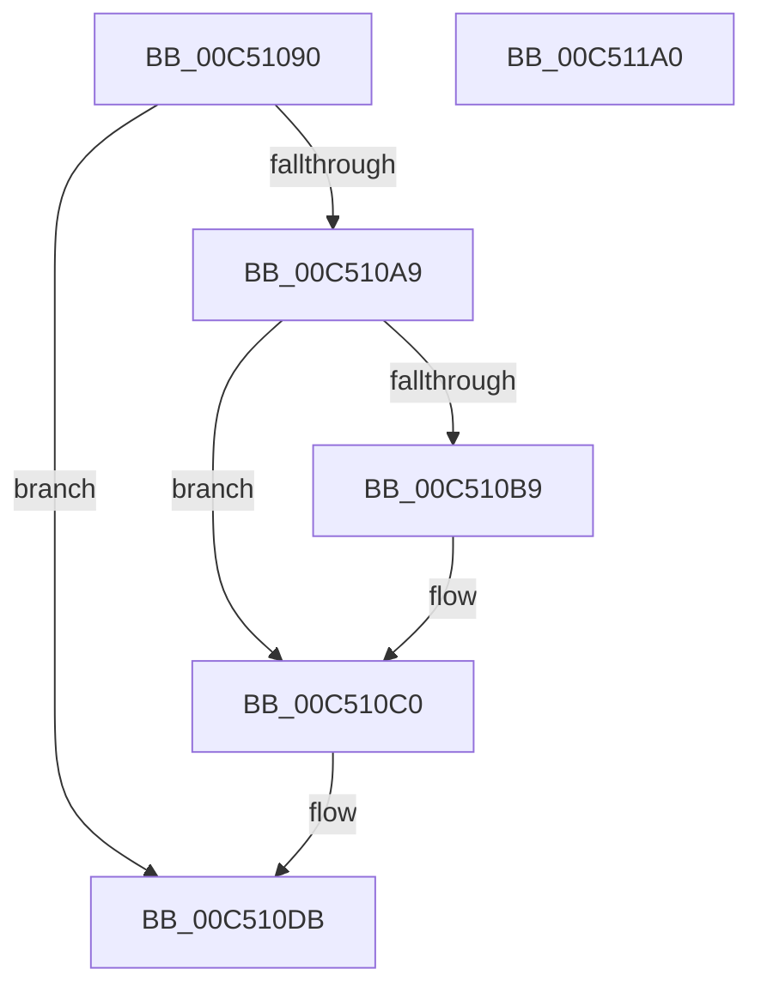

# ExInitializeTimeRefresh

- RVA: `0x00C51090`–`0x00C511A1` (길이 `273` bytes)
- VA: `0x0000000140C51090`
- 실행 섹션: `INIT`
- PDB 이름 있음: `예`; PDB Function 태그: `아니요`
- unwind 정보 RVA: `0x00064C80`
- 디코드: `50`개 명령, `273/273` bytes 표시
- 미해석 바이트: `0` (있으면 어셈블리에 `.byte`로 보존)

> 이 문서는 커널 이미지의 기계어와 PDB 기호를 분석해 생성했습니다. 4번과 5번은 함수 원형과 자료형을 바이너리 사용 방식에서 추정한 C 해석이며 원본 소스 복구 결과는 아닙니다.

## 1. Dependencies

- 직접 호출 지점: **4**; 고유 호출 대상: **4**
- 직접 호출자로 확인된 함수: **1**
- RIP 상대 이미지 참조: **24**

### Outgoing calls
- `0x00C5109A` → [ZwLockProductActivationKeys](../../text/6A/ZwLockProductActivationKeys_function_006AF370.md) (function, `0x006AF370`)
- `0x00C510B0` → [ExGetExpirationDate](../../page/7C/ExGetExpirationDate_function_007C78C8.md) (function, `0x007C78C8`)
- `0x00C51149` → [KiInitializeTimer2](../../text/3A/KiInitializeTimer2_function_003A3288.md) (function, `0x003A3288`)
- `0x00C51179` → [KeSetTimer2](../../text/3A/KeSetTimer2_function_003A08E0.md) (function, `0x003A08E0`)

### Direct callers
- [Phase1InitializationDiscard](../C1/Phase1InitializationDiscard_function_00C1C728.md) at `0x00C1D6A6`

### Static image references
- `0x00C510A1` → RVA `0x00EF0138` (`.data`; read)
- `0x00C510A9` → RVA `0x00FD9F30` (`PAGEDATA`; read)
- `0x00C510B9` → RVA `0x00FD9F30` (`PAGEDATA`; write)
- `0x00C510C0` → RVA `0x00FC5008` (`ALMOSTRO`; read)
- `0x00C510CE` → RVA `0x00FD9A9C` (`PAGEDATA`; write)
- `0x00C510DB` → RVA `0x004B8DC0` (`ExpTimeRefreshDpcRoutine`; read)
- `0x00C510E2` → RVA `0x00EFEF60` (`.data`; write)
- `0x00C510EC` → RVA `0x00EFEF78` (`.data`; write)
- `0x00C510F3` → RVA `0x006556E0` (`ExpTimeRefreshCallback`; read)
- `0x00C510FA` → RVA `0x00EFEFC0` (`.data`; read)
- `0x00C51101` → RVA `0x00EFEF98` (`.data`; write)
- `0x00C51108` → RVA `0x00EFEF80` (`.data`; write)
- `0x00C5110F` → RVA `0x00EFEEC0` (`.data`; read)
- `0x00C51116` → RVA `0x00B72A80` (`ExpTimeRefreshWork`; read)
- `0x00C5111D` → RVA `0x00EFEF70` (`.data`; write)
- `0x00C5112A` → RVA `0x00EFEFB0` (`.data`; write)
- `0x00C51134` → RVA `0x00EFEFB8` (`.data`; write)
- `0x00C5113B` → RVA `0x00EFEFA0` (`.data`; write)
- `0x00C51142` → RVA `0x00EFEEC2` (`.data`; write)
- `0x00C5116B` → RVA `0x00EFEE58` (`.data`; write)
- `0x00C5117E` → RVA `0x00EFEE40` (`.data`; read)
- `0x00C51185` → RVA `0x00EFEFC8` (`.data`; write)
- `0x00C5118C` → RVA `0x00EFEE48` (`.data`; write)
- `0x00C51193` → RVA `0x00EFEE40` (`.data`; write)

## 2. Other-region calls and transfers

- 다른 실행 섹션으로 향하는 call: **4**
  - `0x00C5109A` → [ZwLockProductActivationKeys](../../text/6A/ZwLockProductActivationKeys_function_006AF370.md) (`INIT` → `.text`)
  - `0x00C510B0` → [ExGetExpirationDate](../../page/7C/ExGetExpirationDate_function_007C78C8.md) (`INIT` → `PAGE`)
  - `0x00C51149` → [KiInitializeTimer2](../../text/3A/KiInitializeTimer2_function_003A3288.md) (`INIT` → `.text`)
  - `0x00C51179` → [KeSetTimer2](../../text/3A/KeSetTimer2_function_003A08E0.md) (`INIT` → `.text`)
- 별도 외부 분기/꼬리 이동을 확인하지 못했습니다.

## 3. Assembly (complete function range)

```asm
00C51090  40 53                           push rbx
00C51092  48 83 EC 30                     sub rsp, 0x30
00C51096  33 D2                           xor edx, edx
00C51098  33 C9                           xor ecx, ecx
00C5109A  E8 D1 E2 A5 FF                  call 0x1406af370
00C5109F  33 DB                           xor ebx, ebx
00C510A1  38 1D 91 F0 29 00               cmp byte ptr [rip + 0x29f091], bl
00C510A7  75 32                           jne 0x140c510db
00C510A9  48 8D 0D 80 8E 38 00            lea rcx, [rip + 0x388e80]
00C510B0  E8 13 68 B7 FF                  call 0x1407c78c8
00C510B5  85 C0                           test eax, eax
00C510B7  79 07                           jns 0x140c510c0
00C510B9  48 89 1D 70 8E 38 00            mov qword ptr [rip + 0x388e70], rbx
00C510C0  48 8B 0D 41 3F 37 00            mov rcx, qword ptr [rip + 0x373f41]
00C510C7  48 8B 05 62 8E 38 00            mov rax, qword ptr [rip + 0x388e62]
00C510CE  88 1D C8 89 38 00               mov byte ptr [rip + 0x3889c8], bl
00C510D4  48 89 81 C8 02 00 00            mov qword ptr [rcx + 0x2c8], rax
00C510DB  48 8D 05 DE 7C 86 FF            lea rax, [rip - 0x798322]
00C510E2  C7 05 74 DE 2A 00 13 01 00 00   mov dword ptr [rip + 0x2ade74], 0x113
00C510EC  48 89 05 85 DE 2A 00            mov qword ptr [rip + 0x2ade85], rax
00C510F3  48 8D 15 E6 45 A0 FF            lea rdx, [rip - 0x5fba1a]
00C510FA  48 8D 05 BF DE 2A 00            lea rax, [rip + 0x2adebf]
00C51101  48 89 1D 90 DE 2A 00            mov qword ptr [rip + 0x2ade90], rbx
00C51108  48 89 05 71 DE 2A 00            mov qword ptr [rip + 0x2ade71], rax
00C5110F  48 8D 0D AA DD 2A 00            lea rcx, [rip + 0x2addaa]
00C51116  48 8D 05 63 19 F2 FF            lea rax, [rip - 0xde69d]
00C5111D  48 89 1D 4C DE 2A 00            mov qword ptr [rip + 0x2ade4c], rbx
00C51124  41 B9 08 00 00 00               mov r9d, 8
00C5112A  48 89 05 7F DE 2A 00            mov qword ptr [rip + 0x2ade7f], rax
00C51131  45 33 C0                        xor r8d, r8d
00C51134  48 89 1D 7D DE 2A 00            mov qword ptr [rip + 0x2ade7d], rbx
00C5113B  48 89 1D 5E DE 2A 00            mov qword ptr [rip + 0x2ade5e], rbx
00C51142  66 89 1D 79 DD 2A 00            mov word ptr [rip + 0x2add79], bx
00C51149  E8 3A 21 75 FF                  call 0x1403a3288
00C5114E  48 83 4C 24 28 FF               or qword ptr [rsp + 0x28], 0xffffffffffffffff
00C51154  4C 8D 4C 24 20                  lea r9, [rsp + 0x20]
00C51159  48 BA 00 98 3B 9E F7 FF FF FF   movabs rdx, 0xfffffff79e3b9800
00C51163  48 89 5C 24 20                  mov qword ptr [rsp + 0x20], rbx
00C51168  45 33 C0                        xor r8d, r8d
00C5116B  48 89 15 E6 DC 2A 00            mov qword ptr [rip + 0x2adce6], rdx
00C51172  48 8D 0D 47 DD 2A 00            lea rcx, [rip + 0x2add47]
00C51179  E8 62 F7 74 FF                  call 0x1403a08e0
00C5117E  48 8D 05 BB DC 2A 00            lea rax, [rip + 0x2adcbb]
00C51185  48 89 1D 3C DE 2A 00            mov qword ptr [rip + 0x2ade3c], rbx
00C5118C  48 89 05 B5 DC 2A 00            mov qword ptr [rip + 0x2adcb5], rax
00C51193  48 89 05 A6 DC 2A 00            mov qword ptr [rip + 0x2adca6], rax
00C5119A  48 83 C4 30                     add rsp, 0x30
00C5119E  5B                              pop rbx
00C5119F  C3                              ret
00C511A0  CC                              int3
```

## 4. C-style interpretation (structured pseudocode)

```c
__int64 __fastcall ExInitializeTimeRefresh(int a1, int a2, int a3)
{
    __int64 result;
    __int64 v_rbx;
    __int64 v_rsp;
    unsigned __int64 v_stack_m10;
    unsigned __int64 v_stack_m18;

    v_rsp = (v_rsp) - (48);
    a2 = 0;
    a1 = 0;
    result = ZwLockProductActivationKeys(a1, a2, a3, a4);
    v_rbx = 0;
    if ((*(unsigned __int8 *)(v_rip + 2748561)) != 0) goto loc_00C510DB;
    result = ExGetExpirationDate(v_rip + 3706496, a2, a3, a4);
    if (sign_flag) {
        *(unsigned __int64 *)(v_rip + 3706480) = 0;
    }
    *(unsigned __int8 *)(v_rip + 3705288) = 0;
    *(unsigned __int64 *)(*(unsigned __int64 *)(v_rip + 3620673) + 712) = *(unsigned __int64 *)(v_rip + 3706466);
loc_00C510DB:
    *(unsigned int *)(v_rip + 2809460) = 275;
    *(unsigned __int64 *)(v_rip + 2809477) = v_rip - 7963426;
    *(unsigned __int64 *)(v_rip + 2809488) = 0;
    *(unsigned __int64 *)(v_rip + 2809457) = v_rip + 2809535;
    *(unsigned __int64 *)(v_rip + 2809420) = 0;
    *(unsigned __int64 *)(v_rip + 2809471) = v_rip - 911005;
    a3 = 0;
    *(unsigned __int64 *)(v_rip + 2809469) = 0;
    *(unsigned __int64 *)(v_rip + 2809438) = 0;
    *(unsigned __int16 *)(v_rip + 2809209) = 0;
    result = KiInitializeTimer2(v_rip + 2809258, v_rip - 6273562, a3, 8);
    v_stack_m18 = 0;
    a3 = 0;
    *(unsigned __int64 *)(v_rip + 2809062) = v_rip - 6273562;
    result = KeSetTimer2(v_rip + 2809159, v_rip - 6273562, a3, v_stack_m18);
    *(unsigned __int64 *)(v_rip + 2809404) = 0;
    *(unsigned __int64 *)(v_rip + 2809013) = v_rip + 2809019;
    *(unsigned __int64 *)(v_rip + 2808998) = v_rip + 2809019;
    v_rsp = (v_rsp) + (48);
    return v_rip + 2809019;
}
```

## 5. (Beta) C Style

```c
int64_t ExInitializeTimeRefresh(int32_t Arg1, int32_t Arg2, int32_t Arg3)
{
    int64_t result;
    int64_t local_rbx;
    int64_t local_rsp;
    uint64_t v_stack_m10;
    uint64_t v_stack_m18;

    local_rsp = (local_rsp) - (48);
    Arg2 = 0;
    Arg1 = 0;
    result = ZwLockProductActivationKeys(Arg1, Arg2, Arg3, a4);
    local_rbx = 0;
    if ((*(uint8_t *)(v_rip + 0x29F091)) != 0) goto loc_00C510DB;
    result = ExGetExpirationDate(v_rip + 3706496, Arg2, Arg3, a4);
    if (sign_flag) {
        *(uint64_t *)(v_rip + 0x388E70) = 0;
    }
    *(uint8_t *)(v_rip + 0x3889C8) = 0;
    *(uint64_t *)(*(uint64_t *)(v_rip + 0x373F41) + 0x2C8) = *(uint64_t *)(v_rip + 0x388E62);
loc_00C510DB:
    *(uint32_t *)(v_rip + 0x2ADE74) = 275;
    *(uint64_t *)(v_rip + 0x2ADE85) = v_rip - 7963426;
    *(uint64_t *)(v_rip + 0x2ADE90) = 0;
    *(uint64_t *)(v_rip + 0x2ADE71) = v_rip + 2809535;
    *(uint64_t *)(v_rip + 0x2ADE4C) = 0;
    *(uint64_t *)(v_rip + 0x2ADE7F) = v_rip - 911005;
    Arg3 = 0;
    *(uint64_t *)(v_rip + 0x2ADE7D) = 0;
    *(uint64_t *)(v_rip + 0x2ADE5E) = 0;
    *(uint16_t *)(v_rip + 0x2ADD79) = 0;
    result = KiInitializeTimer2(v_rip + 2809258, v_rip - 6273562, Arg3, 8);
    v_stack_m18 = 0;
    Arg3 = 0;
    *(uint64_t *)(v_rip + 0x2ADCE6) = v_rip - 6273562;
    result = KeSetTimer2(v_rip + 2809159, v_rip - 6273562, Arg3, v_stack_m18);
    *(uint64_t *)(v_rip + 0x2ADE3C) = 0;
    *(uint64_t *)(v_rip + 0x2ADCB5) = v_rip + 2809019;
    *(uint64_t *)(v_rip + 0x2ADCA6) = v_rip + 2809019;
    local_rsp = (local_rsp) + (48);
    return v_rip + 2809019;
}
```

## 6. Execution-region graph

[열기: 2D/3D 그래프와 함수 탐색 컨트롤 패널](../../../control-panel.html?section=init&rva=0x00C51090&view=graph)

- 2D 그래프는 위에서 아래로 흐르고, 3D 그래프는 빈 공간을 드래그해 회전합니다. Shift+드래그는 이동, 휠은 확대·축소, 함수 노드 선택은 대상 보고서 이동입니다.

### Static fallback


