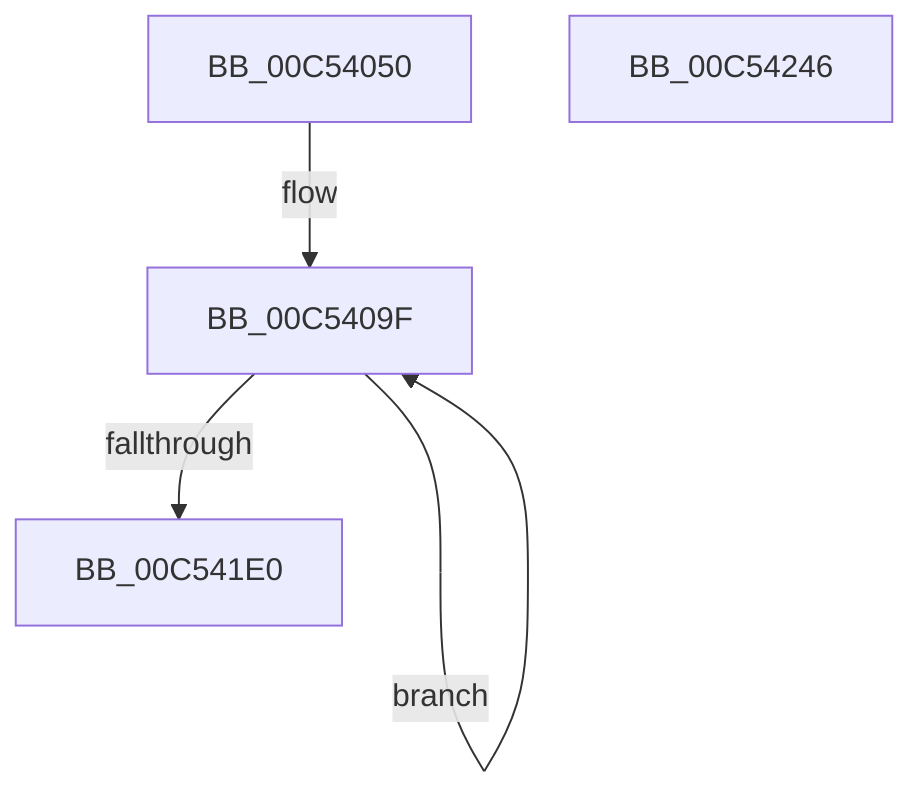

# ExRngInitializeSystem

- RVA: `0x00C54050`–`0x00C54247` (길이 `503` bytes)
- VA: `0x0000000140C54050`
- 실행 섹션: `INIT`
- PDB 이름 있음: `예`; PDB Function 태그: `아니요`
- unwind 정보 RVA: `0x000D5868`
- 디코드: `113`개 명령, `503/503` bytes 표시
- 미해석 바이트: `0` (있으면 어셈블리에 `.byte`로 보존)

> 이 문서는 커널 이미지의 기계어와 PDB 기호를 분석해 생성했습니다. 4번과 5번은 함수 원형과 자료형을 바이너리 사용 방식에서 추정한 C 해석이며 원본 소스 복구 결과는 아닙니다.

## 1. Dependencies

- 직접 호출 지점: **2**; 고유 호출 대상: **2**
- 직접 호출자로 확인된 함수: **1**
- RIP 상대 이미지 참조: **6**

### Outgoing calls
- `0x00C5420C` → [memcpy](../../text/6C/memcpy_function_006C6840.md) (function, `0x006C6840`)
- `0x00C54238` → [_security_check_cookie](../../text/6A/_security_check_cookie_function_006AC640.md) (function, `0x006AC640`)

### Direct callers
- [KiInitializeBootStructures](../../pagelk/B6/KiInitializeBootStructures_function_00B68530.md) at `0x00B687C2`

### Static image references
- `0x00C54059` → RVA `0x00E0A740` (`.data`; read)
- `0x00C5406B` → RVA `0x00EFA7B0` (`.data`; read/write)
- `0x00C54073` → RVA `0x00EFA5E0` (`.data`; read)
- `0x00C5407A` → RVA `0x00FC6B20` (`ALMOSTRO`; read)
- `0x00C541EC` → RVA `0x00EFA2A0` (`.data`; read)
- `0x00C541FE` → RVA `0x00EFA7B8` (`.data`; write)

## 2. Other-region calls and transfers

- 다른 실행 섹션으로 향하는 call: **2**
  - `0x00C5420C` → [memcpy](../../text/6C/memcpy_function_006C6840.md) (`INIT` → `.text`)
  - `0x00C54238` → [_security_check_cookie](../../text/6A/_security_check_cookie_function_006AC640.md) (`INIT` → `.text`)
- 별도 외부 분기/꼬리 이동을 확인하지 못했습니다.

## 3. Assembly (complete function range)

```asm
00C54050  40 57                           push rdi
00C54052  48 81 EC 10 01 00 00            sub rsp, 0x110
00C54059  48 8B 05 E0 66 1B 00            mov rax, qword ptr [rip + 0x1b66e0]
00C54060  48 33 C4                        xor rax, rsp
00C54063  48 89 84 24 00 01 00 00         mov qword ptr [rsp + 0x100], rax
00C5406B  48 83 25 3D 67 2A 00 00         and qword ptr [rip + 0x2a673d], 0
00C54073  4C 8D 05 66 65 2A 00            lea r8, [rip + 0x2a6566]
00C5407A  48 8B 05 9F 2A 37 00            mov rax, qword ptr [rip + 0x372a9f]
00C54081  41 B9 DC 00 00 00               mov r9d, 0xdc
00C54087  41 BA 02 00 00 00               mov r10d, 2
00C5408D  48 8B B8 F0 00 00 00            mov rdi, qword ptr [rax + 0xf0]
00C54094  45 8D 59 A4                     lea r11d, [r9 - 0x5c]
00C54098  48 81 C7 58 01 00 00            add rdi, 0x158
00C5409F  48 8D 54 24 20                  lea rdx, [rsp + 0x20]
00C540A4  41 8B C9                        mov ecx, r9d
00C540A7  48 81 C1 48 04 00 00            add rcx, 0x448
00C540AE  41 81 C1 DC 00 00 00            add r9d, 0xdc
00C540B5  48 03 CF                        add rcx, rdi
00C540B8  0F 10 01                        movups xmm0, xmmword ptr [rcx]
00C540BB  0F 10 49 10                     movups xmm1, xmmword ptr [rcx + 0x10]
00C540BF  0F 11 02                        movups xmmword ptr [rdx], xmm0
00C540C2  0F 10 41 20                     movups xmm0, xmmword ptr [rcx + 0x20]
00C540C6  0F 11 4A 10                     movups xmmword ptr [rdx + 0x10], xmm1
00C540CA  0F 10 49 30                     movups xmm1, xmmword ptr [rcx + 0x30]
00C540CE  0F 11 42 20                     movups xmmword ptr [rdx + 0x20], xmm0
00C540D2  0F 10 41 40                     movups xmm0, xmmword ptr [rcx + 0x40]
00C540D6  0F 11 4A 30                     movups xmmword ptr [rdx + 0x30], xmm1
00C540DA  0F 10 49 50                     movups xmm1, xmmword ptr [rcx + 0x50]
00C540DE  0F 11 42 40                     movups xmmword ptr [rdx + 0x40], xmm0
00C540E2  0F 10 41 60                     movups xmm0, xmmword ptr [rcx + 0x60]
00C540E6  0F 11 4A 50                     movups xmmword ptr [rdx + 0x50], xmm1
00C540EA  0F 10 49 70                     movups xmm1, xmmword ptr [rcx + 0x70]
00C540EE  49 03 CB                        add rcx, r11
00C540F1  0F 11 42 60                     movups xmmword ptr [rdx + 0x60], xmm0
00C540F5  49 03 D3                        add rdx, r11
00C540F8  48 8B 41 50                     mov rax, qword ptr [rcx + 0x50]
00C540FC  0F 10 01                        movups xmm0, xmmword ptr [rcx]
00C540FF  0F 11 4A F0                     movups xmmword ptr [rdx - 0x10], xmm1
00C54103  0F 10 49 10                     movups xmm1, xmmword ptr [rcx + 0x10]
00C54107  0F 11 02                        movups xmmword ptr [rdx], xmm0
00C5410A  0F 10 41 20                     movups xmm0, xmmword ptr [rcx + 0x20]
00C5410E  0F 11 4A 10                     movups xmmword ptr [rdx + 0x10], xmm1
00C54112  0F 10 49 30                     movups xmm1, xmmword ptr [rcx + 0x30]
00C54116  0F 11 42 20                     movups xmmword ptr [rdx + 0x20], xmm0
00C5411A  0F 10 41 40                     movups xmm0, xmmword ptr [rcx + 0x40]
00C5411E  0F 11 4A 30                     movups xmmword ptr [rdx + 0x30], xmm1
00C54122  0F 11 42 40                     movups xmmword ptr [rdx + 0x40], xmm0
00C54126  48 89 42 50                     mov qword ptr [rdx + 0x50], rax
00C5412A  8B 41 58                        mov eax, dword ptr [rcx + 0x58]
00C5412D  48 8D 4C 24 20                  lea rcx, [rsp + 0x20]
00C54132  89 42 58                        mov dword ptr [rdx + 0x58], eax
00C54135  4B 8D 14 03                     lea rdx, [r11 + r8]
00C54139  0F 10 01                        movups xmm0, xmmword ptr [rcx]
00C5413C  41 C7 80 DC 00 00 00 01 00 00 00  mov dword ptr [r8 + 0xdc], 1
00C54147  0F 10 49 10                     movups xmm1, xmmword ptr [rcx + 0x10]
00C5414B  41 C7 80 E0 00 00 00 20 00 00 00  mov dword ptr [r8 + 0xe0], 0x20
00C54156  41 0F 11 00                     movups xmmword ptr [r8], xmm0
00C5415A  0F 10 41 20                     movups xmm0, xmmword ptr [rcx + 0x20]
00C5415E  41 0F 11 48 10                  movups xmmword ptr [r8 + 0x10], xmm1
00C54163  0F 10 49 30                     movups xmm1, xmmword ptr [rcx + 0x30]
00C54167  41 0F 11 40 20                  movups xmmword ptr [r8 + 0x20], xmm0
00C5416C  0F 10 41 40                     movups xmm0, xmmword ptr [rcx + 0x40]
00C54170  41 0F 11 48 30                  movups xmmword ptr [r8 + 0x30], xmm1
00C54175  0F 10 49 50                     movups xmm1, xmmword ptr [rcx + 0x50]
00C54179  41 0F 11 40 40                  movups xmmword ptr [r8 + 0x40], xmm0
00C5417E  0F 10 41 60                     movups xmm0, xmmword ptr [rcx + 0x60]
00C54182  41 0F 11 48 50                  movups xmmword ptr [r8 + 0x50], xmm1
00C54187  0F 10 49 70                     movups xmm1, xmmword ptr [rcx + 0x70]
00C5418B  49 03 CB                        add rcx, r11
00C5418E  41 0F 11 40 60                  movups xmmword ptr [r8 + 0x60], xmm0
00C54193  0F 11 4A F0                     movups xmmword ptr [rdx - 0x10], xmm1
00C54197  48 8B 41 50                     mov rax, qword ptr [rcx + 0x50]
00C5419B  0F 10 01                        movups xmm0, xmmword ptr [rcx]
00C5419E  0F 10 49 10                     movups xmm1, xmmword ptr [rcx + 0x10]
00C541A2  0F 11 02                        movups xmmword ptr [rdx], xmm0
00C541A5  0F 10 41 20                     movups xmm0, xmmword ptr [rcx + 0x20]
00C541A9  0F 11 4A 10                     movups xmmword ptr [rdx + 0x10], xmm1
00C541AD  0F 10 49 30                     movups xmm1, xmmword ptr [rcx + 0x30]
00C541B1  0F 11 42 20                     movups xmmword ptr [rdx + 0x20], xmm0
00C541B5  0F 10 41 40                     movups xmm0, xmmword ptr [rcx + 0x40]
00C541B9  0F 11 4A 30                     movups xmmword ptr [rdx + 0x30], xmm1
00C541BD  0F 11 42 40                     movups xmmword ptr [rdx + 0x40], xmm0
00C541C1  48 89 42 50                     mov qword ptr [rdx + 0x50], rax
00C541C5  8B 41 58                        mov eax, dword ptr [rcx + 0x58]
00C541C8  89 42 58                        mov dword ptr [rdx + 0x58], eax
00C541CB  41 83 08 01                     or dword ptr [r8], 1
00C541CF  4D 8D 80 E4 00 00 00            lea r8, [r8 + 0xe4]
00C541D6  49 83 EA 01                     sub r10, 1
00C541DA  0F 85 BF FE FF FF               jne 0x140c5409f
00C541E0  41 B8 00 04 00 00               mov r8d, 0x400
00C541E6  41 8B D1                        mov edx, r9d
00C541E9  45 2B C1                        sub r8d, r9d
00C541EC  48 8D 0D AD 60 2A 00            lea rcx, [rip + 0x2a60ad]
00C541F3  41 C1 E8 02                     shr r8d, 2
00C541F7  48 81 C2 48 04 00 00            add rdx, 0x448
00C541FE  44 89 05 B3 65 2A 00            mov dword ptr [rip + 0x2a65b3], r8d
00C54205  48 03 D7                        add rdx, rdi
00C54208  49 C1 E0 02                     shl r8, 2
00C5420C  E8 2F 26 A7 FF                  call 0x1406c6840
00C54211  48 81 C7 48 04 00 00            add rdi, 0x448
00C54218  B9 00 04 00 00                  mov ecx, 0x400
00C5421D  33 C0                           xor eax, eax
00C5421F  F3 AA                           rep stosb byte ptr [rdi], al
00C54221  48 8D 7C 24 20                  lea rdi, [rsp + 0x20]
00C54226  B9 DC 00 00 00                  mov ecx, 0xdc
00C5422B  F3 AA                           rep stosb byte ptr [rdi], al
00C5422D  48 8B 8C 24 00 01 00 00         mov rcx, qword ptr [rsp + 0x100]
00C54235  48 33 CC                        xor rcx, rsp
00C54238  E8 03 84 A5 FF                  call 0x1406ac640
00C5423D  48 81 C4 10 01 00 00            add rsp, 0x110
00C54244  5F                              pop rdi
00C54245  C3                              ret
00C54246  CC                              int3
```

## 4. C-style interpretation (structured pseudocode)

```c
__int64 __fastcall ExRngInitializeSystem(void)
{
    __int64 result;
    __int64 v_r10;
    __int64 v_rdi;
    __int64 v_rsp;
    unsigned __int64 v_stack_m18;
    unsigned __int64 v_stack_mF8;

    v_rsp = (v_rsp) - (272);
    result = (*(unsigned __int64 *)(v_rip + 1795808)) ^ (v_rsp);
    v_stack_m18 = result;
    v_rdi = (*(unsigned __int64 *)(*(unsigned __int64 *)(v_rip + 3615391) + 240)) + (344);
loc_00C5409F:
    a1 = (220) + (0x448ULL);
    a4 = (unsigned int)((220) + (220));
    a1 = (a1) + (v_rdi);
    *(unsigned __int64 *)(v_stack_mF8) = v_xmm0;
    *(unsigned __int64 *)(v_stack_mF8 + 16) = v_xmm1;
    *(unsigned __int64 *)(v_stack_mF8 + 32) = v_xmm0;
    *(unsigned __int64 *)(v_stack_mF8 + 48) = v_xmm1;
    *(unsigned __int64 *)(v_stack_mF8 + 64) = v_xmm0;
    *(unsigned __int64 *)(v_stack_mF8 + 80) = v_xmm1;
    a1 = (a1) + (220 - 92);
    *(unsigned __int64 *)(v_stack_mF8 + 96) = v_xmm0;
    a2 = (v_stack_mF8) + (220 - 92);
    *(unsigned __int64 *)(a2 - 16) = v_xmm1;
    *(unsigned __int64 *)(a2) = v_xmm0;
    *(unsigned __int64 *)(a2 + 16) = v_xmm1;
    *(unsigned __int64 *)(a2 + 32) = v_xmm0;
    *(unsigned __int64 *)(a2 + 48) = v_xmm1;
    *(unsigned __int64 *)(a2 + 64) = v_xmm0;
    *(unsigned __int64 *)(a2 + 80) = *(unsigned __int64 *)(a1 + 80);
    *(unsigned int *)(a2 + 88) = (unsigned int)((unsigned int)(*(unsigned int *)(a1 + 88)));
    *(unsigned int *)(v_rip + 2778470 + 220) = 1;
    *(unsigned int *)(v_rip + 2778470 + 224) = 32;
    *(unsigned __int64 *)(v_rip + 2778470) = v_xmm0;
    *(unsigned __int64 *)(v_rip + 2778470 + 16) = v_xmm1;
    *(unsigned __int64 *)(v_rip + 2778470 + 32) = v_xmm0;
    *(unsigned __int64 *)(v_rip + 2778470 + 48) = v_xmm1;
    *(unsigned __int64 *)(v_rip + 2778470 + 64) = v_xmm0;
    *(unsigned __int64 *)(v_rip + 2778470 + 80) = v_xmm1;
    a1 = (v_stack_mF8) + (220 - 92);
    *(unsigned __int64 *)(v_rip + 2778470 + 96) = v_xmm0;
    *(unsigned __int64 *)(220 - 92 + v_rip + 2778470 * 1 - 16) = v_xmm1;
    *(unsigned __int64 *)(220 - 92 + v_rip + 2778470 * 1) = v_xmm0;
    *(unsigned __int64 *)(220 - 92 + v_rip + 2778470 * 1 + 16) = v_xmm1;
    *(unsigned __int64 *)(220 - 92 + v_rip + 2778470 * 1 + 32) = v_xmm0;
    *(unsigned __int64 *)(220 - 92 + v_rip + 2778470 * 1 + 48) = v_xmm1;
    *(unsigned __int64 *)(220 - 92 + v_rip + 2778470 * 1 + 64) = v_xmm0;
    *(unsigned __int64 *)(220 - 92 + v_rip + 2778470 * 1 + 80) = *(unsigned __int64 *)(a1 + 80);
    *(unsigned int *)(220 - 92 + v_rip + 2778470 * 1 + 88) = (unsigned int)((unsigned int)(*(unsigned int *)(a1 + 88)));
    v_r10 = (2) - (1);
    if (condition_is_not_equal) goto loc_00C5409F;
    a3 = (unsigned int)(((unsigned int)(0x400ULL)) - ((unsigned int)(a4)));
    a3 = (unsigned int)((a3) >> (2));
    a2 = ((unsigned int)((unsigned int)(a4))) + (0x448ULL);
    *(unsigned int *)(v_rip + 2778547) = (unsigned int)(a3);
    a2 = (a2) + (v_rdi);
    a3 = (a3) << (2);
    result = memcpy(v_rip + 2777261, a2, a3, a4);
    v_rdi = (v_rdi) + (0x448ULL);
    result = 0;
    a1 = (v_stack_m18) ^ (v_rsp);
    result = _security_check_cookie(a1, a2, a3, a4);
    v_rsp = (v_rsp) + (272);
    return result;
}
```

## 5. (Beta) C Style

```c
void ExRngInitializeSystem(void)
{
    int64_t result;
    int64_t local_r10;
    int64_t local_rdi;
    int64_t local_rsp;
    uint64_t v_stack_m18;
    uint64_t v_stack_mF8;

    local_rsp = (local_rsp) - (272);
    result = (*(uint64_t *)(v_rip + 0x1B66E0)) ^ (local_rsp);
    v_stack_m18 = result;
    local_rdi = (*(uint64_t *)(*(uint64_t *)(v_rip + 0x372A9F) + 0xF0)) + (344);
loc_00C5409F:
    a1 = (220) + (0x448ULL);
    a4 = (uint32_t)((220) + (220));
    a1 = (a1) + (local_rdi);
    *(uint64_t *)(v_stack_mF8) = v_xmm0;
    *(uint64_t *)(v_stack_mF8 + 0x10) = v_xmm1;
    *(uint64_t *)(v_stack_mF8 + 0x20) = v_xmm0;
    *(uint64_t *)(v_stack_mF8 + 0x30) = v_xmm1;
    *(uint64_t *)(v_stack_mF8 + 0x40) = v_xmm0;
    *(uint64_t *)(v_stack_mF8 + 0x50) = v_xmm1;
    a1 = (a1) + (220 - 92);
    *(uint64_t *)(v_stack_mF8 + 0x60) = v_xmm0;
    a2 = (v_stack_mF8) + (220 - 92);
    *(uint64_t *)(a2 - 0x10) = v_xmm1;
    *(uint64_t *)(a2) = v_xmm0;
    *(uint64_t *)(a2 + 0x10) = v_xmm1;
    *(uint64_t *)(a2 + 0x20) = v_xmm0;
    *(uint64_t *)(a2 + 0x30) = v_xmm1;
    *(uint64_t *)(a2 + 0x40) = v_xmm0;
    *(uint64_t *)(a2 + 0x50) = *(uint64_t *)(a1 + 0x50);
    *(uint32_t *)(a2 + 0x58) = (uint32_t)((uint32_t)(*(uint32_t *)(a1 + 0x58)));
    *(uint32_t *)(v_rip + 0x2A6566 + 0xDC) = 1;
    *(uint32_t *)(v_rip + 0x2A6566 + 0xE0) = 32;
    *(uint64_t *)(v_rip + 0x2A6566) = v_xmm0;
    *(uint64_t *)(v_rip + 0x2A6566 + 0x10) = v_xmm1;
    *(uint64_t *)(v_rip + 0x2A6566 + 0x20) = v_xmm0;
    *(uint64_t *)(v_rip + 0x2A6566 + 0x30) = v_xmm1;
    *(uint64_t *)(v_rip + 0x2A6566 + 0x40) = v_xmm0;
    *(uint64_t *)(v_rip + 0x2A6566 + 0x50) = v_xmm1;
    a1 = (v_stack_mF8) + (220 - 92);
    *(uint64_t *)(v_rip + 0x2A6566 + 0x60) = v_xmm0;
    *(uint64_t *)(220 - 0x5C + v_rip + 0x2A6566 * 1 - 0x10) = v_xmm1;
    *(uint64_t *)(220 - 0x5C + v_rip + 0x2A6566 * 1) = v_xmm0;
    *(uint64_t *)(220 - 0x5C + v_rip + 0x2A6566 * 1 + 0x10) = v_xmm1;
    *(uint64_t *)(220 - 0x5C + v_rip + 0x2A6566 * 1 + 0x20) = v_xmm0;
    *(uint64_t *)(220 - 0x5C + v_rip + 0x2A6566 * 1 + 0x30) = v_xmm1;
    *(uint64_t *)(220 - 0x5C + v_rip + 0x2A6566 * 1 + 0x40) = v_xmm0;
    *(uint64_t *)(220 - 0x5C + v_rip + 0x2A6566 * 1 + 0x50) = *(uint64_t *)(a1 + 0x50);
    *(uint32_t *)(220 - 0x5C + v_rip + 0x2A6566 * 1 + 0x58) = (uint32_t)((uint32_t)(*(uint32_t *)(a1 + 0x58)));
    local_r10 = (2) - (1);
    if (condition_is_not_equal) goto loc_00C5409F;
    a3 = (uint32_t)(((uint32_t)(0x400ULL)) - ((uint32_t)(a4)));
    a3 = (uint32_t)((a3) >> (2));
    a2 = ((uint32_t)((uint32_t)(a4))) + (0x448ULL);
    *(uint32_t *)(v_rip + 0x2A65B3) = (uint32_t)(a3);
    a2 = (a2) + (local_rdi);
    a3 = (a3) << (2);
    result = memcpy(v_rip + 2777261, a2, a3, a4);
    local_rdi = (local_rdi) + (0x448ULL);
    result = 0;
    a1 = (v_stack_m18) ^ (local_rsp);
    result = _security_check_cookie(a1, a2, a3, a4);
    local_rsp = (local_rsp) + (272);
    return result;
}
```

## 6. Execution-region graph

[열기: 2D/3D 그래프와 함수 탐색 컨트롤 패널](../../../control-panel.html?section=init&rva=0x00C54050&view=graph)

- 2D 그래프는 위에서 아래로 흐르고, 3D 그래프는 빈 공간을 드래그해 회전합니다. Shift+드래그는 이동, 휠은 확대·축소, 함수 노드 선택은 대상 보고서 이동입니다.

### Static fallback


