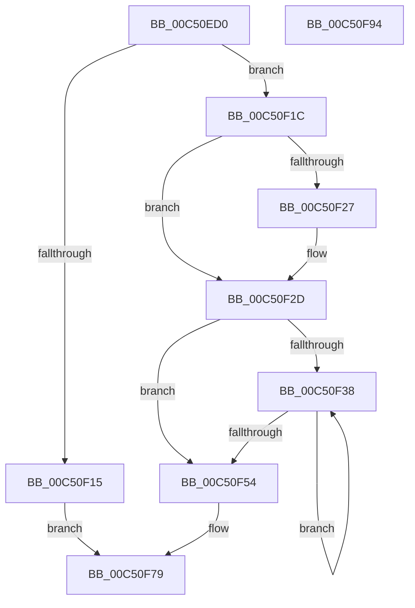

# ExpAddNonMirroredRanges

- RVA: `0x00C50ED0`–`0x00C50F95` (길이 `197` bytes)
- VA: `0x0000000140C50ED0`
- 실행 섹션: `INIT`
- PDB 이름 있음: `예`; PDB Function 태그: `아니요`
- unwind 정보 RVA: `0x00084C9C`
- 디코드: `58`개 명령, `197/197` bytes 표시
- 미해석 바이트: `0` (있으면 어셈블리에 `.byte`로 보존)

> 이 문서는 커널 이미지의 기계어와 PDB 기호를 분석해 생성했습니다. 4번과 5번은 함수 원형과 자료형을 바이너리 사용 방식에서 추정한 C 해석이며 원본 소스 복구 결과는 아닙니다.

## 1. Dependencies

- 직접 호출 지점: **3**; 고유 호출 대상: **3**
- 직접 호출자로 확인된 함수: **1**
- RIP 상대 이미지 참조: **0**

### Outgoing calls
- `0x00C50F08` → [ExAllocatePool2](../../poolcode/B8/ExAllocatePool2_function_00B820F0.md) (function, `0x00B820F0`)
- `0x00C50F68` → [ZwManagePartition](../../text/6A/ZwManagePartition_function_006AF430.md) (function, `0x006AF430`)
- `0x00C50F74` → [ExFreePoolWithTag](../../poolcode/B8/ExFreePoolWithTag_function_00B82870.md) (function, `0x00B82870`)

### Direct callers
- [ExpInitializeMemoryMirroring](ExpInitializeMemoryMirroring_function_00C50F9C.md) at `0x00C5104D`
- [ExpInitializeMemoryMirroring](ExpInitializeMemoryMirroring_function_00C50F9C.md) at `0x00C51064`

### Static image references
- 디코드된 RIP-relative 메모리 참조가 없습니다.

## 2. Other-region calls and transfers

- 다른 실행 섹션으로 향하는 call: **3**
  - `0x00C50F08` → [ExAllocatePool2](../../poolcode/B8/ExAllocatePool2_function_00B820F0.md) (`INIT` → `POOLCODE`)
  - `0x00C50F68` → [ZwManagePartition](../../text/6A/ZwManagePartition_function_006AF430.md) (`INIT` → `.text`)
  - `0x00C50F74` → [ExFreePoolWithTag](../../poolcode/B8/ExFreePoolWithTag_function_00B82870.md) (`INIT` → `POOLCODE`)
- 별도 외부 분기/꼬리 이동을 확인하지 못했습니다.

## 3. Assembly (complete function range)

```asm
00C50ED0  48 89 5C 24 08                  mov qword ptr [rsp + 8], rbx
00C50ED5  48 89 6C 24 10                  mov qword ptr [rsp + 0x10], rbp
00C50EDA  48 89 74 24 18                  mov qword ptr [rsp + 0x18], rsi
00C50EDF  57                              push rdi
00C50EE0  41 56                           push r14
00C50EE2  41 57                           push r15
00C50EE4  48 83 EC 30                     sub rsp, 0x30
00C50EE8  8B F2                           mov esi, edx
00C50EEA  49 8B F8                        mov rdi, r8
00C50EED  8B EA                           mov ebp, edx
00C50EEF  4C 8B F9                        mov r15, rcx
00C50EF2  B9 00 01 00 00                  mov ecx, 0x100
00C50EF7  41 B8 4B 73 72 4D               mov r8d, 0x4d72734b
00C50EFD  45 8A F1                        mov r14b, r9b
00C50F00  48 8D 56 03                     lea rdx, [rsi + 3]
00C50F04  48 C1 E2 04                     shl rdx, 4
00C50F08  E8 E3 11 F3 FF                  call 0x140b820f0
00C50F0D  48 8B D8                        mov rbx, rax
00C50F10  48 85 C0                        test rax, rax
00C50F13  75 07                           jne 0x140c50f1c
00C50F15  BF 9A 00 00 C0                  mov edi, 0xc000009a
00C50F1A  EB 5D                           jmp 0x140c50f79
00C50F1C  C7 00 09 00 00 00               mov dword ptr [rax], 9
00C50F22  45 84 F6                        test r14b, r14b
00C50F25  74 06                           je 0x140c50f2d
00C50F27  C7 00 0D 00 00 00               mov dword ptr [rax], 0xd
00C50F2D  89 70 04                        mov dword ptr [rax + 4], esi
00C50F30  48 8D 48 30                     lea rcx, [rax + 0x30]
00C50F34  85 F6                           test esi, esi
00C50F36  74 1C                           je 0x140c50f54
00C50F38  48 8B 07                        mov rax, qword ptr [rdi]
00C50F3B  48 8D 7F 10                     lea rdi, [rdi + 0x10]
00C50F3F  48 89 01                        mov qword ptr [rcx], rax
00C50F42  48 8D 49 10                     lea rcx, [rcx + 0x10]
00C50F46  48 8B 47 F8                     mov rax, qword ptr [rdi - 8]
00C50F4A  48 89 41 F8                     mov qword ptr [rcx - 8], rax
00C50F4E  48 83 ED 01                     sub rbp, 1
00C50F52  75 E4                           jne 0x140c50f38
00C50F54  33 D2                           xor edx, edx
00C50F56  C7 44 24 20 40 00 00 00         mov dword ptr [rsp + 0x20], 0x40
00C50F5E  4C 8B CB                        mov r9, rbx
00C50F61  49 8B CF                        mov rcx, r15
00C50F64  44 8D 42 04                     lea r8d, [rdx + 4]
00C50F68  E8 C3 E4 A5 FF                  call 0x1406af430
00C50F6D  8B F8                           mov edi, eax
00C50F6F  33 D2                           xor edx, edx
00C50F71  48 8B CB                        mov rcx, rbx
00C50F74  E8 F7 18 F3 FF                  call 0x140b82870
00C50F79  48 8B 5C 24 50                  mov rbx, qword ptr [rsp + 0x50]
00C50F7E  8B C7                           mov eax, edi
00C50F80  48 8B 6C 24 58                  mov rbp, qword ptr [rsp + 0x58]
00C50F85  48 8B 74 24 60                  mov rsi, qword ptr [rsp + 0x60]
00C50F8A  48 83 C4 30                     add rsp, 0x30
00C50F8E  41 5F                           pop r15
00C50F90  41 5E                           pop r14
00C50F92  5F                              pop rdi
00C50F93  C3                              ret
00C50F94  CC                              int3
```

## 4. C-style interpretation (structured pseudocode)

```c
__int64 __fastcall ExpAddNonMirroredRanges(__int64 a1, int a2, __int64 a3, unsigned __int8 a4)
{
    __int64 result;
    __int64 v_rbp;
    __int64 v_rsp;
    unsigned int v_stack_m28;
    unsigned __int64 v_stack_p10;
    unsigned __int64 v_stack_p18;
    unsigned __int64 v_stack_p8;

    v_stack_p8 = v_rbx;
    v_stack_p10 = v_rbp;
    v_stack_p18 = v_rsi;
    v_rsp = (v_rsp) - (48);
    a2 = ((unsigned int)(a2) + 3) << (4);
    result = ExAllocatePool2(256, a2, (unsigned int)(0x4D72734BULL), a4);
    if (result != 0) goto loc_00C50F1C;
    goto loc_00C50F79;
loc_00C50F1C:
    *(unsigned int *)(result) = 9;
    if (a4 != 0) {
        *(unsigned int *)(result) = 13;
    }
    *(unsigned int *)(result + 4) = (unsigned int)((unsigned int)(a2));
    if ((unsigned int)((unsigned int)(a2)) == 0) goto loc_00C50F54;
loc_00C50F38:
    *(unsigned __int64 *)(result + 48) = *(unsigned __int64 *)((unsigned int)(0xC000009AULL));
    *(unsigned __int64 *)(result + 48 + 16 - 8) = *(unsigned __int64 *)((unsigned int)(0xC000009AULL) + 16 - 8);
    v_rbp = ((unsigned int)(a2)) - (1);
    if (condition_is_not_equal) goto loc_00C50F38;
loc_00C50F54:
    a2 = 0;
    v_stack_m28 = 64;
    result = ZwManagePartition(a1, a2, a2 + 4, result);
    a2 = 0;
    result = ExFreePoolWithTag(result, a2, a2 + 4, result);
loc_00C50F79:
    v_rsp = (v_rsp) + (48);
    return (unsigned int)((unsigned int)((unsigned int)((unsigned int)(result))));
}
```

## 5. (Beta) C Style

```c
int64_t ExpAddNonMirroredRanges(int64_t Arg1, void *Arg2, void *Arg3, uint8_t Arg4)
{
    uint8_t *arg2 = (uint8_t *)Arg2;
    uint8_t *arg3 = (uint8_t *)Arg3;

    int64_t result;
    int64_t local_rbp;
    int64_t local_rsp;
    uint32_t v_stack_m28;
    uint64_t v_stack_p10;
    uint64_t v_stack_p18;
    uint64_t v_stack_p8;

    v_stack_p8 = local_rbx;
    v_stack_p10 = local_rbp;
    v_stack_p18 = local_rsi;
    local_rsp = (local_rsp) - (48);
    Arg2 = ((uint32_t)(Arg2) + 3) << (4);
    result = ExAllocatePool2(256, Arg2, (uint32_t)(0x4D72734BULL), Arg4);
    if (result != 0) goto loc_00C50F1C;
    goto loc_00C50F79;
loc_00C50F1C:
    *(uint32_t *)(result) = 9;
    if (Arg4 != 0) {
        *(uint32_t *)(result) = 13;
    }
    *(uint32_t *)(result + 0x4) = (uint32_t)((uint32_t)(Arg2));
    if ((uint32_t)((uint32_t)(Arg2)) == 0) goto loc_00C50F54;
loc_00C50F38:
    *(uint64_t *)(result + 0x30) = *(uint64_t *)((uint32_t)(0xC000009AULL));
    *(uint64_t *)(result + 0x30 + 0x10 - 0x8) = *(uint64_t *)((uint32_t)(0xC000009AULL) + 0x10 - 0x8);
    local_rbp = ((uint32_t)(Arg2)) - (1);
    if (condition_is_not_equal) goto loc_00C50F38;
loc_00C50F54:
    Arg2 = 0;
    v_stack_m28 = 64;
    result = ZwManagePartition(Arg1, Arg2, Arg2 + 4, result);
    Arg2 = 0;
    result = ExFreePoolWithTag(result, Arg2, Arg2 + 4, result);
loc_00C50F79:
    local_rsp = (local_rsp) + (48);
    return (uint32_t)((uint32_t)((uint32_t)((uint32_t)(result))));
}
```

### 관측된 메모리 오프셋

구조체 형식이 확인되지 않은 접근은 인자 기준의 오프셋으로만 기록했습니다.

| 기준 인자 | 오프셋 표현 | 폭 (bit) | 접근 |
|---|---:|---:|---|
| `Arg2` | `+ 0x3` | `64` | `R` |
| `Arg3` | `- 0x8` | `64` | `R` |
| `Arg3` | `+ 0x0` | `64` | `R` |
| `Arg3` | `+ 0x10` | `64` | `R` |

## 6. Execution-region graph

[열기: 2D/3D 그래프와 함수 탐색 컨트롤 패널](../../../control-panel.html?section=init&rva=0x00C50ED0&view=graph)

- 2D 그래프는 위에서 아래로 흐르고, 3D 그래프는 빈 공간을 드래그해 회전합니다. Shift+드래그는 이동, 휠은 확대·축소, 함수 노드 선택은 대상 보고서 이동입니다.

### Static fallback


