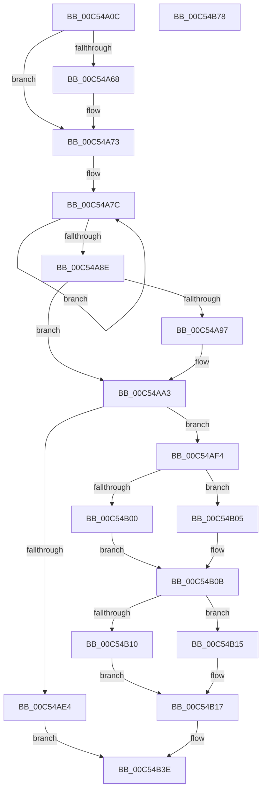

# ExpAeThresholdInitialization

- RVA: `0x00C54A0C`–`0x00C54B79` (길이 `365` bytes)
- VA: `0x0000000140C54A0C`
- 실행 섹션: `INIT`
- PDB 이름 있음: `예`; PDB Function 태그: `아니요`
- unwind 정보 RVA: `0x000D5D38`
- 디코드: `94`개 명령, `365/365` bytes 표시
- 미해석 바이트: `0` (있으면 어셈블리에 `.byte`로 보존)

> 이 문서는 커널 이미지의 기계어와 PDB 기호를 분석해 생성했습니다. 4번과 5번은 함수 원형과 자료형을 바이너리 사용 방식에서 추정한 C 해석이며 원본 소스 복구 결과는 아닙니다.

## 1. Dependencies

- 직접 호출 지점: **6**; 고유 호출 대상: **6**
- 직접 호출자로 확인된 함수: **1**
- RIP 상대 이미지 참조: **6**

### Outgoing calls
- `0x00C54A4D` → [memset](../../text/6C/memset_function_006C6C40.md) (function, `0x006C6C40`)
- `0x00C54A6E` → [KiRaiseIrqlProcessIrqlFlags](../../text/4F/KiRaiseIrqlProcessIrqlFlags_function_004F56FC.md) (function, `0x004F56FC`)
- `0x00C54A80` → [ExpAeMeasureContention](../../text/65/ExpAeMeasureContention_function_0065D63C.md) (function, `0x0065D63C`)
- `0x00C54A9E` → [KiLowerIrqlProcessIrqlFlags](../../text/4F/KiLowerIrqlProcessIrqlFlags_function_004F5698.md) (function, `0x004F5698`)
- `0x00C54ABA` → [KeGenericCallDpcEx](../../text/2C/KeGenericCallDpcEx_function_002C99F4.md) (function, `0x002C99F4`)
- `0x00C54B56` → [_security_check_cookie](../../text/6A/_security_check_cookie_function_006AC640.md) (function, `0x006AC640`)

### Direct callers
- [ExpInitSystemPhase1](ExpInitSystemPhase1_function_00C51508.md) at `0x00C515D9`

### Static image references
- `0x00C54A30` → RVA `0x00E0A740` (`.data`; read)
- `0x00C54A60` → RVA `0x00FC6D20` (`ALMOSTRO`; read)
- `0x00C54AB3` → RVA `0x0065D680` (`ExpAeThresholdInitWorker`; read)
- `0x00C54AE9` → RVA `0x00FC5016` (`ALMOSTRO`; write)
- `0x00C54B3E` → RVA `0x00FC5148` (`ALMOSTRO`; write)
- `0x00C54B46` → RVA `0x00FC51E8` (`ALMOSTRO`; write)

## 2. Other-region calls and transfers

- 다른 실행 섹션으로 향하는 call: **6**
  - `0x00C54A4D` → [memset](../../text/6C/memset_function_006C6C40.md) (`INIT` → `.text`)
  - `0x00C54A6E` → [KiRaiseIrqlProcessIrqlFlags](../../text/4F/KiRaiseIrqlProcessIrqlFlags_function_004F56FC.md) (`INIT` → `.text`)
  - `0x00C54A80` → [ExpAeMeasureContention](../../text/65/ExpAeMeasureContention_function_0065D63C.md) (`INIT` → `.text`)
  - `0x00C54A9E` → [KiLowerIrqlProcessIrqlFlags](../../text/4F/KiLowerIrqlProcessIrqlFlags_function_004F5698.md) (`INIT` → `.text`)
  - `0x00C54ABA` → [KeGenericCallDpcEx](../../text/2C/KeGenericCallDpcEx_function_002C99F4.md) (`INIT` → `.text`)
  - `0x00C54B56` → [_security_check_cookie](../../text/6A/_security_check_cookie_function_006AC640.md) (`INIT` → `.text`)
- 별도 외부 분기/꼬리 이동을 확인하지 못했습니다.

## 3. Assembly (complete function range)

```asm
00C54A0C  48 8B C4                        mov rax, rsp
00C54A0F  48 89 58 08                     mov qword ptr [rax + 8], rbx
00C54A13  48 89 78 10                     mov qword ptr [rax + 0x10], rdi
00C54A17  4C 89 70 18                     mov qword ptr [rax + 0x18], r14
00C54A1B  4C 89 78 20                     mov qword ptr [rax + 0x20], r15
00C54A1F  55                              push rbp
00C54A20  48 81 EC 70 01 00 00            sub rsp, 0x170
00C54A27  48 8D 6C 24 60                  lea rbp, [rsp + 0x60]
00C54A2C  48 83 E5 C0                     and rbp, 0xffffffffffffffc0
00C54A30  48 8B 05 09 5D 1B 00            mov rax, qword ptr [rip + 0x1b5d09]
00C54A37  48 33 C4                        xor rax, rsp
00C54A3A  48 89 85 00 01 00 00            mov qword ptr [rbp + 0x100], rax
00C54A41  33 D2                           xor edx, edx
00C54A43  48 8D 4D 40                     lea rcx, [rbp + 0x40]
00C54A47  41 B8 C0 00 00 00               mov r8d, 0xc0
00C54A4D  E8 EE 21 A7 FF                  call 0x1406c6c40
00C54A52  33 DB                           xor ebx, ebx
00C54A54  44 0F 20 C7                     mov rdi, cr8
00C54A58  44 8D 73 02                     lea r14d, [rbx + 2]
00C54A5C  45 0F 22 C6                     mov cr8, r14
00C54A60  39 1D BA 22 37 00               cmp dword ptr [rip + 0x3722ba], ebx
00C54A66  74 0B                           je 0x140c54a73
00C54A68  41 8A D6                        mov dl, r14b
00C54A6B  40 8A CF                        mov cl, dil
00C54A6E  E8 89 0C 8A FF                  call 0x1404f56fc
00C54A73  41 BF 00 04 00 00               mov r15d, 0x400
00C54A79  45 8B CF                        mov r9d, r15d
00C54A7C  48 8D 4D 40                     lea rcx, [rbp + 0x40]
00C54A80  E8 B7 8B A0 FF                  call 0x14065d63c
00C54A85  48 03 D8                        add rbx, rax
00C54A88  49 83 E9 01                     sub r9, 1
00C54A8C  75 EE                           jne 0x140c54a7c
00C54A8E  44 39 0D 8B 22 37 00            cmp dword ptr [rip + 0x37228b], r9d
00C54A95  74 0C                           je 0x140c54aa3
00C54A97  44 0F 20 C1                     mov rcx, cr8
00C54A9B  40 8A D7                        mov dl, dil
00C54A9E  E8 F5 0B 8A FF                  call 0x1404f5698
00C54AA3  40 0F B6 C7                     movzx eax, dil
00C54AA7  44 0F 22 C0                     mov cr8, rax
00C54AAB  48 8D 55 40                     lea rdx, [rbp + 0x40]
00C54AAF  48 C1 EB 0A                     shr rbx, 0xa
00C54AB3  48 8D 0D C6 8B A0 FF            lea rcx, [rip - 0x5f743a]
00C54ABA  E8 35 4F 67 FF                  call 0x1402c99f4
00C54ABF  48 8B 85 C0 00 00 00            mov rax, qword ptr [rbp + 0xc0]
00C54AC6  48 63 8D C8 00 00 00            movsxd rcx, dword ptr [rbp + 0xc8]
00C54ACD  48 99                           cqo
00C54ACF  49 F7 FF                        idiv r15
00C54AD2  33 D2                           xor edx, edx
00C54AD4  48 F7 F1                        div rcx
00C54AD7  48 8D 0C 9D 00 00 00 00         lea rcx, [rbx*4]
00C54ADF  48 3B C1                        cmp rax, rcx
00C54AE2  73 10                           jae 0x140c54af4
00C54AE4  BA FF FF FF FF                  mov edx, 0xffffffff
00C54AE9  C6 05 26 05 37 00 FF            mov byte ptr [rip + 0x370526], 0xff
00C54AF0  8B C2                           mov eax, edx
00C54AF2  EB 4A                           jmp 0x140c54b3e
00C54AF4  48 8B C3                        mov rax, rbx
00C54AF7  48 C1 E8 20                     shr rax, 0x20
00C54AFB  48 85 C0                        test rax, rax
00C54AFE  75 05                           jne 0x140c54b05
00C54B00  0F BD CB                        bsr ecx, ebx
00C54B03  EB 06                           jmp 0x140c54b0b
00C54B05  0F BD C8                        bsr ecx, eax
00C54B08  83 C1 20                        add ecx, 0x20
00C54B0B  41 3B CE                        cmp ecx, r14d
00C54B0E  72 05                           jb 0x140c54b15
00C54B10  83 C1 FE                        add ecx, -2
00C54B13  EB 02                           jmp 0x140c54b17
00C54B15  33 C9                           xor ecx, ecx
00C54B17  BA FF FF FF FF                  mov edx, 0xffffffff
00C54B1C  88 0D F4 04 37 00               mov byte ptr [rip + 0x3704f4], cl
00C54B22  48 8B C3                        mov rax, rbx
00C54B25  48 C1 E8 02                     shr rax, 2
00C54B29  48 03 C3                        add rax, rbx
00C54B2C  48 C1 E0 07                     shl rax, 7
00C54B30  48 D3 E8                        shr rax, cl
00C54B33  48 3B C2                        cmp rax, rdx
00C54B36  0F 47 C2                        cmova eax, edx
00C54B39  BA 00 00 F0 00                  mov edx, 0xf00000
00C54B3E  89 05 04 06 37 00               mov dword ptr [rip + 0x370604], eax
00C54B44  B0 01                           mov al, 1
00C54B46  89 15 9C 06 37 00               mov dword ptr [rip + 0x37069c], edx
00C54B4C  48 8B 8D 00 01 00 00            mov rcx, qword ptr [rbp + 0x100]
00C54B53  48 33 CC                        xor rcx, rsp
00C54B56  E8 E5 7A A5 FF                  call 0x1406ac640
00C54B5B  4C 8D 9C 24 70 01 00 00         lea r11, [rsp + 0x170]
00C54B63  49 8B 5B 10                     mov rbx, qword ptr [r11 + 0x10]
00C54B67  49 8B 7B 18                     mov rdi, qword ptr [r11 + 0x18]
00C54B6B  4D 8B 73 20                     mov r14, qword ptr [r11 + 0x20]
00C54B6F  4D 8B 7B 28                     mov r15, qword ptr [r11 + 0x28]
00C54B73  49 8B E3                        mov rsp, r11
00C54B76  5D                              pop rbp
00C54B77  C3                              ret
00C54B78  CC                              int3
```

## 4. C-style interpretation (structured pseudocode)

```c
__int64 __fastcall ExpAeThresholdInitialization(__int64 a1, int a2)
{
    __int64 result;
    __int64 v_rbp;
    __int64 v_rbx;
    __int64 v_rsp;
    unsigned __int64 v_stack_m118;
    unsigned __int64 v_stack_m18;
    unsigned int v_stack_m50;
    unsigned __int64 v_stack_m58;
    unsigned __int64 v_stack_m8;
    unsigned __int64 v_stack_mD8;

    *(unsigned __int64 *)(v_rsp + 8) = v_rbx;
    *(unsigned __int64 *)(v_rsp + 16) = v_rdi;
    *(unsigned __int64 *)(v_rsp + 24) = v_r14;
    *(unsigned __int64 *)(v_rsp + 32) = v_r15;
    v_rsp = (v_rsp) - (368);
    v_rbp = (v_stack_m118) & (-64);
    result = (*(unsigned __int64 *)(v_rip + 1793289)) ^ (v_rsp);
    v_stack_m18 = result;
    a2 = 0;
    result = memset(v_stack_mD8, a2, 192, a4);
    v_rbx = 0;
    if ((*(unsigned int *)(v_rip + 3613370)) != 0) {
        a2 = (unsigned __int8)(v_rbx + 2);
        a1 = (unsigned __int8)(v_cr8);
        result = KiRaiseIrqlProcessIrqlFlags(a1, a2, 192, a4);
    }
loc_00C54A7C:
    result = ExpAeMeasureContention(v_stack_mD8, a2, 192, (unsigned int)((unsigned int)((unsigned int)(0x400ULL))));
    v_rbx = (v_rbx) + (result);
    a4 = ((unsigned int)((unsigned int)((unsigned int)(0x400ULL)))) - (1);
    if (condition_is_not_equal) goto loc_00C54A7C;
    if ((*(unsigned int *)(v_rip + 3613323)) != ((unsigned int)(a4))) {
        a1 = v_rbx + 2;
        a2 = (unsigned __int8)(v_cr8);
        result = KiLowerIrqlProcessIrqlFlags(a1, a2, 192, a4);
    }
    v_rbx = (v_rbx) >> (10);
    result = KeGenericCallDpcEx(v_rip - 6255674, v_stack_mD8, 192, a4);
    a2 = 0;
    if (v_stack_m58 >= (v_rbx * 4)) goto loc_00C54AF4;
    *(unsigned __int8 *)(v_rip + 3605798) = 255;
    goto loc_00C54B3E;
loc_00C54AF4:
    result = (v_rbx) >> (32);
    if (result != 0) goto loc_00C54B05;
    goto loc_00C54B0B;
loc_00C54B05:
    a1 = (unsigned int)((v_rbx * 4) + (32));
loc_00C54B0B:
    if (((unsigned int)(a1)) < ((unsigned int)(v_rbx + 2))) goto loc_00C54B15;
    a1 = (unsigned int)((a1) + (-2));
    goto loc_00C54B17;
loc_00C54B15:
    a1 = 0;
loc_00C54B17:
    *(unsigned __int8 *)(v_rip + 3605748) = 0;
    result = (v_rbx) >> (2);
    result = (result) + (v_rbx);
    result = (result) << (7);
    result = (result) >> (0);
    if (result > ((unsigned int)(0xFFFFFFFFULL))) { result = (unsigned int)((unsigned int)(0xFFFFFFFFULL)); }
loc_00C54B3E:
    *(unsigned int *)(v_rip + 3606020) = (unsigned int)(result);
    *(unsigned int *)(v_rip + 3606172) = (unsigned int)((unsigned int)(0xF00000ULL));
    a1 = (v_stack_m18) ^ (v_rsp);
    result = _security_check_cookie(a1, (unsigned int)(0xF00000ULL), 192, a4);
    return result;
}
```

## 5. (Beta) C Style

```c
int64_t ExpAeThresholdInitialization(int64_t Arg1, int32_t Arg2)
{
    int64_t result;
    int64_t local_rbp;
    int64_t local_rbx;
    int64_t local_rsp;
    uint64_t v_stack_m118;
    uint64_t v_stack_m18;
    uint32_t v_stack_m50;
    uint64_t v_stack_m58;
    uint64_t v_stack_m8;
    uint64_t v_stack_mD8;

    *(uint64_t *)(local_rsp + 0x8) = local_rbx;
    *(uint64_t *)(local_rsp + 0x10) = local_rdi;
    *(uint64_t *)(local_rsp + 0x18) = local_r14;
    *(uint64_t *)(local_rsp + 0x20) = local_r15;
    local_rsp = (local_rsp) - (368);
    local_rbp = (v_stack_m118) & (-64);
    result = (*(uint64_t *)(v_rip + 0x1B5D09)) ^ (local_rsp);
    v_stack_m18 = result;
    Arg2 = 0;
    result = memset(v_stack_mD8, Arg2, 192, a4);
    local_rbx = 0;
    if ((*(uint32_t *)(v_rip + 0x3722BA)) != 0) {
        Arg2 = (uint8_t)(local_rbx + 2);
        Arg1 = (uint8_t)(v_cr8);
        result = KiRaiseIrqlProcessIrqlFlags(Arg1, Arg2, 192, a4);
    }
loc_00C54A7C:
    result = ExpAeMeasureContention(v_stack_mD8, Arg2, 192, (uint32_t)((uint32_t)((uint32_t)(0x400ULL))));
    local_rbx = (local_rbx) + (result);
    a4 = ((uint32_t)((uint32_t)((uint32_t)(0x400ULL)))) - (1);
    if (condition_is_not_equal) goto loc_00C54A7C;
    if ((*(uint32_t *)(v_rip + 0x37228B)) != ((uint32_t)(a4))) {
        Arg1 = local_rbx + 2;
        Arg2 = (uint8_t)(v_cr8);
        result = KiLowerIrqlProcessIrqlFlags(Arg1, Arg2, 192, a4);
    }
    local_rbx = (local_rbx) >> (10);
    result = KeGenericCallDpcEx(v_rip - 6255674, v_stack_mD8, 192, a4);
    Arg2 = 0;
    if (v_stack_m58 >= (local_rbx * 4)) goto loc_00C54AF4;
    *(uint8_t *)(v_rip + 0x370526) = 255;
    goto loc_00C54B3E;
loc_00C54AF4:
    result = (local_rbx) >> (32);
    if (result != 0) goto loc_00C54B05;
    goto loc_00C54B0B;
loc_00C54B05:
    Arg1 = (uint32_t)((local_rbx * 4) + (32));
loc_00C54B0B:
    if (((uint32_t)(Arg1)) < ((uint32_t)(local_rbx + 2))) goto loc_00C54B15;
    Arg1 = (uint32_t)((Arg1) + (-2));
    goto loc_00C54B17;
loc_00C54B15:
    Arg1 = 0;
loc_00C54B17:
    *(uint8_t *)(v_rip + 0x3704F4) = 0;
    result = (local_rbx) >> (2);
    result = (result) + (local_rbx);
    result = (result) << (7);
    result = (result) >> (0);
    if (result > ((uint32_t)(0xFFFFFFFFULL))) { result = (uint32_t)((uint32_t)(0xFFFFFFFFULL)); }
loc_00C54B3E:
    *(uint32_t *)(v_rip + 0x370604) = (uint32_t)(result);
    *(uint32_t *)(v_rip + 0x37069C) = (uint32_t)((uint32_t)(0xF00000ULL));
    Arg1 = (v_stack_m18) ^ (local_rsp);
    result = _security_check_cookie(Arg1, (uint32_t)(0xF00000ULL), 192, a4);
    return result;
}
```

## 6. Execution-region graph

[열기: 2D/3D 그래프와 함수 탐색 컨트롤 패널](../../../control-panel.html?section=init&rva=0x00C54A0C&view=graph)

- 2D 그래프는 위에서 아래로 흐르고, 3D 그래프는 빈 공간을 드래그해 회전합니다. Shift+드래그는 이동, 휠은 확대·축소, 함수 노드 선택은 대상 보고서 이동입니다.

### Static fallback


