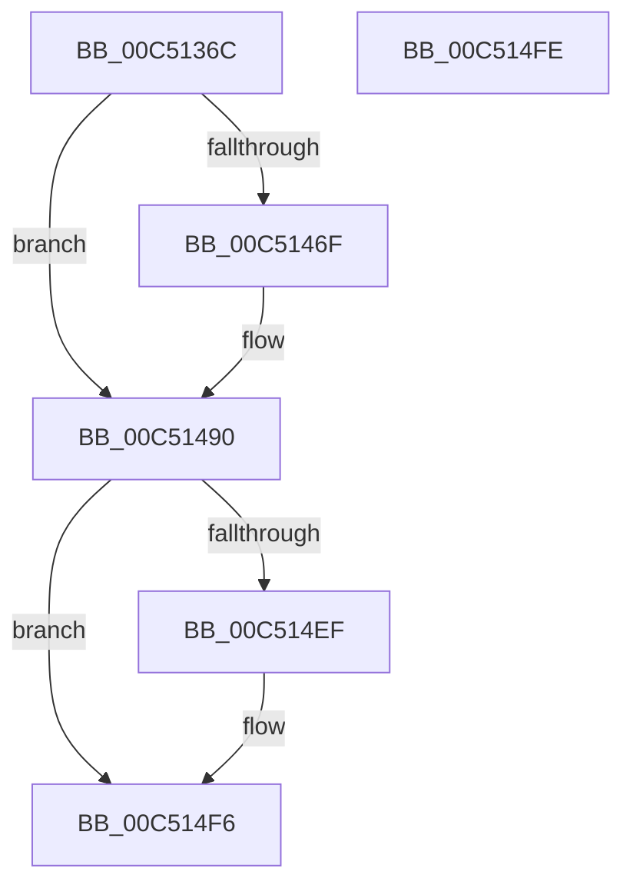

# ExpInitSystemPhase0

- RVA: `0x00C5136C`–`0x00C514FF` (길이 `403` bytes)
- VA: `0x0000000140C5136C`
- 실행 섹션: `INIT`
- PDB 이름 있음: `예`; PDB Function 태그: `아니요`
- unwind 정보 RVA: `0x00064C80`
- 디코드: `71`개 명령, `403/403` bytes 표시
- 미해석 바이트: `0` (있으면 어셈블리에 `.byte`로 보존)

> 이 문서는 커널 이미지의 기계어와 PDB 기호를 분석해 생성했습니다. 4번과 5번은 함수 원형과 자료형을 바이너리 사용 방식에서 추정한 C 해석이며 원본 소스 복구 결과는 아닙니다.

## 1. Dependencies

- 직접 호출 지점: **5**; 고유 호출 대상: **4**
- 직접 호출자로 확인된 함수: **1**
- RIP 상대 이미지 참조: **35**

### Outgoing calls
- `0x00C51440` → [ExInitializeResourceLite2](../../text/41/ExInitializeResourceLite2_function_0041F710.md) (function, `0x0041F710`)
- `0x00C5147C` → [ExGetSuiteMask](../../page/7C/ExGetSuiteMask_function_007C68D0.md) (function, `0x007C68D0`)
- `0x00C51495` → [ExGenRandom](../../text/41/ExGenRandom_function_0041B010.md) (function, `0x0041B010`)
- `0x00C514A5` → [ExGenRandom](../../text/41/ExGenRandom_function_0041B010.md) (function, `0x0041B010`)
- `0x00C514B6` → [RtlHpGlobalsInitialize](../../text/5F/RtlHpGlobalsInitialize_function_005F09DC.md) (function, `0x005F09DC`)

### Direct callers
- [ExInitSystem](ExInitSystem_function_00C511A8.md) at `0x00C51357`

### Static image references
- `0x00C51372` → RVA `0x00FC5008` (`ALMOSTRO`; read)
- `0x00C51379` → RVA `0x00EFF0A0` (`.data`; read)
- `0x00C51383` → RVA `0x00EFA100` (`.data`; write)
- `0x00C51397` → RVA `0x00EFAC20` (`.data`; read)
- `0x00C5139E` → RVA `0x00EFAB48` (`.data`; read/write)
- `0x00C513A6` → RVA `0x00EFAB50` (`.data`; read/write)
- `0x00C513AD` → RVA `0x00EFAB5C` (`.data`; read/write)
- `0x00C513B4` → RVA `0x00EFABC0` (`.data`; read/write)
- `0x00C513BC` → RVA `0x00EFABE0` (`.data`; read/write)
- `0x00C513C4` → RVA `0x00EFAC28` (`.data`; write)
- `0x00C513CB` → RVA `0x00EFAC20` (`.data`; write)
- `0x00C513D2` → RVA `0x00EFAB60` (`.data`; read)
- `0x00C513D9` → RVA `0x00EFAB68` (`.data`; write)
- `0x00C513E0` → RVA `0x00EFAB60` (`.data`; write)
- `0x00C513E7` → RVA `0x00EFABF0` (`.data`; read)
- `0x00C513EE` → RVA `0x00EFABF8` (`.data`; write)
- `0x00C513F5` → RVA `0x00EFABF0` (`.data`; write)
- `0x00C513FC` → RVA `0x00EFABB0` (`.data`; read)
- `0x00C51403` → RVA `0x00EFABB8` (`.data`; write)
- `0x00C5140A` → RVA `0x00EFABB0` (`.data`; write)
- `0x00C51411` → RVA `0x00EFF080` (`.data`; read)
- `0x00C51418` → RVA `0x00EFF088` (`.data`; write)
- `0x00C5141F` → RVA `0x00EFF080` (`.data`; write)
- `0x00C51426` → RVA `0x00EFAB40` (`.data`; write)
- `0x00C51430` → RVA `0x00EFAB58` (`.data`; write)
- `0x00C51439` → RVA `0x00EFAB5A` (`.data`; write)
- `0x00C51445` → RVA `0x00FC6B20` (`ALMOSTRO`; read)
- `0x00C51452` → RVA `0x00FD8228` (`PAGEDATA`; read/write)
- `0x00C51460` → RVA `0x01008170` (`INITDATA`; read)
- `0x00C51467` → RVA `0x00EFF078` (`.data`; write)
- `0x00C5146F` → RVA `0x010086EC` (`INITDATA`; read)
- `0x00C51475` → RVA `0x010089D0` (`INITDATA`; read)
- `0x00C514AF` → RVA `0x00E67B30` (`.data`; write)
- `0x00C514DB` → RVA `0x00F05C00` (`.data`; write)
- `0x00C514EF` → RVA `0x00E0EBF0` (`.data`; write)

## 2. Other-region calls and transfers

- 다른 실행 섹션으로 향하는 call: **5**
  - `0x00C51440` → [ExInitializeResourceLite2](../../text/41/ExInitializeResourceLite2_function_0041F710.md) (`INIT` → `.text`)
  - `0x00C5147C` → [ExGetSuiteMask](../../page/7C/ExGetSuiteMask_function_007C68D0.md) (`INIT` → `PAGE`)
  - `0x00C51495` → [ExGenRandom](../../text/41/ExGenRandom_function_0041B010.md) (`INIT` → `.text`)
  - `0x00C514A5` → [ExGenRandom](../../text/41/ExGenRandom_function_0041B010.md) (`INIT` → `.text`)
  - `0x00C514B6` → [RtlHpGlobalsInitialize](../../text/5F/RtlHpGlobalsInitialize_function_005F09DC.md) (`INIT` → `.text`)
- 별도 외부 분기/꼬리 이동을 확인하지 못했습니다.

## 3. Assembly (complete function range)

```asm
00C5136C  40 53                           push rbx
00C5136E  48 83 EC 30                     sub rsp, 0x30
00C51372  48 8B 05 8F 3C 37 00            mov rax, qword ptr [rip + 0x373c8f]
00C51379  48 8D 0D 20 DD 2A 00            lea rcx, [rip + 0x2add20]
00C51380  83 CA FF                        or edx, 0xffffffff
00C51383  48 C7 05 72 8D 2A 00 00 A6 9D FD  mov qword ptr [rip + 0x2a8d72], 0xfffffffffd9da600
00C5138E  66 C7 80 D6 02 00 00 0A 00      mov word ptr [rax + 0x2d6], 0xa
00C51397  48 8D 05 82 98 2A 00            lea rax, [rip + 0x2a9882]
00C5139E  48 83 25 A2 97 2A 00 00         and qword ptr [rip + 0x2a97a2], 0
00C513A6  83 25 A3 97 2A 00 00            and dword ptr [rip + 0x2a97a3], 0
00C513AD  83 25 A8 97 2A 00 00            and dword ptr [rip + 0x2a97a8], 0
00C513B4  48 83 25 04 98 2A 00 00         and qword ptr [rip + 0x2a9804], 0
00C513BC  48 83 25 1C 98 2A 00 00         and qword ptr [rip + 0x2a981c], 0
00C513C4  48 89 05 5D 98 2A 00            mov qword ptr [rip + 0x2a985d], rax
00C513CB  48 89 05 4E 98 2A 00            mov qword ptr [rip + 0x2a984e], rax
00C513D2  48 8D 05 87 97 2A 00            lea rax, [rip + 0x2a9787]
00C513D9  48 89 05 88 97 2A 00            mov qword ptr [rip + 0x2a9788], rax
00C513E0  48 89 05 79 97 2A 00            mov qword ptr [rip + 0x2a9779], rax
00C513E7  48 8D 05 02 98 2A 00            lea rax, [rip + 0x2a9802]
00C513EE  48 89 05 03 98 2A 00            mov qword ptr [rip + 0x2a9803], rax
00C513F5  48 89 05 F4 97 2A 00            mov qword ptr [rip + 0x2a97f4], rax
00C513FC  48 8D 05 AD 97 2A 00            lea rax, [rip + 0x2a97ad]
00C51403  48 89 05 AE 97 2A 00            mov qword ptr [rip + 0x2a97ae], rax
00C5140A  48 89 05 9F 97 2A 00            mov qword ptr [rip + 0x2a979f], rax
00C51411  48 8D 05 68 DC 2A 00            lea rax, [rip + 0x2adc68]
00C51418  48 89 05 69 DC 2A 00            mov qword ptr [rip + 0x2adc69], rax
00C5141F  48 89 05 5A DC 2A 00            mov qword ptr [rip + 0x2adc5a], rax
00C51426  C7 05 10 97 2A 00 01 00 00 00   mov dword ptr [rip + 0x2a9710], 1
00C51430  66 C7 05 1F 97 2A 00 01 00      mov word ptr [rip + 0x2a971f], 1
00C51439  C6 05 1A 97 2A 00 06            mov byte ptr [rip + 0x2a971a], 6
00C51440  E8 CB E2 7C FF                  call 0x14041f710
00C51445  48 8B 05 D4 56 37 00            mov rax, qword ptr [rip + 0x3756d4]
00C5144C  8B 88 08 01 00 00               mov ecx, dword ptr [rax + 0x108]
00C51452  48 83 25 CE 6D 38 00 00         and qword ptr [rip + 0x386dce], 0
00C5145A  C1 E9 02                        shr ecx, 2
00C5145D  80 E1 01                        and cl, 1
00C51460  83 3D 09 6D 3B 00 07            cmp dword ptr [rip + 0x3b6d09], 7
00C51467  88 0D 0B DC 2A 00               mov byte ptr [rip + 0x2adc0b], cl
00C5146D  75 21                           jne 0x140c51490
00C5146F  8A 15 77 72 3B 00               mov dl, byte ptr [rip + 0x3b7277]
00C51475  48 8D 0D 54 75 3B 00            lea rcx, [rip + 0x3b7554]
00C5147C  E8 4F 54 B7 FF                  call 0x1407c68d0
00C51481  8B C8                           mov ecx, eax
00C51483  48 8B 05 7E 3B 37 00            mov rax, qword ptr [rip + 0x373b7e]
00C5148A  89 88 D0 02 00 00               mov dword ptr [rax + 0x2d0], ecx
00C51490  B9 01 00 00 00                  mov ecx, 1
00C51495  E8 76 9B 7C FF                  call 0x14041b010
00C5149A  8B D8                           mov ebx, eax
00C5149C  B9 01 00 00 00                  mov ecx, 1
00C514A1  48 C1 E3 20                     shl rbx, 0x20
00C514A5  E8 66 9B 7C FF                  call 0x14041b010
00C514AA  8B C0                           mov eax, eax
00C514AC  48 0B C3                        or rax, rbx
00C514AF  48 89 05 7A 66 21 00            mov qword ptr [rip + 0x21667a], rax
00C514B6  E8 21 F5 99 FF                  call 0x1405f09dc
00C514BB  48 8B 0D 5E 56 37 00            mov rcx, qword ptr [rip + 0x37565e]
00C514C2  0F 57 C0                        xorps xmm0, xmm0
00C514C5  0F 11 44 24 20                  movups xmmword ptr [rsp + 0x20], xmm0
00C514CA  C6 44 24 20 02                  mov byte ptr [rsp + 0x20], 2
00C514CF  0F 10 4C 24 20                  movups xmm1, xmmword ptr [rsp + 0x20]
00C514D4  48 8B 91 F0 00 00 00            mov rdx, qword ptr [rcx + 0xf0]
00C514DB  F3 0F 7F 0D 1D 47 2B 00         movdqu xmmword ptr [rip + 0x2b471d], xmm1
00C514E3  48 8B 8A B0 0E 00 00            mov rcx, qword ptr [rdx + 0xeb0]
00C514EA  48 85 C9                        test rcx, rcx
00C514ED  74 07                           je 0x140c514f6
00C514EF  48 89 0D FA D6 1B 00            mov qword ptr [rip + 0x1bd6fa], rcx
00C514F6  B0 01                           mov al, 1
00C514F8  48 83 C4 30                     add rsp, 0x30
00C514FC  5B                              pop rbx
00C514FD  C3                              ret
00C514FE  CC                              int3
```

## 4. C-style interpretation (structured pseudocode)

```c
__int64 __fastcall ExpInitSystemPhase0(__int64 a1, int a2)
{
    __int64 result;
    __int64 v_rbx;
    __int64 v_rsp;
    unsigned __int64 v_stack_m18;

    v_rsp = (v_rsp) - (48);
    a2 = (unsigned int)((a2) | (0xFFFFFFFFULL));
    *(unsigned __int64 *)(v_rip + 2788722) = 0xFFFFFFFFFD9DA600ULL;
    *(unsigned __int16 *)(*(unsigned __int64 *)(v_rip + 3619983) + 726) = 10;
    *(unsigned __int64 *)(v_rip + 2791517) = v_rip + 2791554;
    *(unsigned __int64 *)(v_rip + 2791502) = v_rip + 2791554;
    *(unsigned __int64 *)(v_rip + 2791304) = v_rip + 2791303;
    *(unsigned __int64 *)(v_rip + 2791289) = v_rip + 2791303;
    *(unsigned __int64 *)(v_rip + 2791427) = v_rip + 2791426;
    *(unsigned __int64 *)(v_rip + 2791412) = v_rip + 2791426;
    *(unsigned __int64 *)(v_rip + 2791342) = v_rip + 2791341;
    *(unsigned __int64 *)(v_rip + 2791327) = v_rip + 2791341;
    *(unsigned __int64 *)(v_rip + 2808937) = v_rip + 2808936;
    *(unsigned __int64 *)(v_rip + 2808922) = v_rip + 2808936;
    *(unsigned int *)(v_rip + 2791184) = 1;
    *(unsigned __int16 *)(v_rip + 2791199) = 1;
    *(unsigned __int8 *)(v_rip + 2791194) = 6;
    result = ExInitializeResourceLite2(v_rip + 2809120, a2, a3, a4);
    a1 = (unsigned int)(((unsigned int)(*(unsigned int *)(*(unsigned __int64 *)(v_rip + 3626708) + 264))) >> (2));
    a1 = (unsigned __int8)((a1) & (1));
    *(unsigned __int8 *)(v_rip + 2808843) = (unsigned __int8)(a1);
    result = *(unsigned __int64 *)(v_rip + 3626708);
    if ((*(unsigned int *)(v_rip + 3894537)) == 7) {
        a2 = *(unsigned __int8 *)(v_rip + 3895927);
        a1 = v_rip + 3896660;
        result = ExGetSuiteMask(a1, a2, a3, a4);
        a1 = (unsigned int)(result);
        result = *(unsigned __int64 *)(v_rip + 3619710);
        *(unsigned int *)(result + 720) = (unsigned int)(a1);
    }
    result = ExGenRandom(1, a2, a3, a4);
    v_rbx = ((unsigned int)((unsigned int)(result))) << (32);
    result = ExGenRandom(1, a2, a3, a4);
    result = ((unsigned int)((unsigned int)(result))) | (v_rbx);
    *(unsigned __int64 *)(v_rip + 2188922) = result;
    result = RtlHpGlobalsInitialize(1, a2, a3, a4);
    v_stack_m18 = v_xmm0;
    v_stack_m18 = 2;
    *(unsigned __int64 *)(v_rip + 2836253) = v_xmm1;
    if (*(unsigned __int64 *)(*(unsigned __int64 *)(*(unsigned __int64 *)(v_rip + 3626590) + 240) + 3760) != 0) {
        *(unsigned __int64 *)(v_rip + 1824506) = *(unsigned __int64 *)(*(unsigned __int64 *)(*(unsigned __int64 *)(v_rip + 3626590) + 240) + 3760);
    }
    v_rsp = (v_rsp) + (48);
    return 1;
}
```

## 5. (Beta) C Style

```c
int64_t ExpInitSystemPhase0(int64_t Arg1, int32_t Arg2)
{
    int64_t result;
    int64_t local_rbx;
    int64_t local_rsp;
    uint64_t v_stack_m18;

    local_rsp = (local_rsp) - (48);
    Arg2 = (uint32_t)((Arg2) | (0xFFFFFFFFULL));
    *(uint64_t *)(v_rip + 0x2A8D72) = 0xFFFFFFFFFD9DA600ULL;
    *(uint16_t *)(*(uint64_t *)(v_rip + 0x373C8F) + 0x2D6) = 10;
    *(uint64_t *)(v_rip + 0x2A985D) = v_rip + 2791554;
    *(uint64_t *)(v_rip + 0x2A984E) = v_rip + 2791554;
    *(uint64_t *)(v_rip + 0x2A9788) = v_rip + 2791303;
    *(uint64_t *)(v_rip + 0x2A9779) = v_rip + 2791303;
    *(uint64_t *)(v_rip + 0x2A9803) = v_rip + 2791426;
    *(uint64_t *)(v_rip + 0x2A97F4) = v_rip + 2791426;
    *(uint64_t *)(v_rip + 0x2A97AE) = v_rip + 2791341;
    *(uint64_t *)(v_rip + 0x2A979F) = v_rip + 2791341;
    *(uint64_t *)(v_rip + 0x2ADC69) = v_rip + 2808936;
    *(uint64_t *)(v_rip + 0x2ADC5A) = v_rip + 2808936;
    *(uint32_t *)(v_rip + 0x2A9710) = 1;
    *(uint16_t *)(v_rip + 0x2A971F) = 1;
    *(uint8_t *)(v_rip + 0x2A971A) = 6;
    result = ExInitializeResourceLite2(v_rip + 2809120, Arg2, a3, a4);
    Arg1 = (uint32_t)(((uint32_t)(*(uint32_t *)(*(uint64_t *)(v_rip + 0x3756D4) + 0x108))) >> (2));
    Arg1 = (uint8_t)((Arg1) & (1));
    *(uint8_t *)(v_rip + 0x2ADC0B) = (uint8_t)(Arg1);
    result = *(uint64_t *)(v_rip + 0x3756D4);
    if ((*(uint32_t *)(v_rip + 0x3B6D09)) == 7) {
        Arg2 = *(uint8_t *)(v_rip + 0x3B7277);
        Arg1 = v_rip + 3896660;
        result = ExGetSuiteMask(Arg1, Arg2, a3, a4);
        Arg1 = (uint32_t)(result);
        result = *(uint64_t *)(v_rip + 0x373B7E);
        *(uint32_t *)(result + 0x2D0) = (uint32_t)(Arg1);
    }
    result = ExGenRandom(1, Arg2, a3, a4);
    local_rbx = ((uint32_t)((uint32_t)(result))) << (32);
    result = ExGenRandom(1, Arg2, a3, a4);
    result = ((uint32_t)((uint32_t)(result))) | (local_rbx);
    *(uint64_t *)(v_rip + 0x21667A) = result;
    result = RtlHpGlobalsInitialize(1, Arg2, a3, a4);
    v_stack_m18 = v_xmm0;
    v_stack_m18 = 2;
    *(uint64_t *)(v_rip + 0x2B471D) = v_xmm1;
    if (*(uint64_t *)(*(uint64_t *)(*(uint64_t *)(v_rip + 0x37565E) + 0xF0) + 0xEB0) != 0) {
        *(uint64_t *)(v_rip + 0x1BD6FA) = *(uint64_t *)(*(uint64_t *)(*(uint64_t *)(v_rip + 0x37565E) + 0xF0) + 0xEB0);
    }
    local_rsp = (local_rsp) + (48);
    return 1;
}
```

## 6. Execution-region graph

[열기: 2D/3D 그래프와 함수 탐색 컨트롤 패널](../../../control-panel.html?section=init&rva=0x00C5136C&view=graph)

- 2D 그래프는 위에서 아래로 흐르고, 3D 그래프는 빈 공간을 드래그해 회전합니다. Shift+드래그는 이동, 휠은 확대·축소, 함수 노드 선택은 대상 보고서 이동입니다.

### Static fallback


