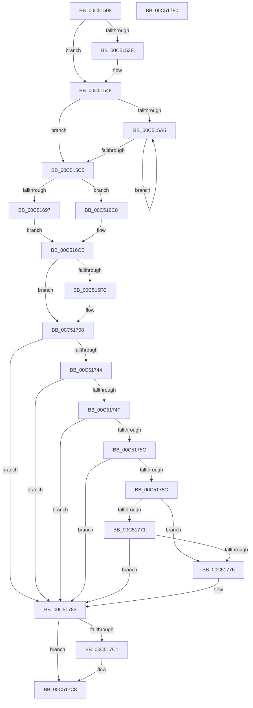

# ExpInitSystemPhase1

- RVA: `0x00C51508`–`0x00C517F1` (길이 `745` bytes)
- VA: `0x0000000140C51508`
- 실행 섹션: `INIT`
- PDB 이름 있음: `예`; PDB Function 태그: `아니요`
- unwind 정보 RVA: `0x000D4AA4`
- 디코드: `202`개 명령, `745/745` bytes 표시
- 미해석 바이트: `0` (있으면 어셈블리에 `.byte`로 보존)

> 이 문서는 커널 이미지의 기계어와 PDB 기호를 분석해 생성했습니다. 4번과 5번은 함수 원형과 자료형을 바이너리 사용 방식에서 추정한 C 해석이며 원본 소스 복구 결과는 아닙니다.

## 1. Dependencies

- 직접 호출 지점: **25**; 고유 호출 대상: **25**
- 직접 호출자로 확인된 함수: **1**
- RIP 상대 이미지 참조: **20**

### Outgoing calls
- `0x00C51534` → [KeQueryMaximumProcessorCountEx](../../text/26/KeQueryMaximumProcessorCountEx_function_00264D60.md) (function, `0x00264D60`)
- `0x00C51548` → [Feature_Servicing_DisallowSharedLockImplicitUpgrade__private_IsEnabledDeviceUsageNoInline](../../text/65/Feature_Servicing_DisallowSharedLockImplicitUpgrade__private_IsEnabledDeviceUsageNoInline_function_006580C8.md) (function, `0x006580C8`)
- `0x00C5158B` → [ExpWorkerInitialization](ExpWorkerInitialization_function_00C539A4.md) (function, `0x00C539A4`)
- `0x00C515B4` → [ExInitializeProcessor](../../text/65/ExInitializeProcessor_function_00655844.md) (function, `0x00655844`)
- `0x00C515C5` → [ExpEventInitialization](ExpEventInitialization_function_00C538E4.md) (function, `0x00C538E4`)
- `0x00C515D2` → [ExpMutantInitialization](ExpMutantInitialization_function_00C54520.md) (function, `0x00C54520`)
- `0x00C515D9` → [ExpAeThresholdInitialization](ExpAeThresholdInitialization_function_00C54A0C.md) (function, `0x00C54A0C`)
- `0x00C515E1` → [ExpInitializeCallbacks](ExpInitializeCallbacks_function_00C532CC.md) (function, `0x00C532CC`)
- `0x00C515E9` → [ExpSemaphoreInitialization](ExpSemaphoreInitialization_function_00C53DBC.md) (function, `0x00C53DBC`)
- `0x00C515F1` → [ExpTimerInitialization](ExpTimerInitialization_function_00C5372C.md) (function, `0x00C5372C`)
- `0x00C515F9` → [ExpSaInitialize](../../text/65/ExpSaInitialize_function_0065CADC.md) (function, `0x0065CADC`)
- `0x00C51601` → [ExpHeapInitPhase1](../../text/65/ExpHeapInitPhase1_function_0065C890.md) (function, `0x0065C890`)
- `0x00C51609` → [ExpProfileInitialization](ExpProfileInitialization_function_00C54448.md) (function, `0x00C54448`)
- `0x00C5162D` → [ExpKeyedEventInitialization](ExpKeyedEventInitialization_function_00C5460C.md) (function, `0x00C5460C`)
- `0x00C51686` → [ExAllocatePool2](../../poolcode/B8/ExAllocatePool2_function_00B820F0.md) (function, `0x00B820F0`)
- `0x00C516C1` → [UcInitialize](../../text/69/UcInitialize_function_0069AD9C.md) (function, `0x0069AD9C`)
- `0x00C516CB` → [ExpWin32Initialization](ExpWin32Initialization_function_00C534C0.md) (function, `0x00C534C0`)
- `0x00C516D9` → [ExpWorkerFactoryInitialization](ExpWorkerFactoryInitialization_function_00C54250.md) (function, `0x00C54250`)
- `0x00C516EC` → `ext-ms-win-ntos-ucode-l1-1-0.dll!ExpMicrocodeInitialization` (import, 간접 대상; import `ext-ms-win-ntos-ucode-l1-1-0.dll!ExpMicrocodeInitialization`)
- `0x00C5171A` → [ExpPrmInitialization](ExpPrmInitialization_function_00C517F8.md) (function, `0x00C517F8`)
- `0x00C5173B` → [RtlGetProductInfo](../../text/5E/RtlGetProductInfo_function_005EC870.md) (function, `0x005EC870`)
- `0x00C51753` → [ExpGetProductInfoSuiteTypeMap](../../page/7C/ExpGetProductInfoSuiteTypeMap_function_007C6A30.md) (function, `0x007C6A30`)
- `0x00C517B8` → [ExRegisterHost](../../page/7D/ExRegisterHost_function_007D06CC.md) (function, `0x007D06CC`)
- `0x00C517C8` → [ExpInitializeCrossVmIntegration](ExpInitializeCrossVmIntegration_function_00C54964.md) (function, `0x00C54964`)
- `0x00C517CD` → [ExpInitializeSvm](ExpInitializeSvm_function_00C53E7C.md) (function, `0x00C53E7C`)

### Direct callers
- [ExInitSystem](ExInitSystem_function_00C511A8.md) at `0x00C511D9`

### Static image references
- `0x00C5152E` → RVA `0x00E68588` (`.data`; write)
- `0x00C5154F` → RVA `0x00FD9D38` (`PAGEDATA`; write)
- `0x00C51558` → RVA `0x00EFEE30` (`.data`; write)
- `0x00C5155F` → RVA `0x00FDA038` (`PAGEDATA`; read)
- `0x00C51566` → RVA `0x00EFED78` (`.data`; write)
- `0x00C51570` → RVA `0x00FDA040` (`PAGEDATA`; write)
- `0x00C51577` → RVA `0x00E685A8` (`.data`; write)
- `0x00C5157D` → RVA `0x00FDA038` (`PAGEDATA`; write)
- `0x00C51584` → RVA `0x00FD80B8` (`PAGEDATA`; write)
- `0x00C51590` → RVA `0x00FC6A80` (`ALMOSTRO`; read)
- `0x00C515A5` → RVA `0x00FC8C40` (`ALMOSTRO`; read)
- `0x00C5160E` → RVA `0x00E685D8` (`.data`; read/write)
- `0x00C51626` → RVA `0x00FD81D8` (`PAGEDATA`; write)
- `0x00C5168B` → RVA `0x00FD9B98` (`PAGEDATA`; write)
- `0x00C5169A` → RVA `0x0090C4C0` (`ExpWnfWorkItemRoutine`; read)
- `0x00C516EC` → RVA `0x00151610` (`ext-ms-win-ntos-ucode-l1-1-0.dll!ExpMicrocodeInitialization (IAT)`; read)
- `0x00C51776` → RVA `0x00FC5008` (`ALMOSTRO`; read)
- `0x00C51797` → RVA `0x007D1290` (`ExpPcwHostCallback`; read)
- `0x00C517A2` → RVA `0x00FD8080` (`PAGEDATA`; read)
- `0x00C517C1` → RVA `0x00FD8080` (`PAGEDATA`; write)

## 2. Other-region calls and transfers

- 다른 실행 섹션으로 향하는 call: **10**
  - `0x00C51534` → [KeQueryMaximumProcessorCountEx](../../text/26/KeQueryMaximumProcessorCountEx_function_00264D60.md) (`INIT` → `.text`)
  - `0x00C51548` → [Feature_Servicing_DisallowSharedLockImplicitUpgrade__private_IsEnabledDeviceUsageNoInline](../../text/65/Feature_Servicing_DisallowSharedLockImplicitUpgrade__private_IsEnabledDeviceUsageNoInline_function_006580C8.md) (`INIT` → `.text`)
  - `0x00C515B4` → [ExInitializeProcessor](../../text/65/ExInitializeProcessor_function_00655844.md) (`INIT` → `.text`)
  - `0x00C515F9` → [ExpSaInitialize](../../text/65/ExpSaInitialize_function_0065CADC.md) (`INIT` → `.text`)
  - `0x00C51601` → [ExpHeapInitPhase1](../../text/65/ExpHeapInitPhase1_function_0065C890.md) (`INIT` → `.text`)
  - `0x00C51686` → [ExAllocatePool2](../../poolcode/B8/ExAllocatePool2_function_00B820F0.md) (`INIT` → `POOLCODE`)
  - `0x00C516C1` → [UcInitialize](../../text/69/UcInitialize_function_0069AD9C.md) (`INIT` → `.text`)
  - `0x00C5173B` → [RtlGetProductInfo](../../text/5E/RtlGetProductInfo_function_005EC870.md) (`INIT` → `.text`)
  - `0x00C51753` → [ExpGetProductInfoSuiteTypeMap](../../page/7C/ExpGetProductInfoSuiteTypeMap_function_007C6A30.md) (`INIT` → `PAGE`)
  - `0x00C517B8` → [ExRegisterHost](../../page/7D/ExRegisterHost_function_007D06CC.md) (`INIT` → `PAGE`)
- 별도 외부 분기/꼬리 이동을 확인하지 못했습니다.

## 3. Assembly (complete function range)

```asm
00C51508  48 89 5C 24 20                  mov qword ptr [rsp + 0x20], rbx
00C5150D  48 89 4C 24 08                  mov qword ptr [rsp + 8], rcx
00C51512  55                              push rbp
00C51513  56                              push rsi
00C51514  57                              push rdi
00C51515  41 54                           push r12
00C51517  41 55                           push r13
00C51519  41 56                           push r14
00C5151B  41 57                           push r15
00C5151D  48 8B EC                        mov rbp, rsp
00C51520  48 81 EC 80 00 00 00            sub rsp, 0x80
00C51527  33 F6                           xor esi, esi
00C51529  B9 FF FF 00 00                  mov ecx, 0xffff
00C5152E  89 35 54 70 21 00               mov dword ptr [rip + 0x217054], esi
00C51534  E8 27 38 61 FF                  call 0x140264d60
00C51539  83 F8 01                        cmp eax, 1
00C5153C  76 0A                           jbe 0x140c51548
00C5153E  C7 05 40 70 21 00 00 28 00 00   mov dword ptr [rip + 0x217040], 0x2800
00C51548  E8 7B 6B A0 FF                  call 0x1406580c8
00C5154D  85 C0                           test eax, eax
00C5154F  48 89 35 E2 87 38 00            mov qword ptr [rip + 0x3887e2], rsi
00C51556  8B CE                           mov ecx, esi
00C51558  48 89 35 D1 D8 2A 00            mov qword ptr [rip + 0x2ad8d1], rsi
00C5155F  48 8D 05 D2 8A 38 00            lea rax, [rip + 0x388ad2]
00C51566  48 89 35 0B D8 2A 00            mov qword ptr [rip + 0x2ad80b], rsi
00C5156D  0F 94 C1                        sete cl
00C51570  48 89 05 C9 8A 38 00            mov qword ptr [rip + 0x388ac9], rax
00C51577  89 0D 2B 70 21 00               mov dword ptr [rip + 0x21702b], ecx
00C5157D  48 89 05 B4 8A 38 00            mov qword ptr [rip + 0x388ab4], rax
00C51584  48 89 35 2D 6B 38 00            mov qword ptr [rip + 0x386b2d], rsi
00C5158B  E8 14 24 00 00                  call 0x140c539a4
00C51590  8B 0D EA 54 37 00               mov ecx, dword ptr [rip + 0x3754ea]
00C51596  8B F8                           mov edi, eax
00C51598  C1 EF 1F                        shr edi, 0x1f
00C5159B  8B DE                           mov ebx, esi
00C5159D  40 80 F7 01                     xor dil, 1
00C515A1  85 C9                           test ecx, ecx
00C515A3  74 20                           je 0x140c515c5
00C515A5  48 8D 05 94 76 37 00            lea rax, [rip + 0x377694]
00C515AC  8B CB                           mov ecx, ebx
00C515AE  33 D2                           xor edx, edx
00C515B0  48 8B 0C C8                     mov rcx, qword ptr [rax + rcx*8]
00C515B4  E8 8B 42 A0 FF                  call 0x140655844
00C515B9  8B 05 C1 54 37 00               mov eax, dword ptr [rip + 0x3754c1]
00C515BF  FF C3                           inc ebx
00C515C1  3B D8                           cmp ebx, eax
00C515C3  72 E0                           jb 0x140c515a5
00C515C5  E8 1A 23 00 00                  call 0x140c538e4
00C515CA  F6 D8                           neg al
00C515CC  45 1A ED                        sbb r13b, r13b
00C515CF  44 22 EF                        and r13b, dil
00C515D2  E8 49 2F 00 00                  call 0x140c54520
00C515D7  8A D8                           mov bl, al
00C515D9  E8 2E 34 00 00                  call 0x140c54a0c
00C515DE  40 8A F8                        mov dil, al
00C515E1  E8 E6 1C 00 00                  call 0x140c532cc
00C515E6  40 8A F0                        mov sil, al
00C515E9  E8 CE 27 00 00                  call 0x140c53dbc
00C515EE  44 8A F0                        mov r14b, al
00C515F1  E8 36 21 00 00                  call 0x140c5372c
00C515F6  44 8A F8                        mov r15b, al
00C515F9  E8 DE B4 A0 FF                  call 0x14065cadc
00C515FE  44 8A E0                        mov r12b, al
00C51601  E8 8A B2 A0 FF                  call 0x14065c890
00C51606  88 45 48                        mov byte ptr [rbp + 0x48], al
00C51609  E8 3A 2E 00 00                  call 0x140c54448
00C5160E  48 83 25 C2 6F 21 00 00         and qword ptr [rip + 0x216fc2], 0
00C51616  48 B9 14 00 00 00 80 F7 FF FF   movabs rcx, 0xfffff78000000014
00C51620  88 45 50                        mov byte ptr [rbp + 0x50], al
00C51623  48 8B 09                        mov rcx, qword ptr [rcx]
00C51626  48 89 0D AB 6B 38 00            mov qword ptr [rip + 0x386bab], rcx
00C5162D  E8 DA 2F 00 00                  call 0x140c5460c
00C51632  F6 DB                           neg bl
00C51634  44 8B C0                        mov r8d, eax
00C51637  1A C9                           sbb cl, cl
00C51639  41 22 CD                        and cl, r13b
00C5163C  40 F6 DF                        neg dil
00C5163F  1A D2                           sbb dl, dl
00C51641  22 D1                           and dl, cl
00C51643  40 F6 DE                        neg sil
00C51646  1A C0                           sbb al, al
00C51648  22 C2                           and al, dl
00C5164A  41 F6 DE                        neg r14b
00C5164D  1A C9                           sbb cl, cl
00C5164F  22 C8                           and cl, al
00C51651  41 F6 DF                        neg r15b
00C51654  1A C0                           sbb al, al
00C51656  22 C1                           and al, cl
00C51658  41 F6 DC                        neg r12b
00C5165B  1A C9                           sbb cl, cl
00C5165D  22 C8                           and cl, al
00C5165F  F6 5D 48                        neg byte ptr [rbp + 0x48]
00C51662  1A D2                           sbb dl, dl
00C51664  22 D1                           and dl, cl
00C51666  F6 5D 50                        neg byte ptr [rbp + 0x50]
00C51669  1A C0                           sbb al, al
00C5166B  33 F6                           xor esi, esi
00C5166D  22 C2                           and al, dl
00C5166F  8B DE                           mov ebx, esi
00C51671  45 85 C0                        test r8d, r8d
00C51674  0F B6 C0                        movzx eax, al
00C51677  41 B8 57 6E 66 20               mov r8d, 0x20666e57
00C5167D  8D 56 30                        lea edx, [rsi + 0x30]
00C51680  0F 49 D8                        cmovns ebx, eax
00C51683  8D 4E 40                        lea ecx, [rsi + 0x40]
00C51686  E8 65 0A F3 FF                  call 0x140b820f0
00C5168B  48 89 05 06 85 38 00            mov qword ptr [rip + 0x388506], rax
00C51692  48 85 C0                        test rax, rax
00C51695  74 31                           je 0x140c516c8
00C51697  0F 57 C0                        xorps xmm0, xmm0
00C5169A  48 8D 0D 1F AE CB FF            lea rcx, [rip - 0x3451e1]
00C516A1  0F 11 00                        movups xmmword ptr [rax], xmm0
00C516A4  0F 11 40 10                     movups xmmword ptr [rax + 0x10], xmm0
00C516A8  0F 11 40 20                     movups xmmword ptr [rax + 0x20], xmm0
00C516AC  C7 00 08 09 30 00               mov dword ptr [rax], 0x300908
00C516B2  48 89 48 18                     mov qword ptr [rax + 0x18], rcx
00C516B6  8D 4E 02                        lea ecx, [rsi + 2]
00C516B9  48 89 70 20                     mov qword ptr [rax + 0x20], rsi
00C516BD  48 89 70 08                     mov qword ptr [rax + 8], rsi
00C516C1  E8 D6 96 A4 FF                  call 0x14069ad9c
00C516C6  EB 03                           jmp 0x140c516cb
00C516C8  40 8A DE                        mov bl, sil
00C516CB  E8 F0 1D 00 00                  call 0x140c534c0
00C516D0  F6 D8                           neg al
00C516D2  1A C9                           sbb cl, cl
00C516D4  22 CB                           and cl, bl
00C516D6  0F B6 D9                        movzx ebx, cl
00C516D9  E8 72 2B 00 00                  call 0x140c54250
00C516DE  85 C0                           test eax, eax
00C516E0  8B FE                           mov edi, esi
00C516E2  0F 49 FB                        cmovns edi, ebx
00C516E5  BB 01 00 00 00                  mov ebx, 1
00C516EA  8B CB                           mov ecx, ebx
00C516EC  48 FF 15 1D FF 4F FF            call qword ptr [rip - 0xb000e3]
00C516F3  0F 1F 44 00 00                  nop dword ptr [rax + rax]
00C516F8  85 C0                           test eax, eax
00C516FA  79 0C                           jns 0x140c51708
00C516FC  3D BB 00 00 C0                  cmp eax, 0xc00000bb
00C51701  40 0F B6 FF                     movzx edi, dil
00C51705  0F 45 FE                        cmovne edi, esi
00C51708  48 8B 4D 40                     mov rcx, qword ptr [rbp + 0x40]
00C5170C  48 8B 89 F0 00 00 00            mov rcx, qword ptr [rcx + 0xf0]
00C51713  48 81 C1 28 0A 00 00            add rcx, 0xa28
00C5171A  E8 D9 00 00 00                  call 0x140c517f8
00C5171F  33 C0                           xor eax, eax
00C51721  89 75 40                        mov dword ptr [rbp + 0x40], esi
00C51724  33 D2                           xor edx, edx
00C51726  89 45 B8                        mov dword ptr [rbp - 0x48], eax
00C51729  48 8D 45 40                     lea rax, [rbp + 0x40]
00C5172D  45 33 C9                        xor r9d, r9d
00C51730  45 33 C0                        xor r8d, r8d
00C51733  48 89 44 24 20                  mov qword ptr [rsp + 0x20], rax
00C51738  8D 4A 06                        lea ecx, [rdx + 6]
00C5173B  E8 30 B1 99 FF                  call 0x1405ec870
00C51740  84 C0                           test al, al
00C51742  74 3F                           je 0x140c51783
00C51744  8B 4D 40                        mov ecx, dword ptr [rbp + 0x40]
00C51747  81 F9 CD AB CD AB               cmp ecx, 0xabcdabcd
00C5174D  74 34                           je 0x140c51783
00C5174F  48 8D 55 B0                     lea rdx, [rbp - 0x50]
00C51753  E8 D8 52 B7 FF                  call 0x1407c6a30
00C51758  84 C0                           test al, al
00C5175A  74 27                           je 0x140c51783
00C5175C  A1 64 02 00 00 80 F7 FF FF      movabs eax, dword ptr [0xfffff78000000264]
00C51765  8B 4D B8                        mov ecx, dword ptr [rbp - 0x48]
00C51768  3B C1                           cmp eax, ecx
00C5176A  74 17                           je 0x140c51783
00C5176C  83 F8 02                        cmp eax, 2
00C5176F  75 05                           jne 0x140c51776
00C51771  83 F9 03                        cmp ecx, 3
00C51774  74 0D                           je 0x140c51783
00C51776  48 8B 05 8B 38 37 00            mov rax, qword ptr [rip + 0x37388b]
00C5177D  89 88 64 02 00 00               mov dword ptr [rax + 0x264], ecx
00C51783  48 8D 45 C0                     lea rax, [rbp - 0x40]
00C51787  48 C7 45 D0 01 00 01 00         mov qword ptr [rbp - 0x30], 0x10001
00C5178F  48 89 45 D8                     mov qword ptr [rbp - 0x28], rax
00C51793  4C 8D 45 D0                     lea r8, [rbp - 0x30]
00C51797  48 8D 05 F2 FA B7 FF            lea rax, [rip - 0x48050e]
00C5179E  48 89 5D E0                     mov qword ptr [rbp - 0x20], rbx
00C517A2  48 8D 0D D7 68 38 00            lea rcx, [rip + 0x3868d7]
00C517A9  48 89 45 E8                     mov qword ptr [rbp - 0x18], rax
00C517AD  89 5D C0                        mov dword ptr [rbp - 0x40], ebx
00C517B0  48 89 75 C8                     mov qword ptr [rbp - 0x38], rsi
00C517B4  48 89 75 F0                     mov qword ptr [rbp - 0x10], rsi
00C517B8  E8 0F EF B7 FF                  call 0x1407d06cc
00C517BD  85 C0                           test eax, eax
00C517BF  79 07                           jns 0x140c517c8
00C517C1  48 89 35 B8 68 38 00            mov qword ptr [rip + 0x3868b8], rsi
00C517C8  E8 97 31 00 00                  call 0x140c54964
00C517CD  E8 AA 26 00 00                  call 0x140c53e7c
00C517D2  48 8B 9C 24 D8 00 00 00         mov rbx, qword ptr [rsp + 0xd8]
00C517DA  40 8A C7                        mov al, dil
00C517DD  48 81 C4 80 00 00 00            add rsp, 0x80
00C517E4  41 5F                           pop r15
00C517E6  41 5E                           pop r14
00C517E8  41 5D                           pop r13
00C517EA  41 5C                           pop r12
00C517EC  5F                              pop rdi
00C517ED  5E                              pop rsi
00C517EE  5D                              pop rbp
00C517EF  C3                              ret
00C517F0  CC                              int3
```

## 4. C-style interpretation (structured pseudocode)

```c
__int64 __fastcall ExpInitSystemPhase1(__int64 a1, int a2, __int64 a3, int a4)
{
    __int64 result;
    __int64 v_r12;
    __int64 v_r13;
    __int64 v_r14;
    __int64 v_r15;
    __int64 v_rbx;
    __int64 v_rdi;
    __int64 v_rsi;
    __int64 v_rsp;
    unsigned __int64 v_stack_m48;
    unsigned __int64 v_stack_m50;
    unsigned __int64 v_stack_m58;
    unsigned __int64 v_stack_m60;
    unsigned __int64 v_stack_m68;
    unsigned __int64 v_stack_m70;
    unsigned __int64 v_stack_m78;
    unsigned int v_stack_m80;
    unsigned __int64 v_stack_m88;
    unsigned __int64 v_stack_m98;
    unsigned __int8 v_stack_p10;
    unsigned __int8 v_stack_p18;
    unsigned __int64 v_stack_p20;
    unsigned __int64 v_stack_p8;

    v_stack_p20 = v_rbx;
    v_stack_p8 = a1;
    v_rsp = (v_rsp) - (128);
    v_rsi = 0;
    *(unsigned int *)(v_rip + 2191444) = 0;
    result = KeQueryMaximumProcessorCountEx((unsigned int)(0xFFFFULL), a2, a3, a4);
    if (((unsigned int)(result)) >= = 1) {
        *(unsigned int *)(v_rip + 2191424) = 0x2800ULL;
    }
    result = Feature_Servicing_DisallowSharedLockImplicitUpgrade__private_IsEnabledDeviceUsageNoInline((unsigned int)(0xFFFFULL), a2, a3, a4);
    *(unsigned __int64 *)(v_rip + 3704802) = 0;
    *(unsigned __int64 *)(v_rip + 2808017) = 0;
    *(unsigned __int64 *)(v_rip + 2807819) = 0;
    a1 = ((unsigned int)(result) == 0) ? 1 : 0;
    *(unsigned __int64 *)(v_rip + 3705545) = v_rip + 3705554;
    *(unsigned int *)(v_rip + 2191403) = (unsigned int)(a1);
    *(unsigned __int64 *)(v_rip + 3705524) = v_rip + 3705554;
    *(unsigned __int64 *)(v_rip + 3697453) = 0;
    result = ExpWorkerInitialization(a1, a2, a3, a4);
    v_rdi = (unsigned int)(((unsigned int)((unsigned int)(result))) >> (31));
    v_rdi = (unsigned __int8)((v_rdi) ^ (1));
    if ((unsigned int)((unsigned int)(*(unsigned int *)(v_rip + 3626218))) == 0) goto loc_00C515C5;
loc_00C515A5:
    a2 = 0;
    result = ExInitializeProcessor(*(unsigned __int64 *)(v_rip + 3634836 + 0 * 8), a2, a3, a4);
    v_rbx = (unsigned int)((0) + 1);
    if (((unsigned int)(v_rbx)) < ((unsigned int)((unsigned int)(*(unsigned int *)(v_rip + 3626177))))) goto loc_00C515A5;
loc_00C515C5:
    result = ExpEventInitialization(*(unsigned __int64 *)(v_rip + 3634836 + 0 * 8), a2, a3, a4);
    result = (unsigned __int8)(-(result));
    v_r13 = (unsigned __int8)((v_r13) & ((unsigned __int8)(v_rdi)));
    result = ExpMutantInitialization(*(unsigned __int64 *)(v_rip + 3634836 + 0 * 8), a2, a3, a4);
    result = ExpAeThresholdInitialization(*(unsigned __int64 *)(v_rip + 3634836 + 0 * 8), a2, a3, a4);
    result = ExpInitializeCallbacks(*(unsigned __int64 *)(v_rip + 3634836 + 0 * 8), a2, a3, a4);
    result = ExpSemaphoreInitialization(*(unsigned __int64 *)(v_rip + 3634836 + 0 * 8), a2, a3, a4);
    result = ExpTimerInitialization(*(unsigned __int64 *)(v_rip + 3634836 + 0 * 8), a2, a3, a4);
    result = ExpSaInitialize(*(unsigned __int64 *)(v_rip + 3634836 + 0 * 8), a2, a3, a4);
    result = ExpHeapInitPhase1(*(unsigned __int64 *)(v_rip + 3634836 + 0 * 8), a2, a3, a4);
    v_stack_p10 = (unsigned __int8)(result);
    result = ExpProfileInitialization(*(unsigned __int64 *)(v_rip + 3634836 + 0 * 8), a2, a3, a4);
    v_stack_p18 = (unsigned __int8)(result);
    *(unsigned __int64 *)(v_rip + 3697579) = *(unsigned __int64 *)(*(unsigned __int64 *)(v_rip + 3634836 + 0 * 8));
    result = ExpKeyedEventInitialization(*(unsigned __int64 *)(*(unsigned __int64 *)(v_rip + 3634836 + 0 * 8)), a2, a3, a4);
    v_rbx = (unsigned __int8)(-((unsigned __int8)(result)));
    a1 = (unsigned __int8)((*(unsigned __int64 *)(*(unsigned __int64 *)(v_rip + 3634836 + 0 * 8))) & ((unsigned __int8)(v_r13)));
    v_rdi = (unsigned __int8)(-((unsigned __int8)(result)));
    a2 = (unsigned __int8)((a2) & ((unsigned __int8)(a1)));
    v_rsi = (unsigned __int8)(-((unsigned __int8)(result)));
    result = (unsigned __int8)((result) & ((unsigned __int8)(a2)));
    v_r14 = (unsigned __int8)(-((unsigned __int8)(result)));
    a1 = (unsigned __int8)((a1) & ((unsigned __int8)(result)));
    v_r15 = (unsigned __int8)(-((unsigned __int8)(result)));
    result = (unsigned __int8)((result) & ((unsigned __int8)(a1)));
    v_r12 = (unsigned __int8)(-((unsigned __int8)(result)));
    a1 = (unsigned __int8)((a1) & ((unsigned __int8)(result)));
    a2 = (unsigned __int8)((a2) & ((unsigned __int8)(a1)));
    v_rsi = 0;
    result = (unsigned __int8)((result) & ((unsigned __int8)(a2)));
    v_rbx = 0;
    if (!sign_flag) { v_rbx = (unsigned int)((unsigned __int8)(result)); }
    result = ExAllocatePool2(v_rsi + 64, v_rsi + 48, (unsigned int)(0x20666E57ULL), a4);
    *(unsigned __int64 *)(v_rip + 3704070) = result;
    if (result == 0) goto loc_00C516C8;
    *(unsigned __int64 *)(result) = v_xmm0;
    *(unsigned __int64 *)(result + 16) = v_xmm0;
    *(unsigned __int64 *)(result + 32) = v_xmm0;
    *(unsigned int *)(result) = 0x300908ULL;
    *(unsigned __int64 *)(result + 24) = v_rip - 3428833;
    *(unsigned __int64 *)(result + 32) = 0;
    *(unsigned __int64 *)(result + 8) = 0;
    result = UcInitialize(v_rsi + 2, v_rsi + 48, (unsigned int)(0x20666E57ULL), a4);
    goto loc_00C516CB;
loc_00C516C8:
loc_00C516CB:
    result = ExpWin32Initialization(v_rsi + 2, v_rsi + 48, (unsigned int)(0x20666E57ULL), a4);
    result = (unsigned __int8)(-(result));
    a1 = (unsigned __int8)((v_rsi + 2) & (0));
    result = ExpWorkerFactoryInitialization(a1, v_rsi + 48, (unsigned int)(0x20666E57ULL), a4);
    v_rdi = 0;
    if (!sign_flag) { v_rdi = (unsigned int)((unsigned __int8)(a1)); }
    result = ext_ms_win_ntos_ucode_l1_1_0_dll_ExpMicrocodeInitialization(1, v_rsi + 48, (unsigned int)(0x20666E57ULL), a4);
    if (sign_flag) {
        v_rdi = (unsigned __int8)(v_rdi);
        if (((unsigned int)(result)) != 0xC00000BBULL) { v_rdi = 0; }
    }
    a1 = (*(unsigned __int64 *)(v_stack_p8 + 240)) + (0xA28ULL);
    result = ExpPrmInitialization(a1, v_rsi + 48, (unsigned int)(0x20666E57ULL), a4);
    result = 0;
    v_stack_p8 = 0;
    a2 = 0;
    v_stack_m80 = 0;
    a4 = 0;
    a3 = 0;
    v_stack_m98 = v_stack_p8;
    result = RtlGetProductInfo(a2 + 6, a2, a3, a4);
    if ((unsigned __int8)(result) == 0) goto loc_00C51783;
    if (((unsigned int)((unsigned int)(v_stack_p8))) == 0xABCDABCDULL) goto loc_00C51783;
    result = ExpGetProductInfoSuiteTypeMap((unsigned int)(v_stack_p8), v_stack_m88, a3, a4);
    if ((unsigned __int8)(result) == 0) goto loc_00C51783;
    if (((unsigned int)(result)) == ((unsigned int)((unsigned int)(v_stack_m80)))) goto loc_00C51783;
    if (((unsigned int)(result)) != 2) goto loc_00C51776;
    if (((unsigned int)((unsigned int)(v_stack_m80))) != 3) {
        result = *(unsigned __int64 *)(v_rip + 3618955);
        *(unsigned int *)(result + 612) = (unsigned int)((unsigned int)(v_stack_m80));
    }
    v_stack_m68 = 0x10001ULL;
    v_stack_m60 = v_stack_m78;
    v_stack_m58 = 1;
    v_stack_m50 = v_rip - 4719886;
    v_stack_m78 = 1;
    v_stack_m70 = 0;
    v_stack_m48 = 0;
    result = ExRegisterHost(v_rip + 3696855, v_stack_m88, v_stack_m68, a4);
    if (sign_flag) {
        *(unsigned __int64 *)(v_rip + 3696824) = 0;
    }
    result = ExpInitializeCrossVmIntegration(v_rip + 3696855, v_stack_m88, v_stack_m68, a4);
    result = ExpInitializeSvm(v_rip + 3696855, v_stack_m88, v_stack_m68, a4);
    v_rsp = (v_rsp) + (128);
    return (unsigned __int8)(v_rdi);
}
```

## 5. (Beta) C Style

```c
int64_t ExpInitSystemPhase1(int64_t Arg1, int32_t Arg2, int64_t Arg3, int32_t Arg4)
{
    int64_t result;
    int64_t local_r12;
    int64_t local_r13;
    int64_t local_r14;
    int64_t local_r15;
    int64_t local_rbx;
    int64_t local_rdi;
    int64_t local_rsi;
    int64_t local_rsp;
    uint64_t v_stack_m48;
    uint64_t v_stack_m50;
    uint64_t v_stack_m58;
    uint64_t v_stack_m60;
    uint64_t v_stack_m68;
    uint64_t v_stack_m70;
    uint64_t v_stack_m78;
    uint32_t v_stack_m80;
    uint64_t v_stack_m88;
    uint64_t v_stack_m98;
    uint8_t v_stack_p10;
    uint8_t v_stack_p18;
    uint64_t v_stack_p20;
    uint64_t v_stack_p8;

    v_stack_p20 = local_rbx;
    v_stack_p8 = Arg1;
    local_rsp = (local_rsp) - (128);
    local_rsi = 0;
    *(uint32_t *)(v_rip + 0x217054) = 0;
    result = KeQueryMaximumProcessorCountEx((uint32_t)(0xFFFFULL), Arg2, Arg3, Arg4);
    if (((uint32_t)(result)) >= = 1) {
        *(uint32_t *)(v_rip + 0x217040) = 0x2800ULL;
    }
    result = Feature_Servicing_DisallowSharedLockImplicitUpgrade__private_IsEnabledDeviceUsageNoInline((uint32_t)(0xFFFFULL), Arg2, Arg3, Arg4);
    *(uint64_t *)(v_rip + 0x3887E2) = 0;
    *(uint64_t *)(v_rip + 0x2AD8D1) = 0;
    *(uint64_t *)(v_rip + 0x2AD80B) = 0;
    Arg1 = ((uint32_t)(result) == 0) ? 1 : 0;
    *(uint64_t *)(v_rip + 0x388AC9) = v_rip + 3705554;
    *(uint32_t *)(v_rip + 0x21702B) = (uint32_t)(Arg1);
    *(uint64_t *)(v_rip + 0x388AB4) = v_rip + 3705554;
    *(uint64_t *)(v_rip + 0x386B2D) = 0;
    result = ExpWorkerInitialization(Arg1, Arg2, Arg3, Arg4);
    local_rdi = (uint32_t)(((uint32_t)((uint32_t)(result))) >> (31));
    local_rdi = (uint8_t)((local_rdi) ^ (1));
    if ((uint32_t)((uint32_t)(*(uint32_t *)(v_rip + 0x3754EA))) == 0) goto loc_00C515C5;
loc_00C515A5:
    Arg2 = 0;
    result = ExInitializeProcessor(*(uint64_t *)(v_rip + 0x377694 + 0x0 * 8), Arg2, Arg3, Arg4);
    local_rbx = (uint32_t)((0) + 1);
    if (((uint32_t)(local_rbx)) < ((uint32_t)((uint32_t)(*(uint32_t *)(v_rip + 0x3754C1))))) goto loc_00C515A5;
loc_00C515C5:
    result = ExpEventInitialization(*(uint64_t *)(v_rip + 0x377694 + 0x0 * 8), Arg2, Arg3, Arg4);
    result = (uint8_t)(-(result));
    local_r13 = (uint8_t)((local_r13) & ((uint8_t)(local_rdi)));
    result = ExpMutantInitialization(*(uint64_t *)(v_rip + 0x377694 + 0x0 * 8), Arg2, Arg3, Arg4);
    result = ExpAeThresholdInitialization(*(uint64_t *)(v_rip + 0x377694 + 0x0 * 8), Arg2, Arg3, Arg4);
    result = ExpInitializeCallbacks(*(uint64_t *)(v_rip + 0x377694 + 0x0 * 8), Arg2, Arg3, Arg4);
    result = ExpSemaphoreInitialization(*(uint64_t *)(v_rip + 0x377694 + 0x0 * 8), Arg2, Arg3, Arg4);
    result = ExpTimerInitialization(*(uint64_t *)(v_rip + 0x377694 + 0x0 * 8), Arg2, Arg3, Arg4);
    result = ExpSaInitialize(*(uint64_t *)(v_rip + 0x377694 + 0x0 * 8), Arg2, Arg3, Arg4);
    result = ExpHeapInitPhase1(*(uint64_t *)(v_rip + 0x377694 + 0x0 * 8), Arg2, Arg3, Arg4);
    v_stack_p10 = (uint8_t)(result);
    result = ExpProfileInitialization(*(uint64_t *)(v_rip + 0x377694 + 0x0 * 8), Arg2, Arg3, Arg4);
    v_stack_p18 = (uint8_t)(result);
    *(uint64_t *)(v_rip + 0x386BAB) = *(uint64_t *)(*(uint64_t *)(v_rip + 0x377694 + 0x0 * 8));
    result = ExpKeyedEventInitialization(*(uint64_t *)(*(uint64_t *)(v_rip + 0x377694 + 0x0 * 8)), Arg2, Arg3, Arg4);
    local_rbx = (uint8_t)(-((uint8_t)(result)));
    Arg1 = (uint8_t)((*(uint64_t *)(*(uint64_t *)(v_rip + 0x377694 + 0x0 * 8))) & ((uint8_t)(local_r13)));
    local_rdi = (uint8_t)(-((uint8_t)(result)));
    Arg2 = (uint8_t)((Arg2) & ((uint8_t)(Arg1)));
    local_rsi = (uint8_t)(-((uint8_t)(result)));
    result = (uint8_t)((result) & ((uint8_t)(Arg2)));
    local_r14 = (uint8_t)(-((uint8_t)(result)));
    Arg1 = (uint8_t)((Arg1) & ((uint8_t)(result)));
    local_r15 = (uint8_t)(-((uint8_t)(result)));
    result = (uint8_t)((result) & ((uint8_t)(Arg1)));
    local_r12 = (uint8_t)(-((uint8_t)(result)));
    Arg1 = (uint8_t)((Arg1) & ((uint8_t)(result)));
    Arg2 = (uint8_t)((Arg2) & ((uint8_t)(Arg1)));
    local_rsi = 0;
    result = (uint8_t)((result) & ((uint8_t)(Arg2)));
    local_rbx = 0;
    if (!sign_flag) { local_rbx = (uint32_t)((uint8_t)(result)); }
    result = ExAllocatePool2(local_rsi + 64, local_rsi + 48, (uint32_t)(0x20666E57ULL), Arg4);
    *(uint64_t *)(v_rip + 0x388506) = result;
    if (result == 0) goto loc_00C516C8;
    *(uint64_t *)(result) = v_xmm0;
    *(uint64_t *)(result + 0x10) = v_xmm0;
    *(uint64_t *)(result + 0x20) = v_xmm0;
    *(uint32_t *)(result) = 0x300908ULL;
    *(uint64_t *)(result + 0x18) = v_rip - 3428833;
    *(uint64_t *)(result + 0x20) = 0;
    *(uint64_t *)(result + 0x8) = 0;
    result = UcInitialize(local_rsi + 2, local_rsi + 48, (uint32_t)(0x20666E57ULL), Arg4);
    goto loc_00C516CB;
loc_00C516C8:
loc_00C516CB:
    result = ExpWin32Initialization(local_rsi + 2, local_rsi + 48, (uint32_t)(0x20666E57ULL), Arg4);
    result = (uint8_t)(-(result));
    Arg1 = (uint8_t)((local_rsi + 2) & (0));
    result = ExpWorkerFactoryInitialization(Arg1, local_rsi + 48, (uint32_t)(0x20666E57ULL), Arg4);
    local_rdi = 0;
    if (!sign_flag) { local_rdi = (uint32_t)((uint8_t)(Arg1)); }
    result = kernel_indirect_call(1, local_rsi + 48, (uint32_t)(0x20666E57ULL), Arg4);
    if (sign_flag) {
        local_rdi = (uint8_t)(local_rdi);
        if (((uint32_t)(result)) != 0xC00000BBULL) { local_rdi = 0; }
    }
    Arg1 = (*(uint64_t *)(v_stack_p8 + 0xF0)) + (0xA28ULL);
    result = ExpPrmInitialization(Arg1, local_rsi + 48, (uint32_t)(0x20666E57ULL), Arg4);
    result = 0;
    v_stack_p8 = 0;
    Arg2 = 0;
    v_stack_m80 = 0;
    Arg4 = 0;
    Arg3 = 0;
    v_stack_m98 = v_stack_p8;
    result = RtlGetProductInfo(Arg2 + 6, Arg2, Arg3, Arg4);
    if ((uint8_t)(result) == 0) goto loc_00C51783;
    if (((uint32_t)((uint32_t)(v_stack_p8))) == 0xABCDABCDULL) goto loc_00C51783;
    result = ExpGetProductInfoSuiteTypeMap((uint32_t)(v_stack_p8), v_stack_m88, Arg3, Arg4);
    if ((uint8_t)(result) == 0) goto loc_00C51783;
    if (((uint32_t)(result)) == ((uint32_t)((uint32_t)(v_stack_m80)))) goto loc_00C51783;
    if (((uint32_t)(result)) != 2) goto loc_00C51776;
    if (((uint32_t)((uint32_t)(v_stack_m80))) != 3) {
        result = *(uint64_t *)(v_rip + 0x37388B);
        *(uint32_t *)(result + 0x264) = (uint32_t)((uint32_t)(v_stack_m80));
    }
    v_stack_m68 = 0x10001ULL;
    v_stack_m60 = v_stack_m78;
    v_stack_m58 = 1;
    v_stack_m50 = v_rip - 4719886;
    v_stack_m78 = 1;
    v_stack_m70 = 0;
    v_stack_m48 = 0;
    result = ExRegisterHost(v_rip + 3696855, v_stack_m88, v_stack_m68, Arg4);
    if (sign_flag) {
        *(uint64_t *)(v_rip + 0x3868B8) = 0;
    }
    result = ExpInitializeCrossVmIntegration(v_rip + 3696855, v_stack_m88, v_stack_m68, Arg4);
    result = ExpInitializeSvm(v_rip + 3696855, v_stack_m88, v_stack_m68, Arg4);
    local_rsp = (local_rsp) + (128);
    return (uint8_t)(local_rdi);
}
```

## 6. Execution-region graph

[열기: 2D/3D 그래프와 함수 탐색 컨트롤 패널](../../../control-panel.html?section=init&rva=0x00C51508&view=graph)

- 2D 그래프는 위에서 아래로 흐르고, 3D 그래프는 빈 공간을 드래그해 회전합니다. Shift+드래그는 이동, 휠은 확대·축소, 함수 노드 선택은 대상 보고서 이동입니다.

### Static fallback


