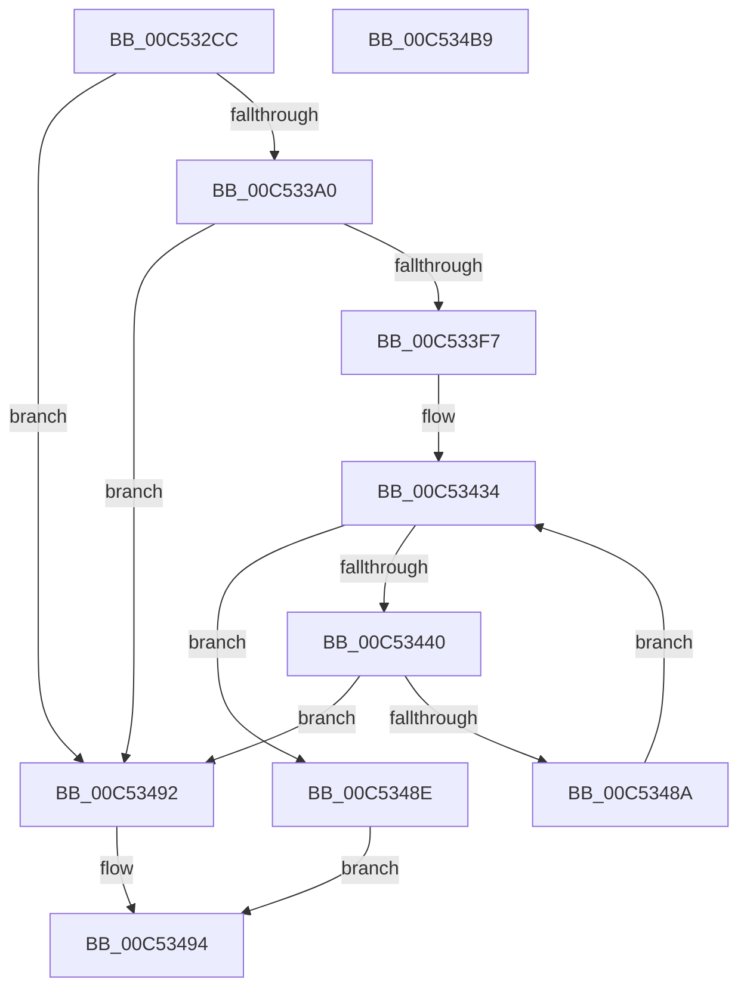

# ExpInitializeCallbacks

- RVA: `0x00C532CC`–`0x00C534BA` (길이 `494` bytes)
- VA: `0x0000000140C532CC`
- 실행 섹션: `INIT`
- PDB 이름 있음: `예`; PDB Function 태그: `아니요`
- unwind 정보 RVA: `0x000D5078`
- 디코드: `109`개 명령, `494/494` bytes 표시
- 미해석 바이트: `0` (있으면 어셈블리에 `.byte`로 보존)

> 이 문서는 커널 이미지의 기계어와 PDB 기호를 분석해 생성했습니다. 4번과 5번은 함수 원형과 자료형을 바이너리 사용 방식에서 추정한 C 해석이며 원본 소스 복구 결과는 아닙니다.

## 1. Dependencies

- 직접 호출 지점: **9**; 고유 호출 대상: **7**
- 직접 호출자로 확인된 함수: **1**
- RIP 상대 이미지 참조: **18**

### Outgoing calls
- `0x00C53334` → [RtlInitUnicodeString](../../text/42/RtlInitUnicodeString_function_0042A780.md) (function, `0x0042A780`)
- `0x00C53347` → [memset](../../text/6C/memset_function_006C6C40.md) (function, `0x006C6C40`)
- `0x00C53393` → [ObCreateObjectType](../../page/70/ObCreateObjectType_function_00705230.md) (function, `0x00705230`)
- `0x00C533AC` → [RtlInitUnicodeString](../../text/42/RtlInitUnicodeString_function_0042A780.md) (function, `0x0042A780`)
- `0x00C533EA` → [NtCreateDirectoryObject](../../page/A5/NtCreateDirectoryObject_function_00A561F0.md) (function, `0x00A561F0`)
- `0x00C533FB` → [NtClose](../../page/86/NtClose_function_00868870.md) (function, `0x00868870`)
- `0x00C5344A` → [RtlInitUnicodeString](../../text/42/RtlInitUnicodeString_function_0042A780.md) (function, `0x0042A780`)
- `0x00C53481` → [ExCreateCallback](../../page/A7/ExCreateCallback_function_00A7B9D0.md) (function, `0x00A7B9D0`)
- `0x00C5349B` → [_security_check_cookie](../../text/6A/_security_check_cookie_function_006AC640.md) (function, `0x006AC640`)

### Direct callers
- [ExpInitSystemPhase1](ExpInitSystemPhase1_function_00C51508.md) at `0x00C515E1`

### Static image references
- `0x00C532E7` → RVA `0x00E0A740` (`.data`; read)
- `0x00C532F7` → RVA `0x00C7DCF0` (` ?? ::PBOPGDP::`string'`; read)
- `0x00C5330D` → RVA `0x00EFACC0` (`.data`; read/write)
- `0x00C5331A` → RVA `0x00EFACB0` (`.data`; read)
- `0x00C53321` → RVA `0x00EFACB8` (`.data`; write)
- `0x00C53328` → RVA `0x00EFACB0` (`.data`; write)
- `0x00C5334C` → RVA `0x00C825B0` (`ExpCallbackMapping`; read)
- `0x00C53357` → RVA `0x007CAC80` (`ExpDeleteCallback`; read)
- `0x00C5335E` → RVA `0x00FC7008` (`ALMOSTRO`; read)
- `0x00C533A0` → RVA `0x00C82718` (`ExpWstrCallback`; read)
- `0x00C533CC` → RVA `0x00FD9D88` (`PAGEDATA`; read)
- `0x00C53400` → RVA `0x00EFACE0` (`.data`; read/write)
- `0x00C53408` → RVA `0x00EFACE8` (`.data`; read)
- `0x00C5340F` → RVA `0x00EFACE4` (`.data`; read/write)
- `0x00C53416` → RVA `0x00B4D020` (`ExpInitializeCallback`; read)
- `0x00C5341D` → RVA `0x00EFACF0` (`.data`; write)
- `0x00C53426` → RVA `0x00EFACE8` (`.data`; write)
- `0x00C5342D` → RVA `0x00EFACE2` (`.data`; write)

## 2. Other-region calls and transfers

- 다른 실행 섹션으로 향하는 call: **9**
  - `0x00C53334` → [RtlInitUnicodeString](../../text/42/RtlInitUnicodeString_function_0042A780.md) (`INIT` → `.text`)
  - `0x00C53347` → [memset](../../text/6C/memset_function_006C6C40.md) (`INIT` → `.text`)
  - `0x00C53393` → [ObCreateObjectType](../../page/70/ObCreateObjectType_function_00705230.md) (`INIT` → `PAGE`)
  - `0x00C533AC` → [RtlInitUnicodeString](../../text/42/RtlInitUnicodeString_function_0042A780.md) (`INIT` → `.text`)
  - `0x00C533EA` → [NtCreateDirectoryObject](../../page/A5/NtCreateDirectoryObject_function_00A561F0.md) (`INIT` → `PAGE`)
  - `0x00C533FB` → [NtClose](../../page/86/NtClose_function_00868870.md) (`INIT` → `PAGE`)
  - `0x00C5344A` → [RtlInitUnicodeString](../../text/42/RtlInitUnicodeString_function_0042A780.md) (`INIT` → `.text`)
  - `0x00C53481` → [ExCreateCallback](../../page/A7/ExCreateCallback_function_00A7B9D0.md) (`INIT` → `PAGE`)
  - `0x00C5349B` → [_security_check_cookie](../../text/6A/_security_check_cookie_function_006AC640.md) (`INIT` → `.text`)
- 별도 외부 분기/꼬리 이동을 확인하지 못했습니다.

## 3. Assembly (complete function range)

```asm
00C532CC  48 8B C4                        mov rax, rsp
00C532CF  48 89 58 08                     mov qword ptr [rax + 8], rbx
00C532D3  48 89 78 10                     mov qword ptr [rax + 0x10], rdi
00C532D7  4C 89 70 18                     mov qword ptr [rax + 0x18], r14
00C532DB  55                              push rbp
00C532DC  48 8D 68 A1                     lea rbp, [rax - 0x5f]
00C532E0  48 81 EC 00 01 00 00            sub rsp, 0x100
00C532E7  48 8B 05 52 74 1B 00            mov rax, qword ptr [rip + 0x1b7452]
00C532EE  48 33 C4                        xor rax, rsp
00C532F1  48 89 45 47                     mov qword ptr [rbp + 0x47], rax
00C532F5  33 C0                           xor eax, eax
00C532F7  48 8D 15 F2 A9 02 00            lea rdx, [rip + 0x2a9f2]
00C532FE  21 45 AB                        and dword ptr [rbp - 0x55], eax
00C53301  48 8D 4C 24 20                  lea rcx, [rsp + 0x20]
00C53306  48 21 45 87                     and qword ptr [rbp - 0x79], rax
00C5330A  0F 57 C0                        xorps xmm0, xmm0
00C5330D  48 21 05 AC 79 2A 00            and qword ptr [rip + 0x2a79ac], rax
00C53314  89 45 93                        mov dword ptr [rbp - 0x6d], eax
00C53317  21 45 93                        and dword ptr [rbp - 0x6d], eax
00C5331A  48 8D 05 8F 79 2A 00            lea rax, [rip + 0x2a798f]
00C53321  48 89 05 90 79 2A 00            mov qword ptr [rip + 0x2a7990], rax
00C53328  48 89 05 81 79 2A 00            mov qword ptr [rip + 0x2a7981], rax
00C5332F  0F 11 44 24 20                  movups xmmword ptr [rsp + 0x20], xmm0
00C53334  E8 47 74 7D FF                  call 0x14042a780
00C53339  BB 78 00 00 00                  mov ebx, 0x78
00C5333E  48 8D 4D C7                     lea rcx, [rbp - 0x39]
00C53342  44 8B C3                        mov r8d, ebx
00C53345  33 D2                           xor edx, edx
00C53347  E8 F4 38 A7 FF                  call 0x1406c6c40
00C5334C  0F 10 05 5D F2 02 00            movups xmm0, xmmword ptr [rip + 0x2f25d]
00C53353  80 4D C9 04                     or byte ptr [rbp - 0x37], 4
00C53357  48 8D 05 22 79 B7 FF            lea rax, [rip - 0x4886de]
00C5335E  4C 8D 0D A3 3C 37 00            lea r9, [rip + 0x373ca3]
00C53365  66 89 5D C7                     mov word ptr [rbp - 0x39], bx
00C53369  45 33 C0                        xor r8d, r8d
00C5336C  C7 45 CF 00 01 00 00            mov dword ptr [rbp - 0x31], 0x100
00C53373  48 8D 55 C7                     lea rdx, [rbp - 0x39]
00C53377  48 89 45 0F                     mov qword ptr [rbp + 0xf], rax
00C5337B  48 8D 4C 24 20                  lea rcx, [rsp + 0x20]
00C53380  C7 45 EB 00 02 00 00            mov dword ptr [rbp - 0x15], 0x200
00C53387  F3 0F 7F 45 D3                  movdqu xmmword ptr [rbp - 0x2d], xmm0
00C5338C  C7 45 E3 01 00 1F 00            mov dword ptr [rbp - 0x1d], 0x1f0001
00C53393  E8 98 1E AB FF                  call 0x140705230
00C53398  85 C0                           test eax, eax
00C5339A  0F 88 F2 00 00 00               js 0x140c53492
00C533A0  48 8D 15 71 F3 02 00            lea rdx, [rip + 0x2f371]
00C533A7  48 8D 4C 24 20                  lea rcx, [rsp + 0x20]
00C533AC  E8 CF 73 7D FF                  call 0x14042a780
00C533B1  48 83 65 97 00                  and qword ptr [rbp - 0x69], 0
00C533B6  48 8D 44 24 20                  lea rax, [rsp + 0x20]
00C533BB  48 83 65 B7 00                  and qword ptr [rbp - 0x49], 0
00C533C0  4C 8D 45 8F                     lea r8, [rbp - 0x71]
00C533C4  48 89 45 9F                     mov qword ptr [rbp - 0x61], rax
00C533C8  48 8D 4D 87                     lea rcx, [rbp - 0x79]
00C533CC  48 8B 05 B5 69 38 00            mov rax, qword ptr [rip + 0x3869b5]
00C533D3  BA 0F 00 0F 00                  mov edx, 0xf000f
00C533D8  48 89 45 AF                     mov qword ptr [rbp - 0x51], rax
00C533DC  C7 45 8F 30 00 00 00            mov dword ptr [rbp - 0x71], 0x30
00C533E3  C7 45 A7 50 00 00 00            mov dword ptr [rbp - 0x59], 0x50
00C533EA  E8 01 2E E0 FF                  call 0x140a561f0
00C533EF  85 C0                           test eax, eax
00C533F1  0F 88 9B 00 00 00               js 0x140c53492
00C533F7  48 8B 4D 87                     mov rcx, qword ptr [rbp - 0x79]
00C533FB  E8 70 54 C1 FF                  call 0x140868870
00C53400  66 83 25 D8 78 2A 00 00         and word ptr [rip + 0x2a78d8], 0
00C53408  48 8D 05 D9 78 2A 00            lea rax, [rip + 0x2a78d9]
00C5340F  83 25 CE 78 2A 00 00            and dword ptr [rip + 0x2a78ce], 0
00C53416  4C 8D 35 03 9C EF FF            lea r14, [rip - 0x1063fd]
00C5341D  48 89 05 CC 78 2A 00            mov qword ptr [rip + 0x2a78cc], rax
00C53424  33 DB                           xor ebx, ebx
00C53426  48 89 05 BB 78 2A 00            mov qword ptr [rip + 0x2a78bb], rax
00C5342D  C6 05 AE 78 2A 00 06            mov byte ptr [rip + 0x2a78ae], 6
00C53434  8B FB                           mov edi, ebx
00C53436  48 03 FF                        add rdi, rdi
00C53439  49 83 3C FE 00                  cmp qword ptr [r14 + rdi*8], 0
00C5343E  74 4E                           je 0x140c5348e
00C53440  49 8B 54 FE 08                  mov rdx, qword ptr [r14 + rdi*8 + 8]
00C53445  48 8D 4C 24 20                  lea rcx, [rsp + 0x20]
00C5344A  E8 31 73 7D FF                  call 0x14042a780
00C5344F  49 8B 0C FE                     mov rcx, qword ptr [r14 + rdi*8]
00C53453  48 8D 44 24 20                  lea rax, [rsp + 0x20]
00C53458  48 83 65 97 00                  and qword ptr [rbp - 0x69], 0
00C5345D  48 8D 55 8F                     lea rdx, [rbp - 0x71]
00C53461  41 B1 01                        mov r9b, 1
00C53464  C7 45 8F 30 00 00 00            mov dword ptr [rbp - 0x71], 0x30
00C5346B  0F 57 C0                        xorps xmm0, xmm0
00C5346E  C7 45 A7 50 00 00 00            mov dword ptr [rbp - 0x59], 0x50
00C53475  45 8A C1                        mov r8b, r9b
00C53478  48 89 45 9F                     mov qword ptr [rbp - 0x61], rax
00C5347C  F3 0F 7F 45 AF                  movdqu xmmword ptr [rbp - 0x51], xmm0
00C53481  E8 4A 85 E2 FF                  call 0x140a7b9d0
00C53486  85 C0                           test eax, eax
00C53488  78 08                           js 0x140c53492
00C5348A  FF C3                           inc ebx
00C5348C  EB A6                           jmp 0x140c53434
00C5348E  B0 01                           mov al, 1
00C53490  EB 02                           jmp 0x140c53494
00C53492  32 C0                           xor al, al
00C53494  48 8B 4D 47                     mov rcx, qword ptr [rbp + 0x47]
00C53498  48 33 CC                        xor rcx, rsp
00C5349B  E8 A0 91 A5 FF                  call 0x1406ac640
00C534A0  4C 8D 9C 24 00 01 00 00         lea r11, [rsp + 0x100]
00C534A8  49 8B 5B 10                     mov rbx, qword ptr [r11 + 0x10]
00C534AC  49 8B 7B 18                     mov rdi, qword ptr [r11 + 0x18]
00C534B0  4D 8B 73 20                     mov r14, qword ptr [r11 + 0x20]
00C534B4  49 8B E3                        mov rsp, r11
00C534B7  5D                              pop rbp
00C534B8  C3                              ret
00C534B9  CC                              int3
```

## 4. C-style interpretation (structured pseudocode)

```c
__int64 __fastcall ExpInitializeCallbacks(void)
{
    __int64 result;
    __int64 v_rbx;
    __int64 v_rdi;
    __int64 v_rsp;
    unsigned __int64 v_stack_m8;
    unsigned __int64 v_stack_mE8;

    *(unsigned __int64 *)(v_rsp + 8) = v_rbx;
    *(unsigned __int64 *)(v_rsp + 16) = v_rdi;
    *(unsigned __int64 *)(v_rsp + 24) = v_r14;
    v_rsp = (v_rsp) - (256);
    result = (*(unsigned __int64 *)(v_rip + 1799250)) ^ (v_rsp);
    *(unsigned __int64 *)(v_rsp - 95 + 71) = result;
    result = 0;
    *(unsigned int *)(v_rsp - 95 - 109) = 0;
    *(unsigned __int64 *)(v_rip + 2783632) = v_rip + 2783631;
    *(unsigned __int64 *)(v_rip + 2783617) = v_rip + 2783631;
    v_stack_mE8 = v_xmm0;
    result = RtlInitUnicodeString(v_stack_mE8, v_rip + 174578, a3, a4);
    a2 = 0;
    result = memset(v_rsp - 95 - 57, a2, 120, a4);
    *(unsigned __int16 *)(v_rsp - 95 - 57) = 120;
    a3 = 0;
    *(unsigned int *)(v_rsp - 95 - 49) = 256;
    *(unsigned __int64 *)(v_rsp - 95 + 15) = v_rip - 4753118;
    *(unsigned int *)(v_rsp - 95 - 21) = 512;
    *(unsigned __int64 *)(v_rsp - 95 - 45) = v_xmm0;
    *(unsigned int *)(v_rsp - 95 - 29) = 0x1F0001ULL;
    result = ObCreateObjectType(v_stack_mE8, v_rsp - 95 - 57, a3, v_rip + 3620003);
    if (sign_flag) goto loc_00C53492;
    result = RtlInitUnicodeString(v_stack_mE8, v_rip + 193393, a3, v_rip + 3620003);
    *(unsigned __int64 *)(v_rsp - 95 - 97) = v_stack_mE8;
    *(unsigned __int64 *)(v_rsp - 95 - 81) = *(unsigned __int64 *)(v_rip + 3697077);
    *(unsigned int *)(v_rsp - 95 - 113) = 48;
    *(unsigned int *)(v_rsp - 95 - 89) = 80;
    result = NtCreateDirectoryObject(v_rsp - 95 - 121, (unsigned int)(0xF000FULL), v_rsp - 95 - 113, v_rip + 3620003);
    if (sign_flag) goto loc_00C53492;
    result = NtClose(*(unsigned __int64 *)(v_rsp - 95 - 121), (unsigned int)(0xF000FULL), v_rsp - 95 - 113, v_rip + 3620003);
    *(unsigned __int64 *)(v_rip + 2783436) = v_rip + 2783449;
    v_rbx = 0;
    *(unsigned __int64 *)(v_rip + 2783419) = v_rip + 2783449;
    *(unsigned __int8 *)(v_rip + 2783406) = 6;
loc_00C53434:
    v_rdi = (0) + (0);
    if ((*(unsigned __int64 *)(v_rip - 1074173 + v_rdi * 8)) == 0) goto loc_00C5348E;
    result = RtlInitUnicodeString(v_stack_mE8, *(unsigned __int64 *)(v_rip - 1074173 + v_rdi * 8 + 8), v_rsp - 95 - 113, v_rip + 3620003);
    *(unsigned int *)(v_rsp - 95 - 113) = 48;
    *(unsigned int *)(v_rsp - 95 - 89) = 80;
    *(unsigned __int64 *)(v_rsp - 95 - 97) = v_stack_mE8;
    *(unsigned __int64 *)(v_rsp - 95 - 81) = v_xmm0;
    result = ExCreateCallback(*(unsigned __int64 *)(v_rip - 1074173 + v_rdi * 8), v_rsp - 95 - 113, 1, 1);
    if (sign_flag) goto loc_00C53492;
    v_rbx = (unsigned int)((v_rbx) + 1);
    goto loc_00C53434;
loc_00C5348E:
    goto loc_00C53494;
loc_00C53492:
    result = 0;
loc_00C53494:
    a1 = (*(unsigned __int64 *)(v_rsp - 95 + 71)) ^ (v_rsp);
    result = _security_check_cookie(a1, v_rsp - 95 - 113, 1, 1);
    return result;
}
```

## 5. (Beta) C Style

```c
void ExpInitializeCallbacks(void)
{
    int64_t result;
    int64_t local_rbx;
    int64_t local_rdi;
    int64_t local_rsp;
    uint64_t v_stack_m8;
    uint64_t v_stack_mE8;

    *(uint64_t *)(local_rsp + 0x8) = local_rbx;
    *(uint64_t *)(local_rsp + 0x10) = local_rdi;
    *(uint64_t *)(local_rsp + 0x18) = local_r14;
    local_rsp = (local_rsp) - (256);
    result = (*(uint64_t *)(v_rip + 0x1B7452)) ^ (local_rsp);
    *(uint64_t *)(local_rsp - 0x5F + 0x47) = result;
    result = 0;
    *(uint32_t *)(local_rsp - 0x5F - 0x6D) = 0;
    *(uint64_t *)(v_rip + 0x2A7990) = v_rip + 2783631;
    *(uint64_t *)(v_rip + 0x2A7981) = v_rip + 2783631;
    v_stack_mE8 = v_xmm0;
    result = RtlInitUnicodeString(v_stack_mE8, v_rip + 174578, a3, a4);
    a2 = 0;
    result = memset(local_rsp - 95 - 57, a2, 120, a4);
    *(uint16_t *)(local_rsp - 0x5F - 0x39) = 120;
    a3 = 0;
    *(uint32_t *)(local_rsp - 0x5F - 0x31) = 256;
    *(uint64_t *)(local_rsp - 0x5F + 0xF) = v_rip - 4753118;
    *(uint32_t *)(local_rsp - 0x5F - 0x15) = 512;
    *(uint64_t *)(local_rsp - 0x5F - 0x2D) = v_xmm0;
    *(uint32_t *)(local_rsp - 0x5F - 0x1D) = 0x1F0001ULL;
    result = ObCreateObjectType(v_stack_mE8, local_rsp - 95 - 57, a3, v_rip + 3620003);
    if (sign_flag) goto loc_00C53492;
    result = RtlInitUnicodeString(v_stack_mE8, v_rip + 193393, a3, v_rip + 3620003);
    *(uint64_t *)(local_rsp - 0x5F - 0x61) = v_stack_mE8;
    *(uint64_t *)(local_rsp - 0x5F - 0x51) = *(uint64_t *)(v_rip + 0x3869B5);
    *(uint32_t *)(local_rsp - 0x5F - 0x71) = 48;
    *(uint32_t *)(local_rsp - 0x5F - 0x59) = 80;
    result = NtCreateDirectoryObject(local_rsp - 95 - 121, (uint32_t)(0xF000FULL), local_rsp - 95 - 113, v_rip + 3620003);
    if (sign_flag) goto loc_00C53492;
    result = NtClose(*(uint64_t *)(local_rsp - 0x5F - 0x79), (uint32_t)(0xF000FULL), local_rsp - 95 - 113, v_rip + 3620003);
    *(uint64_t *)(v_rip + 0x2A78CC) = v_rip + 2783449;
    local_rbx = 0;
    *(uint64_t *)(v_rip + 0x2A78BB) = v_rip + 2783449;
    *(uint8_t *)(v_rip + 0x2A78AE) = 6;
loc_00C53434:
    local_rdi = (0) + (0);
    if ((*(uint64_t *)(v_rip - 0x1063FD + local_rdi * 8)) == 0) goto loc_00C5348E;
    result = RtlInitUnicodeString(v_stack_mE8, *(uint64_t *)(v_rip - 0x1063FD + local_rdi * 8 + 0x8), local_rsp - 95 - 113, v_rip + 3620003);
    *(uint32_t *)(local_rsp - 0x5F - 0x71) = 48;
    *(uint32_t *)(local_rsp - 0x5F - 0x59) = 80;
    *(uint64_t *)(local_rsp - 0x5F - 0x61) = v_stack_mE8;
    *(uint64_t *)(local_rsp - 0x5F - 0x51) = v_xmm0;
    result = ExCreateCallback(*(uint64_t *)(v_rip - 0x1063FD + local_rdi * 8), local_rsp - 95 - 113, 1, 1);
    if (sign_flag) goto loc_00C53492;
    local_rbx = (uint32_t)((local_rbx) + 1);
    goto loc_00C53434;
loc_00C5348E:
    goto loc_00C53494;
loc_00C53492:
    result = 0;
loc_00C53494:
    a1 = (*(uint64_t *)(local_rsp - 0x5F + 0x47)) ^ (local_rsp);
    result = _security_check_cookie(a1, local_rsp - 95 - 113, 1, 1);
    return result;
}
```

## 6. Execution-region graph

[열기: 2D/3D 그래프와 함수 탐색 컨트롤 패널](../../../control-panel.html?section=init&rva=0x00C532CC&view=graph)

- 2D 그래프는 위에서 아래로 흐르고, 3D 그래프는 빈 공간을 드래그해 회전합니다. Shift+드래그는 이동, 휠은 확대·축소, 함수 노드 선택은 대상 보고서 이동입니다.

### Static fallback


