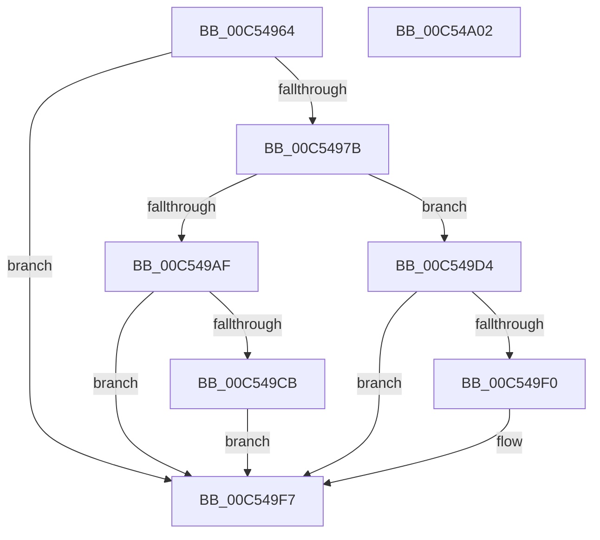

# ExpInitializeCrossVmIntegration

- RVA: `0x00C54964`–`0x00C54A03` (길이 `159` bytes)
- VA: `0x0000000140C54964`
- 실행 섹션: `INIT`
- PDB 이름 있음: `예`; PDB Function 태그: `아니요`
- unwind 정보 RVA: `0x0009EAB4`
- 디코드: `38`개 명령, `159/159` bytes 표시
- 미해석 바이트: `0` (있으면 어셈블리에 `.byte`로 보존)

> 이 문서는 커널 이미지의 기계어와 PDB 기호를 분석해 생성했습니다. 4번과 5번은 함수 원형과 자료형을 바이너리 사용 방식에서 추정한 C 해석이며 원본 소스 복구 결과는 아닙니다.

## 1. Dependencies

- 직접 호출 지점: **2**; 고유 호출 대상: **1**
- 직접 호출자로 확인된 함수: **1**
- RIP 상대 이미지 참조: **7**

### Outgoing calls
- `0x00C549C2` → [ExRegisterHost](../../page/7D/ExRegisterHost_function_007D06CC.md) (function, `0x007D06CC`)
- `0x00C549E7` → [ExRegisterHost](../../page/7D/ExRegisterHost_function_007D06CC.md) (function, `0x007D06CC`)

### Direct callers
- [ExpInitSystemPhase1](ExpInitSystemPhase1_function_00C51508.md) at `0x00C517C8`

### Static image references
- `0x00C54973` → RVA `0x00FC6A97` (`ALMOSTRO`; read)
- `0x00C5497B` → RVA `0x00FC6A90` (`ALMOSTRO`; read)
- `0x00C5499A` → RVA `0x007D54A0` (`ExpCrossVmIntHostCallback`; read)
- `0x00C549AF` → RVA `0x00EFA120` (`.data`; read)
- `0x00C549CB` → RVA `0x00EFA120` (`.data`; write)
- `0x00C549D4` → RVA `0x00EFA118` (`.data`; read)
- `0x00C549F0` → RVA `0x00EFA118` (`.data`; write)

## 2. Other-region calls and transfers

- 다른 실행 섹션으로 향하는 call: **2**
  - `0x00C549C2` → [ExRegisterHost](../../page/7D/ExRegisterHost_function_007D06CC.md) (`INIT` → `PAGE`)
  - `0x00C549E7` → [ExRegisterHost](../../page/7D/ExRegisterHost_function_007D06CC.md) (`INIT` → `PAGE`)
- 별도 외부 분기/꼬리 이동을 확인하지 못했습니다.

## 3. Assembly (complete function range)

```asm
00C54964  48 89 5C 24 08                  mov qword ptr [rsp + 8], rbx
00C54969  55                              push rbp
00C5496A  48 8B EC                        mov rbp, rsp
00C5496D  48 83 EC 60                     sub rsp, 0x60
00C54971  33 DB                           xor ebx, ebx
00C54973  38 1D 1E 21 37 00               cmp byte ptr [rip + 0x37211e], bl
00C54979  74 7C                           je 0x140c549f7
00C5497B  8B 05 0F 21 37 00               mov eax, dword ptr [rip + 0x37210f]
00C54981  4C 8D 45 D0                     lea r8, [rbp - 0x30]
00C54985  A8 02                           test al, 2
00C54987  C7 45 C0 01 00 00 00            mov dword ptr [rbp - 0x40], 1
00C5498E  48 8D 45 C0                     lea rax, [rbp - 0x40]
00C54992  48 89 5D C8                     mov qword ptr [rbp - 0x38], rbx
00C54996  48 89 45 D8                     mov qword ptr [rbp - 0x28], rax
00C5499A  48 8D 05 FF 0A B8 FF            lea rax, [rip - 0x47f501]
00C549A1  48 89 45 E8                     mov qword ptr [rbp - 0x18], rax
00C549A5  48 C7 45 E0 00 02 00 00         mov qword ptr [rbp - 0x20], 0x200
00C549AD  74 25                           je 0x140c549d4
00C549AF  48 8D 0D 6A 57 2A 00            lea rcx, [rip + 0x2a576a]
00C549B6  48 C7 45 D0 0F 00 01 00         mov qword ptr [rbp - 0x30], 0x1000f
00C549BE  48 89 4D F0                     mov qword ptr [rbp - 0x10], rcx
00C549C2  E8 05 BD B7 FF                  call 0x1407d06cc
00C549C7  85 C0                           test eax, eax
00C549C9  79 2C                           jns 0x140c549f7
00C549CB  48 89 1D 4E 57 2A 00            mov qword ptr [rip + 0x2a574e], rbx
00C549D2  EB 23                           jmp 0x140c549f7
00C549D4  48 8D 0D 3D 57 2A 00            lea rcx, [rip + 0x2a573d]
00C549DB  48 C7 45 D0 10 00 01 00         mov qword ptr [rbp - 0x30], 0x10010
00C549E3  48 89 4D F0                     mov qword ptr [rbp - 0x10], rcx
00C549E7  E8 E0 BC B7 FF                  call 0x1407d06cc
00C549EC  85 C0                           test eax, eax
00C549EE  79 07                           jns 0x140c549f7
00C549F0  48 89 1D 21 57 2A 00            mov qword ptr [rip + 0x2a5721], rbx
00C549F7  48 8B 5C 24 70                  mov rbx, qword ptr [rsp + 0x70]
00C549FC  48 83 C4 60                     add rsp, 0x60
00C54A00  5D                              pop rbp
00C54A01  C3                              ret
00C54A02  CC                              int3
```

## 4. C-style interpretation (structured pseudocode)

```c
__int64 __fastcall ExpInitializeCrossVmIntegration(void)
{
    __int64 result;
    __int64 v_rbx;
    __int64 v_rsp;
    unsigned __int64 v_stack_m18;
    unsigned __int64 v_stack_m20;
    unsigned __int64 v_stack_m28;
    unsigned __int64 v_stack_m30;
    unsigned __int64 v_stack_m38;
    unsigned __int64 v_stack_m40;
    unsigned int v_stack_m48;
    unsigned __int64 v_stack_p8;

    v_stack_p8 = v_rbx;
    v_rsp = (v_rsp) - (96);
    v_rbx = 0;
    if ((*(unsigned __int8 *)(v_rip + 3612958)) == 0) goto loc_00C549F7;
    v_stack_m48 = 1;
    v_stack_m40 = 0;
    v_stack_m30 = v_stack_m48;
    v_stack_m20 = v_rip - 4715777;
    v_stack_m28 = 512;
    if ((((unsigned __int8)((unsigned int)(*(unsigned int *)(v_rip + 3612943)))) & (2)) == 0) goto loc_00C549D4;
    v_stack_m38 = 0x1000FULL;
    v_stack_m18 = v_rip + 2774890;
    result = ExRegisterHost(v_rip + 2774890, a2, v_stack_m38, a4);
    if (!sign_flag) goto loc_00C549F7;
    *(unsigned __int64 *)(v_rip + 2774862) = 0;
    goto loc_00C549F7;
loc_00C549D4:
    v_stack_m38 = 0x10010ULL;
    v_stack_m18 = v_rip + 2774845;
    result = ExRegisterHost(v_rip + 2774845, a2, v_stack_m38, a4);
    if (sign_flag) {
        *(unsigned __int64 *)(v_rip + 2774817) = 0;
    }
    v_rsp = (v_rsp) + (96);
    return result;
}
```

## 5. (Beta) C Style

```c
void ExpInitializeCrossVmIntegration(void)
{
    int64_t result;
    int64_t local_rbx;
    int64_t local_rsp;
    uint64_t v_stack_m18;
    uint64_t v_stack_m20;
    uint64_t v_stack_m28;
    uint64_t v_stack_m30;
    uint64_t v_stack_m38;
    uint64_t v_stack_m40;
    uint32_t v_stack_m48;
    uint64_t v_stack_p8;

    v_stack_p8 = local_rbx;
    local_rsp = (local_rsp) - (96);
    local_rbx = 0;
    if ((*(uint8_t *)(v_rip + 0x37211E)) == 0) goto loc_00C549F7;
    v_stack_m48 = 1;
    v_stack_m40 = 0;
    v_stack_m30 = v_stack_m48;
    v_stack_m20 = v_rip - 4715777;
    v_stack_m28 = 512;
    if ((((uint8_t)((uint32_t)(*(uint32_t *)(v_rip + 0x37210F)))) & (2)) == 0) goto loc_00C549D4;
    v_stack_m38 = 0x1000FULL;
    v_stack_m18 = v_rip + 2774890;
    result = ExRegisterHost(v_rip + 2774890, a2, v_stack_m38, a4);
    if (!sign_flag) goto loc_00C549F7;
    *(uint64_t *)(v_rip + 0x2A574E) = 0;
    goto loc_00C549F7;
loc_00C549D4:
    v_stack_m38 = 0x10010ULL;
    v_stack_m18 = v_rip + 2774845;
    result = ExRegisterHost(v_rip + 2774845, a2, v_stack_m38, a4);
    if (sign_flag) {
        *(uint64_t *)(v_rip + 0x2A5721) = 0;
    }
    local_rsp = (local_rsp) + (96);
    return result;
}
```

## 6. Execution-region graph

[열기: 2D/3D 그래프와 함수 탐색 컨트롤 패널](../../../control-panel.html?section=init&rva=0x00C54964&view=graph)

- 2D 그래프는 위에서 아래로 흐르고, 3D 그래프는 빈 공간을 드래그해 회전합니다. Shift+드래그는 이동, 휠은 확대·축소, 함수 노드 선택은 대상 보고서 이동입니다.

### Static fallback


