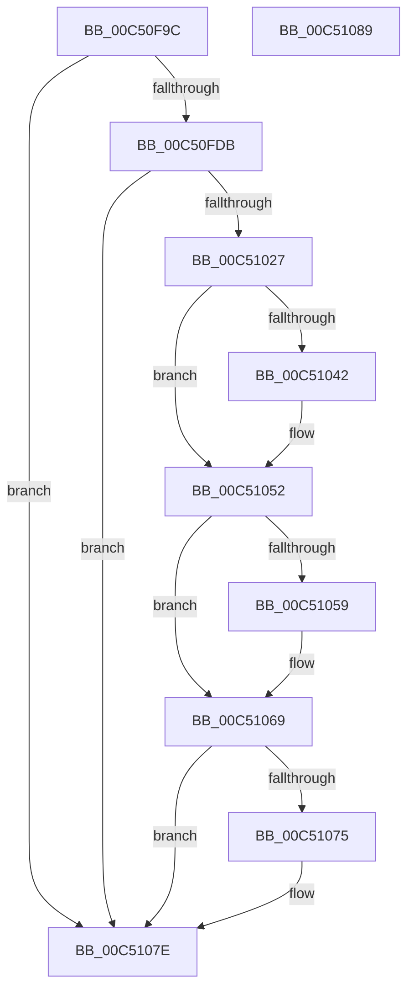

# ExpInitializeMemoryMirroring

- RVA: `0x00C50F9C`–`0x00C5108A` (길이 `238` bytes)
- VA: `0x0000000140C50F9C`
- 실행 섹션: `INIT`
- PDB 이름 있음: `예`; PDB Function 태그: `아니요`
- unwind 정보 RVA: `0x000C4610`
- 디코드: `59`개 명령, `238/238` bytes 표시
- 미해석 바이트: `0` (있으면 어셈블리에 `.byte`로 보존)

> 이 문서는 커널 이미지의 기계어와 PDB 기호를 분석해 생성했습니다. 4번과 5번은 함수 원형과 자료형을 바이너리 사용 방식에서 추정한 C 해석이며 원본 소스 복구 결과는 아닙니다.

## 1. Dependencies

- 직접 호출 지점: **5**; 고유 호출 대상: **4**
- 직접 호출자로 확인된 함수: **1**
- RIP 상대 이미지 참조: **3**

### Outgoing calls
- `0x00C50FE6` → [RtlInitUnicodeString](../../text/42/RtlInitUnicodeString_function_0042A780.md) (function, `0x0042A780`)
- `0x00C5101E` → [ZwCreatePartition](../../text/6A/ZwCreatePartition_function_006AE870.md) (function, `0x006AE870`)
- `0x00C5104D` → [ExpAddNonMirroredRanges](ExpAddNonMirroredRanges_function_00C50ED0.md) (function, `0x00C50ED0`)
- `0x00C51064` → [ExpAddNonMirroredRanges](ExpAddNonMirroredRanges_function_00C50ED0.md) (function, `0x00C50ED0`)
- `0x00C51079` → [guard_dispatch_icall](../../text/6B/guard_dispatch_icall_function_006BAAD0.md) (function, `0x006BAAD0`)

### Direct callers
- [BootApplicationPersistentDataProcess](../BE/BootApplicationPersistentDataProcess_function_00BEEBD4.md) at `0x00BEEC3B`

### Static image references
- `0x00C50FBB` → RVA `0x00FC6B20` (`ALMOSTRO`; read)
- `0x00C50FDB` → RVA `0x00C7DC60` (` ?? ::PBOPGDP::`string'`; read)
- `0x00C51069` → RVA `0x00EFF000` (`.data`; read)

## 2. Other-region calls and transfers

- 다른 실행 섹션으로 향하는 call: **3**
  - `0x00C50FE6` → [RtlInitUnicodeString](../../text/42/RtlInitUnicodeString_function_0042A780.md) (`INIT` → `.text`)
  - `0x00C5101E` → [ZwCreatePartition](../../text/6A/ZwCreatePartition_function_006AE870.md) (`INIT` → `.text`)
  - `0x00C51079` → [guard_dispatch_icall](../../text/6B/guard_dispatch_icall_function_006BAAD0.md) (`INIT` → `.text`)
- 별도 외부 분기/꼬리 이동을 확인하지 못했습니다.

## 3. Assembly (complete function range)

```asm
00C50F9C  48 89 5C 24 10                  mov qword ptr [rsp + 0x10], rbx
00C50FA1  55                              push rbp
00C50FA2  48 8B EC                        mov rbp, rsp
00C50FA5  48 83 EC 60                     sub rsp, 0x60
00C50FA9  33 C0                           xor eax, eax
00C50FAB  0F 57 C0                        xorps xmm0, xmm0
00C50FAE  21 45 EC                        and dword ptr [rbp - 0x14], eax
00C50FB1  48 21 45 10                     and qword ptr [rbp + 0x10], rax
00C50FB5  89 45 D4                        mov dword ptr [rbp - 0x2c], eax
00C50FB8  21 45 D4                        and dword ptr [rbp - 0x2c], eax
00C50FBB  48 8B 05 5E 5B 37 00            mov rax, qword ptr [rip + 0x375b5e]
00C50FC2  0F 11 45 C0                     movups xmmword ptr [rbp - 0x40], xmm0
00C50FC6  48 8B 88 F0 00 00 00            mov rcx, qword ptr [rax + 0xf0]
00C50FCD  48 83 B9 A8 0E 00 00 00         cmp qword ptr [rcx + 0xea8], 0
00C50FD5  0F 84 A3 00 00 00               je 0x140c5107e
00C50FDB  48 8D 15 7E CC 02 00            lea rdx, [rip + 0x2cc7e]
00C50FE2  48 8D 4D C0                     lea rcx, [rbp - 0x40]
00C50FE6  E8 95 97 7D FF                  call 0x14042a780
00C50FEB  48 83 65 D8 00                  and qword ptr [rbp - 0x28], 0
00C50FF0  48 8D 45 C0                     lea rax, [rbp - 0x40]
00C50FF4  0F 57 C0                        xorps xmm0, xmm0
00C50FF7  48 89 45 E0                     mov qword ptr [rbp - 0x20], rax
00C50FFB  4C 8D 4D D0                     lea r9, [rbp - 0x30]
00C50FFF  C7 45 D0 30 00 00 00            mov dword ptr [rbp - 0x30], 0x30
00C51006  41 B8 03 00 1F 00               mov r8d, 0x1f0003
00C5100C  C7 45 E8 00 02 00 00            mov dword ptr [rbp - 0x18], 0x200
00C51013  48 8D 55 10                     lea rdx, [rbp + 0x10]
00C51017  33 C9                           xor ecx, ecx
00C51019  F3 0F 7F 45 F0                  movdqu xmmword ptr [rbp - 0x10], xmm0
00C5101E  E8 4D D8 A5 FF                  call 0x1406ae870
00C51023  85 C0                           test eax, eax
00C51025  78 57                           js 0x140c5107e
00C51027  48 8B 05 F2 5A 37 00            mov rax, qword ptr [rip + 0x375af2]
00C5102E  48 8B 88 F0 00 00 00            mov rcx, qword ptr [rax + 0xf0]
00C51035  48 8B 99 A8 0E 00 00            mov rbx, qword ptr [rcx + 0xea8]
00C5103C  8B 13                           mov edx, dword ptr [rbx]
00C5103E  85 D2                           test edx, edx
00C51040  74 10                           je 0x140c51052
00C51042  4C 8B 43 08                     mov r8, qword ptr [rbx + 8]
00C51046  45 33 C9                        xor r9d, r9d
00C51049  48 8B 4D 10                     mov rcx, qword ptr [rbp + 0x10]
00C5104D  E8 7E FE FF FF                  call 0x140c50ed0
00C51052  8B 53 04                        mov edx, dword ptr [rbx + 4]
00C51055  85 D2                           test edx, edx
00C51057  74 10                           je 0x140c51069
00C51059  4C 8B 43 10                     mov r8, qword ptr [rbx + 0x10]
00C5105D  41 B1 01                        mov r9b, 1
00C51060  48 8B 4D 10                     mov rcx, qword ptr [rbp + 0x10]
00C51064  E8 67 FE FF FF                  call 0x140c50ed0
00C51069  48 8B 05 90 DF 2A 00            mov rax, qword ptr [rip + 0x2adf90]
00C51070  48 85 C0                        test rax, rax
00C51073  74 09                           je 0x140c5107e
00C51075  48 8B 4D 10                     mov rcx, qword ptr [rbp + 0x10]
00C51079  E8 52 9A A6 FF                  call 0x1406baad0
00C5107E  48 8B 5C 24 78                  mov rbx, qword ptr [rsp + 0x78]
00C51083  48 83 C4 60                     add rsp, 0x60
00C51087  5D                              pop rbp
00C51088  C3                              ret
00C51089  CC                              int3
```

## 4. C-style interpretation (structured pseudocode)

```c
__int64 __fastcall ExpInitializeMemoryMirroring(void)
{
    __int64 result;
    __int64 v_rsp;
    unsigned __int64 v_stack_m18;
    unsigned int v_stack_m1C;
    unsigned int v_stack_m20;
    unsigned __int64 v_stack_m28;
    unsigned __int64 v_stack_m30;
    unsigned int v_stack_m34;
    unsigned __int64 v_stack_m38;
    unsigned __int64 v_stack_m48;
    unsigned __int64 v_stack_p10;
    unsigned __int64 v_stack_p8;

    v_stack_p10 = v_rbx;
    v_rsp = (v_rsp) - (96);
    result = 0;
    v_stack_m34 = 0;
    v_stack_m48 = v_xmm0;
    if ((*(unsigned __int64 *)(*(unsigned __int64 *)(*(unsigned __int64 *)(v_rip + 3627870) + 240) + 3752)) == 0) goto loc_00C5107E;
    result = RtlInitUnicodeString(v_stack_m48, v_rip + 183422, a3, a4);
    v_stack_m28 = v_stack_m48;
    v_stack_m38 = 48;
    v_stack_m20 = 512;
    a1 = 0;
    v_stack_m18 = v_xmm0;
    result = ZwCreatePartition(a1, v_stack_p8, (unsigned int)(0x1F0003ULL), v_stack_m38);
    if (sign_flag) goto loc_00C5107E;
    result = *(unsigned __int64 *)(v_rip + 3627762);
    if ((unsigned int)((unsigned int)(*(unsigned int *)(*(unsigned __int64 *)(*(unsigned __int64 *)(*(unsigned __int64 *)(v_rip + 3627762) + 240) + 3752)))) != 0) {
        a3 = *(unsigned __int64 *)(*(unsigned __int64 *)(*(unsigned __int64 *)(*(unsigned __int64 *)(v_rip + 3627762) + 240) + 3752) + 8);
        a4 = 0;
        a1 = v_stack_p8;
        result = ExpAddNonMirroredRanges(a1, (unsigned int)(*(unsigned int *)(*(unsigned __int64 *)(*(unsigned __int64 *)(*(unsigned __int64 *)(v_rip + 3627762) + 240) + 3752))), a3, a4);
    }
    if ((unsigned int)((unsigned int)(*(unsigned int *)(*(unsigned __int64 *)(*(unsigned __int64 *)(*(unsigned __int64 *)(v_rip + 3627762) + 240) + 3752) + 4))) != 0) {
        a3 = *(unsigned __int64 *)(*(unsigned __int64 *)(*(unsigned __int64 *)(*(unsigned __int64 *)(v_rip + 3627762) + 240) + 3752) + 16);
        a4 = 1;
        a1 = v_stack_p8;
        result = ExpAddNonMirroredRanges(a1, (unsigned int)(*(unsigned int *)(*(unsigned __int64 *)(*(unsigned __int64 *)(*(unsigned __int64 *)(v_rip + 3627762) + 240) + 3752) + 4)), a3, a4);
    }
    result = *(unsigned __int64 *)(v_rip + 2809744);
    if (*(unsigned __int64 *)(v_rip + 2809744) != 0) {
        a1 = v_stack_p8;
        result = guard_dispatch_icall(a1, (unsigned int)(*(unsigned int *)(*(unsigned __int64 *)(*(unsigned __int64 *)(*(unsigned __int64 *)(v_rip + 3627762) + 240) + 3752) + 4)), a3, a4);
    }
    v_rsp = (v_rsp) + (96);
    return result;
}
```

## 5. (Beta) C Style

```c
void ExpInitializeMemoryMirroring(void)
{
    int64_t result;
    int64_t local_rsp;
    uint64_t v_stack_m18;
    uint32_t v_stack_m1C;
    uint32_t v_stack_m20;
    uint64_t v_stack_m28;
    uint64_t v_stack_m30;
    uint32_t v_stack_m34;
    uint64_t v_stack_m38;
    uint64_t v_stack_m48;
    uint64_t v_stack_p10;
    uint64_t v_stack_p8;

    v_stack_p10 = local_rbx;
    local_rsp = (local_rsp) - (96);
    result = 0;
    v_stack_m34 = 0;
    v_stack_m48 = v_xmm0;
    if ((*(uint64_t *)(*(uint64_t *)(*(uint64_t *)(v_rip + 0x375B5E) + 0xF0) + 0xEA8)) == 0) goto loc_00C5107E;
    result = RtlInitUnicodeString(v_stack_m48, v_rip + 183422, a3, a4);
    v_stack_m28 = v_stack_m48;
    v_stack_m38 = 48;
    v_stack_m20 = 512;
    a1 = 0;
    v_stack_m18 = v_xmm0;
    result = ZwCreatePartition(a1, v_stack_p8, (uint32_t)(0x1F0003ULL), v_stack_m38);
    if (sign_flag) goto loc_00C5107E;
    result = *(uint64_t *)(v_rip + 0x375AF2);
    if ((uint32_t)((uint32_t)(*(uint32_t *)(*(uint64_t *)(*(uint64_t *)(*(uint64_t *)(v_rip + 0x375AF2) + 0xF0) + 0xEA8)))) != 0) {
        a3 = *(uint64_t *)(*(uint64_t *)(*(uint64_t *)(*(uint64_t *)(v_rip + 0x375AF2) + 0xF0) + 0xEA8) + 0x8);
        a4 = 0;
        a1 = v_stack_p8;
        result = ExpAddNonMirroredRanges(a1, (uint32_t)(*(uint32_t *)(*(uint64_t *)(*(uint64_t *)(*(uint64_t *)(v_rip + 0x375AF2) + 0xF0) + 0xEA8))), a3, a4);
    }
    if ((uint32_t)((uint32_t)(*(uint32_t *)(*(uint64_t *)(*(uint64_t *)(*(uint64_t *)(v_rip + 0x375AF2) + 0xF0) + 0xEA8) + 0x4))) != 0) {
        a3 = *(uint64_t *)(*(uint64_t *)(*(uint64_t *)(*(uint64_t *)(v_rip + 0x375AF2) + 0xF0) + 0xEA8) + 0x10);
        a4 = 1;
        a1 = v_stack_p8;
        result = ExpAddNonMirroredRanges(a1, (uint32_t)(*(uint32_t *)(*(uint64_t *)(*(uint64_t *)(*(uint64_t *)(v_rip + 0x375AF2) + 0xF0) + 0xEA8) + 0x4)), a3, a4);
    }
    result = *(uint64_t *)(v_rip + 0x2ADF90);
    if (*(uint64_t *)(v_rip + 0x2ADF90) != 0) {
        a1 = v_stack_p8;
        result = guard_dispatch_icall(a1, (uint32_t)(*(uint32_t *)(*(uint64_t *)(*(uint64_t *)(*(uint64_t *)(v_rip + 0x375AF2) + 0xF0) + 0xEA8) + 0x4)), a3, a4);
    }
    local_rsp = (local_rsp) + (96);
    return result;
}
```

## 6. Execution-region graph

[열기: 2D/3D 그래프와 함수 탐색 컨트롤 패널](../../../control-panel.html?section=init&rva=0x00C50F9C&view=graph)

- 2D 그래프는 위에서 아래로 흐르고, 3D 그래프는 빈 공간을 드래그해 회전합니다. Shift+드래그는 이동, 휠은 확대·축소, 함수 노드 선택은 대상 보고서 이동입니다.

### Static fallback


