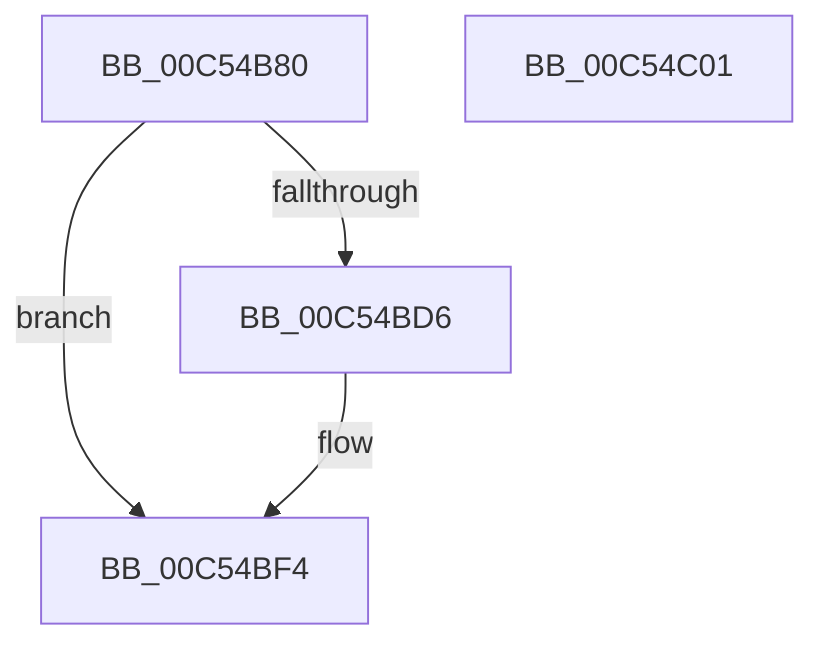

# ExpInitializePrivatePools

- RVA: `0x00C54B80`–`0x00C54C02` (길이 `130` bytes)
- VA: `0x0000000140C54B80`
- 실행 섹션: `INIT`
- PDB 이름 있음: `예`; PDB Function 태그: `아니요`
- unwind 정보 RVA: `0x0005CF00`
- 디코드: `31`개 명령, `130/130` bytes 표시
- 미해석 바이트: `0` (있으면 어셈블리에 `.byte`로 보존)

> 이 문서는 커널 이미지의 기계어와 PDB 기호를 분석해 생성했습니다. 4번과 5번은 함수 원형과 자료형을 바이너리 사용 방식에서 추정한 C 해석이며 원본 소스 복구 결과는 아닙니다.

## 1. Dependencies

- 직접 호출 지점: **2**; 고유 호출 대상: **1**
- 직접 호출자로 확인된 함수: **1**
- RIP 상대 이미지 참조: **8**

### Outgoing calls
- `0x00C54BBA` → [ExGenRandom](../../text/41/ExGenRandom_function_0041B010.md) (function, `0x0041B010`)
- `0x00C54BC7` → [ExGenRandom](../../text/41/ExGenRandom_function_0041B010.md) (function, `0x0041B010`)

### Direct callers
- [ExInitializePoolHeapManagement](../../text/65/ExInitializePoolHeapManagement_function_0065C3D0.md) at `0x0065C5F7`

### Static image references
- `0x00C54B86` → RVA `0x00E6BEE0` (`.data`; read/write)
- `0x00C54B8E` → RVA `0x00E6BEE8` (`.data`; read)
- `0x00C54B95` → RVA `0x00E6BEF0` (`.data`; write)
- `0x00C54B9E` → RVA `0x00E6BEE8` (`.data`; write)
- `0x00C54BA5` → RVA `0x00E6BEF8` (`.data`; read)
- `0x00C54BAC` → RVA `0x00E6BF00` (`.data`; write)
- `0x00C54BB3` → RVA `0x00E6BEF8` (`.data`; write)
- `0x00C54BF4` → RVA `0x00E6BF08` (`.data`; write)

## 2. Other-region calls and transfers

- 다른 실행 섹션으로 향하는 call: **2**
  - `0x00C54BBA` → [ExGenRandom](../../text/41/ExGenRandom_function_0041B010.md) (`INIT` → `.text`)
  - `0x00C54BC7` → [ExGenRandom](../../text/41/ExGenRandom_function_0041B010.md) (`INIT` → `.text`)
- 별도 외부 분기/꼬리 이동을 확인하지 못했습니다.

## 3. Assembly (complete function range)

```asm
00C54B80  40 53                           push rbx
00C54B82  48 83 EC 20                     sub rsp, 0x20
00C54B86  48 83 25 52 73 21 00 00         and qword ptr [rip + 0x217352], 0
00C54B8E  48 8D 05 53 73 21 00            lea rax, [rip + 0x217353]
00C54B95  48 89 05 54 73 21 00            mov qword ptr [rip + 0x217354], rax
00C54B9C  33 C9                           xor ecx, ecx
00C54B9E  48 89 05 43 73 21 00            mov qword ptr [rip + 0x217343], rax
00C54BA5  48 8D 05 4C 73 21 00            lea rax, [rip + 0x21734c]
00C54BAC  48 89 05 4D 73 21 00            mov qword ptr [rip + 0x21734d], rax
00C54BB3  48 89 05 3E 73 21 00            mov qword ptr [rip + 0x21733e], rax
00C54BBA  E8 51 64 7C FF                  call 0x14041b010
00C54BBF  8B D8                           mov ebx, eax
00C54BC1  33 C9                           xor ecx, ecx
00C54BC3  48 C1 E3 20                     shl rbx, 0x20
00C54BC7  E8 44 64 7C FF                  call 0x14041b010
00C54BCC  8B C8                           mov ecx, eax
00C54BCE  48 0B CB                        or rcx, rbx
00C54BD1  F6 C1 0F                        test cl, 0xf
00C54BD4  75 1E                           jne 0x140c54bf4
00C54BD6  48 B8 89 88 88 88 88 88 88 88   movabs rax, 0x8888888888888889
00C54BE0  48 F7 E1                        mul rcx
00C54BE3  48 03 C9                        add rcx, rcx
00C54BE6  48 C1 EA 03                     shr rdx, 3
00C54BEA  48 6B C2 0F                     imul rax, rdx, 0xf
00C54BEE  48 2B C8                        sub rcx, rax
00C54BF1  48 FF C1                        inc rcx
00C54BF4  48 89 0D 0D 73 21 00            mov qword ptr [rip + 0x21730d], rcx
00C54BFB  48 83 C4 20                     add rsp, 0x20
00C54BFF  5B                              pop rbx
00C54C00  C3                              ret
00C54C01  CC                              int3
```

## 4. C-style interpretation (structured pseudocode)

```c
__int64 __fastcall ExpInitializePrivatePools(int a1, __int64 a2)
{
    __int64 result;
    __int64 v_rbx;
    __int64 v_rsp;

    v_rsp = (v_rsp) - (32);
    *(unsigned __int64 *)(v_rip + 2192212) = v_rip + 2192211;
    a1 = 0;
    *(unsigned __int64 *)(v_rip + 2192195) = v_rip + 2192211;
    *(unsigned __int64 *)(v_rip + 2192205) = v_rip + 2192204;
    *(unsigned __int64 *)(v_rip + 2192190) = v_rip + 2192204;
    result = ExGenRandom(a1, a2, a3, a4);
    a1 = 0;
    v_rbx = ((unsigned int)((unsigned int)(result))) << (32);
    result = ExGenRandom(a1, a2, a3, a4);
    a1 = ((unsigned int)((unsigned int)(result))) | (v_rbx);
    if ((((unsigned __int8)(a1)) & (15)) == 0) {
        a1 = (a1) + (a1);
        a2 = (a2) >> (3);
        result = (result) * (a2);
        a1 = (a1) - (result);
        a1 = (a1) + 1;
    }
    *(unsigned __int64 *)(v_rip + 2192141) = a1;
    v_rsp = (v_rsp) + (32);
    return result;
}
```

## 5. (Beta) C Style

```c
int64_t ExpInitializePrivatePools(int32_t Arg1, int64_t Arg2)
{
    int64_t result;
    int64_t local_rbx;
    int64_t local_rsp;

    local_rsp = (local_rsp) - (32);
    *(uint64_t *)(v_rip + 0x217354) = v_rip + 2192211;
    Arg1 = 0;
    *(uint64_t *)(v_rip + 0x217343) = v_rip + 2192211;
    *(uint64_t *)(v_rip + 0x21734D) = v_rip + 2192204;
    *(uint64_t *)(v_rip + 0x21733E) = v_rip + 2192204;
    result = ExGenRandom(Arg1, Arg2, a3, a4);
    Arg1 = 0;
    local_rbx = ((uint32_t)((uint32_t)(result))) << (32);
    result = ExGenRandom(Arg1, Arg2, a3, a4);
    Arg1 = ((uint32_t)((uint32_t)(result))) | (local_rbx);
    if ((((uint8_t)(Arg1)) & (15)) == 0) {
        Arg1 = (Arg1) + (Arg1);
        Arg2 = (Arg2) >> (3);
        result = (result) * (Arg2);
        Arg1 = (Arg1) - (result);
        Arg1 = (Arg1) + 1;
    }
    *(uint64_t *)(v_rip + 0x21730D) = Arg1;
    local_rsp = (local_rsp) + (32);
    return result;
}
```

## 6. Execution-region graph

[열기: 2D/3D 그래프와 함수 탐색 컨트롤 패널](../../../control-panel.html?section=init&rva=0x00C54B80&view=graph)

- 2D 그래프는 위에서 아래로 흐르고, 3D 그래프는 빈 공간을 드래그해 회전합니다. Shift+드래그는 이동, 휠은 확대·축소, 함수 노드 선택은 대상 보고서 이동입니다.

### Static fallback


