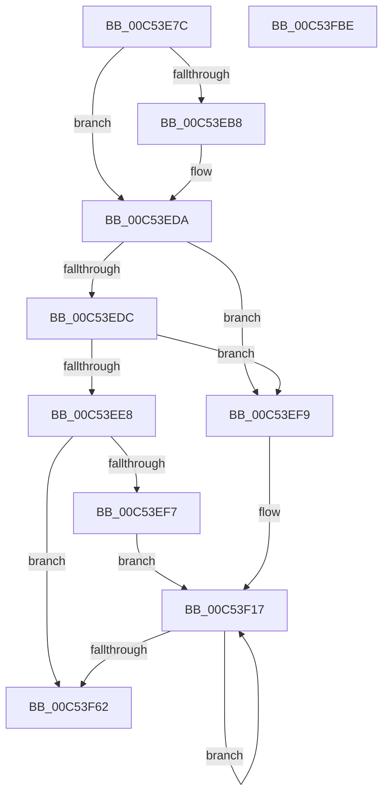

# ExpInitializeSvm

- RVA: `0x00C53E7C`–`0x00C53FBF` (길이 `323` bytes)
- VA: `0x0000000140C53E7C`
- 실행 섹션: `INIT`
- PDB 이름 있음: `예`; PDB Function 태그: `아니요`
- unwind 정보 RVA: `0x00064C80`
- 디코드: `69`개 명령, `323/323` bytes 표시
- 미해석 바이트: `0` (있으면 어셈블리에 `.byte`로 보존)

> 이 문서는 커널 이미지의 기계어와 PDB 기호를 분석해 생성했습니다. 4번과 5번은 함수 원형과 자료형을 바이너리 사용 방식에서 추정한 C 해석이며 원본 소스 복구 결과는 아닙니다.

## 1. Dependencies

- 직접 호출 지점: **2**; 고유 호출 대상: **2**
- 직접 호출자로 확인된 함수: **1**
- RIP 상대 이미지 참조: **18**

### Outgoing calls
- `0x00C53EA8` → [guard_dispatch_icall](../../text/6B/guard_dispatch_icall_function_006BAAD0.md) (function, `0x006BAAD0`)
- `0x00C53EC5` → [ExAllocatePool2](../../poolcode/B8/ExAllocatePool2_function_00B820F0.md) (function, `0x00B820F0`)

### Direct callers
- [ExpInitSystemPhase1](ExpInitSystemPhase1_function_00C51508.md) at `0x00C517CD`

### Static image references
- `0x00C53E82` → RVA `0x00E06D28` (`.data`; read)
- `0x00C53E89` → RVA `0x00EFA8E0` (`.data`; read)
- `0x00C53E92` → RVA `0x00EFA8C0` (`.data`; read)
- `0x00C53ED3` → RVA `0x00EFA838` (`.data`; write)
- `0x00C53EDC` → RVA `0x00EFA838` (`.data`; read)
- `0x00C53EE8` → RVA `0x00EFA8A8` (`.data`; write)
- `0x00C53EF9` → RVA `0x00EFA840` (`.data`; read)
- `0x00C53F1A` → RVA `0x0065BFD0` (`ExpSvmWorkerThread`; read)
- `0x00C53F2D` → RVA `0x0065BD70` (`ExpSvmDpcRoutine`; read)
- `0x00C53F69` → RVA `0x0065BDA0` (`ExpSvmFaultRoutine`; read)
- `0x00C53F74` → RVA `0x0065BDF0` (`ExpSvmReferenceAsid`; read)
- `0x00C53F7F` → RVA `0x0065BB40` (`ExpSvmDereferenceAsid`; read)
- `0x00C53F8A` → RVA `0x0065BEC0` (`ExpSvmServicePageFault`; read)
- `0x00C53F95` → RVA `0x00EFA8F0` (`.data`; read)
- `0x00C53F9C` → RVA `0x00EFA8F8` (`.data`; write)
- `0x00C53FA3` → RVA `0x00EFA8F0` (`.data`; write)
- `0x00C53FAA` → RVA `0x00EFA8D8` (`.data`; write)
- `0x00C53FB1` → RVA `0x00EFA8E8` (`.data`; write)

## 2. Other-region calls and transfers

- 다른 실행 섹션으로 향하는 call: **2**
  - `0x00C53EA8` → [guard_dispatch_icall](../../text/6B/guard_dispatch_icall_function_006BAAD0.md) (`INIT` → `.text`)
  - `0x00C53EC5` → [ExAllocatePool2](../../poolcode/B8/ExAllocatePool2_function_00B820F0.md) (`INIT` → `POOLCODE`)
- 별도 외부 분기/꼬리 이동을 확인하지 못했습니다.

## 3. Assembly (complete function range)

```asm
00C53E7C  40 53                           push rbx
00C53E7E  48 83 EC 30                     sub rsp, 0x30
00C53E82  48 8B 05 9F 2E 1B 00            mov rax, qword ptr [rip + 0x1b2e9f]
00C53E89  4C 8D 0D 50 6A 2A 00            lea r9, [rip + 0x2a6a50]
00C53E90  33 DB                           xor ebx, ebx
00C53E92  4C 8D 05 27 6A 2A 00            lea r8, [rip + 0x2a6a27]
00C53E99  48 8D 54 24 40                  lea rdx, [rsp + 0x40]
00C53E9E  89 5C 24 40                     mov dword ptr [rsp + 0x40], ebx
00C53EA2  33 C9                           xor ecx, ecx
00C53EA4  48 8B 40 08                     mov rax, qword ptr [rax + 8]
00C53EA8  E8 23 6C A6 FF                  call 0x1406baad0
00C53EAD  44 8B 44 24 40                  mov r8d, dword ptr [rsp + 0x40]
00C53EB2  41 83 F8 01                     cmp r8d, 1
00C53EB6  76 22                           jbe 0x140c53eda
00C53EB8  49 6B D0 68                     imul rdx, r8, 0x68
00C53EBC  8D 4B 40                        lea ecx, [rbx + 0x40]
00C53EBF  41 B8 45 78 53 76               mov r8d, 0x76537845
00C53EC5  E8 26 E2 F2 FF                  call 0x140b820f0
00C53ECA  44 8B 44 24 40                  mov r8d, dword ptr [rsp + 0x40]
00C53ECF  41 83 F8 01                     cmp r8d, 1
00C53ED3  48 89 05 5E 69 2A 00            mov qword ptr [rip + 0x2a695e], rax
00C53EDA  74 1D                           je 0x140c53ef9
00C53EDC  48 8B 15 55 69 2A 00            mov rdx, qword ptr [rip + 0x2a6955]
00C53EE3  48 85 D2                        test rdx, rdx
00C53EE6  74 11                           je 0x140c53ef9
00C53EE8  44 89 05 B9 69 2A 00            mov dword ptr [rip + 0x2a69b9], r8d
00C53EEF  44 8B CB                        mov r9d, ebx
00C53EF2  45 85 C0                        test r8d, r8d
00C53EF5  74 6B                           je 0x140c53f62
00C53EF7  EB 1E                           jmp 0x140c53f17
00C53EF9  48 8D 15 40 69 2A 00            lea rdx, [rip + 0x2a6940]
00C53F00  41 B8 01 00 00 00               mov r8d, 1
00C53F06  48 89 15 2B 69 2A 00            mov qword ptr [rip + 0x2a692b], rdx
00C53F0D  44 8B CB                        mov r9d, ebx
00C53F10  44 89 05 91 69 2A 00            mov dword ptr [rip + 0x2a6991], r8d
00C53F17  41 8B C1                        mov eax, r9d
00C53F1A  4C 8D 15 AF 80 A0 FF            lea r10, [rip - 0x5f7f51]
00C53F21  48 6B C8 68                     imul rcx, rax, 0x68
00C53F25  41 FF C1                        inc r9d
00C53F28  4C 89 54 11 10                  mov qword ptr [rcx + rdx + 0x10], r10
00C53F2D  4C 8D 15 3C 7E A0 FF            lea r10, [rip - 0x5f81c4]
00C53F34  48 89 44 11 18                  mov qword ptr [rcx + rdx + 0x18], rax
00C53F39  48 89 1C 11                     mov qword ptr [rcx + rdx], rbx
00C53F3D  4C 89 54 11 38                  mov qword ptr [rcx + rdx + 0x38], r10
00C53F42  C7 44 11 20 13 01 00 00         mov dword ptr [rcx + rdx + 0x20], 0x113
00C53F4A  48 89 44 11 40                  mov qword ptr [rcx + rdx + 0x40], rax
00C53F4F  48 89 5C 11 58                  mov qword ptr [rcx + rdx + 0x58], rbx
00C53F54  48 89 5C 11 30                  mov qword ptr [rcx + rdx + 0x30], rbx
00C53F59  89 5C 11 60                     mov dword ptr [rcx + rdx + 0x60], ebx
00C53F5D  45 3B C8                        cmp r9d, r8d
00C53F60  72 B5                           jb 0x140c53f17
00C53F62  48 8B 05 BF 2D 1B 00            mov rax, qword ptr [rip + 0x1b2dbf]
00C53F69  48 8D 0D 30 7E A0 FF            lea rcx, [rip - 0x5f81d0]
00C53F70  48 89 48 60                     mov qword ptr [rax + 0x60], rcx
00C53F74  48 8D 0D 75 7E A0 FF            lea rcx, [rip - 0x5f818b]
00C53F7B  48 89 48 68                     mov qword ptr [rax + 0x68], rcx
00C53F7F  48 8D 0D BA 7B A0 FF            lea rcx, [rip - 0x5f8446]
00C53F86  48 89 48 70                     mov qword ptr [rax + 0x70], rcx
00C53F8A  48 8D 0D 2F 7F A0 FF            lea rcx, [rip - 0x5f80d1]
00C53F91  48 89 48 78                     mov qword ptr [rax + 0x78], rcx
00C53F95  48 8D 05 54 69 2A 00            lea rax, [rip + 0x2a6954]
00C53F9C  48 89 05 55 69 2A 00            mov qword ptr [rip + 0x2a6955], rax
00C53FA3  48 89 05 46 69 2A 00            mov qword ptr [rip + 0x2a6946], rax
00C53FAA  48 89 1D 27 69 2A 00            mov qword ptr [rip + 0x2a6927], rbx
00C53FB1  48 89 1D 30 69 2A 00            mov qword ptr [rip + 0x2a6930], rbx
00C53FB8  48 83 C4 30                     add rsp, 0x30
00C53FBC  5B                              pop rbx
00C53FBD  C3                              ret
00C53FBE  CC                              int3
```

## 4. C-style interpretation (structured pseudocode)

```c
__int64 __fastcall ExpInitializeSvm(int a1)
{
    __int64 result;
    __int64 v_rbx;
    __int64 v_rsp;
    unsigned __int64 v_stack_p8;

    v_rsp = (v_rsp) - (48);
    v_rbx = 0;
    v_stack_p8 = 0;
    a1 = 0;
    result = guard_dispatch_icall(a1, v_stack_p8, v_rip + 2779687, v_rip + 2779728);
    if (((unsigned int)((unsigned int)(v_stack_p8))) >= = 1) {
        a2 = (v_stack_p8) * ((unsigned int)(v_stack_p8));
        a1 = v_rbx + 64;
        a3 = 0x76537845ULL;
        result = ExAllocatePool2(a1, a2, a3, v_rip + 2779728);
        a3 = v_stack_p8;
        *(unsigned __int64 *)(v_rip + 2779486) = result;
    }
    if (((unsigned int)(a3)) == 1) goto loc_00C53EF9;
    if (*(unsigned __int64 *)(v_rip + 2779477) == 0) goto loc_00C53EF9;
    *(unsigned int *)(v_rip + 2779577) = (unsigned int)(a3);
    if ((unsigned int)(a3) == 0) goto loc_00C53F62;
    goto loc_00C53F17;
loc_00C53EF9:
    *(unsigned __int64 *)(v_rip + 2779435) = v_rip + 2779456;
    *(unsigned int *)(v_rip + 2779537) = 1;
loc_00C53F17:
    a1 = (a1) * (0);
    a4 = (unsigned int)((0) + 1);
    *(unsigned __int64 *)(a1 + v_rip + 2779456 * 1 + 16) = v_rip - 6258513;
    *(unsigned __int64 *)(a1 + v_rip + 2779456 * 1 + 24) = 0;
    *(unsigned __int64 *)(a1 + v_rip + 2779456 * 1) = 0;
    *(unsigned __int64 *)(a1 + v_rip + 2779456 * 1 + 56) = v_rip - 6259140;
    *(unsigned int *)(a1 + v_rip + 2779456 * 1 + 32) = 275;
    *(unsigned __int64 *)(a1 + v_rip + 2779456 * 1 + 64) = 0;
    *(unsigned __int64 *)(a1 + v_rip + 2779456 * 1 + 88) = 0;
    *(unsigned __int64 *)(a1 + v_rip + 2779456 * 1 + 48) = 0;
    *(unsigned int *)(a1 + v_rip + 2779456 * 1 + 96) = 0;
    if (((unsigned int)(a4)) < 1) goto loc_00C53F17;
loc_00C53F62:
    *(unsigned __int64 *)(*(unsigned __int64 *)(v_rip + 1781183) + 96) = v_rip - 6259152;
    *(unsigned __int64 *)(*(unsigned __int64 *)(v_rip + 1781183) + 104) = v_rip - 6259083;
    *(unsigned __int64 *)(*(unsigned __int64 *)(v_rip + 1781183) + 112) = v_rip - 6259782;
    *(unsigned __int64 *)(*(unsigned __int64 *)(v_rip + 1781183) + 120) = v_rip - 6258897;
    *(unsigned __int64 *)(v_rip + 2779477) = v_rip + 2779476;
    *(unsigned __int64 *)(v_rip + 2779462) = v_rip + 2779476;
    *(unsigned __int64 *)(v_rip + 2779431) = 0;
    *(unsigned __int64 *)(v_rip + 2779440) = 0;
    v_rsp = (v_rsp) + (48);
    return v_rip + 2779476;
}
```

## 5. (Beta) C Style

```c
int64_t ExpInitializeSvm(int32_t Arg1)
{
    int64_t result;
    int64_t local_rbx;
    int64_t local_rsp;
    uint64_t v_stack_p8;

    local_rsp = (local_rsp) - (48);
    local_rbx = 0;
    v_stack_p8 = 0;
    Arg1 = 0;
    result = guard_dispatch_icall(Arg1, v_stack_p8, v_rip + 2779687, v_rip + 2779728);
    if (((uint32_t)((uint32_t)(v_stack_p8))) >= = 1) {
        a2 = (v_stack_p8) * ((uint32_t)(v_stack_p8));
        Arg1 = local_rbx + 64;
        a3 = 0x76537845ULL;
        result = ExAllocatePool2(Arg1, a2, a3, v_rip + 2779728);
        a3 = v_stack_p8;
        *(uint64_t *)(v_rip + 0x2A695E) = result;
    }
    if (((uint32_t)(a3)) == 1) goto loc_00C53EF9;
    if (*(uint64_t *)(v_rip + 0x2A6955) == 0) goto loc_00C53EF9;
    *(uint32_t *)(v_rip + 0x2A69B9) = (uint32_t)(a3);
    if ((uint32_t)(a3) == 0) goto loc_00C53F62;
    goto loc_00C53F17;
loc_00C53EF9:
    *(uint64_t *)(v_rip + 0x2A692B) = v_rip + 2779456;
    *(uint32_t *)(v_rip + 0x2A6991) = 1;
loc_00C53F17:
    Arg1 = (Arg1) * (0);
    a4 = (uint32_t)((0) + 1);
    *(uint64_t *)(Arg1 + v_rip + 0x2A6940 * 1 + 0x10) = v_rip - 6258513;
    *(uint64_t *)(Arg1 + v_rip + 0x2A6940 * 1 + 0x18) = 0;
    *(uint64_t *)(Arg1 + v_rip + 0x2A6940 * 1) = 0;
    *(uint64_t *)(Arg1 + v_rip + 0x2A6940 * 1 + 0x38) = v_rip - 6259140;
    *(uint32_t *)(Arg1 + v_rip + 0x2A6940 * 1 + 0x20) = 275;
    *(uint64_t *)(Arg1 + v_rip + 0x2A6940 * 1 + 0x40) = 0;
    *(uint64_t *)(Arg1 + v_rip + 0x2A6940 * 1 + 0x58) = 0;
    *(uint64_t *)(Arg1 + v_rip + 0x2A6940 * 1 + 0x30) = 0;
    *(uint32_t *)(Arg1 + v_rip + 0x2A6940 * 1 + 0x60) = 0;
    if (((uint32_t)(a4)) < 1) goto loc_00C53F17;
loc_00C53F62:
    *(uint64_t *)(*(uint64_t *)(v_rip + 0x1B2DBF) + 0x60) = v_rip - 6259152;
    *(uint64_t *)(*(uint64_t *)(v_rip + 0x1B2DBF) + 0x68) = v_rip - 6259083;
    *(uint64_t *)(*(uint64_t *)(v_rip + 0x1B2DBF) + 0x70) = v_rip - 6259782;
    *(uint64_t *)(*(uint64_t *)(v_rip + 0x1B2DBF) + 0x78) = v_rip - 6258897;
    *(uint64_t *)(v_rip + 0x2A6955) = v_rip + 2779476;
    *(uint64_t *)(v_rip + 0x2A6946) = v_rip + 2779476;
    *(uint64_t *)(v_rip + 0x2A6927) = 0;
    *(uint64_t *)(v_rip + 0x2A6930) = 0;
    local_rsp = (local_rsp) + (48);
    return v_rip + 2779476;
}
```

## 6. Execution-region graph

[열기: 2D/3D 그래프와 함수 탐색 컨트롤 패널](../../../control-panel.html?section=init&rva=0x00C53E7C&view=graph)

- 2D 그래프는 위에서 아래로 흐르고, 3D 그래프는 빈 공간을 드래그해 회전합니다. Shift+드래그는 이동, 휠은 확대·축소, 함수 노드 선택은 대상 보고서 이동입니다.

### Static fallback


