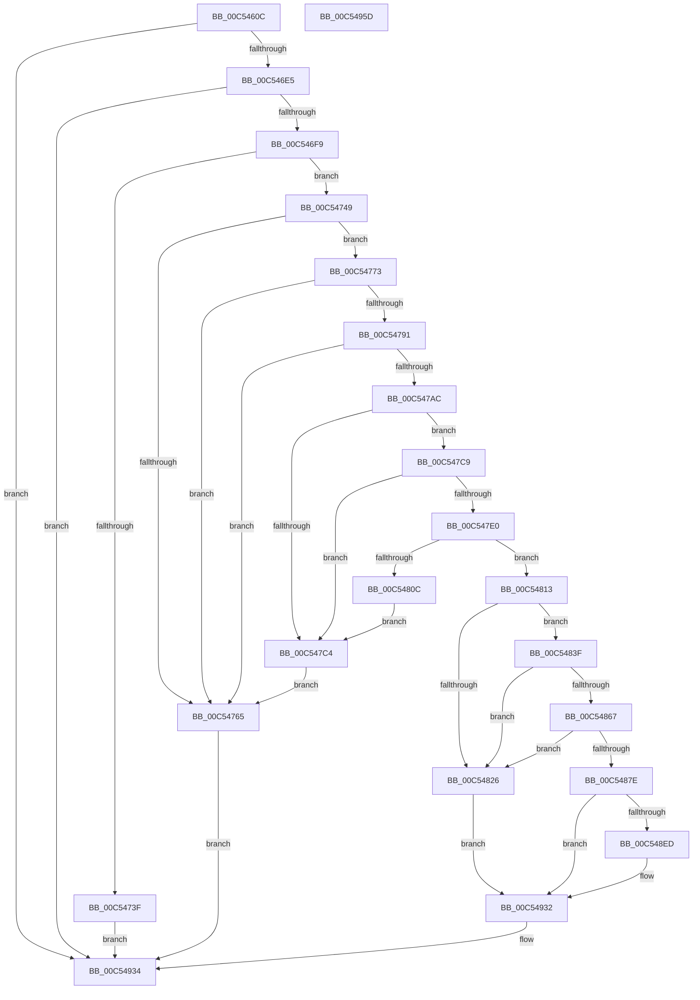

# ExpKeyedEventInitialization

- RVA: `0x00C5460C`–`0x00C5495E` (길이 `850` bytes)
- VA: `0x0000000140C5460C`
- 실행 섹션: `INIT`
- PDB 이름 있음: `예`; PDB Function 태그: `아니요`
- unwind 정보 RVA: `0x000D5B70`
- 디코드: `216`개 명령, `850/850` bytes 표시
- 미해석 바이트: `0` (있으면 어셈블리에 `.byte`로 보존)

> 이 문서는 커널 이미지의 기계어와 PDB 기호를 분석해 생성했습니다. 4번과 5번은 함수 원형과 자료형을 바이너리 사용 방식에서 추정한 C 해석이며 원본 소스 복구 결과는 아닙니다.

## 1. Dependencies

- 직접 호출 지점: **24**; 고유 호출 대상: **15**
- 직접 호출자로 확인된 함수: **1**
- RIP 상대 이미지 참조: **9**

### Outgoing calls
- `0x00C5464F` → [memset](../../text/6C/memset_function_006C6C40.md) (function, `0x006C6C40`)
- `0x00C54682` → [RtlInitUnicodeString](../../text/42/RtlInitUnicodeString_function_0042A780.md) (function, `0x0042A780`)
- `0x00C546D8` → [ObCreateObjectType](../../page/70/ObCreateObjectType_function_00705230.md) (function, `0x00705230`)
- `0x00C546EC` → [RtlCreateSecurityDescriptor](../../page/9F/RtlCreateSecurityDescriptor_function_009F1DF0.md) (function, `0x009F1DF0`)
- `0x00C54732` → [ExAllocatePool2](../../poolcode/B8/ExAllocatePool2_function_00B820F0.md) (function, `0x00B820F0`)
- `0x00C54757` → [RtlCreateAcl](../../page/91/RtlCreateAcl_function_00916F00.md) (function, `0x00916F00`)
- `0x00C54767` → [ExFreePoolWithTag](../../poolcode/B8/ExFreePoolWithTag_function_00B82870.md) (function, `0x00B82870`)
- `0x00C54783` → [RtlAddAccessAllowedAce](../../page/92/RtlAddAccessAllowedAce_function_009298C0.md) (function, `0x009298C0`)
- `0x00C5479E` → [RtlAddAccessAllowedAce](../../page/92/RtlAddAccessAllowedAce_function_009298C0.md) (function, `0x009298C0`)
- `0x00C547B9` → [RtlAddAccessAllowedAce](../../page/92/RtlAddAccessAllowedAce_function_009298C0.md) (function, `0x009298C0`)
- `0x00C547D5` → [RtlSetDaclSecurityDescriptor](../../page/9E/RtlSetDaclSecurityDescriptor_function_009EC210.md) (function, `0x009EC210`)
- `0x00C547FF` → [ExAllocatePool2](../../poolcode/B8/ExAllocatePool2_function_00B820F0.md) (function, `0x00B820F0`)
- `0x00C5481B` → [RtlCreateAcl](../../page/91/RtlCreateAcl_function_00916F00.md) (function, `0x00916F00`)
- `0x00C5482B` → [ExFreePoolWithTag](../../poolcode/B8/ExFreePoolWithTag_function_00B82870.md) (function, `0x00B82870`)
- `0x00C54835` → [ExFreePoolWithTag](../../poolcode/B8/ExFreePoolWithTag_function_00B82870.md) (function, `0x00B82870`)
- `0x00C5485C` → [RtlAddMandatoryAce](../../page/92/RtlAddMandatoryAce_function_00929BA0.md) (function, `0x00929BA0`)
- `0x00C54873` → [RtlSetSaclSecurityDescriptor](../../page/A1/RtlSetSaclSecurityDescriptor_function_00A18B80.md) (function, `0x00A18B80`)
- `0x00C5488A` → [RtlInitUnicodeString](../../text/42/RtlInitUnicodeString_function_0042A780.md) (function, `0x0042A780`)
- `0x00C548CE` → [ZwCreateKeyedEvent](../../text/6A/ZwCreateKeyedEvent_function_006AE7B0.md) (function, `0x006AE7B0`)
- `0x00C548DA` → [ExFreePoolWithTag](../../poolcode/B8/ExFreePoolWithTag_function_00B82870.md) (function, `0x00B82870`)
- `0x00C548E4` → [ExFreePoolWithTag](../../poolcode/B8/ExFreePoolWithTag_function_00B82870.md) (function, `0x00B82870`)
- `0x00C54915` → [ObReferenceObjectByHandle](../../page/86/ObReferenceObjectByHandle_function_00868DB0.md) (function, `0x00868DB0`)
- `0x00C5492D` → [ZwClose](../../text/6A/ZwClose_function_006AD2B0.md) (function, `0x006AD2B0`)
- `0x00C5493B` → [_security_check_cookie](../../text/6A/_security_check_cookie_function_006AC640.md) (function, `0x006AC640`)

### Direct callers
- [ExpInitSystemPhase1](ExpInitSystemPhase1_function_00C51508.md) at `0x00C5162D`

### Static image references
- `0x00C5462B` → RVA `0x00E0A740` (`.data`; read)
- `0x00C54656` → RVA `0x00C7DE90` (` ?? ::PBOPGDP::`string'`; read)
- `0x00C5468B` → RVA `0x00FC52B0` (`ALMOSTRO`; read)
- `0x00C546F9` → RVA `0x00E67D48` (`.data`; read)
- `0x00C5470A` → RVA `0x00FD9A68` (`PAGEDATA`; read)
- `0x00C54715` → RVA `0x00E67D58` (`.data`; read)
- `0x00C547E0` → RVA `0x00F05878` (`.data`; read)
- `0x00C5487E` → RVA `0x00C7DE40` (` ?? ::PBOPGDP::`string'`; read)
- `0x00C54926` → RVA `0x00EFA130` (`.data`; write)

## 2. Other-region calls and transfers

- 다른 실행 섹션으로 향하는 call: **24**
  - `0x00C5464F` → [memset](../../text/6C/memset_function_006C6C40.md) (`INIT` → `.text`)
  - `0x00C54682` → [RtlInitUnicodeString](../../text/42/RtlInitUnicodeString_function_0042A780.md) (`INIT` → `.text`)
  - `0x00C546D8` → [ObCreateObjectType](../../page/70/ObCreateObjectType_function_00705230.md) (`INIT` → `PAGE`)
  - `0x00C546EC` → [RtlCreateSecurityDescriptor](../../page/9F/RtlCreateSecurityDescriptor_function_009F1DF0.md) (`INIT` → `PAGE`)
  - `0x00C54732` → [ExAllocatePool2](../../poolcode/B8/ExAllocatePool2_function_00B820F0.md) (`INIT` → `POOLCODE`)
  - `0x00C54757` → [RtlCreateAcl](../../page/91/RtlCreateAcl_function_00916F00.md) (`INIT` → `PAGE`)
  - `0x00C54767` → [ExFreePoolWithTag](../../poolcode/B8/ExFreePoolWithTag_function_00B82870.md) (`INIT` → `POOLCODE`)
  - `0x00C54783` → [RtlAddAccessAllowedAce](../../page/92/RtlAddAccessAllowedAce_function_009298C0.md) (`INIT` → `PAGE`)
  - `0x00C5479E` → [RtlAddAccessAllowedAce](../../page/92/RtlAddAccessAllowedAce_function_009298C0.md) (`INIT` → `PAGE`)
  - `0x00C547B9` → [RtlAddAccessAllowedAce](../../page/92/RtlAddAccessAllowedAce_function_009298C0.md) (`INIT` → `PAGE`)
  - `0x00C547D5` → [RtlSetDaclSecurityDescriptor](../../page/9E/RtlSetDaclSecurityDescriptor_function_009EC210.md) (`INIT` → `PAGE`)
  - `0x00C547FF` → [ExAllocatePool2](../../poolcode/B8/ExAllocatePool2_function_00B820F0.md) (`INIT` → `POOLCODE`)
  - `0x00C5481B` → [RtlCreateAcl](../../page/91/RtlCreateAcl_function_00916F00.md) (`INIT` → `PAGE`)
  - `0x00C5482B` → [ExFreePoolWithTag](../../poolcode/B8/ExFreePoolWithTag_function_00B82870.md) (`INIT` → `POOLCODE`)
  - `0x00C54835` → [ExFreePoolWithTag](../../poolcode/B8/ExFreePoolWithTag_function_00B82870.md) (`INIT` → `POOLCODE`)
  - `0x00C5485C` → [RtlAddMandatoryAce](../../page/92/RtlAddMandatoryAce_function_00929BA0.md) (`INIT` → `PAGE`)
  - `0x00C54873` → [RtlSetSaclSecurityDescriptor](../../page/A1/RtlSetSaclSecurityDescriptor_function_00A18B80.md) (`INIT` → `PAGE`)
  - `0x00C5488A` → [RtlInitUnicodeString](../../text/42/RtlInitUnicodeString_function_0042A780.md) (`INIT` → `.text`)
  - `0x00C548CE` → [ZwCreateKeyedEvent](../../text/6A/ZwCreateKeyedEvent_function_006AE7B0.md) (`INIT` → `.text`)
  - `0x00C548DA` → [ExFreePoolWithTag](../../poolcode/B8/ExFreePoolWithTag_function_00B82870.md) (`INIT` → `POOLCODE`)
  - `0x00C548E4` → [ExFreePoolWithTag](../../poolcode/B8/ExFreePoolWithTag_function_00B82870.md) (`INIT` → `POOLCODE`)
  - `0x00C54915` → [ObReferenceObjectByHandle](../../page/86/ObReferenceObjectByHandle_function_00868DB0.md) (`INIT` → `PAGE`)
  - `0x00C5492D` → [ZwClose](../../text/6A/ZwClose_function_006AD2B0.md) (`INIT` → `.text`)
  - `0x00C5493B` → [_security_check_cookie](../../text/6A/_security_check_cookie_function_006AC640.md) (`INIT` → `.text`)
- 별도 외부 분기/꼬리 이동을 확인하지 못했습니다.

## 3. Assembly (complete function range)

```asm
00C5460C  48 8B C4                        mov rax, rsp
00C5460F  48 89 58 08                     mov qword ptr [rax + 8], rbx
00C54613  48 89 70 10                     mov qword ptr [rax + 0x10], rsi
00C54617  48 89 78 18                     mov qword ptr [rax + 0x18], rdi
00C5461B  55                              push rbp
00C5461C  41 55                           push r13
00C5461E  41 57                           push r15
00C54620  48 8D 68 A8                     lea rbp, [rax - 0x58]
00C54624  48 81 EC 40 01 00 00            sub rsp, 0x140
00C5462B  48 8B 05 0E 61 1B 00            mov rax, qword ptr [rip + 0x1b610e]
00C54632  48 33 C4                        xor rax, rsp
00C54635  48 89 45 30                     mov qword ptr [rbp + 0x30], rax
00C54639  0F 57 C0                        xorps xmm0, xmm0
00C5463C  48 8D 4D B0                     lea rcx, [rbp - 0x50]
00C54640  BB 78 00 00 00                  mov ebx, 0x78
00C54645  33 D2                           xor edx, edx
00C54647  44 8B C3                        mov r8d, ebx
00C5464A  0F 11 44 24 40                  movups xmmword ptr [rsp + 0x40], xmm0
00C5464F  E8 EC 25 A7 FF                  call 0x1406c6c40
00C54654  33 C0                           xor eax, eax
00C54656  48 8D 15 33 98 02 00            lea rdx, [rip + 0x29833]
00C5465D  21 44 24 6C                     and dword ptr [rsp + 0x6c], eax
00C54661  48 8D 4C 24 40                  lea rcx, [rsp + 0x40]
00C54666  48 21 44 24 30                  and qword ptr [rsp + 0x30], rax
00C5466B  0F 57 C0                        xorps xmm0, xmm0
00C5466E  89 44 24 54                     mov dword ptr [rsp + 0x54], eax
00C54672  21 44 24 54                     and dword ptr [rsp + 0x54], eax
00C54676  0F 11 45 80                     movups xmmword ptr [rbp - 0x80], xmm0
00C5467A  48 89 45 A0                     mov qword ptr [rbp - 0x60], rax
00C5467E  0F 11 45 90                     movups xmmword ptr [rbp - 0x70], xmm0
00C54682  E8 F9 60 7D FF                  call 0x14042a780
00C54687  83 65 B8 00                     and dword ptr [rbp - 0x48], 0
00C5468B  4C 8D 0D 1E 0C 37 00            lea r9, [rip + 0x370c1e]
00C54692  83 65 D8 00                     and dword ptr [rbp - 0x28], 0
00C54696  48 8D 55 B0                     lea rdx, [rbp - 0x50]
00C5469A  83 65 DC 00                     and dword ptr [rbp - 0x24], 0
00C5469E  48 8D 4C 24 40                  lea rcx, [rsp + 0x40]
00C546A3  80 4D B2 04                     or byte ptr [rbp - 0x4e], 4
00C546A7  41 BD 03 00 0F 00               mov r13d, 0xf0003
00C546AD  45 33 C0                        xor r8d, r8d
00C546B0  44 89 6D CC                     mov dword ptr [rbp - 0x34], r13d
00C546B4  44 89 6D C8                     mov dword ptr [rbp - 0x38], r13d
00C546B8  66 89 5D B0                     mov word ptr [rbp - 0x50], bx
00C546BC  C7 45 D4 01 00 00 00            mov dword ptr [rbp - 0x2c], 1
00C546C3  C7 45 BC 01 00 02 00            mov dword ptr [rbp - 0x44], 0x20001
00C546CA  C7 45 C0 02 00 02 00            mov dword ptr [rbp - 0x40], 0x20002
00C546D1  C7 45 C4 00 00 02 00            mov dword ptr [rbp - 0x3c], 0x20000
00C546D8  E8 53 0B AB FF                  call 0x140705230
00C546DD  85 C0                           test eax, eax
00C546DF  0F 88 4F 02 00 00               js 0x140c54934
00C546E5  8D 53 89                        lea edx, [rbx - 0x77]
00C546E8  48 8D 4D 80                     lea rcx, [rbp - 0x80]
00C546EC  E8 FF D6 D9 FF                  call 0x1409f1df0
00C546F1  85 C0                           test eax, eax
00C546F3  0F 88 3B 02 00 00               js 0x140c54934
00C546F9  48 8B 05 48 36 21 00            mov rax, qword ptr [rip + 0x213648]
00C54700  41 B8 44 61 63 6C               mov r8d, 0x6c636144
00C54706  0F B6 50 01                     movzx edx, byte ptr [rax + 1]
00C5470A  48 8B 05 57 53 38 00            mov rax, qword ptr [rip + 0x385357]
00C54711  0F B6 48 01                     movzx ecx, byte ptr [rax + 1]
00C54715  48 8B 05 3C 36 21 00            mov rax, qword ptr [rip + 0x21363c]
00C5471C  03 D1                           add edx, ecx
00C5471E  0F B6 48 01                     movzx ecx, byte ptr [rax + 1]
00C54722  03 D1                           add edx, ecx
00C54724  B9 00 01 00 00                  mov ecx, 0x100
00C54729  8D 3C 95 44 00 00 00            lea edi, [rdx*4 + 0x44]
00C54730  8B D7                           mov edx, edi
00C54732  E8 B9 D9 F2 FF                  call 0x140b820f0
00C54737  48 8B D8                        mov rbx, rax
00C5473A  48 85 C0                        test rax, rax
00C5473D  75 0A                           jne 0x140c54749
00C5473F  B8 9A 00 00 C0                  mov eax, 0xc000009a
00C54744  E9 EB 01 00 00                  jmp 0x140c54934
00C54749  41 BF 02 00 00 00               mov r15d, 2
00C5474F  8B D7                           mov edx, edi
00C54751  45 8B C7                        mov r8d, r15d
00C54754  48 8B CB                        mov rcx, rbx
00C54757  E8 A4 27 CC FF                  call 0x140916f00
00C5475C  8B F8                           mov edi, eax
00C5475E  48 8B CB                        mov rcx, rbx
00C54761  85 C0                           test eax, eax
00C54763  79 0E                           jns 0x140c54773
00C54765  33 D2                           xor edx, edx
00C54767  E8 04 E1 F2 FF                  call 0x140b82870
00C5476C  8B C7                           mov eax, edi
00C5476E  E9 C1 01 00 00                  jmp 0x140c54934
00C54773  4C 8B 0D CE 35 21 00            mov r9, qword ptr [rip + 0x2135ce]
00C5477A  41 B8 03 00 02 00               mov r8d, 0x20003
00C54780  41 8B D7                        mov edx, r15d
00C54783  E8 38 51 CD FF                  call 0x1409298c0
00C54788  8B F8                           mov edi, eax
00C5478A  48 8B CB                        mov rcx, rbx
00C5478D  85 C0                           test eax, eax
00C5478F  78 D4                           js 0x140c54765
00C54791  4C 8B 0D D0 52 38 00            mov r9, qword ptr [rip + 0x3852d0]
00C54798  45 8B C5                        mov r8d, r13d
00C5479B  41 8B D7                        mov edx, r15d
00C5479E  E8 1D 51 CD FF                  call 0x1409298c0
00C547A3  8B F8                           mov edi, eax
00C547A5  48 8B CB                        mov rcx, rbx
00C547A8  85 C0                           test eax, eax
00C547AA  78 B9                           js 0x140c54765
00C547AC  4C 8B 0D A5 35 21 00            mov r9, qword ptr [rip + 0x2135a5]
00C547B3  45 8B C5                        mov r8d, r13d
00C547B6  41 8B D7                        mov edx, r15d
00C547B9  E8 02 51 CD FF                  call 0x1409298c0
00C547BE  8B F8                           mov edi, eax
00C547C0  85 C0                           test eax, eax
00C547C2  79 05                           jns 0x140c547c9
00C547C4  48 8B CB                        mov rcx, rbx
00C547C7  EB 9C                           jmp 0x140c54765
00C547C9  45 33 C9                        xor r9d, r9d
00C547CC  48 8D 4D 80                     lea rcx, [rbp - 0x80]
00C547D0  4C 8B C3                        mov r8, rbx
00C547D3  B2 01                           mov dl, 1
00C547D5  E8 36 7A D9 FF                  call 0x1409ec210
00C547DA  8B F8                           mov edi, eax
00C547DC  85 C0                           test eax, eax
00C547DE  78 E4                           js 0x140c547c4
00C547E0  48 8B 05 91 10 2B 00            mov rax, qword ptr [rip + 0x2b1091]
00C547E7  B9 00 01 00 00                  mov ecx, 0x100
00C547EC  41 B8 44 61 63 6C               mov r8d, 0x6c636144
00C547F2  0F B6 50 01                     movzx edx, byte ptr [rax + 1]
00C547F6  8D 34 95 1C 00 00 00            lea esi, [rdx*4 + 0x1c]
00C547FD  8B D6                           mov edx, esi
00C547FF  E8 EC D8 F2 FF                  call 0x140b820f0
00C54804  48 8B F8                        mov rdi, rax
00C54807  48 85 C0                        test rax, rax
00C5480A  75 07                           jne 0x140c54813
00C5480C  BF 9A 00 00 C0                  mov edi, 0xc000009a
00C54811  EB B1                           jmp 0x140c547c4
00C54813  45 8B C7                        mov r8d, r15d
00C54816  8B D6                           mov edx, esi
00C54818  48 8B CF                        mov rcx, rdi
00C5481B  E8 E0 26 CC FF                  call 0x140916f00
00C54820  8B F0                           mov esi, eax
00C54822  85 C0                           test eax, eax
00C54824  79 19                           jns 0x140c5483f
00C54826  33 D2                           xor edx, edx
00C54828  48 8B CB                        mov rcx, rbx
00C5482B  E8 40 E0 F2 FF                  call 0x140b82870
00C54830  33 D2                           xor edx, edx
00C54832  48 8B CF                        mov rcx, rdi
00C54835  E8 36 E0 F2 FF                  call 0x140b82870
00C5483A  E9 F3 00 00 00                  jmp 0x140c54932
00C5483F  4C 8B 0D 32 10 2B 00            mov r9, qword ptr [rip + 0x2b1032]
00C54846  45 33 C0                        xor r8d, r8d
00C54849  C7 44 24 28 01 00 00 00         mov dword ptr [rsp + 0x28], 1
00C54851  41 8B D7                        mov edx, r15d
00C54854  48 8B CF                        mov rcx, rdi
00C54857  C6 44 24 20 11                  mov byte ptr [rsp + 0x20], 0x11
00C5485C  E8 3F 53 CD FF                  call 0x140929ba0
00C54861  8B F0                           mov esi, eax
00C54863  85 C0                           test eax, eax
00C54865  78 BF                           js 0x140c54826
00C54867  45 33 C9                        xor r9d, r9d
00C5486A  48 8D 4D 80                     lea rcx, [rbp - 0x80]
00C5486E  4C 8B C7                        mov r8, rdi
00C54871  B2 01                           mov dl, 1
00C54873  E8 08 43 DC FF                  call 0x140a18b80
00C54878  8B F0                           mov esi, eax
00C5487A  85 C0                           test eax, eax
00C5487C  78 A8                           js 0x140c54826
00C5487E  48 8D 15 BB 95 02 00            lea rdx, [rip + 0x295bb]
00C54885  48 8D 4C 24 40                  lea rcx, [rsp + 0x40]
00C5488A  E8 F1 5E 7D FF                  call 0x14042a780
00C5488F  48 83 64 24 58 00               and qword ptr [rsp + 0x58], 0
00C54895  48 8D 44 24 40                  lea rax, [rsp + 0x40]
00C5489A  48 83 64 24 78 00               and qword ptr [rsp + 0x78], 0
00C548A0  4C 8D 44 24 50                  lea r8, [rsp + 0x50]
00C548A5  48 89 44 24 60                  mov qword ptr [rsp + 0x60], rax
00C548AA  48 8D 4C 24 30                  lea rcx, [rsp + 0x30]
00C548AF  48 8D 45 80                     lea rax, [rbp - 0x80]
00C548B3  C7 44 24 50 30 00 00 00         mov dword ptr [rsp + 0x50], 0x30
00C548BB  45 33 C9                        xor r9d, r9d
00C548BE  48 89 44 24 70                  mov qword ptr [rsp + 0x70], rax
00C548C3  41 8B D5                        mov edx, r13d
00C548C6  C7 44 24 68 10 00 00 00         mov dword ptr [rsp + 0x68], 0x10
00C548CE  E8 DD 9E A5 FF                  call 0x1406ae7b0
00C548D3  33 D2                           xor edx, edx
00C548D5  48 8B CB                        mov rcx, rbx
00C548D8  8B F0                           mov esi, eax
00C548DA  E8 91 DF F2 FF                  call 0x140b82870
00C548DF  33 D2                           xor edx, edx
00C548E1  48 8B CF                        mov rcx, rdi
00C548E4  E8 87 DF F2 FF                  call 0x140b82870
00C548E9  85 F6                           test esi, esi
00C548EB  78 45                           js 0x140c54932
00C548ED  4C 8B 05 BC 09 37 00            mov r8, qword ptr [rip + 0x3709bc]
00C548F4  48 8D 44 24 38                  lea rax, [rsp + 0x38]
00C548F9  48 83 64 24 28 00               and qword ptr [rsp + 0x28], 0
00C548FF  45 33 C9                        xor r9d, r9d
00C54902  48 8B 4C 24 30                  mov rcx, qword ptr [rsp + 0x30]
00C54907  41 8B D5                        mov edx, r13d
00C5490A  48 83 64 24 38 00               and qword ptr [rsp + 0x38], 0
00C54910  48 89 44 24 20                  mov qword ptr [rsp + 0x20], rax
00C54915  E8 96 44 C1 FF                  call 0x140868db0
00C5491A  48 8B 4C 24 30                  mov rcx, qword ptr [rsp + 0x30]
00C5491F  8B F0                           mov esi, eax
00C54921  48 8B 44 24 38                  mov rax, qword ptr [rsp + 0x38]
00C54926  48 89 05 03 58 2A 00            mov qword ptr [rip + 0x2a5803], rax
00C5492D  E8 7E 89 A5 FF                  call 0x1406ad2b0
00C54932  8B C6                           mov eax, esi
00C54934  48 8B 4D 30                     mov rcx, qword ptr [rbp + 0x30]
00C54938  48 33 CC                        xor rcx, rsp
00C5493B  E8 00 7D A5 FF                  call 0x1406ac640
00C54940  4C 8D 9C 24 40 01 00 00         lea r11, [rsp + 0x140]
00C54948  49 8B 5B 20                     mov rbx, qword ptr [r11 + 0x20]
00C5494C  49 8B 73 28                     mov rsi, qword ptr [r11 + 0x28]
00C54950  49 8B 7B 30                     mov rdi, qword ptr [r11 + 0x30]
00C54954  49 8B E3                        mov rsp, r11
00C54957  41 5F                           pop r15
00C54959  41 5D                           pop r13
00C5495B  5D                              pop rbp
00C5495C  C3                              ret
00C5495D  CC                              int3
```

## 4. C-style interpretation (structured pseudocode)

```c
__int64 __fastcall ExpKeyedEventInitialization(__int64 a1, int a2)
{
    __int64 result;
    __int64 v_rsi;
    __int64 v_rsp;
    unsigned __int64 v_stack_m100;
    unsigned int v_stack_m104;
    unsigned __int64 v_stack_m108;
    unsigned __int64 v_stack_m118;
    unsigned __int64 v_stack_m120;
    unsigned __int64 v_stack_m128;
    unsigned int v_stack_m130;
    unsigned __int8 v_stack_m138;
    unsigned __int64 v_stack_m18;
    unsigned __int64 v_stack_mE0;
    unsigned __int64 v_stack_mE8;
    unsigned int v_stack_mEC;
    unsigned int v_stack_mF0;
    unsigned __int64 v_stack_mF8;

    *(unsigned __int64 *)(v_rsp + 8) = v_rbx;
    *(unsigned __int64 *)(v_rsp + 16) = v_rsi;
    *(unsigned __int64 *)(v_rsp + 24) = v_rdi;
    v_rsp = (v_rsp) - (320);
    result = (*(unsigned __int64 *)(v_rip + 1794318)) ^ (v_rsp);
    *(unsigned __int64 *)(v_rsp - 88 + 48) = result;
    a2 = 0;
    v_stack_m118 = v_xmm0;
    result = memset(v_rsp - 88 - 80, a2, 120, a4);
    result = 0;
    v_stack_m104 = 0;
    *(unsigned __int64 *)(v_rsp - 88 - 128) = v_xmm0;
    *(unsigned __int64 *)(v_rsp - 88 - 96) = 0;
    *(unsigned __int64 *)(v_rsp - 88 - 112) = v_xmm0;
    result = RtlInitUnicodeString(v_stack_m118, v_rip + 170035, 120, a4);
    a3 = 0;
    *(unsigned int *)(v_rsp - 88 - 52) = (unsigned int)((unsigned int)(0xF0003ULL));
    *(unsigned int *)(v_rsp - 88 - 56) = (unsigned int)((unsigned int)(0xF0003ULL));
    *(unsigned __int16 *)(v_rsp - 88 - 80) = 120;
    *(unsigned int *)(v_rsp - 88 - 44) = 1;
    *(unsigned int *)(v_rsp - 88 - 68) = 0x20001ULL;
    *(unsigned int *)(v_rsp - 88 - 64) = 0x20002ULL;
    *(unsigned int *)(v_rsp - 88 - 60) = 0x20000ULL;
    result = ObCreateObjectType(v_stack_m118, v_rsp - 88 - 80, a3, v_rip + 3607582);
    if (sign_flag) goto loc_00C54934;
    result = RtlCreateSecurityDescriptor(v_rsp - 88 - 128, 120 - 119, a3, v_rip + 3607582);
    if (sign_flag) goto loc_00C54934;
    a2 = (unsigned int)((*(unsigned __int8 *)(*(unsigned __int64 *)(v_rip + 2176584) + 1)) + ((unsigned int)(*(unsigned __int8 *)(*(unsigned __int64 *)(v_rip + 3691351) + 1))));
    a2 = (unsigned int)((a2) + ((unsigned int)(*(unsigned __int8 *)(*(unsigned __int64 *)(v_rip + 2176572) + 1))));
    result = ExAllocatePool2(256, (unsigned int)((unsigned int)(a2 * 4 + 68)), (unsigned int)(0x6C636144ULL), v_rip + 3607582);
    if (result != 0) goto loc_00C54749;
    goto loc_00C54934;
loc_00C54749:
    result = RtlCreateAcl(result, (unsigned int)((unsigned int)(a2 * 4 + 68)), 2, v_rip + 3607582);
    if (!sign_flag) goto loc_00C54773;
loc_00C54765:
    a2 = 0;
    result = ExFreePoolWithTag(result, a2, 2, v_rip + 3607582);
    goto loc_00C54934;
loc_00C54773:
    result = RtlAddAccessAllowedAce(result, 2, (unsigned int)(0x20003ULL), *(unsigned __int64 *)(v_rip + 2176462));
    if (sign_flag) goto loc_00C54765;
    result = RtlAddAccessAllowedAce(result, 2, (unsigned int)((unsigned int)((unsigned int)(0xF0003ULL))), *(unsigned __int64 *)(v_rip + 3691216));
    if (sign_flag) goto loc_00C54765;
    result = RtlAddAccessAllowedAce(result, 2, (unsigned int)((unsigned int)((unsigned int)(0xF0003ULL))), *(unsigned __int64 *)(v_rip + 2176421));
    if (!sign_flag) goto loc_00C547C9;
loc_00C547C4:
    goto loc_00C54765;
loc_00C547C9:
    a4 = 0;
    result = RtlSetDaclSecurityDescriptor(v_rsp - 88 - 128, 1, result, a4);
    if (sign_flag) goto loc_00C547C4;
    result = ExAllocatePool2(256, (unsigned int)((unsigned int)(*(unsigned __int8 *)(*(unsigned __int64 *)(v_rip + 2822289) + 1) * 4 + 28)), (unsigned int)(0x6C636144ULL), a4);
    if (result != 0) goto loc_00C54813;
    goto loc_00C547C4;
loc_00C54813:
    result = RtlCreateAcl((unsigned int)(0xC000009AULL), (unsigned int)((unsigned int)(*(unsigned __int8 *)(*(unsigned __int64 *)(v_rip + 2822289) + 1) * 4 + 28)), 2, a4);
    if (!sign_flag) goto loc_00C5483F;
loc_00C54826:
    a2 = 0;
    result = ExFreePoolWithTag(result, a2, 2, a4);
    a2 = 0;
    result = ExFreePoolWithTag((unsigned int)(0xC000009AULL), a2, 2, a4);
    goto loc_00C54932;
loc_00C5483F:
    a3 = 0;
    v_stack_m130 = 1;
    v_stack_m138 = 17;
    result = RtlAddMandatoryAce((unsigned int)(0xC000009AULL), 2, a3, *(unsigned __int64 *)(v_rip + 2822194));
    if (sign_flag) goto loc_00C54826;
    a4 = 0;
    result = RtlSetSaclSecurityDescriptor(v_rsp - 88 - 128, 1, (unsigned int)(0xC000009AULL), a4);
    if (sign_flag) goto loc_00C54826;
    result = RtlInitUnicodeString(v_stack_m118, v_rip + 169403, (unsigned int)(0xC000009AULL), a4);
    v_stack_mF8 = v_stack_m118;
    v_stack_m108 = 48;
    a4 = 0;
    v_stack_mE8 = v_rsp - 88 - 128;
    v_stack_mF0 = 16;
    result = ZwCreateKeyedEvent(v_stack_m128, (unsigned int)((unsigned int)((unsigned int)(0xF0003ULL))), v_stack_m108, a4);
    a2 = 0;
    result = ExFreePoolWithTag(result, a2, v_stack_m108, a4);
    a2 = 0;
    result = ExFreePoolWithTag((unsigned int)(0xC000009AULL), a2, v_stack_m108, a4);
    v_rsi = (unsigned int)((unsigned int)(result));
    if (!(sign_flag)) {
        a3 = *(unsigned __int64 *)(v_rip + 3606972);
        result = v_stack_m120;
        a4 = 0;
        a1 = v_stack_m128;
        a2 = (unsigned int)((unsigned int)(0xF0003ULL));
        v_stack_m138 = result;
        result = ObReferenceObjectByHandle(a1, a2, a3, a4);
        a1 = v_stack_m128;
        v_rsi = (unsigned int)(result);
        result = v_stack_m120;
        *(unsigned __int64 *)(v_rip + 2775043) = result;
        result = ZwClose(a1, a2, a3, a4);
    }
loc_00C54934:
    a1 = (*(unsigned __int64 *)(v_rsp - 88 + 48)) ^ (v_rsp);
    result = _security_check_cookie(a1, a2, a3, a4);
    return result;
}
```

## 5. (Beta) C Style

```c
int64_t ExpKeyedEventInitialization(int64_t Arg1, int32_t Arg2)
{
    int64_t result;
    int64_t local_rsi;
    int64_t local_rsp;
    uint64_t v_stack_m100;
    uint32_t v_stack_m104;
    uint64_t v_stack_m108;
    uint64_t v_stack_m118;
    uint64_t v_stack_m120;
    uint64_t v_stack_m128;
    uint32_t v_stack_m130;
    uint8_t v_stack_m138;
    uint64_t v_stack_m18;
    uint64_t v_stack_mE0;
    uint64_t v_stack_mE8;
    uint32_t v_stack_mEC;
    uint32_t v_stack_mF0;
    uint64_t v_stack_mF8;

    *(uint64_t *)(local_rsp + 0x8) = local_rbx;
    *(uint64_t *)(local_rsp + 0x10) = local_rsi;
    *(uint64_t *)(local_rsp + 0x18) = local_rdi;
    local_rsp = (local_rsp) - (320);
    result = (*(uint64_t *)(v_rip + 0x1B610E)) ^ (local_rsp);
    *(uint64_t *)(local_rsp - 0x58 + 0x30) = result;
    Arg2 = 0;
    v_stack_m118 = v_xmm0;
    result = memset(local_rsp - 88 - 80, Arg2, 120, a4);
    result = 0;
    v_stack_m104 = 0;
    *(uint64_t *)(local_rsp - 0x58 - 0x80) = v_xmm0;
    *(uint64_t *)(local_rsp - 0x58 - 0x60) = 0;
    *(uint64_t *)(local_rsp - 0x58 - 0x70) = v_xmm0;
    result = RtlInitUnicodeString(v_stack_m118, v_rip + 170035, 120, a4);
    a3 = 0;
    *(uint32_t *)(local_rsp - 0x58 - 0x34) = (uint32_t)((uint32_t)(0xF0003ULL));
    *(uint32_t *)(local_rsp - 0x58 - 0x38) = (uint32_t)((uint32_t)(0xF0003ULL));
    *(uint16_t *)(local_rsp - 0x58 - 0x50) = 120;
    *(uint32_t *)(local_rsp - 0x58 - 0x2C) = 1;
    *(uint32_t *)(local_rsp - 0x58 - 0x44) = 0x20001ULL;
    *(uint32_t *)(local_rsp - 0x58 - 0x40) = 0x20002ULL;
    *(uint32_t *)(local_rsp - 0x58 - 0x3C) = 0x20000ULL;
    result = ObCreateObjectType(v_stack_m118, local_rsp - 88 - 80, a3, v_rip + 3607582);
    if (sign_flag) goto loc_00C54934;
    result = RtlCreateSecurityDescriptor(local_rsp - 88 - 128, 120 - 119, a3, v_rip + 3607582);
    if (sign_flag) goto loc_00C54934;
    Arg2 = (uint32_t)((*(uint8_t *)(*(uint64_t *)(v_rip + 0x213648) + 0x1)) + ((uint32_t)(*(uint8_t *)(*(uint64_t *)(v_rip + 0x385357) + 0x1))));
    Arg2 = (uint32_t)((Arg2) + ((uint32_t)(*(uint8_t *)(*(uint64_t *)(v_rip + 0x21363C) + 0x1))));
    result = ExAllocatePool2(256, (uint32_t)((uint32_t)(Arg2 * 4 + 68)), (uint32_t)(0x6C636144ULL), v_rip + 3607582);
    if (result != 0) goto loc_00C54749;
    goto loc_00C54934;
loc_00C54749:
    result = RtlCreateAcl(result, (uint32_t)((uint32_t)(Arg2 * 4 + 68)), 2, v_rip + 3607582);
    if (!sign_flag) goto loc_00C54773;
loc_00C54765:
    Arg2 = 0;
    result = ExFreePoolWithTag(result, Arg2, 2, v_rip + 3607582);
    goto loc_00C54934;
loc_00C54773:
    result = RtlAddAccessAllowedAce(result, 2, (uint32_t)(0x20003ULL), *(uint64_t *)(v_rip + 0x2135CE));
    if (sign_flag) goto loc_00C54765;
    result = RtlAddAccessAllowedAce(result, 2, (uint32_t)((uint32_t)((uint32_t)(0xF0003ULL))), *(uint64_t *)(v_rip + 0x3852D0));
    if (sign_flag) goto loc_00C54765;
    result = RtlAddAccessAllowedAce(result, 2, (uint32_t)((uint32_t)((uint32_t)(0xF0003ULL))), *(uint64_t *)(v_rip + 0x2135A5));
    if (!sign_flag) goto loc_00C547C9;
loc_00C547C4:
    goto loc_00C54765;
loc_00C547C9:
    a4 = 0;
    result = RtlSetDaclSecurityDescriptor(local_rsp - 88 - 128, 1, result, a4);
    if (sign_flag) goto loc_00C547C4;
    result = ExAllocatePool2(256, (uint32_t)((uint32_t)(*(uint8_t *)(*(uint64_t *)(v_rip + 0x2B1091) + 0x1) * 4 + 28)), (uint32_t)(0x6C636144ULL), a4);
    if (result != 0) goto loc_00C54813;
    goto loc_00C547C4;
loc_00C54813:
    result = RtlCreateAcl((uint32_t)(0xC000009AULL), (uint32_t)((uint32_t)(*(uint8_t *)(*(uint64_t *)(v_rip + 0x2B1091) + 0x1) * 4 + 28)), 2, a4);
    if (!sign_flag) goto loc_00C5483F;
loc_00C54826:
    Arg2 = 0;
    result = ExFreePoolWithTag(result, Arg2, 2, a4);
    Arg2 = 0;
    result = ExFreePoolWithTag((uint32_t)(0xC000009AULL), Arg2, 2, a4);
    goto loc_00C54932;
loc_00C5483F:
    a3 = 0;
    v_stack_m130 = 1;
    v_stack_m138 = 17;
    result = RtlAddMandatoryAce((uint32_t)(0xC000009AULL), 2, a3, *(uint64_t *)(v_rip + 0x2B1032));
    if (sign_flag) goto loc_00C54826;
    a4 = 0;
    result = RtlSetSaclSecurityDescriptor(local_rsp - 88 - 128, 1, (uint32_t)(0xC000009AULL), a4);
    if (sign_flag) goto loc_00C54826;
    result = RtlInitUnicodeString(v_stack_m118, v_rip + 169403, (uint32_t)(0xC000009AULL), a4);
    v_stack_mF8 = v_stack_m118;
    v_stack_m108 = 48;
    a4 = 0;
    v_stack_mE8 = local_rsp - 88 - 128;
    v_stack_mF0 = 16;
    result = ZwCreateKeyedEvent(v_stack_m128, (uint32_t)((uint32_t)((uint32_t)(0xF0003ULL))), v_stack_m108, a4);
    Arg2 = 0;
    result = ExFreePoolWithTag(result, Arg2, v_stack_m108, a4);
    Arg2 = 0;
    result = ExFreePoolWithTag((uint32_t)(0xC000009AULL), Arg2, v_stack_m108, a4);
    local_rsi = (uint32_t)((uint32_t)(result));
    if (!(sign_flag)) {
        a3 = *(uint64_t *)(v_rip + 0x3709BC);
        result = v_stack_m120;
        a4 = 0;
        Arg1 = v_stack_m128;
        Arg2 = (uint32_t)((uint32_t)(0xF0003ULL));
        v_stack_m138 = result;
        result = ObReferenceObjectByHandle(Arg1, Arg2, a3, a4);
        Arg1 = v_stack_m128;
        local_rsi = (uint32_t)(result);
        result = v_stack_m120;
        *(uint64_t *)(v_rip + 0x2A5803) = result;
        result = ZwClose(Arg1, Arg2, a3, a4);
    }
loc_00C54934:
    Arg1 = (*(uint64_t *)(local_rsp - 0x58 + 0x30)) ^ (local_rsp);
    result = _security_check_cookie(Arg1, Arg2, a3, a4);
    return result;
}
```

## 6. Execution-region graph

[열기: 2D/3D 그래프와 함수 탐색 컨트롤 패널](../../../control-panel.html?section=init&rva=0x00C5460C&view=graph)

- 2D 그래프는 위에서 아래로 흐르고, 3D 그래프는 빈 공간을 드래그해 회전합니다. Shift+드래그는 이동, 휠은 확대·축소, 함수 노드 선택은 대상 보고서 이동입니다.

### Static fallback


