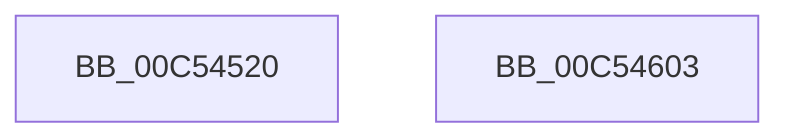

# ExpMutantInitialization

- RVA: `0x00C54520`–`0x00C54604` (길이 `228` bytes)
- VA: `0x0000000140C54520`
- 실행 섹션: `INIT`
- PDB 이름 있음: `예`; PDB Function 태그: `아니요`
- unwind 정보 RVA: `0x000C43B4`
- 디코드: `48`개 명령, `228/228` bytes 표시
- 미해석 바이트: `0` (있으면 어셈블리에 `.byte`로 보존)

> 이 문서는 커널 이미지의 기계어와 PDB 기호를 분석해 생성했습니다. 4번과 5번은 함수 원형과 자료형을 바이너리 사용 방식에서 추정한 C 해석이며 원본 소스 복구 결과는 아닙니다.

## 1. Dependencies

- 직접 호출 지점: **5**; 고유 호출 대상: **4**
- 직접 호출자로 확인된 함수: **1**
- RIP 상대 이미지 참조: **6**

### Outgoing calls
- `0x00C54552` → [RtlInitUnicodeString](../../text/42/RtlInitUnicodeString_function_0042A780.md) (function, `0x0042A780`)
- `0x00C54565` → [memset](../../text/6C/memset_function_006C6C40.md) (function, `0x006C6C40`)
- `0x00C54587` → [memset](../../text/6C/memset_function_006C6C40.md) (function, `0x006C6C40`)
- `0x00C545DC` → [ObCreateObjectType](../../page/70/ObCreateObjectType_function_00705230.md) (function, `0x00705230`)
- `0x00C545ED` → [_security_check_cookie](../../text/6A/_security_check_cookie_function_006AC640.md) (function, `0x006AC640`)

### Direct callers
- [ExpInitSystemPhase1](ExpInitSystemPhase1_function_00C51508.md) at `0x00C515D2`

### Static image references
- `0x00C54532` → RVA `0x00E0A740` (`.data`; read)
- `0x00C54543` → RVA `0x00C7DE30` (` ?? ::PBOPGDP::`string'`; read)
- `0x00C54575` → RVA `0x00EFEE10` (`.data`; read)
- `0x00C5458C` → RVA `0x00C824E0` (`ExpMutantMapping`; read)
- `0x00C54593` → RVA `0x00351770` (`ExpDeleteMutant`; read)
- `0x00C5459E` → RVA `0x00FC52B8` (`ALMOSTRO`; read)

## 2. Other-region calls and transfers

- 다른 실행 섹션으로 향하는 call: **5**
  - `0x00C54552` → [RtlInitUnicodeString](../../text/42/RtlInitUnicodeString_function_0042A780.md) (`INIT` → `.text`)
  - `0x00C54565` → [memset](../../text/6C/memset_function_006C6C40.md) (`INIT` → `.text`)
  - `0x00C54587` → [memset](../../text/6C/memset_function_006C6C40.md) (`INIT` → `.text`)
  - `0x00C545DC` → [ObCreateObjectType](../../page/70/ObCreateObjectType_function_00705230.md) (`INIT` → `PAGE`)
  - `0x00C545ED` → [_security_check_cookie](../../text/6A/_security_check_cookie_function_006AC640.md) (`INIT` → `.text`)
- 별도 외부 분기/꼬리 이동을 확인하지 못했습니다.

## 3. Assembly (complete function range)

```asm
00C54520  48 89 5C 24 08                  mov qword ptr [rsp + 8], rbx
00C54525  55                              push rbp
00C54526  48 8D 6C 24 A9                  lea rbp, [rsp - 0x57]
00C5452B  48 81 EC C0 00 00 00            sub rsp, 0xc0
00C54532  48 8B 05 07 62 1B 00            mov rax, qword ptr [rip + 0x1b6207]
00C54539  48 33 C4                        xor rax, rsp
00C5453C  48 89 45 47                     mov qword ptr [rbp + 0x47], rax
00C54540  0F 57 C0                        xorps xmm0, xmm0
00C54543  48 8D 15 E6 98 02 00            lea rdx, [rip + 0x298e6]
00C5454A  48 8D 4D B7                     lea rcx, [rbp - 0x49]
00C5454E  0F 11 45 B7                     movups xmmword ptr [rbp - 0x49], xmm0
00C54552  E8 29 62 7D FF                  call 0x14042a780
00C54557  BB 78 00 00 00                  mov ebx, 0x78
00C5455C  48 8D 4D C7                     lea rcx, [rbp - 0x39]
00C54560  44 8B C3                        mov r8d, ebx
00C54563  33 D2                           xor edx, edx
00C54565  E8 D6 26 A7 FF                  call 0x1406c6c40
00C5456A  65 48 8B 04 25 88 01 00 00      mov rax, qword ptr gs:[0x188]
00C54573  33 D2                           xor edx, edx
00C54575  44 8B 05 94 A8 2A 00            mov r8d, dword ptr [rip + 0x2aa894]
00C5457C  48 8B 88 B8 00 00 00            mov rcx, qword ptr [rax + 0xb8]
00C54583  48 83 C1 28                     add rcx, 0x28
00C54587  E8 B4 26 A7 FF                  call 0x1406c6c40
00C5458C  0F 10 05 4D DF 02 00            movups xmm0, xmmword ptr [rip + 0x2df4d]
00C54593  48 8D 05 D6 D1 6F FF            lea rax, [rip - 0x902e2a]
00C5459A  66 89 5D C7                     mov word ptr [rbp - 0x39], bx
00C5459E  4C 8D 0D 13 0D 37 00            lea r9, [rip + 0x370d13]
00C545A5  C7 45 CB 40 00 00 00            mov dword ptr [rbp - 0x35], 0x40
00C545AC  45 33 C0                        xor r8d, r8d
00C545AF  C7 45 CF 00 01 00 00            mov dword ptr [rbp - 0x31], 0x100
00C545B6  48 8D 55 C7                     lea rdx, [rbp - 0x39]
00C545BA  C7 45 EB 00 02 00 00            mov dword ptr [rbp - 0x15], 0x200
00C545C1  48 8D 4D B7                     lea rcx, [rbp - 0x49]
00C545C5  C7 45 F3 38 00 00 00            mov dword ptr [rbp - 0xd], 0x38
00C545CC  F3 0F 7F 45 D3                  movdqu xmmword ptr [rbp - 0x2d], xmm0
00C545D1  C7 45 E3 01 00 1F 00            mov dword ptr [rbp - 0x1d], 0x1f0001
00C545D8  48 89 45 0F                     mov qword ptr [rbp + 0xf], rax
00C545DC  E8 4F 0C AB FF                  call 0x140705230
00C545E1  C1 E8 1F                        shr eax, 0x1f
00C545E4  34 01                           xor al, 1
00C545E6  48 8B 4D 47                     mov rcx, qword ptr [rbp + 0x47]
00C545EA  48 33 CC                        xor rcx, rsp
00C545ED  E8 4E 80 A5 FF                  call 0x1406ac640
00C545F2  48 8B 9C 24 D0 00 00 00         mov rbx, qword ptr [rsp + 0xd0]
00C545FA  48 81 C4 C0 00 00 00            add rsp, 0xc0
00C54601  5D                              pop rbp
00C54602  C3                              ret
00C54603  CC                              int3
```

## 4. C-style interpretation (structured pseudocode)

```c
__int64 __fastcall ExpMutantInitialization(void)
{
    __int64 result;
    __int64 v_rsp;
    unsigned __int64 v_stack_m18;
    unsigned __int64 v_stack_m50;
    unsigned __int64 v_stack_m5F;
    unsigned int v_stack_m6C;
    unsigned int v_stack_m74;
    unsigned int v_stack_m7C;
    unsigned __int64 v_stack_m8C;
    unsigned int v_stack_m90;
    unsigned int v_stack_m94;
    unsigned __int64 v_stack_m98;
    unsigned __int64 v_stack_mA8;
    unsigned __int64 v_stack_p8;

    v_stack_p8 = v_rbx;
    v_rsp = (v_rsp) - (192);
    result = (*(unsigned __int64 *)(v_rip + 1794567)) ^ (v_rsp);
    v_stack_m18 = result;
    v_stack_mA8 = v_xmm0;
    result = RtlInitUnicodeString(v_stack_mA8, v_rip + 170214, a3, a4);
    a2 = 0;
    result = memset(v_stack_m98, a2, 120, a4);
    a2 = 0;
    a1 = (*(unsigned __int64 *)(*(unsigned __int64 *)(gs_base + (0 + 392)) + 184)) + (40);
    result = memset(a1, a2, (unsigned int)(*(unsigned int *)(v_rip + 2795668)), a4);
    v_stack_m98 = 120;
    v_stack_m94 = 64;
    a3 = 0;
    v_stack_m90 = 256;
    v_stack_m74 = 512;
    v_stack_m6C = 56;
    v_stack_m8C = v_xmm0;
    v_stack_m7C = 0x1F0001ULL;
    v_stack_m50 = v_rip - 9449002;
    result = ObCreateObjectType(v_stack_mA8, v_stack_m98, a3, v_rip + 3607827);
    result = (unsigned int)((result) >> (31));
    result = (unsigned __int8)((result) ^ (1));
    a1 = (v_stack_m18) ^ (v_rsp);
    result = _security_check_cookie(a1, v_stack_m98, a3, v_rip + 3607827);
    v_rsp = (v_rsp) + (192);
    return result;
}
```

## 5. (Beta) C Style

```c
void ExpMutantInitialization(void)
{
    int64_t result;
    int64_t local_rsp;
    uint64_t v_stack_m18;
    uint64_t v_stack_m50;
    uint64_t v_stack_m5F;
    uint32_t v_stack_m6C;
    uint32_t v_stack_m74;
    uint32_t v_stack_m7C;
    uint64_t v_stack_m8C;
    uint32_t v_stack_m90;
    uint32_t v_stack_m94;
    uint64_t v_stack_m98;
    uint64_t v_stack_mA8;
    uint64_t v_stack_p8;

    v_stack_p8 = local_rbx;
    local_rsp = (local_rsp) - (192);
    result = (*(uint64_t *)(v_rip + 0x1B6207)) ^ (local_rsp);
    v_stack_m18 = result;
    v_stack_mA8 = v_xmm0;
    result = RtlInitUnicodeString(v_stack_mA8, v_rip + 170214, a3, a4);
    a2 = 0;
    result = memset(v_stack_m98, a2, 120, a4);
    a2 = 0;
    a1 = (*(uint64_t *)(*(uint64_t *)(gs_base + (0 + 0x188)) + 0xB8)) + (40);
    result = memset(a1, a2, (uint32_t)(*(uint32_t *)(v_rip + 0x2AA894)), a4);
    v_stack_m98 = 120;
    v_stack_m94 = 64;
    a3 = 0;
    v_stack_m90 = 256;
    v_stack_m74 = 512;
    v_stack_m6C = 56;
    v_stack_m8C = v_xmm0;
    v_stack_m7C = 0x1F0001ULL;
    v_stack_m50 = v_rip - 9449002;
    result = ObCreateObjectType(v_stack_mA8, v_stack_m98, a3, v_rip + 3607827);
    result = (uint32_t)((result) >> (31));
    result = (uint8_t)((result) ^ (1));
    a1 = (v_stack_m18) ^ (local_rsp);
    result = _security_check_cookie(a1, v_stack_m98, a3, v_rip + 3607827);
    local_rsp = (local_rsp) + (192);
    return result;
}
```

## 6. Execution-region graph

[열기: 2D/3D 그래프와 함수 탐색 컨트롤 패널](../../../control-panel.html?section=init&rva=0x00C54520&view=graph)

- 2D 그래프는 위에서 아래로 흐르고, 3D 그래프는 빈 공간을 드래그해 회전합니다. Shift+드래그는 이동, 휠은 확대·축소, 함수 노드 선택은 대상 보고서 이동입니다.

### Static fallback


