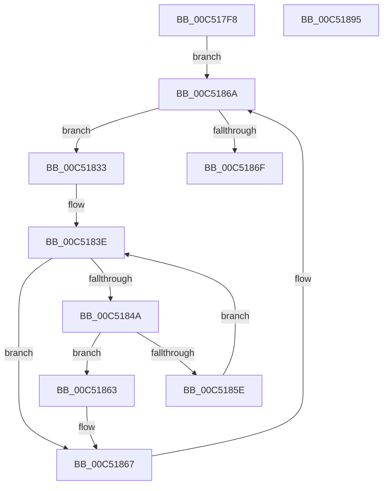

# ExpPrmInitialization

- RVA: `0x00C517F8`–`0x00C51896` (길이 `158` bytes)
- VA: `0x0000000140C517F8`
- 실행 섹션: `INIT`
- PDB 이름 있음: `예`; PDB Function 태그: `아니요`
- unwind 정보 RVA: `0x0005C954`
- 디코드: `41`개 명령, `158/158` bytes 표시
- 미해석 바이트: `0` (있으면 어셈블리에 `.byte`로 보존)

> 이 문서는 커널 이미지의 기계어와 PDB 기호를 분석해 생성했습니다. 4번과 5번은 함수 원형과 자료형을 바이너리 사용 방식에서 추정한 C 해석이며 원본 소스 복구 결과는 아닙니다.

## 1. Dependencies

- 직접 호출 지점: **4**; 고유 호출 대상: **4**
- 직접 호출자로 확인된 함수: **1**
- RIP 상대 이미지 참조: **2**

### Outgoing calls
- `0x00C51829` → [ExAcquireResourceSharedLite](../../text/21/ExAcquireResourceSharedLite_function_00211BC0.md) (function, `0x00211BC0`)
- `0x00C51855` → [RtlEqualUnicodeString](../../page/93/RtlEqualUnicodeString_function_00932A20.md) (function, `0x00932A20`)
- `0x00C51876` → [ExReleaseResourceLite](../../text/25/ExReleaseResourceLite_function_0025FA10.md) (function, `0x0025FA10`)
- `0x00C5187B` → [KeLeaveCriticalRegion](../../text/25/KeLeaveCriticalRegion_function_0025D8B0.md) (function, `0x0025D8B0`)

### Direct callers
- [ExpInitSystemPhase1](ExpInitSystemPhase1_function_00C51508.md) at `0x00C5171A`

### Static image references
- `0x00C5181A` → RVA `0x00EF54E0` (`.data`; read)
- `0x00C51837` → RVA `0x00EF54C0` (`.data`; read)

## 2. Other-region calls and transfers

- 다른 실행 섹션으로 향하는 call: **4**
  - `0x00C51829` → [ExAcquireResourceSharedLite](../../text/21/ExAcquireResourceSharedLite_function_00211BC0.md) (`INIT` → `.text`)
  - `0x00C51855` → [RtlEqualUnicodeString](../../page/93/RtlEqualUnicodeString_function_00932A20.md) (`INIT` → `PAGE`)
  - `0x00C51876` → [ExReleaseResourceLite](../../text/25/ExReleaseResourceLite_function_0025FA10.md) (`INIT` → `.text`)
  - `0x00C5187B` → [KeLeaveCriticalRegion](../../text/25/KeLeaveCriticalRegion_function_0025D8B0.md) (`INIT` → `.text`)
- 별도 외부 분기/꼬리 이동을 확인하지 못했습니다.

## 3. Assembly (complete function range)

```asm
00C517F8  48 89 5C 24 08                  mov qword ptr [rsp + 8], rbx
00C517FD  48 89 6C 24 10                  mov qword ptr [rsp + 0x10], rbp
00C51802  48 89 74 24 18                  mov qword ptr [rsp + 0x18], rsi
00C51807  57                              push rdi
00C51808  48 83 EC 20                     sub rsp, 0x20
00C5180C  65 48 8B 04 25 88 01 00 00      mov rax, qword ptr gs:[0x188]
00C51815  48 8B F1                        mov rsi, rcx
00C51818  B2 01                           mov dl, 1
00C5181A  48 8D 0D BF 3C 2A 00            lea rcx, [rip + 0x2a3cbf]
00C51821  66 FF 88 E4 01 00 00            dec word ptr [rax + 0x1e4]
00C51828  90                              nop
00C51829  E8 92 03 5C FF                  call 0x140211bc0
00C5182E  48 8B 1E                        mov rbx, qword ptr [rsi]
00C51831  EB 37                           jmp 0x140c5186a
00C51833  48 8B 6B 30                     mov rbp, qword ptr [rbx + 0x30]
00C51837  48 8B 3D 82 3C 2A 00            mov rdi, qword ptr [rip + 0x2a3c82]
00C5183E  48 8D 05 7B 3C 2A 00            lea rax, [rip + 0x2a3c7b]
00C51845  48 3B F8                        cmp rdi, rax
00C51848  74 1D                           je 0x140c51867
00C5184A  48 8D 57 48                     lea rdx, [rdi + 0x48]
00C5184E  41 B0 01                        mov r8b, 1
00C51851  48 8D 4D 48                     lea rcx, [rbp + 0x48]
00C51855  E8 C6 11 CE FF                  call 0x140932a20
00C5185A  84 C0                           test al, al
00C5185C  75 05                           jne 0x140c51863
00C5185E  48 8B 3F                        mov rdi, qword ptr [rdi]
00C51861  EB DB                           jmp 0x140c5183e
00C51863  48 89 7B 30                     mov qword ptr [rbx + 0x30], rdi
00C51867  48 8B 1B                        mov rbx, qword ptr [rbx]
00C5186A  48 3B DE                        cmp rbx, rsi
00C5186D  75 C4                           jne 0x140c51833
00C5186F  48 8D 0D 6A 3C 2A 00            lea rcx, [rip + 0x2a3c6a]
00C51876  E8 95 E1 60 FF                  call 0x14025fa10
00C5187B  E8 30 C0 60 FF                  call 0x14025d8b0
00C51880  48 8B 5C 24 30                  mov rbx, qword ptr [rsp + 0x30]
00C51885  48 8B 6C 24 38                  mov rbp, qword ptr [rsp + 0x38]
00C5188A  48 8B 74 24 40                  mov rsi, qword ptr [rsp + 0x40]
00C5188F  48 83 C4 20                     add rsp, 0x20
00C51893  5F                              pop rdi
00C51894  C3                              ret
00C51895  CC                              int3
```

## 4. C-style interpretation (structured pseudocode)

```c
__int64 __fastcall ExpPrmInitialization(__int64 a1)
{
    __int64 result;
    __int64 v_rsp;
    unsigned __int64 v_stack_p10;
    unsigned __int64 v_stack_p18;
    unsigned __int64 v_stack_p8;

    v_stack_p8 = v_rbx;
    v_stack_p10 = v_rbp;
    v_stack_p18 = v_rsi;
    v_rsp = (v_rsp) - (32);
    result = ExAcquireResourceSharedLite(v_rip + 2768063, 1, a3, a4);
    goto loc_00C5186A;
loc_00C51833:
loc_00C5183E:
    if ((*(unsigned __int64 *)(v_rip + 2768002)) == (v_rip + 2767995)) goto loc_00C51867;
    result = RtlEqualUnicodeString(*(unsigned __int64 *)(*(unsigned __int64 *)(a1) + 48) + 72, *(unsigned __int64 *)(v_rip + 2768002) + 72, 1, a4);
    if ((unsigned __int8)(result) != 0) goto loc_00C51863;
    goto loc_00C5183E;
loc_00C51863:
    *(unsigned __int64 *)(*(unsigned __int64 *)(a1) + 48) = *(unsigned __int64 *)(*(unsigned __int64 *)(v_rip + 2768002));
loc_00C51867:
loc_00C5186A:
    if ((*(unsigned __int64 *)(*(unsigned __int64 *)(a1))) != a1) goto loc_00C51833;
    result = ExReleaseResourceLite(v_rip + 2767978, *(unsigned __int64 *)(v_rip + 2768002) + 72, 1, a4);
    result = KeLeaveCriticalRegion(v_rip + 2767978, *(unsigned __int64 *)(v_rip + 2768002) + 72, 1, a4);
    v_rsp = (v_rsp) + (32);
    return result;
}
```

## 5. (Beta) C Style

```c
int64_t ExpPrmInitialization(void *Arg1)
{
    uint8_t *arg1 = (uint8_t *)Arg1;

    int64_t result;
    int64_t local_rsp;
    uint64_t v_stack_p10;
    uint64_t v_stack_p18;
    uint64_t v_stack_p8;

    v_stack_p8 = local_rbx;
    v_stack_p10 = local_rbp;
    v_stack_p18 = local_rsi;
    local_rsp = (local_rsp) - (32);
    result = ExAcquireResourceSharedLite(v_rip + 2768063, 1, a3, a4);
    goto loc_00C5186A;
loc_00C51833:
loc_00C5183E:
    if ((*(uint64_t *)(v_rip + 0x2A3C82)) == (v_rip + 2767995)) goto loc_00C51867;
    result = RtlEqualUnicodeString(*(uint64_t *)(*(uint64_t *)(arg1) + 0x30) + 72, *(uint64_t *)(v_rip + 0x2A3C82) + 72, 1, a4);
    if ((uint8_t)(result) != 0) goto loc_00C51863;
    goto loc_00C5183E;
loc_00C51863:
    *(uint64_t *)(*(uint64_t *)(arg1) + 0x30) = *(uint64_t *)(*(uint64_t *)(v_rip + 0x2A3C82));
loc_00C51867:
loc_00C5186A:
    if ((*(uint64_t *)(*(uint64_t *)(arg1))) != Arg1) goto loc_00C51833;
    result = ExReleaseResourceLite(v_rip + 2767978, *(uint64_t *)(v_rip + 0x2A3C82) + 72, 1, a4);
    result = KeLeaveCriticalRegion(v_rip + 2767978, *(uint64_t *)(v_rip + 0x2A3C82) + 72, 1, a4);
    local_rsp = (local_rsp) + (32);
    return result;
}
```

### 관측된 메모리 오프셋

구조체 형식이 확인되지 않은 접근은 인자 기준의 오프셋으로만 기록했습니다.

| 기준 인자 | 오프셋 표현 | 폭 (bit) | 접근 |
|---|---:|---:|---|
| `Arg1` | `+ 0x0` | `64` | `R` |

## 6. Execution-region graph

[열기: 2D/3D 그래프와 함수 탐색 컨트롤 패널](../../../control-panel.html?section=init&rva=0x00C517F8&view=graph)

- 2D 그래프는 위에서 아래로 흐르고, 3D 그래프는 빈 공간을 드래그해 회전합니다. Shift+드래그는 이동, 휠은 확대·축소, 함수 노드 선택은 대상 보고서 이동입니다.

### Static fallback


