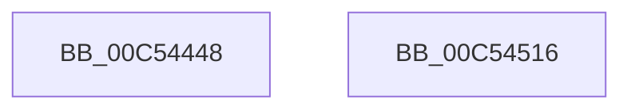

# ExpProfileInitialization

- RVA: `0x00C54448`–`0x00C54517` (길이 `207` bytes)
- VA: `0x0000000140C54448`
- 실행 섹션: `INIT`
- PDB 이름 있음: `예`; PDB Function 태그: `아니요`
- unwind 정보 RVA: `0x000C43B4`
- 디코드: `46`개 명령, `207/207` bytes 표시
- 미해석 바이트: `0` (있으면 어셈블리에 `.byte`로 보존)

> 이 문서는 커널 이미지의 기계어와 PDB 기호를 분석해 생성했습니다. 4번과 5번은 함수 원형과 자료형을 바이너리 사용 방식에서 추정한 C 해석이며 원본 소스 복구 결과는 아닙니다.

## 1. Dependencies

- 직접 호출 지점: **5**; 고유 호출 대상: **5**
- 직접 호출자로 확인된 함수: **1**
- RIP 상대 이미지 참조: **6**

### Outgoing calls
- `0x00C5447E` → [KiInitializeMutant](../../text/45/KiInitializeMutant_function_00456E9C.md) (function, `0x00456E9C`)
- `0x00C5448E` → [RtlInitUnicodeString](../../text/42/RtlInitUnicodeString_function_0042A780.md) (function, `0x0042A780`)
- `0x00C544A1` → [memset](../../text/6C/memset_function_006C6C40.md) (function, `0x006C6C40`)
- `0x00C544EF` → [ObCreateObjectType](../../page/70/ObCreateObjectType_function_00705230.md) (function, `0x00705230`)
- `0x00C54500` → [_security_check_cookie](../../text/6A/_security_check_cookie_function_006AC640.md) (function, `0x006AC640`)

### Direct callers
- [ExpInitSystemPhase1](ExpInitSystemPhase1_function_00C51508.md) at `0x00C51609`

### Static image references
- `0x00C5445A` → RVA `0x00E0A740` (`.data`; read)
- `0x00C5446B` → RVA `0x00EFA140` (`.data`; read)
- `0x00C54483` → RVA `0x00C7DE20` (` ?? ::PBOPGDP::`string'`; read)
- `0x00C544A6` → RVA `0x00C824F0` (`ExpProfileMapping`; read)
- `0x00C544AD` → RVA `0x007D1FE0` (`ExpProfileDelete`; read)
- `0x00C544B8` → RVA `0x00FC5390` (`ALMOSTRO`; read)

## 2. Other-region calls and transfers

- 다른 실행 섹션으로 향하는 call: **5**
  - `0x00C5447E` → [KiInitializeMutant](../../text/45/KiInitializeMutant_function_00456E9C.md) (`INIT` → `.text`)
  - `0x00C5448E` → [RtlInitUnicodeString](../../text/42/RtlInitUnicodeString_function_0042A780.md) (`INIT` → `.text`)
  - `0x00C544A1` → [memset](../../text/6C/memset_function_006C6C40.md) (`INIT` → `.text`)
  - `0x00C544EF` → [ObCreateObjectType](../../page/70/ObCreateObjectType_function_00705230.md) (`INIT` → `PAGE`)
  - `0x00C54500` → [_security_check_cookie](../../text/6A/_security_check_cookie_function_006AC640.md) (`INIT` → `.text`)
- 별도 외부 분기/꼬리 이동을 확인하지 못했습니다.

## 3. Assembly (complete function range)

```asm
00C54448  48 89 5C 24 08                  mov qword ptr [rsp + 8], rbx
00C5444D  55                              push rbp
00C5444E  48 8D 6C 24 A9                  lea rbp, [rsp - 0x57]
00C54453  48 81 EC C0 00 00 00            sub rsp, 0xc0
00C5445A  48 8B 05 DF 62 1B 00            mov rax, qword ptr [rip + 0x1b62df]
00C54461  48 33 C4                        xor rax, rsp
00C54464  48 89 45 47                     mov qword ptr [rbp + 0x47], rax
00C54468  0F 57 C0                        xorps xmm0, xmm0
00C5446B  48 8D 0D CE 5C 2A 00            lea rcx, [rip + 0x2a5cce]
00C54472  45 33 C9                        xor r9d, r9d
00C54475  41 B0 01                        mov r8b, 1
00C54478  33 D2                           xor edx, edx
00C5447A  0F 11 45 B7                     movups xmmword ptr [rbp - 0x49], xmm0
00C5447E  E8 19 2A 80 FF                  call 0x140456e9c
00C54483  48 8D 15 96 99 02 00            lea rdx, [rip + 0x29996]
00C5448A  48 8D 4D B7                     lea rcx, [rbp - 0x49]
00C5448E  E8 ED 62 7D FF                  call 0x14042a780
00C54493  BB 78 00 00 00                  mov ebx, 0x78
00C54498  48 8D 4D C7                     lea rcx, [rbp - 0x39]
00C5449C  44 8B C3                        mov r8d, ebx
00C5449F  33 D2                           xor edx, edx
00C544A1  E8 9A 27 A7 FF                  call 0x1406c6c40
00C544A6  0F 10 05 43 E0 02 00            movups xmm0, xmmword ptr [rip + 0x2e043]
00C544AD  48 8D 05 2C DB B7 FF            lea rax, [rip - 0x4824d4]
00C544B4  66 89 5D C7                     mov word ptr [rbp - 0x39], bx
00C544B8  4C 8D 0D D1 0E 37 00            lea r9, [rip + 0x370ed1]
00C544BF  C7 45 CF 00 01 00 00            mov dword ptr [rbp - 0x31], 0x100
00C544C6  45 33 C0                        xor r8d, r8d
00C544C9  C7 45 EB 00 02 00 00            mov dword ptr [rbp - 0x15], 0x200
00C544D0  48 8D 55 C7                     lea rdx, [rbp - 0x39]
00C544D4  C7 45 F3 50 01 00 00            mov dword ptr [rbp - 0xd], 0x150
00C544DB  48 8D 4D B7                     lea rcx, [rbp - 0x49]
00C544DF  C7 45 E3 01 00 0F 00            mov dword ptr [rbp - 0x1d], 0xf0001
00C544E6  F3 0F 7F 45 D3                  movdqu xmmword ptr [rbp - 0x2d], xmm0
00C544EB  48 89 45 0F                     mov qword ptr [rbp + 0xf], rax
00C544EF  E8 3C 0D AB FF                  call 0x140705230
00C544F4  C1 E8 1F                        shr eax, 0x1f
00C544F7  34 01                           xor al, 1
00C544F9  48 8B 4D 47                     mov rcx, qword ptr [rbp + 0x47]
00C544FD  48 33 CC                        xor rcx, rsp
00C54500  E8 3B 81 A5 FF                  call 0x1406ac640
00C54505  48 8B 9C 24 D0 00 00 00         mov rbx, qword ptr [rsp + 0xd0]
00C5450D  48 81 C4 C0 00 00 00            add rsp, 0xc0
00C54514  5D                              pop rbp
00C54515  C3                              ret
00C54516  CC                              int3
```

## 4. C-style interpretation (structured pseudocode)

```c
__int64 __fastcall ExpProfileInitialization(__int64 a1, int a2, __int64 a3, int a4)
{
    __int64 result;
    __int64 v_rsp;
    unsigned __int64 v_stack_m18;
    unsigned __int64 v_stack_m50;
    unsigned __int64 v_stack_m5F;
    unsigned int v_stack_m6C;
    unsigned int v_stack_m74;
    unsigned int v_stack_m7C;
    unsigned __int64 v_stack_m8C;
    unsigned int v_stack_m90;
    unsigned __int64 v_stack_m98;
    unsigned __int64 v_stack_mA8;
    unsigned __int64 v_stack_p8;

    v_stack_p8 = v_rbx;
    v_rsp = (v_rsp) - (192);
    result = (*(unsigned __int64 *)(v_rip + 1794783)) ^ (v_rsp);
    v_stack_m18 = result;
    a4 = 0;
    a2 = 0;
    v_stack_mA8 = v_xmm0;
    result = KiInitializeMutant(v_rip + 2776270, a2, 1, a4);
    result = RtlInitUnicodeString(v_stack_mA8, v_rip + 170390, 1, a4);
    a2 = 0;
    result = memset(v_stack_m98, a2, 120, a4);
    v_stack_m98 = 120;
    v_stack_m90 = 256;
    a3 = 0;
    v_stack_m74 = 512;
    v_stack_m6C = 336;
    v_stack_m7C = 0xF0001ULL;
    v_stack_m8C = v_xmm0;
    v_stack_m50 = v_rip - 4728020;
    result = ObCreateObjectType(v_stack_mA8, v_stack_m98, a3, v_rip + 3608273);
    result = (unsigned int)((result) >> (31));
    result = (unsigned __int8)((result) ^ (1));
    a1 = (v_stack_m18) ^ (v_rsp);
    result = _security_check_cookie(a1, v_stack_m98, a3, v_rip + 3608273);
    v_rsp = (v_rsp) + (192);
    return result;
}
```

## 5. (Beta) C Style

```c
int64_t ExpProfileInitialization(int64_t Arg1, int32_t Arg2, int64_t Arg3, int32_t Arg4)
{
    int64_t result;
    int64_t local_rsp;
    uint64_t v_stack_m18;
    uint64_t v_stack_m50;
    uint64_t v_stack_m5F;
    uint32_t v_stack_m6C;
    uint32_t v_stack_m74;
    uint32_t v_stack_m7C;
    uint64_t v_stack_m8C;
    uint32_t v_stack_m90;
    uint64_t v_stack_m98;
    uint64_t v_stack_mA8;
    uint64_t v_stack_p8;

    v_stack_p8 = local_rbx;
    local_rsp = (local_rsp) - (192);
    result = (*(uint64_t *)(v_rip + 0x1B62DF)) ^ (local_rsp);
    v_stack_m18 = result;
    Arg4 = 0;
    Arg2 = 0;
    v_stack_mA8 = v_xmm0;
    result = KiInitializeMutant(v_rip + 2776270, Arg2, 1, Arg4);
    result = RtlInitUnicodeString(v_stack_mA8, v_rip + 170390, 1, Arg4);
    Arg2 = 0;
    result = memset(v_stack_m98, Arg2, 120, Arg4);
    v_stack_m98 = 120;
    v_stack_m90 = 256;
    Arg3 = 0;
    v_stack_m74 = 512;
    v_stack_m6C = 336;
    v_stack_m7C = 0xF0001ULL;
    v_stack_m8C = v_xmm0;
    v_stack_m50 = v_rip - 4728020;
    result = ObCreateObjectType(v_stack_mA8, v_stack_m98, Arg3, v_rip + 3608273);
    result = (uint32_t)((result) >> (31));
    result = (uint8_t)((result) ^ (1));
    Arg1 = (v_stack_m18) ^ (local_rsp);
    result = _security_check_cookie(Arg1, v_stack_m98, Arg3, v_rip + 3608273);
    local_rsp = (local_rsp) + (192);
    return result;
}
```

## 6. Execution-region graph

[열기: 2D/3D 그래프와 함수 탐색 컨트롤 패널](../../../control-panel.html?section=init&rva=0x00C54448&view=graph)

- 2D 그래프는 위에서 아래로 흐르고, 3D 그래프는 빈 공간을 드래그해 회전합니다. Shift+드래그는 이동, 휠은 확대·축소, 함수 노드 선택은 대상 보고서 이동입니다.

### Static fallback


