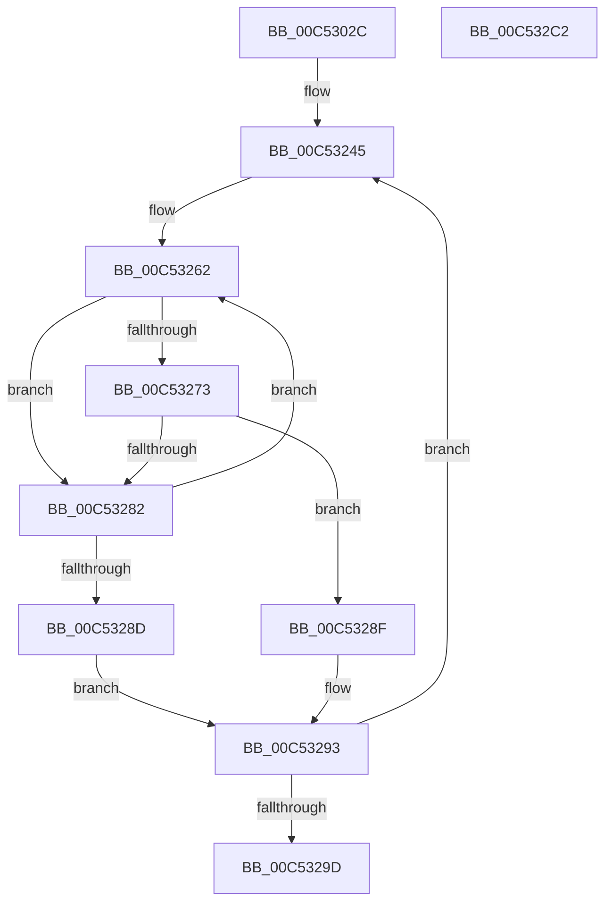

# ExpSeedHotTags

- RVA: `0x00C5302C`–`0x00C532C3` (길이 `663` bytes)
- VA: `0x0000000140C5302C`
- 실행 섹션: `INIT`
- PDB 이름 있음: `예`; PDB Function 태그: `아니요`
- unwind 정보 RVA: `0x000D4CA8`
- 디코드: `115`개 명령, `663/663` bytes 표시
- 미해석 바이트: `0` (있으면 어셈블리에 `.byte`로 보존)

> 이 문서는 커널 이미지의 기계어와 PDB 기호를 분석해 생성했습니다. 4번과 5번은 함수 원형과 자료형을 바이너리 사용 방식에서 추정한 C 해석이며 원본 소스 복구 결과는 아닙니다.

## 1. Dependencies

- 직접 호출 지점: **1**; 고유 호출 대상: **1**
- 직접 호출자로 확인된 함수: **1**
- RIP 상대 이미지 참조: **4**

### Outgoing calls
- `0x00C532A4` → [_security_check_cookie](../../text/6A/_security_check_cookie_function_006AC640.md) (function, `0x006AC640`)

### Direct callers
- [ExInitializePoolTracker](ExInitializePoolTracker_function_00C52F10.md) at `0x00C52FD4`

### Static image references
- `0x00C53047` → RVA `0x00E0A740` (`.data`; read)
- `0x00C53055` → RVA `0x00EFED60` (`.data`; read)
- `0x00C53248` → RVA `0x00EFED58` (`.data`; read)
- `0x00C53273` → RVA `0x00EFED50` (`.data`; read)

## 2. Other-region calls and transfers

- 다른 실행 섹션으로 향하는 call: **1**
  - `0x00C532A4` → [_security_check_cookie](../../text/6A/_security_check_cookie_function_006AC640.md) (`INIT` → `.text`)
- 별도 외부 분기/꼬리 이동을 확인하지 못했습니다.

## 3. Assembly (complete function range)

```asm
00C5302C  48 8B C4                        mov rax, rsp
00C5302F  48 89 58 08                     mov qword ptr [rax + 8], rbx
00C53033  48 89 70 10                     mov qword ptr [rax + 0x10], rsi
00C53037  48 89 78 18                     mov qword ptr [rax + 0x18], rdi
00C5303B  55                              push rbp
00C5303C  48 8D 68 E8                     lea rbp, [rax - 0x18]
00C53040  48 81 EC 10 01 00 00            sub rsp, 0x110
00C53047  48 8B 05 F2 76 1B 00            mov rax, qword ptr [rip + 0x1b76f2]
00C5304E  48 33 C4                        xor rax, rsp
00C53051  48 89 45 00                     mov qword ptr [rbp], rax
00C53055  4C 8B 15 04 BD 2A 00            mov r10, qword ptr [rip + 0x2abd04]
00C5305C  4C 8D 04 24                     lea r8, [rsp]
00C53060  C7 04 24 49 6F 20 20            mov dword ptr [rsp], 0x20206f49
00C53067  41 B9 40 00 00 00               mov r9d, 0x40
00C5306D  C7 44 24 04 48 61 6C 20         mov dword ptr [rsp + 4], 0x206c6148
00C53075  C7 44 24 08 4D 64 6C 50         mov dword ptr [rsp + 8], 0x506c644d
00C5307D  C7 44 24 0C 50 6F 6F 4C         mov dword ptr [rsp + 0xc], 0x4c6f6f50
00C53085  C7 44 24 10 4F 62 53 74         mov dword ptr [rsp + 0x10], 0x7453624f
00C5308D  C7 44 24 14 49 72 70 20         mov dword ptr [rsp + 0x14], 0x20707249
00C53095  C7 44 24 18 4E 44 64 62         mov dword ptr [rsp + 0x18], 0x6264444e
00C5309D  C7 44 24 1C 49 72 70 4C         mov dword ptr [rsp + 0x1c], 0x4c707249
00C530A5  C7 44 24 20 49 6F 4F 70         mov dword ptr [rsp + 0x20], 0x704f6f49
00C530AD  C7 44 24 24 4D 64 6C 20         mov dword ptr [rsp + 0x24], 0x206c644d
00C530B5  C7 44 24 28 46 69 6C 65         mov dword ptr [rsp + 0x28], 0x656c6946
00C530BD  C7 44 24 2C 43 4D 56 61         mov dword ptr [rsp + 0x2c], 0x61564d43
00C530C5  C7 44 24 30 53 65 53 64         mov dword ptr [rsp + 0x30], 0x64536553
00C530CD  C7 44 24 34 4E 74 46 43         mov dword ptr [rsp + 0x34], 0x4346744e
00C530D5  C7 44 24 38 50 6F 6F 6C         mov dword ptr [rsp + 0x38], 0x6c6f6f50
00C530DD  C7 44 24 3C 54 43 50 72         mov dword ptr [rsp + 0x3c], 0x72504354
00C530E5  C7 44 24 40 43 4D 4E 62         mov dword ptr [rsp + 0x40], 0x624e4d43
00C530ED  C7 44 24 44 53 65 54 64         mov dword ptr [rsp + 0x44], 0x64546553
00C530F5  C7 44 24 48 4E 74 46 73         mov dword ptr [rsp + 0x48], 0x7346744e
00C530FD  C7 44 24 4C 54 43 50 54         mov dword ptr [rsp + 0x4c], 0x54504354
00C53105  C7 44 24 50 54 43 50 43         mov dword ptr [rsp + 0x50], 0x43504354
00C5310D  C7 44 24 54 4B 65 79 20         mov dword ptr [rsp + 0x54], 0x2079654b
00C53115  C7 44 24 58 4F 62 53 71         mov dword ptr [rsp + 0x58], 0x7153624f
00C5311D  C7 44 24 5C 49 6F 4E 6D         mov dword ptr [rsp + 0x5c], 0x6d4e6f49
00C53125  C7 44 24 60 49 6F 45 61         mov dword ptr [rsp + 0x60], 0x61456f49
00C5312D  C7 44 24 64 54 43 50 63         mov dword ptr [rsp + 0x64], 0x63504354
00C53135  C7 44 24 68 4E 74 46 61         mov dword ptr [rsp + 0x68], 0x6146744e
00C5313D  C7 44 24 6C 4E 74 66 30         mov dword ptr [rsp + 0x6c], 0x3066744e
00C53145  C7 44 24 70 53 65 63 74         mov dword ptr [rsp + 0x70], 0x74636553
00C5314D  C7 44 24 74 49 72 70 53         mov dword ptr [rsp + 0x74], 0x53707249
00C53155  C7 44 24 78 54 6F 6B 65         mov dword ptr [rsp + 0x78], 0x656b6f54
00C5315D  C7 44 24 7C 53 65 20 20         mov dword ptr [rsp + 0x7c], 0x20206553
00C53165  C7 45 80 4F 62 43 6C            mov dword ptr [rbp - 0x80], 0x6c43624f
00C5316C  C7 45 84 43 63 53 63            mov dword ptr [rbp - 0x7c], 0x63536343
00C53173  C7 45 88 4E 74 46 4C            mov dword ptr [rbp - 0x78], 0x4c46744e
00C5317A  C7 45 8C 53 65 41 63            mov dword ptr [rbp - 0x74], 0x63416553
00C53181  C7 45 90 46 53 66 6D            mov dword ptr [rbp - 0x70], 0x6d665346
00C53188  C7 45 94 43 63 57 6B            mov dword ptr [rbp - 0x6c], 0x6b576343
00C5318F  C7 45 98 46 53 69 6D            mov dword ptr [rbp - 0x68], 0x6d695346
00C53196  C7 45 9C 41 66 64 43            mov dword ptr [rbp - 0x64], 0x43646641
00C5319D  C7 45 A0 41 66 64 45            mov dword ptr [rbp - 0x60], 0x45646641
00C531A4  C7 45 A4 46 53 72 6F            mov dword ptr [rbp - 0x5c], 0x6f725346
00C531AB  C7 45 A8 4E 74 66 6E            mov dword ptr [rbp - 0x58], 0x6e66744e
00C531B2  C7 45 AC 55 49 52 50            mov dword ptr [rbp - 0x54], 0x50524955
00C531B9  C7 45 B0 4E 70 46 72            mov dword ptr [rbp - 0x50], 0x7246704e
00C531C0  C7 45 B4 4E 70 46 52            mov dword ptr [rbp - 0x4c], 0x5246704e
00C531C7  C7 45 B8 53 65 50 61            mov dword ptr [rbp - 0x48], 0x61506553
00C531CE  C7 45 BC 53 65 55 73            mov dword ptr [rbp - 0x44], 0x73556553
00C531D5  C7 45 C0 41 63 70 46            mov dword ptr [rbp - 0x40], 0x46706341
00C531DC  C7 45 C4 41 63 70 4D            mov dword ptr [rbp - 0x3c], 0x4d706341
00C531E3  C7 45 C8 53 65 53 63            mov dword ptr [rbp - 0x38], 0x63536553
00C531EA  C7 45 CC 4F 62 4E 6D            mov dword ptr [rbp - 0x34], 0x6d4e624f
00C531F1  C7 45 D0 4E 70 46 73            mov dword ptr [rbp - 0x30], 0x7346704e
00C531F8  C7 45 D4 53 65 4C 75            mov dword ptr [rbp - 0x2c], 0x754c6553
00C531FF  C7 45 D8 53 63 50 44            mov dword ptr [rbp - 0x28], 0x44506353
00C53206  C7 45 DC 45 76 65 6E            mov dword ptr [rbp - 0x24], 0x6e657645
00C5320D  C7 45 E0 52 71 72 76            mov dword ptr [rbp - 0x20], 0x76727152
00C53214  C7 45 E4 56 61 64 6C            mov dword ptr [rbp - 0x1c], 0x6c646156
00C5321B  C7 45 E8 50 70 20 20            mov dword ptr [rbp - 0x18], 0x20207050
00C53222  C7 45 EC 56 61 64 53            mov dword ptr [rbp - 0x14], 0x53646156
00C53229  C7 45 F0 56 61 64 20            mov dword ptr [rbp - 0x10], 0x20646156
00C53230  C7 45 F4 56 61 64 4C            mov dword ptr [rbp - 0xc], 0x4c646156
00C53237  C7 45 F8 56 61 64 46            mov dword ptr [rbp - 8], 0x46646156
00C5323E  C7 45 FC 4D 6D 64 69            mov dword ptr [rbp - 4], 0x69646d4d
00C53245  41 8B 18                        mov ebx, dword ptr [r8]
00C53248  8B 3D 0A BB 2A 00               mov edi, dword ptr [rip + 0x2abb0a]
00C5324E  48 69 CB 5F 9E 00 00            imul rcx, rbx, 0x9e5f
00C53255  48 8B D1                        mov rdx, rcx
00C53258  48 C1 EA 20                     shr rdx, 0x20
00C5325C  33 D1                           xor edx, ecx
00C5325E  23 D7                           and edx, edi
00C53260  8B F2                           mov esi, edx
00C53262  44 8B DA                        mov r11d, edx
00C53265  4B 8D 0C 9B                     lea rcx, [r11 + r11*4]
00C53269  48 03 C9                        add rcx, rcx
00C5326C  41 83 3C CA 00                  cmp dword ptr [r10 + rcx*8], 0
00C53271  75 0F                           jne 0x140c53282
00C53273  48 8B 05 D6 BA 2A 00            mov rax, qword ptr [rip + 0x2abad6]
00C5327A  48 FF C8                        dec rax
00C5327D  4C 3B D8                        cmp r11, rax
00C53280  75 0D                           jne 0x140c5328f
00C53282  8D 42 01                        lea eax, [rdx + 1]
00C53285  23 C7                           and eax, edi
00C53287  8B D0                           mov edx, eax
00C53289  3B C6                           cmp eax, esi
00C5328B  75 D5                           jne 0x140c53262
00C5328D  EB 04                           jmp 0x140c53293
00C5328F  41 89 1C CA                     mov dword ptr [r10 + rcx*8], ebx
00C53293  49 83 C0 04                     add r8, 4
00C53297  49 83 E9 01                     sub r9, 1
00C5329B  75 A8                           jne 0x140c53245
00C5329D  48 8B 4D 00                     mov rcx, qword ptr [rbp]
00C532A1  48 33 CC                        xor rcx, rsp
00C532A4  E8 97 93 A5 FF                  call 0x1406ac640
00C532A9  4C 8D 9C 24 10 01 00 00         lea r11, [rsp + 0x110]
00C532B1  49 8B 5B 10                     mov rbx, qword ptr [r11 + 0x10]
00C532B5  49 8B 73 18                     mov rsi, qword ptr [r11 + 0x18]
00C532B9  49 8B 7B 20                     mov rdi, qword ptr [r11 + 0x20]
00C532BD  49 8B E3                        mov rsp, r11
00C532C0  5D                              pop rbp
00C532C1  C3                              ret
00C532C2  CC                              int3
```

## 4. C-style interpretation (structured pseudocode)

```c
__int64 __fastcall ExpSeedHotTags(void)
{
    __int64 result;
    __int64 v_rsp;
    unsigned int v_stack_m100;
    unsigned int v_stack_m104;
    unsigned int v_stack_m108;
    unsigned int v_stack_m10C;
    unsigned int v_stack_m110;
    unsigned int v_stack_m114;
    unsigned __int64 v_stack_m118;
    unsigned __int64 v_stack_m8;
    unsigned int v_stack_m9C;
    unsigned int v_stack_mA0;
    unsigned int v_stack_mA4;
    unsigned int v_stack_mA8;
    unsigned int v_stack_mAC;
    unsigned int v_stack_mB0;
    unsigned int v_stack_mB4;
    unsigned int v_stack_mB8;
    unsigned int v_stack_mBC;
    unsigned int v_stack_mC0;
    unsigned int v_stack_mC4;
    unsigned int v_stack_mC8;
    unsigned int v_stack_mCC;
    unsigned int v_stack_mD0;
    unsigned int v_stack_mD4;
    unsigned int v_stack_mD8;
    unsigned int v_stack_mDC;
    unsigned int v_stack_mE0;
    unsigned int v_stack_mE4;
    unsigned int v_stack_mE8;
    unsigned int v_stack_mEC;
    unsigned int v_stack_mF0;
    unsigned int v_stack_mF4;
    unsigned int v_stack_mF8;
    unsigned int v_stack_mFC;

    *(unsigned __int64 *)(v_rsp + 8) = v_rbx;
    *(unsigned __int64 *)(v_rsp + 16) = v_rsi;
    *(unsigned __int64 *)(v_rsp + 24) = v_rdi;
    v_rsp = (v_rsp) - (272);
    result = (*(unsigned __int64 *)(v_rip + 1799922)) ^ (v_rsp);
    *(unsigned __int64 *)(v_rsp - 24) = result;
    v_stack_m118 = 0x20206F49ULL;
    v_stack_m114 = 0x206C6148ULL;
    v_stack_m110 = 0x506C644DULL;
    v_stack_m10C = 0x4C6F6F50ULL;
    v_stack_m108 = 0x7453624FULL;
    v_stack_m104 = 0x20707249ULL;
    v_stack_m100 = 0x6264444EULL;
    v_stack_mFC = 0x4C707249ULL;
    v_stack_mF8 = 0x704F6F49ULL;
    v_stack_mF4 = 0x206C644DULL;
    v_stack_mF0 = 0x656C6946ULL;
    v_stack_mEC = 0x61564D43ULL;
    v_stack_mE8 = 0x64536553ULL;
    v_stack_mE4 = 0x4346744EULL;
    v_stack_mE0 = 0x6C6F6F50ULL;
    v_stack_mDC = 0x72504354ULL;
    v_stack_mD8 = 0x624E4D43ULL;
    v_stack_mD4 = 0x64546553ULL;
    v_stack_mD0 = 0x7346744EULL;
    v_stack_mCC = 0x54504354ULL;
    v_stack_mC8 = 0x43504354ULL;
    v_stack_mC4 = 0x2079654BULL;
    v_stack_mC0 = 0x7153624FULL;
    v_stack_mBC = 0x6D4E6F49ULL;
    v_stack_mB8 = 0x61456F49ULL;
    v_stack_mB4 = 0x63504354ULL;
    v_stack_mB0 = 0x6146744EULL;
    v_stack_mAC = 0x3066744EULL;
    v_stack_mA8 = 0x74636553ULL;
    v_stack_mA4 = 0x53707249ULL;
    v_stack_mA0 = 0x656B6F54ULL;
    v_stack_m9C = 0x20206553ULL;
    *(unsigned int *)(v_rsp - 24 - 128) = 0x6C43624FULL;
    *(unsigned int *)(v_rsp - 24 - 124) = 0x63536343ULL;
    *(unsigned int *)(v_rsp - 24 - 120) = 0x4C46744EULL;
    *(unsigned int *)(v_rsp - 24 - 116) = 0x63416553ULL;
    *(unsigned int *)(v_rsp - 24 - 112) = 0x6D665346ULL;
    *(unsigned int *)(v_rsp - 24 - 108) = 0x6B576343ULL;
    *(unsigned int *)(v_rsp - 24 - 104) = 0x6D695346ULL;
    *(unsigned int *)(v_rsp - 24 - 100) = 0x43646641ULL;
    *(unsigned int *)(v_rsp - 24 - 96) = 0x45646641ULL;
    *(unsigned int *)(v_rsp - 24 - 92) = 0x6F725346ULL;
    *(unsigned int *)(v_rsp - 24 - 88) = 0x6E66744EULL;
    *(unsigned int *)(v_rsp - 24 - 84) = 0x50524955ULL;
    *(unsigned int *)(v_rsp - 24 - 80) = 0x7246704EULL;
    *(unsigned int *)(v_rsp - 24 - 76) = 0x5246704EULL;
    *(unsigned int *)(v_rsp - 24 - 72) = 0x61506553ULL;
    *(unsigned int *)(v_rsp - 24 - 68) = 0x73556553ULL;
    *(unsigned int *)(v_rsp - 24 - 64) = 0x46706341ULL;
    *(unsigned int *)(v_rsp - 24 - 60) = 0x4D706341ULL;
    *(unsigned int *)(v_rsp - 24 - 56) = 0x63536553ULL;
    *(unsigned int *)(v_rsp - 24 - 52) = 0x6D4E624FULL;
    *(unsigned int *)(v_rsp - 24 - 48) = 0x7346704EULL;
    *(unsigned int *)(v_rsp - 24 - 44) = 0x754C6553ULL;
    *(unsigned int *)(v_rsp - 24 - 40) = 0x44506353ULL;
    *(unsigned int *)(v_rsp - 24 - 36) = 0x6E657645ULL;
    *(unsigned int *)(v_rsp - 24 - 32) = 0x76727152ULL;
    *(unsigned int *)(v_rsp - 24 - 28) = 0x6C646156ULL;
    *(unsigned int *)(v_rsp - 24 - 24) = 0x20207050ULL;
    *(unsigned int *)(v_rsp - 24 - 20) = 0x53646156ULL;
    *(unsigned int *)(v_rsp - 24 - 16) = 0x20646156ULL;
    *(unsigned int *)(v_rsp - 24 - 12) = 0x4C646156ULL;
    *(unsigned int *)(v_rsp - 24 - 8) = 0x46646156ULL;
    *(unsigned int *)(v_rsp - 24 - 4) = 0x69646D4DULL;
loc_00C53245:
    a1 = (a1) * ((unsigned int)(*(unsigned int *)(v_stack_m118)));
    a2 = (a1) >> (32);
    a2 = (unsigned int)((a2) ^ ((unsigned int)(a1)));
    a2 = (unsigned int)((a2) & ((unsigned int)((unsigned int)(*(unsigned int *)(v_rip + 2800394)))));
loc_00C53262:
    a1 = ((unsigned int)((unsigned int)(a2)) + (unsigned int)((unsigned int)(a2)) * 4) + ((unsigned int)((unsigned int)(a2)) + (unsigned int)((unsigned int)(a2)) * 4);
    if ((*(unsigned int *)(*(unsigned __int64 *)(v_rip + 2800900) + a1 * 8)) != 0) goto loc_00C53282;
    result = (*(unsigned __int64 *)(v_rip + 2800342)) - 1;
    if (((unsigned int)((unsigned int)(a2))) != result) goto loc_00C5328F;
loc_00C53282:
    result = (unsigned int)((a2 + 1) & ((unsigned int)((unsigned int)(*(unsigned int *)(v_rip + 2800394)))));
    if (((unsigned int)(result)) != ((unsigned int)((unsigned int)((unsigned int)(a2))))) goto loc_00C53262;
    goto loc_00C53293;
loc_00C5328F:
    *(unsigned int *)(*(unsigned __int64 *)(v_rip + 2800900) + a1 * 8) = (unsigned int)((unsigned int)(*(unsigned int *)(v_stack_m118)));
loc_00C53293:
    a3 = (v_stack_m118) + (4);
    a4 = (64) - (1);
    if (condition_is_not_equal) goto loc_00C53245;
    a1 = (*(unsigned __int64 *)(v_rsp - 24)) ^ (v_rsp);
    result = _security_check_cookie(a1, (unsigned int)((unsigned int)(result)), a3, a4);
    return result;
}
```

## 5. (Beta) C Style

```c
void ExpSeedHotTags(void)
{
    int64_t result;
    int64_t local_rsp;
    uint32_t v_stack_m100;
    uint32_t v_stack_m104;
    uint32_t v_stack_m108;
    uint32_t v_stack_m10C;
    uint32_t v_stack_m110;
    uint32_t v_stack_m114;
    uint64_t v_stack_m118;
    uint64_t v_stack_m8;
    uint32_t v_stack_m9C;
    uint32_t v_stack_mA0;
    uint32_t v_stack_mA4;
    uint32_t v_stack_mA8;
    uint32_t v_stack_mAC;
    uint32_t v_stack_mB0;
    uint32_t v_stack_mB4;
    uint32_t v_stack_mB8;
    uint32_t v_stack_mBC;
    uint32_t v_stack_mC0;
    uint32_t v_stack_mC4;
    uint32_t v_stack_mC8;
    uint32_t v_stack_mCC;
    uint32_t v_stack_mD0;
    uint32_t v_stack_mD4;
    uint32_t v_stack_mD8;
    uint32_t v_stack_mDC;
    uint32_t v_stack_mE0;
    uint32_t v_stack_mE4;
    uint32_t v_stack_mE8;
    uint32_t v_stack_mEC;
    uint32_t v_stack_mF0;
    uint32_t v_stack_mF4;
    uint32_t v_stack_mF8;
    uint32_t v_stack_mFC;

    *(uint64_t *)(local_rsp + 0x8) = local_rbx;
    *(uint64_t *)(local_rsp + 0x10) = local_rsi;
    *(uint64_t *)(local_rsp + 0x18) = local_rdi;
    local_rsp = (local_rsp) - (272);
    result = (*(uint64_t *)(v_rip + 0x1B76F2)) ^ (local_rsp);
    *(uint64_t *)(local_rsp - 0x18) = result;
    v_stack_m118 = 0x20206F49ULL;
    v_stack_m114 = 0x206C6148ULL;
    v_stack_m110 = 0x506C644DULL;
    v_stack_m10C = 0x4C6F6F50ULL;
    v_stack_m108 = 0x7453624FULL;
    v_stack_m104 = 0x20707249ULL;
    v_stack_m100 = 0x6264444EULL;
    v_stack_mFC = 0x4C707249ULL;
    v_stack_mF8 = 0x704F6F49ULL;
    v_stack_mF4 = 0x206C644DULL;
    v_stack_mF0 = 0x656C6946ULL;
    v_stack_mEC = 0x61564D43ULL;
    v_stack_mE8 = 0x64536553ULL;
    v_stack_mE4 = 0x4346744EULL;
    v_stack_mE0 = 0x6C6F6F50ULL;
    v_stack_mDC = 0x72504354ULL;
    v_stack_mD8 = 0x624E4D43ULL;
    v_stack_mD4 = 0x64546553ULL;
    v_stack_mD0 = 0x7346744EULL;
    v_stack_mCC = 0x54504354ULL;
    v_stack_mC8 = 0x43504354ULL;
    v_stack_mC4 = 0x2079654BULL;
    v_stack_mC0 = 0x7153624FULL;
    v_stack_mBC = 0x6D4E6F49ULL;
    v_stack_mB8 = 0x61456F49ULL;
    v_stack_mB4 = 0x63504354ULL;
    v_stack_mB0 = 0x6146744EULL;
    v_stack_mAC = 0x3066744EULL;
    v_stack_mA8 = 0x74636553ULL;
    v_stack_mA4 = 0x53707249ULL;
    v_stack_mA0 = 0x656B6F54ULL;
    v_stack_m9C = 0x20206553ULL;
    *(uint32_t *)(local_rsp - 0x18 - 0x80) = 0x6C43624FULL;
    *(uint32_t *)(local_rsp - 0x18 - 0x7C) = 0x63536343ULL;
    *(uint32_t *)(local_rsp - 0x18 - 0x78) = 0x4C46744EULL;
    *(uint32_t *)(local_rsp - 0x18 - 0x74) = 0x63416553ULL;
    *(uint32_t *)(local_rsp - 0x18 - 0x70) = 0x6D665346ULL;
    *(uint32_t *)(local_rsp - 0x18 - 0x6C) = 0x6B576343ULL;
    *(uint32_t *)(local_rsp - 0x18 - 0x68) = 0x6D695346ULL;
    *(uint32_t *)(local_rsp - 0x18 - 0x64) = 0x43646641ULL;
    *(uint32_t *)(local_rsp - 0x18 - 0x60) = 0x45646641ULL;
    *(uint32_t *)(local_rsp - 0x18 - 0x5C) = 0x6F725346ULL;
    *(uint32_t *)(local_rsp - 0x18 - 0x58) = 0x6E66744EULL;
    *(uint32_t *)(local_rsp - 0x18 - 0x54) = 0x50524955ULL;
    *(uint32_t *)(local_rsp - 0x18 - 0x50) = 0x7246704EULL;
    *(uint32_t *)(local_rsp - 0x18 - 0x4C) = 0x5246704EULL;
    *(uint32_t *)(local_rsp - 0x18 - 0x48) = 0x61506553ULL;
    *(uint32_t *)(local_rsp - 0x18 - 0x44) = 0x73556553ULL;
    *(uint32_t *)(local_rsp - 0x18 - 0x40) = 0x46706341ULL;
    *(uint32_t *)(local_rsp - 0x18 - 0x3C) = 0x4D706341ULL;
    *(uint32_t *)(local_rsp - 0x18 - 0x38) = 0x63536553ULL;
    *(uint32_t *)(local_rsp - 0x18 - 0x34) = 0x6D4E624FULL;
    *(uint32_t *)(local_rsp - 0x18 - 0x30) = 0x7346704EULL;
    *(uint32_t *)(local_rsp - 0x18 - 0x2C) = 0x754C6553ULL;
    *(uint32_t *)(local_rsp - 0x18 - 0x28) = 0x44506353ULL;
    *(uint32_t *)(local_rsp - 0x18 - 0x24) = 0x6E657645ULL;
    *(uint32_t *)(local_rsp - 0x18 - 0x20) = 0x76727152ULL;
    *(uint32_t *)(local_rsp - 0x18 - 0x1C) = 0x6C646156ULL;
    *(uint32_t *)(local_rsp - 0x18 - 0x18) = 0x20207050ULL;
    *(uint32_t *)(local_rsp - 0x18 - 0x14) = 0x53646156ULL;
    *(uint32_t *)(local_rsp - 0x18 - 0x10) = 0x20646156ULL;
    *(uint32_t *)(local_rsp - 0x18 - 0xC) = 0x4C646156ULL;
    *(uint32_t *)(local_rsp - 0x18 - 0x8) = 0x46646156ULL;
    *(uint32_t *)(local_rsp - 0x18 - 0x4) = 0x69646D4DULL;
loc_00C53245:
    a1 = (a1) * ((uint32_t)(*(uint32_t *)(v_stack_m118)));
    a2 = (a1) >> (32);
    a2 = (uint32_t)((a2) ^ ((uint32_t)(a1)));
    a2 = (uint32_t)((a2) & ((uint32_t)((uint32_t)(*(uint32_t *)(v_rip + 0x2ABB0A)))));
loc_00C53262:
    a1 = ((uint32_t)((uint32_t)(a2)) + (uint32_t)((uint32_t)(a2)) * 4) + ((uint32_t)((uint32_t)(a2)) + (uint32_t)((uint32_t)(a2)) * 4);
    if ((*(uint32_t *)(*(uint64_t *)(v_rip + 0x2ABD04) + a1 * 8)) != 0) goto loc_00C53282;
    result = (*(uint64_t *)(v_rip + 0x2ABAD6)) - 1;
    if (((uint32_t)((uint32_t)(a2))) != result) goto loc_00C5328F;
loc_00C53282:
    result = (uint32_t)((a2 + 1) & ((uint32_t)((uint32_t)(*(uint32_t *)(v_rip + 0x2ABB0A)))));
    if (((uint32_t)(result)) != ((uint32_t)((uint32_t)((uint32_t)(a2))))) goto loc_00C53262;
    goto loc_00C53293;
loc_00C5328F:
    *(uint32_t *)(*(uint64_t *)(v_rip + 0x2ABD04) + a1 * 8) = (uint32_t)((uint32_t)(*(uint32_t *)(v_stack_m118)));
loc_00C53293:
    a3 = (v_stack_m118) + (4);
    a4 = (64) - (1);
    if (condition_is_not_equal) goto loc_00C53245;
    a1 = (*(uint64_t *)(local_rsp - 0x18)) ^ (local_rsp);
    result = _security_check_cookie(a1, (uint32_t)((uint32_t)(result)), a3, a4);
    return result;
}
```

## 6. Execution-region graph

[열기: 2D/3D 그래프와 함수 탐색 컨트롤 패널](../../../control-panel.html?section=init&rva=0x00C5302C&view=graph)

- 2D 그래프는 위에서 아래로 흐르고, 3D 그래프는 빈 공간을 드래그해 회전합니다. Shift+드래그는 이동, 휠은 확대·축소, 함수 노드 선택은 대상 보고서 이동입니다.

### Static fallback


