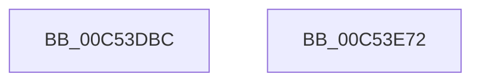

# ExpSemaphoreInitialization

- RVA: `0x00C53DBC`–`0x00C53E73` (길이 `183` bytes)
- VA: `0x0000000140C53DBC`
- 실행 섹션: `INIT`
- PDB 이름 있음: `예`; PDB Function 태그: `아니요`
- unwind 정보 RVA: `0x000C43B4`
- 디코드: `40`개 명령, `183/183` bytes 표시
- 미해석 바이트: `0` (있으면 어셈블리에 `.byte`로 보존)

> 이 문서는 커널 이미지의 기계어와 PDB 기호를 분석해 생성했습니다. 4번과 5번은 함수 원형과 자료형을 바이너리 사용 방식에서 추정한 C 해석이며 원본 소스 복구 결과는 아닙니다.

## 1. Dependencies

- 직접 호출 지점: **4**; 고유 호출 대상: **4**
- 직접 호출자로 확인된 함수: **1**
- RIP 상대 이미지 참조: **4**

### Outgoing calls
- `0x00C53DEE` → [RtlInitUnicodeString](../../text/42/RtlInitUnicodeString_function_0042A780.md) (function, `0x0042A780`)
- `0x00C53E01` → [memset](../../text/6C/memset_function_006C6C40.md) (function, `0x006C6C40`)
- `0x00C53E4B` → [ObCreateObjectType](../../page/70/ObCreateObjectType_function_00705230.md) (function, `0x00705230`)
- `0x00C53E5C` → [_security_check_cookie](../../text/6A/_security_check_cookie_function_006AC640.md) (function, `0x006AC640`)

### Direct callers
- [ExpInitSystemPhase1](ExpInitSystemPhase1_function_00C51508.md) at `0x00C515E9`

### Static image references
- `0x00C53DCE` → RVA `0x00E0A740` (`.data`; read)
- `0x00C53DDF` → RVA `0x00C7DE00` (` ?? ::PBOPGDP::`string'`; read)
- `0x00C53E06` → RVA `0x00C82520` (`ExpSemaphoreMapping`; read)
- `0x00C53E0D` → RVA `0x00FC52C0` (`ALMOSTRO`; read)

## 2. Other-region calls and transfers

- 다른 실행 섹션으로 향하는 call: **4**
  - `0x00C53DEE` → [RtlInitUnicodeString](../../text/42/RtlInitUnicodeString_function_0042A780.md) (`INIT` → `.text`)
  - `0x00C53E01` → [memset](../../text/6C/memset_function_006C6C40.md) (`INIT` → `.text`)
  - `0x00C53E4B` → [ObCreateObjectType](../../page/70/ObCreateObjectType_function_00705230.md) (`INIT` → `PAGE`)
  - `0x00C53E5C` → [_security_check_cookie](../../text/6A/_security_check_cookie_function_006AC640.md) (`INIT` → `.text`)
- 별도 외부 분기/꼬리 이동을 확인하지 못했습니다.

## 3. Assembly (complete function range)

```asm
00C53DBC  48 89 5C 24 08                  mov qword ptr [rsp + 8], rbx
00C53DC1  55                              push rbp
00C53DC2  48 8D 6C 24 A9                  lea rbp, [rsp - 0x57]
00C53DC7  48 81 EC C0 00 00 00            sub rsp, 0xc0
00C53DCE  48 8B 05 6B 69 1B 00            mov rax, qword ptr [rip + 0x1b696b]
00C53DD5  48 33 C4                        xor rax, rsp
00C53DD8  48 89 45 47                     mov qword ptr [rbp + 0x47], rax
00C53DDC  0F 57 C0                        xorps xmm0, xmm0
00C53DDF  48 8D 15 1A A0 02 00            lea rdx, [rip + 0x2a01a]
00C53DE6  48 8D 4D B7                     lea rcx, [rbp - 0x49]
00C53DEA  0F 11 45 B7                     movups xmmword ptr [rbp - 0x49], xmm0
00C53DEE  E8 8D 69 7D FF                  call 0x14042a780
00C53DF3  BB 78 00 00 00                  mov ebx, 0x78
00C53DF8  48 8D 4D C7                     lea rcx, [rbp - 0x39]
00C53DFC  44 8B C3                        mov r8d, ebx
00C53DFF  33 D2                           xor edx, edx
00C53E01  E8 3A 2E A7 FF                  call 0x1406c6c40
00C53E06  0F 10 05 13 E7 02 00            movups xmm0, xmmword ptr [rip + 0x2e713]
00C53E0D  4C 8D 0D AC 14 37 00            lea r9, [rip + 0x3714ac]
00C53E14  66 89 5D C7                     mov word ptr [rbp - 0x39], bx
00C53E18  45 33 C0                        xor r8d, r8d
00C53E1B  C7 45 CB 08 00 00 00            mov dword ptr [rbp - 0x35], 8
00C53E22  48 8D 55 C7                     lea rdx, [rbp - 0x39]
00C53E26  C7 45 CF 00 01 00 00            mov dword ptr [rbp - 0x31], 0x100
00C53E2D  48 8D 4D B7                     lea rcx, [rbp - 0x49]
00C53E31  C7 45 EB 00 02 00 00            mov dword ptr [rbp - 0x15], 0x200
00C53E38  F3 0F 7F 45 D3                  movdqu xmmword ptr [rbp - 0x2d], xmm0
00C53E3D  C7 45 F3 20 00 00 00            mov dword ptr [rbp - 0xd], 0x20
00C53E44  C7 45 E3 03 00 1F 00            mov dword ptr [rbp - 0x1d], 0x1f0003
00C53E4B  E8 E0 13 AB FF                  call 0x140705230
00C53E50  C1 E8 1F                        shr eax, 0x1f
00C53E53  34 01                           xor al, 1
00C53E55  48 8B 4D 47                     mov rcx, qword ptr [rbp + 0x47]
00C53E59  48 33 CC                        xor rcx, rsp
00C53E5C  E8 DF 87 A5 FF                  call 0x1406ac640
00C53E61  48 8B 9C 24 D0 00 00 00         mov rbx, qword ptr [rsp + 0xd0]
00C53E69  48 81 C4 C0 00 00 00            add rsp, 0xc0
00C53E70  5D                              pop rbp
00C53E71  C3                              ret
00C53E72  CC                              int3
```

## 4. C-style interpretation (structured pseudocode)

```c
__int64 __fastcall ExpSemaphoreInitialization(void)
{
    __int64 result;
    __int64 v_rsp;
    unsigned __int64 v_stack_m18;
    unsigned __int64 v_stack_m5F;
    unsigned int v_stack_m6C;
    unsigned int v_stack_m74;
    unsigned int v_stack_m7C;
    unsigned __int64 v_stack_m8C;
    unsigned int v_stack_m90;
    unsigned int v_stack_m94;
    unsigned __int64 v_stack_m98;
    unsigned __int64 v_stack_mA8;
    unsigned __int64 v_stack_p8;

    v_stack_p8 = v_rbx;
    v_rsp = (v_rsp) - (192);
    result = (*(unsigned __int64 *)(v_rip + 1796459)) ^ (v_rsp);
    v_stack_m18 = result;
    v_stack_mA8 = v_xmm0;
    result = RtlInitUnicodeString(v_stack_mA8, v_rip + 172058, a3, a4);
    a2 = 0;
    result = memset(v_stack_m98, a2, 120, a4);
    v_stack_m98 = 120;
    a3 = 0;
    v_stack_m94 = 8;
    v_stack_m90 = 256;
    v_stack_m74 = 512;
    v_stack_m8C = v_xmm0;
    v_stack_m6C = 32;
    v_stack_m7C = 0x1F0003ULL;
    result = ObCreateObjectType(v_stack_mA8, v_stack_m98, a3, v_rip + 3609772);
    result = (unsigned int)((result) >> (31));
    result = (unsigned __int8)((result) ^ (1));
    a1 = (v_stack_m18) ^ (v_rsp);
    result = _security_check_cookie(a1, v_stack_m98, a3, v_rip + 3609772);
    v_rsp = (v_rsp) + (192);
    return result;
}
```

## 5. (Beta) C Style

```c
void ExpSemaphoreInitialization(void)
{
    int64_t result;
    int64_t local_rsp;
    uint64_t v_stack_m18;
    uint64_t v_stack_m5F;
    uint32_t v_stack_m6C;
    uint32_t v_stack_m74;
    uint32_t v_stack_m7C;
    uint64_t v_stack_m8C;
    uint32_t v_stack_m90;
    uint32_t v_stack_m94;
    uint64_t v_stack_m98;
    uint64_t v_stack_mA8;
    uint64_t v_stack_p8;

    v_stack_p8 = local_rbx;
    local_rsp = (local_rsp) - (192);
    result = (*(uint64_t *)(v_rip + 0x1B696B)) ^ (local_rsp);
    v_stack_m18 = result;
    v_stack_mA8 = v_xmm0;
    result = RtlInitUnicodeString(v_stack_mA8, v_rip + 172058, a3, a4);
    a2 = 0;
    result = memset(v_stack_m98, a2, 120, a4);
    v_stack_m98 = 120;
    a3 = 0;
    v_stack_m94 = 8;
    v_stack_m90 = 256;
    v_stack_m74 = 512;
    v_stack_m8C = v_xmm0;
    v_stack_m6C = 32;
    v_stack_m7C = 0x1F0003ULL;
    result = ObCreateObjectType(v_stack_mA8, v_stack_m98, a3, v_rip + 3609772);
    result = (uint32_t)((result) >> (31));
    result = (uint8_t)((result) ^ (1));
    a1 = (v_stack_m18) ^ (local_rsp);
    result = _security_check_cookie(a1, v_stack_m98, a3, v_rip + 3609772);
    local_rsp = (local_rsp) + (192);
    return result;
}
```

## 6. Execution-region graph

[열기: 2D/3D 그래프와 함수 탐색 컨트롤 패널](../../../control-panel.html?section=init&rva=0x00C53DBC&view=graph)

- 2D 그래프는 위에서 아래로 흐르고, 3D 그래프는 빈 공간을 드래그해 회전합니다. Shift+드래그는 이동, 휠은 확대·축소, 함수 노드 선택은 대상 보고서 이동입니다.

### Static fallback


