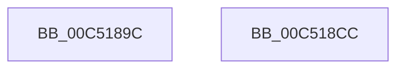

# ExpSingleStringCheck

- RVA: `0x00C5189C`–`0x00C518CD` (길이 `49` bytes)
- VA: `0x0000000140C5189C`
- 실행 섹션: `INIT`
- PDB 이름 있음: `예`; PDB Function 태그: `예`
- unwind 정보 RVA: `0x0005D2F4`
- 디코드: `13`개 명령, `49/49` bytes 표시
- 미해석 바이트: `0` (있으면 어셈블리에 `.byte`로 보존)

> 이 문서는 커널 이미지의 기계어와 PDB 기호를 분석해 생성했습니다. 4번과 5번은 함수 원형과 자료형을 바이너리 사용 방식에서 추정한 C 해석이며 원본 소스 복구 결과는 아닙니다.

## 1. Dependencies

- 직접 호출 지점: **2**; 고유 호출 대상: **2**
- 직접 호출자로 확인된 함수: **1**
- RIP 상대 이미지 참조: **0**

### Outgoing calls
- `0x00C518B0` → [RtlInitUnicodeString](../../text/42/RtlInitUnicodeString_function_0042A780.md) (function, `0x0042A780`)
- `0x00C518C2` → [crc32](../../text/46/crc32_function_00468F58.md) (function, `0x00468F58`)

### Direct callers
- [ExpStringCheck](ExpStringCheck_function_00C518D4.md) at `0x00C51A13`
- [ExpStringCheck](ExpStringCheck_function_00C518D4.md) at `0x00C51A1E`
- [ExpStringCheck](ExpStringCheck_function_00C518D4.md) at `0x00C51A29`
- [ExpStringCheck](ExpStringCheck_function_00C518D4.md) at `0x00C51A34`
- [ExpStringCheck](ExpStringCheck_function_00C518D4.md) at `0x00C51A3F`
- [ExpStringCheck](ExpStringCheck_function_00C518D4.md) at `0x00C51A4A`
- [ExpStringCheck](ExpStringCheck_function_00C518D4.md) at `0x00C51A55`
- [ExpStringCheck](ExpStringCheck_function_00C518D4.md) at `0x00C51A60`
- [ExpStringCheck](ExpStringCheck_function_00C518D4.md) at `0x00C51A6D`
- [ExpStringCheck](ExpStringCheck_function_00C518D4.md) at `0x00C51A7A`
- [ExpStringCheck](ExpStringCheck_function_00C518D4.md) at `0x00C51A87`
- [ExpStringCheck](ExpStringCheck_function_00C518D4.md) at `0x00C51A94`
- [ExpStringCheck](ExpStringCheck_function_00C518D4.md) at `0x00C51AA1`
- [ExpStringCheck](ExpStringCheck_function_00C518D4.md) at `0x00C51AAE`
- [ExpStringCheck](ExpStringCheck_function_00C518D4.md) at `0x00C51ABB`
- [ExpStringCheck](ExpStringCheck_function_00C518D4.md) at `0x00C51AC8`
- [ExpStringCheck](ExpStringCheck_function_00C518D4.md) at `0x00C51AD5`
- [ExpStringCheck](ExpStringCheck_function_00C518D4.md) at `0x00C51AE2`
- [ExpStringCheck](ExpStringCheck_function_00C518D4.md) at `0x00C51AEF`
- [ExpStringCheck](ExpStringCheck_function_00C518D4.md) at `0x00C51AFC`
- [ExpStringCheck](ExpStringCheck_function_00C518D4.md) at `0x00C51B08`
- [ExpStringCheck](ExpStringCheck_function_00C518D4.md) at `0x00C51B14`
- [ExpStringCheck](ExpStringCheck_function_00C518D4.md) at `0x00C51B20`
- [ExpStringCheck](ExpStringCheck_function_00C518D4.md) at `0x00C51B2C`
- [ExpStringCheck](ExpStringCheck_function_00C518D4.md) at `0x00C51B38`
- [ExpStringCheck](ExpStringCheck_function_00C518D4.md) at `0x00C51B44`
- [ExpStringCheck](ExpStringCheck_function_00C518D4.md) at `0x00C51B50`
- [ExpStringCheck](ExpStringCheck_function_00C518D4.md) at `0x00C51B5C`
- [ExpStringCheck](ExpStringCheck_function_00C518D4.md) at `0x00C51B68`

### Static image references
- 디코드된 RIP-relative 메모리 참조가 없습니다.

## 2. Other-region calls and transfers

- 다른 실행 섹션으로 향하는 call: **2**
  - `0x00C518B0` → [RtlInitUnicodeString](../../text/42/RtlInitUnicodeString_function_0042A780.md) (`INIT` → `.text`)
  - `0x00C518C2` → [crc32](../../text/46/crc32_function_00468F58.md) (`INIT` → `.text`)
- 별도 외부 분기/꼬리 이동을 확인하지 못했습니다.

## 3. Assembly (complete function range)

```asm
00C5189C  48 83 EC 38                     sub rsp, 0x38
00C518A0  0F 57 C0                        xorps xmm0, xmm0
00C518A3  48 8B D1                        mov rdx, rcx
00C518A6  48 8D 4C 24 20                  lea rcx, [rsp + 0x20]
00C518AB  0F 11 44 24 20                  movups xmmword ptr [rsp + 0x20], xmm0
00C518B0  E8 CB 8E 7D FF                  call 0x14042a780
00C518B5  44 0F B7 44 24 20               movzx r8d, word ptr [rsp + 0x20]
00C518BB  33 C9                           xor ecx, ecx
00C518BD  48 8B 54 24 28                  mov rdx, qword ptr [rsp + 0x28]
00C518C2  E8 91 76 81 FF                  call 0x140468f58
00C518C7  48 83 C4 38                     add rsp, 0x38
00C518CB  C3                              ret
00C518CC  CC                              int3
```

## 4. C-style interpretation (structured pseudocode)

```c
__int64 __fastcall ExpSingleStringCheck(__int64 a1)
{
    __int64 result;
    __int64 v_rsp;
    unsigned __int64 v_stack_m10;
    unsigned __int64 v_stack_m18;

    v_rsp = (v_rsp) - (56);
    v_stack_m18 = v_xmm0;
    result = RtlInitUnicodeString(v_stack_m18, a1, a3, a4);
    a1 = 0;
    result = crc32(a1, v_stack_m10, v_stack_m18, a4);
    v_rsp = (v_rsp) + (56);
    return result;
}
```

## 5. (Beta) C Style

```c
int64_t ExpSingleStringCheck(int64_t Arg1)
{
    int64_t result;
    int64_t local_rsp;
    uint64_t v_stack_m10;
    uint64_t v_stack_m18;

    local_rsp = (local_rsp) - (56);
    v_stack_m18 = v_xmm0;
    result = RtlInitUnicodeString(v_stack_m18, Arg1, a3, a4);
    Arg1 = 0;
    result = crc32(Arg1, v_stack_m10, v_stack_m18, a4);
    local_rsp = (local_rsp) + (56);
    return result;
}
```

## 6. Execution-region graph

[열기: 2D/3D 그래프와 함수 탐색 컨트롤 패널](../../../control-panel.html?section=init&rva=0x00C5189C&view=graph)

- 2D 그래프는 위에서 아래로 흐르고, 3D 그래프는 빈 공간을 드래그해 회전합니다. Shift+드래그는 이동, 휠은 확대·축소, 함수 노드 선택은 대상 보고서 이동입니다.

### Static fallback


