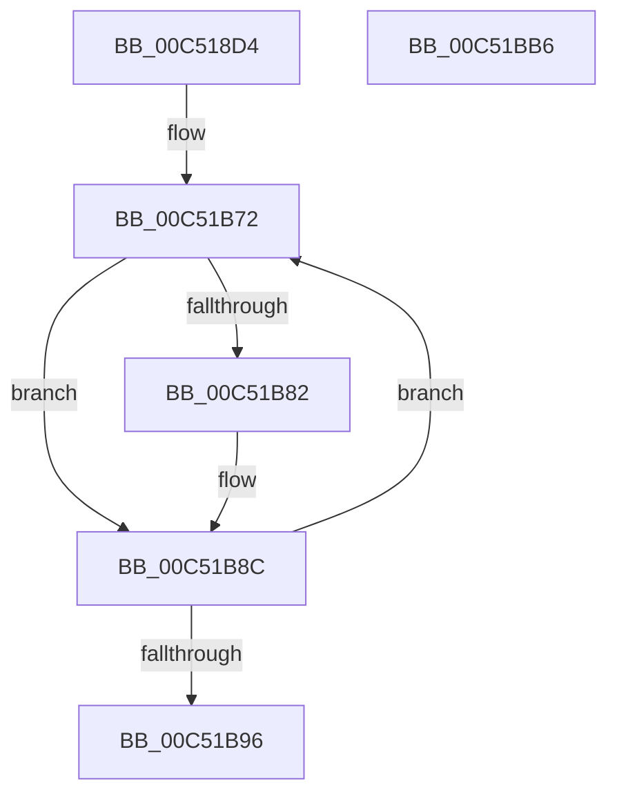

# ExpStringCheck

- RVA: `0x00C518D4`–`0x00C51BB7` (길이 `739` bytes)
- VA: `0x0000000140C518D4`
- 실행 섹션: `INIT`
- PDB 이름 있음: `예`; PDB Function 태그: `예`
- unwind 정보 RVA: `0x000D4B14`
- 디코드: `171`개 명령, `739/739` bytes 표시
- 미해석 바이트: `0` (있으면 어셈블리에 `.byte`로 보존)

> 이 문서는 커널 이미지의 기계어와 PDB 기호를 분석해 생성했습니다. 4번과 5번은 함수 원형과 자료형을 바이너리 사용 방식에서 추정한 C 해석이며 원본 소스 복구 결과는 아닙니다.

## 1. Dependencies

- 직접 호출 지점: **30**; 고유 호출 대상: **2**
- 직접 호출자로 확인된 함수: **1**
- RIP 상대 이미지 참조: **3**

### Outgoing calls
- `0x00C51A13` → [ExpSingleStringCheck](ExpSingleStringCheck_function_00C5189C.md) (function, `0x00C5189C`)
- `0x00C51A1E` → [ExpSingleStringCheck](ExpSingleStringCheck_function_00C5189C.md) (function, `0x00C5189C`)
- `0x00C51A29` → [ExpSingleStringCheck](ExpSingleStringCheck_function_00C5189C.md) (function, `0x00C5189C`)
- `0x00C51A34` → [ExpSingleStringCheck](ExpSingleStringCheck_function_00C5189C.md) (function, `0x00C5189C`)
- `0x00C51A3F` → [ExpSingleStringCheck](ExpSingleStringCheck_function_00C5189C.md) (function, `0x00C5189C`)
- `0x00C51A4A` → [ExpSingleStringCheck](ExpSingleStringCheck_function_00C5189C.md) (function, `0x00C5189C`)
- `0x00C51A55` → [ExpSingleStringCheck](ExpSingleStringCheck_function_00C5189C.md) (function, `0x00C5189C`)
- `0x00C51A60` → [ExpSingleStringCheck](ExpSingleStringCheck_function_00C5189C.md) (function, `0x00C5189C`)
- `0x00C51A6D` → [ExpSingleStringCheck](ExpSingleStringCheck_function_00C5189C.md) (function, `0x00C5189C`)
- `0x00C51A7A` → [ExpSingleStringCheck](ExpSingleStringCheck_function_00C5189C.md) (function, `0x00C5189C`)
- `0x00C51A87` → [ExpSingleStringCheck](ExpSingleStringCheck_function_00C5189C.md) (function, `0x00C5189C`)
- `0x00C51A94` → [ExpSingleStringCheck](ExpSingleStringCheck_function_00C5189C.md) (function, `0x00C5189C`)
- `0x00C51AA1` → [ExpSingleStringCheck](ExpSingleStringCheck_function_00C5189C.md) (function, `0x00C5189C`)
- `0x00C51AAE` → [ExpSingleStringCheck](ExpSingleStringCheck_function_00C5189C.md) (function, `0x00C5189C`)
- `0x00C51ABB` → [ExpSingleStringCheck](ExpSingleStringCheck_function_00C5189C.md) (function, `0x00C5189C`)
- `0x00C51AC8` → [ExpSingleStringCheck](ExpSingleStringCheck_function_00C5189C.md) (function, `0x00C5189C`)
- `0x00C51AD5` → [ExpSingleStringCheck](ExpSingleStringCheck_function_00C5189C.md) (function, `0x00C5189C`)
- `0x00C51AE2` → [ExpSingleStringCheck](ExpSingleStringCheck_function_00C5189C.md) (function, `0x00C5189C`)
- `0x00C51AEF` → [ExpSingleStringCheck](ExpSingleStringCheck_function_00C5189C.md) (function, `0x00C5189C`)
- `0x00C51AFC` → [ExpSingleStringCheck](ExpSingleStringCheck_function_00C5189C.md) (function, `0x00C5189C`)
- `0x00C51B08` → [ExpSingleStringCheck](ExpSingleStringCheck_function_00C5189C.md) (function, `0x00C5189C`)
- `0x00C51B14` → [ExpSingleStringCheck](ExpSingleStringCheck_function_00C5189C.md) (function, `0x00C5189C`)
- `0x00C51B20` → [ExpSingleStringCheck](ExpSingleStringCheck_function_00C5189C.md) (function, `0x00C5189C`)
- `0x00C51B2C` → [ExpSingleStringCheck](ExpSingleStringCheck_function_00C5189C.md) (function, `0x00C5189C`)
- `0x00C51B38` → [ExpSingleStringCheck](ExpSingleStringCheck_function_00C5189C.md) (function, `0x00C5189C`)
- `0x00C51B44` → [ExpSingleStringCheck](ExpSingleStringCheck_function_00C5189C.md) (function, `0x00C5189C`)
- `0x00C51B50` → [ExpSingleStringCheck](ExpSingleStringCheck_function_00C5189C.md) (function, `0x00C5189C`)
- `0x00C51B5C` → [ExpSingleStringCheck](ExpSingleStringCheck_function_00C5189C.md) (function, `0x00C5189C`)
- `0x00C51B68` → [ExpSingleStringCheck](ExpSingleStringCheck_function_00C5189C.md) (function, `0x00C5189C`)
- `0x00C51B9D` → [_security_check_cookie](../../text/6A/_security_check_cookie_function_006AC640.md) (function, `0x006AC640`)

### Direct callers
- [ExInitSystem](ExInitSystem_function_00C511A8.md) at `0x00C51352`

### Static image references
- `0x00C518ED` → RVA `0x00E0A740` (`.data`; read)
- `0x00C51B72` → RVA `0x00038F60` (`.rdata`; read)
- `0x00C51B82` → RVA `0x00EFEE10` (`.data`; write)

## 2. Other-region calls and transfers

- 다른 실행 섹션으로 향하는 call: **1**
  - `0x00C51B9D` → [_security_check_cookie](../../text/6A/_security_check_cookie_function_006AC640.md) (`INIT` → `.text`)
- 별도 외부 분기/꼬리 이동을 확인하지 못했습니다.

## 3. Assembly (complete function range)

```asm
00C518D4  40 55                           push rbp
00C518D6  53                              push rbx
00C518D7  56                              push rsi
00C518D8  57                              push rdi
00C518D9  41 54                           push r12
00C518DB  41 55                           push r13
00C518DD  41 56                           push r14
00C518DF  41 57                           push r15
00C518E1  48 8D 6C 24 98                  lea rbp, [rsp - 0x68]
00C518E6  48 81 EC 68 01 00 00            sub rsp, 0x168
00C518ED  48 8B 05 4C 8E 1B 00            mov rax, qword ptr [rip + 0x1b8e4c]
00C518F4  48 33 C4                        xor rax, rsp
00C518F7  48 89 45 50                     mov qword ptr [rbp + 0x50], rax
00C518FB  48 8B 85 F0 00 00 00            mov rax, qword ptr [rbp + 0xf0]
00C51902  4D 8B E9                        mov r13, r9
00C51905  48 8B BD D0 00 00 00            mov rdi, qword ptr [rbp + 0xd0]
00C5190C  4D 8B F0                        mov r14, r8
00C5190F  48 8B B5 D8 00 00 00            mov rsi, qword ptr [rbp + 0xd8]
00C51916  48 8B DA                        mov rbx, rdx
00C51919  4C 8B BD E0 00 00 00            mov r15, qword ptr [rbp + 0xe0]
00C51920  4C 8B A5 E8 00 00 00            mov r12, qword ptr [rbp + 0xe8]
00C51927  48 89 44 24 20                  mov qword ptr [rsp + 0x20], rax
00C5192C  48 8B 85 F8 00 00 00            mov rax, qword ptr [rbp + 0xf8]
00C51933  48 89 44 24 28                  mov qword ptr [rsp + 0x28], rax
00C51938  48 8B 85 00 01 00 00            mov rax, qword ptr [rbp + 0x100]
00C5193F  48 89 44 24 30                  mov qword ptr [rsp + 0x30], rax
00C51944  48 8B 85 08 01 00 00            mov rax, qword ptr [rbp + 0x108]
00C5194B  48 89 44 24 38                  mov qword ptr [rsp + 0x38], rax
00C51950  48 8B 85 10 01 00 00            mov rax, qword ptr [rbp + 0x110]
00C51957  48 89 44 24 40                  mov qword ptr [rsp + 0x40], rax
00C5195C  48 8B 85 18 01 00 00            mov rax, qword ptr [rbp + 0x118]
00C51963  48 89 44 24 48                  mov qword ptr [rsp + 0x48], rax
00C51968  48 8B 85 20 01 00 00            mov rax, qword ptr [rbp + 0x120]
00C5196F  48 89 44 24 50                  mov qword ptr [rsp + 0x50], rax
00C51974  48 8B 85 28 01 00 00            mov rax, qword ptr [rbp + 0x128]
00C5197B  48 89 44 24 58                  mov qword ptr [rsp + 0x58], rax
00C51980  48 8B 85 30 01 00 00            mov rax, qword ptr [rbp + 0x130]
00C51987  48 89 44 24 60                  mov qword ptr [rsp + 0x60], rax
00C5198C  48 8B 85 38 01 00 00            mov rax, qword ptr [rbp + 0x138]
00C51993  48 89 44 24 68                  mov qword ptr [rsp + 0x68], rax
00C51998  48 8B 85 40 01 00 00            mov rax, qword ptr [rbp + 0x140]
00C5199F  48 89 44 24 70                  mov qword ptr [rsp + 0x70], rax
00C519A4  48 8B 85 48 01 00 00            mov rax, qword ptr [rbp + 0x148]
00C519AB  48 89 44 24 78                  mov qword ptr [rsp + 0x78], rax
00C519B0  48 8B 85 50 01 00 00            mov rax, qword ptr [rbp + 0x150]
00C519B7  48 89 45 80                     mov qword ptr [rbp - 0x80], rax
00C519BB  48 8B 85 58 01 00 00            mov rax, qword ptr [rbp + 0x158]
00C519C2  48 89 45 88                     mov qword ptr [rbp - 0x78], rax
00C519C6  48 8B 85 60 01 00 00            mov rax, qword ptr [rbp + 0x160]
00C519CD  48 89 45 90                     mov qword ptr [rbp - 0x70], rax
00C519D1  48 8B 85 68 01 00 00            mov rax, qword ptr [rbp + 0x168]
00C519D8  48 89 45 98                     mov qword ptr [rbp - 0x68], rax
00C519DC  48 8B 85 70 01 00 00            mov rax, qword ptr [rbp + 0x170]
00C519E3  48 89 45 A0                     mov qword ptr [rbp - 0x60], rax
00C519E7  48 8B 85 78 01 00 00            mov rax, qword ptr [rbp + 0x178]
00C519EE  48 89 45 A8                     mov qword ptr [rbp - 0x58], rax
00C519F2  48 8B 85 80 01 00 00            mov rax, qword ptr [rbp + 0x180]
00C519F9  48 89 45 B0                     mov qword ptr [rbp - 0x50], rax
00C519FD  48 8B 85 88 01 00 00            mov rax, qword ptr [rbp + 0x188]
00C51A04  48 89 45 B8                     mov qword ptr [rbp - 0x48], rax
00C51A08  48 8B 85 90 01 00 00            mov rax, qword ptr [rbp + 0x190]
00C51A0F  48 89 45 C0                     mov qword ptr [rbp - 0x40], rax
00C51A13  E8 84 FE FF FF                  call 0x140c5189c
00C51A18  48 8B CB                        mov rcx, rbx
00C51A1B  89 45 D0                        mov dword ptr [rbp - 0x30], eax
00C51A1E  E8 79 FE FF FF                  call 0x140c5189c
00C51A23  49 8B CE                        mov rcx, r14
00C51A26  89 45 D4                        mov dword ptr [rbp - 0x2c], eax
00C51A29  E8 6E FE FF FF                  call 0x140c5189c
00C51A2E  49 8B CD                        mov rcx, r13
00C51A31  89 45 D8                        mov dword ptr [rbp - 0x28], eax
00C51A34  E8 63 FE FF FF                  call 0x140c5189c
00C51A39  48 8B CF                        mov rcx, rdi
00C51A3C  89 45 DC                        mov dword ptr [rbp - 0x24], eax
00C51A3F  E8 58 FE FF FF                  call 0x140c5189c
00C51A44  48 8B CE                        mov rcx, rsi
00C51A47  89 45 E0                        mov dword ptr [rbp - 0x20], eax
00C51A4A  E8 4D FE FF FF                  call 0x140c5189c
00C51A4F  49 8B CF                        mov rcx, r15
00C51A52  89 45 E4                        mov dword ptr [rbp - 0x1c], eax
00C51A55  E8 42 FE FF FF                  call 0x140c5189c
00C51A5A  49 8B CC                        mov rcx, r12
00C51A5D  89 45 E8                        mov dword ptr [rbp - 0x18], eax
00C51A60  E8 37 FE FF FF                  call 0x140c5189c
00C51A65  48 8B 4C 24 20                  mov rcx, qword ptr [rsp + 0x20]
00C51A6A  89 45 EC                        mov dword ptr [rbp - 0x14], eax
00C51A6D  E8 2A FE FF FF                  call 0x140c5189c
00C51A72  48 8B 4C 24 28                  mov rcx, qword ptr [rsp + 0x28]
00C51A77  89 45 F0                        mov dword ptr [rbp - 0x10], eax
00C51A7A  E8 1D FE FF FF                  call 0x140c5189c
00C51A7F  48 8B 4C 24 30                  mov rcx, qword ptr [rsp + 0x30]
00C51A84  89 45 F4                        mov dword ptr [rbp - 0xc], eax
00C51A87  E8 10 FE FF FF                  call 0x140c5189c
00C51A8C  89 45 F8                        mov dword ptr [rbp - 8], eax
00C51A8F  48 8B 4C 24 38                  mov rcx, qword ptr [rsp + 0x38]
00C51A94  E8 03 FE FF FF                  call 0x140c5189c
00C51A99  48 8B 4C 24 40                  mov rcx, qword ptr [rsp + 0x40]
00C51A9E  89 45 FC                        mov dword ptr [rbp - 4], eax
00C51AA1  E8 F6 FD FF FF                  call 0x140c5189c
00C51AA6  48 8B 4C 24 48                  mov rcx, qword ptr [rsp + 0x48]
00C51AAB  89 45 00                        mov dword ptr [rbp], eax
00C51AAE  E8 E9 FD FF FF                  call 0x140c5189c
00C51AB3  48 8B 4C 24 50                  mov rcx, qword ptr [rsp + 0x50]
00C51AB8  89 45 04                        mov dword ptr [rbp + 4], eax
00C51ABB  E8 DC FD FF FF                  call 0x140c5189c
00C51AC0  48 8B 4C 24 58                  mov rcx, qword ptr [rsp + 0x58]
00C51AC5  89 45 08                        mov dword ptr [rbp + 8], eax
00C51AC8  E8 CF FD FF FF                  call 0x140c5189c
00C51ACD  48 8B 4C 24 60                  mov rcx, qword ptr [rsp + 0x60]
00C51AD2  89 45 0C                        mov dword ptr [rbp + 0xc], eax
00C51AD5  E8 C2 FD FF FF                  call 0x140c5189c
00C51ADA  48 8B 4C 24 68                  mov rcx, qword ptr [rsp + 0x68]
00C51ADF  89 45 10                        mov dword ptr [rbp + 0x10], eax
00C51AE2  E8 B5 FD FF FF                  call 0x140c5189c
00C51AE7  48 8B 4C 24 70                  mov rcx, qword ptr [rsp + 0x70]
00C51AEC  89 45 14                        mov dword ptr [rbp + 0x14], eax
00C51AEF  E8 A8 FD FF FF                  call 0x140c5189c
00C51AF4  48 8B 4C 24 78                  mov rcx, qword ptr [rsp + 0x78]
00C51AF9  89 45 18                        mov dword ptr [rbp + 0x18], eax
00C51AFC  E8 9B FD FF FF                  call 0x140c5189c
00C51B01  48 8B 4D 80                     mov rcx, qword ptr [rbp - 0x80]
00C51B05  89 45 1C                        mov dword ptr [rbp + 0x1c], eax
00C51B08  E8 8F FD FF FF                  call 0x140c5189c
00C51B0D  48 8B 4D 88                     mov rcx, qword ptr [rbp - 0x78]
00C51B11  89 45 20                        mov dword ptr [rbp + 0x20], eax
00C51B14  E8 83 FD FF FF                  call 0x140c5189c
00C51B19  48 8B 4D 90                     mov rcx, qword ptr [rbp - 0x70]
00C51B1D  89 45 24                        mov dword ptr [rbp + 0x24], eax
00C51B20  E8 77 FD FF FF                  call 0x140c5189c
00C51B25  48 8B 4D 98                     mov rcx, qword ptr [rbp - 0x68]
00C51B29  89 45 28                        mov dword ptr [rbp + 0x28], eax
00C51B2C  E8 6B FD FF FF                  call 0x140c5189c
00C51B31  48 8B 4D A0                     mov rcx, qword ptr [rbp - 0x60]
00C51B35  89 45 2C                        mov dword ptr [rbp + 0x2c], eax
00C51B38  E8 5F FD FF FF                  call 0x140c5189c
00C51B3D  48 8B 4D A8                     mov rcx, qword ptr [rbp - 0x58]
00C51B41  89 45 30                        mov dword ptr [rbp + 0x30], eax
00C51B44  E8 53 FD FF FF                  call 0x140c5189c
00C51B49  48 8B 4D B0                     mov rcx, qword ptr [rbp - 0x50]
00C51B4D  89 45 34                        mov dword ptr [rbp + 0x34], eax
00C51B50  E8 47 FD FF FF                  call 0x140c5189c
00C51B55  48 8B 4D B8                     mov rcx, qword ptr [rbp - 0x48]
00C51B59  89 45 38                        mov dword ptr [rbp + 0x38], eax
00C51B5C  E8 3B FD FF FF                  call 0x140c5189c
00C51B61  48 8B 4D C0                     mov rcx, qword ptr [rbp - 0x40]
00C51B65  89 45 3C                        mov dword ptr [rbp + 0x3c], eax
00C51B68  E8 2F FD FF FF                  call 0x140c5189c
00C51B6D  89 45 40                        mov dword ptr [rbp + 0x40], eax
00C51B70  33 C9                           xor ecx, ecx
00C51B72  48 8D 05 E7 73 3E FF            lea rax, [rip - 0xc18c19]
00C51B79  8B 04 01                        mov eax, dword ptr [rcx + rax]
00C51B7C  39 44 0D D0                     cmp dword ptr [rbp + rcx - 0x30], eax
00C51B80  74 0A                           je 0x140c51b8c
00C51B82  C7 05 84 D2 2A 00 08 00 00 00   mov dword ptr [rip + 0x2ad284], 8
00C51B8C  48 83 C1 04                     add rcx, 4
00C51B90  48 83 F9 74                     cmp rcx, 0x74
00C51B94  7C DC                           jl 0x140c51b72
00C51B96  48 8B 4D 50                     mov rcx, qword ptr [rbp + 0x50]
00C51B9A  48 33 CC                        xor rcx, rsp
00C51B9D  E8 9E AA A5 FF                  call 0x1406ac640
00C51BA2  48 81 C4 68 01 00 00            add rsp, 0x168
00C51BA9  41 5F                           pop r15
00C51BAB  41 5E                           pop r14
00C51BAD  41 5D                           pop r13
00C51BAF  41 5C                           pop r12
00C51BB1  5F                              pop rdi
00C51BB2  5E                              pop rsi
00C51BB3  5B                              pop rbx
00C51BB4  5D                              pop rbp
00C51BB5  C3                              ret
00C51BB6  CC                              int3
```

## 4. C-style interpretation (structured pseudocode)

```c
__int64 __fastcall ExpStringCheck(__int64 a1, __int64 a2, __int64 a3, __int64 a4, __int64 a5, __int64 a6, __int64 a7, __int64 a8, __int64 a9, __int64 a10, __int64 a11, __int64 a12, __int64 a13, __int64 a14, __int64 a15, __int64 a16, __int64 a17, __int64 a18, __int64 a19, __int64 a20, __int64 a21, __int64 a22, __int64 a23, __int64 a24, __int64 a25, __int64 a26, __int64 a27, __int64 a28, __int64 a29)
{
    __int64 result;
    __int64 v_rsp;
    unsigned __int64 v_stack_m100;
    unsigned __int64 v_stack_m108;
    unsigned __int64 v_stack_m110;
    unsigned __int64 v_stack_m118;
    unsigned __int64 v_stack_m120;
    unsigned __int64 v_stack_m128;
    unsigned __int64 v_stack_m130;
    unsigned __int64 v_stack_m138;
    unsigned __int64 v_stack_m140;
    unsigned __int64 v_stack_m148;
    unsigned __int64 v_stack_m150;
    unsigned __int64 v_stack_m158;
    unsigned __int64 v_stack_m160;
    unsigned __int64 v_stack_m168;
    unsigned __int64 v_stack_m170;
    unsigned __int64 v_stack_m178;
    unsigned __int64 v_stack_m180;
    unsigned __int64 v_stack_m188;
    unsigned __int64 v_stack_m58;
    unsigned int v_stack_m68;
    unsigned int v_stack_m6C;
    unsigned int v_stack_m70;
    unsigned int v_stack_m74;
    unsigned int v_stack_m78;
    unsigned int v_stack_m7C;
    unsigned int v_stack_m80;
    unsigned int v_stack_m84;
    unsigned int v_stack_m88;
    unsigned int v_stack_m8C;
    unsigned int v_stack_m90;
    unsigned int v_stack_m94;
    unsigned int v_stack_m98;
    unsigned int v_stack_m9C;
    unsigned int v_stack_mA0;
    unsigned int v_stack_mA4;
    unsigned __int64 v_stack_mA8;
    unsigned int v_stack_mAC;
    unsigned int v_stack_mB0;
    unsigned int v_stack_mB4;
    unsigned int v_stack_mB8;
    unsigned int v_stack_mBC;
    unsigned int v_stack_mC0;
    unsigned int v_stack_mC4;
    unsigned int v_stack_mC8;
    unsigned int v_stack_mCC;
    unsigned int v_stack_mD0;
    unsigned int v_stack_mD4;
    unsigned int v_stack_mD8;
    unsigned __int64 v_stack_mE8;
    unsigned __int64 v_stack_mF0;
    unsigned __int64 v_stack_mF8;

    v_rsp = (v_rsp) - (360);
    result = (*(unsigned __int64 *)(v_rip + 1805900)) ^ (v_rsp);
    v_stack_m58 = result;
    v_stack_m188 = a9;
    v_stack_m180 = a10;
    v_stack_m178 = a11;
    v_stack_m170 = a12;
    v_stack_m168 = a13;
    v_stack_m160 = a14;
    v_stack_m158 = a15;
    v_stack_m150 = a16;
    v_stack_m148 = a17;
    v_stack_m140 = a18;
    v_stack_m138 = a19;
    v_stack_m130 = a20;
    v_stack_m128 = a21;
    v_stack_m120 = a22;
    v_stack_m118 = a23;
    v_stack_m110 = a24;
    v_stack_m108 = a25;
    v_stack_m100 = a26;
    v_stack_mF8 = a27;
    v_stack_mF0 = a28;
    v_stack_mE8 = a29;
    result = ExpSingleStringCheck(a1, a2, a3, a4);
    v_stack_mD8 = (unsigned int)(result);
    result = ExpSingleStringCheck(a2, a2, a3, a4);
    v_stack_mD4 = (unsigned int)(result);
    result = ExpSingleStringCheck(a3, a2, a3, a4);
    v_stack_mD0 = (unsigned int)(result);
    result = ExpSingleStringCheck(a4, a2, a3, a4);
    v_stack_mCC = (unsigned int)(result);
    result = ExpSingleStringCheck(a5, a2, a3, a4);
    v_stack_mC8 = (unsigned int)(result);
    result = ExpSingleStringCheck(a6, a2, a3, a4);
    v_stack_mC4 = (unsigned int)(result);
    result = ExpSingleStringCheck(a7, a2, a3, a4);
    v_stack_mC0 = (unsigned int)(result);
    result = ExpSingleStringCheck(a8, a2, a3, a4);
    v_stack_mBC = (unsigned int)(result);
    result = ExpSingleStringCheck(v_stack_m188, a2, a3, a4);
    v_stack_mB8 = (unsigned int)(result);
    result = ExpSingleStringCheck(v_stack_m180, a2, a3, a4);
    v_stack_mB4 = (unsigned int)(result);
    result = ExpSingleStringCheck(v_stack_m178, a2, a3, a4);
    v_stack_mB0 = (unsigned int)(result);
    result = ExpSingleStringCheck(v_stack_m170, a2, a3, a4);
    v_stack_mAC = (unsigned int)(result);
    result = ExpSingleStringCheck(v_stack_m168, a2, a3, a4);
    v_stack_mA8 = (unsigned int)(result);
    result = ExpSingleStringCheck(v_stack_m160, a2, a3, a4);
    v_stack_mA4 = (unsigned int)(result);
    result = ExpSingleStringCheck(v_stack_m158, a2, a3, a4);
    v_stack_mA0 = (unsigned int)(result);
    result = ExpSingleStringCheck(v_stack_m150, a2, a3, a4);
    v_stack_m9C = (unsigned int)(result);
    result = ExpSingleStringCheck(v_stack_m148, a2, a3, a4);
    v_stack_m98 = (unsigned int)(result);
    result = ExpSingleStringCheck(v_stack_m140, a2, a3, a4);
    v_stack_m94 = (unsigned int)(result);
    result = ExpSingleStringCheck(v_stack_m138, a2, a3, a4);
    v_stack_m90 = (unsigned int)(result);
    result = ExpSingleStringCheck(v_stack_m130, a2, a3, a4);
    v_stack_m8C = (unsigned int)(result);
    result = ExpSingleStringCheck(v_stack_m128, a2, a3, a4);
    v_stack_m88 = (unsigned int)(result);
    result = ExpSingleStringCheck(v_stack_m120, a2, a3, a4);
    v_stack_m84 = (unsigned int)(result);
    result = ExpSingleStringCheck(v_stack_m118, a2, a3, a4);
    v_stack_m80 = (unsigned int)(result);
    result = ExpSingleStringCheck(v_stack_m110, a2, a3, a4);
    v_stack_m7C = (unsigned int)(result);
    result = ExpSingleStringCheck(v_stack_m108, a2, a3, a4);
    v_stack_m78 = (unsigned int)(result);
    result = ExpSingleStringCheck(v_stack_m100, a2, a3, a4);
    v_stack_m74 = (unsigned int)(result);
    result = ExpSingleStringCheck(v_stack_mF8, a2, a3, a4);
    v_stack_m70 = (unsigned int)(result);
    result = ExpSingleStringCheck(v_stack_mF0, a2, a3, a4);
    v_stack_m6C = (unsigned int)(result);
    result = ExpSingleStringCheck(v_stack_mE8, a2, a3, a4);
    v_stack_m68 = (unsigned int)(result);
    a1 = 0;
loc_00C51B72:
    if ((*(unsigned int *)(v_stack_mA8 + a1 * 1 - 48)) != ((unsigned int)((unsigned int)(*(unsigned int *)(a1 + v_rip - 12684313 * 1))))) {
        *(unsigned int *)(v_rip + 2806404) = 8;
    }
    a1 = (a1) + (4);
    if (a1 < 116) goto loc_00C51B72;
    a1 = (v_stack_m58) ^ (v_rsp);
    result = _security_check_cookie(a1, a2, a3, a4);
    v_rsp = (v_rsp) + (360);
    return result;
}
```

## 5. (Beta) C Style

```c
int64_t ExpStringCheck(int64_t Arg1, int64_t Arg2, int64_t Arg3, int64_t Arg4, int64_t Arg5, int64_t Arg6, int64_t Arg7, int64_t Arg8, int64_t Arg9, int64_t Arg10, int64_t Arg11, int64_t Arg12, int64_t Arg13, int64_t Arg14, int64_t Arg15, int64_t Arg16, int64_t Arg17, int64_t Arg18, int64_t Arg19, int64_t Arg20, int64_t Arg21, int64_t Arg22, int64_t Arg23, int64_t Arg24, int64_t Arg25, int64_t Arg26, int64_t Arg27, int64_t Arg28, int64_t Arg29)
{
    int64_t result;
    int64_t local_rsp;
    uint64_t v_stack_m100;
    uint64_t v_stack_m108;
    uint64_t v_stack_m110;
    uint64_t v_stack_m118;
    uint64_t v_stack_m120;
    uint64_t v_stack_m128;
    uint64_t v_stack_m130;
    uint64_t v_stack_m138;
    uint64_t v_stack_m140;
    uint64_t v_stack_m148;
    uint64_t v_stack_m150;
    uint64_t v_stack_m158;
    uint64_t v_stack_m160;
    uint64_t v_stack_m168;
    uint64_t v_stack_m170;
    uint64_t v_stack_m178;
    uint64_t v_stack_m180;
    uint64_t v_stack_m188;
    uint64_t v_stack_m58;
    uint32_t v_stack_m68;
    uint32_t v_stack_m6C;
    uint32_t v_stack_m70;
    uint32_t v_stack_m74;
    uint32_t v_stack_m78;
    uint32_t v_stack_m7C;
    uint32_t v_stack_m80;
    uint32_t v_stack_m84;
    uint32_t v_stack_m88;
    uint32_t v_stack_m8C;
    uint32_t v_stack_m90;
    uint32_t v_stack_m94;
    uint32_t v_stack_m98;
    uint32_t v_stack_m9C;
    uint32_t v_stack_mA0;
    uint32_t v_stack_mA4;
    uint64_t v_stack_mA8;
    uint32_t v_stack_mAC;
    uint32_t v_stack_mB0;
    uint32_t v_stack_mB4;
    uint32_t v_stack_mB8;
    uint32_t v_stack_mBC;
    uint32_t v_stack_mC0;
    uint32_t v_stack_mC4;
    uint32_t v_stack_mC8;
    uint32_t v_stack_mCC;
    uint32_t v_stack_mD0;
    uint32_t v_stack_mD4;
    uint32_t v_stack_mD8;
    uint64_t v_stack_mE8;
    uint64_t v_stack_mF0;
    uint64_t v_stack_mF8;

    local_rsp = (local_rsp) - (360);
    result = (*(uint64_t *)(v_rip + 0x1B8E4C)) ^ (local_rsp);
    v_stack_m58 = result;
    v_stack_m188 = Arg9;
    v_stack_m180 = Arg10;
    v_stack_m178 = Arg11;
    v_stack_m170 = Arg12;
    v_stack_m168 = Arg13;
    v_stack_m160 = Arg14;
    v_stack_m158 = Arg15;
    v_stack_m150 = Arg16;
    v_stack_m148 = Arg17;
    v_stack_m140 = Arg18;
    v_stack_m138 = Arg19;
    v_stack_m130 = Arg20;
    v_stack_m128 = Arg21;
    v_stack_m120 = Arg22;
    v_stack_m118 = Arg23;
    v_stack_m110 = Arg24;
    v_stack_m108 = Arg25;
    v_stack_m100 = Arg26;
    v_stack_mF8 = Arg27;
    v_stack_mF0 = Arg28;
    v_stack_mE8 = Arg29;
    result = ExpSingleStringCheck(Arg1, Arg2, Arg3, Arg4);
    v_stack_mD8 = (uint32_t)(result);
    result = ExpSingleStringCheck(Arg2, Arg2, Arg3, Arg4);
    v_stack_mD4 = (uint32_t)(result);
    result = ExpSingleStringCheck(Arg3, Arg2, Arg3, Arg4);
    v_stack_mD0 = (uint32_t)(result);
    result = ExpSingleStringCheck(Arg4, Arg2, Arg3, Arg4);
    v_stack_mCC = (uint32_t)(result);
    result = ExpSingleStringCheck(Arg5, Arg2, Arg3, Arg4);
    v_stack_mC8 = (uint32_t)(result);
    result = ExpSingleStringCheck(Arg6, Arg2, Arg3, Arg4);
    v_stack_mC4 = (uint32_t)(result);
    result = ExpSingleStringCheck(Arg7, Arg2, Arg3, Arg4);
    v_stack_mC0 = (uint32_t)(result);
    result = ExpSingleStringCheck(Arg8, Arg2, Arg3, Arg4);
    v_stack_mBC = (uint32_t)(result);
    result = ExpSingleStringCheck(v_stack_m188, Arg2, Arg3, Arg4);
    v_stack_mB8 = (uint32_t)(result);
    result = ExpSingleStringCheck(v_stack_m180, Arg2, Arg3, Arg4);
    v_stack_mB4 = (uint32_t)(result);
    result = ExpSingleStringCheck(v_stack_m178, Arg2, Arg3, Arg4);
    v_stack_mB0 = (uint32_t)(result);
    result = ExpSingleStringCheck(v_stack_m170, Arg2, Arg3, Arg4);
    v_stack_mAC = (uint32_t)(result);
    result = ExpSingleStringCheck(v_stack_m168, Arg2, Arg3, Arg4);
    v_stack_mA8 = (uint32_t)(result);
    result = ExpSingleStringCheck(v_stack_m160, Arg2, Arg3, Arg4);
    v_stack_mA4 = (uint32_t)(result);
    result = ExpSingleStringCheck(v_stack_m158, Arg2, Arg3, Arg4);
    v_stack_mA0 = (uint32_t)(result);
    result = ExpSingleStringCheck(v_stack_m150, Arg2, Arg3, Arg4);
    v_stack_m9C = (uint32_t)(result);
    result = ExpSingleStringCheck(v_stack_m148, Arg2, Arg3, Arg4);
    v_stack_m98 = (uint32_t)(result);
    result = ExpSingleStringCheck(v_stack_m140, Arg2, Arg3, Arg4);
    v_stack_m94 = (uint32_t)(result);
    result = ExpSingleStringCheck(v_stack_m138, Arg2, Arg3, Arg4);
    v_stack_m90 = (uint32_t)(result);
    result = ExpSingleStringCheck(v_stack_m130, Arg2, Arg3, Arg4);
    v_stack_m8C = (uint32_t)(result);
    result = ExpSingleStringCheck(v_stack_m128, Arg2, Arg3, Arg4);
    v_stack_m88 = (uint32_t)(result);
    result = ExpSingleStringCheck(v_stack_m120, Arg2, Arg3, Arg4);
    v_stack_m84 = (uint32_t)(result);
    result = ExpSingleStringCheck(v_stack_m118, Arg2, Arg3, Arg4);
    v_stack_m80 = (uint32_t)(result);
    result = ExpSingleStringCheck(v_stack_m110, Arg2, Arg3, Arg4);
    v_stack_m7C = (uint32_t)(result);
    result = ExpSingleStringCheck(v_stack_m108, Arg2, Arg3, Arg4);
    v_stack_m78 = (uint32_t)(result);
    result = ExpSingleStringCheck(v_stack_m100, Arg2, Arg3, Arg4);
    v_stack_m74 = (uint32_t)(result);
    result = ExpSingleStringCheck(v_stack_mF8, Arg2, Arg3, Arg4);
    v_stack_m70 = (uint32_t)(result);
    result = ExpSingleStringCheck(v_stack_mF0, Arg2, Arg3, Arg4);
    v_stack_m6C = (uint32_t)(result);
    result = ExpSingleStringCheck(v_stack_mE8, Arg2, Arg3, Arg4);
    v_stack_m68 = (uint32_t)(result);
    Arg1 = 0;
loc_00C51B72:
    if ((*(uint32_t *)(v_stack_mA8 + Arg1 * 1 - 0x30)) != ((uint32_t)((uint32_t)(*(uint32_t *)(Arg1 + v_rip - 0xC18C19 * 1))))) {
        *(uint32_t *)(v_rip + 0x2AD284) = 8;
    }
    Arg1 = (Arg1) + (4);
    if (Arg1 < 116) goto loc_00C51B72;
    Arg1 = (v_stack_m58) ^ (local_rsp);
    result = _security_check_cookie(Arg1, Arg2, Arg3, Arg4);
    local_rsp = (local_rsp) + (360);
    return result;
}
```

## 6. Execution-region graph

[열기: 2D/3D 그래프와 함수 탐색 컨트롤 패널](../../../control-panel.html?section=init&rva=0x00C518D4&view=graph)

- 2D 그래프는 위에서 아래로 흐르고, 3D 그래프는 빈 공간을 드래그해 회전합니다. Shift+드래그는 이동, 휠은 확대·축소, 함수 노드 선택은 대상 보고서 이동입니다.

### Static fallback


