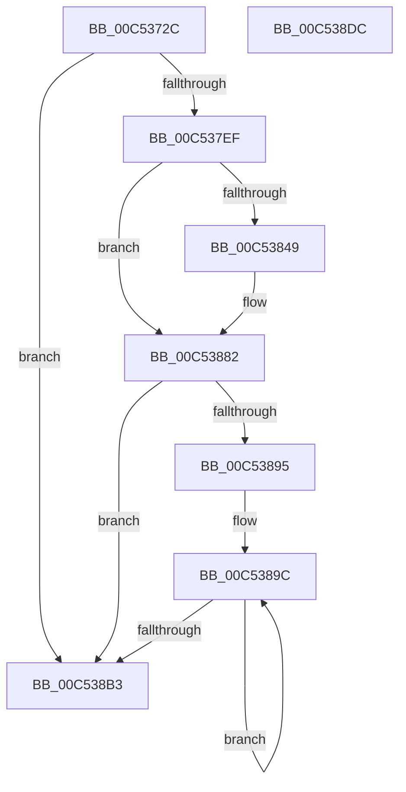

# ExpTimerInitialization

- RVA: `0x00C5372C`–`0x00C538DD` (길이 `433` bytes)
- VA: `0x0000000140C5372C`
- 실행 섹션: `INIT`
- PDB 이름 있음: `예`; PDB Function 태그: `아니요`
- unwind 정보 RVA: `0x000C6DD8`
- 디코드: `100`개 명령, `433/433` bytes 표시
- 미해석 바이트: `0` (있으면 어셈블리에 `.byte`로 보존)

> 이 문서는 커널 이미지의 기계어와 PDB 기호를 분석해 생성했습니다. 4번과 5번은 함수 원형과 자료형을 바이너리 사용 방식에서 추정한 C 해석이며 원본 소스 복구 결과는 아닙니다.

## 1. Dependencies

- 직접 호출 지점: **9**; 고유 호출 대상: **7**
- 직접 호출자로 확인된 함수: **1**
- RIP 상대 이미지 참조: **18**

### Outgoing calls
- `0x00C53781` → [RtlInitUnicodeString](../../text/42/RtlInitUnicodeString_function_0042A780.md) (function, `0x0042A780`)
- `0x00C53792` → [memset](../../text/6C/memset_function_006C6C40.md) (function, `0x006C6C40`)
- `0x00C537E0` → [ObCreateObjectType](../../page/70/ObCreateObjectType_function_00705230.md) (function, `0x00705230`)
- `0x00C537FA` → [RtlInitUnicodeString](../../text/42/RtlInitUnicodeString_function_0042A780.md) (function, `0x0042A780`)
- `0x00C53823` → [ObCreateObjectType](../../page/70/ObCreateObjectType_function_00705230.md) (function, `0x00705230`)
- `0x00C5382C` → [ExGenRandom](../../text/41/ExGenRandom_function_0041B010.md) (function, `0x0041B010`)
- `0x00C5386A` → [wil_details_FeatureReporting_ReportUsageToService](../../text/53/wil_details_FeatureReporting_ReportUsageToService_function_0053E6E4.md) (function, `0x0053E6E4`)
- `0x00C5387D` → [wil_details_FeatureStateCache_TryEnableDeviceUsageFastPath](../../text/53/wil_details_FeatureStateCache_TryEnableDeviceUsageFastPath_function_0053E774.md) (function, `0x0053E774`)
- `0x00C538C2` → [_security_check_cookie](../../text/6A/_security_check_cookie_function_006AC640.md) (function, `0x006AC640`)

### Direct callers
- [ExpInitSystemPhase1](ExpInitSystemPhase1_function_00C51508.md) at `0x00C515F1`

### Static image references
- `0x00C53743` → RVA `0x00E0A740` (`.data`; read)
- `0x00C53751` → RVA `0x00EFAB90` (`.data`; read)
- `0x00C5375D` → RVA `0x00EFAB98` (`.data`; write)
- `0x00C53764` → RVA `0x00C7DDE0` (` ?? ::PBOPGDP::`string'`; read)
- `0x00C5376B` → RVA `0x00EFABA8` (`.data`; write)
- `0x00C53776` → RVA `0x00EFAB90` (`.data`; write)
- `0x00C53797` → RVA `0x00C82540` (`ExpTimerMapping`; read)
- `0x00C5379E` → RVA `0x00230C40` (`ExpDeleteTimer`; read)
- `0x00C537A9` → RVA `0x00FC6D98` (`ALMOSTRO`; read)
- `0x00C537EF` → RVA `0x00C7DDD0` (` ?? ::PBOPGDP::`string'`; read)
- `0x00C537FF` → RVA `0x00A571D0` (`ExpDeleteTimer2`; read)
- `0x00C5380D` → RVA `0x00FC6F20` (`ALMOSTRO`; read)
- `0x00C53831` → RVA `0x00FC6AF6` (`ALMOSTRO`; write)
- `0x00C53837` → RVA `0x00FC4600` (`.data`; read)
- `0x00C53863` → RVA `0x000DCC20` (`.rdata`; read)
- `0x00C53882` → RVA `0x00EFABA0` (`.data`; read)
- `0x00C53889` → RVA `0x00EFAB79` (`.data`; write)
- `0x00C53895` → RVA `0x00E093D4` (`.data`; read)

## 2. Other-region calls and transfers

- 다른 실행 섹션으로 향하는 call: **9**
  - `0x00C53781` → [RtlInitUnicodeString](../../text/42/RtlInitUnicodeString_function_0042A780.md) (`INIT` → `.text`)
  - `0x00C53792` → [memset](../../text/6C/memset_function_006C6C40.md) (`INIT` → `.text`)
  - `0x00C537E0` → [ObCreateObjectType](../../page/70/ObCreateObjectType_function_00705230.md) (`INIT` → `PAGE`)
  - `0x00C537FA` → [RtlInitUnicodeString](../../text/42/RtlInitUnicodeString_function_0042A780.md) (`INIT` → `.text`)
  - `0x00C53823` → [ObCreateObjectType](../../page/70/ObCreateObjectType_function_00705230.md) (`INIT` → `PAGE`)
  - `0x00C5382C` → [ExGenRandom](../../text/41/ExGenRandom_function_0041B010.md) (`INIT` → `.text`)
  - `0x00C5386A` → [wil_details_FeatureReporting_ReportUsageToService](../../text/53/wil_details_FeatureReporting_ReportUsageToService_function_0053E6E4.md) (`INIT` → `.text`)
  - `0x00C5387D` → [wil_details_FeatureStateCache_TryEnableDeviceUsageFastPath](../../text/53/wil_details_FeatureStateCache_TryEnableDeviceUsageFastPath_function_0053E774.md) (`INIT` → `.text`)
  - `0x00C538C2` → [_security_check_cookie](../../text/6A/_security_check_cookie_function_006AC640.md) (`INIT` → `.text`)
- 별도 외부 분기/꼬리 이동을 확인하지 못했습니다.

## 3. Assembly (complete function range)

```asm
00C5372C  48 89 5C 24 08                  mov qword ptr [rsp + 8], rbx
00C53731  48 89 7C 24 10                  mov qword ptr [rsp + 0x10], rdi
00C53736  55                              push rbp
00C53737  48 8D 6C 24 A9                  lea rbp, [rsp - 0x57]
00C5373C  48 81 EC C0 00 00 00            sub rsp, 0xc0
00C53743  48 8B 05 F6 6F 1B 00            mov rax, qword ptr [rip + 0x1b6ff6]
00C5374A  48 33 C4                        xor rax, rsp
00C5374D  48 89 45 47                     mov qword ptr [rbp + 0x47], rax
00C53751  48 8D 05 38 74 2A 00            lea rax, [rip + 0x2a7438]
00C53758  0F 57 C0                        xorps xmm0, xmm0
00C5375B  33 FF                           xor edi, edi
00C5375D  48 89 05 34 74 2A 00            mov qword ptr [rip + 0x2a7434], rax
00C53764  48 8D 15 75 A6 02 00            lea rdx, [rip + 0x2a675]
00C5376B  48 89 3D 36 74 2A 00            mov qword ptr [rip + 0x2a7436], rdi
00C53772  48 8D 4D B7                     lea rcx, [rbp - 0x49]
00C53776  48 89 05 13 74 2A 00            mov qword ptr [rip + 0x2a7413], rax
00C5377D  0F 11 45 B7                     movups xmmword ptr [rbp - 0x49], xmm0
00C53781  E8 FA 6F 7D FF                  call 0x14042a780
00C53786  8D 5F 78                        lea ebx, [rdi + 0x78]
00C53789  33 D2                           xor edx, edx
00C5378B  44 8B C3                        mov r8d, ebx
00C5378E  48 8D 4D C7                     lea rcx, [rbp - 0x39]
00C53792  E8 A9 34 A7 FF                  call 0x1406c6c40
00C53797  0F 10 05 A2 ED 02 00            movups xmm0, xmmword ptr [rip + 0x2eda2]
00C5379E  48 8D 05 9B D4 5D FF            lea rax, [rip - 0xa22b65]
00C537A5  66 89 5D C7                     mov word ptr [rbp - 0x39], bx
00C537A9  4C 8D 0D E8 35 37 00            lea r9, [rip + 0x3735e8]
00C537B0  C7 45 CF 00 01 00 00            mov dword ptr [rbp - 0x31], 0x100
00C537B7  45 33 C0                        xor r8d, r8d
00C537BA  C7 45 EB 00 02 00 00            mov dword ptr [rbp - 0x15], 0x200
00C537C1  48 8D 55 C7                     lea rdx, [rbp - 0x39]
00C537C5  C7 45 F3 48 01 00 00            mov dword ptr [rbp - 0xd], 0x148
00C537CC  48 8D 4D B7                     lea rcx, [rbp - 0x49]
00C537D0  C7 45 E3 03 00 1F 00            mov dword ptr [rbp - 0x1d], 0x1f0003
00C537D7  F3 0F 7F 45 D3                  movdqu xmmword ptr [rbp - 0x2d], xmm0
00C537DC  48 89 45 0F                     mov qword ptr [rbp + 0xf], rax
00C537E0  E8 4B 1A AB FF                  call 0x140705230
00C537E5  8B D8                           mov ebx, eax
00C537E7  85 C0                           test eax, eax
00C537E9  0F 88 C4 00 00 00               js 0x140c538b3
00C537EF  48 8D 15 DA A5 02 00            lea rdx, [rip + 0x2a5da]
00C537F6  48 8D 4D B7                     lea rcx, [rbp - 0x49]
00C537FA  E8 81 6F 7D FF                  call 0x14042a780
00C537FF  48 8D 05 CA 39 E0 FF            lea rax, [rip - 0x1fc636]
00C53806  C7 45 F3 A8 00 00 00            mov dword ptr [rbp - 0xd], 0xa8
00C5380D  4C 8D 0D 0C 37 37 00            lea r9, [rip + 0x37370c]
00C53814  48 89 45 0F                     mov qword ptr [rbp + 0xf], rax
00C53818  45 33 C0                        xor r8d, r8d
00C5381B  48 8D 55 C7                     lea rdx, [rbp - 0x39]
00C5381F  48 8D 4D B7                     lea rcx, [rbp - 0x49]
00C53823  E8 08 1A AB FF                  call 0x140705230
00C53828  33 C9                           xor ecx, ecx
00C5382A  8B D8                           mov ebx, eax
00C5382C  E8 DF 77 7C FF                  call 0x14041b010
00C53831  88 05 BF 32 37 00               mov byte ptr [rip + 0x3732bf], al
00C53837  8B 0D C3 0D 37 00               mov ecx, dword ptr [rip + 0x370dc3]
00C5383D  48 89 7D B7                     mov qword ptr [rbp - 0x49], rdi
00C53841  89 4D B7                        mov dword ptr [rbp - 0x49], ecx
00C53844  F6 C1 10                        test cl, 0x10
00C53847  75 39                           jne 0x140c53882
00C53849  48 8B 45 B7                     mov rax, qword ptr [rbp - 0x49]
00C5384D  44 8D 4F 01                     lea r9d, [rdi + 1]
00C53851  83 C9 01                        or ecx, 1
00C53854  48 89 45 B7                     mov qword ptr [rbp - 0x49], rax
00C53858  89 4D B7                        mov dword ptr [rbp - 0x49], ecx
00C5385B  44 8D 47 03                     lea r8d, [rdi + 3]
00C5385F  48 8B 55 B7                     mov rdx, qword ptr [rbp - 0x49]
00C53863  48 8D 0D B6 93 48 FF            lea rcx, [rip - 0xb76c4a]
00C5386A  E8 75 AE 8E FF                  call 0x14053e6e4
00C5386F  48 8B 4D B7                     mov rcx, qword ptr [rbp - 0x49]
00C53873  4C 8D 05 A6 93 48 FF            lea r8, [rip - 0xb76c5a]
00C5387A  8D 57 03                        lea edx, [rdi + 3]
00C5387D  E8 F2 AE 8E FF                  call 0x14053e774
00C53882  44 8B 05 17 73 2A 00            mov r8d, dword ptr [rip + 0x2a7317]
00C53889  C6 05 E9 72 2A 00 01            mov byte ptr [rip + 0x2a72e9], 1
00C53890  45 85 C0                        test r8d, r8d
00C53893  74 1E                           je 0x140c538b3
00C53895  48 8D 15 38 5B 1B 00            lea rdx, [rip + 0x1b5b38]
00C5389C  8B CF                           mov ecx, edi
00C5389E  41 8B C0                        mov eax, r8d
00C538A1  D3 E8                           shr eax, cl
00C538A3  FF C7                           inc edi
00C538A5  83 E0 01                        and eax, 1
00C538A8  89 02                           mov dword ptr [rdx], eax
00C538AA  48 8D 52 18                     lea rdx, [rdx + 0x18]
00C538AE  83 FF 14                        cmp edi, 0x14
00C538B1  72 E9                           jb 0x140c5389c
00C538B3  C1 EB 1F                        shr ebx, 0x1f
00C538B6  80 F3 01                        xor bl, 1
00C538B9  8A C3                           mov al, bl
00C538BB  48 8B 4D 47                     mov rcx, qword ptr [rbp + 0x47]
00C538BF  48 33 CC                        xor rcx, rsp
00C538C2  E8 79 8D A5 FF                  call 0x1406ac640
00C538C7  4C 8D 9C 24 C0 00 00 00         lea r11, [rsp + 0xc0]
00C538CF  49 8B 5B 10                     mov rbx, qword ptr [r11 + 0x10]
00C538D3  49 8B 7B 18                     mov rdi, qword ptr [r11 + 0x18]
00C538D7  49 8B E3                        mov rsp, r11
00C538DA  5D                              pop rbp
00C538DB  C3                              ret
00C538DC  CC                              int3
```

## 4. C-style interpretation (structured pseudocode)

```c
__int64 __fastcall ExpTimerInitialization(void)
{
    __int64 result;
    __int64 v_rbx;
    __int64 v_rdi;
    __int64 v_rsp;
    unsigned __int64 v_stack_m18;
    unsigned __int64 v_stack_m50;
    unsigned __int64 v_stack_m5F;
    unsigned int v_stack_m6C;
    unsigned int v_stack_m74;
    unsigned int v_stack_m7C;
    unsigned __int64 v_stack_m8;
    unsigned __int64 v_stack_m8C;
    unsigned int v_stack_m90;
    unsigned __int64 v_stack_m98;
    unsigned __int64 v_stack_mA8;
    unsigned __int64 v_stack_p10;
    unsigned __int64 v_stack_p8;

    v_stack_p8 = v_rbx;
    v_stack_p10 = v_rdi;
    v_rsp = (v_rsp) - (192);
    result = (*(unsigned __int64 *)(v_rip + 1798134)) ^ (v_rsp);
    v_stack_m18 = result;
    v_rdi = 0;
    *(unsigned __int64 *)(v_rip + 2782260) = v_rip + 2782264;
    *(unsigned __int64 *)(v_rip + 2782262) = 0;
    *(unsigned __int64 *)(v_rip + 2782227) = v_rip + 2782264;
    v_stack_mA8 = v_xmm0;
    result = RtlInitUnicodeString(v_stack_mA8, v_rip + 173685, a3, a4);
    a2 = 0;
    result = memset(v_stack_m98, a2, (unsigned int)((unsigned int)(v_rdi + 120)), a4);
    v_stack_m98 = (unsigned __int16)(v_rdi + 120);
    v_stack_m90 = 256;
    a3 = 0;
    v_stack_m74 = 512;
    v_stack_m6C = 328;
    v_stack_m7C = 0x1F0003ULL;
    v_stack_m8C = v_xmm0;
    v_stack_m50 = v_rip - 10627941;
    result = ObCreateObjectType(v_stack_mA8, v_stack_m98, a3, v_rip + 3618280);
    if (sign_flag) goto loc_00C538B3;
    result = RtlInitUnicodeString(v_stack_mA8, v_rip + 173530, a3, v_rip + 3618280);
    v_stack_m6C = 168;
    v_stack_m50 = v_rip - 2082358;
    a3 = 0;
    result = ObCreateObjectType(v_stack_mA8, v_stack_m98, a3, v_rip + 3618572);
    a1 = 0;
    result = ExGenRandom(a1, v_stack_m98, a3, v_rip + 3618572);
    *(unsigned __int8 *)(v_rip + 3617471) = (unsigned __int8)(result);
    v_stack_mA8 = 0;
    v_stack_mA8 = (unsigned int)((unsigned int)(*(unsigned int *)(v_rip + 3608003)));
    if ((((unsigned __int8)((unsigned int)(*(unsigned int *)(v_rip + 3608003)))) & (16)) == 0) {
        result = v_stack_mA8;
        a4 = v_rdi + 1;
        a1 = (unsigned int)(((unsigned int)(*(unsigned int *)(v_rip + 3608003))) | (1));
        v_stack_mA8 = result;
        v_stack_mA8 = (unsigned int)(a1);
        a3 = v_rdi + 3;
        a2 = v_stack_mA8;
        a1 = v_rip - 12020810;
        result = wil_details_FeatureReporting_ReportUsageToService(a1, a2, a3, a4);
        a1 = v_stack_mA8;
        a3 = v_rip - 12020826;
        a2 = v_rdi + 3;
        result = wil_details_FeatureStateCache_TryEnableDeviceUsageFastPath(a1, a2, a3, a4);
    }
    *(unsigned __int8 *)(v_rip + 2781929) = 1;
    if ((unsigned int)((unsigned int)(*(unsigned int *)(v_rip + 2781975))) == 0) goto loc_00C538B3;
loc_00C5389C:
    result = (unsigned int)(((unsigned int)((unsigned int)((unsigned int)(*(unsigned int *)(v_rip + 2781975))))) >> (0));
    v_rdi = (unsigned int)((v_rdi) + 1);
    result = (unsigned int)((result) & (1));
    *(unsigned int *)(v_rip + 1792824) = (unsigned int)(result);
    if (((unsigned int)(v_rdi)) < 20) goto loc_00C5389C;
loc_00C538B3:
    v_rbx = (unsigned int)(((unsigned int)((unsigned int)(result))) >> (31));
    v_rbx = (unsigned __int8)((v_rbx) ^ (1));
    a1 = (v_stack_m18) ^ (v_rsp);
    result = _security_check_cookie(a1, v_rip + 1792824 + 24, (unsigned int)(*(unsigned int *)(v_rip + 2781975)), a4);
    return result;
}
```

## 5. (Beta) C Style

```c
void ExpTimerInitialization(void)
{
    int64_t result;
    int64_t local_rbx;
    int64_t local_rdi;
    int64_t local_rsp;
    uint64_t v_stack_m18;
    uint64_t v_stack_m50;
    uint64_t v_stack_m5F;
    uint32_t v_stack_m6C;
    uint32_t v_stack_m74;
    uint32_t v_stack_m7C;
    uint64_t v_stack_m8;
    uint64_t v_stack_m8C;
    uint32_t v_stack_m90;
    uint64_t v_stack_m98;
    uint64_t v_stack_mA8;
    uint64_t v_stack_p10;
    uint64_t v_stack_p8;

    v_stack_p8 = local_rbx;
    v_stack_p10 = local_rdi;
    local_rsp = (local_rsp) - (192);
    result = (*(uint64_t *)(v_rip + 0x1B6FF6)) ^ (local_rsp);
    v_stack_m18 = result;
    local_rdi = 0;
    *(uint64_t *)(v_rip + 0x2A7434) = v_rip + 2782264;
    *(uint64_t *)(v_rip + 0x2A7436) = 0;
    *(uint64_t *)(v_rip + 0x2A7413) = v_rip + 2782264;
    v_stack_mA8 = v_xmm0;
    result = RtlInitUnicodeString(v_stack_mA8, v_rip + 173685, a3, a4);
    a2 = 0;
    result = memset(v_stack_m98, a2, (uint32_t)((uint32_t)(local_rdi + 120)), a4);
    v_stack_m98 = (uint16_t)(local_rdi + 120);
    v_stack_m90 = 256;
    a3 = 0;
    v_stack_m74 = 512;
    v_stack_m6C = 328;
    v_stack_m7C = 0x1F0003ULL;
    v_stack_m8C = v_xmm0;
    v_stack_m50 = v_rip - 10627941;
    result = ObCreateObjectType(v_stack_mA8, v_stack_m98, a3, v_rip + 3618280);
    if (sign_flag) goto loc_00C538B3;
    result = RtlInitUnicodeString(v_stack_mA8, v_rip + 173530, a3, v_rip + 3618280);
    v_stack_m6C = 168;
    v_stack_m50 = v_rip - 2082358;
    a3 = 0;
    result = ObCreateObjectType(v_stack_mA8, v_stack_m98, a3, v_rip + 3618572);
    a1 = 0;
    result = ExGenRandom(a1, v_stack_m98, a3, v_rip + 3618572);
    *(uint8_t *)(v_rip + 0x3732BF) = (uint8_t)(result);
    v_stack_mA8 = 0;
    v_stack_mA8 = (uint32_t)((uint32_t)(*(uint32_t *)(v_rip + 0x370DC3)));
    if ((((uint8_t)((uint32_t)(*(uint32_t *)(v_rip + 0x370DC3)))) & (16)) == 0) {
        result = v_stack_mA8;
        a4 = local_rdi + 1;
        a1 = (uint32_t)(((uint32_t)(*(uint32_t *)(v_rip + 0x370DC3))) | (1));
        v_stack_mA8 = result;
        v_stack_mA8 = (uint32_t)(a1);
        a3 = local_rdi + 3;
        a2 = v_stack_mA8;
        a1 = v_rip - 12020810;
        result = wil_details_FeatureReporting_ReportUsageToService(a1, a2, a3, a4);
        a1 = v_stack_mA8;
        a3 = v_rip - 12020826;
        a2 = local_rdi + 3;
        result = wil_details_FeatureStateCache_TryEnableDeviceUsageFastPath(a1, a2, a3, a4);
    }
    *(uint8_t *)(v_rip + 0x2A72E9) = 1;
    if ((uint32_t)((uint32_t)(*(uint32_t *)(v_rip + 0x2A7317))) == 0) goto loc_00C538B3;
loc_00C5389C:
    result = (uint32_t)(((uint32_t)((uint32_t)((uint32_t)(*(uint32_t *)(v_rip + 0x2A7317))))) >> (0));
    local_rdi = (uint32_t)((local_rdi) + 1);
    result = (uint32_t)((result) & (1));
    *(uint32_t *)(v_rip + 0x1B5B38) = (uint32_t)(result);
    if (((uint32_t)(local_rdi)) < 20) goto loc_00C5389C;
loc_00C538B3:
    local_rbx = (uint32_t)(((uint32_t)((uint32_t)(result))) >> (31));
    local_rbx = (uint8_t)((local_rbx) ^ (1));
    a1 = (v_stack_m18) ^ (local_rsp);
    result = _security_check_cookie(a1, v_rip + 1792824 + 24, (uint32_t)(*(uint32_t *)(v_rip + 0x2A7317)), a4);
    return result;
}
```

## 6. Execution-region graph

[열기: 2D/3D 그래프와 함수 탐색 컨트롤 패널](../../../control-panel.html?section=init&rva=0x00C5372C&view=graph)

- 2D 그래프는 위에서 아래로 흐르고, 3D 그래프는 빈 공간을 드래그해 회전합니다. Shift+드래그는 이동, 휠은 확대·축소, 함수 노드 선택은 대상 보고서 이동입니다.

### Static fallback


