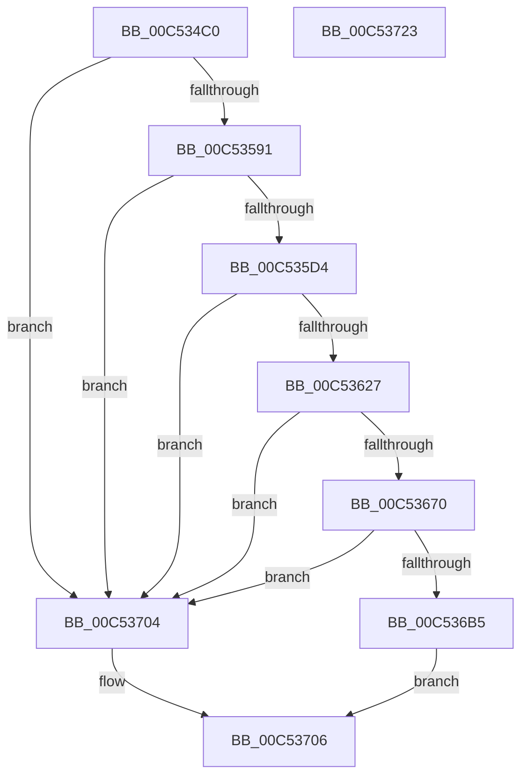

# ExpWin32Initialization

- RVA: `0x00C534C0`–`0x00C53724` (길이 `612` bytes)
- VA: `0x0000000140C534C0`
- 실행 섹션: `INIT`
- PDB 이름 있음: `예`; PDB Function 태그: `아니요`
- unwind 정보 RVA: `0x000C43B4`
- 디코드: `140`개 명령, `612/612` bytes 표시
- 미해석 바이트: `0` (있으면 어셈블리에 `.byte`로 보존)

> 이 문서는 커널 이미지의 기계어와 PDB 기호를 분석해 생성했습니다. 4번과 5번은 함수 원형과 자료형을 바이너리 사용 방식에서 추정한 C 해석이며 원본 소스 복구 결과는 아닙니다.

## 1. Dependencies

- 직접 호출 지점: **14**; 고유 호출 대상: **4**
- 직접 호출자로 확인된 함수: **1**
- RIP 상대 이미지 참조: **24**

### Outgoing calls
- `0x00C534F2` → [RtlInitUnicodeString](../../text/42/RtlInitUnicodeString_function_0042A780.md) (function, `0x0042A780`)
- `0x00C53505` → [memset](../../text/6C/memset_function_006C6C40.md) (function, `0x006C6C40`)
- `0x00C53582` → [ObCreateObjectType](../../page/70/ObCreateObjectType_function_00705230.md) (function, `0x00705230`)
- `0x00C5359C` → [RtlInitUnicodeString](../../text/42/RtlInitUnicodeString_function_0042A780.md) (function, `0x0042A780`)
- `0x00C535C7` → [ObCreateObjectType](../../page/70/ObCreateObjectType_function_00705230.md) (function, `0x00705230`)
- `0x00C535DF` → [RtlInitUnicodeString](../../text/42/RtlInitUnicodeString_function_0042A780.md) (function, `0x0042A780`)
- `0x00C53617` → [ObCreateObjectType](../../page/70/ObCreateObjectType_function_00705230.md) (function, `0x00705230`)
- `0x00C53632` → [RtlInitUnicodeString](../../text/42/RtlInitUnicodeString_function_0042A780.md) (function, `0x0042A780`)
- `0x00C53663` → [ObCreateObjectType](../../page/70/ObCreateObjectType_function_00705230.md) (function, `0x00705230`)
- `0x00C5367B` → [RtlInitUnicodeString](../../text/42/RtlInitUnicodeString_function_0042A780.md) (function, `0x0042A780`)
- `0x00C536AC` → [ObCreateObjectType](../../page/70/ObCreateObjectType_function_00705230.md) (function, `0x00705230`)
- `0x00C536C0` → [RtlInitUnicodeString](../../text/42/RtlInitUnicodeString_function_0042A780.md) (function, `0x0042A780`)
- `0x00C536F8` → [ObCreateObjectType](../../page/70/ObCreateObjectType_function_00705230.md) (function, `0x00705230`)
- `0x00C5370D` → [_security_check_cookie](../../text/6A/_security_check_cookie_function_006AC640.md) (function, `0x006AC640`)

### Direct callers
- [ExpInitSystemPhase1](ExpInitSystemPhase1_function_00C51508.md) at `0x00C516CB`

### Static image references
- `0x00C534D2` → RVA `0x00E0A740` (`.data`; read)
- `0x00C534E3` → RVA `0x00C7DDB0` (` ?? ::PBOPGDP::`string'`; read)
- `0x00C5350A` → RVA `0x00C825A0` (`ExpWindowStationMapping`; read)
- `0x00C53511` → RVA `0x00904FA0` (`ExpWin32CloseProcedure`; read)
- `0x00C53520` → RVA `0x00FC6F50` (`ALMOSTRO`; read)
- `0x00C53527` → RVA `0x009051E0` (`ExpWin32DeleteProcedure`; read)
- `0x00C5353D` → RVA `0x009050A0` (`ExpWin32OkayToCloseProcedure`; read)
- `0x00C53553` → RVA `0x00905400` (`ExpWin32ParseProcedure`; read)
- `0x00C53568` → RVA `0x009052D0` (`ExpWin32OpenProcedure`; read)
- `0x00C53591` → RVA `0x00C7DD60` (` ?? ::PBOPGDP::`string'`; read)
- `0x00C535A1` → RVA `0x00C82580` (`ExpDesktopMapping`; read)
- `0x00C535AC` → RVA `0x00FC6F40` (`ALMOSTRO`; read)
- `0x00C535D4` → RVA `0x00C7DD40` (` ?? ::PBOPGDP::`string'`; read)
- `0x00C535E7` → RVA `0x00FC6F48` (`ALMOSTRO`; read)
- `0x00C535EE` → RVA `0x00C82590` (`ExpCompositionMapping`; read)
- `0x00C53627` → RVA `0x00C7DD90` (` ?? ::PBOPGDP::`string'`; read)
- `0x00C5363A` → RVA `0x00FC6F30` (`ALMOSTRO`; read)
- `0x00C53641` → RVA `0x00C82560` (`ExpRawInputManagerMapping`; read)
- `0x00C53670` → RVA `0x00C7DD70` (` ?? ::PBOPGDP::`string'`; read)
- `0x00C53683` → RVA `0x00FC6F38` (`ALMOSTRO`; read)
- `0x00C5368A` → RVA `0x00C82570` (`ExpCoreMessagingMapping`; read)
- `0x00C536B5` → RVA `0x00C7DD10` (` ?? ::PBOPGDP::`string'`; read)
- `0x00C536C8` → RVA `0x00FC6F28` (`ALMOSTRO`; read)
- `0x00C536CF` → RVA `0x00C82550` (`ExpActivationObjectMapping`; read)

## 2. Other-region calls and transfers

- 다른 실행 섹션으로 향하는 call: **14**
  - `0x00C534F2` → [RtlInitUnicodeString](../../text/42/RtlInitUnicodeString_function_0042A780.md) (`INIT` → `.text`)
  - `0x00C53505` → [memset](../../text/6C/memset_function_006C6C40.md) (`INIT` → `.text`)
  - `0x00C53582` → [ObCreateObjectType](../../page/70/ObCreateObjectType_function_00705230.md) (`INIT` → `PAGE`)
  - `0x00C5359C` → [RtlInitUnicodeString](../../text/42/RtlInitUnicodeString_function_0042A780.md) (`INIT` → `.text`)
  - `0x00C535C7` → [ObCreateObjectType](../../page/70/ObCreateObjectType_function_00705230.md) (`INIT` → `PAGE`)
  - `0x00C535DF` → [RtlInitUnicodeString](../../text/42/RtlInitUnicodeString_function_0042A780.md) (`INIT` → `.text`)
  - `0x00C53617` → [ObCreateObjectType](../../page/70/ObCreateObjectType_function_00705230.md) (`INIT` → `PAGE`)
  - `0x00C53632` → [RtlInitUnicodeString](../../text/42/RtlInitUnicodeString_function_0042A780.md) (`INIT` → `.text`)
  - `0x00C53663` → [ObCreateObjectType](../../page/70/ObCreateObjectType_function_00705230.md) (`INIT` → `PAGE`)
  - `0x00C5367B` → [RtlInitUnicodeString](../../text/42/RtlInitUnicodeString_function_0042A780.md) (`INIT` → `.text`)
  - `0x00C536AC` → [ObCreateObjectType](../../page/70/ObCreateObjectType_function_00705230.md) (`INIT` → `PAGE`)
  - `0x00C536C0` → [RtlInitUnicodeString](../../text/42/RtlInitUnicodeString_function_0042A780.md) (`INIT` → `.text`)
  - `0x00C536F8` → [ObCreateObjectType](../../page/70/ObCreateObjectType_function_00705230.md) (`INIT` → `PAGE`)
  - `0x00C5370D` → [_security_check_cookie](../../text/6A/_security_check_cookie_function_006AC640.md) (`INIT` → `.text`)
- 별도 외부 분기/꼬리 이동을 확인하지 못했습니다.

## 3. Assembly (complete function range)

```asm
00C534C0  48 89 5C 24 08                  mov qword ptr [rsp + 8], rbx
00C534C5  55                              push rbp
00C534C6  48 8D 6C 24 A9                  lea rbp, [rsp - 0x57]
00C534CB  48 81 EC C0 00 00 00            sub rsp, 0xc0
00C534D2  48 8B 05 67 72 1B 00            mov rax, qword ptr [rip + 0x1b7267]
00C534D9  48 33 C4                        xor rax, rsp
00C534DC  48 89 45 47                     mov qword ptr [rbp + 0x47], rax
00C534E0  0F 57 C0                        xorps xmm0, xmm0
00C534E3  48 8D 15 C6 A8 02 00            lea rdx, [rip + 0x2a8c6]
00C534EA  48 8D 4D B7                     lea rcx, [rbp - 0x49]
00C534EE  0F 11 45 B7                     movups xmmword ptr [rbp - 0x49], xmm0
00C534F2  E8 89 72 7D FF                  call 0x14042a780
00C534F7  BB 78 00 00 00                  mov ebx, 0x78
00C534FC  48 8D 4D C7                     lea rcx, [rbp - 0x39]
00C53500  44 8B C3                        mov r8d, ebx
00C53503  33 D2                           xor edx, edx
00C53505  E8 36 37 A7 FF                  call 0x1406c6c40
00C5350A  0F 10 05 8F F0 02 00            movups xmm0, xmmword ptr [rip + 0x2f08f]
00C53511  48 8D 05 88 1A CB FF            lea rax, [rip - 0x34e578]
00C53518  66 89 5D C7                     mov word ptr [rbp - 0x39], bx
00C5351C  48 89 45 07                     mov qword ptr [rbp + 7], rax
00C53520  4C 8D 0D 29 3A 37 00            lea r9, [rip + 0x373a29]
00C53527  48 8D 05 B2 1C CB FF            lea rax, [rip - 0x34e34e]
00C5352E  C7 45 EB 00 02 00 00            mov dword ptr [rbp - 0x15], 0x200
00C53535  48 89 45 0F                     mov qword ptr [rbp + 0xf], rax
00C53539  48 8D 55 C7                     lea rdx, [rbp - 0x39]
00C5353D  48 8D 05 5C 1B CB FF            lea rax, [rip - 0x34e4a4]
00C53544  C7 45 CF 30 01 00 00            mov dword ptr [rbp - 0x31], 0x130
00C5354B  48 89 45 2F                     mov qword ptr [rbp + 0x2f], rax
00C5354F  48 8D 4D B7                     lea rcx, [rbp - 0x49]
00C53553  48 8D 05 A6 1E CB FF            lea rax, [rip - 0x34e15a]
00C5355A  C7 45 E3 00 00 0F 00            mov dword ptr [rbp - 0x1d], 0xf0000
00C53561  48 89 45 17                     mov qword ptr [rbp + 0x17], rax
00C53565  45 33 C0                        xor r8d, r8d
00C53568  48 8D 05 61 1D CB FF            lea rax, [rip - 0x34e29f]
00C5356F  48 89 45 FF                     mov qword ptr [rbp - 1], rax
00C53573  8A 45 C9                        mov al, byte ptr [rbp - 0x37]
00C53576  24 BF                           and al, 0xbf
00C53578  0C 18                           or al, 0x18
00C5357A  88 45 C9                        mov byte ptr [rbp - 0x37], al
00C5357D  F3 0F 7F 45 D3                  movdqu xmmword ptr [rbp - 0x2d], xmm0
00C53582  E8 A9 1C AB FF                  call 0x140705230
00C53587  33 DB                           xor ebx, ebx
00C53589  85 C0                           test eax, eax
00C5358B  0F 88 73 01 00 00               js 0x140c53704
00C53591  48 8D 15 C8 A7 02 00            lea rdx, [rip + 0x2a7c8]
00C53598  48 8D 4D B7                     lea rcx, [rbp - 0x49]
00C5359C  E8 DF 71 7D FF                  call 0x14042a780
00C535A1  0F 10 05 D8 EF 02 00            movups xmm0, xmmword ptr [rip + 0x2efd8]
00C535A8  80 4D C9 40                     or byte ptr [rbp - 0x37], 0x40
00C535AC  4C 8D 0D 8D 39 37 00            lea r9, [rip + 0x37398d]
00C535B3  45 33 C0                        xor r8d, r8d
00C535B6  48 89 5D 17                     mov qword ptr [rbp + 0x17], rbx
00C535BA  48 8D 55 C7                     lea rdx, [rbp - 0x39]
00C535BE  48 8D 4D B7                     lea rcx, [rbp - 0x49]
00C535C2  F3 0F 7F 45 D3                  movdqu xmmword ptr [rbp - 0x2d], xmm0
00C535C7  E8 64 1C AB FF                  call 0x140705230
00C535CC  85 C0                           test eax, eax
00C535CE  0F 88 30 01 00 00               js 0x140c53704
00C535D4  48 8D 15 65 A7 02 00            lea rdx, [rip + 0x2a765]
00C535DB  48 8D 4D B7                     lea rcx, [rbp - 0x49]
00C535DF  E8 9C 71 7D FF                  call 0x14042a780
00C535E4  8A 45 C9                        mov al, byte ptr [rbp - 0x37]
00C535E7  4C 8D 0D 5A 39 37 00            lea r9, [rip + 0x37395a]
00C535EE  0F 10 05 9B EF 02 00            movups xmm0, xmmword ptr [rip + 0x2ef9b]
00C535F5  24 BF                           and al, 0xbf
00C535F7  48 89 5D 17                     mov qword ptr [rbp + 0x17], rbx
00C535FB  0C 02                           or al, 2
00C535FD  C7 45 CB 00 04 00 00            mov dword ptr [rbp - 0x35], 0x400
00C53604  45 33 C0                        xor r8d, r8d
00C53607  88 45 C9                        mov byte ptr [rbp - 0x37], al
00C5360A  48 8D 55 C7                     lea rdx, [rbp - 0x39]
00C5360E  48 8D 4D B7                     lea rcx, [rbp - 0x49]
00C53612  F3 0F 7F 45 D3                  movdqu xmmword ptr [rbp - 0x2d], xmm0
00C53617  E8 14 1C AB FF                  call 0x140705230
00C5361C  89 5D CB                        mov dword ptr [rbp - 0x35], ebx
00C5361F  85 C0                           test eax, eax
00C53621  0F 88 DD 00 00 00               js 0x140c53704
00C53627  48 8D 15 62 A7 02 00            lea rdx, [rip + 0x2a762]
00C5362E  48 8D 4D B7                     lea rcx, [rbp - 0x49]
00C53632  E8 49 71 7D FF                  call 0x14042a780
00C53637  8A 45 C9                        mov al, byte ptr [rbp - 0x37]
00C5363A  4C 8D 0D EF 38 37 00            lea r9, [rip + 0x3738ef]
00C53641  0F 10 05 18 EF 02 00            movups xmm0, xmmword ptr [rip + 0x2ef18]
00C53648  24 BF                           and al, 0xbf
00C5364A  48 89 5D 17                     mov qword ptr [rbp + 0x17], rbx
00C5364E  0C 02                           or al, 2
00C53650  48 8D 55 C7                     lea rdx, [rbp - 0x39]
00C53654  45 33 C0                        xor r8d, r8d
00C53657  88 45 C9                        mov byte ptr [rbp - 0x37], al
00C5365A  48 8D 4D B7                     lea rcx, [rbp - 0x49]
00C5365E  F3 0F 7F 45 D3                  movdqu xmmword ptr [rbp - 0x2d], xmm0
00C53663  E8 C8 1B AB FF                  call 0x140705230
00C53668  85 C0                           test eax, eax
00C5366A  0F 88 94 00 00 00               js 0x140c53704
00C53670  48 8D 15 F9 A6 02 00            lea rdx, [rip + 0x2a6f9]
00C53677  48 8D 4D B7                     lea rcx, [rbp - 0x49]
00C5367B  E8 00 71 7D FF                  call 0x14042a780
00C53680  8A 45 C9                        mov al, byte ptr [rbp - 0x37]
00C53683  4C 8D 0D AE 38 37 00            lea r9, [rip + 0x3738ae]
00C5368A  0F 10 05 DF EE 02 00            movups xmm0, xmmword ptr [rip + 0x2eedf]
00C53691  24 BF                           and al, 0xbf
00C53693  48 89 5D 17                     mov qword ptr [rbp + 0x17], rbx
00C53697  0C 02                           or al, 2
00C53699  48 8D 55 C7                     lea rdx, [rbp - 0x39]
00C5369D  45 33 C0                        xor r8d, r8d
00C536A0  88 45 C9                        mov byte ptr [rbp - 0x37], al
00C536A3  48 8D 4D B7                     lea rcx, [rbp - 0x49]
00C536A7  F3 0F 7F 45 D3                  movdqu xmmword ptr [rbp - 0x2d], xmm0
00C536AC  E8 7F 1B AB FF                  call 0x140705230
00C536B1  85 C0                           test eax, eax
00C536B3  78 4F                           js 0x140c53704
00C536B5  48 8D 15 54 A6 02 00            lea rdx, [rip + 0x2a654]
00C536BC  48 8D 4D B7                     lea rcx, [rbp - 0x49]
00C536C0  E8 BB 70 7D FF                  call 0x14042a780
00C536C5  8A 45 C9                        mov al, byte ptr [rbp - 0x37]
00C536C8  4C 8D 0D 59 38 37 00            lea r9, [rip + 0x373859]
00C536CF  0F 10 05 7A EE 02 00            movups xmm0, xmmword ptr [rip + 0x2ee7a]
00C536D6  24 BF                           and al, 0xbf
00C536D8  48 89 5D 17                     mov qword ptr [rbp + 0x17], rbx
00C536DC  0C 06                           or al, 6
00C536DE  C7 45 EB 01 00 00 00            mov dword ptr [rbp - 0x15], 1
00C536E5  45 33 C0                        xor r8d, r8d
00C536E8  88 45 C9                        mov byte ptr [rbp - 0x37], al
00C536EB  48 8D 55 C7                     lea rdx, [rbp - 0x39]
00C536EF  48 8D 4D B7                     lea rcx, [rbp - 0x49]
00C536F3  F3 0F 7F 45 D3                  movdqu xmmword ptr [rbp - 0x2d], xmm0
00C536F8  E8 33 1B AB FF                  call 0x140705230
00C536FD  C1 E8 1F                        shr eax, 0x1f
00C53700  34 01                           xor al, 1
00C53702  EB 02                           jmp 0x140c53706
00C53704  32 C0                           xor al, al
00C53706  48 8B 4D 47                     mov rcx, qword ptr [rbp + 0x47]
00C5370A  48 33 CC                        xor rcx, rsp
00C5370D  E8 2E 8F A5 FF                  call 0x1406ac640
00C53712  48 8B 9C 24 D0 00 00 00         mov rbx, qword ptr [rsp + 0xd0]
00C5371A  48 81 C4 C0 00 00 00            add rsp, 0xc0
00C53721  5D                              pop rbp
00C53722  C3                              ret
00C53723  CC                              int3
```

## 4. C-style interpretation (structured pseudocode)

```c
__int64 __fastcall ExpWin32Initialization(void)
{
    __int64 result;
    __int64 v_rbx;
    __int64 v_rsp;
    unsigned __int64 v_stack_m18;
    unsigned __int64 v_stack_m30;
    unsigned __int64 v_stack_m48;
    unsigned __int64 v_stack_m50;
    unsigned __int64 v_stack_m58;
    unsigned __int64 v_stack_m5F;
    unsigned __int64 v_stack_m60;
    unsigned int v_stack_m74;
    unsigned int v_stack_m7C;
    unsigned __int64 v_stack_m8C;
    unsigned int v_stack_m90;
    unsigned int v_stack_m94;
    unsigned __int8 v_stack_m96;
    unsigned __int64 v_stack_m98;
    unsigned __int64 v_stack_mA8;
    unsigned __int64 v_stack_p8;

    v_stack_p8 = v_rbx;
    v_rsp = (v_rsp) - (192);
    result = (*(unsigned __int64 *)(v_rip + 1798759)) ^ (v_rsp);
    v_stack_m18 = result;
    v_stack_mA8 = v_xmm0;
    result = RtlInitUnicodeString(v_stack_mA8, v_rip + 174278, a3, a4);
    a2 = 0;
    result = memset(v_stack_m98, a2, 120, a4);
    v_stack_m98 = 120;
    v_stack_m58 = v_rip - 3466616;
    v_stack_m74 = 512;
    v_stack_m50 = v_rip - 3466062;
    v_stack_m90 = 304;
    v_stack_m30 = v_rip - 3466404;
    v_stack_m7C = 0xF0000ULL;
    v_stack_m48 = v_rip - 3465562;
    a3 = 0;
    v_stack_m60 = v_rip - 3465887;
    result = (unsigned __int8)((v_stack_m96) & (191));
    result = (unsigned __int8)((result) | (24));
    v_stack_m96 = (unsigned __int8)(result);
    v_stack_m8C = v_xmm0;
    result = ObCreateObjectType(v_stack_mA8, v_stack_m98, a3, v_rip + 3619369);
    v_rbx = 0;
    if (sign_flag) goto loc_00C53704;
    result = RtlInitUnicodeString(v_stack_mA8, v_rip + 174024, a3, v_rip + 3619369);
    a3 = 0;
    v_stack_m48 = 0;
    v_stack_m8C = v_xmm0;
    result = ObCreateObjectType(v_stack_mA8, v_stack_m98, a3, v_rip + 3619213);
    if (sign_flag) goto loc_00C53704;
    result = RtlInitUnicodeString(v_stack_mA8, v_rip + 173925, a3, v_rip + 3619213);
    result = (unsigned __int8)((v_stack_m96) & (191));
    v_stack_m48 = 0;
    result = (unsigned __int8)((result) | (2));
    v_stack_m94 = 0x400ULL;
    a3 = 0;
    v_stack_m96 = (unsigned __int8)(result);
    v_stack_m8C = v_xmm0;
    result = ObCreateObjectType(v_stack_mA8, v_stack_m98, a3, v_rip + 3619162);
    v_stack_m94 = 0;
    if (sign_flag) goto loc_00C53704;
    result = RtlInitUnicodeString(v_stack_mA8, v_rip + 173922, a3, v_rip + 3619162);
    result = (unsigned __int8)((v_stack_m96) & (191));
    v_stack_m48 = 0;
    result = (unsigned __int8)((result) | (2));
    a3 = 0;
    v_stack_m96 = (unsigned __int8)(result);
    v_stack_m8C = v_xmm0;
    result = ObCreateObjectType(v_stack_mA8, v_stack_m98, a3, v_rip + 3619055);
    if (sign_flag) goto loc_00C53704;
    result = RtlInitUnicodeString(v_stack_mA8, v_rip + 173817, a3, v_rip + 3619055);
    result = (unsigned __int8)((v_stack_m96) & (191));
    v_stack_m48 = 0;
    result = (unsigned __int8)((result) | (2));
    a3 = 0;
    v_stack_m96 = (unsigned __int8)(result);
    v_stack_m8C = v_xmm0;
    result = ObCreateObjectType(v_stack_mA8, v_stack_m98, a3, v_rip + 3618990);
    if (sign_flag) goto loc_00C53704;
    result = RtlInitUnicodeString(v_stack_mA8, v_rip + 173652, a3, v_rip + 3618990);
    result = (unsigned __int8)((v_stack_m96) & (191));
    v_stack_m48 = 0;
    result = (unsigned __int8)((result) | (6));
    v_stack_m74 = 1;
    a3 = 0;
    v_stack_m96 = (unsigned __int8)(result);
    v_stack_m8C = v_xmm0;
    result = ObCreateObjectType(v_stack_mA8, v_stack_m98, a3, v_rip + 3618905);
    result = (unsigned int)((result) >> (31));
    result = (unsigned __int8)((result) ^ (1));
    goto loc_00C53706;
loc_00C53704:
    result = 0;
loc_00C53706:
    a1 = (v_stack_m18) ^ (v_rsp);
    result = _security_check_cookie(a1, v_stack_m98, a3, v_rip + 3618905);
    v_rsp = (v_rsp) + (192);
    return result;
}
```

## 5. (Beta) C Style

```c
void ExpWin32Initialization(void)
{
    int64_t result;
    int64_t local_rbx;
    int64_t local_rsp;
    uint64_t v_stack_m18;
    uint64_t v_stack_m30;
    uint64_t v_stack_m48;
    uint64_t v_stack_m50;
    uint64_t v_stack_m58;
    uint64_t v_stack_m5F;
    uint64_t v_stack_m60;
    uint32_t v_stack_m74;
    uint32_t v_stack_m7C;
    uint64_t v_stack_m8C;
    uint32_t v_stack_m90;
    uint32_t v_stack_m94;
    uint8_t v_stack_m96;
    uint64_t v_stack_m98;
    uint64_t v_stack_mA8;
    uint64_t v_stack_p8;

    v_stack_p8 = local_rbx;
    local_rsp = (local_rsp) - (192);
    result = (*(uint64_t *)(v_rip + 0x1B7267)) ^ (local_rsp);
    v_stack_m18 = result;
    v_stack_mA8 = v_xmm0;
    result = RtlInitUnicodeString(v_stack_mA8, v_rip + 174278, a3, a4);
    a2 = 0;
    result = memset(v_stack_m98, a2, 120, a4);
    v_stack_m98 = 120;
    v_stack_m58 = v_rip - 3466616;
    v_stack_m74 = 512;
    v_stack_m50 = v_rip - 3466062;
    v_stack_m90 = 304;
    v_stack_m30 = v_rip - 3466404;
    v_stack_m7C = 0xF0000ULL;
    v_stack_m48 = v_rip - 3465562;
    a3 = 0;
    v_stack_m60 = v_rip - 3465887;
    result = (uint8_t)((v_stack_m96) & (191));
    result = (uint8_t)((result) | (24));
    v_stack_m96 = (uint8_t)(result);
    v_stack_m8C = v_xmm0;
    result = ObCreateObjectType(v_stack_mA8, v_stack_m98, a3, v_rip + 3619369);
    local_rbx = 0;
    if (sign_flag) goto loc_00C53704;
    result = RtlInitUnicodeString(v_stack_mA8, v_rip + 174024, a3, v_rip + 3619369);
    a3 = 0;
    v_stack_m48 = 0;
    v_stack_m8C = v_xmm0;
    result = ObCreateObjectType(v_stack_mA8, v_stack_m98, a3, v_rip + 3619213);
    if (sign_flag) goto loc_00C53704;
    result = RtlInitUnicodeString(v_stack_mA8, v_rip + 173925, a3, v_rip + 3619213);
    result = (uint8_t)((v_stack_m96) & (191));
    v_stack_m48 = 0;
    result = (uint8_t)((result) | (2));
    v_stack_m94 = 0x400ULL;
    a3 = 0;
    v_stack_m96 = (uint8_t)(result);
    v_stack_m8C = v_xmm0;
    result = ObCreateObjectType(v_stack_mA8, v_stack_m98, a3, v_rip + 3619162);
    v_stack_m94 = 0;
    if (sign_flag) goto loc_00C53704;
    result = RtlInitUnicodeString(v_stack_mA8, v_rip + 173922, a3, v_rip + 3619162);
    result = (uint8_t)((v_stack_m96) & (191));
    v_stack_m48 = 0;
    result = (uint8_t)((result) | (2));
    a3 = 0;
    v_stack_m96 = (uint8_t)(result);
    v_stack_m8C = v_xmm0;
    result = ObCreateObjectType(v_stack_mA8, v_stack_m98, a3, v_rip + 3619055);
    if (sign_flag) goto loc_00C53704;
    result = RtlInitUnicodeString(v_stack_mA8, v_rip + 173817, a3, v_rip + 3619055);
    result = (uint8_t)((v_stack_m96) & (191));
    v_stack_m48 = 0;
    result = (uint8_t)((result) | (2));
    a3 = 0;
    v_stack_m96 = (uint8_t)(result);
    v_stack_m8C = v_xmm0;
    result = ObCreateObjectType(v_stack_mA8, v_stack_m98, a3, v_rip + 3618990);
    if (sign_flag) goto loc_00C53704;
    result = RtlInitUnicodeString(v_stack_mA8, v_rip + 173652, a3, v_rip + 3618990);
    result = (uint8_t)((v_stack_m96) & (191));
    v_stack_m48 = 0;
    result = (uint8_t)((result) | (6));
    v_stack_m74 = 1;
    a3 = 0;
    v_stack_m96 = (uint8_t)(result);
    v_stack_m8C = v_xmm0;
    result = ObCreateObjectType(v_stack_mA8, v_stack_m98, a3, v_rip + 3618905);
    result = (uint32_t)((result) >> (31));
    result = (uint8_t)((result) ^ (1));
    goto loc_00C53706;
loc_00C53704:
    result = 0;
loc_00C53706:
    a1 = (v_stack_m18) ^ (local_rsp);
    result = _security_check_cookie(a1, v_stack_m98, a3, v_rip + 3618905);
    local_rsp = (local_rsp) + (192);
    return result;
}
```

## 6. Execution-region graph

[열기: 2D/3D 그래프와 함수 탐색 컨트롤 패널](../../../control-panel.html?section=init&rva=0x00C534C0&view=graph)

- 2D 그래프는 위에서 아래로 흐르고, 3D 그래프는 빈 공간을 드래그해 회전합니다. Shift+드래그는 이동, 휠은 확대·축소, 함수 노드 선택은 대상 보고서 이동입니다.

### Static fallback


