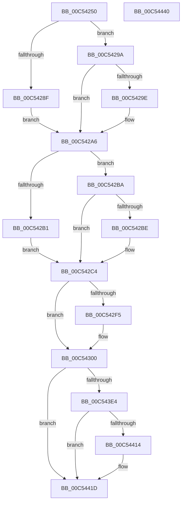

# ExpWorkerFactoryInitialization

- RVA: `0x00C54250`–`0x00C54441` (길이 `497` bytes)
- VA: `0x0000000140C54250`
- 실행 섹션: `INIT`
- PDB 이름 있음: `예`; PDB Function 태그: `아니요`
- unwind 정보 RVA: `0x000C4AE8`
- 디코드: `108`개 명령, `497/497` bytes 표시
- 미해석 바이트: `0` (있으면 어셈블리에 `.byte`로 보존)

> 이 문서는 커널 이미지의 기계어와 PDB 기호를 분석해 생성했습니다. 4번과 5번은 함수 원형과 자료형을 바이너리 사용 방식에서 추정한 C 해석이며 원본 소스 복구 결과는 아닙니다.

## 1. Dependencies

- 직접 호출 지점: **8**; 고유 호출 대상: **8**
- 직접 호출자로 확인된 함수: **1**
- RIP 상대 이미지 참조: **27**

### Outgoing calls
- `0x00C542FA` → [RtlRaiseStatus](../../text/2F/RtlRaiseStatus_function_002F6A50.md) (function, `0x002F6A50`)
- `0x00C54313` → [KeInitializeQueue](../../text/48/KeInitializeQueue_function_00480C90.md) (function, `0x00480C90`)
- `0x00C54364` → [KeRegisterObjectNotification](../../text/39/KeRegisterObjectNotification_function_00393454.md) (function, `0x00393454`)
- `0x00C5437D` → [memset](../../text/6C/memset_function_006C6C40.md) (function, `0x006C6C40`)
- `0x00C543D9` → [ObCreateObjectType](../../page/70/ObCreateObjectType_function_00705230.md) (function, `0x00705230`)
- `0x00C54409` → [PsCreateSystemThread](../../page/9E/PsCreateSystemThread_function_009ED0D0.md) (function, `0x009ED0D0`)
- `0x00C54418` → [ZwClose](../../text/6A/ZwClose_function_006AD2B0.md) (function, `0x006AD2B0`)
- `0x00C54426` → [_security_check_cookie](../../text/6A/_security_check_cookie_function_006AC640.md) (function, `0x006AC640`)

### Direct callers
- [ExpInitSystemPhase1](ExpInitSystemPhase1_function_00C51508.md) at `0x00C516D9`

### Static image references
- `0x00C54267` → RVA `0x00E0A740` (`.data`; read)
- `0x00C54275` → RVA `0x00E0EBF8` (`.data`; read)
- `0x00C54292` → RVA `0x00E0EBF8` (`.data`; write)
- `0x00C542A6` → RVA `0x00E0EBFC` (`.data`; read)
- `0x00C542B1` → RVA `0x00E0EBFC` (`.data`; write)
- `0x00C542CD` → RVA `0x00E29160` (`.data`; read)
- `0x00C542D4` → RVA `0x00EFA268` (`.data`; write)
- `0x00C542DF` → RVA `0x00EFA178` (`.data`; write)
- `0x00C542E6` → RVA `0x00EFA260` (`.data`; write)
- `0x00C54303` → RVA `0x00EFA1A0` (`.data`; read)
- `0x00C5430C` → RVA `0x00E29160` (`.data`; write)
- `0x00C54318` → RVA `0x00EFA228` (`.data`; read)
- `0x00C5431F` → RVA `0x00EFA220` (`.data`; write)
- `0x00C54326` → RVA `0x00EFA1E0` (`.data`; read)
- `0x00C5432D` → RVA `0x00EFA230` (`.data`; write)
- `0x00C5433B` → RVA `0x00EFA228` (`.data`; write)
- `0x00C54342` → RVA `0x00EFA220` (`.data`; read)
- `0x00C54350` → RVA `0x00EFA238` (`.data`; write)
- `0x00C54357` → RVA `0x00EFA25C` (`.data`; write)
- `0x00C5435D` → RVA `0x00EFA258` (`.data`; write)
- `0x00C5436E` → RVA `0x00EFA180` (`.data`; write)
- `0x00C54382` → RVA `0x00C82510` (`ExpWorkerFactoryMapping`; read)
- `0x00C54389` → RVA `0x00A6C4C0` (`ExpCloseWorkerFactory`; read)
- `0x00C54398` → RVA `0x00FC51E0` (`ALMOSTRO`; read)
- `0x00C5439F` → RVA `0x00486880` (`ExpDeleteWorkerFactory`; read)
- `0x00C543BF` → RVA `0x00C82500` (`INIT`; read)
- `0x00C543E4` → RVA `0x0065CCC0` (`ExpWorkerFactoryManagerThread`; read)

## 2. Other-region calls and transfers

- 다른 실행 섹션으로 향하는 call: **8**
  - `0x00C542FA` → [RtlRaiseStatus](../../text/2F/RtlRaiseStatus_function_002F6A50.md) (`INIT` → `.text`)
  - `0x00C54313` → [KeInitializeQueue](../../text/48/KeInitializeQueue_function_00480C90.md) (`INIT` → `.text`)
  - `0x00C54364` → [KeRegisterObjectNotification](../../text/39/KeRegisterObjectNotification_function_00393454.md) (`INIT` → `.text`)
  - `0x00C5437D` → [memset](../../text/6C/memset_function_006C6C40.md) (`INIT` → `.text`)
  - `0x00C543D9` → [ObCreateObjectType](../../page/70/ObCreateObjectType_function_00705230.md) (`INIT` → `PAGE`)
  - `0x00C54409` → [PsCreateSystemThread](../../page/9E/PsCreateSystemThread_function_009ED0D0.md) (`INIT` → `PAGE`)
  - `0x00C54418` → [ZwClose](../../text/6A/ZwClose_function_006AD2B0.md) (`INIT` → `.text`)
  - `0x00C54426` → [_security_check_cookie](../../text/6A/_security_check_cookie_function_006AC640.md) (`INIT` → `.text`)
- 별도 외부 분기/꼬리 이동을 확인하지 못했습니다.

## 3. Assembly (complete function range)

```asm
00C54250  48 89 5C 24 08                  mov qword ptr [rsp + 8], rbx
00C54255  48 89 7C 24 10                  mov qword ptr [rsp + 0x10], rdi
00C5425A  55                              push rbp
00C5425B  48 8D 6C 24 A9                  lea rbp, [rsp - 0x57]
00C54260  48 81 EC E0 00 00 00            sub rsp, 0xe0
00C54267  48 8B 05 D2 64 1B 00            mov rax, qword ptr [rip + 0x1b64d2]
00C5426E  48 33 C4                        xor rax, rsp
00C54271  48 89 45 47                     mov qword ptr [rbp + 0x47], rax
00C54275  8B 05 7D A9 1B 00               mov eax, dword ptr [rip + 0x1ba97d]
00C5427B  33 FF                           xor edi, edi
00C5427D  48 89 7D B7                     mov qword ptr [rbp - 0x49], rdi
00C54281  BA 58 02 00 00                  mov edx, 0x258
00C54286  44 8D 47 01                     lea r8d, [rdi + 1]
00C5428A  41 3B C0                        cmp eax, r8d
00C5428D  73 0B                           jae 0x140c5429a
00C5428F  41 8B C0                        mov eax, r8d
00C54292  89 05 60 A9 1B 00               mov dword ptr [rip + 0x1ba960], eax
00C54298  EB 0C                           jmp 0x140c542a6
00C5429A  3B C2                           cmp eax, edx
00C5429C  76 08                           jbe 0x140c542a6
00C5429E  8B C2                           mov eax, edx
00C542A0  89 15 52 A9 1B 00               mov dword ptr [rip + 0x1ba952], edx
00C542A6  8B 0D 50 A9 1B 00               mov ecx, dword ptr [rip + 0x1ba950]
00C542AC  41 3B C8                        cmp ecx, r8d
00C542AF  73 09                           jae 0x140c542ba
00C542B1  44 89 05 44 A9 1B 00            mov dword ptr [rip + 0x1ba944], r8d
00C542B8  EB 0A                           jmp 0x140c542c4
00C542BA  3B CA                           cmp ecx, edx
00C542BC  76 06                           jbe 0x140c542c4
00C542BE  89 15 38 A9 1B 00               mov dword ptr [rip + 0x1ba938], edx
00C542C4  48 98                           cdqe
00C542C6  48 69 C8 80 69 67 FF            imul rcx, rax, -0x989680
00C542CD  48 8D 05 8C 4E 1D 00            lea rax, [rip + 0x1d4e8c]
00C542D4  48 C7 05 89 5F 2A 00 80 B0 ED FF  mov qword ptr [rip + 0x2a5f89], 0xffffffffffedb080
00C542DF  48 89 0D 92 5E 2A 00            mov qword ptr [rip + 0x2a5e92], rcx
00C542E6  48 C7 05 6F 5F 2A 00 20 6C FB FF  mov qword ptr [rip + 0x2a5f6f], 0xfffffffffffb6c20
00C542F1  A8 0F                           test al, 0xf
00C542F3  74 0B                           je 0x140c54300
00C542F5  B9 02 00 00 80                  mov ecx, 0x80000002
00C542FA  E8 51 27 6A FF                  call 0x1402f6a50
00C542FF  CC                              int3
00C54300  0F 57 C0                        xorps xmm0, xmm0
00C54303  48 8D 0D 96 5E 2A 00            lea rcx, [rip + 0x2a5e96]
00C5430A  33 D2                           xor edx, edx
00C5430C  0F 29 05 4D 4E 1D 00            movaps xmmword ptr [rip + 0x1d4e4d], xmm0
00C54313  E8 78 C9 82 FF                  call 0x140480c90
00C54318  48 8D 05 09 5F 2A 00            lea rax, [rip + 0x2a5f09]
00C5431F  48 89 3D FA 5E 2A 00            mov qword ptr [rip + 0x2a5efa], rdi
00C54326  4C 8D 05 B3 5E 2A 00            lea r8, [rip + 0x2a5eb3]
00C5432D  48 89 05 FC 5E 2A 00            mov qword ptr [rip + 0x2a5efc], rax
00C54334  48 8D 15 65 5E 2A 00            lea rdx, [rip + 0x2a5e65]
00C5433B  48 89 05 E6 5E 2A 00            mov qword ptr [rip + 0x2a5ee6], rax
00C54342  48 8D 0D D7 5E 2A 00            lea rcx, [rip + 0x2a5ed7]
00C54349  C6 05 D0 5E 2A 00 09            mov byte ptr [rip + 0x2a5ed0], 9
00C54350  48 89 3D E1 5E 2A 00            mov qword ptr [rip + 0x2a5ee1], rdi
00C54357  89 3D FF 5E 2A 00               mov dword ptr [rip + 0x2a5eff], edi
00C5435D  66 89 3D F4 5E 2A 00            mov word ptr [rip + 0x2a5ef4], di
00C54364  E8 EB F0 73 FF                  call 0x140393454
00C54369  BB 78 00 00 00                  mov ebx, 0x78
00C5436E  89 3D 0C 5E 2A 00               mov dword ptr [rip + 0x2a5e0c], edi
00C54374  44 8B C3                        mov r8d, ebx
00C54377  48 8D 4D C7                     lea rcx, [rbp - 0x39]
00C5437B  33 D2                           xor edx, edx
00C5437D  E8 BE 28 A7 FF                  call 0x1406c6c40
00C54382  0F 10 05 87 E1 02 00            movups xmm0, xmmword ptr [rip + 0x2e187]
00C54389  48 8D 05 30 81 E1 FF            lea rax, [rip - 0x1e7ed0]
00C54390  66 89 5D C7                     mov word ptr [rbp - 0x39], bx
00C54394  48 89 45 07                     mov qword ptr [rbp + 7], rax
00C54398  4C 8D 0D 41 0E 37 00            lea r9, [rip + 0x370e41]
00C5439F  48 8D 05 DA 24 83 FF            lea rax, [rip - 0x7cdb26]
00C543A6  C7 45 CF 00 01 00 00            mov dword ptr [rbp - 0x31], 0x100
00C543AD  45 33 C0                        xor r8d, r8d
00C543B0  48 89 45 0F                     mov qword ptr [rbp + 0xf], rax
00C543B4  48 8D 55 C7                     lea rdx, [rbp - 0x39]
00C543B8  C7 45 EB 00 02 00 00            mov dword ptr [rbp - 0x15], 0x200
00C543BF  48 8D 0D 3A E1 02 00            lea rcx, [rip + 0x2e13a]
00C543C6  C7 45 F3 A0 02 00 00            mov dword ptr [rbp - 0xd], 0x2a0
00C543CD  F3 0F 7F 45 D3                  movdqu xmmword ptr [rbp - 0x2d], xmm0
00C543D2  C7 45 E3 FF 00 0F 00            mov dword ptr [rbp - 0x1d], 0xf00ff
00C543D9  E8 52 0E AB FF                  call 0x140705230
00C543DE  8B D8                           mov ebx, eax
00C543E0  85 C0                           test eax, eax
00C543E2  78 39                           js 0x140c5441d
00C543E4  48 8D 05 D5 88 A0 FF            lea rax, [rip - 0x5f772b]
00C543EB  48 89 7C 24 30                  mov qword ptr [rsp + 0x30], rdi
00C543F0  48 89 44 24 28                  mov qword ptr [rsp + 0x28], rax
00C543F5  48 8D 4D B7                     lea rcx, [rbp - 0x49]
00C543F9  45 33 C9                        xor r9d, r9d
00C543FC  48 89 7C 24 20                  mov qword ptr [rsp + 0x20], rdi
00C54401  45 33 C0                        xor r8d, r8d
00C54404  BA FF FF 1F 00                  mov edx, 0x1fffff
00C54409  E8 C2 8C D9 FF                  call 0x1409ed0d0
00C5440E  8B D8                           mov ebx, eax
00C54410  85 C0                           test eax, eax
00C54412  78 09                           js 0x140c5441d
00C54414  48 8B 4D B7                     mov rcx, qword ptr [rbp - 0x49]
00C54418  E8 93 8E A5 FF                  call 0x1406ad2b0
00C5441D  8B C3                           mov eax, ebx
00C5441F  48 8B 4D 47                     mov rcx, qword ptr [rbp + 0x47]
00C54423  48 33 CC                        xor rcx, rsp
00C54426  E8 15 82 A5 FF                  call 0x1406ac640
00C5442B  4C 8D 9C 24 E0 00 00 00         lea r11, [rsp + 0xe0]
00C54433  49 8B 5B 10                     mov rbx, qword ptr [r11 + 0x10]
00C54437  49 8B 7B 18                     mov rdi, qword ptr [r11 + 0x18]
00C5443B  49 8B E3                        mov rsp, r11
00C5443E  5D                              pop rbp
00C5443F  C3                              ret
00C54440  CC                              int3
```

## 4. C-style interpretation (structured pseudocode)

```c
__int64 __fastcall ExpWorkerFactoryInitialization(void)
{
    __int64 result;
    __int64 v_rdi;
    __int64 v_rsp;
    unsigned __int64 v_stack_m18;
    unsigned __int64 v_stack_m50;
    unsigned __int64 v_stack_m58;
    unsigned __int64 v_stack_m5F;
    unsigned int v_stack_m6C;
    unsigned int v_stack_m74;
    unsigned int v_stack_m7C;
    unsigned __int64 v_stack_m8;
    unsigned __int64 v_stack_m8C;
    unsigned int v_stack_m90;
    unsigned __int64 v_stack_m98;
    unsigned __int64 v_stack_mA8;
    unsigned __int64 v_stack_mB8;
    unsigned __int64 v_stack_mC0;
    unsigned __int64 v_stack_mC8;
    unsigned __int64 v_stack_p10;
    unsigned __int64 v_stack_p8;

    v_stack_p8 = v_rbx;
    v_stack_p10 = v_rdi;
    v_rsp = (v_rsp) - (224);
    result = (*(unsigned __int64 *)(v_rip + 1795282)) ^ (v_rsp);
    v_stack_m18 = result;
    v_rdi = 0;
    v_stack_mA8 = 0;
    if (((unsigned int)((unsigned int)(*(unsigned int *)(v_rip + 1812861)))) >= ((unsigned int)(v_rdi + 1))) goto loc_00C5429A;
    *(unsigned int *)(v_rip + 1812832) = (unsigned int)((unsigned int)((unsigned int)(v_rdi + 1)));
    goto loc_00C542A6;
loc_00C5429A:
    result = (unsigned int)((unsigned int)(v_rdi + 1));
    if (((unsigned int)((unsigned int)((unsigned int)(v_rdi + 1)))) >= = 600) {
        result = 600;
        *(unsigned int *)(v_rip + 1812818) = 600;
    }
    if (((unsigned int)((unsigned int)(*(unsigned int *)(v_rip + 1812816)))) >= ((unsigned int)(v_rdi + 1))) goto loc_00C542BA;
    *(unsigned int *)(v_rip + 1812804) = (unsigned int)(v_rdi + 1);
    goto loc_00C542C4;
loc_00C542BA:
    if (((unsigned int)((unsigned int)(*(unsigned int *)(v_rip + 1812816)))) >= = 600) {
        *(unsigned int *)(v_rip + 1812792) = 600;
    }
    a1 = ((unsigned int)(*(unsigned int *)(v_rip + 1812816))) * (result);
    *(unsigned __int64 *)(v_rip + 2776969) = 0xFFFFFFFFFFEDB080ULL;
    *(unsigned __int64 *)(v_rip + 2776722) = a1;
    *(unsigned __int64 *)(v_rip + 2776943) = 0xFFFFFFFFFFFB6C20ULL;
    result = v_rip + 1920652;
    if ((((unsigned __int8)(v_rip + 1920652)) & (15)) != 0) {
        a1 = 0x80000002ULL;
        result = RtlRaiseStatus(a1, 600, v_rdi + 1, a4);
    }
    a2 = 0;
    *(unsigned __int64 *)(v_rip + 1920589) = v_xmm0;
    result = KeInitializeQueue(v_rip + 2776726, a2, v_rdi + 1, a4);
    *(unsigned __int64 *)(v_rip + 2776826) = 0;
    *(unsigned __int64 *)(v_rip + 2776828) = v_rip + 2776841;
    *(unsigned __int64 *)(v_rip + 2776806) = v_rip + 2776841;
    *(unsigned __int8 *)(v_rip + 2776784) = 9;
    *(unsigned __int64 *)(v_rip + 2776801) = 0;
    *(unsigned int *)(v_rip + 2776831) = 0;
    *(unsigned __int16 *)(v_rip + 2776820) = 0;
    result = KeRegisterObjectNotification(v_rip + 2776791, v_rip + 2776677, v_rip + 2776755, a4);
    *(unsigned int *)(v_rip + 2776588) = 0;
    a2 = 0;
    result = memset(v_stack_m98, a2, 120, a4);
    v_stack_m98 = 120;
    v_stack_m58 = v_rip - 1998544;
    v_stack_m90 = 256;
    a3 = 0;
    v_stack_m50 = v_rip - 8182566;
    v_stack_m74 = 512;
    v_stack_m6C = 672;
    v_stack_m8C = v_xmm0;
    v_stack_m7C = 0xF00FFULL;
    result = ObCreateObjectType(v_rip + 188730, v_stack_m98, a3, v_rip + 3608129);
    if (sign_flag) goto loc_00C5441D;
    v_stack_mB8 = 0;
    v_stack_mC0 = v_rip - 6256427;
    a4 = 0;
    v_stack_mC8 = 0;
    a3 = 0;
    result = PsCreateSystemThread(v_stack_mA8, (unsigned int)(0x1FFFFFULL), a3, a4);
    if (!(sign_flag)) {
        a1 = v_stack_mA8;
        result = ZwClose(a1, (unsigned int)(0x1FFFFFULL), a3, a4);
    }
    a1 = (v_stack_m18) ^ (v_rsp);
    result = _security_check_cookie(a1, (unsigned int)(0x1FFFFFULL), a3, a4);
    return result;
}
```

## 5. (Beta) C Style

```c
void ExpWorkerFactoryInitialization(void)
{
    int64_t result;
    int64_t local_rdi;
    int64_t local_rsp;
    uint64_t v_stack_m18;
    uint64_t v_stack_m50;
    uint64_t v_stack_m58;
    uint64_t v_stack_m5F;
    uint32_t v_stack_m6C;
    uint32_t v_stack_m74;
    uint32_t v_stack_m7C;
    uint64_t v_stack_m8;
    uint64_t v_stack_m8C;
    uint32_t v_stack_m90;
    uint64_t v_stack_m98;
    uint64_t v_stack_mA8;
    uint64_t v_stack_mB8;
    uint64_t v_stack_mC0;
    uint64_t v_stack_mC8;
    uint64_t v_stack_p10;
    uint64_t v_stack_p8;

    v_stack_p8 = local_rbx;
    v_stack_p10 = local_rdi;
    local_rsp = (local_rsp) - (224);
    result = (*(uint64_t *)(v_rip + 0x1B64D2)) ^ (local_rsp);
    v_stack_m18 = result;
    local_rdi = 0;
    v_stack_mA8 = 0;
    if (((uint32_t)((uint32_t)(*(uint32_t *)(v_rip + 0x1BA97D)))) >= ((uint32_t)(local_rdi + 1))) goto loc_00C5429A;
    *(uint32_t *)(v_rip + 0x1BA960) = (uint32_t)((uint32_t)((uint32_t)(local_rdi + 1)));
    goto loc_00C542A6;
loc_00C5429A:
    result = (uint32_t)((uint32_t)(local_rdi + 1));
    if (((uint32_t)((uint32_t)((uint32_t)(local_rdi + 1)))) >= = 600) {
        result = 600;
        *(uint32_t *)(v_rip + 0x1BA952) = 600;
    }
    if (((uint32_t)((uint32_t)(*(uint32_t *)(v_rip + 0x1BA950)))) >= ((uint32_t)(local_rdi + 1))) goto loc_00C542BA;
    *(uint32_t *)(v_rip + 0x1BA944) = (uint32_t)(local_rdi + 1);
    goto loc_00C542C4;
loc_00C542BA:
    if (((uint32_t)((uint32_t)(*(uint32_t *)(v_rip + 0x1BA950)))) >= = 600) {
        *(uint32_t *)(v_rip + 0x1BA938) = 600;
    }
    a1 = ((uint32_t)(*(uint32_t *)(v_rip + 0x1BA950))) * (result);
    *(uint64_t *)(v_rip + 0x2A5F89) = 0xFFFFFFFFFFEDB080ULL;
    *(uint64_t *)(v_rip + 0x2A5E92) = a1;
    *(uint64_t *)(v_rip + 0x2A5F6F) = 0xFFFFFFFFFFFB6C20ULL;
    result = v_rip + 1920652;
    if ((((uint8_t)(v_rip + 1920652)) & (15)) != 0) {
        a1 = 0x80000002ULL;
        result = RtlRaiseStatus(a1, 600, local_rdi + 1, a4);
    }
    a2 = 0;
    *(uint64_t *)(v_rip + 0x1D4E4D) = v_xmm0;
    result = KeInitializeQueue(v_rip + 2776726, a2, local_rdi + 1, a4);
    *(uint64_t *)(v_rip + 0x2A5EFA) = 0;
    *(uint64_t *)(v_rip + 0x2A5EFC) = v_rip + 2776841;
    *(uint64_t *)(v_rip + 0x2A5EE6) = v_rip + 2776841;
    *(uint8_t *)(v_rip + 0x2A5ED0) = 9;
    *(uint64_t *)(v_rip + 0x2A5EE1) = 0;
    *(uint32_t *)(v_rip + 0x2A5EFF) = 0;
    *(uint16_t *)(v_rip + 0x2A5EF4) = 0;
    result = KeRegisterObjectNotification(v_rip + 2776791, v_rip + 2776677, v_rip + 2776755, a4);
    *(uint32_t *)(v_rip + 0x2A5E0C) = 0;
    a2 = 0;
    result = memset(v_stack_m98, a2, 120, a4);
    v_stack_m98 = 120;
    v_stack_m58 = v_rip - 1998544;
    v_stack_m90 = 256;
    a3 = 0;
    v_stack_m50 = v_rip - 8182566;
    v_stack_m74 = 512;
    v_stack_m6C = 672;
    v_stack_m8C = v_xmm0;
    v_stack_m7C = 0xF00FFULL;
    result = ObCreateObjectType(v_rip + 188730, v_stack_m98, a3, v_rip + 3608129);
    if (sign_flag) goto loc_00C5441D;
    v_stack_mB8 = 0;
    v_stack_mC0 = v_rip - 6256427;
    a4 = 0;
    v_stack_mC8 = 0;
    a3 = 0;
    result = PsCreateSystemThread(v_stack_mA8, (uint32_t)(0x1FFFFFULL), a3, a4);
    if (!(sign_flag)) {
        a1 = v_stack_mA8;
        result = ZwClose(a1, (uint32_t)(0x1FFFFFULL), a3, a4);
    }
    a1 = (v_stack_m18) ^ (local_rsp);
    result = _security_check_cookie(a1, (uint32_t)(0x1FFFFFULL), a3, a4);
    return result;
}
```

## 6. Execution-region graph

[열기: 2D/3D 그래프와 함수 탐색 컨트롤 패널](../../../control-panel.html?section=init&rva=0x00C54250&view=graph)

- 2D 그래프는 위에서 아래로 흐르고, 3D 그래프는 빈 공간을 드래그해 회전합니다. Shift+드래그는 이동, 휠은 확대·축소, 함수 노드 선택은 대상 보고서 이동입니다.

### Static fallback


