# ExpWorkerInitialization

- RVA: `0x00C539A4`–`0x00C53DB3` (길이 `1,039` bytes)
- VA: `0x0000000140C539A4`
- 실행 섹션: `INIT`
- PDB 이름 있음: `예`; PDB Function 태그: `아니요`
- unwind 정보 RVA: `0x00060300`
- 디코드: `243`개 명령, `1,039/1,039` bytes 표시
- 미해석 바이트: `0` (있으면 어셈블리에 `.byte`로 보존)

> 이 문서는 커널 이미지의 기계어와 PDB 기호를 분석해 생성했습니다. 4번과 5번은 함수 원형과 자료형을 바이너리 사용 방식에서 추정한 C 해석이며 원본 소스 복구 결과는 아닙니다.

## 1. Dependencies

- 직접 호출 지점: **10**; 고유 호출 대상: **10**
- 직접 호출자로 확인된 함수: **1**
- RIP 상대 이미지 참조: **51**

### Outgoing calls
- `0x00C53AFD` → [Feature_WorkQueueShardingWithinNodes__private_IsEnabledDeviceUsageNoInline](../../text/65/Feature_WorkQueueShardingWithinNodes__private_IsEnabledDeviceUsageNoInline_function_0065AA34.md) (function, `0x0065AA34`)
- `0x00C53B42` → [ExpNodeInitialize](../../page/7C/ExpNodeInitialize_function_007CF8A0.md) (function, `0x007CF8A0`)
- `0x00C53B5C` → [ExpWorkQueueInitializeHealthMetricsMonitor](../../page/7D/ExpWorkQueueInitializeHealthMetricsMonitor_function_007D00F4.md) (function, `0x007D00F4`)
- `0x00C53B70` → [ExpPartitionInitialize](../../page/7C/ExpPartitionInitialize_function_007CFB9C.md) (function, `0x007CFB9C`)
- `0x00C53B88` → [ExpPartitionStart](../../page/7C/ExpPartitionStart_function_007CFDCC.md) (function, `0x007CFDCC`)
- `0x00C53B97` → [ExpLegacyWorkerInitialization](../../text/65/ExpLegacyWorkerInitialization_function_0065A5A0.md) (function, `0x0065A5A0`)
- `0x00C53BFE` → [ObpLockObjectTypeExclusive](../../page/9D/ObpLockObjectTypeExclusive_function_009DB5C4.md) (function, `0x009DB5C4`)
- `0x00C53C5F` → [ObpUnlockObjectType](../../page/9D/ObpUnlockObjectType_function_009DB54C.md) (function, `0x009DB54C`)
- `0x00C53D00` → [KiQueryUnbiasedInterruptTime](../../text/42/KiQueryUnbiasedInterruptTime_function_0042D180.md) (function, `0x0042D180`)
- `0x00C53D92` → [ExQueueDebuggerWorker](../../text/65/ExQueueDebuggerWorker_function_0065A358.md) (function, `0x0065A358`)

### Direct callers
- [ExpInitSystemPhase1](ExpInitSystemPhase1_function_00C51508.md) at `0x00C5158B`

### Static image references
- `0x00C539BE` → RVA `0x00EFA93A` (`.data`; write)
- `0x00C539C5` → RVA `0x00EFA940` (`.data`; read)
- `0x00C539CC` → RVA `0x00EFA928` (`.data`; write)
- `0x00C539D9` → RVA `0x00EFA948` (`.data`; write)
- `0x00C539E0` → RVA `0x00EFA940` (`.data`; write)
- `0x00C539EC` → RVA `0x00E0EBD0` (`.data`; read)
- `0x00C539F2` → RVA `0x00EFA920` (`.data`; write)
- `0x00C539F9` → RVA `0x00EFA930` (`.data`; write)
- `0x00C539FF` → RVA `0x00EFA938` (`.data`; write)
- `0x00C53A07` → RVA `0x00EFA93C` (`.data`; write)
- `0x00C53A0D` → RVA `0x00EFA958` (`.data`; write)
- `0x00C53A1A` → RVA `0x00E0EBD0` (`.data`; write)
- `0x00C53A2F` → RVA `0x00E0EBCC` (`.data`; read)
- `0x00C53A40` → RVA `0x00E0EBCC` (`.data`; write)
- `0x00C53A55` → RVA `0x00E0EBDC` (`.data`; read)
- `0x00C53A66` → RVA `0x00E0EBDC` (`.data`; write)
- `0x00C53A78` → RVA `0x00E0EBE0` (`.data`; read)
- `0x00C53A89` → RVA `0x00E0EBE0` (`.data`; write)
- `0x00C53A9B` → RVA `0x00E0EBE4` (`.data`; read)
- `0x00C53AA7` → RVA `0x00E0EBE4` (`.data`; write)
- `0x00C53AB9` → RVA `0x00E0EBE8` (`.data`; read)
- `0x00C53AC5` → RVA `0x00E0EBE8` (`.data`; write)
- `0x00C53AD7` → RVA `0x00E0EBD8` (`.data`; read)
- `0x00C53AE8` → RVA `0x00E0EBD8` (`.data`; write)
- `0x00C53B06` → RVA `0x00E0EBD4` (`.data`; write)
- `0x00C53B10` → RVA `0x00FC5000` (`ALMOSTRO`; read)
- `0x00C53B1F` → RVA `0x00FCF6C0` (`CACHEALI`; read)
- `0x00C53B31` → RVA `0x00FDAEC0` (`PAGEDATA`; read)
- `0x00C53B69` → RVA `0x00FC6EA0` (`ALMOSTRO`; read)
- `0x00C53B9F` → RVA `0x00E62580` (`.data`; read)
- `0x00C53BC6` → RVA `0x00E62580` (`.data`; write)
- `0x00C53BF0` → RVA `0x00E62588` (`.data`; write)
- `0x00C53BF7` → RVA `0x00F0F660` (`.data`; read)
- `0x00C53C0A` → RVA `0x00F0F680` (`.data`; read)
- `0x00C53C1B` → RVA `0x00E62598` (`.data`; write)
- `0x00C53C38` → RVA `0x00E625A0` (`.data`; read/write)
- `0x00C53C93` → RVA `0x00E625C0` (`.data`; write)
- `0x00C53CC1` → RVA `0x00E62588` (`.data`; read)
- `0x00C53CF9` → RVA `0x00E625C8` (`.data`; write)
- `0x00C53D3B` → RVA `0x00E62590` (`.data`; write)
- `0x00C53D42` → RVA `0x0065A390` (`ExpDebuggerDpcRoutine`; read)
- `0x00C53D49` → RVA `0x00EFAA20` (`.data`; write)
- `0x00C53D53` → RVA `0x00EFAA38` (`.data`; write)
- `0x00C53D5A` → RVA `0x00B89F70` (`ExpDebuggerWorker`; read)
- `0x00C53D61` → RVA `0x00EFAA70` (`.data`; write)
- `0x00C53D68` → RVA `0x00EFAA40` (`.data`; write)
- `0x00C53D6F` → RVA `0x00EFAA58` (`.data`; write)
- `0x00C53D76` → RVA `0x00EFAA30` (`.data`; write)
- `0x00C53D7D` → RVA `0x00EFAA78` (`.data`; write)
- `0x00C53D84` → RVA `0x00EFAA60` (`.data`; write)
- `0x00C53D8B` → RVA `0x00E0EBC8` (`.data`; write)

## 2. Other-region calls and transfers

- 다른 실행 섹션으로 향하는 call: **10**
  - `0x00C53AFD` → [Feature_WorkQueueShardingWithinNodes__private_IsEnabledDeviceUsageNoInline](../../text/65/Feature_WorkQueueShardingWithinNodes__private_IsEnabledDeviceUsageNoInline_function_0065AA34.md) (`INIT` → `.text`)
  - `0x00C53B42` → [ExpNodeInitialize](../../page/7C/ExpNodeInitialize_function_007CF8A0.md) (`INIT` → `PAGE`)
  - `0x00C53B5C` → [ExpWorkQueueInitializeHealthMetricsMonitor](../../page/7D/ExpWorkQueueInitializeHealthMetricsMonitor_function_007D00F4.md) (`INIT` → `PAGE`)
  - `0x00C53B70` → [ExpPartitionInitialize](../../page/7C/ExpPartitionInitialize_function_007CFB9C.md) (`INIT` → `PAGE`)
  - `0x00C53B88` → [ExpPartitionStart](../../page/7C/ExpPartitionStart_function_007CFDCC.md) (`INIT` → `PAGE`)
  - `0x00C53B97` → [ExpLegacyWorkerInitialization](../../text/65/ExpLegacyWorkerInitialization_function_0065A5A0.md) (`INIT` → `.text`)
  - `0x00C53BFE` → [ObpLockObjectTypeExclusive](../../page/9D/ObpLockObjectTypeExclusive_function_009DB5C4.md) (`INIT` → `PAGE`)
  - `0x00C53C5F` → [ObpUnlockObjectType](../../page/9D/ObpUnlockObjectType_function_009DB54C.md) (`INIT` → `PAGE`)
  - `0x00C53D00` → [KiQueryUnbiasedInterruptTime](../../text/42/KiQueryUnbiasedInterruptTime_function_0042D180.md) (`INIT` → `.text`)
  - `0x00C53D92` → [ExQueueDebuggerWorker](../../text/65/ExQueueDebuggerWorker_function_0065A358.md) (`INIT` → `.text`)
- 별도 외부 분기/꼬리 이동을 확인하지 못했습니다.

## 3. Assembly (complete function range)

```asm
00C539A4  48 89 5C 24 08                  mov qword ptr [rsp + 8], rbx
00C539A9  48 89 6C 24 10                  mov qword ptr [rsp + 0x10], rbp
00C539AE  48 89 74 24 18                  mov qword ptr [rsp + 0x18], rsi
00C539B3  57                              push rdi
00C539B4  41 56                           push r14
00C539B6  41 57                           push r15
00C539B8  48 83 EC 20                     sub rsp, 0x20
00C539BC  33 ED                           xor ebp, ebp
00C539BE  C6 05 75 6F 2A 00 06            mov byte ptr [rip + 0x2a6f75], 6
00C539C5  48 8D 05 74 6F 2A 00            lea rax, [rip + 0x2a6f74]
00C539CC  48 89 2D 55 6F 2A 00            mov qword ptr [rip + 0x2a6f55], rbp
00C539D3  41 BE 01 00 00 00               mov r14d, 1
00C539D9  48 89 05 68 6F 2A 00            mov qword ptr [rip + 0x2a6f68], rax
00C539E0  48 89 05 59 6F 2A 00            mov qword ptr [rip + 0x2a6f59], rax
00C539E7  B9 00 40 00 00                  mov ecx, 0x4000
00C539EC  8B 05 DE B1 1B 00               mov eax, dword ptr [rip + 0x1bb1de]
00C539F2  44 89 35 27 6F 2A 00            mov dword ptr [rip + 0x2a6f27], r14d
00C539F9  89 2D 31 6F 2A 00               mov dword ptr [rip + 0x2a6f31], ebp
00C539FF  66 44 89 35 31 6F 2A 00         mov word ptr [rip + 0x2a6f31], r14w
00C53A07  89 2D 2F 6F 2A 00               mov dword ptr [rip + 0x2a6f2f], ebp
00C53A0D  44 88 35 44 6F 2A 00            mov byte ptr [rip + 0x2a6f44], r14b
00C53A14  3B C1                           cmp eax, ecx
00C53A16  7E 08                           jle 0x140c53a20
00C53A18  8B C1                           mov eax, ecx
00C53A1A  89 0D B0 B1 1B 00               mov dword ptr [rip + 0x1bb1b0], ecx
00C53A20  83 F8 20                        cmp eax, 0x20
00C53A23  7D 0A                           jge 0x140c53a2f
00C53A25  C7 05 A1 B1 1B 00 20 00 00 00   mov dword ptr [rip + 0x1bb1a1], 0x20
00C53A2F  8B 05 97 B1 1B 00               mov eax, dword ptr [rip + 0x1bb197]
00C53A35  B9 10 0E 00 00                  mov ecx, 0xe10
00C53A3A  3B C1                           cmp eax, ecx
00C53A3C  76 08                           jbe 0x140c53a46
00C53A3E  8B C1                           mov eax, ecx
00C53A40  89 0D 86 B1 1B 00               mov dword ptr [rip + 0x1bb186], ecx
00C53A46  83 F8 3C                        cmp eax, 0x3c
00C53A49  73 0A                           jae 0x140c53a55
00C53A4B  C7 05 77 B1 1B 00 3C 00 00 00   mov dword ptr [rip + 0x1bb177], 0x3c
00C53A55  8B 05 81 B1 1B 00               mov eax, dword ptr [rip + 0x1bb181]
00C53A5B  B9 00 02 00 00                  mov ecx, 0x200
00C53A60  3B C1                           cmp eax, ecx
00C53A62  76 08                           jbe 0x140c53a6c
00C53A64  8B C1                           mov eax, ecx
00C53A66  89 0D 70 B1 1B 00               mov dword ptr [rip + 0x1bb170], ecx
00C53A6C  41 3B C6                        cmp eax, r14d
00C53A6F  73 07                           jae 0x140c53a78
00C53A71  44 89 35 64 B1 1B 00            mov dword ptr [rip + 0x1bb164], r14d
00C53A78  8B 05 62 B1 1B 00               mov eax, dword ptr [rip + 0x1bb162]
00C53A7E  BA 64 00 00 00                  mov edx, 0x64
00C53A83  3B C2                           cmp eax, edx
00C53A85  76 08                           jbe 0x140c53a8f
00C53A87  8B C2                           mov eax, edx
00C53A89  89 15 51 B1 1B 00               mov dword ptr [rip + 0x1bb151], edx
00C53A8F  41 3B C6                        cmp eax, r14d
00C53A92  73 07                           jae 0x140c53a9b
00C53A94  44 89 35 45 B1 1B 00            mov dword ptr [rip + 0x1bb145], r14d
00C53A9B  8B 05 43 B1 1B 00               mov eax, dword ptr [rip + 0x1bb143]
00C53AA1  3B C1                           cmp eax, ecx
00C53AA3  76 08                           jbe 0x140c53aad
00C53AA5  8B C1                           mov eax, ecx
00C53AA7  89 0D 37 B1 1B 00               mov dword ptr [rip + 0x1bb137], ecx
00C53AAD  41 3B C6                        cmp eax, r14d
00C53AB0  73 07                           jae 0x140c53ab9
00C53AB2  44 89 35 2B B1 1B 00            mov dword ptr [rip + 0x1bb12b], r14d
00C53AB9  8B 05 29 B1 1B 00               mov eax, dword ptr [rip + 0x1bb129]
00C53ABF  3B C2                           cmp eax, edx
00C53AC1  76 08                           jbe 0x140c53acb
00C53AC3  8B C2                           mov eax, edx
00C53AC5  89 15 1D B1 1B 00               mov dword ptr [rip + 0x1bb11d], edx
00C53ACB  41 3B C6                        cmp eax, r14d
00C53ACE  73 07                           jae 0x140c53ad7
00C53AD0  44 89 35 11 B1 1B 00            mov dword ptr [rip + 0x1bb111], r14d
00C53AD7  8B 05 FB B0 1B 00               mov eax, dword ptr [rip + 0x1bb0fb]
00C53ADD  B9 60 EA 00 00                  mov ecx, 0xea60
00C53AE2  3B C1                           cmp eax, ecx
00C53AE4  76 08                           jbe 0x140c53aee
00C53AE6  8B C1                           mov eax, ecx
00C53AE8  89 0D EA B0 1B 00               mov dword ptr [rip + 0x1bb0ea], ecx
00C53AEE  B9 E8 03 00 00                  mov ecx, 0x3e8
00C53AF3  3B C1                           cmp eax, ecx
00C53AF5  73 06                           jae 0x140c53afd
00C53AF7  89 0D DB B0 1B 00               mov dword ptr [rip + 0x1bb0db], ecx
00C53AFD  E8 32 6F A0 FF                  call 0x14065aa34
00C53B02  85 C0                           test eax, eax
00C53B04  75 0A                           jne 0x140c53b10
00C53B06  C7 05 C4 B0 1B 00 00 08 00 00   mov dword ptr [rip + 0x1bb0c4], 0x800
00C53B10  66 3B 2D E9 14 37 00            cmp bp, word ptr [rip + 0x3714e9]
00C53B17  0F B7 DD                        movzx ebx, bp
00C53B1A  73 40                           jae 0x140c53b5c
00C53B1C  0F B7 C3                        movzx eax, bx
00C53B1F  48 8D 0D 9A BB 37 00            lea rcx, [rip + 0x37bb9a]
00C53B26  48 69 D0 38 03 00 00            imul rdx, rax, 0x338
00C53B2D  48 8B 0C C1                     mov rcx, qword ptr [rcx + rax*8]
00C53B31  48 8D 05 88 73 38 00            lea rax, [rip + 0x387388]
00C53B38  48 03 D0                        add rdx, rax
00C53B3B  48 3B CA                        cmp rcx, rdx
00C53B3E  48 0F 44 CD                     cmove rcx, rbp
00C53B42  E8 59 BD B7 FF                  call 0x1407cf8a0
00C53B47  85 C0                           test eax, eax
00C53B49  0F 88 4A 02 00 00               js 0x140c53d99
00C53B4F  66 41 03 DE                     add bx, r14w
00C53B53  66 3B 1D A6 14 37 00            cmp bx, word ptr [rip + 0x3714a6]
00C53B5A  72 C0                           jb 0x140c53b1c
00C53B5C  E8 93 C5 B7 FF                  call 0x1407d00f4
00C53B61  85 C0                           test eax, eax
00C53B63  0F 88 30 02 00 00               js 0x140c53d99
00C53B69  48 8B 0D 30 33 37 00            mov rcx, qword ptr [rip + 0x373330]
00C53B70  E8 27 C0 B7 FF                  call 0x1407cfb9c
00C53B75  85 C0                           test eax, eax
00C53B77  0F 88 1C 02 00 00               js 0x140c53d99
00C53B7D  48 8B 0D 1C 33 37 00            mov rcx, qword ptr [rip + 0x37331c]
00C53B84  48 8B 49 10                     mov rcx, qword ptr [rcx + 0x10]
00C53B88  E8 3F C2 B7 FF                  call 0x1407cfdcc
00C53B8D  8B F0                           mov esi, eax
00C53B8F  85 C0                           test eax, eax
00C53B91  0F 88 02 02 00 00               js 0x140c53d99
00C53B97  E8 04 6A A0 FF                  call 0x14065a5a0
00C53B9C  0F AE E8                        lfence
00C53B9F  48 39 2D DA E9 20 00            cmp qword ptr [rip + 0x20e9da], rbp
00C53BA6  0F 85 96 01 00 00               jne 0x140c53d42
00C53BAC  0F 31                           rdtsc
00C53BAE  48 C1 E2 20                     shl rdx, 0x20
00C53BB2  48 0B C2                        or rax, rdx
00C53BB5  48 C1 E8 04                     shr rax, 4
00C53BB9  69 C8 BF CB 7F 02               imul ecx, eax, 0x27fcbbf
00C53BBF  48 81 F1 96 0B 00 00            xor rcx, 0xb96
00C53BC6  48 89 0D B3 E9 20 00            mov qword ptr [rip + 0x20e9b3], rcx
00C53BCD  75 07                           jne 0x140c53bd6
00C53BCF  4C 89 35 AA E9 20 00            mov qword ptr [rip + 0x20e9aa], r14
00C53BD6  0F 31                           rdtsc
00C53BD8  48 C1 E2 20                     shl rdx, 0x20
00C53BDC  48 0B C2                        or rax, rdx
00C53BDF  48 C1 E8 04                     shr rax, 4
00C53BE3  69 C8 BF CB 7F 02               imul ecx, eax, 0x27fcbbf
00C53BE9  48 81 F1 CB 05 00 00            xor rcx, 0x5cb
00C53BF0  48 89 0D 91 E9 20 00            mov qword ptr [rip + 0x20e991], rcx
00C53BF7  48 8B 0D 62 BA 2B 00            mov rcx, qword ptr [rip + 0x2bba62]
00C53BFE  E8 C1 79 D8 FF                  call 0x1409db5c4
00C53C03  48 8B 05 56 BA 2B 00            mov rax, qword ptr [rip + 0x2bba56]
00C53C0A  4C 8D 3D 6F BA 2B 00            lea r15, [rip + 0x2bba6f]
00C53C11  8B CD                           mov ecx, ebp
00C53C13  BB 40 00 00 00                  mov ebx, 0x40
00C53C18  8B 78 2C                        mov edi, dword ptr [rax + 0x2c]
00C53C1B  48 89 3D 76 E9 20 00            mov qword ptr [rip + 0x20e976], rdi
00C53C22  85 FF                           test edi, edi
00C53C24  74 32                           je 0x140c53c58
00C53C26  49 8B D7                        mov rdx, r15
00C53C29  48 8B 02                        mov rax, qword ptr [rdx]
00C53C2C  48 85 C0                        test rax, rax
00C53C2F  74 1C                           je 0x140c53c4d
00C53C31  84 58 42                        test byte ptr [rax + 0x42], bl
00C53C34  74 0A                           je 0x140c53c40
00C53C36  8B C1                           mov eax, ecx
00C53C38  48 0F AB 05 60 E9 20 00         bts qword ptr [rip + 0x20e960], rax
00C53C40  41 03 CE                        add ecx, r14d
00C53C43  48 83 C2 08                     add rdx, 8
00C53C47  3B CF                           cmp ecx, edi
00C53C49  72 DE                           jb 0x140c53c29
00C53C4B  EB 0B                           jmp 0x140c53c58
00C53C4D  8B C1                           mov eax, ecx
00C53C4F  8B F9                           mov edi, ecx
00C53C51  48 89 05 40 E9 20 00            mov qword ptr [rip + 0x20e940], rax
00C53C58  48 8B 0D 01 BA 2B 00            mov rcx, qword ptr [rip + 0x2bba01]
00C53C5F  E8 E8 78 D8 FF                  call 0x1409db54c
00C53C64  85 FF                           test edi, edi
00C53C66  75 0C                           jne 0x140c53c74
00C53C68  48 89 2D 11 E9 20 00            mov qword ptr [rip + 0x20e911], rbp
00C53C6F  E9 CE 00 00 00                  jmp 0x140c53d42
00C53C74  0F 31                           rdtsc
00C53C76  48 C1 E2 20                     shl rdx, 0x20
00C53C7A  48 0B C2                        or rax, rdx
00C53C7D  8B CF                           mov ecx, edi
00C53C7F  48 C1 E8 04                     shr rax, 4
00C53C83  33 D2                           xor edx, edx
00C53C85  48 69 C0 BF CB 7F 02            imul rax, rax, 0x27fcbbf
00C53C8C  48 F7 F1                        div rcx
00C53C8F  49 8B 04 D7                     mov rax, qword ptr [r15 + rdx*8]
00C53C93  48 89 05 26 E9 20 00            mov qword ptr [rip + 0x20e926], rax
00C53C9A  4C 8D 40 70                     lea r8, [rax + 0x70]
00C53C9E  49 8D 48 40                     lea rcx, [r8 + 0x40]
00C53CA2  49 8B C0                        mov rax, r8
00C53CA5  4C 3B C1                        cmp r8, rcx
00C53CA8  73 0B                           jae 0x140c53cb5
00C53CAA  0F 18 00                        prefetchnta byte ptr [rax]
00C53CAD  48 03 C3                        add rax, rbx
00C53CB0  48 3B C1                        cmp rax, rcx
00C53CB3  72 F5                           jb 0x140c53caa
00C53CB5  48 8B 15 C4 E8 20 00            mov rdx, qword ptr [rip + 0x20e8c4]
00C53CBC  B8 08 00 00 00                  mov eax, 8
00C53CC1  4C 8B 0D C0 E8 20 00            mov r9, qword ptr [rip + 0x20e8c0]
00C53CC8  49 2B 10                        sub rdx, qword ptr [r8]
00C53CCB  41 8B C9                        mov ecx, r9d
00C53CCE  48 D3 CA                        ror rdx, cl
00C53CD1  49 83 C0 08                     add r8, 8
00C53CD5  83 C3 F8                        add ebx, -8
00C53CD8  49 2B C6                        sub rax, r14
00C53CDB  75 EB                           jne 0x140c53cc8
00C53CDD  85 DB                           test ebx, ebx
00C53CDF  74 15                           je 0x140c53cf6
00C53CE1  41 0F B6 00                     movzx eax, byte ptr [r8]
00C53CE5  41 8B C9                        mov ecx, r9d
00C53CE8  48 2B D0                        sub rdx, rax
00C53CEB  4D 03 C6                        add r8, r14
00C53CEE  48 D3 CA                        ror rdx, cl
00C53CF1  83 C3 FF                        add ebx, -1
00C53CF4  75 EB                           jne 0x140c53ce1
00C53CF6  41 8A CE                        mov cl, r14b
00C53CF9  48 89 15 C8 E8 20 00            mov qword ptr [rip + 0x20e8c8], rdx
00C53D00  E8 7B 94 7D FF                  call 0x14042d180
00C53D05  4C 8B D8                        mov r11, rax
00C53D08  0F 31                           rdtsc
00C53D0A  48 C1 E2 20                     shl rdx, 0x20
00C53D0E  48 B9 00 20 5F A0 12 00 00 00   movabs rcx, 0x12a05f2000
00C53D18  48 0B C2                        or rax, rdx
00C53D1B  33 D2                           xor edx, edx
00C53D1D  48 C1 E8 04                     shr rax, 4
00C53D21  48 69 C0 BF CB 7F 02            imul rax, rax, 0x27fcbbf
00C53D28  48 F7 F1                        div rcx
00C53D2B  48 B8 00 40 23 0E 43 00 00 00   movabs rax, 0x430e234000
00C53D35  48 03 C2                        add rax, rdx
00C53D38  49 03 C3                        add rax, r11
00C53D3B  48 89 05 4E E8 20 00            mov qword ptr [rip + 0x20e84e], rax
00C53D42  48 8D 05 47 66 A0 FF            lea rax, [rip - 0x5f99b9]
00C53D49  C7 05 CD 6C 2A 00 13 01 00 00   mov dword ptr [rip + 0x2a6ccd], 0x113
00C53D53  48 89 05 DE 6C 2A 00            mov qword ptr [rip + 0x2a6cde], rax
00C53D5A  48 8D 05 0F 62 F3 FF            lea rax, [rip - 0xc9df1]
00C53D61  48 89 05 08 6D 2A 00            mov qword ptr [rip + 0x2a6d08], rax
00C53D68  48 89 2D D1 6C 2A 00            mov qword ptr [rip + 0x2a6cd1], rbp
00C53D6F  48 89 2D E2 6C 2A 00            mov qword ptr [rip + 0x2a6ce2], rbp
00C53D76  48 89 2D B3 6C 2A 00            mov qword ptr [rip + 0x2a6cb3], rbp
00C53D7D  48 89 2D F4 6C 2A 00            mov qword ptr [rip + 0x2a6cf4], rbp
00C53D84  48 89 2D D5 6C 2A 00            mov qword ptr [rip + 0x2a6cd5], rbp
00C53D8B  44 89 35 36 AE 1B 00            mov dword ptr [rip + 0x1bae36], r14d
00C53D92  E8 C1 65 A0 FF                  call 0x14065a358
00C53D97  8B C6                           mov eax, esi
00C53D99  48 8B 5C 24 40                  mov rbx, qword ptr [rsp + 0x40]
00C53D9E  48 8B 6C 24 48                  mov rbp, qword ptr [rsp + 0x48]
00C53DA3  48 8B 74 24 50                  mov rsi, qword ptr [rsp + 0x50]
00C53DA8  48 83 C4 20                     add rsp, 0x20
00C53DAC  41 5F                           pop r15
00C53DAE  41 5E                           pop r14
00C53DB0  5F                              pop rdi
00C53DB1  C3                              ret
00C53DB2  CC                              int3
```

## 4. C-style interpretation (structured pseudocode)

```c
__int64 __fastcall ExpWorkerInitialization(void)
{
    __int64 result;
    __int64 v_rbp;
    __int64 v_rbx;
    __int64 v_rsp;
    unsigned __int64 v_stack_p10;
    unsigned __int64 v_stack_p18;
    unsigned __int64 v_stack_p8;

    v_stack_p8 = v_rbx;
    v_stack_p10 = v_rbp;
    v_stack_p18 = v_rsi;
    v_rsp = (v_rsp) - (32);
    v_rbp = 0;
    *(unsigned __int8 *)(v_rip + 2781045) = 6;
    *(unsigned __int64 *)(v_rip + 2781013) = 0;
    *(unsigned __int64 *)(v_rip + 2781032) = v_rip + 2781044;
    *(unsigned __int64 *)(v_rip + 2781017) = v_rip + 2781044;
    *(unsigned int *)(v_rip + 2780967) = 1;
    *(unsigned int *)(v_rip + 2780977) = 0;
    *(unsigned __int16 *)(v_rip + 2780977) = 1;
    *(unsigned int *)(v_rip + 2780975) = 0;
    *(unsigned __int8 *)(v_rip + 2780996) = 1;
    result = (unsigned int)(*(unsigned int *)(v_rip + 1815006));
    if (((unsigned int)((unsigned int)(*(unsigned int *)(v_rip + 1815006)))) >= = ((unsigned int)((unsigned int)(0x4000ULL)))) {
        result = (unsigned int)((unsigned int)(0x4000ULL));
        *(unsigned int *)(v_rip + 1814960) = (unsigned int)((unsigned int)(0x4000ULL));
    }
    if (((unsigned int)(result)) < 32) {
        *(unsigned int *)(v_rip + 1814945) = 32;
    }
    result = (unsigned int)(*(unsigned int *)(v_rip + 1814935));
    if (((unsigned int)((unsigned int)(*(unsigned int *)(v_rip + 1814935)))) >= = ((unsigned int)((unsigned int)(0xE10ULL)))) {
        result = (unsigned int)((unsigned int)(0xE10ULL));
        *(unsigned int *)(v_rip + 1814918) = (unsigned int)((unsigned int)(0xE10ULL));
    }
    if (((unsigned int)(result)) < 60) {
        *(unsigned int *)(v_rip + 1814903) = 60;
    }
    result = (unsigned int)(*(unsigned int *)(v_rip + 1814913));
    if (((unsigned int)((unsigned int)(*(unsigned int *)(v_rip + 1814913)))) >= = 512) {
        result = 512;
        *(unsigned int *)(v_rip + 1814896) = 512;
    }
    if (((unsigned int)(result)) < 1) {
        *(unsigned int *)(v_rip + 1814884) = 1;
    }
    result = (unsigned int)(*(unsigned int *)(v_rip + 1814882));
    if (((unsigned int)((unsigned int)(*(unsigned int *)(v_rip + 1814882)))) >= = 100) {
        result = 100;
        *(unsigned int *)(v_rip + 1814865) = 100;
    }
    if (((unsigned int)(result)) < 1) {
        *(unsigned int *)(v_rip + 1814853) = 1;
    }
    result = (unsigned int)(*(unsigned int *)(v_rip + 1814851));
    if (((unsigned int)((unsigned int)(*(unsigned int *)(v_rip + 1814851)))) >= = 512) {
        result = 512;
        *(unsigned int *)(v_rip + 1814839) = 512;
    }
    if (((unsigned int)(result)) < 1) {
        *(unsigned int *)(v_rip + 1814827) = 1;
    }
    result = (unsigned int)(*(unsigned int *)(v_rip + 1814825));
    if (((unsigned int)((unsigned int)(*(unsigned int *)(v_rip + 1814825)))) >= = 100) {
        result = 100;
        *(unsigned int *)(v_rip + 1814813) = 100;
    }
    if (((unsigned int)(result)) < 1) {
        *(unsigned int *)(v_rip + 1814801) = 1;
    }
    result = (unsigned int)(*(unsigned int *)(v_rip + 1814779));
    if (((unsigned int)((unsigned int)(*(unsigned int *)(v_rip + 1814779)))) >= = ((unsigned int)((unsigned int)(0xEA60ULL)))) {
        result = (unsigned int)((unsigned int)(0xEA60ULL));
        *(unsigned int *)(v_rip + 1814762) = (unsigned int)((unsigned int)(0xEA60ULL));
    }
    if (((unsigned int)(result)) < 1000) {
        *(unsigned int *)(v_rip + 1814747) = 1000;
    }
    result = Feature_WorkQueueShardingWithinNodes__private_IsEnabledDeviceUsageNoInline(1000, 100, a3, a4);
    if ((unsigned int)(result) == 0) {
        *(unsigned int *)(v_rip + 1814724) = 0x800ULL;
    }
    if (0 >= (*(unsigned __int16 *)(v_rip + 3609833))) goto loc_00C53B5C;
loc_00C53B1C:
    a2 = (100) * (0);
    a2 = (a2) + (v_rip + 3699592);
    a1 = *(unsigned __int64 *)(v_rip + 3652506 + 0 * 8);
    if ((*(unsigned __int64 *)(v_rip + 3652506 + 0 * 8)) == a2) { a1 = 0; }
    result = ExpNodeInitialize(a1, a2, a3, a4);
    if (sign_flag) goto loc_00C53D99;
    v_rbx = (unsigned __int16)((0) + (1));
    if (((unsigned __int16)(v_rbx)) < (*(unsigned __int16 *)(v_rip + 3609766))) goto loc_00C53B1C;
loc_00C53B5C:
    result = ExpWorkQueueInitializeHealthMetricsMonitor(a1, a2, a3, a4);
    if (sign_flag) goto loc_00C53D99;
    result = ExpPartitionInitialize(*(unsigned __int64 *)(v_rip + 3617584), a2, a3, a4);
    if (sign_flag) goto loc_00C53D99;
    result = ExpPartitionStart(*(unsigned __int64 *)(*(unsigned __int64 *)(v_rip + 3617564) + 16), a2, a3, a4);
    if (sign_flag) goto loc_00C53D99;
    result = ExpLegacyWorkerInitialization(*(unsigned __int64 *)(*(unsigned __int64 *)(v_rip + 3617564) + 16), a2, a3, a4);
    if ((*(unsigned __int64 *)(v_rip + 2157018)) != 0) goto loc_00C53D42;
    a2 = (a2) << (32);
    result = (result) | (a2);
    result = (result) >> (4);
    a1 = (unsigned int)((*(unsigned __int64 *)(*(unsigned __int64 *)(v_rip + 3617564) + 16)) * ((unsigned int)(result)));
    a1 = (a1) ^ (0xB96ULL);
    *(unsigned __int64 *)(v_rip + 2156979) = a1;
    if (!(condition_is_not_equal)) {
        *(unsigned __int64 *)(v_rip + 2156970) = 1;
    }
    a2 = (a2) << (32);
    result = (result) | (a2);
    result = (result) >> (4);
    a1 = (unsigned int)((a1) * ((unsigned int)(result)));
    a1 = (a1) ^ (0x5CBULL);
    *(unsigned __int64 *)(v_rip + 2156945) = a1;
    result = ObpLockObjectTypeExclusive(*(unsigned __int64 *)(v_rip + 2865762), a2, a3, a4);
    *(unsigned __int64 *)(v_rip + 2156918) = (unsigned int)(*(unsigned int *)(*(unsigned __int64 *)(v_rip + 2865750) + 44));
    if ((unsigned int)((unsigned int)(*(unsigned int *)(*(unsigned __int64 *)(v_rip + 2865750) + 44))) == 0) goto loc_00C53C58;
loc_00C53C29:
    if (*(unsigned __int64 *)(v_rip + 2865775) == 0) goto loc_00C53C4D;
    result = *(unsigned __int64 *)(v_rip + 2865775);
    if (((*(unsigned __int8 *)(*(unsigned __int64 *)(v_rip + 2865775) + 66)) & (64)) != 0) {
        result = 0;
    }
    a1 = (unsigned int)((0) + (1));
    a2 = (v_rip + 2865775) + (8);
    if (((unsigned int)(a1)) < ((unsigned int)((unsigned int)(*(unsigned int *)(*(unsigned __int64 *)(v_rip + 2865750) + 44))))) goto loc_00C53C29;
    goto loc_00C53C58;
loc_00C53C4D:
    *(unsigned __int64 *)(v_rip + 2156864) = (unsigned int)((unsigned int)(a1));
loc_00C53C58:
    result = ObpUnlockObjectType(*(unsigned __int64 *)(v_rip + 2865665), a2, a3, a4);
    if ((unsigned int)((unsigned int)((unsigned int)(a1))) != 0) goto loc_00C53C74;
    *(unsigned __int64 *)(v_rip + 2156817) = 0;
    goto loc_00C53D42;
loc_00C53C74:
    a2 = (a2) << (32);
    result = (result) | (a2);
    result = (result) >> (4);
    a2 = 0;
    result = (result) * (result);
    *(unsigned __int64 *)(v_rip + 2156838) = *(unsigned __int64 *)(v_rip + 2865775 + a2 * 8);
    if ((*(unsigned __int64 *)(v_rip + 2865775 + a2 * 8) + 112) >= (*(unsigned __int64 *)(v_rip + 2865775 + a2 * 8) + 112 + 64)) goto loc_00C53CB5;
loc_00C53CAA:
    result = (*(unsigned __int64 *)(v_rip + 2865775 + a2 * 8) + 112) + (64);
    if (result < (*(unsigned __int64 *)(v_rip + 2865775 + a2 * 8) + 112 + 64)) goto loc_00C53CAA;
loc_00C53CB5:
loc_00C53CC8:
    a2 = (*(unsigned __int64 *)(v_rip + 2156740)) - (*(unsigned __int64 *)(*(unsigned __int64 *)(v_rip + 2865775 + a2 * 8) + 112));
    a3 = (*(unsigned __int64 *)(v_rip + 2865775 + a2 * 8) + 112) + (8);
    v_rbx = (unsigned int)((64) + (-8));
    result = (8) - (1);
    if (condition_is_not_equal) goto loc_00C53CC8;
    if ((unsigned int)(v_rbx) == 0) goto loc_00C53CF6;
loc_00C53CE1:
    a2 = (a2) - (*(unsigned __int8 *)(a3));
    a3 = (a3) + (1);
    v_rbx = (unsigned int)((v_rbx) + (-1));
    if (condition_is_not_equal) goto loc_00C53CE1;
loc_00C53CF6:
    *(unsigned __int64 *)(v_rip + 2156744) = a2;
    result = KiQueryUnbiasedInterruptTime(1, a2, a3, *(unsigned __int64 *)(v_rip + 2156736));
    a2 = (a2) << (32);
    result = (result) | (a2);
    a2 = 0;
    result = (result) >> (4);
    result = (result) * (result);
    result = (result) + (0);
    result = (result) + (result);
    *(unsigned __int64 *)(v_rip + 2156622) = result;
loc_00C53D42:
    *(unsigned int *)(v_rip + 2780365) = 275;
    *(unsigned __int64 *)(v_rip + 2780382) = v_rip - 6265273;
    *(unsigned __int64 *)(v_rip + 2780424) = v_rip - 826865;
    *(unsigned __int64 *)(v_rip + 2780369) = 0;
    *(unsigned __int64 *)(v_rip + 2780386) = 0;
    *(unsigned __int64 *)(v_rip + 2780339) = 0;
    *(unsigned __int64 *)(v_rip + 2780404) = 0;
    *(unsigned __int64 *)(v_rip + 2780373) = 0;
    *(unsigned int *)(v_rip + 1814070) = 1;
    result = ExQueueDebuggerWorker(1, a2, a3, *(unsigned __int64 *)(v_rip + 2156736));
loc_00C53D99:
    v_rsp = (v_rsp) + (32);
    return (unsigned int)((unsigned int)((unsigned int)((unsigned int)(result))));
}
```

## 5. (Beta) C Style

```c
void ExpWorkerInitialization(void)
{
    int64_t result;
    int64_t local_rbp;
    int64_t local_rbx;
    int64_t local_rsp;
    uint64_t v_stack_p10;
    uint64_t v_stack_p18;
    uint64_t v_stack_p8;

    v_stack_p8 = local_rbx;
    v_stack_p10 = local_rbp;
    v_stack_p18 = local_rsi;
    local_rsp = (local_rsp) - (32);
    local_rbp = 0;
    *(uint8_t *)(v_rip + 0x2A6F75) = 6;
    *(uint64_t *)(v_rip + 0x2A6F55) = 0;
    *(uint64_t *)(v_rip + 0x2A6F68) = v_rip + 2781044;
    *(uint64_t *)(v_rip + 0x2A6F59) = v_rip + 2781044;
    *(uint32_t *)(v_rip + 0x2A6F27) = 1;
    *(uint32_t *)(v_rip + 0x2A6F31) = 0;
    *(uint16_t *)(v_rip + 0x2A6F31) = 1;
    *(uint32_t *)(v_rip + 0x2A6F2F) = 0;
    *(uint8_t *)(v_rip + 0x2A6F44) = 1;
    result = (uint32_t)(*(uint32_t *)(v_rip + 0x1BB1DE));
    if (((uint32_t)((uint32_t)(*(uint32_t *)(v_rip + 0x1BB1DE)))) >= = ((uint32_t)((uint32_t)(0x4000ULL)))) {
        result = (uint32_t)((uint32_t)(0x4000ULL));
        *(uint32_t *)(v_rip + 0x1BB1B0) = (uint32_t)((uint32_t)(0x4000ULL));
    }
    if (((uint32_t)(result)) < 32) {
        *(uint32_t *)(v_rip + 0x1BB1A1) = 32;
    }
    result = (uint32_t)(*(uint32_t *)(v_rip + 0x1BB197));
    if (((uint32_t)((uint32_t)(*(uint32_t *)(v_rip + 0x1BB197)))) >= = ((uint32_t)((uint32_t)(0xE10ULL)))) {
        result = (uint32_t)((uint32_t)(0xE10ULL));
        *(uint32_t *)(v_rip + 0x1BB186) = (uint32_t)((uint32_t)(0xE10ULL));
    }
    if (((uint32_t)(result)) < 60) {
        *(uint32_t *)(v_rip + 0x1BB177) = 60;
    }
    result = (uint32_t)(*(uint32_t *)(v_rip + 0x1BB181));
    if (((uint32_t)((uint32_t)(*(uint32_t *)(v_rip + 0x1BB181)))) >= = 512) {
        result = 512;
        *(uint32_t *)(v_rip + 0x1BB170) = 512;
    }
    if (((uint32_t)(result)) < 1) {
        *(uint32_t *)(v_rip + 0x1BB164) = 1;
    }
    result = (uint32_t)(*(uint32_t *)(v_rip + 0x1BB162));
    if (((uint32_t)((uint32_t)(*(uint32_t *)(v_rip + 0x1BB162)))) >= = 100) {
        result = 100;
        *(uint32_t *)(v_rip + 0x1BB151) = 100;
    }
    if (((uint32_t)(result)) < 1) {
        *(uint32_t *)(v_rip + 0x1BB145) = 1;
    }
    result = (uint32_t)(*(uint32_t *)(v_rip + 0x1BB143));
    if (((uint32_t)((uint32_t)(*(uint32_t *)(v_rip + 0x1BB143)))) >= = 512) {
        result = 512;
        *(uint32_t *)(v_rip + 0x1BB137) = 512;
    }
    if (((uint32_t)(result)) < 1) {
        *(uint32_t *)(v_rip + 0x1BB12B) = 1;
    }
    result = (uint32_t)(*(uint32_t *)(v_rip + 0x1BB129));
    if (((uint32_t)((uint32_t)(*(uint32_t *)(v_rip + 0x1BB129)))) >= = 100) {
        result = 100;
        *(uint32_t *)(v_rip + 0x1BB11D) = 100;
    }
    if (((uint32_t)(result)) < 1) {
        *(uint32_t *)(v_rip + 0x1BB111) = 1;
    }
    result = (uint32_t)(*(uint32_t *)(v_rip + 0x1BB0FB));
    if (((uint32_t)((uint32_t)(*(uint32_t *)(v_rip + 0x1BB0FB)))) >= = ((uint32_t)((uint32_t)(0xEA60ULL)))) {
        result = (uint32_t)((uint32_t)(0xEA60ULL));
        *(uint32_t *)(v_rip + 0x1BB0EA) = (uint32_t)((uint32_t)(0xEA60ULL));
    }
    if (((uint32_t)(result)) < 1000) {
        *(uint32_t *)(v_rip + 0x1BB0DB) = 1000;
    }
    result = Feature_WorkQueueShardingWithinNodes__private_IsEnabledDeviceUsageNoInline(1000, 100, a3, a4);
    if ((uint32_t)(result) == 0) {
        *(uint32_t *)(v_rip + 0x1BB0C4) = 0x800ULL;
    }
    if (0 >= (*(uint16_t *)(v_rip + 0x3714E9))) goto loc_00C53B5C;
loc_00C53B1C:
    a2 = (100) * (0);
    a2 = (a2) + (v_rip + 3699592);
    a1 = *(uint64_t *)(v_rip + 0x37BB9A + 0x0 * 8);
    if ((*(uint64_t *)(v_rip + 0x37BB9A + 0x0 * 8)) == a2) { a1 = 0; }
    result = ExpNodeInitialize(a1, a2, a3, a4);
    if (sign_flag) goto loc_00C53D99;
    local_rbx = (uint16_t)((0) + (1));
    if (((uint16_t)(local_rbx)) < (*(uint16_t *)(v_rip + 0x3714A6))) goto loc_00C53B1C;
loc_00C53B5C:
    result = ExpWorkQueueInitializeHealthMetricsMonitor(a1, a2, a3, a4);
    if (sign_flag) goto loc_00C53D99;
    result = ExpPartitionInitialize(*(uint64_t *)(v_rip + 0x373330), a2, a3, a4);
    if (sign_flag) goto loc_00C53D99;
    result = ExpPartitionStart(*(uint64_t *)(*(uint64_t *)(v_rip + 0x37331C) + 0x10), a2, a3, a4);
    if (sign_flag) goto loc_00C53D99;
    result = ExpLegacyWorkerInitialization(*(uint64_t *)(*(uint64_t *)(v_rip + 0x37331C) + 0x10), a2, a3, a4);
    if ((*(uint64_t *)(v_rip + 0x20E9DA)) != 0) goto loc_00C53D42;
    a2 = (a2) << (32);
    result = (result) | (a2);
    result = (result) >> (4);
    a1 = (uint32_t)((*(uint64_t *)(*(uint64_t *)(v_rip + 0x37331C) + 0x10)) * ((uint32_t)(result)));
    a1 = (a1) ^ (0xB96ULL);
    *(uint64_t *)(v_rip + 0x20E9B3) = a1;
    if (!(condition_is_not_equal)) {
        *(uint64_t *)(v_rip + 0x20E9AA) = 1;
    }
    a2 = (a2) << (32);
    result = (result) | (a2);
    result = (result) >> (4);
    a1 = (uint32_t)((a1) * ((uint32_t)(result)));
    a1 = (a1) ^ (0x5CBULL);
    *(uint64_t *)(v_rip + 0x20E991) = a1;
    result = ObpLockObjectTypeExclusive(*(uint64_t *)(v_rip + 0x2BBA62), a2, a3, a4);
    *(uint64_t *)(v_rip + 0x20E976) = (uint32_t)(*(uint32_t *)(*(uint64_t *)(v_rip + 0x2BBA56) + 0x2C));
    if ((uint32_t)((uint32_t)(*(uint32_t *)(*(uint64_t *)(v_rip + 0x2BBA56) + 0x2C))) == 0) goto loc_00C53C58;
loc_00C53C29:
    if (*(uint64_t *)(v_rip + 0x2BBA6F) == 0) goto loc_00C53C4D;
    result = *(uint64_t *)(v_rip + 0x2BBA6F);
    if (((*(uint8_t *)(*(uint64_t *)(v_rip + 0x2BBA6F) + 0x42)) & (64)) != 0) {
        result = 0;
    }
    a1 = (uint32_t)((0) + (1));
    a2 = (v_rip + 2865775) + (8);
    if (((uint32_t)(a1)) < ((uint32_t)((uint32_t)(*(uint32_t *)(*(uint64_t *)(v_rip + 0x2BBA56) + 0x2C))))) goto loc_00C53C29;
    goto loc_00C53C58;
loc_00C53C4D:
    *(uint64_t *)(v_rip + 0x20E940) = (uint32_t)((uint32_t)(a1));
loc_00C53C58:
    result = ObpUnlockObjectType(*(uint64_t *)(v_rip + 0x2BBA01), a2, a3, a4);
    if ((uint32_t)((uint32_t)((uint32_t)(a1))) != 0) goto loc_00C53C74;
    *(uint64_t *)(v_rip + 0x20E911) = 0;
    goto loc_00C53D42;
loc_00C53C74:
    a2 = (a2) << (32);
    result = (result) | (a2);
    result = (result) >> (4);
    a2 = 0;
    result = (result) * (result);
    *(uint64_t *)(v_rip + 0x20E926) = *(uint64_t *)(v_rip + 0x2BBA6F + a2 * 8);
    if ((*(uint64_t *)(v_rip + 0x2BBA6F + a2 * 8) + 112) >= (*(uint64_t *)(v_rip + 0x2BBA6F + a2 * 8) + 112 + 64)) goto loc_00C53CB5;
loc_00C53CAA:
    result = (*(uint64_t *)(v_rip + 0x2BBA6F + a2 * 8) + 112) + (64);
    if (result < (*(uint64_t *)(v_rip + 0x2BBA6F + a2 * 8) + 112 + 64)) goto loc_00C53CAA;
loc_00C53CB5:
loc_00C53CC8:
    a2 = (*(uint64_t *)(v_rip + 0x20E8C4)) - (*(uint64_t *)(*(uint64_t *)(v_rip + 0x2BBA6F + a2 * 8) + 0x70));
    a3 = (*(uint64_t *)(v_rip + 0x2BBA6F + a2 * 8) + 112) + (8);
    local_rbx = (uint32_t)((64) + (-8));
    result = (8) - (1);
    if (condition_is_not_equal) goto loc_00C53CC8;
    if ((uint32_t)(local_rbx) == 0) goto loc_00C53CF6;
loc_00C53CE1:
    a2 = (a2) - (*(uint8_t *)(a3));
    a3 = (a3) + (1);
    local_rbx = (uint32_t)((local_rbx) + (-1));
    if (condition_is_not_equal) goto loc_00C53CE1;
loc_00C53CF6:
    *(uint64_t *)(v_rip + 0x20E8C8) = a2;
    result = KiQueryUnbiasedInterruptTime(1, a2, a3, *(uint64_t *)(v_rip + 0x20E8C0));
    a2 = (a2) << (32);
    result = (result) | (a2);
    a2 = 0;
    result = (result) >> (4);
    result = (result) * (result);
    result = (result) + (0);
    result = (result) + (result);
    *(uint64_t *)(v_rip + 0x20E84E) = result;
loc_00C53D42:
    *(uint32_t *)(v_rip + 0x2A6CCD) = 275;
    *(uint64_t *)(v_rip + 0x2A6CDE) = v_rip - 6265273;
    *(uint64_t *)(v_rip + 0x2A6D08) = v_rip - 826865;
    *(uint64_t *)(v_rip + 0x2A6CD1) = 0;
    *(uint64_t *)(v_rip + 0x2A6CE2) = 0;
    *(uint64_t *)(v_rip + 0x2A6CB3) = 0;
    *(uint64_t *)(v_rip + 0x2A6CF4) = 0;
    *(uint64_t *)(v_rip + 0x2A6CD5) = 0;
    *(uint32_t *)(v_rip + 0x1BAE36) = 1;
    result = ExQueueDebuggerWorker(1, a2, a3, *(uint64_t *)(v_rip + 0x20E8C0));
loc_00C53D99:
    local_rsp = (local_rsp) + (32);
    return (uint32_t)((uint32_t)((uint32_t)((uint32_t)(result))));
}
```

## 6. Execution-region graph

[열기: 2D/3D 그래프와 함수 탐색 컨트롤 패널](../../../control-panel.html?section=init&rva=0x00C539A4&view=graph)

- 2D 그래프는 위에서 아래로 흐르고, 3D 그래프는 빈 공간을 드래그해 회전합니다. Shift+드래그는 이동, 휠은 확대·축소, 함수 노드 선택은 대상 보고서 이동입니다.

### Static fallback

```mermaid
flowchart TD
  bb_00C539A4[BB_00C539A4]
  bb_00C53A18[BB_00C53A18]
  bb_00C53A20[BB_00C53A20]
  bb_00C53A25[BB_00C53A25]
  bb_00C53A2F[BB_00C53A2F]
  bb_00C53A3E[BB_00C53A3E]
  bb_00C53A46[BB_00C53A46]
  bb_00C53A4B[BB_00C53A4B]
  bb_00C53A55[BB_00C53A55]
  bb_00C53A64[BB_00C53A64]
  bb_00C53A6C[BB_00C53A6C]
  bb_00C53A71[BB_00C53A71]
  bb_00C53A78[BB_00C53A78]
  bb_00C53A87[BB_00C53A87]
  bb_00C53A8F[BB_00C53A8F]
  bb_00C53A94[BB_00C53A94]
  bb_00C53A9B[BB_00C53A9B]
  bb_00C53AA5[BB_00C53AA5]
  bb_00C53AAD[BB_00C53AAD]
  bb_00C53AB2[BB_00C53AB2]
  bb_00C53AB9[BB_00C53AB9]
  bb_00C53AC3[BB_00C53AC3]
  bb_00C53ACB[BB_00C53ACB]
  bb_00C53AD0[BB_00C53AD0]
  bb_00C53AD7[BB_00C53AD7]
  bb_00C53AE6[BB_00C53AE6]
  bb_00C53AEE[BB_00C53AEE]
  bb_00C53AF7[BB_00C53AF7]
  bb_00C53AFD[BB_00C53AFD]
  bb_00C53B06[BB_00C53B06]
  bb_00C53B10[BB_00C53B10]
  bb_00C53B1C[BB_00C53B1C]
  bb_00C53B4F[BB_00C53B4F]
  bb_00C53B5C[BB_00C53B5C]
  bb_00C53B69[BB_00C53B69]
  bb_00C53B7D[BB_00C53B7D]
  bb_00C53B97[BB_00C53B97]
  bb_00C53BAC[BB_00C53BAC]
  bb_00C53BCF[BB_00C53BCF]
  bb_00C53BD6[BB_00C53BD6]
  bb_00C53C26[BB_00C53C26]
  bb_00C53C29[BB_00C53C29]
  bb_00C53C31[BB_00C53C31]
  bb_00C53C36[BB_00C53C36]
  bb_00C53C40[BB_00C53C40]
  bb_00C53C4B[BB_00C53C4B]
  bb_00C53C4D[BB_00C53C4D]
  bb_00C53C58[BB_00C53C58]
  bb_00C53C68[BB_00C53C68]
  bb_00C53C74[BB_00C53C74]
  bb_00C53CAA[BB_00C53CAA]
  bb_00C53CB5[BB_00C53CB5]
  bb_00C53CC8[BB_00C53CC8]
  bb_00C53CDD[BB_00C53CDD]
  bb_00C53CE1[BB_00C53CE1]
  bb_00C53CF6[BB_00C53CF6]
  bb_00C53D42[BB_00C53D42]
  bb_00C53D99[BB_00C53D99]
  bb_00C53DB2[BB_00C53DB2]
  bb_00C539A4 -->|branch| bb_00C53A20
  bb_00C539A4 -->|fallthrough| bb_00C53A18
  bb_00C53A18 -->|flow| bb_00C53A20
  bb_00C53A20 -->|branch| bb_00C53A2F
  bb_00C53A20 -->|fallthrough| bb_00C53A25
  bb_00C53A25 -->|flow| bb_00C53A2F
  bb_00C53A2F -->|branch| bb_00C53A46
  bb_00C53A2F -->|fallthrough| bb_00C53A3E
  bb_00C53A3E -->|flow| bb_00C53A46
  bb_00C53A46 -->|branch| bb_00C53A55
  bb_00C53A46 -->|fallthrough| bb_00C53A4B
  bb_00C53A4B -->|flow| bb_00C53A55
  bb_00C53A55 -->|branch| bb_00C53A6C
  bb_00C53A55 -->|fallthrough| bb_00C53A64
  bb_00C53A64 -->|flow| bb_00C53A6C
  bb_00C53A6C -->|branch| bb_00C53A78
  bb_00C53A6C -->|fallthrough| bb_00C53A71
  bb_00C53A71 -->|flow| bb_00C53A78
  bb_00C53A78 -->|branch| bb_00C53A8F
  bb_00C53A78 -->|fallthrough| bb_00C53A87
  bb_00C53A87 -->|flow| bb_00C53A8F
  bb_00C53A8F -->|branch| bb_00C53A9B
  bb_00C53A8F -->|fallthrough| bb_00C53A94
  bb_00C53A94 -->|flow| bb_00C53A9B
  bb_00C53A9B -->|branch| bb_00C53AAD
  bb_00C53A9B -->|fallthrough| bb_00C53AA5
  bb_00C53AA5 -->|flow| bb_00C53AAD
  bb_00C53AAD -->|branch| bb_00C53AB9
  bb_00C53AAD -->|fallthrough| bb_00C53AB2
  bb_00C53AB2 -->|flow| bb_00C53AB9
  bb_00C53AB9 -->|branch| bb_00C53ACB
  bb_00C53AB9 -->|fallthrough| bb_00C53AC3
  bb_00C53AC3 -->|flow| bb_00C53ACB
  bb_00C53ACB -->|branch| bb_00C53AD7
  bb_00C53ACB -->|fallthrough| bb_00C53AD0
  bb_00C53AD0 -->|flow| bb_00C53AD7
  bb_00C53AD7 -->|branch| bb_00C53AEE
  bb_00C53AD7 -->|fallthrough| bb_00C53AE6
  bb_00C53AE6 -->|flow| bb_00C53AEE
  bb_00C53AEE -->|branch| bb_00C53AFD
  bb_00C53AEE -->|fallthrough| bb_00C53AF7
  bb_00C53AF7 -->|flow| bb_00C53AFD
  bb_00C53AFD -->|branch| bb_00C53B10
  bb_00C53AFD -->|fallthrough| bb_00C53B06
  bb_00C53B06 -->|flow| bb_00C53B10
  bb_00C53B10 -->|branch| bb_00C53B5C
  bb_00C53B10 -->|fallthrough| bb_00C53B1C
  bb_00C53B1C -->|branch| bb_00C53D99
  bb_00C53B1C -->|fallthrough| bb_00C53B4F
  bb_00C53B4F -->|branch| bb_00C53B1C
  bb_00C53B4F -->|fallthrough| bb_00C53B5C
  bb_00C53B5C -->|branch| bb_00C53D99
  bb_00C53B5C -->|fallthrough| bb_00C53B69
  bb_00C53B69 -->|branch| bb_00C53D99
  bb_00C53B69 -->|fallthrough| bb_00C53B7D
  bb_00C53B7D -->|branch| bb_00C53D99
  bb_00C53B7D -->|fallthrough| bb_00C53B97
  bb_00C53B97 -->|branch| bb_00C53D42
  bb_00C53B97 -->|fallthrough| bb_00C53BAC
  bb_00C53BAC -->|branch| bb_00C53BD6
  bb_00C53BAC -->|fallthrough| bb_00C53BCF
  bb_00C53BCF -->|flow| bb_00C53BD6
  bb_00C53BD6 -->|branch| bb_00C53C58
  bb_00C53BD6 -->|fallthrough| bb_00C53C26
  bb_00C53C26 -->|flow| bb_00C53C29
  bb_00C53C29 -->|branch| bb_00C53C4D
  bb_00C53C29 -->|fallthrough| bb_00C53C31
  bb_00C53C31 -->|branch| bb_00C53C40
  bb_00C53C31 -->|fallthrough| bb_00C53C36
  bb_00C53C36 -->|flow| bb_00C53C40
  bb_00C53C40 -->|branch| bb_00C53C29
  bb_00C53C40 -->|fallthrough| bb_00C53C4B
  bb_00C53C4B -->|branch| bb_00C53C58
  bb_00C53C4D -->|flow| bb_00C53C58
  bb_00C53C58 -->|branch| bb_00C53C74
  bb_00C53C58 -->|fallthrough| bb_00C53C68
  bb_00C53C68 -->|branch| bb_00C53D42
  bb_00C53C74 -->|branch| bb_00C53CB5
  bb_00C53C74 -->|fallthrough| bb_00C53CAA
  bb_00C53CAA -->|branch| bb_00C53CAA
  bb_00C53CAA -->|fallthrough| bb_00C53CB5
  bb_00C53CB5 -->|flow| bb_00C53CC8
  bb_00C53CC8 -->|branch| bb_00C53CC8
  bb_00C53CC8 -->|fallthrough| bb_00C53CDD
  bb_00C53CDD -->|branch| bb_00C53CF6
  bb_00C53CDD -->|fallthrough| bb_00C53CE1
  bb_00C53CE1 -->|branch| bb_00C53CE1
  bb_00C53CE1 -->|fallthrough| bb_00C53CF6
  bb_00C53CF6 -->|flow| bb_00C53D42
  bb_00C53D42 -->|flow| bb_00C53D99
```


