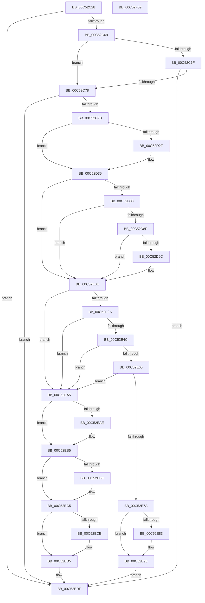

# HeadlessInit

- RVA: `0x00C52C28`–`0x00C52F0A` (길이 `738` bytes)
- VA: `0x0000000140C52C28`
- 실행 섹션: `INIT`
- PDB 이름 있음: `예`; PDB Function 태그: `아니요`
- unwind 정보 RVA: `0x000D4C70`
- 디코드: `196`개 명령, `738/738` bytes 표시
- 미해석 바이트: `0` (있으면 어셈블리에 `.byte`로 보존)

> 이 문서는 커널 이미지의 기계어와 PDB 기호를 분석해 생성했습니다. 4번과 5번은 함수 원형과 자료형을 바이너리 사용 방식에서 추정한 C 해석이며 원본 소스 복구 결과는 아닙니다.

## 1. Dependencies

- 직접 호출 지점: **13**; 고유 호출 대상: **7**
- 직접 호출자로 확인된 함수: **1**
- RIP 상대 이미지 참조: **4**

### Outgoing calls
- `0x00C52C8A` → [ExAllocatePool2](../../poolcode/B8/ExAllocatePool2_function_00B820F0.md) (function, `0x00B820F0`)
- `0x00C52DA9` → [memset](../../text/6C/memset_function_006C6C40.md) (function, `0x006C6C40`)
- `0x00C52E09` → [guard_dispatch_icall](../../text/6B/guard_dispatch_icall_function_006BAAD0.md) (function, `0x006BAAD0`)
- `0x00C52E1C` → [ExAllocatePool2](../../poolcode/B8/ExAllocatePool2_function_00B820F0.md) (function, `0x00B820F0`)
- `0x00C52E3E` → [ExAllocatePool2](../../poolcode/B8/ExAllocatePool2_function_00B820F0.md) (function, `0x00B820F0`)
- `0x00C52E57` → [ExAllocatePool2](../../poolcode/B8/ExAllocatePool2_function_00B820F0.md) (function, `0x00B820F0`)
- `0x00C52E6C` → [MmLockPagableDataSection](../../page/A7/MmLockPagableDataSection_function_00A73E80.md) (function, `0x00A73E80`)
- `0x00C52E9E` → [HdlspEnableTerminal](../../pagehdls/BB/HdlspEnableTerminal_function_00BBD9D4.md) (function, `0x00BBD9D4`)
- `0x00C52EB0` → [ExFreePoolWithTag](../../poolcode/B8/ExFreePoolWithTag_function_00B82870.md) (function, `0x00B82870`)
- `0x00C52EC0` → [ExFreePoolWithTag](../../poolcode/B8/ExFreePoolWithTag_function_00B82870.md) (function, `0x00B82870`)
- `0x00C52ED0` → [ExFreePoolWithTag](../../poolcode/B8/ExFreePoolWithTag_function_00B82870.md) (function, `0x00B82870`)
- `0x00C52EDA` → [ExFreePoolWithTag](../../poolcode/B8/ExFreePoolWithTag_function_00B82870.md) (function, `0x00B82870`)
- `0x00C52EEA` → [_security_check_cookie](../../text/6A/_security_check_cookie_function_006AC640.md) (function, `0x006AC640`)

### Direct callers
- [InitBootProcessor](../C1/InitBootProcessor_function_00C1B1C8.md) at `0x00C1B9E4`

### Static image references
- `0x00C52C40` → RVA `0x00E0A740` (`.data`; read)
- `0x00C52DF9` → RVA `0x00E00858` (`.data`; read)
- `0x00C52E65` → RVA `0x00BBD320` (`HdlspDispatch`; read)
- `0x00C52E97` → RVA `0x00E68578` (`.data`; write)

## 2. Other-region calls and transfers

- 다른 실행 섹션으로 향하는 call: **13**
  - `0x00C52C8A` → [ExAllocatePool2](../../poolcode/B8/ExAllocatePool2_function_00B820F0.md) (`INIT` → `POOLCODE`)
  - `0x00C52DA9` → [memset](../../text/6C/memset_function_006C6C40.md) (`INIT` → `.text`)
  - `0x00C52E09` → [guard_dispatch_icall](../../text/6B/guard_dispatch_icall_function_006BAAD0.md) (`INIT` → `.text`)
  - `0x00C52E1C` → [ExAllocatePool2](../../poolcode/B8/ExAllocatePool2_function_00B820F0.md) (`INIT` → `POOLCODE`)
  - `0x00C52E3E` → [ExAllocatePool2](../../poolcode/B8/ExAllocatePool2_function_00B820F0.md) (`INIT` → `POOLCODE`)
  - `0x00C52E57` → [ExAllocatePool2](../../poolcode/B8/ExAllocatePool2_function_00B820F0.md) (`INIT` → `POOLCODE`)
  - `0x00C52E6C` → [MmLockPagableDataSection](../../page/A7/MmLockPagableDataSection_function_00A73E80.md) (`INIT` → `PAGE`)
  - `0x00C52E9E` → [HdlspEnableTerminal](../../pagehdls/BB/HdlspEnableTerminal_function_00BBD9D4.md) (`INIT` → `PAGEHDLS`)
  - `0x00C52EB0` → [ExFreePoolWithTag](../../poolcode/B8/ExFreePoolWithTag_function_00B82870.md) (`INIT` → `POOLCODE`)
  - `0x00C52EC0` → [ExFreePoolWithTag](../../poolcode/B8/ExFreePoolWithTag_function_00B82870.md) (`INIT` → `POOLCODE`)
  - `0x00C52ED0` → [ExFreePoolWithTag](../../poolcode/B8/ExFreePoolWithTag_function_00B82870.md) (`INIT` → `POOLCODE`)
  - `0x00C52EDA` → [ExFreePoolWithTag](../../poolcode/B8/ExFreePoolWithTag_function_00B82870.md) (`INIT` → `POOLCODE`)
  - `0x00C52EEA` → [_security_check_cookie](../../text/6A/_security_check_cookie_function_006AC640.md) (`INIT` → `.text`)
- 별도 외부 분기/꼬리 이동을 확인하지 못했습니다.

## 3. Assembly (complete function range)

```asm
00C52C28  48 89 5C 24 10                  mov qword ptr [rsp + 0x10], rbx
00C52C2D  48 89 74 24 18                  mov qword ptr [rsp + 0x18], rsi
00C52C32  48 89 7C 24 20                  mov qword ptr [rsp + 0x20], rdi
00C52C37  41 57                           push r15
00C52C39  48 81 EC 40 01 00 00            sub rsp, 0x140
00C52C40  48 8B 05 F9 7A 1B 00            mov rax, qword ptr [rip + 0x1b7af9]
00C52C47  48 33 C4                        xor rax, rsp
00C52C4A  48 89 84 24 30 01 00 00         mov qword ptr [rsp + 0x130], rax
00C52C52  48 8B 81 F0 00 00 00            mov rax, qword ptr [rcx + 0xf0]
00C52C59  48 8B F1                        mov rsi, rcx
00C52C5C  48 8B 78 30                     mov rdi, qword ptr [rax + 0x30]
00C52C60  48 85 FF                        test rdi, rdi
00C52C63  0F 84 76 02 00 00               je 0x140c52edf
00C52C69  83 7F 08 04                     cmp dword ptr [rdi + 8], 4
00C52C6D  76 09                           jbe 0x140c52c78
00C52C6F  80 3F 00                        cmp byte ptr [rdi], 0
00C52C72  0F 84 67 02 00 00               je 0x140c52edf
00C52C78  BA 88 00 00 00                  mov edx, 0x88
00C52C7D  41 B8 48 64 6C 73               mov r8d, 0x736c6448
00C52C83  44 8D 7A B8                     lea r15d, [rdx - 0x48]
00C52C87  41 8B CF                        mov ecx, r15d
00C52C8A  E8 61 F4 F2 FF                  call 0x140b820f0
00C52C8F  48 8B D8                        mov rbx, rax
00C52C92  48 85 C0                        test rax, rax
00C52C95  0F 84 44 02 00 00               je 0x140c52edf
00C52C9B  8B 48 30                        mov ecx, dword ptr [rax + 0x30]
00C52C9E  41 B8 00 10 00 00               mov r8d, 0x1000
00C52CA4  48 83 20 00                     and qword ptr [rax], 0
00C52CA8  8B 57 08                        mov edx, dword ptr [rdi + 8]
00C52CAB  C1 E2 09                        shl edx, 9
00C52CAE  33 D1                           xor edx, ecx
00C52CB0  81 E2 00 0E 00 00               and edx, 0xe00
00C52CB6  33 D1                           xor edx, ecx
00C52CB8  89 50 30                        mov dword ptr [rax + 0x30], edx
00C52CBB  48 8B 47 10                     mov rax, qword ptr [rdi + 0x10]
00C52CBF  48 89 43 40                     mov qword ptr [rbx + 0x40], rax
00C52CC3  8B 47 04                        mov eax, dword ptr [rdi + 4]
00C52CC6  89 43 34                        mov dword ptr [rbx + 0x34], eax
00C52CC9  0F B6 47 03                     movzx eax, byte ptr [rdi + 3]
00C52CCD  C1 E0 07                        shl eax, 7
00C52CD0  33 C2                           xor eax, edx
00C52CD2  25 80 00 00 00                  and eax, 0x80
00C52CD7  33 C2                           xor eax, edx
00C52CD9  89 43 30                        mov dword ptr [rbx + 0x30], eax
00C52CDC  0F B6 4F 02                     movzx ecx, byte ptr [rdi + 2]
00C52CE0  C1 E1 08                        shl ecx, 8
00C52CE3  33 C8                           xor ecx, eax
00C52CE5  81 E1 00 01 00 00               and ecx, 0x100
00C52CEB  33 C8                           xor ecx, eax
00C52CED  89 4B 30                        mov dword ptr [rbx + 0x30], ecx
00C52CF0  0F B6 17                        movzx edx, byte ptr [rdi]
00C52CF3  C1 E2 03                        shl edx, 3
00C52CF6  33 D1                           xor edx, ecx
00C52CF8  83 E2 08                        and edx, 8
00C52CFB  33 D1                           xor edx, ecx
00C52CFD  89 53 30                        mov dword ptr [rbx + 0x30], edx
00C52D00  8A 4F 38                        mov cl, byte ptr [rdi + 0x38]
00C52D03  88 4B 74                        mov byte ptr [rbx + 0x74], cl
00C52D06  C6 43 75 00                     mov byte ptr [rbx + 0x75], 0
00C52D0A  8A 47 39                        mov al, byte ptr [rdi + 0x39]
00C52D0D  88 43 54                        mov byte ptr [rbx + 0x54], al
00C52D10  8A 47 3A                        mov al, byte ptr [rdi + 0x3a]
00C52D13  88 43 55                        mov byte ptr [rbx + 0x55], al
00C52D16  8A 47 3B                        mov al, byte ptr [rdi + 0x3b]
00C52D19  88 43 56                        mov byte ptr [rbx + 0x56], al
00C52D1C  8A 47 3C                        mov al, byte ptr [rdi + 0x3c]
00C52D1F  88 43 57                        mov byte ptr [rbx + 0x57], al
00C52D22  0F 10 47 28                     movups xmm0, xmmword ptr [rdi + 0x28]
00C52D26  F3 0F 7F 43 64                  movdqu xmmword ptr [rbx + 0x64], xmm0
00C52D2B  84 C9                           test cl, cl
00C52D2D  74 06                           je 0x140c52d35
00C52D2F  41 0B D0                        or edx, r8d
00C52D32  89 53 30                        mov dword ptr [rbx + 0x30], edx
00C52D35  C6 43 76 01                     mov byte ptr [rbx + 0x76], 1
00C52D39  B9 FD FF 00 00                  mov ecx, 0xfffd
00C52D3E  8A 47 24                        mov al, byte ptr [rdi + 0x24]
00C52D41  24 01                           and al, 1
00C52D43  88 43 77                        mov byte ptr [rbx + 0x77], al
00C52D46  0F B7 47 1A                     movzx eax, word ptr [rdi + 0x1a]
00C52D4A  66 89 43 78                     mov word ptr [rbx + 0x78], ax
00C52D4E  0F B7 47 18                     movzx eax, word ptr [rdi + 0x18]
00C52D52  66 89 43 7A                     mov word ptr [rbx + 0x7a], ax
00C52D56  0F B7 47 1E                     movzx eax, word ptr [rdi + 0x1e]
00C52D5A  66 89 43 7C                     mov word ptr [rbx + 0x7c], ax
00C52D5E  8A 47 1C                        mov al, byte ptr [rdi + 0x1c]
00C52D61  88 43 7E                        mov byte ptr [rbx + 0x7e], al
00C52D64  8A 47 20                        mov al, byte ptr [rdi + 0x20]
00C52D67  88 43 7F                        mov byte ptr [rbx + 0x7f], al
00C52D6A  8A 47 21                        mov al, byte ptr [rdi + 0x21]
00C52D6D  88 83 80 00 00 00               mov byte ptr [rbx + 0x80], al
00C52D73  0F B7 47 18                     movzx eax, word ptr [rdi + 0x18]
00C52D77  66 FF C8                        dec ax
00C52D7A  66 3B C1                        cmp ax, cx
00C52D7D  0F 87 8B 00 00 00               ja 0x140c52e0e
00C52D83  0F B7 47 1A                     movzx eax, word ptr [rdi + 0x1a]
00C52D87  66 FF C8                        dec ax
00C52D8A  66 3B C1                        cmp ax, cx
00C52D8D  77 7F                           ja 0x140c52e0e
00C52D8F  41 0B D0                        or edx, r8d
00C52D92  89 53 30                        mov dword ptr [rbx + 0x30], edx
00C52D95  8B 47 24                        mov eax, dword ptr [rdi + 0x24]
00C52D98  A8 01                           test al, 1
00C52D9A  75 72                           jne 0x140c52e0e
00C52D9C  33 D2                           xor edx, edx
00C52D9E  48 8D 4C 24 20                  lea rcx, [rsp + 0x20]
00C52DA3  41 B8 10 01 00 00               mov r8d, 0x110
00C52DA9  E8 92 3E A7 FF                  call 0x1406c6c40
00C52DAE  8A 07                           mov al, byte ptr [rdi]
00C52DB0  48 8B CE                        mov rcx, rsi
00C52DB3  0F B6 57 21                     movzx edx, byte ptr [rdi + 0x21]
00C52DB7  66 81 4C 24 2E FF FF            or word ptr [rsp + 0x2e], 0xffff
00C52DBE  83 E2 07                        and edx, 7
00C52DC1  88 44 24 33                     mov byte ptr [rsp + 0x33], al
00C52DC5  0F B7 47 18                     movzx eax, word ptr [rdi + 0x18]
00C52DC9  66 89 44 24 2C                  mov word ptr [rsp + 0x2c], ax
00C52DCE  0F B7 47 1A                     movzx eax, word ptr [rdi + 0x1a]
00C52DD2  66 89 44 24 2A                  mov word ptr [rsp + 0x2a], ax
00C52DD7  0F B6 47 1C                     movzx eax, byte ptr [rdi + 0x1c]
00C52DDB  89 44 24 20                     mov dword ptr [rsp + 0x20], eax
00C52DDF  0F B7 47 1E                     movzx eax, word ptr [rdi + 0x1e]
00C52DE3  66 89 44 24 28                  mov word ptr [rsp + 0x28], ax
00C52DE8  0F B6 47 20                     movzx eax, byte ptr [rdi + 0x20]
00C52DEC  83 E0 1F                        and eax, 0x1f
00C52DEF  C1 E2 05                        shl edx, 5
00C52DF2  0B D0                           or edx, eax
00C52DF4  C6 44 24 30 FF                  mov byte ptr [rsp + 0x30], 0xff
00C52DF9  48 8B 05 58 DA 1A 00            mov rax, qword ptr [rip + 0x1ada58]
00C52E00  89 54 24 24                     mov dword ptr [rsp + 0x24], edx
00C52E04  48 8D 54 24 20                  lea rdx, [rsp + 0x20]
00C52E09  E8 C2 7C A6 FF                  call 0x1406baad0
00C52E0E  BA 00 38 00 00                  mov edx, 0x3800
00C52E13  41 B8 48 64 6C 73               mov r8d, 0x736c6448
00C52E19  49 8B CF                        mov rcx, r15
00C52E1C  E8 CF F2 F2 FF                  call 0x140b820f0
00C52E21  48 89 43 10                     mov qword ptr [rbx + 0x10], rax
00C52E25  48 85 C0                        test rax, rax
00C52E28  74 7B                           je 0x140c52ea5
00C52E2A  83 4B 60 FF                     or dword ptr [rbx + 0x60], 0xffffffff
00C52E2E  BF 50 00 00 00                  mov edi, 0x50
00C52E33  8B D7                           mov edx, edi
00C52E35  41 B8 48 64 6C 73               mov r8d, 0x736c6448
00C52E3B  49 8B CF                        mov rcx, r15
00C52E3E  E8 AD F2 F2 FF                  call 0x140b820f0
00C52E43  48 89 43 18                     mov qword ptr [rbx + 0x18], rax
00C52E47  48 85 C0                        test rax, rax
00C52E4A  74 59                           je 0x140c52ea5
00C52E4C  41 B8 48 64 6C 73               mov r8d, 0x736c6448
00C52E52  8B D7                           mov edx, edi
00C52E54  49 8B CF                        mov rcx, r15
00C52E57  E8 94 F2 F2 FF                  call 0x140b820f0
00C52E5C  48 89 43 20                     mov qword ptr [rbx + 0x20], rax
00C52E60  48 85 C0                        test rax, rax
00C52E63  74 40                           je 0x140c52ea5
00C52E65  48 8D 0D B4 A4 F6 FF            lea rcx, [rip - 0x95b4c]
00C52E6C  E8 0F 10 E2 FF                  call 0x140a73e80
00C52E71  48 89 43 08                     mov qword ptr [rbx + 8], rax
00C52E75  48 85 C0                        test rax, rax
00C52E78  74 2B                           je 0x140c52ea5
00C52E7A  81 7B 34 80 25 00 00            cmp dword ptr [rbx + 0x34], 0x2580
00C52E81  75 12                           jne 0x140c52e95
00C52E83  83 4B 4C FF                     or dword ptr [rbx + 0x4c], 0xffffffff
00C52E87  C7 43 50 15 05 00 00            mov dword ptr [rbx + 0x50], 0x515
00C52E8E  C7 43 48 2E CD FF FF            mov dword ptr [rbx + 0x48], 0xffffcd2e
00C52E95  B1 01                           mov cl, 1
00C52E97  48 89 1D DA 56 21 00            mov qword ptr [rip + 0x2156da], rbx
00C52E9E  E8 31 AB F6 FF                  call 0x140bbd9d4
00C52EA3  EB 3A                           jmp 0x140c52edf
00C52EA5  48 8B 4B 10                     mov rcx, qword ptr [rbx + 0x10]
00C52EA9  48 85 C9                        test rcx, rcx
00C52EAC  74 07                           je 0x140c52eb5
00C52EAE  33 D2                           xor edx, edx
00C52EB0  E8 BB F9 F2 FF                  call 0x140b82870
00C52EB5  48 8B 4B 18                     mov rcx, qword ptr [rbx + 0x18]
00C52EB9  48 85 C9                        test rcx, rcx
00C52EBC  74 07                           je 0x140c52ec5
00C52EBE  33 D2                           xor edx, edx
00C52EC0  E8 AB F9 F2 FF                  call 0x140b82870
00C52EC5  48 8B 4B 20                     mov rcx, qword ptr [rbx + 0x20]
00C52EC9  48 85 C9                        test rcx, rcx
00C52ECC  74 07                           je 0x140c52ed5
00C52ECE  33 D2                           xor edx, edx
00C52ED0  E8 9B F9 F2 FF                  call 0x140b82870
00C52ED5  33 D2                           xor edx, edx
00C52ED7  48 8B CB                        mov rcx, rbx
00C52EDA  E8 91 F9 F2 FF                  call 0x140b82870
00C52EDF  48 8B 8C 24 30 01 00 00         mov rcx, qword ptr [rsp + 0x130]
00C52EE7  48 33 CC                        xor rcx, rsp
00C52EEA  E8 51 97 A5 FF                  call 0x1406ac640
00C52EEF  4C 8D 9C 24 40 01 00 00         lea r11, [rsp + 0x140]
00C52EF7  49 8B 5B 18                     mov rbx, qword ptr [r11 + 0x18]
00C52EFB  49 8B 73 20                     mov rsi, qword ptr [r11 + 0x20]
00C52EFF  49 8B 7B 28                     mov rdi, qword ptr [r11 + 0x28]
00C52F03  49 8B E3                        mov rsp, r11
00C52F06  41 5F                           pop r15
00C52F08  C3                              ret
00C52F09  CC                              int3
```

## 4. C-style interpretation (structured pseudocode)

```c
__int64 __fastcall HeadlessInit(__int64 a1)
{
    __int64 result;
    __int64 v_rsp;
    unsigned __int8 v_stack_m115;
    unsigned __int8 v_stack_m118;
    unsigned __int16 v_stack_m11A;
    unsigned __int16 v_stack_m11C;
    unsigned __int16 v_stack_m11E;
    unsigned __int16 v_stack_m120;
    unsigned int v_stack_m124;
    unsigned __int64 v_stack_m128;
    unsigned __int64 v_stack_m18;
    unsigned __int64 v_stack_m8;
    unsigned __int64 v_stack_p10;
    unsigned __int64 v_stack_p18;
    unsigned __int64 v_stack_p20;

    v_stack_p10 = v_rbx;
    v_stack_p18 = v_rsi;
    v_stack_p20 = v_rdi;
    v_rsp = (v_rsp) - (320);
    result = (*(unsigned __int64 *)(v_rip + 1800953)) ^ (v_rsp);
    v_stack_m18 = result;
    if (*(unsigned __int64 *)(*(unsigned __int64 *)(a1 + 240) + 48) == 0) goto loc_00C52EDF;
    if ((*(unsigned int *)(*(unsigned __int64 *)(*(unsigned __int64 *)(a1 + 240) + 48) + 8)) <= 4) goto loc_00C52C78;
    if ((*(unsigned __int8 *)(*(unsigned __int64 *)(*(unsigned __int64 *)(a1 + 240) + 48))) == 0) goto loc_00C52EDF;
loc_00C52C78:
    result = ExAllocatePool2((unsigned int)((unsigned int)(136 - 72)), 136, (unsigned int)(0x736C6448ULL), a4);
    if (result == 0) goto loc_00C52EDF;
    a2 = (unsigned int)(((unsigned int)(*(unsigned int *)(*(unsigned __int64 *)(*(unsigned __int64 *)(a1 + 240) + 48) + 8))) << (9));
    a2 = (unsigned int)((a2) ^ ((unsigned int)((unsigned int)(*(unsigned int *)(result + 48)))));
    a2 = (unsigned int)((a2) & (0xE00ULL));
    a2 = (unsigned int)((a2) ^ ((unsigned int)((unsigned int)(*(unsigned int *)(result + 48)))));
    *(unsigned int *)(result + 48) = (unsigned int)(a2);
    *(unsigned __int64 *)(result + 64) = *(unsigned __int64 *)(*(unsigned __int64 *)(*(unsigned __int64 *)(a1 + 240) + 48) + 16);
    *(unsigned int *)(result + 52) = (unsigned int)((unsigned int)(*(unsigned int *)(*(unsigned __int64 *)(*(unsigned __int64 *)(a1 + 240) + 48) + 4)));
    result = (unsigned int)((*(unsigned __int8 *)(*(unsigned __int64 *)(*(unsigned __int64 *)(a1 + 240) + 48) + 3)) << (7));
    result = (unsigned int)((result) ^ ((unsigned int)(a2)));
    result = (unsigned int)((result) & (128));
    result = (unsigned int)((result) ^ ((unsigned int)(a2)));
    *(unsigned int *)(result + 48) = (unsigned int)(result);
    a1 = (unsigned int)((*(unsigned __int8 *)(*(unsigned __int64 *)(*(unsigned __int64 *)(a1 + 240) + 48) + 2)) << (8));
    a1 = (unsigned int)((a1) ^ ((unsigned int)(result)));
    a1 = (unsigned int)((a1) & (256));
    a1 = (unsigned int)((a1) ^ ((unsigned int)(result)));
    *(unsigned int *)(result + 48) = (unsigned int)(a1);
    a2 = (unsigned int)((*(unsigned __int8 *)(*(unsigned __int64 *)(*(unsigned __int64 *)(a1 + 240) + 48))) << (3));
    a2 = (unsigned int)((a2) ^ ((unsigned int)(a1)));
    a2 = (unsigned int)((a2) & (8));
    a2 = (unsigned int)((a2) ^ ((unsigned int)(a1)));
    *(unsigned int *)(result + 48) = (unsigned int)(a2);
    *(unsigned __int8 *)(result + 116) = (unsigned __int8)(*(unsigned __int8 *)(*(unsigned __int64 *)(*(unsigned __int64 *)(a1 + 240) + 48) + 56));
    *(unsigned __int8 *)(result + 117) = 0;
    *(unsigned __int8 *)(result + 84) = (unsigned __int8)(*(unsigned __int8 *)(*(unsigned __int64 *)(*(unsigned __int64 *)(a1 + 240) + 48) + 57));
    *(unsigned __int8 *)(result + 85) = (unsigned __int8)(*(unsigned __int8 *)(*(unsigned __int64 *)(*(unsigned __int64 *)(a1 + 240) + 48) + 58));
    *(unsigned __int8 *)(result + 86) = (unsigned __int8)(*(unsigned __int8 *)(*(unsigned __int64 *)(*(unsigned __int64 *)(a1 + 240) + 48) + 59));
    *(unsigned __int8 *)(result + 87) = (unsigned __int8)(*(unsigned __int8 *)(*(unsigned __int64 *)(*(unsigned __int64 *)(a1 + 240) + 48) + 60));
    *(unsigned __int64 *)(result + 100) = v_xmm0;
    if ((unsigned __int8)(*(unsigned __int8 *)(*(unsigned __int64 *)(*(unsigned __int64 *)(a1 + 240) + 48) + 56)) != 0) {
        a2 = (unsigned int)((a2) | ((unsigned int)((unsigned int)(0x1000ULL))));
        *(unsigned int *)(result + 48) = (unsigned int)(a2);
    }
    *(unsigned __int8 *)(result + 118) = 1;
    result = (unsigned __int8)((*(unsigned __int8 *)(*(unsigned __int64 *)(*(unsigned __int64 *)(a1 + 240) + 48) + 36)) & (1));
    *(unsigned __int8 *)(result + 119) = (unsigned __int8)(result);
    *(unsigned __int16 *)(result + 120) = (unsigned __int16)(*(unsigned __int16 *)(*(unsigned __int64 *)(*(unsigned __int64 *)(a1 + 240) + 48) + 26));
    *(unsigned __int16 *)(result + 122) = (unsigned __int16)(*(unsigned __int16 *)(*(unsigned __int64 *)(*(unsigned __int64 *)(a1 + 240) + 48) + 24));
    *(unsigned __int16 *)(result + 124) = (unsigned __int16)(*(unsigned __int16 *)(*(unsigned __int64 *)(*(unsigned __int64 *)(a1 + 240) + 48) + 30));
    *(unsigned __int8 *)(result + 126) = (unsigned __int8)(*(unsigned __int8 *)(*(unsigned __int64 *)(*(unsigned __int64 *)(a1 + 240) + 48) + 28));
    *(unsigned __int8 *)(result + 127) = (unsigned __int8)(*(unsigned __int8 *)(*(unsigned __int64 *)(*(unsigned __int64 *)(a1 + 240) + 48) + 32));
    *(unsigned __int8 *)(result + 128) = (unsigned __int8)(*(unsigned __int8 *)(*(unsigned __int64 *)(*(unsigned __int64 *)(a1 + 240) + 48) + 33));
    result = (unsigned __int16)((*(unsigned __int16 *)(*(unsigned __int64 *)(*(unsigned __int64 *)(a1 + 240) + 48) + 24)) - 1);
    if (((unsigned __int16)(result)) > ((unsigned __int16)((unsigned int)(0xFFFDULL)))) goto loc_00C52E0E;
    result = (unsigned __int16)((*(unsigned __int16 *)(*(unsigned __int64 *)(*(unsigned __int64 *)(a1 + 240) + 48) + 26)) - 1);
    if (((unsigned __int16)(result)) > ((unsigned __int16)((unsigned int)(0xFFFDULL)))) goto loc_00C52E0E;
    a2 = (unsigned int)((a2) | ((unsigned int)((unsigned int)(0x1000ULL))));
    *(unsigned int *)(result + 48) = (unsigned int)(a2);
    result = (unsigned int)(*(unsigned int *)(*(unsigned __int64 *)(*(unsigned __int64 *)(a1 + 240) + 48) + 36));
    if ((((unsigned __int8)((unsigned int)(*(unsigned int *)(*(unsigned __int64 *)(*(unsigned __int64 *)(a1 + 240) + 48) + 36)))) & (1)) == 0) {
        a2 = 0;
        a1 = v_stack_m128;
        a3 = 272;
        result = memset(a1, a2, a3, a4);
        result = *(unsigned __int8 *)(*(unsigned __int64 *)(*(unsigned __int64 *)(a1 + 240) + 48));
        a1 = a1;
        a2 = *(unsigned __int8 *)(*(unsigned __int64 *)(*(unsigned __int64 *)(a1 + 240) + 48) + 33);
        a2 = (unsigned int)((a2) & (7));
        v_stack_m115 = (unsigned __int8)(result);
        result = *(unsigned __int16 *)(*(unsigned __int64 *)(*(unsigned __int64 *)(a1 + 240) + 48) + 24);
        v_stack_m11C = (unsigned __int16)(result);
        result = *(unsigned __int16 *)(*(unsigned __int64 *)(*(unsigned __int64 *)(a1 + 240) + 48) + 26);
        v_stack_m11E = (unsigned __int16)(result);
        result = *(unsigned __int8 *)(*(unsigned __int64 *)(*(unsigned __int64 *)(a1 + 240) + 48) + 28);
        v_stack_m128 = (unsigned int)(result);
        result = *(unsigned __int16 *)(*(unsigned __int64 *)(*(unsigned __int64 *)(a1 + 240) + 48) + 30);
        v_stack_m120 = (unsigned __int16)(result);
        result = *(unsigned __int8 *)(*(unsigned __int64 *)(*(unsigned __int64 *)(a1 + 240) + 48) + 32);
        result = (unsigned int)((result) & (31));
        a2 = (unsigned int)((a2) << (5));
        a2 = (unsigned int)((a2) | ((unsigned int)(result)));
        v_stack_m118 = 255;
        result = *(unsigned __int64 *)(v_rip + 1759832);
        v_stack_m124 = (unsigned int)(a2);
        a2 = v_stack_m128;
        result = guard_dispatch_icall(a1, a2, a3, a4);
    }
    result = ExAllocatePool2(136 - 72, (unsigned int)(0x3800ULL), (unsigned int)(0x736C6448ULL), a4);
    *(unsigned __int64 *)(result + 16) = result;
    if (result == 0) goto loc_00C52EA5;
    result = ExAllocatePool2(136 - 72, 80, (unsigned int)(0x736C6448ULL), a4);
    *(unsigned __int64 *)(result + 24) = result;
    if (result == 0) goto loc_00C52EA5;
    result = ExAllocatePool2(136 - 72, 80, (unsigned int)(0x736C6448ULL), a4);
    *(unsigned __int64 *)(result + 32) = result;
    if (result == 0) goto loc_00C52EA5;
    result = MmLockPagableDataSection(v_rip - 613196, 80, (unsigned int)(0x736C6448ULL), a4);
    *(unsigned __int64 *)(result + 8) = result;
    if (result == 0) goto loc_00C52EA5;
    if ((*(unsigned int *)(result + 52)) == 0x2580ULL) {
        *(unsigned int *)(result + 80) = 0x515ULL;
        *(unsigned int *)(result + 72) = 0xFFFFCD2EULL;
    }
    *(unsigned __int64 *)(v_rip + 2184922) = result;
    result = HdlspEnableTerminal(1, 80, (unsigned int)(0x736C6448ULL), a4);
    goto loc_00C52EDF;
loc_00C52EA5:
    if (*(unsigned __int64 *)(result + 16) != 0) {
        a2 = 0;
        result = ExFreePoolWithTag(*(unsigned __int64 *)(result + 16), a2, (unsigned int)(0x736C6448ULL), a4);
    }
    if (*(unsigned __int64 *)(result + 24) != 0) {
        a2 = 0;
        result = ExFreePoolWithTag(*(unsigned __int64 *)(result + 24), a2, (unsigned int)(0x736C6448ULL), a4);
    }
    if (*(unsigned __int64 *)(result + 32) != 0) {
        a2 = 0;
        result = ExFreePoolWithTag(*(unsigned __int64 *)(result + 32), a2, (unsigned int)(0x736C6448ULL), a4);
    }
    a2 = 0;
    result = ExFreePoolWithTag(result, a2, (unsigned int)(0x736C6448ULL), a4);
loc_00C52EDF:
    a1 = (v_stack_m18) ^ (v_rsp);
    result = _security_check_cookie(a1, a2, (unsigned int)(0x736C6448ULL), a4);
    return result;
}
```

## 5. (Beta) C Style

```c
int64_t HeadlessInit(void *Arg1)
{
    uint8_t *arg1 = (uint8_t *)Arg1;

    int64_t result;
    int64_t local_rsp;
    uint8_t v_stack_m115;
    uint8_t v_stack_m118;
    uint16_t v_stack_m11A;
    uint16_t v_stack_m11C;
    uint16_t v_stack_m11E;
    uint16_t v_stack_m120;
    uint32_t v_stack_m124;
    uint64_t v_stack_m128;
    uint64_t v_stack_m18;
    uint64_t v_stack_m8;
    uint64_t v_stack_p10;
    uint64_t v_stack_p18;
    uint64_t v_stack_p20;

    v_stack_p10 = local_rbx;
    v_stack_p18 = local_rsi;
    v_stack_p20 = local_rdi;
    local_rsp = (local_rsp) - (320);
    result = (*(uint64_t *)(v_rip + 0x1B7AF9)) ^ (local_rsp);
    v_stack_m18 = result;
    if (*(uint64_t *)(*(uint64_t *)(arg1 + 0xF0) + 0x30) == 0) goto loc_00C52EDF;
    if ((*(uint32_t *)(*(uint64_t *)(*(uint64_t *)(arg1 + 0xF0) + 0x30) + 0x8)) <= 4) goto loc_00C52C78;
    if ((*(uint8_t *)(*(uint64_t *)(*(uint64_t *)(arg1 + 0xF0) + 0x30))) == 0) goto loc_00C52EDF;
loc_00C52C78:
    result = ExAllocatePool2((uint32_t)((uint32_t)(136 - 72)), 136, (uint32_t)(0x736C6448ULL), a4);
    if (result == 0) goto loc_00C52EDF;
    a2 = (uint32_t)(((uint32_t)(*(uint32_t *)(*(uint64_t *)(*(uint64_t *)(arg1 + 0xF0) + 0x30) + 0x8))) << (9));
    a2 = (uint32_t)((a2) ^ ((uint32_t)((uint32_t)(*(uint32_t *)(result + 0x30)))));
    a2 = (uint32_t)((a2) & (0xE00ULL));
    a2 = (uint32_t)((a2) ^ ((uint32_t)((uint32_t)(*(uint32_t *)(result + 0x30)))));
    *(uint32_t *)(result + 0x30) = (uint32_t)(a2);
    *(uint64_t *)(result + 0x40) = *(uint64_t *)(*(uint64_t *)(*(uint64_t *)(arg1 + 0xF0) + 0x30) + 0x10);
    *(uint32_t *)(result + 0x34) = (uint32_t)((uint32_t)(*(uint32_t *)(*(uint64_t *)(*(uint64_t *)(arg1 + 0xF0) + 0x30) + 0x4)));
    result = (uint32_t)((*(uint8_t *)(*(uint64_t *)(*(uint64_t *)(arg1 + 0xF0) + 0x30) + 0x3)) << (7));
    result = (uint32_t)((result) ^ ((uint32_t)(a2)));
    result = (uint32_t)((result) & (128));
    result = (uint32_t)((result) ^ ((uint32_t)(a2)));
    *(uint32_t *)(result + 0x30) = (uint32_t)(result);
    Arg1 = (uint32_t)((*(uint8_t *)(*(uint64_t *)(*(uint64_t *)(arg1 + 0xF0) + 0x30) + 0x2)) << (8));
    Arg1 = (uint32_t)((Arg1) ^ ((uint32_t)(result)));
    Arg1 = (uint32_t)((Arg1) & (256));
    Arg1 = (uint32_t)((Arg1) ^ ((uint32_t)(result)));
    *(uint32_t *)(result + 0x30) = (uint32_t)(Arg1);
    a2 = (uint32_t)((*(uint8_t *)(*(uint64_t *)(*(uint64_t *)(arg1 + 0xF0) + 0x30))) << (3));
    a2 = (uint32_t)((a2) ^ ((uint32_t)(Arg1)));
    a2 = (uint32_t)((a2) & (8));
    a2 = (uint32_t)((a2) ^ ((uint32_t)(Arg1)));
    *(uint32_t *)(result + 0x30) = (uint32_t)(a2);
    *(uint8_t *)(result + 0x74) = (uint8_t)(*(uint8_t *)(*(uint64_t *)(*(uint64_t *)(arg1 + 0xF0) + 0x30) + 0x38));
    *(uint8_t *)(result + 0x75) = 0;
    *(uint8_t *)(result + 0x54) = (uint8_t)(*(uint8_t *)(*(uint64_t *)(*(uint64_t *)(arg1 + 0xF0) + 0x30) + 0x39));
    *(uint8_t *)(result + 0x55) = (uint8_t)(*(uint8_t *)(*(uint64_t *)(*(uint64_t *)(arg1 + 0xF0) + 0x30) + 0x3A));
    *(uint8_t *)(result + 0x56) = (uint8_t)(*(uint8_t *)(*(uint64_t *)(*(uint64_t *)(arg1 + 0xF0) + 0x30) + 0x3B));
    *(uint8_t *)(result + 0x57) = (uint8_t)(*(uint8_t *)(*(uint64_t *)(*(uint64_t *)(arg1 + 0xF0) + 0x30) + 0x3C));
    *(uint64_t *)(result + 0x64) = v_xmm0;
    if ((uint8_t)(*(uint8_t *)(*(uint64_t *)(*(uint64_t *)(arg1 + 0xF0) + 0x30) + 0x38)) != 0) {
        a2 = (uint32_t)((a2) | ((uint32_t)((uint32_t)(0x1000ULL))));
        *(uint32_t *)(result + 0x30) = (uint32_t)(a2);
    }
    *(uint8_t *)(result + 0x76) = 1;
    result = (uint8_t)((*(uint8_t *)(*(uint64_t *)(*(uint64_t *)(arg1 + 0xF0) + 0x30) + 0x24)) & (1));
    *(uint8_t *)(result + 0x77) = (uint8_t)(result);
    *(uint16_t *)(result + 0x78) = (uint16_t)(*(uint16_t *)(*(uint64_t *)(*(uint64_t *)(arg1 + 0xF0) + 0x30) + 0x1A));
    *(uint16_t *)(result + 0x7A) = (uint16_t)(*(uint16_t *)(*(uint64_t *)(*(uint64_t *)(arg1 + 0xF0) + 0x30) + 0x18));
    *(uint16_t *)(result + 0x7C) = (uint16_t)(*(uint16_t *)(*(uint64_t *)(*(uint64_t *)(arg1 + 0xF0) + 0x30) + 0x1E));
    *(uint8_t *)(result + 0x7E) = (uint8_t)(*(uint8_t *)(*(uint64_t *)(*(uint64_t *)(arg1 + 0xF0) + 0x30) + 0x1C));
    *(uint8_t *)(result + 0x7F) = (uint8_t)(*(uint8_t *)(*(uint64_t *)(*(uint64_t *)(arg1 + 0xF0) + 0x30) + 0x20));
    *(uint8_t *)(result + 0x80) = (uint8_t)(*(uint8_t *)(*(uint64_t *)(*(uint64_t *)(arg1 + 0xF0) + 0x30) + 0x21));
    result = (uint16_t)((*(uint16_t *)(*(uint64_t *)(*(uint64_t *)(arg1 + 0xF0) + 0x30) + 0x18)) - 1);
    if (((uint16_t)(result)) > ((uint16_t)((uint32_t)(0xFFFDULL)))) goto loc_00C52E0E;
    result = (uint16_t)((*(uint16_t *)(*(uint64_t *)(*(uint64_t *)(arg1 + 0xF0) + 0x30) + 0x1A)) - 1);
    if (((uint16_t)(result)) > ((uint16_t)((uint32_t)(0xFFFDULL)))) goto loc_00C52E0E;
    a2 = (uint32_t)((a2) | ((uint32_t)((uint32_t)(0x1000ULL))));
    *(uint32_t *)(result + 0x30) = (uint32_t)(a2);
    result = (uint32_t)(*(uint32_t *)(*(uint64_t *)(*(uint64_t *)(arg1 + 0xF0) + 0x30) + 0x24));
    if ((((uint8_t)((uint32_t)(*(uint32_t *)(*(uint64_t *)(*(uint64_t *)(arg1 + 0xF0) + 0x30) + 0x24)))) & (1)) == 0) {
        a2 = 0;
        Arg1 = v_stack_m128;
        a3 = 272;
        result = memset(Arg1, a2, a3, a4);
        result = *(uint8_t *)(*(uint64_t *)(*(uint64_t *)(arg1 + 0xF0) + 0x30));
        Arg1 = Arg1;
        a2 = *(uint8_t *)(*(uint64_t *)(*(uint64_t *)(arg1 + 0xF0) + 0x30) + 0x21);
        a2 = (uint32_t)((a2) & (7));
        v_stack_m115 = (uint8_t)(result);
        result = *(uint16_t *)(*(uint64_t *)(*(uint64_t *)(arg1 + 0xF0) + 0x30) + 0x18);
        v_stack_m11C = (uint16_t)(result);
        result = *(uint16_t *)(*(uint64_t *)(*(uint64_t *)(arg1 + 0xF0) + 0x30) + 0x1A);
        v_stack_m11E = (uint16_t)(result);
        result = *(uint8_t *)(*(uint64_t *)(*(uint64_t *)(arg1 + 0xF0) + 0x30) + 0x1C);
        v_stack_m128 = (uint32_t)(result);
        result = *(uint16_t *)(*(uint64_t *)(*(uint64_t *)(arg1 + 0xF0) + 0x30) + 0x1E);
        v_stack_m120 = (uint16_t)(result);
        result = *(uint8_t *)(*(uint64_t *)(*(uint64_t *)(arg1 + 0xF0) + 0x30) + 0x20);
        result = (uint32_t)((result) & (31));
        a2 = (uint32_t)((a2) << (5));
        a2 = (uint32_t)((a2) | ((uint32_t)(result)));
        v_stack_m118 = 255;
        result = *(uint64_t *)(v_rip + 0x1ADA58);
        v_stack_m124 = (uint32_t)(a2);
        a2 = v_stack_m128;
        result = guard_dispatch_icall(Arg1, a2, a3, a4);
    }
    result = ExAllocatePool2(136 - 72, (uint32_t)(0x3800ULL), (uint32_t)(0x736C6448ULL), a4);
    *(uint64_t *)(result + 0x10) = result;
    if (result == 0) goto loc_00C52EA5;
    result = ExAllocatePool2(136 - 72, 80, (uint32_t)(0x736C6448ULL), a4);
    *(uint64_t *)(result + 0x18) = result;
    if (result == 0) goto loc_00C52EA5;
    result = ExAllocatePool2(136 - 72, 80, (uint32_t)(0x736C6448ULL), a4);
    *(uint64_t *)(result + 0x20) = result;
    if (result == 0) goto loc_00C52EA5;
    result = MmLockPagableDataSection(v_rip - 613196, 80, (uint32_t)(0x736C6448ULL), a4);
    *(uint64_t *)(result + 0x8) = result;
    if (result == 0) goto loc_00C52EA5;
    if ((*(uint32_t *)(result + 0x34)) == 0x2580ULL) {
        *(uint32_t *)(result + 0x50) = 0x515ULL;
        *(uint32_t *)(result + 0x48) = 0xFFFFCD2EULL;
    }
    *(uint64_t *)(v_rip + 0x2156DA) = result;
    result = HdlspEnableTerminal(1, 80, (uint32_t)(0x736C6448ULL), a4);
    goto loc_00C52EDF;
loc_00C52EA5:
    if (*(uint64_t *)(result + 0x10) != 0) {
        a2 = 0;
        result = ExFreePoolWithTag(*(uint64_t *)(result + 0x10), a2, (uint32_t)(0x736C6448ULL), a4);
    }
    if (*(uint64_t *)(result + 0x18) != 0) {
        a2 = 0;
        result = ExFreePoolWithTag(*(uint64_t *)(result + 0x18), a2, (uint32_t)(0x736C6448ULL), a4);
    }
    if (*(uint64_t *)(result + 0x20) != 0) {
        a2 = 0;
        result = ExFreePoolWithTag(*(uint64_t *)(result + 0x20), a2, (uint32_t)(0x736C6448ULL), a4);
    }
    a2 = 0;
    result = ExFreePoolWithTag(result, a2, (uint32_t)(0x736C6448ULL), a4);
loc_00C52EDF:
    Arg1 = (v_stack_m18) ^ (local_rsp);
    result = _security_check_cookie(Arg1, a2, (uint32_t)(0x736C6448ULL), a4);
    return result;
}
```

### 관측된 메모리 오프셋

구조체 형식이 확인되지 않은 접근은 인자 기준의 오프셋으로만 기록했습니다.

| 기준 인자 | 오프셋 표현 | 폭 (bit) | 접근 |
|---|---:|---:|---|
| `Arg1` | `+ 0xF0` | `64` | `R` |

## 6. Execution-region graph

[열기: 2D/3D 그래프와 함수 탐색 컨트롤 패널](../../../control-panel.html?section=init&rva=0x00C52C28&view=graph)

- 2D 그래프는 위에서 아래로 흐르고, 3D 그래프는 빈 공간을 드래그해 회전합니다. Shift+드래그는 이동, 휠은 확대·축소, 함수 노드 선택은 대상 보고서 이동입니다.

### Static fallback


